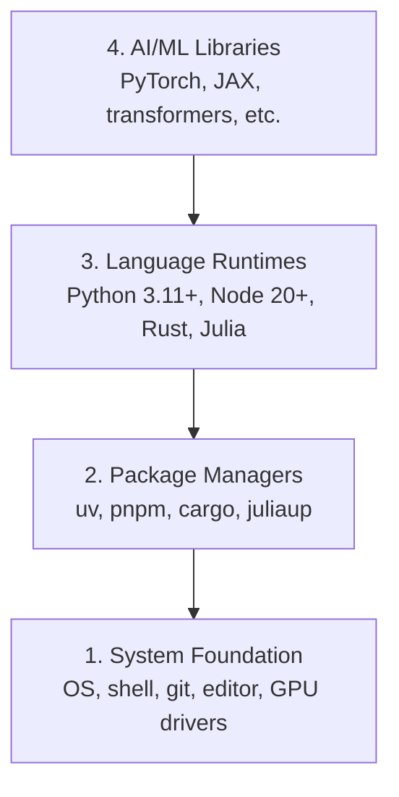

# 開發環境 (Dev Environment)

> 工具會影響你的思考方式。一次設定好，而且要設定正確。

**Type:** Build
**Languages:** Python, Node.js, Rust
**Prerequisites:** None
**Time:** ~45 分鐘

## 學習目標 (Learning Objectives)

- 從零開始設定 Python 3.11+、Node.js 20+ 與 Rust toolchain
- 設定 virtual environment 與 package manager，讓建置結果可重現
- 用 CUDA/MPS 驗證 GPU 是否可用，並執行一個測試用的 tensor 運算
- 理解四層架構：系統、套件、runtime、AI 函式庫

## 問題 (The Problem)

你即將用 Python、TypeScript、Rust 和 Julia，學完 500 多堂 AI 工程課程。如果環境壞了，每一堂課都會變成跟工具搏鬥，而不是在學東西。

大多數人會跳過環境設定，之後花好幾個小時排查 import 錯誤、版本衝突和缺少的 CUDA driver。我們這次只做一次，而且做對。

## 核心概念 (The Concept)

AI 工程環境有四層：



我們由下往上安裝，每一層都依賴它下面那一層。

```figure
s0-env-stack
```

## 動手做 (Build It)

### 步驟 1：系統基礎 (System Foundation)

檢查你的系統，並安裝基本工具。

```bash
# macOS
xcode-select --install
brew install git curl wget

# Ubuntu/Debian
sudo apt update && sudo apt install -y build-essential git curl wget unzip

# Windows (use WSL2)
wsl --install -d Ubuntu-24.04
```

### 步驟 2：用 uv 安裝 Python

我們使用 `uv`，它比 pip 快 10 到 100 倍，而且會自動處理 virtual environment。

```bash
curl -LsSf https://astral.sh/uv/install.sh | sh

uv python install 3.12

uv venv
source .venv/bin/activate  # or .venv\Scripts\activate on Windows

uv pip install numpy matplotlib jupyter
```

驗證：

```python
import sys
print(f"Python {sys.version}")

import numpy as np
print(f"NumPy {np.__version__}")
a = np.array([1, 2, 3])
print(f"Vector: {a}, dot product with itself: {np.dot(a, a)}")
```

### 步驟 3：用 pnpm 安裝 Node.js

供 TypeScript 課程使用（agent、MCP server、web app）。

```bash
curl -fsSL https://fnm.vercel.app/install | bash
fnm install 22
fnm use 22

npm install -g pnpm

node -e "console.log('Node', process.version)"
```

fnm 安裝程式會先檢查有沒有 `unzip`，缺少時會以 `Not installing fnm due to missing dependencies.` 結束：在 Linux 上它要解壓縮 zip 檔，在 macOS 上則透過 Homebrew 安裝。macOS 內建 `unzip`；Ubuntu、Debian 和 WSL2 會在步驟 1 的 apt 指令中安裝它（如果你跳過了那一步，請執行 `sudo apt install -y unzip`）。

**macOS / Apple Silicon (M1/M2/M3/M4)：** 如果安裝程式停在 `Error: Cannot install under Rosetta 2 in ARM default prefix (/opt/homebrew)`，代表你的 terminal 正在 Rosetta 2 下執行（`arch` 顯示 `i386`），但 Homebrew 是原生 arm64 版本。請強制用 arm64 安裝 fnm，把它接進你的 shell，再從 `fnm install 22` 開始重跑上面的指令：

```bash
arch -arm64 brew install fnm
echo 'eval "$(fnm env --use-on-cd)"' >> ~/.zshrc
source ~/.zshrc
```

### 步驟 4：Rust

供注重效能的課程使用（inference、系統）。

```bash
curl --proto '=https' --tlsv1.2 -sSf https://sh.rustup.rs | sh

rustc --version
cargo --version
```

### 步驟 5：Julia（選用）

供數學密集、適合 Julia 發揮的課程使用。

```bash
curl -fsSL https://install.julialang.org | sh

julia -e 'println("Julia ", VERSION)'
```

### 步驟 6：GPU 設定（有的話才需要）

**NVIDIA (Linux / Windows)：**

```bash
nvidia-smi

# Install PyTorch with CUDA
uv pip install torch torchvision torchaudio --index-url https://download.pytorch.org/whl/cu124
```

**macOS / Apple Silicon (M1/M2/M3/M4)：** Mac 上沒有 CUDA，這是正常的，不是失敗。**不要**加上 `--index-url .../cuXXX`（那些 wheel 只支援 Linux/Windows，安裝會失敗）。請安裝一般版本，它已包含 Apple 的 MPS (Metal) GPU backend：

```bash
uv pip install torch torchvision torchaudio
```

驗證（任何平台都適用）：

```python
import torch
print(f"CUDA available: {torch.cuda.is_available()}")           # False on macOS — expected
print(f"MPS available:  {torch.backends.mps.is_available()}")   # True on Apple Silicon
if torch.cuda.is_available():
    print(f"GPU: {torch.cuda.get_device_name(0)}")
```

沒有 GPU 也沒關係，大多數課程用 CPU 就能完成。需要大量訓練的課程，可以改用 Google Colab 或雲端 GPU。

### 步驟 7：驗證你要開始的學習路線

請在儲存庫根目錄執行本課所有指令，也就是包含 `README.md` 和 `phases/` 的那個目錄。Preflight 只檢查你開始所選路線需要的項目，預設會略過之後才會用到的工具，讓新手看到的是一個清楚的答案，而不是一大串警告。

開始完整的入門順序：

```bash
python3 phases/00-setup-and-tooling/01-dev-environment/code/verify.py --route beginner
```

或只檢查你想走的路線：

```bash
python3 phases/00-setup-and-tooling/01-dev-environment/code/verify.py --route ml-foundations
python3 phases/00-setup-and-tooling/01-dev-environment/code/verify.py --route llm-engineering
python3 phases/00-setup-and-tooling/01-dev-environment/code/verify.py --route agents
python3 phases/00-setup-and-tooling/01-dev-environment/code/verify.py --route mcp
python3 phases/00-setup-and-tooling/01-dev-environment/code/verify.py --route agent-skills
python3 phases/00-setup-and-tooling/01-dev-environment/code/verify.py --route certification
```

如果想讓同一個 preflight 一併檢查後續課程會用到的選用工具與相依套件，請加上 `--show-later`。缺少後續才需要的工具，絕不會擋住你所選的路線。

每個失敗的必要檢查，都會附上偵測到的路徑或 import 錯誤，以及一行確切的修正指令。Agent Skills 與 certification 路線還會顯示需要手動確認的 host 檢查項目，因為 Python 腳本無法證明 AI host 已經找到某個 skill，也無法證明你選的 skill 範圍可以寫入。

入門 preflight 通過後，它會印出第一個可以執行的課程：

```text
Ready to start Beginner course.
Next: python3 phases/01-math-foundations/01-linear-algebra-intuition/code/vectors.py
```

## 實際使用 (Use It)

你的環境已準備好，可以開始所選的路線。之後的課程要求時再安裝其他工具就好，不要讓第一堂課卡在整套工具都裝齊。以下是整個課程會用到的工具：

| 語言 | 使用於 | Package Manager |
|----------|---------|-----------------|
| Python | Phases 1-12 (ML, DL, NLP, Vision, Audio, LLMs) | uv |
| TypeScript | Phases 13-17 (Tools, Agents, Swarms, Infra) | pnpm |
| Rust | Phases 12, 15-17 (Performance-critical systems) | cargo |
| Julia | Phase 1 (Math foundations) | Pkg |

## 交付 (Ship It)

這堂課會產出一個驗證腳本，任何人都能執行它來檢查自己的環境設定。

請參考 `outputs/prompt-env-check.md`，裡面有一份 prompt，可以幫助 AI 助理診斷環境問題。

## 練習 (Exercises)

1. 執行驗證腳本，並修正所有失敗項目
2. 為本課程建立一個 Python virtual environment，並安裝 PyTorch
3. 用四種語言各寫一個 "hello world" 並執行

### 提示 (Hints)

**練習 1。** 在儲存庫根目錄執行 `python3 phases/00-setup-and-tooling/01-dev-environment/code/verify.py --route beginner`，先修正第一個失敗的項目，再看下一個。當你重新執行腳本，且所有必要檢查都通過，就算完成。

**練習 2。** 在儲存庫根目錄用 `uv venv` 建立環境並啟用它，再用步驟 6 中符合你硬體的指令安裝 PyTorch。在環境內執行 `python -c "import torch; print(torch.__version__)"`；印出版本號碼代表安裝成功。

**練習 3。** 使用「核心概念」中那四個 runtime：Python、Node.js 上的 TypeScript、Rust 和 Julia。每種語言寫一個小檔案，並分別用 `python3`、`npx tsx`（Node.js 無法直接執行 `.ts` 檔）、`cargo run` 或 `rustc`、`julia` 執行。每次執行都必須印出你的訊息，並以 exit code 0 結束。
