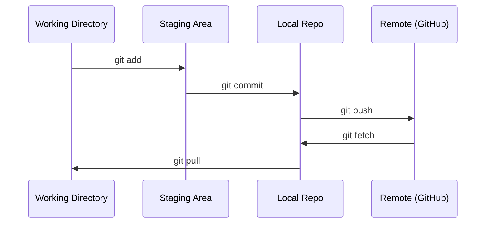

# Git 與協作 (Git & Collaboration)

> 版本控制不是選修。你在這裡做的每一個實驗、每一個模型、每一堂課，都要納入追蹤。

**Type:** Learn
**Languages:** --
**Prerequisites:** Phase 0, Lesson 01
**Time:** ~30 分鐘

## 學習目標 (Learning Objectives)

- 設定 git 身分，並使用 add、commit、push 的日常流程
- 建立並合併 branch，在不弄壞 main 的情況下做獨立實驗
- 撰寫 `.gitignore`，排除 model checkpoint 與大型二進位檔
- 用 `git log` 瀏覽 commit 歷史，了解專案如何演進

## 問題 (The Problem)

你即將在 20 個 phase 中寫下數百個程式檔。沒有版本控制，你會遺失成果、弄壞無法復原的東西，也沒辦法與別人協作。

工具就是 Git。GitHub 則是程式碼存放的地方。這堂課只講本課程需要的部分，多的不教。

## 核心概念 (The Concept)



記住三件事：
1. 常常存檔（`git commit`）
2. 推送到 remote（`git push`）
3. 實驗時開 branch（`git checkout -b experiment`）

```figure
s0-commit-dag
```

## 動手做 (Build It)

### 步驟 1：設定 git

```bash
git config --global user.name "Your Name"
git config --global user.email "you@example.com"
```

### 步驟 2：日常流程

```bash
git status
git add file.py
git commit -m "Add perceptron implementation"
git push origin main
```

### 步驟 3：用 branch 做實驗

```bash
git checkout -b experiment/new-optimizer

# ... make changes, commit ...

git checkout main
git merge experiment/new-optimizer
```

### 步驟 4：操作這個課程 repo

你無法直接推送到課程 repo，只有維護者有寫入權限。請先在 GitHub 上 fork（右上角的 Fork 按鈕），讓 `origin` 指向你自己的副本：

```bash
git clone https://github.com/YOUR-USERNAME/ai-engineering-from-scratch.git
cd ai-engineering-from-scratch

git checkout -b my-progress
# work through lessons, commit your code
git push origin my-progress
```

## 實際使用 (Use It)

這門課只需要下面這幾個指令：

| 指令 | 時機 |
|---------|------|
| `git clone` | 取得課程 repo |
| `git add` + `git commit` | 儲存你的成果 |
| `git push` | 備份到 GitHub |
| `git checkout -b` | 嘗試新東西，又不弄壞 main |
| `git log --oneline` | 看看你做了什麼 |

就這樣。這門課不需要 rebase、cherry-pick 或 submodule。

## 練習 (Exercises)

1. Fork 這個 repo，clone 你的 fork，建立名為 `my-progress` 的 branch，新增一個檔案，commit 後 push
2. 建立一個 `.gitignore`，排除 model checkpoint 檔（`.pt`、`.pth`、`.safetensors`）
3. 用 `git log --oneline` 查看這個 repo 的 commit 歷史，讀讀各課程是怎麼加進來的

### 提示 (Hints)

**練習 1。** 在 GitHub 上按 Fork，再用 `git clone` 你自己 fork 的 URL。執行 `git push -u origin my-progress` 之後，打開你的 fork，確認 branch 清單中有 `my-progress`，而且裡面有你的檔案。

**練習 2。** 在 repo 根目錄的 `.gitignore` 檔中，每個副檔名加一條規則，例如 `*.pt`。為每個副檔名建立一個空檔案後執行 `git status`，這些檔案都不能出現在 untracked 清單中。

**練習 3。** 執行 `git log --oneline`，再執行 `git log --oneline -- phases/00-setup-and-tooling`，只看修改過這個 phase 的 commit。挑一個 commit，執行 `git show --stat <hash>`，看它新增了哪些課程檔案。

## 關鍵術語 (Key Terms)

| 術語 | 大家怎麼說 | 實際意思 |
|------|----------------|----------------------|
| Commit | 「存檔」 | 專案在某個時間點的完整快照 |
| Branch | 「一份複本」 | 指向某個 commit 的指標，隨著你的工作往前移動 |
| Merge | 「合併程式碼」 | 把一個 branch 的變更套用到另一個 branch |
| Remote | 「雲端」 | 放在其他地方（GitHub、GitLab）的 repo 副本 |
