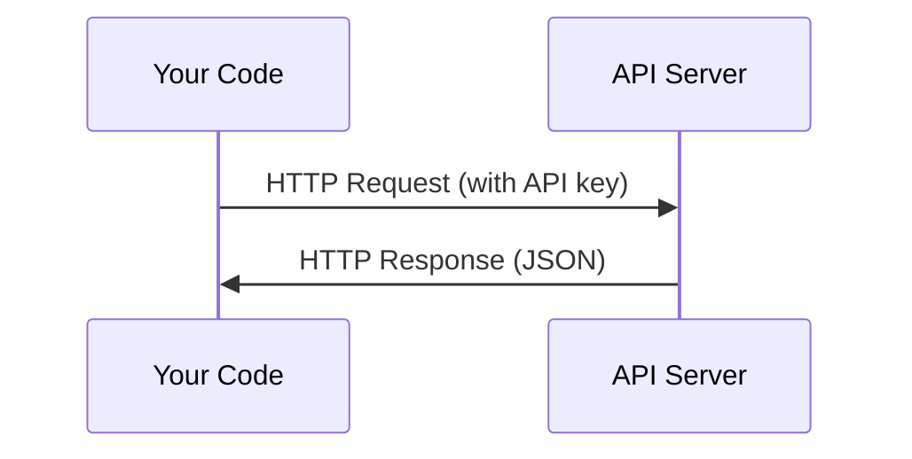

# API 與金鑰 (APIs & Keys)

> 每個 AI API 的運作方式都一樣：送出 request，收到 response。細節會變，模式不會變。

**Type:** Build
**Languages:** Python, TypeScript
**Prerequisites:** Phase 0, Lesson 01
**Time:** ~30 分鐘

## 學習目標 (Learning Objectives)

- 用環境變數與 `.env` 檔安全地存放 API key
- 同時用 Anthropic Python SDK 和原始 HTTP 呼叫 LLM API
- 比較 SDK 與原始 HTTP 的 request/response 格式，方便除錯
- 辨識並處理常見的 API 錯誤，包括驗證失敗與 rate limit

## 問題 (The Problem)

從 Phase 11 開始，你會呼叫 LLM API（Anthropic、OpenAI、Google）。在 Phase 13 到 16，你會建立在迴圈中使用這些 API 的 agent。你需要知道 API key 怎麼運作、怎麼安全地存放，以及怎麼完成第一次 API 呼叫。

## 核心概念 (The Concept)



每次 API 呼叫都包含：
1. 一個 endpoint（URL）
2. 一個 API key（驗證身分）
3. 一個 request body（你要什麼）
4. 一個 response body（你拿回什麼）

```figure
s0-secret-inject
```

## 動手做 (Build It)

### 步驟 1：安全地存放 API key

絕對不要把 API key 寫在程式碼裡。請使用環境變數。

```bash
export ANTHROPIC_API_KEY="sk-ant-..."
export OPENAI_API_KEY="sk-..."
```

或使用 `.env` 檔（記得加進 `.gitignore`）：

```
ANTHROPIC_API_KEY=sk-ant-...
OPENAI_API_KEY=sk-...
```

### 步驟 2：第一次 API 呼叫（Python）

```python
import os

import anthropic

client = anthropic.Anthropic()

MODEL = os.environ.get("LLM_MODEL", "claude-sonnet-5")

response = client.messages.create(
    model=MODEL,
    max_tokens=256,
    messages=[{"role": "user", "content": "What is a neural network in one sentence?"}]
)

print(response.content[0].text)
```

`LLM_MODEL` 用來選擇 Anthropic 的 model id，預設值是不帶日期的 Sonnet 別名。其他供應商（OpenAI、Google 等）也是同樣的模式：一把 key 加一個 model id，但各自有不同的 SDK、endpoint 與 request/response schema。

### 步驟 3：第一次 API 呼叫（TypeScript）

```typescript
import Anthropic from "@anthropic-ai/sdk";

const client = new Anthropic();

const MODEL = process.env.LLM_MODEL ?? "claude-sonnet-5";

const response = await client.messages.create({
  model: MODEL,
  max_tokens: 256,
  messages: [{ role: "user", content: "What is a neural network in one sentence?" }],
});

console.log(response.content[0].text);
```

### 步驟 4：原始 HTTP（不用 SDK）

```python
import os
import urllib.request
import json

url = "https://api.anthropic.com/v1/messages"
headers = {
    "Content-Type": "application/json",
    "x-api-key": os.environ["ANTHROPIC_API_KEY"],
    "anthropic-version": "2023-06-01",
}
body = json.dumps({
    "model": os.environ.get("LLM_MODEL", "claude-sonnet-5"),
    "max_tokens": 256,
    "messages": [{"role": "user", "content": "What is a neural network in one sentence?"}],
}).encode()

req = urllib.request.Request(url, data=body, headers=headers, method="POST")
with urllib.request.urlopen(req) as resp:
    result = json.loads(resp.read())
    print(result["content"][0]["text"])
```

SDK 在背後做的就是這些事。了解原始 HTTP 呼叫，對除錯很有幫助。

## 實際使用 (Use It)

這門課會用到：

| API | 何時需要 | 免費額度 |
|-----|-----------------|-----------|
| Anthropic (Claude) | Phase 11 到 16（agent、tool） | 註冊送 $5 額度 |
| OpenAI | Phase 11（做比較） | 註冊送 $5 額度 |
| Hugging Face | Phase 4 到 10（模型、資料集） | 免費 |

你現在不需要全部都申請。等課程需要時再設定就好。

## 交付 (Ship It)

這堂課會產出：
- `outputs/prompt-api-troubleshooter.md` - 診斷常見的 API 錯誤

## 練習 (Exercises)

1. 取得 Anthropic API key，完成你的第一次 API 呼叫
2. 試試原始 HTTP 版本，並把 response 格式與 SDK 版本做比較
3. 故意使用錯誤的 API key，閱讀錯誤訊息

### 提示 (Hints)

**練習 1。** 在 Anthropic Console 建立一把 key，依照課程所示放進 `ANTHROPIC_API_KEY`，然後執行 `code/first_api_call.py`。當腳本印出模型的回覆、而且沒有錯誤時，就代表成功。

**練習 2。** `code/first_api_call.py` 裡的兩個函式都只印出文字和 token 數量。在 `call_with_sdk()` 加上 `print(response)`，在 `call_raw_http()` 加上 `print(result)`，再執行腳本，就能看到兩邊完整的 response。比較欄位名稱：原始 JSON 的 `content`、`usage`、`stop_reason` 欄位，就是 SDK 轉成物件屬性的那些欄位。

**練習 3。** 只在一個終端機中把 `ANTHROPIC_API_KEY` 設成假值，再執行一次腳本。在輸出中找出 HTTP 狀態碼與錯誤類型；驗證失敗會回傳 401 狀態碼。

## 關鍵術語 (Key Terms)

| 術語 | 大家怎麼說 | 實際意思 |
|------|----------------|----------------------|
| API key | 「API 的密碼」 | 一串獨一無二的字串，用來識別你的帳號並授權 request |
| Rate limit | 「他們在限流我」 | 每分鐘或每小時的最大 request 數，用來防止濫用並確保公平使用 |
| Token | 「一個字」（在 API 情境中） | 計費單位：輸入與輸出的 token 會分開計算與收費 |
| Streaming | 「即時回應」 | 一個字一個字地收到 response，而不是等整個 response 完成 |
