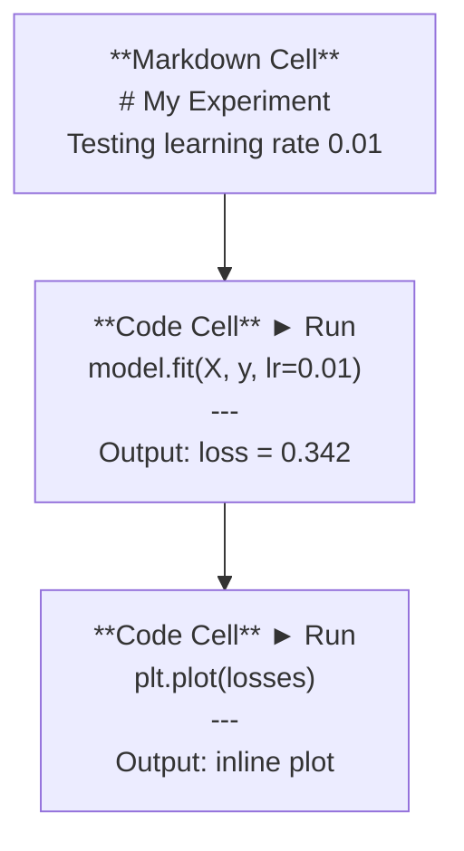
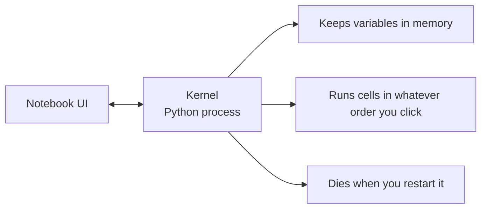

# Jupyter Notebook (Jupyter Notebooks)

> Notebook 是 AI 工程的實驗桌。你在這裡做原型，再把行得通的部分搬進正式環境。

**Type:** Build
**Languages:** Python
**Prerequisites:** Phase 0, Lesson 01
**Time:** ~30 分鐘

## 學習目標 (Learning Objectives)

- 安裝並啟動 JupyterLab、Jupyter Notebook，或搭配 Jupyter 擴充功能的 VS Code
- 使用 magic command（`%timeit`、`%%time`、`%matplotlib inline`）做 benchmark，並直接在 notebook 內視覺化
- 分辨何時用 notebook、何時用 script，並實踐「在 notebook 探索，用 script 交付」的流程
- 辨識並避開常見的 notebook 陷阱：亂序執行、隱藏狀態與記憶體洩漏

## 問題 (The Problem)

每一篇 AI 論文、教學和 Kaggle 競賽都用 Jupyter notebook。它讓你分段執行程式、直接看到輸出、把程式與說明混在一起，還能快速迭代。如果學 AI 不用 notebook，就像寫數學作業卻不用草稿紙。

但 notebook 有真正的陷阱。大家什麼都拿它來做，包括它很不擅長的事。知道何時該用 notebook、何時該用 script，能讓你日後少掉很多除錯的惡夢。

## 核心概念 (The Concept)

Notebook 是一串 cell。每個 cell 不是程式碼，就是文字。



Kernel 是在背景執行的 Python 程序。你執行 cell 時，程式碼會送到 kernel，由它執行後再把結果傳回來。所有 cell 共用同一個 kernel，所以變數會在 cell 之間保留。



「你點哪個就跑哪個」這一點，既是超能力，也是會打到自己腳的槍。

```figure
s0-cell-order
```

## 動手做 (Build It)

### 步驟 1：選擇你的介面

三種選擇，同一種格式：

| 介面 | 安裝 | 最適合 |
|-----------|---------|----------|
| JupyterLab | `pip install jupyterlab` 然後 `jupyter lab` | 完整的 IDE 體驗，多個分頁、檔案瀏覽器、終端機 |
| Jupyter Notebook | `pip install notebook` 然後 `jupyter notebook` | 簡單輕量，一次一個 notebook |
| VS Code | 安裝 "Jupyter" 擴充功能 | 已經在你的編輯器裡，整合 git，可以除錯 |

三者讀寫的都是同一種 `.ipynb` 檔。挑你喜歡的就好。AI 工作中最常見的是 JupyterLab。

```bash
pip install jupyterlab
jupyter lab
```

### 步驟 2：重要的鍵盤快速鍵

你會在兩種模式下操作。按 `Escape` 進入 command mode（左側是藍色條），按 `Enter` 進入 edit mode（綠色條）。

**Command mode（最常用）：**

| 按鍵 | 動作 |
|-----|--------|
| `Shift+Enter` | 執行 cell，並移到下一個 |
| `A` | 在上方插入 cell |
| `B` | 在下方插入 cell |
| `DD` | 刪除 cell |
| `M` | 轉成 markdown |
| `Y` | 轉成 code |
| `Z` | 復原 cell 操作 |
| `Ctrl+Shift+H` | 顯示所有快速鍵 |

**Edit mode：**

| 按鍵 | 動作 |
|-----|--------|
| `Tab` | 自動完成 |
| `Shift+Tab` | 顯示函式簽章 |
| `Ctrl+/` | 切換註解 |

`Shift+Enter` 是你一天會按上千次的鍵。先學會它。

### 步驟 3：Cell 類型

**Code cell** 會執行 Python 並顯示輸出：

```python
import numpy as np
data = np.random.randn(1000)
data.mean(), data.std()
```

輸出：`(0.0032, 0.9987)`

**Markdown cell** 會把文字排版後顯示。用它來記錄你在做什麼、為什麼這樣做。支援標題、粗體、斜體、LaTeX 數學式（`$E = mc^2$`）、表格與圖片。

### 步驟 4：Magic command

這些不是 Python。它們是 Jupyter 專用的指令，以 `%`（line magic）或 `%%`（cell magic）開頭。

**計時你的程式：**

```python
%timeit np.random.randn(10000)
```

輸出：`45.2 us +/- 1.3 us per loop`

```python
%%time
model.fit(X_train, y_train, epochs=10)
```

輸出：`Wall time: 2.34 s`

`%timeit` 會執行很多次並取平均。`%%time` 只執行一次。做微型 benchmark 用 `%timeit`，跑訓練用 `%%time`。

**啟用內嵌繪圖：**

```python
%matplotlib inline
```

現在每個 `plt.plot()` 或 `plt.show()` 都會直接在 notebook 中顯示。

**不離開 notebook 就安裝套件：**

```python
!pip install scikit-learn
```

`!` 前綴可以執行任何 shell 指令。

**查看環境變數：**

```python
%env CUDA_VISIBLE_DEVICES
```

### 步驟 5：直接顯示豐富的輸出

Notebook 會自動顯示 cell 的最後一個運算式。但你也可以自己控制：

```python
import pandas as pd

df = pd.DataFrame({
    "model": ["Linear", "Random Forest", "Neural Net"],
    "accuracy": [0.72, 0.89, 0.94],
    "training_time": [0.1, 2.3, 45.6]
})
df
```

這會顯示排版過的 HTML 表格，而不是一堆純文字。繪圖也一樣：

```python
import matplotlib.pyplot as plt

plt.figure(figsize=(8, 4))
plt.plot([1, 2, 3, 4], [1, 4, 2, 3])
plt.title("Inline Plot")
plt.show()
```

圖會直接出現在 cell 下方。這就是 notebook 在 AI 工作中占主導地位的原因。資料、圖表和程式碼，你都能一起看到。

顯示圖片：

```python
from IPython.display import Image, display
display(Image(filename="architecture.png"))
```

### 步驟 6：Google Colab

Colab 是雲端上免費的 Jupyter notebook。它提供 GPU、預先安裝好的函式庫，以及 Google Drive 整合。完全不用設定。

1. 前往 [colab.research.google.com](https://colab.research.google.com)
2. 上傳這門課的任何 `.ipynb` 檔
3. Runtime > Change runtime type > T4 GPU（免費）

Colab 與本機 Jupyter 的差異：
- 檔案不會在 session 之間保留（請存到 Drive 或下載）
- 預先安裝：numpy、pandas、matplotlib、torch、tensorflow、sklearn
- 用 `from google.colab import files` 上傳或下載檔案
- 用 `from google.colab import drive; drive.mount('/content/drive')` 取得持久儲存空間
- 閒置 90 分鐘後 session 會逾時（免費方案）

## 實際使用 (Use It)

### Notebook 與 script：何時用哪個

| Notebook 適合 | Script 適合 |
|-------------------|-----------------|
| 探索資料集 | 訓練 pipeline |
| 做模型原型 | 可重複使用的工具 |
| 視覺化結果 | 任何含 `if __name__` 的程式 |
| 解釋你的工作 | 定時執行的程式 |
| 快速實驗 | 正式環境的程式 |
| 課程練習 | 套件與函式庫 |

原則：**在 notebook 探索，用 script 交付**。

AI 中常見的流程：
1. 在 notebook 中探索資料
2. 在 notebook 中做模型原型
3. 行得通之後，把程式碼搬到 `.py` 檔
4. 再把這些 `.py` 檔 import 回 notebook，繼續做實驗

### 常見陷阱

**亂序執行。** 你先跑 cell 5，再跑 cell 2，然後跑 cell 7。Notebook 在你的機器上正常，但別人從頭到尾跑一遍就壞了。解法：分享前先執行 Kernel > Restart & Run All。

**隱藏狀態。** 你刪掉一個 cell，但它建立的變數還留在記憶體裡。Notebook 看起來很乾淨，卻依賴一個幽靈 cell。解法：定期重新啟動 kernel。

**記憶體洩漏。** 載入 4GB 的資料集、訓練模型、再載入另一個資料集。什麼都沒有被釋放。解法：用 `del variable_name` 和 `gc.collect()`，或重新啟動 kernel。

## 交付 (Ship It)

這堂課會產出：
- `outputs/prompt-notebook-helper.md`，用來除錯 notebook 的問題

## 練習 (Exercises)

1. 開啟 JupyterLab，建立一個 notebook，用 `%timeit` 比較 list comprehension 與 numpy 在建立 100,000 個隨機數陣列時的速度
2. 建立一個同時含有 markdown 與 code cell 的 notebook，載入 CSV、顯示 dataframe 並畫一張圖。接著執行 Kernel > Restart & Run All，確認它從頭到尾都能跑
3. 把 `code/notebook_tips.py` 的程式碼貼進 Colab notebook，用免費 GPU 執行

### 提示 (Hints)

**練習 1。** 用 `jupyter lab` 啟動 JupyterLab，然後把每個版本放進各自以 `%timeit` 開頭的 cell。兩個 cell 都用同樣的 100,000 大小，這樣兩個時間量測的才是同一件工作。

**練習 2。** 用 `pd.read_csv` 讀資料，把 dataframe 放在 cell 的最後一行來顯示，並用 `df.plot()` 或 matplotlib 繪圖。執行 Kernel > Restart & Run All 之後，每個 cell 的執行計數器都必須顯示數字，而且任何 cell 都不能出現錯誤。

**練習 3。** 貼上程式碼之前，先在 Colab 選擇 Runtime > Change runtime type > GPU。當 `code/notebook_tips.py` 中每個函式都印出自己的區段，而且 cell 中的 `torch.cuda.is_available()` 回傳 `True`，就代表執行正確。

## 關鍵術語 (Key Terms)

| 術語 | 大家怎麼說 | 實際意思 |
|------|----------------|----------------------|
| Kernel | 「執行我程式的東西」 | 一個獨立的 Python 程序，負責執行 cell 並把變數保留在記憶體中 |
| Cell | 「一個程式區塊」 | Notebook 中可獨立執行的單元，內容是程式碼或 markdown |
| Magic command | 「Jupyter 小技巧」 | 以 `%` 或 `%%` 開頭的特殊指令，用來控制 notebook 環境 |
| `.ipynb` | 「Notebook 檔」 | 包含 cell、輸出與 metadata 的 JSON 檔。全名是 IPython Notebook |

## 延伸閱讀 (Further Reading)

- [JupyterLab Docs](https://jupyterlab.readthedocs.io/)，完整功能介紹
- [Google Colab FAQ](https://research.google.com/colaboratory/faq.html)，Colab 專屬的限制與功能
- [28 Jupyter Notebook Tips](https://www.dataquest.io/blog/jupyter-notebook-tips-tricks-shortcuts/)，進階使用者的快速鍵
