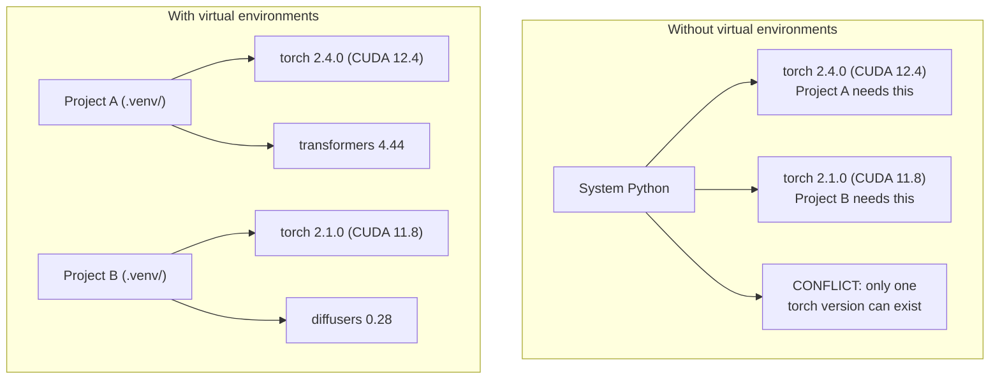

# Python 環境 (Python Environments)

> 依賴地獄是真的。Virtual environment 就是解藥。

**Type:** Build
**Languages:** Shell
**Prerequisites:** Phase 0, Lesson 01
**Time:** ~30 分鐘

## 學習目標 (Learning Objectives)

- 用 `uv`、`venv` 或 `conda` 建立隔離的 virtual environment
- 撰寫含有可選依賴群組的 `pyproject.toml`，並產生 lockfile 以確保可重現
- 診斷並修正常見陷阱：全域安裝、pip 與 conda 混用、CUDA 版本不相符
- 為依賴互相衝突的專案實作「每個 phase 一個環境」的策略

## 問題 (The Problem)

你為一個 fine-tuning 專案安裝了 PyTorch 2.4。下週，另一個專案因為鎖定了 CUDA build，需要 PyTorch 2.1。你全域升級，第一個專案就壞了。你降級，第二個又壞了。

這就是依賴地獄。它在 AI/ML 工作中不斷發生，原因是：

- PyTorch、JAX 和 TensorFlow 各自附帶自己的 CUDA binding
- 模型函式庫會鎖定特定的框架版本
- 全域的 `pip install` 會覆蓋原本存在的東西
- CUDA 11.8 的 build 無法搭配 CUDA 12.x 的 driver（反過來也一樣）

解法：每個專案都有自己隔離的環境和套件。

## 核心概念 (The Concept)



```figure
s0-env-isolation
```

## 動手做 (Build It)

### 選項 1：uv venv（建議）

`uv` 是最快的 Python package manager（比 pip 快 10 到 100 倍）。它用一個工具處理 virtual environment、Python 版本和依賴解析。

```bash
curl -LsSf https://astral.sh/uv/install.sh | sh

uv python install 3.12

cd your-project
uv venv
source .venv/bin/activate
```

安裝套件：

```bash
uv pip install torch numpy
```

一步建立含 `pyproject.toml` 的專案：

```bash
uv init my-ai-project
cd my-ai-project
uv add torch numpy matplotlib
```

### 選項 2：venv（內建）

如果你裝不了 `uv`，Python 本身就內建 `venv`：

```bash
python3 -m venv .venv
source .venv/bin/activate  # Linux/macOS
.venv\Scripts\activate     # Windows

pip install torch numpy
```

比 `uv` 慢，但只要有裝 Python 的地方都能用。

### 選項 3：conda（需要時再用）

Conda 能管理非 Python 的依賴，例如 CUDA toolkit、cuDNN 和 C 函式庫。在這些情況下使用它：

- 你需要特定版本的 CUDA toolkit，又不想裝在整個系統上
- 你在共用叢集上，無法安裝系統套件
- 某個函式庫的安裝說明寫著「use conda」

```bash
# Install miniconda (not the full Anaconda)
curl -LsSf https://repo.anaconda.com/miniconda/Miniconda3-latest-Linux-x86_64.sh -o miniconda.sh
bash miniconda.sh -b

conda create -n myproject python=3.12
conda activate myproject

conda install pytorch torchvision torchaudio pytorch-cuda=12.4 -c pytorch -c nvidia
```

一條規則：如果某個環境用 conda，就用 conda 安裝那個環境裡的所有套件。在 conda 環境裡混用 `pip install`，會造成很難除錯的依賴衝突。

### 這門課的策略：每個 phase 一個環境

你可以為整門課建立一個環境。但別這樣做。不同的 phase 需要不同（有時會互相衝突）的依賴。

策略：

```
ai-engineering-from-scratch/
├── .venv/                    <-- shared lightweight env for phases 0-3
├── phases/
│   ├── 04-neural-networks/
│   │   └── .venv/            <-- PyTorch env
│   ├── 05-cnns/
│   │   └── .venv/            <-- same PyTorch env (symlink or shared)
│   ├── 08-transformers/
│   │   └── .venv/            <-- might need different transformer versions
│   └── 11-llm-apis/
│       └── .venv/            <-- API SDKs, no torch needed
```

`code/env_setup.sh` 裡的腳本會為這門課建立基礎環境。

## pyproject.toml 基礎

每個 Python 專案都該有一個 `pyproject.toml`。它用一個檔案取代 `setup.py`、`setup.cfg` 和 `requirements.txt`。

```toml
[project]
name = "ai-engineering-from-scratch"
version = "0.1.0"
requires-python = ">=3.11"
dependencies = [
    "numpy>=1.26",
    "matplotlib>=3.8",
    "jupyter>=1.0",
    "scikit-learn>=1.4",
]

[project.optional-dependencies]
torch = ["torch>=2.3", "torchvision>=0.18"]
llm = ["anthropic>=0.39", "openai>=1.50"]
```

然後安裝：

```bash
uv pip install -e ".[torch]"    # base + PyTorch
uv pip install -e ".[llm]"     # base + LLM SDKs
uv pip install -e ".[torch,llm]" # everything
```

## Lockfile

Lockfile 會把每一個依賴（包含 transitive dependency）鎖定在確切的版本。這能保證可重現：任何人從 lockfile 安裝，都會得到完全相同的套件。

```bash
# uv generates uv.lock automatically when using uv add
uv add numpy

# pip-tools approach
uv pip compile pyproject.toml -o requirements.lock
uv pip install -r requirements.lock
```

把 lockfile commit 進 git。別人 clone 這個 repo 後，從 lockfile 安裝，就會得到相同的版本。

## 常見錯誤

### 1. 全域安裝

```bash
pip install torch  # BAD: installs to system Python

source .venv/bin/activate
pip install torch  # GOOD: installs to virtual environment
```

檢查你的套件裝到哪裡：

```bash
which python       # should show .venv/bin/python, not /usr/bin/python
which pip           # should show .venv/bin/pip
```

### 2. 混用 pip 與 conda

```bash
conda create -n myenv python=3.12
conda activate myenv
conda install pytorch -c pytorch
pip install some-other-package   # BAD: can break conda's dependency tracking
conda install some-other-package # GOOD: let conda manage everything
```

如果你非得在 conda 裡用 pip（有些套件只有 pip 版本），請先裝完所有 conda 套件，最後再裝 pip 套件。

### 3. 忘記啟用

```bash
python train.py           # uses system Python, missing packages
source .venv/bin/activate
python train.py           # uses project Python, packages found
```

你的 shell 提示字元應該會顯示環境名稱：

```
(.venv) $ python train.py
```

### 4. 把 .venv commit 進 git

```bash
echo ".venv/" >> .gitignore
```

Virtual environment 大小是 200MB 到 2GB。它們只屬於本機，無法在機器之間搬移。請改為 commit `pyproject.toml` 和 lockfile。

### 5. CUDA 版本不相符

```bash
nvidia-smi                # shows driver CUDA version (e.g., 12.4)
python -c "import torch; print(torch.version.cuda)"  # shows PyTorch CUDA version

# These must be compatible.
# PyTorch CUDA version must be <= driver CUDA version.
```

## 實際使用 (Use It)

執行設定腳本，建立你的課程環境：

```bash
bash phases/00-setup-and-tooling/06-python-environments/code/env_setup.sh
```

這會在 repo 根目錄建立 `.venv`，並安裝與驗證核心依賴。

## 練習 (Exercises)

1. 執行 `env_setup.sh`，確認所有檢查都通過
2. 建立第二個 virtual environment，在裡面安裝不同版本的 numpy，並確認兩個環境彼此隔離
3. 為同時需要 PyTorch 和 Anthropic SDK 的專案撰寫 `pyproject.toml`
4. 故意全域安裝一個套件（不啟用 venv），注意它裝到哪裡，然後把它解除安裝

### 提示 (Hints)

**練習 1。** 在 repo 根目錄執行 `bash phases/00-setup-and-tooling/06-python-environments/code/env_setup.sh`。逐行讀輸出；檢查失敗時，只修正那一項，再執行腳本，直到沒有任何檢查失敗。

**練習 2。** 在新資料夾用 `uv venv` 建立第二個環境，啟用它，並用版本鎖定安裝較舊的 numpy，例如 `numpy==1.26.4`。在每個環境中執行 `python -c "import numpy; print(numpy.__version__)"`；兩個版本必須不同。

**練習 3。** 從「pyproject.toml 基礎」的範例開始，把 `torch` 和 `anthropic` 列在 `dependencies` 之下。在新環境中執行 `uv pip install -e .` 或 `uv sync`；當兩個套件都能無錯誤地 import，這個檔案就是正確的。

**練習 4。** 停用所有環境，執行 `pip install --user <small package>`，再執行 `pip show <package>` 並讀 `Location` 那一行。用 `pip uninstall <package>` 解除安裝，再執行一次 `pip show`，確認它已經不見了。

## 關鍵術語 (Key Terms)

| 術語 | 大家怎麼說 | 實際意思 |
|------|----------------|----------------------|
| Virtual environment | 「venv」 | 一個隔離的目錄，內含 Python 直譯器與套件，與系統的 Python 分開 |
| Lockfile | 「鎖定的依賴」 | 列出每個套件及其確切版本的檔案，保證不同機器安裝出相同的結果 |
| pyproject.toml | 「新的 setup.py」 | 標準的 Python 專案設定檔，取代 setup.py/setup.cfg/requirements.txt |
| Transitive dependency | 「依賴的依賴」 | 套件 B 依賴 C；如果你安裝依賴 B 的 A，那麼 C 就是 A 的 transitive dependency |
| CUDA mismatch | 「我的 GPU 不能用」 | PyTorch 編譯時用的 CUDA 版本，與你的 GPU driver 支援的版本不同 |
