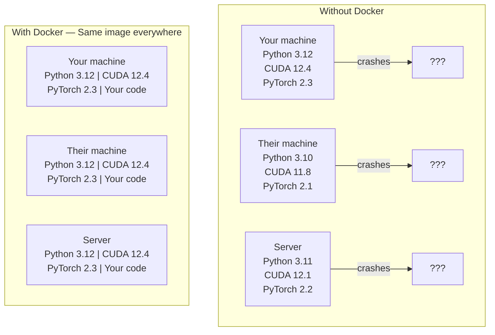

# AI 用的 Docker (Docker for AI)

> 有了 container，「在我的機器上可以跑」就成了過去式。

**Type:** Build
**Languages:** Docker
**Prerequisites:** Phase 0, Lessons 01 and 03
**Time:** ~60 分鐘

## 學習目標 (Learning Objectives)

- 用 Dockerfile 建置支援 GPU 的 Docker image，內含 CUDA、PyTorch 與 AI 函式庫
- 把主機目錄掛載成 volume，讓模型、資料集與程式碼在重建 container 後依然保留
- 設定 NVIDIA Container Toolkit，讓 GPU 在 container 內可用
- 用 Docker Compose 編排多服務的 AI 應用（inference server 加 vector database）

## 問題 (The Problem)

你在筆電上用 PyTorch 2.3、CUDA 12.4 和 Python 3.12 訓練了一個模型。你的同事用的是 PyTorch 2.1、CUDA 11.8 和 Python 3.10。你的模型在他的機器上當掉了。你的 Dockerfile 在兩邊都能跑。

AI 專案是依賴的惡夢。典型的技術堆疊包含 Python、PyTorch、CUDA driver、cuDNN、系統層級的 C 函式庫，以及像 flash-attn 這種需要精確編譯器版本的特殊套件。Docker 把這一切打包成單一 image，在任何地方都以相同方式執行。

## 核心概念 (The Concept)

Docker 把你的程式碼、runtime、函式庫和系統工具包裝成一個隔離的單位，稱為 container。可以把它想成輕量的虛擬機器，只是它共用主機 OS 的 kernel，而不是自己跑一個，所以啟動只要幾秒，不是幾分鐘。



### 為什麼 AI 專案比一般專案更需要 Docker

1. **GPU driver 很脆弱。** CUDA 12.4 的程式碼無法在 CUDA 11.8 上執行。Docker 把 CUDA toolkit 隔離在 container 內，同時透過 NVIDIA Container Toolkit 共用主機的 GPU driver。

2. **模型權重很大。** 7B 參數的模型，fp16 就有 14 GB。你不會想每次重建都重新下載。Docker volume 讓你從主機掛載模型目錄。

3. **多服務架構很常見。** 真正的 AI 應用不只是一支 Python 腳本。它包含 inference server、給 RAG 用的 vector database，也許還有網頁前端。Docker Compose 一個指令就能編排這一切。

### 關鍵詞彙

| 術語 | 意思 |
|------|---------------|
| Image | 唯讀的模板。你的食譜。由 Dockerfile 建置而成。 |
| Container | Image 的執行中實例。你的廚房。 |
| Dockerfile | 建置 image 的指令。一層一層疊上去。 |
| Volume | 持久儲存空間，container 重新啟動後依然存在。 |
| docker-compose | 用 YAML 定義多 container 應用的工具。 |

### AI 中常見的 container 模式

```
Dev Container
  Full toolkit. Editor support. Jupyter. Debugging tools.
  Used during development and experimentation.

Training Container
  Minimal. Just the training script and dependencies.
  Runs on GPU clusters. No editor, no Jupyter.

Inference Container
  Optimized for serving. Small image. Fast cold start.
  Runs behind a load balancer in production.
```

```figure
s0-image-layers
```

## 動手做 (Build It)

### 步驟 1：安裝 Docker

```bash
# macOS
brew install --cask docker
open /Applications/Docker.app

# Ubuntu
curl -fsSL https://get.docker.com | sh
sudo usermod -aG docker $USER
# Log out and back in for group change to take effect
```

驗證：

```bash
docker --version
docker run hello-world
```

### 步驟 2：安裝 NVIDIA Container Toolkit（有 NVIDIA GPU 的 Linux）

這能讓 Docker container 存取你的 GPU。macOS 和 Windows (WSL2) 的使用者可以跳過；Docker Desktop 在這些平台上處理 GPU passthrough 的方式不同。

```bash
distribution=$(. /etc/os-release;echo $ID$VERSION_ID)
curl -fsSL https://nvidia.github.io/libnvidia-container/gpgkey | sudo gpg --dearmor -o /usr/share/keyrings/nvidia-container-toolkit-keyring.gpg
curl -s -L https://nvidia.github.io/libnvidia-container/$distribution/libnvidia-container.list | \
    sed 's#deb https://#deb [signed-by=/usr/share/keyrings/nvidia-container-toolkit-keyring.gpg] https://#g' | \
    sudo tee /etc/apt/sources.list.d/nvidia-container-toolkit.list

sudo apt-get update
sudo apt-get install -y nvidia-container-toolkit
sudo nvidia-ctk runtime configure --runtime=docker
sudo systemctl restart docker
```

在 container 內測試 GPU 存取：

```bash
docker run --rm --gpus all nvidia/cuda:12.4.1-base-ubuntu22.04 nvidia-smi
```

如果你看到 GPU 資訊，就代表 toolkit 運作正常。

### 步驟 3：了解 base image

選對 base image 可以省下好幾個小時的除錯時間。

```
nvidia/cuda:12.4.1-devel-ubuntu22.04
  Full CUDA toolkit. Compilers included.
  Use for: building packages that need nvcc (flash-attn, bitsandbytes)
  Size: ~4 GB

nvidia/cuda:12.4.1-runtime-ubuntu22.04
  CUDA runtime only. No compilers.
  Use for: running pre-built code
  Size: ~1.5 GB

pytorch/pytorch:2.6.0-cuda12.4-cudnn9-runtime
  PyTorch pre-installed on top of CUDA.
  Use for: skipping the PyTorch install step
  Size: ~6 GB

python:3.12-slim
  No CUDA. CPU only.
  Use for: inference on CPU, lightweight tools
  Size: ~150 MB
```

### 步驟 4：撰寫 AI 開發用的 Dockerfile

這是 `code/Dockerfile` 裡的 Dockerfile。我們一起看一遍：

```dockerfile
FROM --platform=linux/amd64 nvidia/cuda:12.4.1-devel-ubuntu22.04

ENV DEBIAN_FRONTEND=noninteractive
ENV PYTHONUNBUFFERED=1

RUN apt-get update && apt-get install -y --no-install-recommends \
    software-properties-common \
    git \
    curl \
    build-essential \
    && add-apt-repository -y ppa:deadsnakes/ppa \
    && apt-get update && apt-get install -y --no-install-recommends \
    python3.12 \
    python3.12-venv \
    python3.12-dev \
    && rm -rf /var/lib/apt/lists/*

RUN update-alternatives --install /usr/bin/python python /usr/bin/python3.12 1

RUN curl -sSL https://raw.githubusercontent.com/pypa/get-pip/3b73145063be545b649ad9ca83ea8da5fc915a4f/public/get-pip.py -o /tmp/get-pip.py \
    && echo "a341e1a43e38001c551a1508a73ff23636a11970b61d901d9a1cad2a18f57055  /tmp/get-pip.py" | sha256sum -c - \
    && python /tmp/get-pip.py \
    && rm /tmp/get-pip.py \
    && update-alternatives --install /usr/bin/pip pip /usr/local/bin/pip3.12 1

RUN python -m pip install --no-cache-dir --upgrade pip setuptools wheel

RUN python -m pip install --no-cache-dir \
    torch==2.6.0+cu124 \
    torchvision==0.21.0+cu124 \
    torchaudio==2.6.0+cu124 \
    --index-url https://download.pytorch.org/whl/cu124

RUN python -m pip install --no-cache-dir \
    numpy \
    pandas \
    scikit-learn \
    matplotlib \
    jupyter \
    transformers \
    datasets \
    accelerate \
    safetensors

WORKDIR /workspace

VOLUME ["/workspace", "/models"]

EXPOSE 8888

CMD ["python"]
```

建置它：

```bash
docker build -t ai-dev -f phases/00-setup-and-tooling/07-docker-for-ai/code/Dockerfile .
```

第一次會花一些時間（要下載 CUDA base image 和 PyTorch）。之後的建置會使用快取的 layer。

**macOS / Apple Silicon (M1/M2/M3/M4)：** `FROM` 那一行的 `--platform=linux/amd64`，就是讓這個建置在 Mac 上成功的關鍵。CUDA base image 也有 arm64 版本，Docker Desktop 在 Apple Silicon 上會自動選用，但 PyTorch 的 `cu124` wheel 只發布 x86_64 版本，所以 `pip install torch==2.6.0+cu124` 那一層會失敗，並出現 `No matching distribution found for torch==2.6.0+cu124`。指定 platform 後會拉取 x86_64 的 image，並在模擬環境下執行：建置比較慢，而且 container 沒有 GPU（Mac 本來就沒有 CUDA）。在 Mac 上，請把下面 `docker run` 指令中的 `--gpus all` 拿掉。如果要在 Apple Silicon 上做 GPU 的工作，請用 Lesson 01 的 MPS 版本在本機直接執行課程，並把這個 image 留給有 NVIDIA GPU 的 x86_64 Linux 主機。

執行它：

```bash
docker run --rm -it --gpus all \
    -v $(pwd):/workspace \
    -v ~/models:/models \
    ai-dev python -c "import torch; print(f'PyTorch {torch.__version__}, CUDA: {torch.cuda.is_available()}')"
```

在 container 內執行 Jupyter：

```bash
docker run --rm -it --gpus all \
    -v $(pwd):/workspace \
    -v ~/models:/models \
    -p 8888:8888 \
    ai-dev jupyter notebook --ip=0.0.0.0 --port=8888 --no-browser --allow-root
```

### 步驟 5：為資料與模型掛載 volume

Volume 掛載對 AI 工作至關重要。沒有它，container 一停止，你下載的 14 GB 模型就消失了。

```bash
# Mount your code
-v $(pwd):/workspace

# Mount a shared models directory
-v ~/models:/models

# Mount datasets
-v ~/datasets:/data
```

在你的訓練腳本裡，從掛載的路徑載入：

```python
from transformers import AutoModel

model = AutoModel.from_pretrained("/models/llama-7b")
```

模型存放在你主機的檔案系統上。想重建 container 幾次都可以，不用重新下載。

### 步驟 6：用 Docker Compose 跑多服務 AI 應用

真正的 RAG 應用需要 inference server 和 vector database。Docker Compose 一個指令就能同時執行兩者。

請見 `code/docker-compose.yml`：

```yaml
services:
  ai-dev:
    build:
      context: .
      dockerfile: Dockerfile
    deploy:
      resources:
        reservations:
          devices:
            - driver: nvidia
              count: all
              capabilities: [gpu]
    volumes:
      - ../../../:/workspace
      - ~/models:/models
      - ~/datasets:/data
    ports:
      - "8888:8888"
    stdin_open: true
    tty: true
    command: jupyter notebook --ip=0.0.0.0 --port=8888 --no-browser --allow-root

  qdrant:
    image: qdrant/qdrant:v1.12.5
    ports:
      - "6333:6333"
      - "6334:6334"
    volumes:
      - qdrant_data:/qdrant/storage

volumes:
  qdrant_data:
```

啟動所有服務：

```bash
cd phases/00-setup-and-tooling/07-docker-for-ai/code
docker compose up -d
```

現在你的 AI 開發 container 可以用服務名稱，透過 `http://qdrant:6333` 連到 vector database。Docker Compose 會自動建立共用網路。

從 AI container 內測試連線：

```python
from qdrant_client import QdrantClient

client = QdrantClient(host="qdrant", port=6333)
print(client.get_collections())
```

停止所有服務：

```bash
docker compose down
```

加上 `-v` 可以一併刪除 qdrant 的 volume：

```bash
docker compose down -v
```

### 步驟 7：AI 工作中實用的 Docker 指令

```bash
# List running containers
docker ps

# List all images and their sizes
docker images

# Remove unused images (reclaim disk space)
docker system prune -a

# Check GPU usage inside a running container
docker exec -it <container_id> nvidia-smi

# Copy a file from container to host
docker cp <container_id>:/workspace/results.csv ./results.csv

# View container logs
docker logs -f <container_id>
```

## 實際使用 (Use It)

你現在有了可重現的 AI 開發環境。接下來這門課的其餘部分：

- 用 `docker compose up` 同時啟動你的開發環境和 vector database
- 把程式碼、模型和資料掛載成 volume，重建時就不會遺失任何東西
- 課程需要新的 Python 套件時，把它加進 Dockerfile 並重新建置
- 把你的 Dockerfile 分享給隊友。他們會得到完全相同的環境。

### 沒有 GPU？

拿掉 `--gpus all` 參數，以及 NVIDIA 的 deploy 區塊。Container 仍然能跑以 CPU 為主的課程。PyTorch 偵測到沒有 CUDA 時，會自動退回使用 CPU。

## 練習 (Exercises)

1. 建置 Dockerfile，並在 container 內執行 `python -c "import torch; print(torch.__version__)"`
2. 啟動 docker-compose 堆疊，並確認 AI container 能透過 `http://qdrant:6333/collections` 存取 Qdrant
3. 在 Dockerfile 中加入 `flask`，重新建置，並在 port 5000 上執行一個簡單的 API server。用 `-p 5000:5000` 對應 port
4. 用 `docker images` 量測 image 大小。試著把 base image 從 `devel` 換成 `runtime`，並比較大小

### 提示 (Hints)

**練習 1。** 用課程中的 `docker build -t ai-dev -f phases/00-setup-and-tooling/07-docker-for-ai/code/Dockerfile .` 指令建置，再在 `docker run --rm ai-dev` 內執行 import。在 Mac 上，如課程所述，請省略 `--gpus all`。Container 必須印出以 `2.6.0` 開頭的版本。

**練習 2。** 在 `code/` 資料夾中執行 `docker compose up -d`，再用 `docker compose exec ai-dev bash` 在 `ai-dev` 服務中開啟 shell。在裡面執行 `curl http://qdrant:6333/collections`；回傳 JSON 就代表服務名稱在 compose 網路上能被解析。

**練習 3。** 在 Dockerfile 中加入 `RUN pip install flask` 這一行，重新建置，並用 `host="0.0.0.0"` 啟動 server，因為綁定在 container 內 localhost 的 server，從外部連不到。在你的機器上開啟 `http://localhost:5000`，確認 port 對應有效。

**練習 4。** 執行 `docker images ai-dev`，記下 SIZE 欄位。把 `FROM` 那行的 `devel` 改成 `runtime`，用新的 tag 建置，並比較兩個大小；runtime image 省去了編譯器和 header。

## 關鍵術語 (Key Terms)

| 術語 | 大家怎麼說 | 實際意思 |
|------|----------------|----------------------|
| Container | 「輕量 VM」 | 使用主機 kernel 的隔離程序，擁有自己的檔案系統和網路 |
| Image layer | 「快取的步驟」 | Dockerfile 的每個指令都會建立一個 layer。沒變的 layer 會被快取，所以重建很快。 |
| NVIDIA Container Toolkit | 「Docker 裡的 GPU」 | 一個 runtime hook，透過 `--gpus` 參數把主機的 GPU 開放給 container |
| Volume mount | 「共用資料夾」 | 把主機上的目錄對應到 container 內。Container 停止後，變更依然保留。 |
| Base image | 「起點」 | 你的 Dockerfile 以 `FROM` 指定、並在其上建置的 image。決定了預先安裝哪些東西。 |
