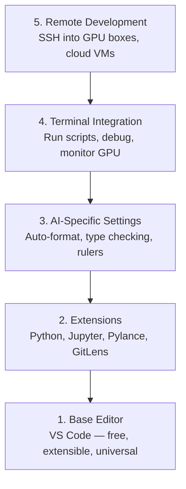

# 編輯器設定 (Editor Setup)

> 編輯器是你的副駕駛。設定一次，讓它不擋路，還能真正派上用場。

**Type:** Build
**Languages:** --
**Prerequisites:** Phase 0, Lesson 01
**Time:** ~20 分鐘

## 學習目標 (Learning Objectives)

- 安裝 VS Code，以及 Python、Jupyter、linting 和 remote SSH 的必備擴充功能
- 為 AI 工作流程設定儲存時自動格式化、型別檢查與 notebook 輸出捲動
- 設定 Remote SSH，像在本機一樣編輯與除錯遠端 GPU 機器上的程式碼
- 評估編輯器替代方案（Cursor、Windsurf、Neovim）及其在 AI 工作上的取捨

## 問題 (The Problem)

你會花上數千小時在編輯器裡寫 Python、執行 notebook、除錯訓練迴圈，並 SSH 進 GPU 主機。設定不當的編輯器會讓每次工作都充滿阻力：沒有自動完成、沒有型別提示、沒有即時錯誤、要手動排版，終端機流程也很笨拙。

正確的設定只要 20 分鐘。跳過它，你每天都要多花 20 分鐘。

## 核心概念 (The Concept)

AI 工程的編輯器設定需要五樣東西：



```figure
s0-lsp-roundtrip
```

## 動手做 (Build It)

### 步驟 1：安裝 VS Code

推薦使用 VS Code。它免費、能在所有 OS 上執行、原生支援 Jupyter notebook，而且擴充功能生態系涵蓋 AI 工作所需的一切。

從 [code.visualstudio.com](https://code.visualstudio.com/) 下載。

從終端機驗證：

```bash
code --version
```

如果在 macOS 上找不到 `code`，請開啟 VS Code，按 `Cmd+Shift+P`，輸入 "Shell Command"，並選擇 "Install 'code' command in PATH"。

### 步驟 2：安裝必備擴充功能

在 VS Code 中開啟整合終端機（所有平台都是 `` Ctrl+` ``），並安裝對 AI 工作重要的擴充功能：

```bash
code --install-extension ms-python.python
code --install-extension ms-python.vscode-pylance
code --install-extension ms-toolsai.jupyter
code --install-extension eamodio.gitlens
code --install-extension ms-vscode-remote.remote-ssh
code --install-extension ms-python.debugpy
code --install-extension ms-python.black-formatter
code --install-extension charliermarsh.ruff
```

各自的功用：

| 擴充功能 | 原因 |
|-----------|-----|
| Python | 語言支援、virtual env 偵測、執行與除錯 |
| Pylance | 快速的型別檢查、自動完成、import 解析 |
| Jupyter | 在 VS Code 內執行 notebook，附變數檢視器 |
| GitLens | 查看誰改了什麼，內嵌 git blame |
| Remote SSH | 像本機一樣開啟遠端 GPU 主機上的資料夾 |
| Debugpy | Python 的逐步除錯 |
| Black Formatter | 儲存時自動格式化，風格一致 |
| Ruff | 快速 linting，抓出常見錯誤 |

這堂課的 `code/vscode/extensions.json` 檔包含完整的推薦清單。把它複製到你專案資料夾的 `.vscode/extensions.json`，當你開啟該資料夾時，VS Code 就會提示你安裝。

### 步驟 3：設定

複製這堂課 `code/vscode/settings.json` 裡的設定，或透過 `Settings > Open Settings (JSON)` 手動套用。

AI 工作的關鍵設定：

```jsonc
{
    "python.analysis.typeCheckingMode": "basic",
    "editor.formatOnSave": true,
    "editor.rulers": [88, 120],
    "notebook.output.scrolling": true,
    "files.autoSave": "afterDelay"
}
```

這些設定為什麼重要：

- **型別檢查設為 basic**：在執行前就抓出錯誤的參數型別。能減少因 tensor shape 不符與 API 參數錯誤而花掉的除錯時間。
- **儲存時格式化**：從此不用再煩惱排版。交給 Black。
- **在 88 與 120 設定 ruler**：Black 在 88 處換行。120 的標記則提醒你 docstring 和註解變得太長了。
- **Notebook 輸出捲動**：訓練迴圈會印出數千行。沒有捲動的話，輸出面板會爆掉。
- **自動儲存**：你會忘記存檔。訓練腳本就會執行到舊的程式碼。自動儲存可以避免這種事。

### 步驟 4：終端機整合

VS Code 的整合終端機，就是你執行訓練腳本、監控 GPU 和管理環境的地方。

好好設定它：

```jsonc
{
    "terminal.integrated.defaultProfile.osx": "zsh",
    "terminal.integrated.defaultProfile.linux": "bash",
    "terminal.integrated.fontSize": 13,
    "terminal.integrated.scrollback": 10000
}
```

實用的快速鍵：

| 動作 | macOS | Linux/Windows |
|--------|-------|---------------|
| 切換終端機 | `` Ctrl+` `` | `` Ctrl+` `` |
| 新增終端機 | `` Ctrl+Shift+` `` | `` Ctrl+Shift+` `` |
| 分割終端機 | `Cmd+\` | `Ctrl+Shift+5` |

分割終端機很好用：一個用來執行腳本，另一個用 `nvidia-smi -l 1` 或 `watch -n 1 nvidia-smi` 監控 GPU。

### 步驟 5：遠端開發（SSH 進 GPU 主機）

這是 AI 工作中最重要的擴充功能。你會在遠端機器（雲端 VM、實驗室伺服器、Lambda、Vast.ai）上執行訓練。Remote SSH 讓你開啟遠端檔案系統、編輯檔案、執行終端機並除錯，一切就像在本機一樣。

設定：

1. 安裝 Remote SSH 擴充功能（步驟 2 已完成）。
2. 按 `Ctrl+Shift+P`（或 `Cmd+Shift+P`），輸入 "Remote-SSH: Connect to Host"。
3. 輸入 `user@your-gpu-box-ip`。
4. VS Code 會自動在遠端機器上安裝它的伺服器元件。

若要免密碼登入，請設定 SSH key：

```bash
ssh-keygen -t ed25519 -C "your-email@example.com"
ssh-copy-id user@your-gpu-box-ip
```

為了方便，把主機加進 `~/.ssh/config`：

```
Host gpu-box
    HostName 203.0.113.50
    User ubuntu
    IdentityFile ~/.ssh/id_ed25519
    ForwardAgent yes
```

現在 `Remote-SSH: Connect to Host > gpu-box` 可以立即連線。

## 替代方案 (Alternatives)

### Cursor

[cursor.com](https://cursor.com) 是內建 AI 程式碼生成的 VS Code fork。它使用相同的擴充功能生態系與設定格式。如果你用 Cursor，這堂課的內容仍然全部適用。匯入相同的 `settings.json` 和 `extensions.json` 即可。

### Windsurf

[windsurf.com](https://windsurf.com) 是另一個以 AI 為優先的 VS Code fork。情況相同：相同的擴充功能、相同的設定格式、相同的 Remote SSH 支援。

### Vim/Neovim

如果你已經在用 Vim 或 Neovim，而且用得很順手，就留在那裡。AI Python 工作的最低設定：

- **pyright** 或 **pylsp** 做型別檢查（透過 Mason 或手動安裝）
- **nvim-lspconfig** 做 language server 整合
- **jupyter-vim** 或 **molten-nvim** 提供類似 notebook 的執行方式
- **telescope.nvim** 做檔案與符號搜尋
- **none-ls.nvim** 搭配 black 和 ruff 做格式化與 linting

如果你本來就不用 Vim，現在不要開始。它的學習曲線會和學習 AI 工程互相競爭。請用 VS Code。

## 實際使用 (Use It)

有了這套設定，你的日常工作流程會像這樣：

1. 在 VS Code 中開啟專案資料夾（或透過 Remote SSH 連到 GPU 主機）。
2. 在編輯器中寫 Python，享有自動完成、型別提示與即時錯誤。
3. 用 Jupyter 擴充功能直接在編輯器內執行 Jupyter notebook。
4. 用整合終端機執行訓練腳本、`uv pip install` 和 GPU 監控。
5. commit 前用 GitLens 檢視變更。

## 練習 (Exercises)

1. 安裝 VS Code，以及步驟 2 列出的所有擴充功能
2. 把這堂課的 `settings.json` 複製到你的 VS Code 設定中
3. 開啟一個 Python 檔，確認 Pylance 顯示型別提示，而且 Black 在儲存時會格式化
4. 如果你能使用遠端機器，設定 Remote SSH 並開啟上面的一個資料夾

### 提示 (Hints)

**練習 1。** 安裝步驟 2 表格中的擴充功能，或用 `code --install-extension <id>` 安裝 `code/vscode/extensions.json` 中的每個 ID。執行 `code --list-extensions`，並對照檔案檢查每個 ID。

**練習 2。** 開啟 Settings > Open Settings (JSON)，把 `code/vscode/settings.json` 的內容複製進去。如果該檔案已經有設定，請合併各個 key 並保持 JSON 有效；VS Code 會用紅線標出壞掉的檔案。

**練習 3。** 寫一個帶有型別註解的函式，然後把游標停在對它的呼叫上；Pylance 會顯示推斷出的型別。在某一行加入多餘的空格並儲存；Black 必須在儲存時重新格式化該行。

**練習 4。** 先把伺服器加進 `~/.ssh/config`，並確認 `ssh <host>` 在終端機中可以用。然後用 Remote SSH 指令連線；當 VS Code 在遠端機器上執行時，狀態列會顯示主機名稱。

## 關鍵術語 (Key Terms)

| 術語 | 大家怎麼說 | 實際意思 |
|------|----------------|----------------------|
| LSP | 「自動完成引擎」 | Language Server Protocol：讓編輯器向特定語言的伺服器取得型別資訊、補全與診斷的標準 |
| Pylance | 「Python 外掛」 | Microsoft 的 Python language server，使用 Pyright 做型別檢查與 IntelliSense |
| Remote SSH | 「在伺服器上工作」 | VS Code 擴充功能，在遠端機器上執行輕量的伺服器，並把 UI 串流到你本機的編輯器 |
| Format on save | 「自動美化」 | 每次儲存時，編輯器都會執行 formatter（Black、Ruff），讓程式碼風格始終一致 |
