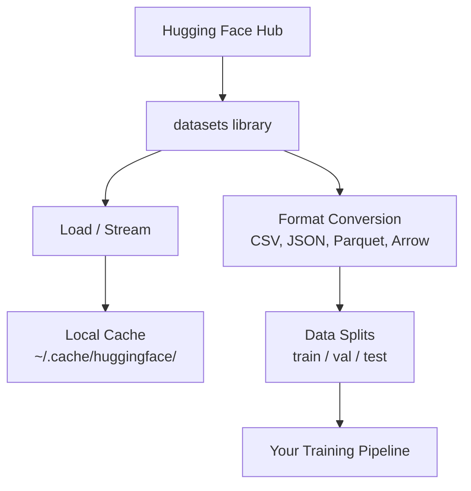

# 資料管理 (Data Management)

> 資料是燃料。你怎麼管理它，決定了你能跑多快。

**Type:** Build
**Language:** Python
**Prerequisites:** Phase 0, Lesson 01
**Time:** ~45 分鐘

## 學習目標 (Learning Objectives)

- 用 Hugging Face `datasets` 函式庫載入、串流與快取資料集
- 在 CSV、JSON、Parquet 與 Arrow 格式之間轉換，並說明各自的取捨
- 用固定的 random seed 建立可重現的 train/validation/test 切分
- 用 `.gitignore`、Git LFS 或 DVC 管理大型模型與資料集檔案

## 問題 (The Problem)

每個 AI 專案都從資料開始。你需要找資料集、下載、轉換格式、切分成訓練與評估用的部分，還要做版本管理，讓實驗可重現。每次都手動做，既慢又容易出錯。你需要一套可重複的流程。

## 核心概念 (The Concept)



Hugging Face `datasets` 函式庫是為 AI 工作載入資料的標準方式。下載、快取、格式轉換和串流，它都開箱即用。

```figure
s0-data-pipeline
```

## 動手做 (Build It)

### 步驟 1：安裝 datasets 函式庫

```bash
pip install datasets huggingface_hub
```

### 步驟 2：載入資料集

```python
from datasets import load_dataset

dataset = load_dataset("stanfordnlp/imdb")
print(dataset)
print(dataset["train"][0])
```

這會下載 IMDB 電影評論資料集。第一次下載之後，它會從 `~/.cache/huggingface/datasets/` 的快取載入。

### 步驟 3：串流大型資料集

有些資料集太大，硬碟放不下。串流會一列一列地載入，不需要下載整個資料集。

```python
dataset = load_dataset("wikimedia/wikipedia", "20231101.en", split="train", streaming=True)

for i, example in enumerate(dataset):
    print(example["title"])
    if i >= 4:
        break
```

串流會給你一個 `IterableDataset`。資料列一到就處理。不管資料集多大，記憶體用量都維持不變。

### 步驟 4：資料集格式

`datasets` 函式庫底層使用 Apache Arrow。你可以依 pipeline 的需求轉成其他格式。

```python
dataset = load_dataset("stanfordnlp/imdb", split="train")

dataset.to_csv("imdb_train.csv")
dataset.to_json("imdb_train.json")
dataset.to_parquet("imdb_train.parquet")
```

格式比較：

| 格式 | 大小 | 讀取速度 | 最適合 |
|--------|------|-----------|----------|
| CSV | 大 | 慢 | 人類可讀、試算表 |
| JSON | 大 | 慢 | API、巢狀資料 |
| Parquet | 小 | 快 | 分析、欄式查詢 |
| Arrow | 小 | 最快 | 記憶體內處理（`datasets` 內部使用的格式） |

對 AI 工作來說，Parquet 是最佳的儲存格式。Arrow 是你在記憶體內操作的格式。CSV 和 JSON 用於交換資料。

### 步驟 5：資料切分

每個 ML 專案都需要三種切分：

- **Train**：模型從這裡學習（通常 80%）
- **Validation**：訓練期間用來檢查進度（通常 10%）
- **Test**：訓練完成後的最終評估（通常 10%）

有些資料集已經切分好了。沒有的話，就自己切：

```python
dataset = load_dataset("stanfordnlp/imdb", split="train")

split = dataset.train_test_split(test_size=0.2, seed=42)
train_val = split["train"].train_test_split(test_size=0.125, seed=42)

train_ds = train_val["train"]
val_ds = train_val["test"]
test_ds = split["test"]

print(f"Train: {len(train_ds)}, Val: {len(val_ds)}, Test: {len(test_ds)}")
```

一定要設定 seed 以確保可重現。同一個 seed 每次都會產生相同的切分。

### 步驟 6：下載並快取模型

模型是很大的檔案。`huggingface_hub` 函式庫負責下載與快取。

```python
from huggingface_hub import hf_hub_download, snapshot_download

model_path = hf_hub_download(
    repo_id="sentence-transformers/all-MiniLM-L6-v2",
    filename="config.json"
)
print(f"Cached at: {model_path}")

model_dir = snapshot_download("sentence-transformers/all-MiniLM-L6-v2")
print(f"Full model at: {model_dir}")
```

模型會快取到 `~/.cache/huggingface/hub/`。下載一次之後，之後執行都能立刻載入。

### 步驟 7：處理大型檔案

模型權重與大型資料集不該放進 git。有三種做法：

**做法 A：.gitignore（最簡單）**

```
*.bin
*.safetensors
*.pt
*.onnx
data/*.parquet
data/*.csv
models/
```

**做法 B：Git LFS（在 git 中追蹤大型檔案）**

```bash
git lfs install
git lfs track "*.bin"
git lfs track "*.safetensors"
git add .gitattributes
```

Git LFS 把指標存在你的 repo 裡，實際檔案則放在另一個伺服器。GitHub 提供 1 GB 的免費額度。

**做法 C：DVC（資料版本控制）**

```bash
pip install dvc
dvc init
dvc add data/training_set.parquet
git add data/training_set.parquet.dvc data/.gitignore
git commit -m "Track training data with DVC"
```

DVC 會建立指向你資料的小型 `.dvc` 檔。資料本身則存放在 S3、GCS 或其他遠端儲存後端。

| 做法 | 複雜度 | 最適合 |
|----------|-----------|----------|
| .gitignore | 低 | 個人專案、可以重新抓取的下載資料 |
| Git LFS | 中 | 透過 git 共享模型權重的團隊 |
| DVC | 高 | 可重現的實驗、大型資料集、團隊 |

這門課用 `.gitignore` 就夠了。需要在不同機器上重現完全相同的實驗時，再用 DVC。

### 步驟 8：儲存模式

**本機儲存**適合約 10 GB 以下的資料集。HF 的快取會自動處理。

**雲端儲存**用於更大的資料，或需要跨機器共享的資料：

```python
import os

local_path = os.path.expanduser("~/.cache/huggingface/datasets/")

# s3_path = "s3://my-bucket/datasets/"
# gcs_path = "gs://my-bucket/datasets/"
```

DVC 可以直接整合 S3 和 GCS：

```bash
dvc remote add -d myremote s3://my-bucket/dvc-store
dvc push
```

這門課用本機儲存就足夠了。當你在遠端 GPU 主機上做 fine-tuning 時，雲端儲存才會變得重要。

## 這門課使用的資料集

| 資料集 | 課程 | 大小 | 學到什麼 |
|---------|---------|------|----------------|
| IMDB | Tokenization、分類 | 84 MB | 文字分類基礎 |
| WikiText | 語言模型 | 181 MB | 預測下一個 token |
| SQuAD | 問答系統 | 35 MB | 問答、span |
| Common Crawl (subset) | Embedding | 不一定 | 大規模文字處理 |
| MNIST | 視覺基礎 | 21 MB | 影像分類基礎 |
| COCO (subset) | 多模態 | 不一定 | 影像與文字配對 |

你現在不需要全部下載。每堂課都會說明它需要什麼。

## 實際使用 (Use It)

執行工具腳本，確認一切運作正常：

```bash
python code/data_utils.py
```

這會下載一個小型資料集、轉換格式、做切分，並印出摘要。

## 交付 (Ship It)

這堂課會產出：
- `code/data_utils.py` - 可重複使用的資料載入與快取工具
- `outputs/prompt-data-helper.md` - 為任務找出合適資料集的 prompt

## 練習 (Exercises)

1. 用 `mrpc` 設定載入 `glue` 資料集，並檢視前 5 筆範例
2. 串流 `c4` 資料集，計算你在 10 秒內能處理多少筆範例
3. 把資料集轉成 Parquet，並將檔案大小與 CSV 比較
4. 用固定的 seed 建立 70/15/15 的 train/val/test 切分，並驗證各自的大小

### 提示 (Hints)

**練習 1。** 呼叫 `code/data_utils.py` 的 `load_and_inspect("glue", "mrpc")`，或直接呼叫 `load_dataset("glue", "mrpc")`，並印出 `ds["train"][:5]`。每筆範例都必須有 `sentence1`、`sentence2` 和 `label` 欄位。

**練習 2。** 像 `stream_dataset` 那樣用 `streaming=True` 載入資料集，並在迴圈中讀取範例，直到 `time.time()` 超過開始時間加 10 秒就停止。印出計數；請跑兩次，因為第一次包含連線的啟動時間。

**練習 3。** 像 `convert_format` 那樣，用 `to_csv` 和 `to_parquet` 儲存同一個資料集，再用 `ls -lh` 或 `os.path.getsize` 比較大小。用 `load_from_parquet` 把 Parquet 檔載回來，檢查列數沒有改變。

**練習 4。** 用固定的 `seed` 呼叫兩次 `train_test_split`：先切出 30%，再把這 30% 對半切。三個長度加起來必須等於原本的長度，而且用同一個 seed 再跑一次，每個切分的第一列必須相同。

## 關鍵術語 (Key Terms)

| 術語 | 大家怎麼說 | 實際意思 |
|------|----------------|----------------------|
| Dataset split | 「訓練資料」 | 在 ML 生命週期不同階段使用的具名子集（train/val/test） |
| Streaming | 「延遲載入」 | 從遠端來源一列一列地處理資料，不需要下載整個資料集 |
| Parquet | 「壓縮的 CSV」 | 針對分析查詢與儲存效率最佳化的欄式檔案格式 |
| Arrow | 「快速的 dataframe」 | datasets 函式庫內部使用的記憶體內欄式格式，支援 zero-copy 讀取 |
| Git LFS | 「大檔案用的 Git」 | 一種擴充功能，把大型檔案存放在 git repo 之外，只在版本控制中保留指標 |
| DVC | 「資料用的 Git」 | 資料集與模型的版本控制系統，可整合雲端儲存 |
| Cache | 「已經下載過了」 | 先前抓取過的資料的本機副本，預設存放在 ~/.cache/huggingface/ |
