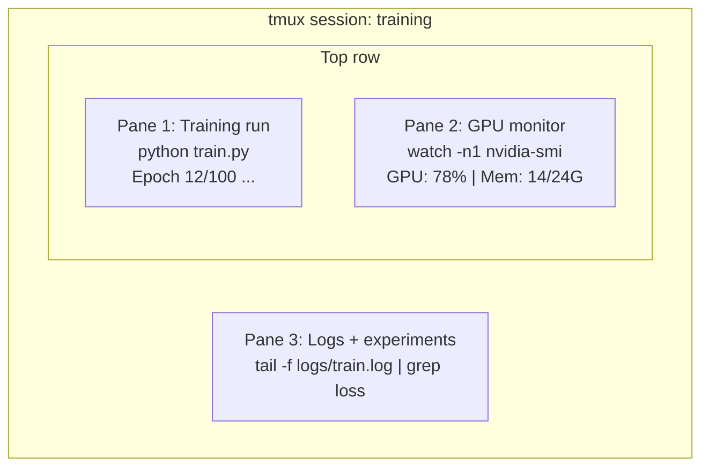

# 終端機與 Shell (Terminal & Shell)

> 終端機是 AI 工程師生活的地方。先習慣它。

**Type:** Learn
**Languages:** --
**Prerequisites:** Phase 0, Lesson 01
**Time:** ~35 分鐘

## 學習目標 (Learning Objectives)

- 用 piping、redirect 和 `grep`，從命令列過濾並處理訓練 log
- 建立含多個 pane 的持久 tmux session，同時進行訓練與 GPU 監控
- 用 `htop`、`nvtop` 和 `nvidia-smi` 監控系統與 GPU 資源
- 用 SSH、`scp` 和 `rsync` 在本機與遠端機器之間傳輸檔案

## 問題 (The Problem)

你待在終端機的時間會比待在任何編輯器都多。訓練、GPU 監控、追蹤 log、遠端 SSH session、環境管理。每個 AI 工作流程都會用到 shell。你在這裡慢，就會處處慢。

這堂課涵蓋 AI 工作中重要的終端機技能。不講 Unix 的歷史，也不深入 Bash 腳本。只教你需要的。

## 核心概念 (The Concept)



三件事同時進行。只用一個終端機。你可以 detach、回家、再 SSH 連回來並重新 attach。訓練會一直跑下去。

```figure
s0-shell-pipeline
```

## 動手做 (Build It)

### 步驟 1：認識你的 shell

查看你正在使用哪個 shell：

```bash
echo $SHELL
```

大多數系統使用 `bash` 或 `zsh`。兩者都可以。這門課的指令在兩者中都能用。

要知道的重點：

```bash
# Move around
cd ~/projects/ai-engineering-from-scratch
pwd
ls -la

# History search (most useful shortcut you'll learn)
# Ctrl+R then type part of a previous command
# Press Ctrl+R again to cycle through matches

# Clear terminal
clear   # or Ctrl+L

# Cancel a running command
# Ctrl+C

# Suspend a running command (resume with fg)
# Ctrl+Z
```

### 步驟 2：Piping 與 redirect

Piping 把指令串接起來。你就是這樣處理 log、過濾輸出和串接工具的。你會不斷用到它。

```bash
# Count how many times "loss" appears in a log
cat train.log | grep "loss" | wc -l

# Extract just the loss values from training output
grep "loss:" train.log | awk '{print $NF}' > losses.txt

# Watch a log file update in real time, filtering for errors
tail -f train.log | grep --line-buffered "ERROR"

# Sort experiments by final accuracy
grep "final_accuracy" results/*.log | sort -t= -k2 -n -r

# Redirect stdout and stderr to separate files
python train.py > output.log 2> errors.log

# Redirect both to the same file
python train.py > train_full.log 2>&1
```

你需要的四種 redirect 和 pipe：

| 符號 | 作用 |
|--------|-------------|
| `>` | 把 stdout 寫入檔案（覆寫） |
| `>>` | 把 stdout 附加到檔案 |
| `2>` | 把 stderr 寫入檔案 |
| `2>&1` | 把 stderr 送到與 stdout 相同的地方 |
| `\|` | 把一個指令的 stdout 當作下一個指令的 stdin |

### 步驟 3：背景程序

訓練一跑就是好幾個小時。你不會想一直開著終端機。

```bash
# Run in background (output still goes to terminal)
python train.py &

# Run in background, immune to hangup (closing terminal won't kill it)
nohup python train.py > train.log 2>&1 &

# Check what's running in background
jobs
ps aux | grep train.py

# Bring a background job to foreground
fg %1

# Kill a background process
kill %1
# or find its PID and kill that
kill $(pgrep -f "train.py")
```

`&`、`nohup` 和 `screen`/`tmux` 的差別：

| 方法 | 關閉終端機後還在嗎？ | 能重新 attach 嗎？ |
|--------|-------------------------|---------------|
| `command &` | 否 | 否 |
| `nohup command &` | 是 | 否（要看 log 檔） |
| `screen` / `tmux` | 是 | 是 |

只要超過幾分鐘的工作，就用 tmux。

### 步驟 4：tmux

tmux 讓你建立含多個 pane 的持久終端機 session。它是管理訓練最有用的單一工具。

```bash
# Install
# macOS
brew install tmux
# Ubuntu
sudo apt install tmux

# Start a named session
tmux new -s training

# Split horizontally
# Ctrl+B then "

# Split vertically
# Ctrl+B then %

# Navigate between panes
# Ctrl+B then arrow keys

# Detach (session keeps running)
# Ctrl+B then d

# Reattach
tmux attach -t training

# List sessions
tmux ls

# Kill a session
tmux kill-session -t training
```

典型的 AI 工作流程 session：

```bash
tmux new -s train

# Pane 1: start training
python train.py --epochs 100 --lr 1e-4

# Ctrl+B, " to split, then run GPU monitor
watch -n1 nvidia-smi

# Ctrl+B, % to split vertically, tail the logs
tail -f logs/experiment.log

# Now detach with Ctrl+B, d
# SSH out, go get coffee, come back
# tmux attach -t train
```

### 步驟 5：用 htop 和 nvtop 監控

```bash
# System processes (better than top)
htop

# GPU processes (if you have NVIDIA GPU)
# Install: sudo apt install nvtop (Ubuntu) or brew install nvtop (macOS)
nvtop

# Quick GPU check without nvtop
nvidia-smi

# Watch GPU usage update every second
watch -n1 nvidia-smi

# See which processes are using the GPU
nvidia-smi --query-compute-apps=pid,name,used_memory --format=csv
```

你會用到的 `htop` 快速鍵：
- `F6` 或 `>` 依欄位排序（依記憶體排序可找出記憶體洩漏）
- `F5` 切換樹狀檢視（查看子程序）
- `F9` 終止程序
- `/` 搜尋程序名稱

### 步驟 6：用 SSH 連遠端 GPU 主機

租用雲端 GPU（Lambda、RunPod、Vast.ai）時，你會透過 SSH 連線。

```bash
# Basic connection
ssh user@gpu-box-ip

# With a specific key
ssh -i ~/.ssh/my_gpu_key user@gpu-box-ip

# Copy files to remote
scp model.pt user@gpu-box-ip:~/models/

# Copy files from remote
scp user@gpu-box-ip:~/results/metrics.json ./

# Sync a whole directory (faster for many files)
rsync -avz ./data/ user@gpu-box-ip:~/data/

# Port forward (access remote Jupyter/TensorBoard locally)
ssh -L 8888:localhost:8888 user@gpu-box-ip
# Now open localhost:8888 in your browser

# SSH config for convenience
# Add to ~/.ssh/config:
# Host gpu
#     HostName 192.168.1.100
#     User ubuntu
#     IdentityFile ~/.ssh/gpu_key
#
# Then just:
# ssh gpu
```

### 步驟 7：AI 工作用的實用 alias

把這些加到你的 `~/.bashrc` 或 `~/.zshrc`：

```bash
source phases/00-setup-and-tooling/10-terminal-and-shell/code/shell_aliases.sh
```

或者只複製你想要的。主要的 alias：

```bash
# GPU status at a glance
alias gpu='nvidia-smi --query-gpu=index,name,utilization.gpu,memory.used,memory.total,temperature.gpu --format=csv,noheader'

# Kill all Python training processes
alias killtraining='pkill -f "python.*train"'

# Quick virtual environment activate
alias ae='source .venv/bin/activate'

# Watch training loss
alias watchloss='tail -f logs/*.log | grep --line-buffered "loss"'
```

完整的集合請見 `code/shell_aliases.sh`。

### 步驟 8：常見的 AI 終端機模式

這些在實務上會反覆出現：

```bash
# Run training, log everything, notify when done
python train.py 2>&1 | tee train.log; echo "DONE" | mail -s "Training complete" you@email.com

# Compare two experiment logs side by side
diff <(grep "accuracy" exp1.log) <(grep "accuracy" exp2.log)

# Find the largest model files (clean up disk space)
find . -name "*.pt" -o -name "*.safetensors" | xargs du -h | sort -rh | head -20

# Download a model from Hugging Face
wget https://huggingface.co/model/resolve/main/model.safetensors

# Untar a dataset
tar xzf dataset.tar.gz -C ./data/

# Count lines in all Python files (see how big your project is)
find . -name "*.py" | xargs wc -l | tail -1

# Check disk space (training data fills disks fast)
df -h
du -sh ./data/*

# Environment variable check before training
env | grep -i cuda
env | grep -i torch
```

## 實際使用 (Use It)

這是這門課中各個工具派上用場的時機：

| 工具 | 何時使用 |
|------|----------------|
| tmux | 每次訓練（Phase 3 以後） |
| `tail -f` + `grep` | 監控訓練 log |
| `nohup` / `&` | 快速的背景工作 |
| `htop` / `nvtop` | 除錯訓練太慢、OOM 錯誤 |
| SSH + `rsync` | 在雲端 GPU 上工作 |
| Piping + redirect | 處理實驗結果 |
| Alias | 節省重複指令的時間 |

## 練習 (Exercises)

1. 安裝 tmux，建立一個有三個 pane 的 session，在一個 pane 執行 `htop`，另一個執行 `watch -n1 date`，第三個執行 Python 腳本。然後 detach 再重新 attach。
2. 把 `code/shell_aliases.sh` 的 alias 加到你的 shell 設定，並用 `source ~/.zshrc`（或 `~/.bashrc`）重新載入。
3. 用 `for i in $(seq 1 100); do echo "epoch $i loss: $(echo "scale=4; 1/$i" | bc)"; sleep 0.1; done > fake_train.log` 建立一份假的訓練 log，再用 `grep`、`tail` 和 `awk` 只取出 loss 的值。
4. 為你有權限使用的伺服器設定一個 SSH config 項目（或用 `localhost` 練習語法）。

### 提示 (Hints)

**練習 1。** 從 `tmux new -s practice` 開始，用前綴鍵 `Ctrl+B` 接著按 `"` 和 `%` 來分割，並用 `Ctrl+B` 加方向鍵在 pane 之間移動。用 `Ctrl+B` 再按 `d` 來 detach，執行 `tmux ls`，再用 `tmux attach -t practice` 重新 attach；三個程式都必須仍在執行。

**練習 2。** 把 `code/shell_aliases.sh` 的內容複製到 `~/.zshrc` 或 `~/.bashrc` 的結尾，然後對該檔案執行 `source`。對其中一個新 alias 執行 `alias` 或 `type <name>`，確認 shell 認得它。

**練習 3。** 先執行 `tail -5 fake_train.log` 看看每行的格式。然後用 `grep loss` 過濾，再用 `awk '{print $NF}'` 只印出最後一個欄位；輸出必須是 100 個越來越小的數字。

**練習 4。** 把課程中的 `Host gpu` 區塊複製到 `~/.ssh/config`，並把 `HostName` 和 `User` 改成你的伺服器，或改成 `localhost` 和你的使用者名稱。執行 `ssh -G gpu` 印出 SSH 將使用的設定。如果你有可連線、且接受你的 key 的 SSH 伺服器，就執行 `ssh gpu` 連線。

## 關鍵術語 (Key Terms)

| 術語 | 大家怎麼說 | 實際意思 |
|------|----------------|----------------------|
| Shell | 「終端機」 | 解譯你所下指令的程式（bash、zsh、fish） |
| tmux | 「終端機多工器」 | 讓你在一個視窗中執行多個終端機 session，並可 detach/重新 attach 的程式 |
| Pipe | 「那個直線符號」 | `\|` 運算子，把一個指令的輸出當作另一個指令的輸入 |
| PID | 「程序 ID」 | 指派給每個執行中程序的唯一數字，用來監控或終止它 |
| nohup | 「No hangup」 | 執行時不受 hangup 訊號影響的指令，所以關閉終端機也不會終止它 |
| SSH | 「連到伺服器」 | Secure Shell，一種用來在遠端機器上執行指令的加密協定 |
