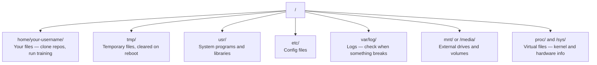

# AI 用的 Linux (Linux for AI)

> 大多數 AI 都跑在 Linux 上。你需要懂到不會卡關。

**Type:** Learn
**Languages:** --
**Prerequisites:** Phase 0, Lesson 01
**Time:** ~30 分鐘

## 學習目標 (Learning Objectives)

- 在 Linux 檔案系統中移動，並從命令列執行基本的檔案操作
- 用 `chmod` 和 `chown` 管理檔案權限，解決 "Permission denied" 錯誤
- 用 `apt` 安裝系統套件，並為 AI 工作設定一台全新的 GPU 主機
- 找出 macOS 與 Linux 的差異，這些差異常讓在遠端機器上工作的開發者踩雷

## 問題 (The Problem)

你在 macOS 或 Windows 上開發。但當你 SSH 進雲端 GPU 主機、租用 Lambda 實例，或啟動 EC2 機器的那一刻，你面對的就是 Ubuntu。終端機是你唯一的介面。沒有 Finder，沒有檔案總管，沒有 GUI。如果你無法從命令列瀏覽檔案系統、安裝套件和管理程序，你就會一邊為閒置的 GPU 時數付費，一邊上網搜尋「Linux 怎麼解壓縮檔案」。

這是一份生存指南。它只涵蓋在遠端 Linux 機器上做 AI 工作所需要的內容，不多也不少。

## 檔案系統配置 (File System Layout)

Linux 把所有東西都放在單一根目錄 `/` 之下。沒有 `C:\` 或 `/Volumes`。你實際會碰到的目錄：



你的家目錄是 `~` 或 `/home/your-username`。你做的幾乎所有事都發生在這裡。

## 必備指令 (Essential Commands)

這 13 個指令涵蓋了你在遠端 GPU 主機上大部分要做的事。

### 移動 (Moving Around)

```bash
pwd                         # Where am I?
ls                          # What's here?
ls -la                      # What's here, including hidden files with details?
cd /path/to/dir             # Go there
cd ~                        # Go home
cd ..                       # Go up one level
```

### 檔案與目錄 (Files and Directories)

```bash
mkdir my-project            # Create a directory
mkdir -p a/b/c              # Create nested directories in one shot

cp file.txt backup.txt      # Copy a file
cp -r src/ src-backup/      # Copy a directory (recursive)

mv old.txt new.txt          # Rename a file
mv file.txt /tmp/           # Move a file

rm file.txt                 # Delete a file (no trash, it's gone)
rm -rf my-dir/              # Delete a directory and everything inside
```

`rm -rf` 是永久刪除。沒有復原。按下 Enter 之前，再檢查一次路徑。

### 讀取檔案 (Reading Files)

```bash
cat file.txt                # Print entire file
head -20 file.txt           # First 20 lines
tail -20 file.txt           # Last 20 lines
tail -f log.txt             # Follow a log file in real time (Ctrl+C to stop)
less file.txt               # Scroll through a file (q to quit)
```

### 搜尋 (Searching)

```bash
grep "error" training.log           # Find lines containing "error"
grep -r "learning_rate" .           # Search all files in current directory
grep -i "cuda" config.yaml          # Case-insensitive search

find . -name "*.py"                 # Find all Python files under current dir
find . -name "*.ckpt" -size +1G     # Find checkpoint files larger than 1GB
```

## 權限 (Permissions)

Linux 中的每個檔案都有擁有者和權限位元。當腳本無法執行，或你無法寫入某個目錄時，就會碰到這個問題。

```bash
ls -l train.py
# -rwxr-xr-- 1 user group 2048 Mar 19 10:00 train.py
#  ^^^             owner permissions: read, write, execute
#     ^^^          group permissions: read, execute
#        ^^        everyone else: read only
```

常見的修正方法：

```bash
chmod +x train.sh           # Make a script executable
chmod 755 deploy.sh         # Owner: full, others: read+execute
chmod 644 config.yaml       # Owner: read+write, others: read only

chown user:group file.txt   # Change who owns a file (needs sudo)
```

看到 "Permission denied" 時，幾乎都是權限問題。`chmod +x` 或 `sudo` 能解決大部分情況。

## 套件管理 (Package Management, apt)

Ubuntu 使用 `apt`。你就是用它來安裝系統層級的軟體。

```bash
sudo apt update             # Refresh the package list (always do this first)
sudo apt install -y htop    # Install a package (-y skips confirmation)
sudo apt install -y build-essential  # C compiler, make, etc. Needed by many Python packages
sudo apt install -y tmux    # Terminal multiplexer (keep sessions alive after disconnect)

apt list --installed        # What's installed?
sudo apt remove htop        # Uninstall
```

在全新 GPU 主機上常裝的套件：

```bash
sudo apt update && sudo apt install -y \
    build-essential \
    git \
    curl \
    wget \
    tmux \
    htop \
    unzip \
    python3-venv
```

## 使用者與 sudo (Users and sudo)

你通常以一般使用者登入。有些操作需要 root（管理員）權限。

```bash
whoami                      # What user am I?
sudo command                # Run a single command as root
sudo su                     # Become root (exit to go back, use sparingly)
```

在雲端 GPU 實例上，你通常是唯一的使用者，而且已經有 sudo 權限。不要什麼都用 root 執行。只在需要時才用 sudo。

## 程序與 systemd (Processes and systemd)

當你的訓練卡住，或需要查看什麼正在執行時：

```bash
htop                        # Interactive process viewer (q to quit)
ps aux | grep python        # Find running Python processes
kill 12345                  # Gracefully stop process with PID 12345
kill -9 12345               # Force kill (use when graceful doesn't work)
nvidia-smi                  # GPU processes and memory usage
```

systemd 管理服務（背景 daemon）。如果你要執行 inference server，就會用到它：

```bash
sudo systemctl start nginx          # Start a service
sudo systemctl stop nginx           # Stop it
sudo systemctl restart nginx        # Restart it
sudo systemctl status nginx         # Check if it's running
sudo systemctl enable nginx         # Start automatically on boot
```

## 磁碟空間 (Disk Space)

GPU 主機的磁碟空間通常有限。模型和資料集很快就會把它塞滿。

```bash
df -h                       # Disk usage for all mounted drives
df -h /home                 # Disk usage for /home specifically

du -sh *                    # Size of each item in current directory
du -sh ~/.cache             # Size of your cache (pip, huggingface models land here)
du -sh /data/checkpoints/   # Check how big your checkpoints are

# Find the biggest space hogs
du -h --max-depth=1 / 2>/dev/null | sort -hr | head -20
```

常見的省空間方法：

```bash
# Clear pip cache
pip cache purge

# Clear apt cache
sudo apt clean

# Remove old checkpoints you don't need
rm -rf checkpoints/epoch_01/ checkpoints/epoch_02/
```

## 網路 (Networking)

你會從命令列下載模型、傳輸檔案，並呼叫 API。

```bash
# Download files
wget https://example.com/model.bin                   # Download a file
curl -O https://example.com/data.tar.gz              # Same thing with curl
curl -s https://api.example.com/health | python3 -m json.tool  # Hit an API, pretty-print JSON

# Transfer files between machines
scp model.bin user@remote:/data/                     # Copy file to remote machine
scp user@remote:/data/results.csv .                  # Copy file from remote to local
scp -r user@remote:/data/checkpoints/ ./local-dir/   # Copy directory

# Sync directories (faster than scp for large transfers, resumes on failure)
rsync -avz --progress ./data/ user@remote:/data/
rsync -avz --progress user@remote:/results/ ./results/
```

只要檔案很大，就用 `rsync` 而不是 `scp`。它只傳輸有變動的位元組，也能處理中斷的連線。

## tmux：讓 session 保持運作 (tmux: Keep Sessions Alive)

當你 SSH 進遠端主機時，闔上筆電會終止你的訓練。tmux 可以避免這種事。

```bash
tmux new -s train           # Start a new session named "train"
# ... start your training, then:
# Ctrl+B, then D            # Detach (training keeps running)

tmux ls                     # List sessions
tmux attach -t train        # Reattach to session

# Inside tmux:
# Ctrl+B, then %            # Split pane vertically
# Ctrl+B, then "            # Split pane horizontally
# Ctrl+B, then arrow keys   # Switch between panes
```

長時間的訓練工作，一定要在 tmux 裡執行。一定。

## 給 Windows 使用者的 WSL2 (WSL2 for Windows Users)

如果你用 Windows，WSL2 讓你不用雙系統開機，就能擁有真正的 Linux 環境。

```bash
# In PowerShell (admin)
wsl --install -d Ubuntu-24.04

# After restart, open Ubuntu from Start menu
sudo apt update && sudo apt upgrade -y
```

WSL2 執行的是真正的 Linux kernel。這堂課的所有內容在裡面都能用。從 WSL 內部看，你的 Windows 檔案位於 `/mnt/c/Users/YourName/`。

GPU passthrough 在 Windows 端安裝 NVIDIA driver 後即可運作。請安裝 Windows 版的 NVIDIA driver（不是 Linux 版），這樣 CUDA 在 WSL2 內就能使用。

## 陷阱：從 macOS 到 Linux (Gotchas: macOS to Linux)

如果你從 macOS 轉過來，這些事會讓你踩雷：

| macOS | Linux | 備註 |
|-------|-------|-------|
| `brew install` | `sudo apt install` | 套件名稱有時不同。`brew install htop` 與 `sudo apt install htop` 作用相同，但 `brew install readline` 與 `sudo apt install libreadline-dev` 就不是這樣。 |
| `open file.txt` | `xdg-open file.txt` | 但遠端主機上不會有 GUI。請用 `cat` 或 `less`。 |
| `pbcopy` / `pbpaste` | 無法使用 | 透過 SSH 時，無法 pipe 到剪貼簿或從剪貼簿 pipe 出來。 |
| `~/.zshrc` | `~/.bashrc` | macOS 預設使用 zsh。大多數 Linux 伺服器使用 bash。 |
| `/opt/homebrew/` | `/usr/bin/`, `/usr/local/bin/` | 執行檔放在不同的位置。 |
| `sed -i '' 's/a/b/' file` | `sed -i 's/a/b/' file` | macOS 的 sed 在 `-i` 後面需要一個空字串。Linux 不需要。 |
| 不分大小寫的檔案系統 | 分大小寫的檔案系統 | 在 Linux 上，`Model.py` 和 `model.py` 是兩個不同的檔案。 |
| 換行字元 `\n` | 換行字元 `\n` | 相同。但 Windows 使用 `\r\n`，這會讓 bash 腳本壞掉。執行 `dos2unix` 來修正。 |

## 速查卡 (Quick Reference Card)

```
Navigation:     pwd, ls, cd, find
Files:          cp, mv, rm, mkdir, cat, head, tail, less
Search:         grep, find
Permissions:    chmod, chown, sudo
Packages:       apt update, apt install
Processes:      htop, ps, kill, nvidia-smi
Services:       systemctl start/stop/restart/status
Disk:           df -h, du -sh
Network:        curl, wget, scp, rsync
Sessions:       tmux new/attach/detach
```

```figure
s0-process-fork
```

## 練習 (Exercises)

1. SSH 進任何一台 Linux 機器（或開啟 WSL2），切換到你的家目錄。建立一個專案資料夾，在裡面用 `touch` 建立三個空檔案，再用 `ls -la` 列出它們。
2. 用 apt 安裝 `htop`，執行它，並找出哪個程序用掉最多記憶體。
3. 啟動一個 tmux session，在裡面執行 `sleep 300`，然後 detach、列出 session，再重新 attach。
4. 用 `df -h` 檢查可用的磁碟空間，再用 `du -sh ~/.cache/*` 找出你的快取中是什麼佔用了空間。
5. 用 `scp` 把檔案從本機傳到遠端機器，再用 `rsync` 做同樣的傳輸，並比較兩者的體驗。

### 提示 (Hints)

**練習 1。** 用 `cd ~`、`mkdir`，再 `cd` 進新資料夾，然後用三個檔名執行 `touch`。在 `ls -la` 的輸出中，確認這三個檔案的大小都是 0，擁有者是你的使用者名稱。

**練習 2。** 用 `sudo apt install -y htop` 安裝，啟動它，並按 `F6`（或點擊欄位名稱）依 `MEM%` 排序。清單最上面的程序用掉最多記憶體。

**練習 3。** 用課程中的 `tmux new -s train`，執行 `sleep 300`，再用 `Ctrl+B` 然後 `d` 來 detach。執行 `tmux ls` 查看 session，然後 `tmux attach -t train`；`sleep` 必須仍在執行。

**練習 4。** 執行 `df -h`，並讀取放著你家資料夾的那個檔案系統的 `Avail` 欄位。然後執行 `du -sh ~/.cache/* | sort -h`，讓最大的資料夾出現在最後一行。

**練習 5。** 用 `scp file.txt user@host:~/` 複製檔案，然後對同一個檔案執行 `rsync -avP file.txt user@host:~/`。再執行第二次 `rsync` 指令：它幾乎不會傳送任何東西，因為遠端的檔案沒有變動。
