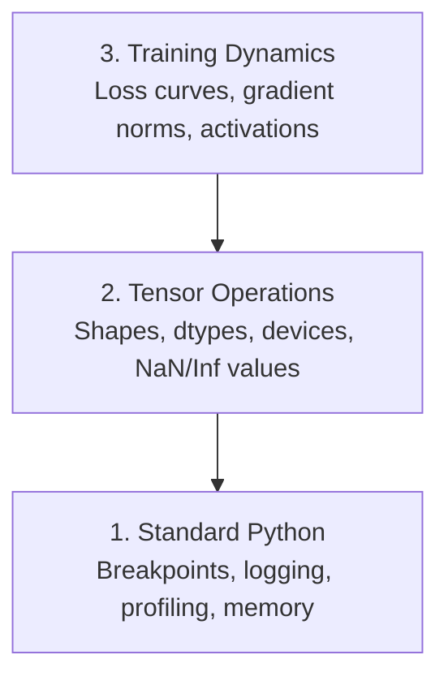

# 除錯與效能分析 (Debugging and Profiling)

> 最糟的 AI bug 不會當機。它們默默地在垃圾資料上訓練，還回報一條漂亮的 loss 曲線。

**Type:** Build
**Language:** Python
**Prerequisites:** Lesson 1 (Dev Environment), basic PyTorch familiarity
**Time:** ~60 分鐘

## 學習目標 (Learning Objectives)

- 用條件式 `breakpoint()` 和 `debug_print`，在訓練途中檢查 tensor 的 shape、dtype 和 NaN 值
- 用 `cProfile`、`line_profiler` 和 `tracemalloc` 分析訓練迴圈，找出瓶頸
- 偵測常見的 AI bug：shape 不符、NaN loss、資料洩漏，以及放在錯誤裝置上的 tensor
- 設定 TensorBoard，視覺化 loss 曲線、權重直方圖與 gradient 分布

## 問題 (The Problem)

AI 程式碼的失敗方式和一般程式碼不同。網頁應用程式當掉時會有 stack trace。設定錯誤的訓練迴圈卻會跑 8 小時，燒掉 $200 的 GPU 時間，產出一個只會預測每個輸入平均值的模型。程式從頭到尾都沒報錯。bug 可能是放在錯誤裝置上的 tensor、忘記加的 `.detach()`，或是 label 洩漏到 feature 裡。

你需要除錯工具，在這些無聲的失敗浪費你的時間和算力之前就把它們抓出來。

## 核心概念 (The Concept)

AI 除錯分成三個層次：



大多數人會直接跳到第 3 層（盯著 TensorBoard 看）。但 80% 的 AI bug 都出在第 1 和第 2 層。

```figure
s0-flame-hot
```

## 動手做 (Build It)

### 第 1 部分：Print 除錯（對，它有用）

大家常看輕 print 除錯。其實不該。對 tensor 程式碼來說，針對性的 print 比逐步執行 debugger 更有效，因為你需要同時看到 shape、dtype 和數值範圍。

```python
def debug_print(name, tensor):
    print(f"{name}: shape={tensor.shape}, dtype={tensor.dtype}, "
          f"device={tensor.device}, "
          f"min={tensor.min().item():.4f}, max={tensor.max().item():.4f}, "
          f"mean={tensor.mean().item():.4f}, "
          f"has_nan={tensor.isnan().any().item()}")
```

在每個可疑的操作之後呼叫它。找到 bug 後，就把 print 移除。很簡單。

### 第 2 部分：Python debugger（pdb 與 breakpoint）

內建的 debugger 在 AI 工作中被低估了。把 `breakpoint()` 放進訓練迴圈，就能互動式地檢查 tensor。

```python
def training_step(model, batch, criterion, optimizer):
    inputs, labels = batch
    outputs = model(inputs)
    loss = criterion(outputs, labels)

    if loss.item() > 100 or torch.isnan(loss):
        breakpoint()

    loss.backward()
    optimizer.step()
```

debugger 把你帶進去之後，有用的指令：

- `p outputs.shape` 檢查 shape
- `p loss.item()` 查看 loss 值
- `p torch.isnan(outputs).sum()` 計算 NaN 的數量
- `p model.fc1.weight.grad` 檢查 gradient
- `c` 繼續，`q` 離開

這就是條件式除錯。只有在看起來不對勁時才會停下來。對於 10,000 步的訓練，這很重要。

### 第 3 部分：Python logging

當你的除錯超出快速檢查的範圍時，就用 logging 取代 print。

```python
import logging

logging.basicConfig(
    level=logging.INFO,
    format="%(asctime)s [%(levelname)s] %(message)s",
    handlers=[
        logging.FileHandler("training.log"),
        logging.StreamHandler()
    ]
)
logger = logging.getLogger(__name__)

logger.info("Starting training: lr=%.4f, batch_size=%d", lr, batch_size)
logger.warning("Loss spike detected: %.4f at step %d", loss.item(), step)
logger.error("NaN loss at step %d, stopping", step)
```

Logging 提供時間戳記、嚴重程度和檔案輸出。當訓練在凌晨 3 點失敗時，你要的是 log 檔，而不是已經捲出畫面的終端機輸出。

### 第 4 部分：為程式區段計時

知道時間花在哪裡，是最佳化的第一步。

```python
import time

class Timer:
    def __init__(self, name=""):
        self.name = name

    def __enter__(self):
        self.start = time.perf_counter()
        return self

    def __exit__(self, *args):
        elapsed = time.perf_counter() - self.start
        print(f"[{self.name}] {elapsed:.4f}s")

with Timer("data loading"):
    batch = next(dataloader_iter)

with Timer("forward pass"):
    outputs = model(batch)

with Timer("backward pass"):
    loss.backward()
```

常見的發現：資料載入占了 60% 的訓練時間。解法是在 DataLoader 中設定 `num_workers > 0`，而不是換更快的 GPU。

### 第 5 部分：cProfile 與 line_profiler

當手動計時不夠用時：

```bash
python -m cProfile -s cumtime train.py
```

這會顯示每個函式呼叫，並依累計時間排序。若要逐行分析：

```bash
pip install line_profiler
```

```python
@profile
def train_step(model, data, target):
    output = model(data)
    loss = F.cross_entropy(output, target)
    loss.backward()
    return loss

# Run with: kernprof -l -v train.py
```

### 第 6 部分：記憶體分析

#### 用 tracemalloc 分析 CPU 記憶體

```python
import tracemalloc

tracemalloc.start()

# your code here
model = build_model()
data = load_dataset()

snapshot = tracemalloc.take_snapshot()
top_stats = snapshot.statistics("lineno")
for stat in top_stats[:10]:
    print(stat)
```

#### 用 memory_profiler 分析 CPU 記憶體

```bash
pip install memory_profiler
```

```python
from memory_profiler import profile

@profile
def load_data():
    raw = read_csv("data.csv")       # watch memory jump here
    processed = preprocess(raw)       # and here
    return processed
```

用 `python -m memory_profiler your_script.py` 執行，就能看到逐行的記憶體使用量。

#### 用 PyTorch 分析 GPU 記憶體

```python
import torch

if torch.cuda.is_available():
    print(torch.cuda.memory_summary())

    print(f"Allocated: {torch.cuda.memory_allocated() / 1e9:.2f} GB")
    print(f"Cached: {torch.cuda.memory_reserved() / 1e9:.2f} GB")
```

遇到 OOM（Out of Memory）時：

1. 降低 batch size（永遠先試這個）
2. 用 `torch.cuda.empty_cache()` 釋放快取的記憶體
3. 對大型的中間結果，先用 `del tensor`，再用 `torch.cuda.empty_cache()`
4. 使用 mixed precision（`torch.cuda.amp`）把記憶體用量減半
5. 對很深的模型使用 gradient checkpointing

### 第 7 部分：常見的 AI bug 與抓法

#### Shape 不符

最常見的 bug。某個 tensor 的 shape 是 `[batch, features]`，但模型預期的是 `[batch, channels, height, width]`。

```python
def check_shapes(model, sample_input):
    print(f"Input: {sample_input.shape}")
    hooks = []

    def make_hook(name):
        def hook(module, inp, out):
            in_shape = inp[0].shape if isinstance(inp, tuple) else inp.shape
            out_shape = out.shape if hasattr(out, "shape") else type(out)
            print(f"  {name}: {in_shape} -> {out_shape}")
        return hook

    for name, module in model.named_modules():
        hooks.append(module.register_forward_hook(make_hook(name)))

    with torch.no_grad():
        model(sample_input)

    for h in hooks:
        h.remove()
```

用一個範例 batch 執行一次。它會列出模型中每一次 shape 的轉換。

#### NaN loss

NaN loss 代表有東西爆掉了。常見原因：

- Learning rate 太高
- 自訂 loss 中除以零
- 對零或負數取 log
- RNN 中的 gradient 爆炸

```python
def detect_nan(model, loss, step):
    if torch.isnan(loss):
        print(f"NaN loss at step {step}")
        for name, param in model.named_parameters():
            if param.grad is not None:
                if torch.isnan(param.grad).any():
                    print(f"  NaN gradient in {name}")
                if torch.isinf(param.grad).any():
                    print(f"  Inf gradient in {name}")
        return True
    return False
```

#### 資料洩漏 (Data Leakage)

你的模型在 test set 上有 99% 的準確率。聽起來很棒。其實是 bug。

```python
def check_data_leakage(train_set, test_set, id_column="id"):
    train_ids = set(train_set[id_column].tolist())
    test_ids = set(test_set[id_column].tolist())
    overlap = train_ids & test_ids
    if overlap:
        print(f"DATA LEAKAGE: {len(overlap)} samples in both train and test")
        return True
    return False
```

也要檢查時間上的洩漏：用未來的資料去預測過去。切分前先依時間戳記排序。

#### 錯誤的裝置 (Wrong Device)

位於不同裝置（CPU 與 GPU）的 tensor 會造成 runtime 錯誤。但有時候，某個 tensor 會默默留在 CPU 上，而其他東西都在 GPU 上，訓練就只是跑得很慢。

```python
def check_devices(model, *tensors):
    model_device = next(model.parameters()).device
    print(f"Model device: {model_device}")
    for i, t in enumerate(tensors):
        if t.device != model_device:
            print(f"  WARNING: tensor {i} on {t.device}, model on {model_device}")
```

### 第 8 部分：TensorBoard 基礎

TensorBoard 讓你看到訓練過程中隨時間發生的變化。

```bash
pip install tensorboard
```

```python
from torch.utils.tensorboard import SummaryWriter

writer = SummaryWriter("runs/experiment_1")

for step in range(num_steps):
    loss = train_step(model, batch)

    writer.add_scalar("loss/train", loss.item(), step)
    writer.add_scalar("lr", optimizer.param_groups[0]["lr"], step)

    if step % 100 == 0:
        for name, param in model.named_parameters():
            writer.add_histogram(f"weights/{name}", param, step)
            if param.grad is not None:
                writer.add_histogram(f"grads/{name}", param.grad, step)

writer.close()
```

啟動它：

```bash
tensorboard --logdir=runs
```

要注意的地方：

- **Loss 沒有下降**：Learning rate 太低，或是模型架構有問題
- **Loss 劇烈震盪**：Learning rate 太高
- **Loss 變成 NaN**：數值不穩定（見上面的 NaN 小節）
- **Train loss 下降，val loss 上升**：Overfitting
- **權重直方圖塌縮到零**：Vanishing gradient
- **Gradient 直方圖爆炸**：需要 gradient clipping

### 第 9 部分：VS Code debugger

要做互動式除錯，請用 `launch.json` 設定 VS Code：

```json
{
    "version": "0.2.0",
    "configurations": [
        {
            "name": "Debug Training",
            "type": "debugpy",
            "request": "launch",
            "program": "${file}",
            "console": "integratedTerminal",
            "justMyCode": false
        }
    ]
}
```

點擊行號旁的空白處來設定中斷點。用 Variables 面板檢查 tensor 的屬性。Debug Console 讓你在執行到一半時執行任意的 Python 運算式。

這在逐步檢視資料前處理 pipeline 時很有用，你可以看到每一次轉換。

## 實際使用 (Use It)

這是能抓出大多數 AI bug 的除錯流程：

1. **訓練前**：用範例 batch 執行 `check_shapes`。確認輸入與輸出的維度符合預期。
2. **前 10 步**：對 loss、outputs 和 gradient 使用 `debug_print`。確認沒有 NaN，且數值在合理範圍內。
3. **訓練期間**：記錄 loss、learning rate 和 gradient norm。用 TensorBoard 視覺化。
4. **出問題時**：在失敗的位置放上 `breakpoint()`。互動式地檢查 tensor。
5. **針對效能**：比較資料載入、forward 與 backward 的時間。如果接近 OOM，就分析記憶體。

## 交付 (Ship It)

執行除錯工具箱腳本：

```bash
python phases/00-setup-and-tooling/12-debugging-and-profiling/code/debug_tools.py
```

請見 `outputs/prompt-debug-ai-code.md`，這個 prompt 可協助診斷 AI 特有的 bug。

## 練習 (Exercises)

1. 執行 `debug_tools.py`，並讀過每個區段的輸出。修改範例模型來製造一個 NaN（提示：在 forward pass 中除以零），並觀察偵測器抓到它。
2. 用 `cProfile` 分析一個訓練迴圈，找出最慢的函式。
3. 用 `tracemalloc` 找出你的資料載入 pipeline 中，哪一行配置了最多記憶體。
4. 為一個簡單的訓練設定 TensorBoard，並判斷模型是否 overfitting。
5. 在訓練迴圈中使用 `breakpoint()`。練習從 debugger 提示符號檢查 tensor 的 shape、裝置和 gradient 值。

### 提示 (Hints)

**練習 1。** 執行 `python3 phases/00-setup-and-tooling/12-debugging-and-profiling/code/debug_tools.py`，並讀每個示範函式的輸出。然後修改 `demo_nan_detection` 中的模型，讓它的輸出除以零，再執行一次；`detect_nan` 必須印出帶有 step 編號的 NaN 警告。

**練習 2。** 用 `python -m cProfile -s cumtime your_script.py` 執行迴圈，或用 `cProfile.Profile()` 包住它。讀 `cumtime` 欄位最上面的幾列；其中屬於你自己程式碼、且時間最大的函式，就是最慢的那一個。

**練習 3。** 像 `demo_memory_tracking` 那樣，在資料載入程式碼之前呼叫 `tracemalloc.start()`，之後呼叫 `tracemalloc.take_snapshot()`。印出 `snapshot.statistics("lineno")[:5]`；第一行會顯示配置最多記憶體的檔案與行號。

**練習 4。** 每個 epoch 都把 training loss 和 validation loss 記錄到 `SummaryWriter`，然後執行 `tensorboard --logdir=runs`。如果 training loss 持續下降，而 validation loss 上升，就代表模型 overfitting。

**練習 5。** 在 `loss.backward()` 之後的迴圈中放入 `breakpoint()`，然後執行腳本。在 `(Pdb)` 提示符號下，印出 `x.shape`、`x.device` 和 `next(model.parameters()).grad`，然後輸入 `c` 繼續到下一步。
