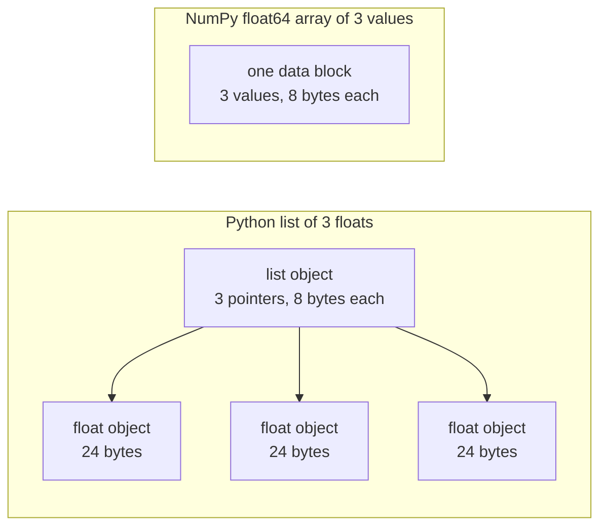

# AI 工程用的 Python (Python for AI Engineering)

> 這門課大部分的程式碼，都用同一小組 Python 慣用寫法。在數學與模型課程依賴它們之前，先在這裡學會。

**Type:** Build
**Languages:** Python
**Prerequisites:** Dev Environment, Python Environments
**Time:** ~120 分鐘

## 學習目標 (Learning Objectives)

- 讀寫課程程式碼中最常用的慣用寫法，從 unpacking、f-string 到 dataclass 與 comprehension。
- 找出三種不會報錯、卻會給出錯誤結果的 Python 錯誤：共用的 list、可變的預設參數，以及已被用完的 generator。
- 只用標準函式庫，建立 CSV 與 JSON 載入器、固定 seed 的資料切分，以及 mini-batch generator。
- 用純 Python 寫出 dot product、平均值與標準差，並量測它們的速度與記憶體用量。
- 說明為什麼對數字做純 Python 迴圈很慢，以及 NumPy broadcasting 如何把迴圈搬進編譯過的程式碼。

## 問題 (The Problem)

這個 phase 之後的課程，用純 Python 來寫數學和模型。在課程的 541 個 Python 檔中，有 276 個會 import `dataclasses`。另外有 187 個檔案呼叫 `random.seed`，或建立 `random.Random` generator。如果這些慣用寫法對你很陌生，你想讀的是數學，讀到的卻是語法。

Python 也有一些行為，會在不報任何錯誤訊息的情況下給出錯誤的結果。兩個名稱可能指向同一個 list，所以透過其中一個名稱修改，另一個也會跟著改變。預設參數的值會從一次呼叫保留到下一次呼叫。Generator 用過一次就空了，所以第二個訓練 epoch 拿不到資料，loss 也就不會改變。

最後一個問題是速度。在我們的測試筆電上，對一百萬個 float 做純 Python 迴圈，大約花 30 毫秒。NumPy 算出同樣的 dot product，不到 1 毫秒。你需要知道原因，這樣才能在清楚易懂的迴圈與陣列運算之間做選擇。

## 核心概念 (The Concept)

### 課程程式碼用了什麼

我們用 `ast` 模組解析了 `phases/*/*/code/` 中的全部 541 個 Python 檔。下表統計至少使用過各個語法結構一次的檔案數。這些數字是我們撰寫這堂課當天的數字，會隨著課程增加而改變。

| 語法結構 | 檔案數 | 比例 |
|-----------|-------|-------|
| 函式定義 | 541 | 100% |
| `if __name__ == "__main__":` | 529 | 98% |
| f-string | 517 | 96% |
| Tuple unpacking | 448 | 83% |
| 類別 | 379 | 70% |
| List comprehension | 375 | 69% |
| 函式的型別提示 | 342 | 63% |
| Generator expression | 326 | 60% |
| Slice | 314 | 58% |
| `lambda` | 175 | 32% |
| `try` 與 `except` | 120 | 22% |
| `with` 陳述式 | 96 | 18% |
| Dict comprehension | 93 | 17% |
| 使用 `yield` 的 generator 函式 | 14 | 3% |

Import 能看出哪些標準模組很重要。541 個檔案中，有 340 個以 `from __future__ import annotations` 開頭，276 個 import `dataclasses`。`math`、`random` 和 `json` 模組分別出現在 187、175 和 126 個檔案中。`collections` 模組出現在 70 個檔案中，而 `itertools` 只出現在 4 個檔案中。

沒有任何一堂課呼叫 `map()` 或 `filter()`。這些工作由 comprehension 完成。在超過 140 個檔案中，出現了帶有 `key=` 函式的 `sorted`、`min`、`max` 或 `.sort` 呼叫。這堂課在這些清單最上方的慣用寫法上花最多時間。

### 名稱指向物件 (Names refer to objects)

在 Python 中，變數是指向某個物件的名稱。賦值是把名稱綁定到物件，並不會複製物件。當兩個名稱指向同一個 list，透過任一名稱做的修改，兩邊都看得到。數字、字串和 tuple 不能改變，所以這條規則不會對它們造成問題。List、dict 和 set 可以改變，所以需要獨立的版本時，請先複製一份。

### List 存的是指標，陣列存的是數字 (A list holds pointers, an array holds numbers)

Python 的 list 並不直接存放數字。它存的是指標，每個指標指向一個完整的 Python 物件。在 64 位元的 CPython 上，每個指標占 8 bytes，每個 `float` 物件占 24 bytes。NumPy 的 `float64` 陣列則把原始的 8 bytes 數值並排存在同一塊記憶體中。



對 list 做迴圈時，每個元素都要做很多工作。直譯器一次執行一個 bytecode 指令。對每個元素，它要跟著指標找到物件，並檢查每個運算元的型別。接著呼叫 float 乘法的程式碼，再建立一個 Python float 物件來存放結果。

NumPy 對原始數值，用一個編譯過的程式碼迴圈做同樣的算術。它對整個陣列只檢查一次資料型別，而且不會為每個元素建立 Python 物件。Vectorized 程式碼描述的是對整個陣列的單一運算，例如 `(x - mean) / std`，由函式庫來執行迴圈。這堂課的向量函式都遵循這條規則。每個函式只做一個陣列運算，所以你之後可以用一個 NumPy 呼叫取代它。

### List 存放每個項目，generator 一次只存一個 (A list holds every item, a generator holds one)

List comprehension 會先建立所有項目，下一行才會執行。Generator 則是在呼叫者每次要求下一個項目時，才建立一個。List 的記憶體會隨項目數量增加。Generator 的記憶體則不論項目多少，都大致維持不變。

Generator 只能執行一次。在最後一個項目之後，每次要求都會引發 `StopIteration`，所以對它做第二次 `for` 迴圈，什麼項目都拿不到。訓練程式碼每個 epoch 讀取一次資料集，所以必須為每個 epoch 建立新的 generator。

Generator 函式在課程程式碼中很少見。深度學習課程使用的資料載入器是 batch 的 iterable，所以這個概念存在於每個訓練迴圈中。下圖用同樣的八列資料，展示兩種做法。

```figure
s0-list-vs-generator
```

## 你需要的慣用寫法 (The Idioms You Need)

這一節的每個區塊都可以獨立執行。把它存成檔案，再用 `python3` 執行。這些區塊需要 Python 3.11 或更新版本，也就是我們在開發環境那堂課安裝的版本。

### 1. 值、集合與 unpacking

Python 有四種內建集合。學會何時使用哪一種。

| 型別 | 範例 | 有順序 | 可修改 | 在課程中的典型用途 |
|------|---------|---------|------------|---------------------------|
| `list` | `[0.5, 1.2]` | 是 | 是 | 樣本、loss、權重 |
| `tuple` | `(32, 784)` | 是 | 否 | Shape、固定的紀錄、dict 的 key |
| `dict` | `{"lr": 0.01}` | 依插入順序 | 是 | 設定、詞彙表、JSON 的列 |
| `set` | `{"cat", "dog"}` | 否 | 是 | 不重複的 token、重疊檢查 |

這個區塊示範賦值不會複製 list。

```python
weights = [0.5, -1.2, 3.0]
alias = weights
alias[0] = 99.0
print(weights)

independent = list(weights)
independent[1] = 0.0
print(weights, independent)

grid = [[0] * 3] * 2
grid[0][0] = 1
print(grid)

grid = [[0] * 3 for _ in range(2)]
grid[0][0] = 1
print(grid)
```

```text
[99.0, -1.2, 3.0]
[99.0, -1.2, 3.0] [99.0, 0.0, 3.0]
[[1, 0, 0], [1, 0, 0]]
[[1, 0, 0], [0, 0, 0]]
```

運算式 `[[0] * 3] * 2` 建立了一個外層 list，裡面有兩個指向同一個內層 list 的參考。Comprehension 則為每一列建立新的內層 list。數學 phase 會用 list 建立矩陣，所以請用 comprehension 的寫法。

Unpacking 用一行把序列的項目指派給多個名稱。帶星號的名稱會收集剩下的項目。F-string 把運算式的值放進字串，冒號後面可以加選用的格式。

```python
shape = (32, 784)
batch_size, n_features = shape
first, *middle, last = [1, 2, 3, 4, 5]
x, y = 1.0, 3.0
x, y = y, x

config = {"lr": 0.01, "epochs": 5}
config["seed"] = 7
tokens = ["the", "cat", "sat", "on", "the", "mat"]
vocab = set(tokens)

print(batch_size, n_features, first, middle, last, x, y)
print(config.get("momentum", 0.9), "cat" in vocab, len(vocab))
print(f"lr={config['lr']:.0e} loss={0.123456:.3f} n={60_000:,} {batch_size=}")
```

```text
32 784 1 [2, 3, 4] 5 3.0 1.0
0.9 True 5
lr=1e-02 loss=0.123 n=60,000 batch_size=32
```

當 key 不存在時，`dict.get` 會回傳預設值。對 set 做 `in` 測試，不論 set 多大，花的時間都差不多。`{batch_size=}` 這種寫法會印出名稱和值，除錯時很有幫助。

Slice `a[start:stop:step]` 包含 `start`，不包含 `stop`。負的索引從尾端開始算。List 的 slice 是一個新 list，所以對大型 list 做 slice，會複製它所有的指標。

```python
tokens = ["<s>", "the", "cat", "sat", "on", "the", "mat", "</s>"]
print(tokens[1:-1])
print(tokens[:3], tokens[-3:])
print(tokens[::2])
print(tokens[::-1][:2])
windows = [tokens[i:i + 3] for i in range(len(tokens) - 2)]
print(len(windows), windows[0])
```

```text
['the', 'cat', 'sat', 'on', 'the', 'mat']
['<s>', 'the', 'cat'] ['the', 'mat', '</s>']
['<s>', 'cat', 'on', 'mat']
['</s>', 'mat']
6 ['<s>', 'the', 'cat']
```

### 2. Comprehension

Comprehension 用一個運算式，從 iterable 建立 list、dict 或 set。它讀起來就像它所描述的數學。

```python
scores = [0.91, 0.42, 0.77, 0.15, 0.66]
labels = [1 if s >= 0.5 else 0 for s in scores]
high = [s for s in scores if s > 0.6]
squares = {i: i * i for i in range(4)}
lengths = {len(word) for word in ["a", "bb", "cc", "ddd"]}
sum_sq = sum(s * s for s in scores)

matrix = [[1, 2, 3], [4, 5, 6]]
transposed = [list(column) for column in zip(*matrix)]
flat = [v for row in matrix for v in row]

print(labels, high, squares, lengths, round(sum_sq, 4))
print(transposed, flat)
```

```text
[1, 0, 1, 0, 1] [0.91, 0.77, 0.66] {0: 0, 1: 1, 2: 4, 3: 9} {1, 2, 3} 2.0555
[[1, 4], [2, 5], [3, 6]] [1, 2, 3, 4, 5, 6]
```

結尾的 `if` 只保留部分項目。`for` 前面的運算式可以是條件運算式 `a if condition else b`。兩個 `for` 子句的執行順序，與兩層巢狀迴圈相同。

圓括號會建立 generator expression。在 `sum(s * s for s in scores)` 中，`sum` 一次讀取一個平方值，Python 不會建立 list。在 `zip(*matrix)` 中，星號把每一列當作獨立的參數傳入，`zip` 再把每個位置的項目配成一組。

### 3. 函式、參數與 closure

預設值讓參數變成選用。Keyword 參數在呼叫時指名參數。參數列中單獨的 `*`，會讓後面的參數變成只能用 keyword 傳入。

```python
def clip(value, low=0.0, high=1.0):
    return max(low, min(high, value))


def train(data, *, lr=0.01, epochs=3):
    return f"{len(data)} samples, lr={lr}, epochs={epochs}"


def make_scaler(factor):
    def scale(values):
        return [v * factor for v in values]
    return scale


print(clip(1.7), clip(-3.0, low=-1.0), clip(0.4, high=0.3))
print(train([1, 2, 3], lr=0.1))
to_percent = make_scaler(100)
print(to_percent([0.25, 0.5]))
```

```text
1.0 -1.0 0.3
3 samples, lr=0.1, epochs=3
[25.0, 50.0]
```

使用 keyword-only 參數時，像 `train(data, 0.1, 3)` 這樣的呼叫會引發 `TypeError`。呼叫者必須寫 `lr=0.1`，這樣兩個數字就不會意外調換位置。

內層函式 `scale` 使用建立它的函式裡的 `factor`。只要 `scale` 還存在，Python 就會保留 `factor`。保留了建立者變數的函式，就是 closure。動手做中的 standardizer 就是用 closure 來保存訓練統計值。

`lambda` 是一個沒有名稱、只有單一運算式的函式。課程程式碼主要把它當作 `key=` 函式使用，第 8 部分會示範。

Python 只在執行 `def` 陳述式時，計算一次預設值。每個使用預設值的呼叫，都會拿到同一個物件。

```python
def add_bad(item, bucket=[]):
    bucket.append(item)
    return bucket


def add_good(item, bucket=None):
    if bucket is None:
        bucket = []
    bucket.append(item)
    return bucket


add_bad("a")
print(add_bad("b"))
add_good("a")
print(add_good("b"))
```

```text
['a', 'b']
['b']
```

對 list、dict 或 set，請用 `None` 作為預設值，並在函式內部建立新的物件。

### 4. 類別與 dataclass

`@dataclass` decorator 會根據有註解的欄位，寫出 `__init__`、`__repr__` 和 `__eq__`。使用 `frozen=True` 時，物件在建立後就不能改變，你可以把它當作 dict 的 key，或放進 set 裡。

```python
from dataclasses import dataclass, field


@dataclass(frozen=True)
class Example:
    features: tuple[float, ...]
    label: int


@dataclass
class TrainConfig:
    lr: float = 0.01
    epochs: int = 5
    hidden: list[int] = field(default_factory=lambda: [64, 32])

    def describe(self):
        return f"lr={self.lr} epochs={self.epochs} hidden={self.hidden}"


ex = Example((1.5, 2.0), 1)
print(ex)
print(ex == Example((1.5, 2.0), 1), len({ex, Example((1.5, 2.0), 1)}))
print(TrainConfig(epochs=10).describe())
try:
    ex.label = 0
except AttributeError as err:
    print(type(err).__name__)
```

```text
Example(features=(1.5, 2.0), label=1)
True 1
lr=0.01 epochs=10 hidden=[64, 32]
FrozenInstanceError
```

`field(default_factory=...)` 會讓每個實例各自拿到一個新的 list。它在 dataclass 內部解決了第 3 部分提到的共用預設值問題。

特殊方法把類別接上 Python 的語法。`len(ds)` 會呼叫 `__len__`，`ds[2]` 會呼叫 `__getitem__`。

```python
class SquaresDataset:
    def __init__(self, n):
        self.n = n

    def __len__(self):
        return self.n

    def __getitem__(self, index):
        if not 0 <= index < self.n:
            raise IndexError(index)
        return index, index * index


ds = SquaresDataset(4)
print(len(ds), ds[2])
print(list(ds))
```

```text
4 (2, 4)
[(0, 0), (1, 1), (2, 4), (3, 9)]
```

`list(ds)` 裡的 `for` 迴圈不需要 `__iter__` 方法就能運作。Python 會依序用 0、1、2 等呼叫 `__getitem__`，直到收到 `IndexError`。PyTorch 的 map-style dataset 使用同樣的兩個方法：`__len__` 和 `__getitem__`。

### 5. Iterator 與 generator

Iterable 是 `for` 迴圈接受的任何物件。`iter()` 從它取得 iterator，`next()` 向 iterator 要一個項目。當 iterator 沒有更多項目時，會引發 `StopIteration`。`for` 迴圈會替你呼叫 `next()`，並在 `StopIteration` 時停止。

```python
numbers = [10, 20, 30]
it = iter(numbers)
print(next(it), next(it), next(it))
try:
    next(it)
except StopIteration:
    print("no more items")


def countdown(n):
    while n > 0:
        yield n
        n -= 1


gen = countdown(3)
print(type(gen).__name__)
print(list(gen))
print(list(gen))
```

```text
10 20 30
no more items
generator
[3, 2, 1]
[]
```

函式本體中含有 `yield` 的函式，就是 generator 函式。呼叫它時不會執行它的任何程式碼，而是回傳一個 generator 物件。每次 `next()` 會執行本體到下一個 `yield`，並在那裡暫停。第二個 `list(gen)` 是空的，因為第一個已經把 generator 用完了。

Generator 可以一次讀檔案的一行。

```python
import os
import tempfile


def read_rows(path):
    with open(path, encoding="utf-8") as fh:
        header = fh.readline().rstrip("\n").split(",")
        for line in fh:
            yield dict(zip(header, line.rstrip("\n").split(",")))


with tempfile.TemporaryDirectory() as tmp:
    path = os.path.join(tmp, "rows.csv")
    with open(path, "w", encoding="utf-8") as fh:
        fh.write("x,label\n")
        fh.writelines(f"{i * 0.5},{i % 2}\n" for i in range(5))
    rows = read_rows(path)
    print(next(rows))
    print(sum(1 for _ in rows))
```

```text
{'x': '0.0', 'label': '0'}
4
```

`read_rows` 一次只在記憶體中保留檔案的一行。它就是圖中的 `read_rows`。為了讓範例簡短，它以逗號分割。真正的 CSV 檔可能在有引號的欄位內含有逗號，所以動手做會使用 `csv` 模組。

```python
import sys

as_list = [i * i for i in range(1_000_000)]
as_generator = (i * i for i in range(1_000_000))
print(sys.getsizeof(as_list), sys.getsizeof(as_generator))
print(sum(as_list) == sum(as_generator))
```

在 64 位元的 CPython 上，list 回報約 8 MB，generator 約 200 bytes。`sys.getsizeof` 只計算 list 的指標，而整數物件還會用掉更多記憶體。動手做會用 `tracemalloc` 量測真正的峰值，我們在除錯與效能分析那堂課用過它。

### 6. Context manager 與例外

`with` 陳述式會先執行設定的程式碼，接著執行它的本體，最後執行清理的程式碼。即使本體引發例外，清理仍會執行。`open()` 回傳的檔案物件就是會關閉檔案的 context manager。

在除錯與效能分析那堂課，我們寫過一個帶有 `__enter__` 和 `__exit__` 的 `Timer` 類別。`contextlib.contextmanager` decorator 能從 generator 做出同類的物件。`yield` 之前的程式碼是設定，`finally` 區塊是清理。

```python
import time
from contextlib import contextmanager


@contextmanager
def timer(label):
    start = time.perf_counter()
    try:
        yield
    finally:
        print(f"{label}: {(time.perf_counter() - start) * 1000:.1f} ms")


def parse_label(text):
    try:
        return int(text)
    except ValueError:
        raise ValueError(f"label must be an integer, got {text!r}") from None


with timer("sum of squares"):
    total = sum(i * i for i in range(200_000))

print(parse_label("3"))
try:
    parse_label("cat")
except ValueError as err:
    print("rejected:", err)
```

```text
sum of squares: 9.4 ms
3
rejected: label must be an integer, got 'cat'
```

你機器上的時間會不同。在 `except` 子句中，請指名你預期的確切例外，例如 `ValueError` 或 `KeyError`。沒有指定例外型別的 `except:` 子句，也會處理 `KeyboardInterrupt`，所以 Ctrl+C 可能無法停止包含它的迴圈。輸入錯誤時，請引發帶有清楚訊息的例外。當你的訊息要取代原本的 traceback 時，請加上 `from None`。

### 7. 型別提示、模組與 main guard

型別提示告訴讀者函式接收什麼、回傳什麼。Python 在程式執行時不會檢查它們。型別檢查器，例如 mypy，會在程式執行前讀取它們。

```python
from __future__ import annotations

from collections.abc import Iterable, Sequence


def mean(values: Sequence[float]) -> float:
    if not values:
        raise ValueError("mean() needs at least one value")
    return sum(values) / len(values)


def count_tokens(docs: Iterable[str]) -> int:
    return sum(len(doc.split()) for doc in docs)


def main() -> None:
    print(mean([1.0, 2.0, 4.0]))
    print(count_tokens(["the cat sat", "on the mat"]))
    print(mean.__annotations__)


if __name__ == "__main__":
    main()
```

```text
2.3333333333333335
6
{'values': 'Sequence[float]', 'return': 'float'}
```

使用 `from __future__ import annotations` 時，Python 會把每個提示存成字串，最後一行的輸出就顯示了這點。`Sequence` 代表任何有 `len()` 和索引的物件，例如 list 或 tuple。`Iterable` 代表 `for` 迴圈接受的任何物件。許多課程檔案從 `typing` import 同樣的名稱，這樣也行得通。

每個 `.py` 檔都是一個模組。用 `python3 file.py` 執行檔案時，Python 會把它的 `__name__` 設為 `"__main__"`。當其他檔案 import 它時，`__name__` 就是模組名稱。這個 guard 只在第一種情況下呼叫 `main()`。有了這個 guard，`code/tests/` 裡的測試就能 import `main.py`，而不會啟動示範。

### 8. 檔案、JSON、CSV 與排序

`pathlib.Path` 用 `/` 連接路徑，也能用一次呼叫讀取或寫入整個檔案。請一律指定 `encoding="utf-8"`，因為預設編碼取決於作業系統。

```python
import csv
import json
import tempfile
from pathlib import Path

rows = [
    {"text": "great movie", "label": 1, "score": 0.93},
    {"text": "boring plot", "label": 0, "score": 0.12},
    {"text": "fine acting", "label": 1, "score": 0.58},
]

with tempfile.TemporaryDirectory() as tmp:
    json_path = Path(tmp) / "reviews.json"
    json_path.write_text(json.dumps(rows, indent=2), encoding="utf-8")
    from_json = json.loads(json_path.read_text(encoding="utf-8"))

    csv_path = Path(tmp) / "reviews.csv"
    with csv_path.open("w", newline="", encoding="utf-8") as fh:
        writer = csv.DictWriter(fh, fieldnames=["text", "label", "score"])
        writer.writeheader()
        writer.writerows(rows)
    with csv_path.open(newline="", encoding="utf-8") as fh:
        from_csv = list(csv.DictReader(fh))

print(from_json == rows)
print(from_csv[0])

by_score = sorted(rows, key=lambda r: r["score"], reverse=True)
print([r["text"] for r in by_score])
print(max(rows, key=lambda r: r["score"])["text"])
print([r["text"] for r in sorted(rows, key=lambda r: (-r["label"], r["text"]))])
```

```text
True
{'text': 'great movie', 'label': '1', 'score': '0.93'}
['great movie', 'fine acting', 'boring plot']
great movie
['fine acting', 'great movie', 'boring plot']
```

JSON 會把數字保留為數字。CSV 把每個欄位都以字串回傳，所以你必須轉換每個欄位。開啟 CSV 檔時請使用 `newline=""`，就像 `csv` 文件所說的。

`key=` 函式會為每個項目回傳 Python 要比較的值。`sorted`、`min` 和 `max` 都接受它。Tuple 作為 key 時，先依第一個值排序，只有在相同時才用第二個值。負號讓較大的 label 排在前面。Python 的排序是 stable 的，所以 key 相同的項目會維持原本的順序。

### 9. 計數、分組與 iterator 工具

這兩個模組提供了純 list 與 dict 沒有的資料結構和 iterator 工具。

```python
from collections import Counter, defaultdict, deque
from itertools import chain, islice, product

labels = ["cat", "dog", "cat", "bird", "cat", "dog"]
counts = Counter(labels)
print(counts.most_common(2))

positions = defaultdict(list)
for i, label in enumerate(labels):
    positions[label].append(i)
print(dict(positions))

recent = deque(maxlen=3)
for loss in [2.0, 1.5, 1.2, 1.1, 0.9]:
    recent.append(loss)
print(list(recent), round(sum(recent) / len(recent), 3))

print(list(product([0.1, 0.01], [16, 32])))
print(list(chain([1, 2], [3], [4, 5])))
print(list(islice(range(100), 5, 10)))
```

```text
[('cat', 3), ('dog', 2)]
{'cat': [0, 2, 4], 'dog': [1, 5], 'bird': [3]}
[1.2, 1.1, 0.9] 1.067
[(0.1, 16), (0.1, 32), (0.01, 16), (0.01, 32)]
[1, 2, 3, 4, 5]
[5, 6, 7, 8, 9]
```

`Counter` 計算可 hash 項目（例如 label 或 token）的次數。`defaultdict(list)` 在你第一次使用新 key 時建立空 list，所以分組的迴圈不需要檢查 key。`deque(maxlen=3)` 在你加入第四個項目時，會移除最舊的項目，形成對近期 loss 的移動視窗。`enumerate` 會連同索引一起給出每個項目。

`product` 給出其輸入的每一種組合，也就是 hyperparameter 網格。`chain` 把多個 iterable 首尾相接。`islice` 對任何 iterator（包含 generator）取 slice。動手做中的 mini-batch generator 使用 `islice`。

### 10. 為什麼對數字做迴圈很慢 (Why loops over numbers are slow)

`dis` 模組會印出直譯器為某個函式執行的 bytecode 指令。

```python
import dis


def dot(a, b):
    total = 0.0
    for x, y in zip(a, b):
        total += x * y
    return total


dis.dis(dot)
```

從 `FOR_ITER` 到跳回它的指令，每個元素都會執行一次。每次乘法與加法大約是十個指令。確切的指令名稱會隨 Python 版本而改變。

迴圈中以 bytecode 執行的步驟越少，就越快。`sum`、`map` 和 `zip` 這類內建函式是用 C 寫的。動手做用純 Python 量測這個效果，實際使用則把整個迴圈搬進 NumPy。

## 動手做 (Build It)

現在來建立後面課程需要的零件。完整版本是 `code/main.py`，`code/tests/test_main.py` 負責測試它。下面的每個區塊都可以獨立執行。

### 步驟 1：紀錄型別與資料集載入器

載入器把 CSV 檔或 JSON 檔讀成同一種形狀：一個由 float 特徵組成的 tuple，加上一個整數 label。

```python
import csv
import json
import tempfile
from dataclasses import dataclass
from pathlib import Path


@dataclass(frozen=True)
class Record:
    features: tuple[float, ...]
    label: int


def row_to_record(row, names, label_field="label"):
    if label_field not in row:
        raise ValueError(f"row has no {label_field!r} field: {row}")
    if set(row) != {*names, label_field}:
        raise ValueError(f"row fields {list(row)} do not match {[*names, label_field]}")
    return Record(tuple(float(row[name]) for name in names), int(row[label_field]))


def load_records(path, label_field="label"):
    path = Path(path)
    if path.suffix == ".json":
        rows = json.loads(path.read_text(encoding="utf-8"))
    elif path.suffix == ".csv":
        with path.open(newline="", encoding="utf-8") as fh:
            rows = list(csv.DictReader(fh))
    else:
        raise ValueError(f"unsupported file type: {path.suffix!r}")
    if not rows:
        return []
    names = [key for key in rows[0] if key != label_field]
    return [row_to_record(row, names, label_field) for row in rows]


with tempfile.TemporaryDirectory() as tmp:
    csv_path = Path(tmp) / "data.csv"
    csv_path.write_text("x1,x2,label\n1.5,60,1\n1.8,82.5,0\n", encoding="utf-8")
    json_path = Path(tmp) / "data.json"
    json_path.write_text('[{"x1": 1.5, "x2": 60, "label": 1}]', encoding="utf-8")
    print(load_records(csv_path))
    print(load_records(json_path))
```

```text
[Record(features=(1.5, 60.0), label=1), Record(features=(1.8, 82.5), label=0)]
[Record(features=(1.5, 60.0), label=1)]
```

第一列決定特徵名稱及其順序。`DictReader` 和 `json.loads` 會依檔案中的順序保留 key，而 dict 會保留 key 被加入的順序。JSON 標準沒有定義物件中 key 的順序，所以 `row_to_record` 依名稱、並按第一列的順序讀取每一列。缺少 label、缺少或多出特徵、或是未知的檔案類型，都會引發帶有訊息的 `ValueError`，所以壞檔案一開始就會讓程式停下來。`main.py` 還有 `save_records`，用來寫出同樣的兩種格式。

### 步驟 2：固定 seed 的 train/test 切分

```python
import random


def train_test_split(items, test_fraction=0.2, seed=0):
    if not 0.0 < test_fraction < 1.0:
        raise ValueError(f"test_fraction must be between 0 and 1, got {test_fraction}")
    if len(items) < 2:
        raise ValueError(f"need at least 2 items to split, got {len(items)}")
    order = list(range(len(items)))
    random.Random(seed).shuffle(order)
    n_test = min(max(1, round(len(items) * test_fraction)), len(items) - 1)
    test = [items[i] for i in order[:n_test]]
    train = [items[i] for i in order[n_test:]]
    return train, test


items = list(range(10))
print(train_test_split(items, seed=1))
print(train_test_split(items, seed=1) == train_test_split(items, seed=1))
print(train_test_split(items, seed=2)[1])
print(items)
```

```text
([9, 7, 5, 3, 0, 4, 1, 2], [6, 8])
True
[5, 9]
[0, 1, 2, 3, 4, 5, 6, 7, 8, 9]
```

`random.Random(seed)` 會建立私有的亂數產生器。`random.seed(seed)` 則會重設所有模組共用的那個全域產生器，所以其他函式庫中的一個呼叫，就可能改變你的序列。在課程中，有 100 個課程檔案呼叫 `random.seed`，96 個建立 `random.Random`。在新的程式碼中請使用私有產生器。

這個函式打亂的是索引的 list，所以輸入的 list 維持不變。同一個 seed 永遠給出同樣的切分。兩邊至少各保留一個項目，所以項目少於 2 的 list 會引發 `ValueError`。請在任何會從資料中學習的步驟（例如標準化）之前先切分資料。在除錯與效能分析那堂課，我們看過 train 和 test 資料重疊，會讓 test 分數過高。

### 步驟 3：Mini-batch generator

```python
from itertools import islice


def batches(items, batch_size, drop_last=False):
    if batch_size < 1:
        raise ValueError(f"batch_size must be at least 1, got {batch_size}")
    return _batch_iter(iter(items), batch_size, drop_last)


def _batch_iter(iterator, batch_size, drop_last):
    while True:
        batch = list(islice(iterator, batch_size))
        if not batch or (drop_last and len(batch) < batch_size):
            return
        yield batch


print(list(batches(range(10), 4)))
print(list(batches(range(10), 4, drop_last=True)))
squares = (i * i for i in range(7))
print([len(b) for b in batches(squares, 3)])

for epoch in range(2):
    sizes = [len(b) for b in batches(range(10), 4)]
    print(f"epoch {epoch}: {sizes}")
```

```text
[[0, 1, 2, 3], [4, 5, 6, 7], [8, 9]]
[[0, 1, 2, 3], [4, 5, 6, 7]]
[3, 3, 1]
epoch 0: [4, 4, 2]
epoch 1: [4, 4, 2]
```

`islice` 從 iterator 取出最多 `batch_size` 個項目。`batches` 只需要 `iter()`，所以它接受 list、檔案和其他 generator。當長度不是 batch size 的倍數時，最後一個 batch 會比較小。對於需要固定 batch shape 的模型，`drop_last=True` 會移除那個 batch。

工作分在兩個函式中，是因為 generator 函式在第一次 `next()` 之前，不會執行任何程式碼。如果檢查放在 generator 裡面，`batches(data, 0)` 會在沒有錯誤的情況下回傳。錯誤要到之後才會從訓練迴圈內部冒出來。外層函式是一般函式，所以會立刻檢查參數。Epoch 迴圈會為每個 epoch 再次呼叫 `batches()`，因為 generator 只會給出一次它的項目。

### 步驟 4：向量運算與 standardizer

```python
import math


def dot(a, b):
    return sum(x * y for x, y in zip(a, b, strict=True))


def mean(values):
    if not values:
        raise ValueError("mean() needs at least one value")
    return sum(values) / len(values)


def std(values):
    mu = mean(values)
    return math.sqrt(sum((v - mu) ** 2 for v in values) / len(values))


def make_standardizer(rows):
    columns = list(zip(*rows))
    means = [mean(c) for c in columns]
    scales = [s if s > 0 else 1.0 for s in (std(c) for c in columns)]

    def standardize(row):
        return [(v - m) / s for v, m, s in zip(row, means, scales, strict=True)]

    return standardize


print(dot([1.0, 2.0, 3.0], [4.0, 5.0, 6.0]))
values = [2.0, 4.0, 4.0, 4.0, 5.0, 5.0, 7.0, 9.0]
print(mean(values), std(values))

train_rows = [(1.0, 100.0), (2.0, 300.0), (3.0, 500.0)]
standardize = make_standardizer(train_rows)
print([[round(v, 3) for v in standardize(r)] for r in train_rows])
print([round(v, 3) for v in standardize((4.0, 700.0))])
```

```text
32.0
5.0 2.0
[[-1.225, -1.225], [0.0, 0.0], [1.225, 1.225]]
[2.449, 2.449]
```

使用 `strict=True` 時，如果兩個向量長度不同，`zip` 會引發 `ValueError`。沒有它的話，`zip` 會在較短的輸入結束時停止，並在沒有任何錯誤的情況下回傳錯誤的答案。`strict` 參數需要 Python 3.10 或更新版本。

`std` 除以 `n`，所以它給出的是母體標準差，和 `statistics.pstdev` 一樣。當你要從樣本估計較大母體的離散程度時，請除以 `n - 1`。

`make_standardizer` 是 closure。它只用訓練的列計算一次平均值和標準差，由 `standardize` 保留。你對 test 的列套用同一個函式，所以 test 資料不會影響這些統計值。常數欄位的標準差為 0，所以 standardizer 對它使用 1 作為縮放值。

### 步驟 5：完整執行一遍

`code/main.py` 把這些零件串在一起。它用兩個群集產生 400 筆紀錄，存成 CSV 和 JSON，再把兩個檔案載回來。接著切分紀錄，在訓練切分上擬合 standardizer，並用 48 筆一批的 batch 計算各類別的 centroid。

Nearest-centroid 分類器會儲存每個類別的平均特徵向量。它預測的類別，是平均值離輸入最近的那一個。`fit_centroids` 一次一個 batch 地把列加總，所以永遠不需要把整個訓練集放進記憶體。`predict` 使用帶有 `key=` 函式的 `min()` 來找出最近的 centroid。

```bash
python3 phases/00-setup-and-tooling/13-python-for-ai-engineering/code/main.py
```

```text
Python for AI engineering: a standard-library toolkit
data     400 records, CSV and JSON load back unchanged: True
split    320 train, 80 test, records in both: 0
batches  size 48: [48, 48, 48, 48, 48, 48, 32]
scale    train feature means after standardizing: [0.0, 0.0]
model    nearest-centroid test accuracy: raw 0.86, standardized 0.89
speed    dot product of 200,000 floats, best of 5:
           index loop         6.60 ms
           zip generator      5.93 ms
           map + mul          2.89 ms
memory   peak bytes to sum 100,000 squares:
           list              4,000,616
           generator               472
```

這兩個特徵的尺度差很多。第二個特徵的離散程度是第一個的十倍，所以它主導了原始距離，原始準確率也就比較低。你的速度與記憶體數字會和這些數字不同。

### 步驟 6：量測速度與記憶體

```python
import operator
import random
import time
import tracemalloc


def dot_index_loop(a, b):
    total = 0.0
    for i in range(len(a)):
        total += a[i] * b[i]
    return total


def dot_zip(a, b):
    return sum(x * y for x, y in zip(a, b, strict=True))


def dot_map(a, b):
    return sum(map(operator.mul, a, b))


def best_time(fn, *args, repeat=5):
    times = []
    for _ in range(repeat):
        start = time.perf_counter()
        fn(*args)
        times.append(time.perf_counter() - start)
    return min(times)


def peak_bytes(fn):
    tracemalloc.start()
    try:
        fn()
        return tracemalloc.get_traced_memory()[1]
    finally:
        tracemalloc.stop()


rng = random.Random(0)
a = [rng.random() for _ in range(1_000_000)]
b = [rng.random() for _ in range(1_000_000)]
for fn in (dot_index_loop, dot_zip, dot_map):
    print(f"{fn.__name__:15} {best_time(fn, a, b) * 1000:7.2f} ms")

print(peak_bytes(lambda: sum([i * i for i in range(100_000)])))
print(peak_bytes(lambda: sum(i * i for i in range(100_000))))
```

`best_time` 回報數次執行中最快的一次。機器上的其他程式只會增加時間，所以最小值最接近真正的成本。`timeit` 模組的文件也給出同樣的建議。

在我們使用 Python 3.11 的測試筆電上，index 迴圈花了約 33 ms。zip 版本約 30 ms，`map` 版本約 14 ms。三者做的算術都一樣。`map` 版本比較快，是因為 `map` 和 `operator.mul` 是用 C 寫的，所以每個元素執行的 bytecode 指令比較少。記憶體的數字則呼應了圖：list 約 4 MB，generator 不到 1 KB。

## 實際使用 (Use It)

### 標準函式庫的版本

標準函式庫為你建立的大部分零件，都提供了經過測試的版本。

| 你建立的 | 標準函式庫 | 備註 |
|-----------|------------------|------|
| `mean`, `std` | `statistics.fmean`, `statistics.pstdev` | 測試會拿它們來比對 |
| `dot` | `math.sumprod` | 需要 Python 3.12 或更新版本 |
| `batches` | `itertools.batched` | 需要 Python 3.12 或更新版本，回傳 tuple |
| `best_time` | `timeit.repeat` | 執行期間也會關閉 garbage collection |
| `peak_bytes` | `tracemalloc` | 同一個模組，附帶 snapshot 與逐行統計 |

```python
import statistics
import sys

values = [2.0, 4.0, 4.0, 4.0, 5.0, 5.0, 7.0, 9.0]
print(statistics.fmean(values), statistics.pstdev(values))

if sys.version_info >= (3, 12):
    import math
    from itertools import batched

    print(math.sumprod([1.0, 2.0, 3.0], [4.0, 5.0, 6.0]))
    print(list(batched(range(10), 4)))
```

```text
5.0 2.0
32.0
[(0, 1, 2, 3), (4, 5, 6, 7), (8, 9)]
```

課程支援 Python 3.11，所以 `main.py` 使用自己的 `dot` 和 `batches`。在 Python 3.11 上，這個區塊只會印出第一行。

### 用編譯過的陣列做同樣的數學

在 Python 環境那堂課的 virtual environment 中安裝 NumPy，例如用 `uv pip install numpy`。課程的程式碼與測試不需要它。

```python
import time

import numpy as np

n = 1_000_000
rng = np.random.default_rng(0)
a = rng.random(n)
b = rng.random(n)
a_list, b_list = a.tolist(), b.tolist()

start = time.perf_counter()
slow = sum(x * y for x, y in zip(a_list, b_list))
python_ms = (time.perf_counter() - start) * 1000

start = time.perf_counter()
fast = float(a @ b)
numpy_ms = (time.perf_counter() - start) * 1000

print(f"pure Python {python_ms:8.2f} ms")
print(f"NumPy       {numpy_ms:8.2f} ms")
print(f"difference  {abs(slow - fast):.1e}")
print(a.dtype, a.itemsize, a.nbytes)
```

在我們的測試筆電上，NumPy 花不到 1 ms，純 Python 版本約 30 ms。兩個結果在最後幾位數字不同，因為兩個版本加總乘積的順序不同。浮點數加法在不同順序下，會給出略有差異的結果。

NumPy 比較快，有三個原因：

- 陣列把原始的 `float64` 數值，每個 8 bytes，存在同一塊記憶體中。Float 的 list 則需要為每個值準備一個 8 bytes 的指標，和一個 24 bytes 的 float 物件。
- 迴圈在編譯過的程式碼中執行。NumPy 對整個陣列只檢查一次資料型別，也不會為每個元素建立 Python 物件。
- 並排放在記憶體中的數值，讓 NumPy 可以使用 SIMD 指令，一個指令就能處理多個值。

對非常小的陣列來說，一次 NumPy 呼叫的固定成本，可能比一個很短的 Python 迴圈還大。練習 4 會找出在你的機器上 NumPy 開始比較快的大小。

### Broadcasting

Broadcasting 讓 NumPy 在你的程式碼不寫迴圈的情況下，合併不同 shape 的陣列。這個區塊做的事，和步驟 4 的 `make_standardizer` 相同。

```python
import numpy as np

X = np.array([[1.0, 100.0], [2.0, 300.0], [3.0, 500.0]])
mu = X.mean(axis=0)
sigma = X.std(axis=0)
Z = (X - mu) / sigma
print(X.shape, mu.shape, Z.shape)
print(Z.round(3))

norms = np.sqrt((X ** 2).sum(axis=1, keepdims=True))
print(norms.shape, (X / norms).shape)
```

```text
(3, 2) (2,) (3, 2)
[[-1.225 -1.225]
 [ 0.     0.   ]
 [ 1.225  1.225]]
(3, 1) (3, 2)
```

NumPy 從最後一個維度往前，逐一比較兩個 shape。當兩個維度相等，或其中一個是 1 時，它們就相容。缺少的前導維度視為 1。大小為 1 的維度會沿著較大的維度重複使用，NumPy 不會複製資料。

| `X` 的 shape | 另一個陣列的 shape | 結果 |
|--------------|--------------------------|--------|
| `(3, 2)` | `(2,)`，欄的平均值 | `(3, 2)` |
| `(3, 2)` | `(3, 1)`，使用 `keepdims=True` 的列範數 | `(3, 2)` |
| `(3, 2)` | `(3,)`，未使用 `keepdims` 的列範數 | `ValueError` |

最後一列是常見的錯誤。NumPy 拿結尾的 2 和 3 比較，而兩者都不是 1。當你對列做歸約，再把結果與原始陣列合併時，請保留 `keepdims=True`。

## 交付 (Ship It)

這堂課產出 `outputs/prompt-python-review.md`。這是一個用來審查 AI 與資料專案中 Python 程式碼的 prompt。給它一個檔案或一份 diff。它會檢查程式碼中，是否有這堂課提到的慣用寫法與無聲錯誤：

- 共用的參考與可變的預設參數
- 第二個 epoch 讀取已被用完的 generator
- 沒有 seed，或只用全域 seed 的亂數
- 來自 test 切分的統計值
- 對大型數值陣列的純 Python 迴圈

它會為每個發現回報位置、問題與修正方式。

## 練習 (Exercises)

1. 從 `main.py` 執行 `run_demo(seed=8)`。找出輸出中會改變的行，以及保持不變的行。解釋為什麼切分的大小不變。
2. 用純 Python 寫 `median(values)`。在奇數長度與偶數長度的 list 上，用 `statistics.median` 測試它。
3. 寫 `stream_records(path)`，這是一個 generator，每次從 CSV 檔產出一個 `Record`。建立一個 200,000 列的檔案。用 `tracemalloc` 比較 `stream_records` 和 `load_records` 的峰值記憶體。
4. 用純 Python 和 NumPy 各寫一個 `matvec(matrix, vector)`。用 `best_time` 量測大小為 4、64 和 1024 的兩個版本。找出在你的機器上 NumPy 開始比較快的大小。
5. 寫出核心概念中的語法結構掃描。對 `phases/*/*/code/*.py` 的每個檔案使用 `ast.parse` 和 `ast.walk`。計算包含 `ast.ListComp`、`ast.Yield` 和 `ast.With` 的檔案數，並將你的數字與表格比較。

### 提示 (Hints)

**練習 1。** 從 `code/main.py` import `run_demo`，分別用 `seed=7` 和 `seed=8` 呼叫它，再用 `format_report` 印出兩個結果。來自隨機資料的值會改變；切分的大小只取決於 `n` 和 `test_fraction`，所以保持不變。

**練習 2。** 先排序 list 的複本，奇數長度時取中間的項目，偶數長度時取中間兩項的平均值。在 `[3, 1, 2]` 和 `[4, 1, 3, 2]` 這類 list 上，把你的結果與 `statistics.median` 比較；兩者必須給出相同的數字。

**練習 3。** 閱讀 `code/main.py` 中的 `load_records` 並保留它的解析步驟，但改為 `yield` 每個 `Record`，而不是附加到 list。用 `save_records` 搭配 `make_dataset(200_000)` 建立檔案，再比較 `peak_bytes(lambda: load_records(path))` 與 `peak_bytes(lambda: sum(1 for _ in your_generator(path)))`。Generator 必須在 callable 內被消耗，否則 `peak_bytes` 只會量到它的建立。它必須回報小得多的峰值。

**練習 4。** 以 `dot` 作為純 Python 版本的範本，並對每一列呼叫一次；NumPy 版本則使用 `np.array(matrix) @ np.array(vector)`。用 `best_time` 為兩者計時，並為每個大小印出一列表格；比較時間之前，兩個結果必須相等。

**練習 5。** 用 `Path.read_text` 讀取每個檔案，用 `ast.parse` 解析，並用 `any(isinstance(node, ast.ListComp) for node in ast.walk(tree))` 測試一個語法結構。每個檔案只計算一次，因為核心概念中的表格統計的是檔案數。

## 關鍵術語 (Key Terms)

| 術語 | 大家怎麼說 | 實際意思 |
|------|----------------|----------------------|
| Iterable | 「可以拿來跑迴圈的東西」 | `iter()` 接受的物件，例如 list、檔案或 generator |
| Iterator | 「游標」 | 物件的 `__next__` 方法每次呼叫回傳一個項目，並在結尾引發 `StopIteration` |
| Generator | 「惰性的 list」 | 來自 `yield` 函式或 generator expression 的 iterator。依要求才產生每個項目，而且只能執行一次。 |
| Comprehension | 「一行的迴圈」 | 從 iterable 建立 list、dict 或 set 的運算式，可加選用的過濾條件 |
| Closure | 「函式裡的函式」 | 保留了建立它的函式中變數的函式 |
| Dataclass | 「結構」 | Python 根據有註解的欄位，寫出 `__init__`、`__repr__` 和 `__eq__` 方法的類別 |
| Context manager | 「with 區塊」 | 在 `with` 區塊開始時執行設定程式碼、結束時執行清理程式碼（即使發生例外也一樣）的物件 |
| Seed | 「那個亂數」 | 偽亂數產生器的起始值。同一個 seed 給出同樣的序列。 |
| Vectorized code | 「快的程式碼」 | 對整個陣列套用單一運算，讓編譯過的程式碼執行迴圈的程式碼 |
| Broadcasting | 「自動對齊 shape」 | NumPy 的規則，透過重複使用大小為 1 的維度（不複製資料）來合併不同 shape 的陣列 |

## 延伸閱讀 (Further Reading)

- [The Python Tutorial: Data Structures](https://docs.python.org/3/tutorial/datastructures.html)：list、tuple、set、dict 與 comprehension。
- [The Python Tutorial: Classes](https://docs.python.org/3/tutorial/classes.html)：作用域、類別、iterator 與 generator。
- [dataclasses](https://docs.python.org/3/library/dataclasses.html)：這個 decorator 的所有選項，包括 `frozen` 與 `field`。
- [collections](https://docs.python.org/3/library/collections.html)：`Counter`、`defaultdict`、`deque` 與其他容器型別。
- [itertools](https://docs.python.org/3/library/itertools.html)：`islice`、`chain`、`product`、`batched`，以及組合它們的範例。
- [Sorting Techniques](https://docs.python.org/3/howto/sorting.html)：key 函式、stable 排序，以及多個 key 的排序。
- [timeit](https://docs.python.org/3/library/timeit.html)：如何量測小段程式碼，以及為什麼要回報最小值。
- [random](https://docs.python.org/3/library/random.html)：全域產生器、`random.Random` 實例與可重現性。
- [PEP 255: Simple Generators](https://peps.python.org/pep-0255/)：新增 `yield` 的提案，以及其設計理由。
- [NumPy: Broadcasting](https://numpy.org/doc/stable/user/basics.broadcasting.html)：完整的 shape 規則，附圖解。
- [Harris et al., Array programming with NumPy, Nature 585, 2020](https://doi.org/10.1038/s41586-020-2649-2)：NumPy 陣列的設計，以及它速度快的原因。
