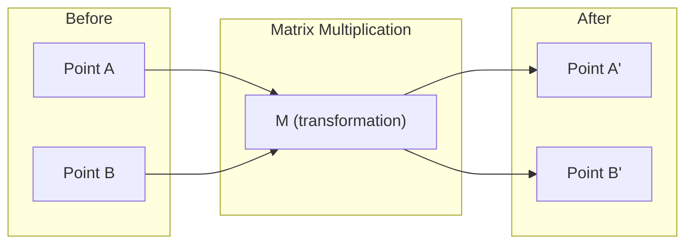
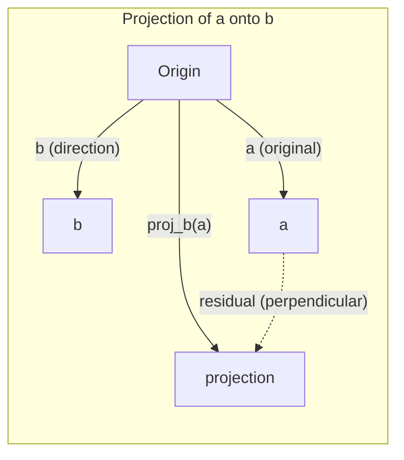

# 線性代數直覺 (Linear Algebra Intuition)

> 每個 AI 模型，說穿了都只是戴了頂花俏帽子的矩陣運算。

**Type:** Learn
**Languages:** Python, Julia
**Prerequisites:** Phase 0
**Time:** ~60 分鐘

## 學習目標 (Learning Objectives)

- 用 Python 從零實作 vector 與 matrix 運算（加法、dot product、matrix multiply）
- 用幾何方式說明 dot product、projection 與 Gram-Schmidt process 在做什麼
- 用 row reduction 判斷一組 vector 的 linear independence、rank 與 basis
- 把線性代數概念對應到 AI 應用：embedding、attention score 與 LoRA

## 問題 (The Problem)

打開任何一篇 ML 論文，第一頁就會看到 vector、matrix、dot product 和各種 transformation。沒有線性代數的直覺，這些只是符號。有了直覺，你就能看懂 neural network 實際在做什麼：在空間中移動點。

你不需要成為數學家。你只需要看懂這些運算在幾何上代表什麼，然後自己寫成程式。

## 核心概念 (The Concept)

### Vector 是點（也是方向） (Vectors Are Points (and Directions))

Vector 就是一串數字。但這些數字有意義：它們是空間中的座標。

**2D vector [3, 2]：**

| x | y | Point |
|---|---|-------|
| 3 | 2 | 這個 vector 在平面上，從原點 (0,0) 指向 (3, 2) |

這個 vector 的 magnitude 是 $\sqrt{3^2 + 2^2} = \sqrt{13}$，方向朝右上方。

在 AI 裡，vector 可以代表一切：
- 一個詞 → 一個 768 維的 vector（它在 embedding space 中的「語意」）
- 一張圖片 → 一個含有數百萬個像素值的 vector
- 一位使用者 → 一個偏好 vector

### Matrix 是轉換 (Matrices Are Transformations)

Matrix 可以把一個 vector 轉成另一個 vector。它可以旋轉、縮放、拉伸或投影。



在 AI 裡，matrix 就是模型本身：
- Neural network 的 weight → 把輸入轉成輸出的 matrix
- Attention score → 決定要關注什麼的 matrix
- Embedding → 把詞對應到 vector 的 matrix

### Dot Product 衡量相似度 (The Dot Product Measures Similarity)

兩個 vector 的 dot product 會告訴你它們有多相似。

```math
\begin{aligned}
a \cdot b &= a_1 \times b_1 + a_2 \times b_2 + \cdots + a_n \times b_n \\[4pt]
\text{Same direction:} \quad a \cdot b &> 0 \quad \text{(similar)} \\
\text{Perpendicular:} \quad a \cdot b &= 0 \quad \text{(unrelated)} \\
\text{Opposite direction:} \quad a \cdot b &< 0 \quad \text{(dissimilar)}
\end{aligned}
```

搜尋引擎、推薦系統和 RAG 的原理就是這樣：找出 dot product 高的 vector。

### Linear Independence (Linear Independence)

如果一組 vector 中，沒有任何一個能寫成其他 vector 的組合，它們就是 linearly independent。若 $v_1, v_2, v_3$ 彼此獨立，它們會張成 (span) 一個 3D 空間。若其中一個是其他的組合，它們只能張成一個平面。

為什麼這對 AI 很重要：你的 feature matrix 應該要有 linearly independent 的欄。如果兩個 feature 完全相關（linearly dependent），模型就無法區分它們各自的影響。這在 regression 中會造成 multicollinearity：weight matrix 變得不穩定，輸入的小變動會讓輸出大幅震盪。

**具體範例：**

```
v1 = [1, 0, 0]
v2 = [0, 1, 0]
v3 = [2, 1, 0]   # v3 = 2*v1 + v2
```

$v_1$ 與 $v_2$ 彼此獨立：兩者都不是對方的純量倍數或組合。但 $v_3 = 2 v_1 + v_2$，所以 $\lbrace v_1, v_2, v_3 \rbrace$ 是 dependent set。這三個 vector 都落在 xy 平面上。不管怎麼組合，你都到不了 [0, 0, 1]。你有三個 vector，卻只有兩個維度的自由度。

在資料集裡：如果 feature_3 = 2*feature_1 + feature_2，加入 feature_3 並不會給模型任何新資訊。更糟的是，它會讓 normal equations 變成 singular：weight 沒有唯一解。

### Basis 與 Rank (Basis and Rank)

Basis 是一組最小的 linearly independent vector，能張成整個空間。Basis vector 的數量就是這個空間的維度。

3D 空間的 standard basis 是 {[1,0,0], [0,1,0], [0,0,1]}。不過 3D 裡任何三個獨立的 vector 都是有效的 basis。選擇 basis，就是選擇座標系。

Matrix 的 rank = linearly independent 的欄數 = linearly independent 的列數。如果 $\text{rank} < \min(\text{rows}, \text{cols})$，這個 matrix 就是 rank-deficient。這代表：
- 方程組有無限多組解（或無解）
- 轉換過程中資訊會遺失
- 這個 matrix 無法求反矩陣 (invert)

| 情況 | Rank | 對 ML 的意義 |
|-----------|------|---------------------|
| Full rank $(\text{rank} = \min(m, n))$ | 最大可能值 | 列數不少於欄數（full column rank）時，least-squares 解是唯一的。列數少於欄數時，有無限多組解可以精確擬合。 |
| Rank deficient $(\text{rank} < \min(m, n))$ | 低於最大值 | Feature 有冗餘。weight 有無限多組解。需要 regularization。 |
| Rank 1 | 1 | 每一欄都是同一個 vector 的縮放複本。所有資料都落在一條線上。 |
| 接近 rank-deficient（singular value 很小） | 數值上偏低 | Matrix 是 ill-conditioned。輸入的微小雜訊會造成輸出的大幅變化。請用 SVD truncation 或 ridge regression。 |

### Projection (Projection)

把 vector **a** 投影到 vector **b** 上，會得到 **a** 在 **b** 方向上的分量：

```math
\mathop{\mathrm{proj}}_b(a) = \frac{a \cdot b}{b \cdot b} \, b
```

殘差 (residual) $(a - \mathop{\mathrm{proj}}_b(a))$ 與 $b$ 垂直。這種 orthogonal decomposition 是 least-squares fitting 的基礎。

Projection 在 ML 裡無所不在：
- Linear regression 最小化觀測值到 column space 的距離：解本身就是一個 projection
- PCA 把資料投影到變異數最大的方向上
- Transformer 的 attention 會計算 query 在 key 上的 projection



**範例：** $a = [3, 4]$，$b = [1, 0]$

$\mathop{\mathrm{proj}}_b(a) = (3 \cdot 1 + 4 \cdot 0) / (1 \cdot 1 + 0 \cdot 0) \cdot [1, 0] = 3 \cdot [1, 0] = [3, 0]$

這個 projection 丟掉了 y 分量。這就是最簡單的降維 (dimensionality reduction)：把你不在意的方向丟掉。

### Gram-Schmidt Process (Gram-Schmidt Process)

把任何一組獨立的 vector 轉成 orthonormal basis。Orthonormal 的意思是每個 vector 長度為 1，而且任兩個 vector 互相垂直。

演算法：
1. 取第一個 vector，做 normalize
2. 取第二個 vector，減去它在第一個 vector 上的 projection，再 normalize
3. 取第三個 vector，減去它在前面所有 vector 上的 projection，再 normalize
4. 對剩下的 vector 重複同樣步驟

```
Input:  v1, v2, v3, ... (linearly independent)

u1 = v1 / |v1|

w2 = v2 - (v2 dot u1) * u1
u2 = w2 / |w2|

w3 = v3 - (v3 dot u1) * u1 - (v3 dot u2) * u2
u3 = w3 / |w3|

Output: u1, u2, u3, ... (orthonormal basis)
```

QR decomposition 的內部就是這樣運作的。Q 是 orthonormal basis，R 記錄 projection 係數。QR decomposition 用在：
- 解 linear system（比 Gaussian elimination 更穩定）
- 計算 eigenvalue（QR algorithm）
- Least-squares regression（標準的數值方法）

```figure
eigen-directions
```

## 動手做 (Build It)

### 步驟 1：從零寫 Vector（Python）

```python
class Vector:
    def __init__(self, components):
        self.components = list(components)
        self.dim = len(self.components)

    def __add__(self, other):
        return Vector([a + b for a, b in zip(self.components, other.components)])

    def __sub__(self, other):
        return Vector([a - b for a, b in zip(self.components, other.components)])

    def dot(self, other):
        return sum(a * b for a, b in zip(self.components, other.components))

    def magnitude(self):
        return sum(x**2 for x in self.components) ** 0.5

    def normalize(self):
        mag = self.magnitude()
        return Vector([x / mag for x in self.components])

    def cosine_similarity(self, other):
        return self.dot(other) / (self.magnitude() * other.magnitude())

    def __repr__(self):
        return f"Vector({self.components})"


a = Vector([1, 2, 3])
b = Vector([4, 5, 6])

print(f"a + b = {a + b}")
print(f"a · b = {a.dot(b)}")
print(f"|a| = {a.magnitude():.4f}")
print(f"cosine similarity = {a.cosine_similarity(b):.4f}")
```

### 步驟 2：從零寫 Matrix（Python）

```python
class Matrix:
    def __init__(self, rows):
        self.rows = [list(row) for row in rows]
        self.shape = (len(self.rows), len(self.rows[0]))

    def __matmul__(self, other):
        if isinstance(other, Vector):
            return Vector([
                sum(self.rows[i][j] * other.components[j] for j in range(self.shape[1]))
                for i in range(self.shape[0])
            ])
        rows = []
        for i in range(self.shape[0]):
            row = []
            for j in range(other.shape[1]):
                row.append(sum(
                    self.rows[i][k] * other.rows[k][j]
                    for k in range(self.shape[1])
                ))
            rows.append(row)
        return Matrix(rows)

    def transpose(self):
        return Matrix([
            [self.rows[j][i] for j in range(self.shape[0])]
            for i in range(self.shape[1])
        ])

    def __repr__(self):
        return f"Matrix({self.rows})"


rotation_90 = Matrix([[0, -1], [1, 0]])
point = Vector([3, 1])

rotated = rotation_90 @ point
print(f"Original: {point}")
print(f"Rotated 90°: {rotated}")
```

### 步驟 3：為什麼這對 AI 很重要

```python
import random

random.seed(42)
weights = Matrix([[random.gauss(0, 0.1) for _ in range(3)] for _ in range(2)])
input_vector = Vector([1.0, 0.5, -0.3])

output = weights @ input_vector
print(f"Input (3D): {input_vector}")
print(f"Output (2D): {output}")
print("This is what a neural network layer does -- matrix multiplication.")
```

### 步驟 4：Julia 版本

```julia
a = [1.0, 2.0, 3.0]
b = [4.0, 5.0, 6.0]

println("a + b = ", a + b)
println("a · b = ", a ⋅ b)       # Julia supports unicode operators
println("|a| = ", √(a ⋅ a))
println("cosine = ", (a ⋅ b) / (√(a ⋅ a) * √(b ⋅ b)))

# Matrix-vector multiplication
W = [0.1 -0.2 0.3; 0.4 0.5 -0.1]
x = [1.0, 0.5, -0.3]
println("Wx = ", W * x)
println("This is a neural network layer.")
```

### 步驟 5：從零實作 linear independence 與 projection（Python）

```python
def is_linearly_independent(vectors):
    n = len(vectors)
    dim = len(vectors[0].components)
    mat = Matrix([v.components[:] for v in vectors])
    rows = [row[:] for row in mat.rows]
    rank = 0
    for col in range(dim):
        pivot = None
        for row in range(rank, len(rows)):
            if abs(rows[row][col]) > 1e-10:
                pivot = row
                break
        if pivot is None:
            continue
        rows[rank], rows[pivot] = rows[pivot], rows[rank]
        scale = rows[rank][col]
        rows[rank] = [x / scale for x in rows[rank]]
        for row in range(len(rows)):
            if row != rank and abs(rows[row][col]) > 1e-10:
                factor = rows[row][col]
                rows[row] = [rows[row][j] - factor * rows[rank][j] for j in range(dim)]
        rank += 1
    return rank == n


def project(a, b):
    scalar = a.dot(b) / b.dot(b)
    return Vector([scalar * x for x in b.components])


def gram_schmidt(vectors):
    orthonormal = []
    for v in vectors:
        w = v
        for u in orthonormal:
            proj = project(w, u)
            w = w - proj
        if w.magnitude() < 1e-10:
            continue
        orthonormal.append(w.normalize())
    return orthonormal


v1 = Vector([1, 0, 0])
v2 = Vector([1, 1, 0])
v3 = Vector([1, 1, 1])
basis = gram_schmidt([v1, v2, v3])
for i, u in enumerate(basis):
    print(f"u{i+1} = {u}")
    print(f"  |u{i+1}| = {u.magnitude():.6f}")

print(f"u1 · u2 = {basis[0].dot(basis[1]):.6f}")
print(f"u1 · u3 = {basis[0].dot(basis[2]):.6f}")
print(f"u2 · u3 = {basis[1].dot(basis[2]):.6f}")
```

## 實際使用 (Use It)

同樣的事情改用 NumPy 來做，這才是你實務上會用的方式：

```python
import numpy as np

a = np.array([1, 2, 3], dtype=float)
b = np.array([4, 5, 6], dtype=float)

print(f"a + b = {a + b}")
print(f"a · b = {np.dot(a, b)}")
print(f"|a| = {np.linalg.norm(a):.4f}")
print(f"cosine = {np.dot(a, b) / (np.linalg.norm(a) * np.linalg.norm(b)):.4f}")

W = np.random.randn(2, 3) * 0.1
x = np.array([1.0, 0.5, -0.3])
print(f"Wx = {W @ x}")
```

### 用 NumPy 做 Rank、Projection 與 QR

```python
import numpy as np

A = np.array([[1, 2], [2, 4]])
print(f"Rank: {np.linalg.matrix_rank(A)}")

a = np.array([3, 4])
b = np.array([1, 0])
proj = (np.dot(a, b) / np.dot(b, b)) * b
print(f"Projection of {a} onto {b}: {proj}")

Q, R = np.linalg.qr(np.random.randn(3, 3))
print(f"Q is orthogonal: {np.allclose(Q @ Q.T, np.eye(3))}")
print(f"R is upper triangular: {np.allclose(R, np.triu(R))}")
```

### PyTorch：帶有 Autodiff 的 Tensor 就是 Vector

```python
import torch

x = torch.randn(3, requires_grad=True)
y = torch.tensor([1.0, 0.0, 0.0])

similarity = torch.dot(x, y)
similarity.backward()

print(f"x = {x.data}")
print(f"y = {y.data}")
print(f"dot product = {similarity.item():.4f}")
print(f"d(dot)/dx = {x.grad}")
```

Dot product 對 x 的 gradient 就是 y。PyTorch 自動算出了這個結果。Neural network 裡的每個運算，都是由這類運算組成的：matrix multiply、dot product、projection，而 autodiff 會追蹤通過它們的 gradient。

你剛剛從零做出了 NumPy 一行就能完成的事。現在你知道底層到底發生了什麼。

## 交付 (Ship It)

這堂課會產出：
- `outputs/prompt-linear-algebra-tutor.md`：給 AI 助理用的 prompt，透過幾何直覺來教線性代數

## 關聯 (Connections)

這堂課的每個概念，都對應到現代 AI 的特定環節：

| 概念 | 出現的地方 |
|---------|------------------|
| Dot product | Transformer 的 attention score、RAG 的 cosine similarity |
| Matrix multiply | 每一層 neural network、每個 linear transformation |
| Linear independence | Feature selection、避免 multicollinearity |
| Rank | 判斷方程組是否可解、LoRA (low-rank adaptation) |
| Projection | Linear regression（投影到 column space）、PCA |
| Gram-Schmidt / QR | 數值求解器、eigenvalue 計算 |
| Orthonormal basis | 穩定的數值計算、whitening transform |

LoRA 值得特別一提。它把 weight 的更新拆解成 low-rank matrix，藉此 fine-tune 大型語言模型。與其更新一個 4096x4096 的 weight matrix（1,600 萬個參數），LoRA 只更新兩個大小分別為 4096x16 和 16x4096 的 matrix（13.1 萬個參數）。Rank-16 的限制代表 LoRA 假設 weight 的更新落在完整 4096 維空間裡的一個 16 維 subspace。這就是線性代數在做實事。

## 練習 (Exercises)

1. 實作 `Vector.angle_between(other)`，回傳兩個 vector 之間的夾角（單位為度）
2. 建立一個 2D 縮放 matrix，把 x 座標變成兩倍、y 座標變成三倍，再套用到 vector [1, 1] 上
3. 給定 5 個隨機的類詞 vector（維度 50），用 cosine similarity 找出最相似的兩個
4. 驗證 Gram-Schmidt 的輸出確實是 orthonormal：檢查每一對 vector 的 dot product 是 0，且每個 vector 的 magnitude 是 1
5. 建立一個 rank 為 2 的 3x3 matrix。用 `rank()` 方法驗證，然後說明它的欄張成的是什麼幾何物件。
6. 把 vector [1, 2, 3] 投影到 [1, 1, 1] 上。這個結果在幾何上代表什麼？

### 提示 (Hints)

**練習 1。** 從 `cosine_similarity` 開始，把值限制在 -1 到 1 之間，接著取 arc cosine，再把 radian 轉成度。檢查 `Vector([1, 0])` 和 `Vector([0, 1])` 會得到 90，而 vector 與自己會得到 0。

**練習 2。** 把兩個縮放係數放在 2x2 matrix 的對角線上，其他兩格填 0。[1, 1] 的結果必須是 [2, 3]。

**練習 3。** 對 5 個 vector 的每一對（共 10 對）計算 cosine similarity，保留最大的值。先用一個 vector 對自己測試你的迴圈，結果必須是 1。

**練習 4。** 對三個獨立的 vector 使用 `gram_schmidt`，然後對每一對計算 `dot`，對每個 vector 計算 `magnitude`。比較時請用像 `1e-9` 這樣的容許誤差，因為浮點數不會剛好得到 0。

**練習 5。** 讓第三列或第三欄等於前兩者的和，這樣就會有一個方向重複。`rank()` 必須回傳 2，而這些欄張成的是一個通過原點的平面。

**練習 6。** 計算縮放係數 $\frac{a \cdot b}{b \cdot b}$，再用它乘上 $b$，或呼叫 `project_onto`。檢查殘差（$a$ 減去 projection）與 [1, 1, 1] 的 dot product 為 0。

## 關鍵術語 (Key Terms)

| 術語 | 一般人怎麼說 | 實際意思 |
|------|----------------|----------------------|
| Vector | 「一支箭頭」 | 一串數字，代表 n 維空間中的一個點或方向 |
| Matrix | 「一張數字表」 | 把 vector 從一個空間映射到另一個空間的轉換 |
| Dot product | 「相乘再加總」 | 衡量兩個 vector 對齊程度的指標，是相似度搜尋的核心 |
| Embedding | 「某種 AI 魔法」 | 代表某個東西（詞、圖片、使用者）意義的 vector |
| Linear independence | 「它們不重疊」 | 集合中沒有任何 vector 能寫成其他 vector 的組合 |
| Rank | 「有幾個維度」 | Matrix 中 linearly independent 的欄（或列）的數量 |
| Projection | 「影子」 | 一個 vector 在另一個 vector 方向上的分量 |
| Basis | 「座標軸」 | 一組能張成整個空間的最小獨立 vector 集合 |
| Orthonormal | 「互相垂直的單位 vector」 | 彼此互相垂直，且長度各為 1 的 vector |

## 總結 (Summary)

| 公式 | 意義 |
|---------|---------|
| $a \cdot b = \sum_i a_i b_i$ | Dot product。衡量對齊程度，是 attention score 與 cosine similarity 的核心 |
| $\cos\theta = \frac{a \cdot b}{\lvert a\rvert \lvert b\rvert}$ | Vector 之間的夾角。1 代表方向相同，0 代表 orthogonal |
| $\lvert a\rvert = \sqrt{a \cdot a}$ | Vector 的 magnitude（長度） |
| $y = Ax, y_i = \sum_j A_{ij} x_j$ | Matrix-vector product。Neural network 的每一層都會對每個輸入套用它 |
| $\text{proj}_b a = \frac{a \cdot b}{b \cdot b} b$ | $a$ 在 $b$ 上的 projection，也就是 $a$ 沿著 $b$ 的那一部分 |
| $b^\perp = a - \text{proj}_b a$ | $a$ 與 $b$ 垂直的分量，用在 Gram-Schmidt |
| $\text{rank}(A) \leq \min(m,n)$ | Rank，即獨立欄的數量。它決定 $Ax = b$ 是否有解 |
| $\Delta W = BA$，$B$ 是 4096×16，$A$ 是 16×4096 | Low-rank 更新。LoRA 用兩個 rank-16 的因子（13.1 萬個參數）取代 4096×4096 的更新（1,600 萬個參數） |
| Orthonormal basis：$\lvert v_i\rvert = 1, v_i \cdot v_j = 0$ | 穩定、可逆的轉換，例如 whitening 與 QR decomposition |
