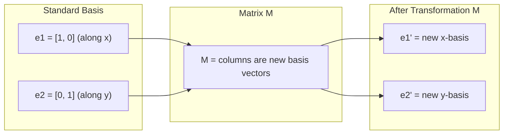
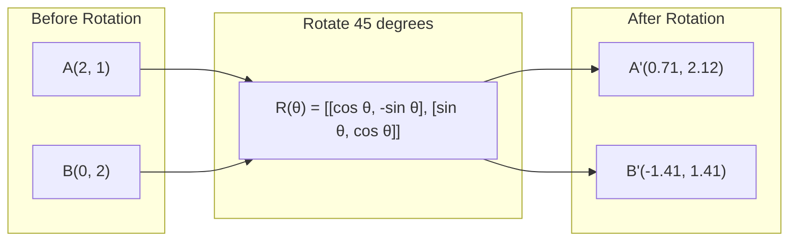
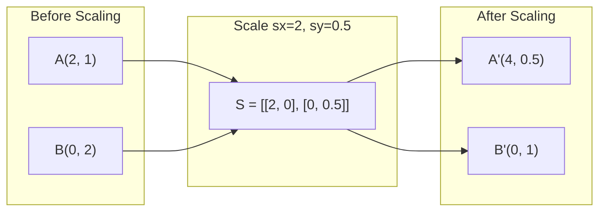
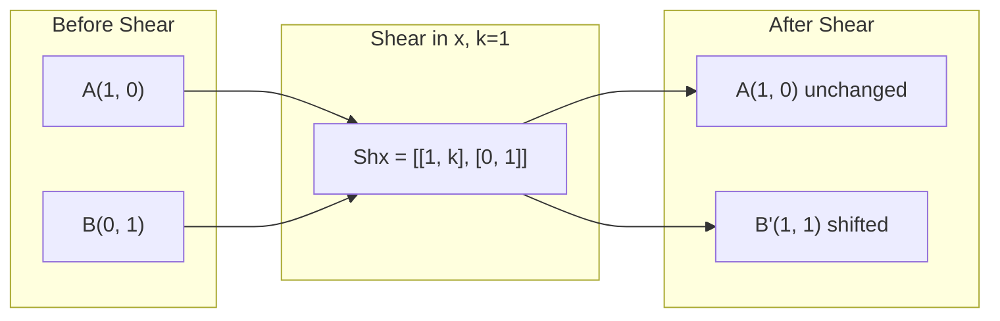
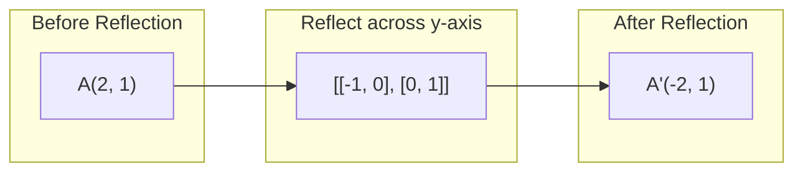
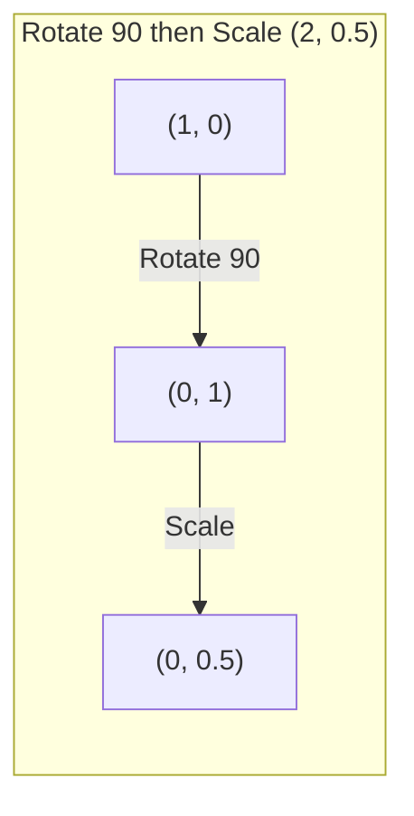
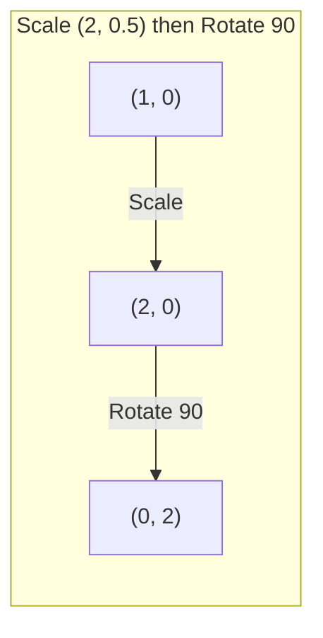

# Matrix 轉換 (Matrix Transformations)

> Matrix 是一台重塑空間的機器。搞懂它對每個點做了什麼，你就懂了整個 transformation。

**Type:** Build
**Languages:** Python, Julia
**Prerequisites:** Phase 1, Lessons 01-02 (Linear Algebra Intuition, Vectors & Matrices Operations)
**Time:** ~75 分鐘

## 學習目標 (Learning Objectives)

- 建構 rotation、scaling、shearing 與 reflection matrix，並套用到 2D 與 3D 的點上
- 用 matrix multiplication 組合多個 transformation，並驗證順序很重要
- 從 characteristic equation 計算 2x2 matrix 的 eigenvalue 與 eigenvector
- 說明為什麼 eigenvalue 決定了 PCA 的方向、RNN 的穩定性與 spectral clustering 的行為

## 問題 (The Problem)

你讀到 PCA，看到「找出 covariance matrix 的 eigenvector」。你讀到模型穩定性，看到「檢查所有 eigenvalue 的絕對值是否小於 1」。你讀到 data augmentation，看到「套用隨機旋轉」。在你理解 matrix 對空間在幾何上做了什麼之前，這些都說不通。

Matrix 不只是一格格的數字，它們是空間機器。Rotation matrix 讓點旋轉，scaling matrix 把點拉伸，shearing matrix 讓點傾斜。Neural network 對資料做的每個 transformation，不是這些運算之一，就是它們的組合。這堂課要把這些運算變得具體。

## 核心概念 (The Concept)

### 把 transformation 看成 matrix (Transformations as matrices)

2D 中的每個 linear transformation 都可以寫成一個 2x2 matrix。這個 matrix 精準告訴你 basis vector [1, 0] 和 [0, 1] 最後落在哪裡，其餘一切都由此推得。



### Rotation (Rotation)

角度為 $\theta$ 的 2D rotation 會保持距離與角度不變。它讓每個點沿著圓弧移動。



在 3D 中，你是繞著一條軸旋轉。每條軸都有自己的 rotation matrix：

```math
\begin{aligned}
R_z(\theta) &= \begin{bmatrix} \cos\theta & -\sin\theta & 0 \\ \sin\theta & \cos\theta & 0 \\ 0 & 0 & 1 \end{bmatrix} \quad \text{Rotate around z-axis (x-y plane spins, z stays)} \\[6pt]
R_x(\theta) &= \begin{bmatrix} 1 & 0 & 0 \\ 0 & \cos\theta & -\sin\theta \\ 0 & \sin\theta & \cos\theta \end{bmatrix} \quad \text{Rotate around x-axis (y-z plane spins, x stays)} \\[6pt]
R_y(\theta) &= \begin{bmatrix} \cos\theta & 0 & \sin\theta \\ 0 & 1 & 0 \\ -\sin\theta & 0 & \cos\theta \end{bmatrix} \quad \text{Rotate around y-axis (x-z plane spins, y stays)}
\end{aligned}
```

### Scaling (Scaling)

Scaling 沿著各個軸獨立地拉伸或壓縮。



### Shearing (Shearing)

Shearing 讓一條軸傾斜，同時保持另一條軸不動。它會把長方形變成平行四邊形。



Shear matrix：
- `Shx = [[1, k], [0, 1]]` 把 $x$ 平移 $k \cdot y$
- `Shy = [[1, 0], [k, 1]]` 把 $y$ 平移 $k \cdot x$

### Reflection (Reflection)

Reflection 讓點沿著某條軸或某條線鏡射。



Reflection matrix：
- 對 y 軸鏡射：`[[-1, 0], [0, 1]]`
- 對 x 軸鏡射：`[[1, 0], [0, -1]]`

### 組合：串接 transformation (Composition: chaining transformations)

先套用 transformation A 再套用 B，等於把它們的 matrix 相乘：`result = B @ A @ point`。順序很重要。先旋轉再縮放，和先縮放再旋轉，結果不同。



組合後：`S @ R = [[0, -2], [0.5, 0]]`



組合後：`R @ S = [[0, -0.5], [2, 0]]`

結果不同。Matrix multiplication 不具交換性 (commutative)。

### Eigenvalue 與 eigenvector (Eigenvalues and eigenvectors)

大多數 vector 被 matrix 作用後都會改變方向。Eigenvector 很特別：matrix 只會縮放它們，絕不會旋轉它們。縮放的倍數就是 eigenvalue。

```
A @ v = lambda * v

v is the eigenvector (direction that survives)
lambda is the eigenvalue (how much it stretches)

Example: A = | 2  1 |
             | 1  2 |

Eigenvector [1, 1] with eigenvalue 3:
  A @ [1,1] = [3, 3] = 3 * [1, 1]     (same direction, scaled by 3)

Eigenvector [1, -1] with eigenvalue 1:
  A @ [1,-1] = [1, -1] = 1 * [1, -1]  (same direction, unchanged)
```

這個 matrix 沿著 [1, 1] 把空間拉伸 3 倍，並讓 [1, -1] 保持不變。其他任何方向，都是這兩者的混合。

### Eigendecomposition (Eigendecomposition)

如果一個 matrix 有 $n$ 個 linearly independent 的 eigenvector，它就可以被分解：

```
A = V @ D @ V^(-1)

V = matrix whose columns are eigenvectors
D = diagonal matrix of eigenvalues
V^(-1) = inverse of V

This says: rotate into eigenvector coordinates, scale along each axis, rotate back.
```

### 為什麼 eigenvalue 很重要 (Why eigenvalues matter)

**PCA。** Covariance matrix 的 eigenvector 就是 principal component。Eigenvalue 告訴你每個 component 涵蓋多少 variance。依 eigenvalue 排序，留下前 $k$ 個，就完成了降維 (dimensionality reduction)。

**穩定性。** 在 recurrent network 與 dynamical system 裡，絕對值 > 1 的 eigenvalue 會讓輸出爆炸，絕對值 < 1 則會讓輸出消失。這就是用一句話講完的 vanishing/exploding gradient 問題。

**Spectral 方法。** Graph neural network 使用 adjacency matrix 的 eigenvalue。Spectral clustering 使用 Laplacian 的 eigenvalue。Eigenvector 會揭露圖的結構。

### Determinant 是體積的縮放倍率 (Determinant as volume scaling factor)

Transformation matrix 的 determinant 告訴你它把面積（2D）或體積（3D）縮放了多少。

```
det = 1:   area preserved (rotation)
det = 2:   area doubled
det = 0:   space crushed to lower dimension (singular)
det = -1:  area preserved but orientation flipped (reflection)

| det(Rotation) | = 1        (always)
| det(Scale sx, sy) | = sx * sy
| det(Shear) | = 1           (area preserved)
| det(Reflection) | = -1     (orientation flipped)
```

```figure
matrix-transform
```

## 動手做 (Build It)

### 步驟 1：從零寫 transformation matrix（Python）

```python
import math

def rotation_2d(theta):
    c, s = math.cos(theta), math.sin(theta)
    return [[c, -s], [s, c]]

def scaling_2d(sx, sy):
    return [[sx, 0], [0, sy]]

def shearing_2d(kx, ky):
    return [[1, kx], [ky, 1]]

def reflection_x():
    return [[1, 0], [0, -1]]

def reflection_y():
    return [[-1, 0], [0, 1]]

def mat_vec_mul(matrix, vector):
    return [
        sum(matrix[i][j] * vector[j] for j in range(len(vector)))
        for i in range(len(matrix))
    ]

def mat_mul(a, b):
    rows_a, cols_b = len(a), len(b[0])
    cols_a = len(a[0])
    return [
        [sum(a[i][k] * b[k][j] for k in range(cols_a)) for j in range(cols_b)]
        for i in range(rows_a)
    ]

point = [1.0, 0.0]
angle = math.pi / 4

rotated = mat_vec_mul(rotation_2d(angle), point)
print(f"Rotate (1,0) by 45 deg: ({rotated[0]:.4f}, {rotated[1]:.4f})")

scaled = mat_vec_mul(scaling_2d(2, 3), [1.0, 1.0])
print(f"Scale (1,1) by (2,3): ({scaled[0]:.1f}, {scaled[1]:.1f})")

sheared = mat_vec_mul(shearing_2d(1, 0), [1.0, 1.0])
print(f"Shear (1,1) kx=1: ({sheared[0]:.1f}, {sheared[1]:.1f})")

reflected = mat_vec_mul(reflection_y(), [2.0, 1.0])
print(f"Reflect (2,1) across y: ({reflected[0]:.1f}, {reflected[1]:.1f})")
```

### 步驟 2：組合 transformation

```python
R = rotation_2d(math.pi / 2)
S = scaling_2d(2, 0.5)

rotate_then_scale = mat_mul(S, R)
scale_then_rotate = mat_mul(R, S)

point = [1.0, 0.0]
result1 = mat_vec_mul(rotate_then_scale, point)
result2 = mat_vec_mul(scale_then_rotate, point)

print(f"Rotate 90 then scale: ({result1[0]:.2f}, {result1[1]:.2f})")
print(f"Scale then rotate 90: ({result2[0]:.2f}, {result2[1]:.2f})")
print(f"Same? {result1 == result2}")
```

### 步驟 3：從零計算 eigenvalue（2x2）

對 2x2 matrix `[[a, b], [c, d]]`，eigenvalue 是 characteristic equation 的解：$\lambda^2 - (a+d)\lambda + (ad - bc) = 0$。

```python
def eigenvalues_2x2(matrix):
    a, b = matrix[0]
    c, d = matrix[1]
    trace = a + d
    det = a * d - b * c
    discriminant = trace ** 2 - 4 * det
    if discriminant < 0:
        real = trace / 2
        imag = (-discriminant) ** 0.5 / 2
        return (complex(real, imag), complex(real, -imag))
    sqrt_disc = discriminant ** 0.5
    return ((trace + sqrt_disc) / 2, (trace - sqrt_disc) / 2)

def eigenvector_2x2(matrix, eigenvalue):
    a, b = matrix[0]
    c, d = matrix[1]
    if abs(b) > 1e-10:
        v = [b, eigenvalue - a]
    elif abs(c) > 1e-10:
        v = [eigenvalue - d, c]
    else:
        if abs(a - eigenvalue) < 1e-10:
            v = [1, 0]
        else:
            v = [0, 1]
    mag = (v[0] ** 2 + v[1] ** 2) ** 0.5
    return [v[0] / mag, v[1] / mag]

A = [[2, 1], [1, 2]]
vals = eigenvalues_2x2(A)
print(f"Matrix: {A}")
print(f"Eigenvalues: {vals[0]:.4f}, {vals[1]:.4f}")

for val in vals:
    vec = eigenvector_2x2(A, val)
    result = mat_vec_mul(A, vec)
    scaled = [val * vec[0], val * vec[1]]
    print(f"  lambda={val:.1f}, v={[round(x,4) for x in vec]}")
    print(f"    A@v = {[round(x,4) for x in result]}")
    print(f"    l*v = {[round(x,4) for x in scaled]}")
```

### 步驟 4：Determinant 是體積的縮放倍率

```python
def det_2x2(matrix):
    return matrix[0][0] * matrix[1][1] - matrix[0][1] * matrix[1][0]

print(f"det(rotation 45) = {det_2x2(rotation_2d(math.pi/4)):.4f}")
print(f"det(scale 2,3)   = {det_2x2(scaling_2d(2, 3)):.1f}")
print(f"det(shear kx=1)  = {det_2x2(shearing_2d(1, 0)):.1f}")
print(f"det(reflect y)   = {det_2x2(reflection_y()):.1f}")

singular = [[1, 2], [2, 4]]
print(f"det(singular)     = {det_2x2(singular):.1f}")
print("Singular: columns are proportional, space collapses to a line.")
```

## 實際使用 (Use It)

NumPy 用最佳化的常式處理這一切。

```python
import numpy as np

theta = np.pi / 4
R = np.array([[np.cos(theta), -np.sin(theta)],
              [np.sin(theta),  np.cos(theta)]])

point = np.array([1.0, 0.0])
print(f"Rotate (1,0) by 45 deg: {R @ point}")

S = np.diag([2.0, 3.0])
composed = S @ R
print(f"Scale(2,3) after Rotate(45): {composed @ point}")

A = np.array([[2, 1], [1, 2]], dtype=float)
eigenvalues, eigenvectors = np.linalg.eig(A)
print(f"\nEigenvalues: {eigenvalues}")
print(f"Eigenvectors (columns):\n{eigenvectors}")

for i in range(len(eigenvalues)):
    v = eigenvectors[:, i]
    lam = eigenvalues[i]
    print(f"  A @ v{i} = {A @ v}, lambda * v{i} = {lam * v}")

print(f"\ndet(R) = {np.linalg.det(R):.4f}")
print(f"det(S) = {np.linalg.det(S):.1f}")

B = np.array([[3, 1], [0, 2]], dtype=float)
vals, vecs = np.linalg.eig(B)
D = np.diag(vals)
V = vecs
reconstructed = V @ D @ np.linalg.inv(V)
print(f"\nEigendecomposition A = V @ D @ V^-1:")
print(f"Original:\n{B}")
print(f"Reconstructed:\n{reconstructed}")
```

### 用 NumPy 做 3D rotation

```python
def rotation_3d_z(theta):
    c, s = np.cos(theta), np.sin(theta)
    return np.array([[c, -s, 0], [s, c, 0], [0, 0, 1]])

def rotation_3d_x(theta):
    c, s = np.cos(theta), np.sin(theta)
    return np.array([[1, 0, 0], [0, c, -s], [0, s, c]])

point_3d = np.array([1.0, 0.0, 0.0])
rotated_z = rotation_3d_z(np.pi / 2) @ point_3d
rotated_x = rotation_3d_x(np.pi / 2) @ point_3d

print(f"\n3D point: {point_3d}")
print(f"Rotate 90 around z: {np.round(rotated_z, 4)}")
print(f"Rotate 90 around x: {np.round(rotated_x, 4)}")
```

## 交付 (Ship It)

這堂課替 PCA（Phase 2）與 neural network weight 分析打下幾何基礎。這裡寫出的 eigenvalue/eigenvector 程式碼，用的就是驅動正式 ML 系統中降維、spectral clustering 與穩定性分析的同一套演算法。

## 練習 (Exercises)

1. 對單位正方形（頂點在 [0,0]、[1,0]、[1,1]、[0,1]）分別套用 rotation、scaling 和 shearing。印出每一種轉換後的頂點。驗證 rotation 會保持頂點之間的距離。

2. 用 characteristic equation 手算 matrix [[4, 2], [1, 3]] 的 eigenvalue。接著用你從零寫的函式和 NumPy 驗證。

3. 建立三個 transformation 的組合（旋轉 30 度、以 [1.5, 0.8] 縮放、以 kx=0.3 做 shear），並套用到排成圓形的 8 個點上。印出轉換前後的座標。計算組合 matrix 的 determinant，驗證它等於各個 determinant 的乘積。

### 提示 (Hints)

**練習 1。** 用 `mat_vec_mul` 把 `rotation_2d`、`scaling_2d` 和 `shearing_2d` 套用到每個頂點。對 rotation，計算轉換前後 4 條邊長與 2 條對角線的長度；每一個都必須維持不變。

**練習 2。** 寫出 characteristic equation $\lambda^2 - (\text{trace})\lambda + \det = 0$ 並解它。檢查你的兩個值相加等於 trace (7)、相乘等於 determinant (10)，再與 `eigenvalues_2x2` 和 `np.linalg.eigvals` 比對。

**練習 3。** 建立三個 matrix，shear 用 `shearing_2d(0.3, 0)`，依套用順序用 `mat_mul` 相乘，再把結果套用到 8 個點 $(\cos\theta, \sin\theta)$ 上。Rotation 的 determinant 是 1，shear 的 determinant 也是 1，所以組合後的 `det_2x2` 必須等於 $1.5 \times 0.8 = 1.2$。

## 關鍵術語 (Key Terms)

| 術語 | 一般人怎麼說 | 實際意思 |
|------|----------------|----------------------|
| Rotation matrix | 「讓東西旋轉」 | 一種 orthogonal matrix，讓點沿著圓弧移動，同時保持距離與角度。Determinant 永遠是 1。 |
| Scaling matrix | 「讓東西變大」 | 一種 diagonal matrix，沿著各軸獨立地拉伸或壓縮。Determinant 是各縮放倍率的乘積。 |
| Shearing matrix | 「讓東西傾斜」 | 讓某個座標依另一個座標按比例平移的 matrix，把長方形變成平行四邊形。Determinant 是 1。 |
| Reflection | 「讓東西鏡射」 | 沿著某條軸或某個平面翻轉空間的 matrix。Determinant 是 -1。 |
| Composition | 「做兩件事」 | 把 transformation matrix 相乘來串接運算。順序很重要：B @ A 代表先套用 A，再套用 B。 |
| Eigenvector | 「特殊的方向」 | Matrix 只會縮放、絕不會旋轉的方向。是這個 transformation 的指紋。 |
| Eigenvalue | 「拉伸多少」 | Matrix 縮放其 eigenvector 的純量倍數。可以是負的（翻轉）或複數（旋轉）。 |
| Eigendecomposition | 「把 matrix 拆開」 | 把 matrix 寫成 $V D V^{-1}$，拆成基本的縮放方向與大小。 |
| Determinant | 「從 matrix 得到的單一數字」 | Transformation 縮放面積（2D）或體積（3D）的倍率。為零代表這個 transformation 不可逆。 |
| Characteristic equation | 「eigenvalue 的來源」 | $\det(A - \lambda I) = 0$。它的根就是 eigenvalue 的多項式。 |

## 延伸閱讀 (Further Reading)

- [3Blue1Brown: Linear Transformations](https://www.3blue1brown.com/lessons/linear-transformations) -- matrix 如何重塑空間的視覺化直覺
- [3Blue1Brown: Eigenvectors and Eigenvalues](https://www.3blue1brown.com/lessons/eigenvalues) -- 對 eigenvector 在幾何上意義最好的視覺化解釋
- [MIT 18.06 Lecture 21: Eigenvalues and Eigenvectors](https://ocw.mit.edu/courses/18-06-linear-algebra-spring-2010/) -- Gilbert Strang 的經典講解
