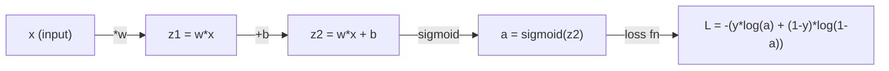
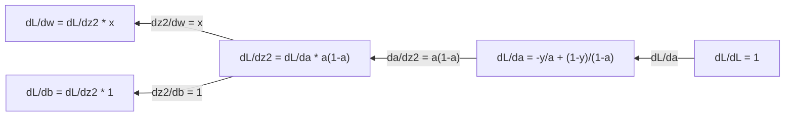
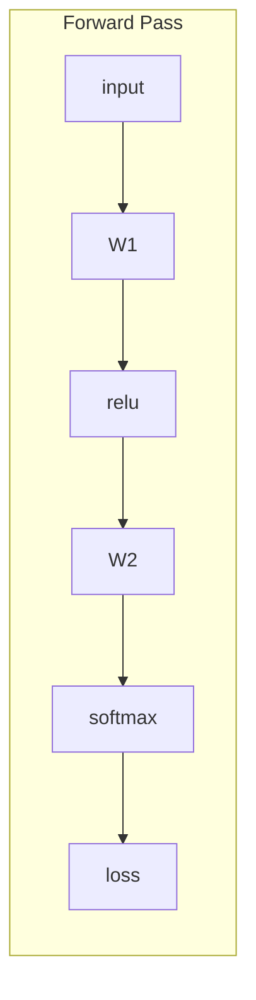
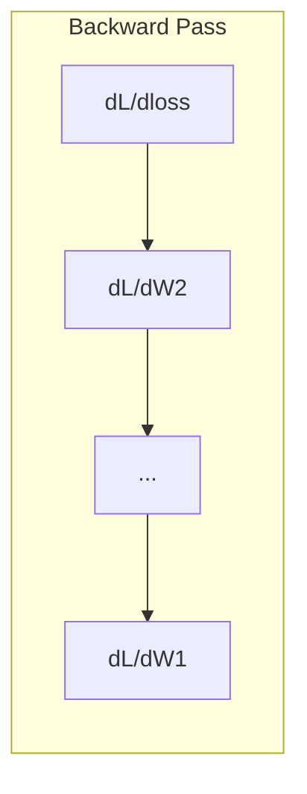

# 機器學習的微積分 (Calculus for Machine Learning)

> Derivative 告訴你哪個方向是下坡。Neural network 要學習，需要的就只有這個。

**Type:** Learn
**Language:** Python
**Prerequisites:** Phase 1, Lessons 01-03
**Time:** ~60 分鐘

## 學習目標 (Learning Objectives)

- 計算常見 ML 函數（$x^2$、sigmoid、cross-entropy）的數值與解析 derivative
- 從零實作 gradient descent，在 1D 與 2D 中最小化 loss function
- 推導 linear regression 模型的 gradient，並用手動更新 weight 的方式訓練它
- 說明 Hessian matrix、Taylor series 近似，以及它們與最佳化方法的關聯

## 問題 (The Problem)

你有一個擁有數百萬個 weight 的 neural network。每個 weight 都是一個旋鈕。你得弄清楚每一個旋鈕該往哪個方向轉，才能讓模型少錯一點。微積分就給你這個方向。

沒有微積分，訓練 neural network 就只能亂試一通，然後祈禱好運。有了 derivative，你就確切知道每個 weight 如何影響誤差。每一次，你都把每個旋鈕轉向正確的方向。

## 核心概念 (The Concept)

### 什麼是 derivative？ (What is a derivative?)

Derivative 衡量變化率。對函數 $y = f(x)$ 來說，derivative $f'(x)$ 告訴你：如果把 $x$ 推動一點點，$y$ 會變多少？

在幾何上，derivative 就是某個點上切線的斜率。

**$f(x) = x^2$：**

| $x$ | $f(x)$ | $f'(x)$（斜率） |
|---|------|---------------|
| 0 | 0    | 0（平的，在最底部） |
| 1 | 1    | 2 |
| 2 | 4    | 4（這個點上的切線斜率） |
| 3 | 9    | 6 |

在 $x=2$ 時，斜率是 4。如果你把 $x$ 往右移動一點點，$y$ 大約會增加那個量的 4 倍。在 $x=0$ 時，斜率是 0。你正處在碗的底部。

正式的定義：

```math
f'(x) = \lim_{h \to 0} \frac{f(x + h) - f(x)}{h}
```

在程式碼裡，你不用取極限，只要用一個很小的 $h$。這就是數值 derivative。

### Partial derivative：一次只看一個變數 (Partial derivatives: one variable at a time)

真實的函數有很多輸入。Neural network 的 loss 取決於數千個 weight。Partial derivative 會把除了一個變數以外的所有變數視為常數，然後只對那一個變數取 derivative。

```math
\begin{aligned}
f(x, y) &= x^2 + 3xy + y^2 \\[4pt]
\frac{\partial f}{\partial x} &= 2x + 3y \quad \text{(treat } y \text{ as a constant)} \\
\frac{\partial f}{\partial y} &= 3x + 2y \quad \text{(treat } x \text{ as a constant)}
\end{aligned}
```

每個 partial derivative 回答的都是：如果我只動這一個 weight，loss 會怎麼變？

### Gradient：所有 partial derivative 組成的 vector (The gradient: vector of all partial derivatives)

Gradient 把所有的 partial derivative 收集成一個 vector。對函數 $f(x, y, z)$ 來說，gradient 是：

```math
\nabla f = \left[ \frac{\partial f}{\partial x}, \frac{\partial f}{\partial y}, \frac{\partial f}{\partial z} \right]
```

Gradient 指向上升最陡的方向。要最小化一個函數，就往相反的方向走。

**$f(x,y) = x^2 + y^2$ 的等高線圖：**

這個函數形成一個碗的形狀，等高線是同心圓。最小值在 (0, 0)。

| 點 | $\nabla f$ | $-\nabla f$（下降方向） |
|-------|--------|----------------------------|
| (1, 1) | [2, 2]（指向上坡，遠離最小值） | [-2, -2]（指向下坡，朝向最小值） |
| (0, 0) | [0, 0]（平的，位於最小值） | [0, 0] |

這就是用圖來看的 gradient descent。算出 gradient，取負號，走一步。

### 與最佳化的關聯 (The connection to optimization)

訓練 neural network 就是最佳化。你有一個 loss function $L(w_1, w_2, \ldots, w_n)$ 來衡量模型錯得多離譜，而你要把它最小化。

```
Gradient descent update rule:

  w_new = w_old - learning_rate * dL/dw

For every weight:
  1. Compute the partial derivative of loss with respect to that weight
  2. Subtract a small multiple of it from the weight
  3. Repeat
```

Learning rate 控制步伐大小。太大會衝過頭，太小就爬得很慢。

**Loss landscape（1D 切片）：**

當 weight $w$ 變動時，loss function $L(w)$ 會形成一條有山峰與山谷的曲線。

| 特徵 | 說明 |
|---------|-------------|
| Global minimum | 整條曲線上最低的點，也就是最佳解 |
| Local minimum | 比鄰近點低、但不是整體最低的山谷 |
| Slope | Gradient descent 從任何起點沿著斜率往下走 |

Gradient descent 沿著斜率往下坡走。它可能會卡在 local minimum，但在高維空間（數百萬個 weight）中，這很少成為實務上的問題。

### 數值 derivative 與解析 derivative (Numerical vs analytical derivatives)

計算 derivative 有兩種方式。

解析 (Analytical)：手動套用微積分規則。對 $f(x) = x^2$，derivative 是 $f'(x) = 2x$。精確又快速。

數值 (Numerical)：用定義來近似。對很小的 $h$ 計算 $f(x+h)$ 和 $f(x-h)$，再取兩者的差。

```
Numerical (central difference):

f'(x) ~= f(x + h) - f(x - h)
          -----------------------
                  2h

h = 0.0001 works well in practice
```

數值 derivative 比較慢，但適用於任何函數。解析 derivative 很快，但需要你自己推導公式。Neural network 框架用的是第三種方法：automatic differentiation，它以機械化的方式算出精確的 derivative。你會在 Phase 3 看到。

### 簡單函數的手算 derivative (Derivatives by hand for simple functions)

這些是你在 ML 裡會一再看到的 derivative。

```
Function        Derivative       Used in
--------        ----------       -------
f(x) = x^2     f'(x) = 2x      Loss functions (MSE)
f(x) = wx + b  f'(w) = x        Linear layer (gradient w.r.t. weight)
                f'(b) = 1        Linear layer (gradient w.r.t. bias)
                f'(x) = w        Linear layer (gradient w.r.t. input)
f(x) = e^x     f'(x) = e^x     Softmax, attention
f(x) = ln(x)   f'(x) = 1/x     Cross-entropy loss
f(x) = 1/(1+e^-x)  f'(x) = f(x)(1-f(x))   Sigmoid activation
```

對 $f(x) = x^2$：

```
f(x) = x^2    f'(x) = 2x

  x    f(x)   f'(x)   meaning
  -2    4      -4      slope tilts left (decreasing)
  -1    1      -2      slope tilts left (decreasing)
   0    0       0      flat (minimum!)
   1    1       2      slope tilts right (increasing)
   2    4       4      slope tilts right (increasing)
```

對 $x=3$、$b=1$ 的 $f(w) = wx + b$：

```
f(w) = 3w + 1    f'(w) = 3

The derivative with respect to w is just x.
If x is big, a small change in w causes a big change in output.
```

### Chain rule (The chain rule)

當函數被組合在一起時，chain rule 告訴你如何微分。

```
If y = f(g(x)), then dy/dx = f'(g(x)) * g'(x)

Example: y = (3x + 1)^2
  outer: f(u) = u^2       f'(u) = 2u
  inner: g(x) = 3x + 1    g'(x) = 3
  dy/dx = 2(3x + 1) * 3 = 6(3x + 1)
```

Neural network 是一串函數的鏈：input -> linear -> activation -> linear -> activation -> loss。Backpropagation 就是從輸出到輸入反覆套用 chain rule。整個演算法就是這樣。

### Hessian Matrix (The Hessian Matrix)

Gradient 告訴你斜率，Hessian 告訴你曲率。

Hessian 是由二階 partial derivative 組成的 matrix。對函數 $f(x_1, x_2, \ldots, x_n)$ 來說，Hessian 的第 $(i, j)$ 個元素是：

```math
H_{ij} = \frac{\partial^2 f}{\partial x_i \, \partial x_j}
```

對雙變數函數 $f(x, y)$：

```math
H = \begin{bmatrix} \dfrac{\partial^2 f}{\partial x^2} & \dfrac{\partial^2 f}{\partial x \, \partial y} \\[8pt] \dfrac{\partial^2 f}{\partial y \, \partial x} & \dfrac{\partial^2 f}{\partial y^2} \end{bmatrix}
```

**在 critical point（gradient = 0 的地方），Hessian 告訴你什麼：**

| Hessian 性質 | 意義 | 曲面範例 |
|-----------------|---------|-----------------|
| Positive definite（所有 eigenvalue > 0） | Local minimum | 開口朝上的碗 |
| Negative definite（所有 eigenvalue < 0） | Local maximum | 開口朝下的碗 |
| Indefinite（eigenvalue 正負混合） | Saddle point | 馬鞍形狀 |

**範例：** $f(x, y) = x^2 - y^2$（一個 saddle 函數）

```
df/dx = 2x       df/dy = -2y
d^2f/dx^2 = 2    d^2f/dy^2 = -2    d^2f/dxdy = 0

H = | 2   0 |
    | 0  -2 |

Eigenvalues: 2 and -2 (one positive, one negative)
--> Saddle point at (0, 0)
```

對照 $f(x, y) = x^2 + y^2$（一個碗）：

```
H = | 2  0 |
    | 0  2 |

Eigenvalues: 2 and 2 (both positive)
--> Local minimum at (0, 0)
```

**為什麼 Hessian 在 ML 裡很重要：**

Newton's method 利用 Hessian，走出比 gradient descent 更好的最佳化步伐。它不只是順著斜率走，還會考慮曲率：

```math
\begin{aligned}
\text{Newton's update:} \quad & w_{\text{new}} = w_{\text{old}} - H^{-1} \cdot \text{gradient} \\
\text{Gradient descent:} \quad & w_{\text{new}} = w_{\text{old}} - \text{lr} \cdot \text{gradient}
\end{aligned}
```

Newton's method 收斂得更快，因為 Hessian 會「重新縮放」gradient：陡的方向步伐較小，平的方向步伐較大。

問題在於：對一個有 $N$ 個參數的 neural network，Hessian 是 $N \times N$。一個有 100 萬個參數的模型，需要一個有 1 兆個元素的 matrix。這就是我們用近似法的原因。

| 方法 | 使用什麼 | 成本 | 收斂速度 |
|--------|-------------|------|-------------|
| Gradient descent | 只用一階 derivative | 每步 $O(N)$ | 慢（linear） |
| Newton's method | 完整的 Hessian | 每步 $O(N^3)$ | 快（quadratic） |
| L-BFGS | 從 gradient 歷史近似 Hessian | 每步 $O(N)$ | 中等（superlinear） |
| Adam | 每個參數各自的自適應速率（diagonal Hessian 近似） | 每步 $O(N)$ | 中等 |
| Natural gradient | Fisher information matrix（統計上的 Hessian） | 每步 $O(N^2)$ | 快 |

實務上，Adam 是 deep learning 的預設 optimizer。它追蹤每個參數 gradient 的移動平均與 variance，以很低的成本近似二階資訊。

### Taylor Series 近似 (Taylor Series Approximation)

任何平滑的函數都可以在局部用多項式來近似：

```math
f(x + h) = f(x) + f'(x)\,h + \frac{1}{2} f''(x)\,h^2 + \frac{1}{6} f'''(x)\,h^3 + \cdots
```

包含的項越多，近似越好，但只在點 $x$ 附近成立。

**為什麼 Taylor series 對 ML 很重要：**

- **一階 Taylor = gradient descent。** 當你使用 $f(x + h) \approx f(x) + f'(x) h$ 時，你是在做線性近似。Gradient descent 最小化這個線性模型，選出 $h = -\text{lr} \cdot f'(x)$。

- **二階 Taylor = Newton's method。** 使用 $f(x + h) \approx f(x) + f'(x) h + \frac{1}{2} f''(x) h^2$，你會得到一個二次模型。把它最小化會得到 $h = -f'(x)/f''(x)$，也就是 Newton 步伐。

- **Loss function 的設計。** MSE 與 cross-entropy 都是平滑的，這代表它們的 Taylor 展開表現良好。這不是巧合。平滑的 loss 讓最佳化可以預測。

```
Approximation order    What it captures    Optimization method
-------------------    -----------------   -------------------
0th order (constant)   Just the value      Random search
1st order (linear)     Slope               Gradient descent
2nd order (quadratic)  Curvature           Newton's method
Higher orders          Finer structure     Rarely used in ML
```

關鍵洞見：所有以 gradient 為基礎的最佳化，其實都是在局部近似 loss function，然後走到那個近似的最小值。

### ML 裡的積分 (Integrals in ML)

Derivative 告訴你變化率。積分 (integral) 計算累積量，也就是曲線下的面積。

在 ML 裡，你很少手算積分，但這個概念無所不在：

**機率。** 對於密度為 $p(x)$ 的連續隨機變數：

```math
P(a < X < b) = \int_a^b p(x) \, dx
```

機率密度曲線在 $a$ 與 $b$ 之間的面積，就是落在那個範圍內的機率。

**期望值 (Expected value)。** 依機率加權的平均結果：

```math
\mathbb{E}[f(X)] = \int f(x) \, p(x) \, dx
```

資料分佈上的期望 loss 是一個積分。訓練就是在最小化它的經驗近似。

**KL divergence。** 衡量兩個分佈有多不同：

```math
\mathrm{KL}(p \,\|\, q) = \int p(x) \log \frac{p(x)}{q(x)} \, dx
```

用在 VAE、knowledge distillation 與 Bayesian inference。

**Normalization constant。** 在 Bayesian inference 中：

```math
p(w \mid \text{data}) = \frac{p(\text{data} \mid w) \, p(w)}{\int p(\text{data} \mid w) \, p(w) \, dw}
```

分母是對所有可能的參數值做的積分。它通常無法精確計算 (intractable)，所以我們才用 MCMC 和 variational inference 這類近似法。

| 積分概念 | 在 ML 中出現的地方 |
|-----------------|----------------------|
| 曲線下面積 | 由密度函數得到機率 |
| 期望值 | Loss function、風險最小化 |
| KL divergence | VAE、policy optimization、distillation |
| Normalization | Bayesian posterior、softmax 的分母 |
| Marginal likelihood | 模型比較、evidence lower bound (ELBO) |

### Computation Graph 中的多變數 Chain Rule (Multivariable Chain Rule in a Computation Graph)

Chain rule 不只適用於排成一條線的純量函數。在 neural network 裡，變數會分岔也會合併。下面是 derivative 如何流過一次簡單的 forward pass：



Backward pass 由右到左計算 gradient：



每個箭頭都乘上局部的 derivative。任何參數的 gradient，就是從 loss 到該參數路徑上所有局部 derivative 的乘積。當路徑分岔又合併時，你要把各路徑的貢獻加總（多變數 chain rule）。

Backpropagation 就只是這樣：沿著 computation graph，從輸出到輸入有系統地套用 chain rule。

### Jacobian matrix (The Jacobian matrix)

當函數把 vector 映射到 vector（像 neural network 的一層），它的 derivative 就是一個 matrix。Jacobian 包含每個輸出對每個輸入的所有 partial derivative。

對 $f: \mathbb{R}^n \to \mathbb{R}^m$，Jacobian $J$ 是一個 $m \times n$ 的 matrix：

| | $x_1$ | $x_2$ | ... | $x_n$ |
|---|---|---|---|---|
| $f_1$ | $\partial f_1/\partial x_1$ | $\partial f_1/\partial x_2$ | ... | $\partial f_1/\partial x_n$ |
| $f_2$ | $\partial f_2/\partial x_1$ | $\partial f_2/\partial x_2$ | ... | $\partial f_2/\partial x_n$ |
| ... | ... | ... | ... | ... |
| $f_m$ | $\partial f_m/\partial x_1$ | $\partial f_m/\partial x_2$ | ... | $\partial f_m/\partial x_n$ |

你不會替 neural network 手算 Jacobian，PyTorch 會處理。但知道它的存在，有助於理解 backpropagation 中的 shape：如果一層把 $\mathbb{R}^n$ 映射到 $\mathbb{R}^m$，它的 Jacobian 就是 $m \times n$。Gradient 則是通過這個 matrix 的 transpose 往回流。

### 為什麼這對 neural network 很重要 (Why this matters for neural networks)

Neural network 裡的每個 weight 都會得到一個 gradient。Gradient 告訴你該如何調整那個 weight 來降低 loss。





每次 weight 的更新：
- `W1 = W1 - lr * dL/dW1`
- `W2 = W2 - lr * dL/dW2`

Forward pass 算出預測與 loss。Backward pass 算出 loss 對每個 weight 的 gradient。接著每個 weight 都往下坡走一小步。重複數百萬步。這就是 deep learning。

```figure
derivative-tangent
```

## 動手做 (Build It)

### 步驟 1：從零寫數值 derivative

```python
def numerical_derivative(f, x, h=1e-7):
    return (f(x + h) - f(x - h)) / (2 * h)

def f(x):
    return x ** 2

for x in [-2, -1, 0, 1, 2]:
    numerical = numerical_derivative(f, x)
    analytical = 2 * x
    print(f"x={x:2d}  f'(x) numerical={numerical:.6f}  analytical={analytical:.1f}")
```

數值 derivative 和解析 derivative 吻合到小數點後很多位。

### 步驟 2：Partial derivative 與 gradient

```python
def numerical_gradient(f, point, h=1e-7):
    gradient = []
    for i in range(len(point)):
        point_plus = list(point)
        point_minus = list(point)
        point_plus[i] += h
        point_minus[i] -= h
        partial = (f(point_plus) - f(point_minus)) / (2 * h)
        gradient.append(partial)
    return gradient

def f_multi(point):
    x, y = point
    return x**2 + 3*x*y + y**2

grad = numerical_gradient(f_multi, [1.0, 2.0])
print(f"Numerical gradient at (1,2): {[f'{g:.4f}' for g in grad]}")
print(f"Analytical gradient at (1,2): [2*1+3*2, 3*1+2*2] = [{2*1+3*2}, {3*1+2*2}]")
```

### 步驟 3：用 gradient descent 找出 f(x) = x^2 的最小值

```python
x = 5.0
lr = 0.1
for step in range(20):
    grad = 2 * x
    x = x - lr * grad
    print(f"step {step:2d}  x={x:8.4f}  f(x)={x**2:10.6f}")
```

從 $x=5$ 出發，每一步都更接近 $x=0$（最小值）。

### 步驟 4：對 2D 函數做 gradient descent

```python
def f_2d(point):
    x, y = point
    return x**2 + y**2

point = [4.0, 3.0]
lr = 0.1
for step in range(30):
    grad = numerical_gradient(f_2d, point)
    point = [p - lr * g for p, g in zip(point, grad)]
    loss = f_2d(point)
    if step % 5 == 0 or step == 29:
        print(f"step {step:2d}  point=({point[0]:7.4f}, {point[1]:7.4f})  f={loss:.6f}")
```

### 步驟 5：比較數值與解析 derivative

```python
import math

test_functions = [
    ("x^2",      lambda x: x**2,          lambda x: 2*x),
    ("x^3",      lambda x: x**3,          lambda x: 3*x**2),
    ("sin(x)",   lambda x: math.sin(x),   lambda x: math.cos(x)),
    ("e^x",      lambda x: math.exp(x),   lambda x: math.exp(x)),
    ("1/x",      lambda x: 1/x,           lambda x: -1/x**2),
]

x = 2.0
print(f"{'Function':<12} {'Numerical':>12} {'Analytical':>12} {'Error':>12}")
print("-" * 50)
for name, f, df in test_functions:
    num = numerical_derivative(f, x)
    ana = df(x)
    err = abs(num - ana)
    print(f"{name:<12} {num:12.6f} {ana:12.6f} {err:12.2e}")
```

### 步驟 6：用數值方式計算 Hessian

```python
def hessian_2d(f, x, y, h=1e-5):
    fxx = (f(x + h, y) - 2 * f(x, y) + f(x - h, y)) / (h ** 2)
    fyy = (f(x, y + h) - 2 * f(x, y) + f(x, y - h)) / (h ** 2)
    fxy = (f(x + h, y + h) - f(x + h, y - h) - f(x - h, y + h) + f(x - h, y - h)) / (4 * h ** 2)
    return [[fxx, fxy], [fxy, fyy]]

def saddle(x, y):
    return x ** 2 - y ** 2

def bowl(x, y):
    return x ** 2 + y ** 2

H_saddle = hessian_2d(saddle, 0.0, 0.0)
H_bowl = hessian_2d(bowl, 0.0, 0.0)
print(f"Saddle Hessian: {H_saddle}")  # [[2, 0], [0, -2]] -- mixed signs
print(f"Bowl Hessian:   {H_bowl}")    # [[2, 0], [0, 2]]  -- both positive
```

Saddle 函數的 Hessian 有 eigenvalue 2 和 -2（正負號混合，確認這是 saddle point）。碗形的 eigenvalue 是 2 和 2（都是正的，確認這是最小值）。

### 步驟 7：Taylor 近似實際運作

```python
import math

def taylor_approx(f, f_prime, f_double_prime, x0, h, order=2):
    result = f(x0)
    if order >= 1:
        result += f_prime(x0) * h
    if order >= 2:
        result += 0.5 * f_double_prime(x0) * h ** 2
    return result

x0 = 0.0
for h in [0.1, 0.5, 1.0, 2.0]:
    true_val = math.sin(h)
    t1 = taylor_approx(math.sin, math.cos, lambda x: -math.sin(x), x0, h, order=1)
    t2 = taylor_approx(math.sin, math.cos, lambda x: -math.sin(x), x0, h, order=2)
    print(f"h={h:.1f}  sin(h)={true_val:.4f}  order1={t1:.4f}  order2={t2:.4f}")
```

在 $x_0=0$ 附近，$\sin(x) \approx x$（一階 Taylor）。對小的 $h$ 近似得非常好，但 $h$ 變大就失效了。這就是 gradient descent 搭配小的 learning rate 效果最好的原因：每一步都假設線性近似是準確的。

### 步驟 8：為什麼這對 neural network 很重要

```python
import random

random.seed(42)

w = random.gauss(0, 1)
b = random.gauss(0, 1)
lr = 0.01

xs = [1.0, 2.0, 3.0, 4.0, 5.0]
ys = [3.0, 5.0, 7.0, 9.0, 11.0]

for epoch in range(200):
    total_loss = 0
    dw = 0
    db = 0
    for x, y in zip(xs, ys):
        pred = w * x + b
        error = pred - y
        total_loss += error ** 2
        dw += 2 * error * x
        db += 2 * error
    dw /= len(xs)
    db /= len(xs)
    total_loss /= len(xs)
    w -= lr * dw
    b -= lr * db
    if epoch % 40 == 0 or epoch == 199:
        print(f"epoch {epoch:3d}  w={w:.4f}  b={b:.4f}  loss={total_loss:.6f}")

print(f"\nLearned: y = {w:.2f}x + {b:.2f}")
print(f"Actual:  y = 2x + 1")
```

每個以 gradient 為基礎的訓練迴圈都遵循這個模式：預測、計算 loss、計算 gradient、更新 weight。

## 實際使用 (Use It)

用 NumPy，同樣的運算更快也更精簡：

```python
import numpy as np

x = np.array([1, 2, 3, 4, 5], dtype=float)
y = np.array([3, 5, 7, 9, 11], dtype=float)

w, b = np.random.randn(), np.random.randn()
lr = 0.01

for epoch in range(200):
    pred = w * x + b
    error = pred - y
    loss = np.mean(error ** 2)
    dw = np.mean(2 * error * x)
    db = np.mean(2 * error)
    w -= lr * dw
    b -= lr * db

print(f"Learned: y = {w:.2f}x + {b:.2f}")
```

你剛剛從零做出了 gradient descent。PyTorch 會自動化 gradient 的計算，但更新迴圈完全一樣。

## 練習 (Exercises)

1. 實作 `numerical_second_derivative(f, x)`，呼叫兩次 `numerical_derivative`。驗證 $x^3$ 在 $x=2$ 處的二階 derivative 是 12。
2. 用 gradient descent 找出 $f(x, y) = (x - 3)^2 + (y + 1)^2$ 的最小值。從 $(0, 0)$ 出發。答案應該收斂到 $(3, -1)$。
3. 在 gradient descent 迴圈中加入 momentum：維護一個累積過去 gradient 的 velocity vector。在 $f(x) = x^4 - 3x^2$ 上，比較有無 momentum 時的收斂速度。

### 提示 (Hints)

**練習 1。** 定義一個回傳 `numerical_derivative(f, x)` 的輔助函式，再把這個輔助函式傳給 `numerical_derivative` 一次。如果結果有雜訊，兩次呼叫都改用較大的步長，例如 `h=1e-4`；$x=2$ 處的值必須接近 12。

**練習 2。** 寫出 gradient $(2(x - 3), 2(y + 1))$，或使用 `numerical_gradient`，並從 $(0, 0)$ 呼叫 `gradient_descent_nd`。每 10 步印出一次該點；它必須朝 $(3, -1)$ 移動，而且 loss 必須降到接近 0。

**練習 3。** 維護一個 velocity `v`，以 `v = momentum * v - lr * grad` 更新它，再把 `v` 加到 `x` 上。計算兩種方法各需要幾步才能讓 gradient 接近 0；最小值在 $x = \pm\sqrt{1.5} \approx \pm 1.225$。

## 關鍵術語 (Key Terms)

| 術語 | 一般人怎麼說 | 實際意思 |
|------|----------------|----------------------|
| Derivative | 「斜率」 | 函數在某一點的變化率。告訴你輸入每變動一個單位，輸出會變多少。 |
| Partial derivative | 「對單一變數的 derivative」 | 在其他變數都固定時，對某一個變數的 derivative。 |
| Gradient | 「上升最陡的方向」 | 所有 partial derivative 組成的 vector。指向讓函數增加最快的方向。 |
| Gradient descent | 「往下坡走」 | 從參數中減去 gradient（乘上 learning rate）來降低 loss。是 neural network 訓練的核心。 |
| Learning rate | 「步長」 | 控制每一步 gradient descent 有多大的純量。太大：發散。太小：收斂很慢。 |
| Chain rule | 「把 derivative 相乘」 | 微分複合函數的規則：$\frac{df}{dx} = \frac{df}{dg} \cdot \frac{dg}{dx}$。是 backpropagation 的數學基礎。 |
| Jacobian | 「derivative 的 matrix」 | 當函數把 vector 映射到 vector 時，Jacobian 是輸出對輸入所有 partial derivative 組成的 matrix。 |
| Numerical derivative | 「有限差分」 | 在兩個相近的點計算函數值，再取兩點間的斜率，藉此近似 derivative。 |
| Backpropagation | 「Reverse-mode autodiff」 | 利用 chain rule，由輸出到輸入逐層計算 gradient。Neural network 學習的方式。 |
| Hessian | 「二階 derivative 的 matrix」 | 所有二階 partial derivative 組成的 matrix。描述函數的曲率。在 critical point 上，Hessian 為 positive definite 代表 local minimum。 |
| Taylor series | 「多項式近似」 | 用函數的 derivative 在某點附近近似該函數：$f(x+h) \approx f(x) + f'(x)h + \frac{1}{2}f''(x)h^2 + \cdots$ 是理解 gradient descent 與 Newton's method 為何有效的基礎。 |
| Integral | 「曲線下的面積」 | 某個量在一個範圍內的累積。在 ML 裡，integral 定義了機率、期望值與 KL divergence。 |

## 延伸閱讀 (Further Reading)

- [3Blue1Brown: Essence of Calculus](https://www.3blue1brown.com/topics/calculus) - derivative、integral 與 chain rule 的視覺化直覺
- [Stanford CS231n: Backpropagation](https://cs231n.github.io/optimization-2/) - gradient 如何流過 neural network 的各層
