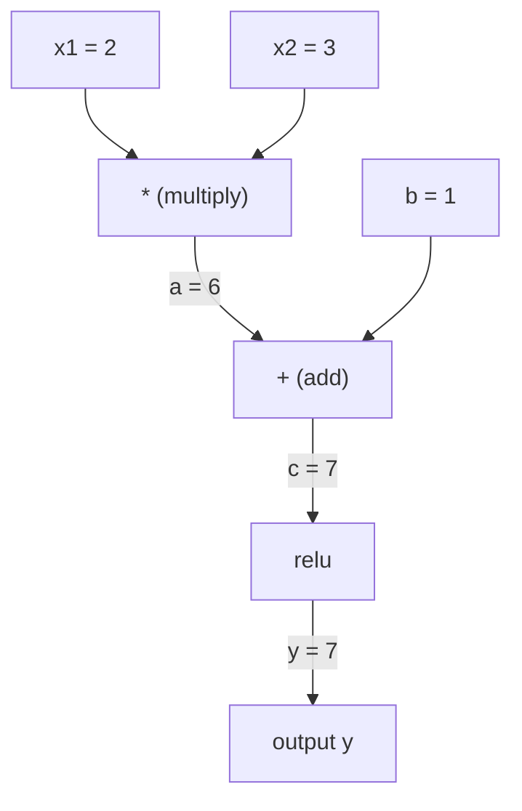
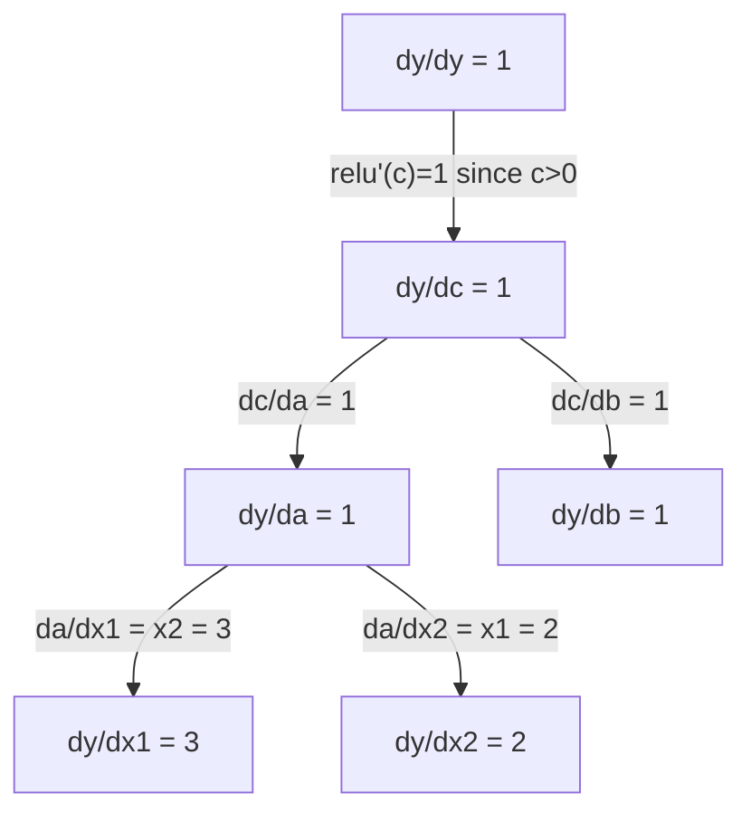

# Chain Rule 與 Automatic Differentiation (Chain Rule & Automatic Differentiation)

> Chain rule 是每一個會學習的 neural network 背後的引擎。

**Type:** Build
**Language:** Python
**Prerequisites:** Phase 1, Lesson 04 (Derivatives & Gradients)
**Time:** ~90 分鐘

## 學習目標 (Learning Objectives)

- 打造一個最小的 autograd 引擎（Value class），記錄運算，並用 reverse-mode autodiff 計算 gradient
- 用 topological sort 在 computation graph 上實作 forward 與 backward pass
- 只用自己從零寫的 autograd 引擎，建構並訓練一個能解 XOR 的 multi-layer perceptron
- 用 gradient checking，對照數值有限差分來驗證 autodiff 的正確性

## 問題 (The Problem)

你會算簡單函數的 derivative。但 neural network 不是簡單函數。它是數百個函數組合在一起：matrix multiply、加 bias、套用 activation、再一次 matrix multiply、softmax、cross-entropy loss。輸出是函數的函數的函數。

要訓練網路，你需要 loss 對每一個 weight 的 gradient。對數百萬個參數手算是不可能的。用數值方式（有限差分）又太慢。

Chain rule 給你數學，automatic differentiation 給你演算法。兩者合起來，讓你能對任意的函數組合算出精確的 gradient，所需時間與一次 forward pass 成正比。

PyTorch、TensorFlow 和 JAX 就是這樣運作的。你會從零打造一個迷你版本。

## 核心概念 (The Concept)

### Chain Rule (The Chain Rule)

如果 $y = f(g(x))$，$y$ 對 $x$ 的 derivative 是：

```math
\frac{dy}{dx} = \frac{dy}{dg} \cdot \frac{dg}{dx} = f'(g(x)) \cdot g'(x)
```

沿著鏈把 derivative 相乘。每一環貢獻它的局部 derivative。

範例：$y = \sin(x^2)$

```math
\begin{aligned}
g(x) &= x^2 \qquad & g'(x) &= 2x \\
f(g) &= \sin(g) \qquad & f'(g) &= \cos(g) \\[4pt]
\frac{dy}{dx} &= \cos(x^2) \cdot 2x
\end{aligned}
```

對更深的組合，鏈會延伸：

```math
\begin{aligned}
y &= f(g(h(x))) \\[4pt]
\frac{dy}{dx} &= f'(g(h(x))) \cdot g'(h(x)) \cdot h'(x)
\end{aligned}
```

Neural network 裡的每一層，都是這條鏈上的一環。

### Computational Graph (Computational Graphs)

Computational graph 讓 chain rule 變得看得見。每個運算都變成一個節點。資料沿著圖往前流，gradient 則往後流。

**Forward pass（計算數值）：**



**Backward pass（計算 gradient）：**



Backward pass 在每個節點套用 chain rule，把 gradient 從輸出傳播到輸入。

### Forward Mode 與 Reverse Mode (Forward Mode vs Reverse Mode)

在圖上套用 chain rule 有兩種方式。

**Forward mode** 從輸入開始，把 derivative 往前推。它先設 $dx/dx = 1$，再通過每個運算往下傳播。適合輸入少、輸出多的情況。

```
Forward mode: seed dx/dx = 1, propagate forward

  x = 2       (dx/dx = 1)
  a = x^2     (da/dx = 2x = 4)
  y = sin(a)  (dy/dx = cos(a) * da/dx = cos(4) * 4 = -2.615)
```

**Reverse mode** 從輸出開始，把 gradient 往後拉。它先設 $dy/dy = 1$，再反向通過每個運算傳播。適合輸入多、輸出少的情況。

```
Reverse mode: seed dy/dy = 1, propagate backward

  y = sin(a)  (dy/dy = 1)
  a = x^2     (dy/da = cos(a) = cos(4) = -0.654)
  x = 2       (dy/dx = dy/da * da/dx = -0.654 * 4 = -2.615)
```

Neural network 有數百萬個輸入（weight）和一個輸出（loss）。Reverse mode 一次 backward pass 就能算出所有 gradient。這就是 backpropagation 使用 reverse mode 的原因。

| 模式 | Seed | 方向 | 最適合 |
|------|------|-----------|-----------|
| Forward | $dx_i/dx_i = 1$ | 由輸入到輸出 | 輸入少、輸出多 |
| Reverse | $dy/dy = 1$ | 由輸出到輸入 | 輸入多、輸出少（neural net） |

### 用 Dual Number 實作 Forward Mode (Dual Numbers for Forward Mode)

Forward mode 可以用 dual number 優雅地實作。Dual number 的形式是 $a + b\epsilon$，其中 $\epsilon^2 = 0$。

```
Dual number: (value, derivative)

(2, 1) means: value is 2, derivative w.r.t. x is 1

Arithmetic rules:
  (a, a') + (b, b') = (a+b, a'+b')
  (a, a') * (b, b') = (a*b, a'*b + a*b')
  sin(a, a')         = (sin(a), cos(a)*a')
```

把輸入變數的 derivative 設為 1。Derivative 就會自動通過每個運算傳播。

### 打造 Autograd 引擎 (Building an Autograd Engine)

Autograd 引擎需要三件事：

1. **Value 包裝。** 把每個數字包進一個物件，物件儲存它的值與 gradient。
2. **記錄 graph。** 每個運算都記錄它的輸入與局部 gradient 函式。
3. **Backward pass。** 對 graph 做 topological sort，再反向走過它，在每個節點套用 chain rule。

PyTorch 的 `autograd` 做的就是這件事。`torch.Tensor` class 包裝數值，在 `requires_grad=True` 時記錄運算，並在你呼叫 `.backward()` 時計算 gradient。

### PyTorch Autograd 底層如何運作 (How PyTorch Autograd Works Under the Hood)

當你寫下 PyTorch 程式碼：

```python
x = torch.tensor(2.0, requires_grad=True)
y = x ** 2 + 3 * x + 1
y.backward()
print(x.grad)  # 7.0 = 2*x + 3 = 2*2 + 3
```

PyTorch 在內部會：

1. 為 `x` 建立一個 `requires_grad=True` 的 `Tensor` 節點
2. 每個運算（`**`、`*`、`+`）都建立一個新節點，並記錄 backward 函式
3. `y.backward()` 會在記錄好的 graph 上觸發 reverse-mode autodiff
4. 每個節點的 `grad_fn` 計算局部 gradient，並傳給它的 parent 節點
5. Gradient 以加總（而非取代）的方式累積在 `.grad` 屬性中

這個 graph 是動態的（define-by-run）。每次 forward pass 都會建立新的 graph。這就是 PyTorch 能在模型內支援 control flow（if/else、迴圈）的原因。

```figure
chain-rule
```

## 動手做 (Build It)

### 步驟 1：Value class

```python
class Value:
    def __init__(self, data, children=(), op=''):
        self.data = data
        self.grad = 0.0
        self._backward = lambda: None
        self._prev = set(children)
        self._op = op

    def __repr__(self):
        return f"Value(data={self.data:.4f}, grad={self.grad:.4f})"
```

每個 `Value` 儲存它的數值 data、它的 gradient（初始為零）、一個 backward 函式，以及指向產生它的子節點的指標。

### 步驟 2：具備 gradient 追蹤的算術運算

```python
    def __add__(self, other):
        other = other if isinstance(other, Value) else Value(other)
        out = Value(self.data + other.data, (self, other), '+')
        def _backward():
            self.grad += out.grad
            other.grad += out.grad
        out._backward = _backward
        return out

    def __mul__(self, other):
        other = other if isinstance(other, Value) else Value(other)
        out = Value(self.data * other.data, (self, other), '*')
        def _backward():
            self.grad += other.data * out.grad
            other.grad += self.data * out.grad
        out._backward = _backward
        return out

    def relu(self):
        out = Value(max(0, self.data), (self,), 'relu')
        def _backward():
            self.grad += (1.0 if out.data > 0 else 0.0) * out.grad
        out._backward = _backward
        return out
```

每個運算都會建立一個 closure，知道如何計算局部 gradient，並乘上上游 gradient（`out.grad`）。`+=` 處理的是一個值被用在多個運算中的情況。

### 步驟 3：Backward pass

```python
    def backward(self):
        topo = []
        visited = set()
        def build_topo(v):
            if v not in visited:
                visited.add(v)
                for child in v._prev:
                    build_topo(child)
                topo.append(v)
        build_topo(self)

        self.grad = 1.0
        for v in reversed(topo):
            v._backward()
```

Topological sort 確保每個節點的 gradient 在傳給它的子節點之前，已經完整算好。Seed gradient 是 1.0（$dy/dy = 1$）。

### 步驟 4：補上更多運算，湊成完整的引擎

基本的 Value class 處理加法、乘法與 relu。真正的 autograd 引擎需要更多。以下是打造 neural network 所需的運算：

```python
    def __neg__(self):
        return self * -1

    def __sub__(self, other):
        return self + (-other)

    def __radd__(self, other):
        return self + other

    def __rmul__(self, other):
        return self * other

    def __rsub__(self, other):
        return other + (-self)

    def __pow__(self, n):
        out = Value(self.data ** n, (self,), f'**{n}')
        def _backward():
            self.grad += n * (self.data ** (n - 1)) * out.grad
        out._backward = _backward
        return out

    def __truediv__(self, other):
        return self * (other ** -1) if isinstance(other, Value) else self * (Value(other) ** -1)

    def exp(self):
        import math
        e = math.exp(self.data)
        out = Value(e, (self,), 'exp')
        def _backward():
            self.grad += e * out.grad
        out._backward = _backward
        return out

    def log(self):
        import math
        out = Value(math.log(self.data), (self,), 'log')
        def _backward():
            self.grad += (1.0 / self.data) * out.grad
        out._backward = _backward
        return out

    def tanh(self):
        import math
        t = math.tanh(self.data)
        out = Value(t, (self,), 'tanh')
        def _backward():
            self.grad += (1 - t ** 2) * out.grad
        out._backward = _backward
        return out
```

**為什麼每個運算都很重要：**

| 運算 | Backward 規則 | 用在 |
|-----------|--------------|---------|
| `__sub__` | 重用 add + neg | Loss 計算 (pred - target) |
| `__pow__` | $n \cdot x^{n-1}$ | 多項式 activation、MSE ($\text{error}^2$) |
| `__truediv__` | 重用 mul + pow(-1) | Normalization、learning rate 縮放 |
| `exp` | $\exp(x) \cdot \text{upstream}$ | Softmax、log-likelihood |
| `log` | $(1/x) \cdot \text{upstream}$ | Cross-entropy loss、log probability |
| `tanh` | $(1 - \tanh^2) \cdot \text{upstream}$ | 經典的 activation function |

巧妙之處在於：`__sub__` 和 `__truediv__` 是用現有的運算來定義的。它們不用額外處理就能得到正確的 gradient，因為 chain rule 會穿過底層的 add/mul/pow 運算組合起來。

### 步驟 5：從零寫迷你 MLP

有了完整的 Value class，你就能打造 neural network。不用 PyTorch，不用 NumPy，只靠 Value 和 chain rule。

```python
import random

class Neuron:
    def __init__(self, n_inputs):
        self.w = [Value(random.uniform(-1, 1)) for _ in range(n_inputs)]
        self.b = Value(0.0)

    def __call__(self, x):
        act = sum((wi * xi for wi, xi in zip(self.w, x)), self.b)
        return act.tanh()

    def parameters(self):
        return self.w + [self.b]

class Layer:
    def __init__(self, n_inputs, n_outputs):
        self.neurons = [Neuron(n_inputs) for _ in range(n_outputs)]

    def __call__(self, x):
        return [n(x) for n in self.neurons]

    def parameters(self):
        return [p for n in self.neurons for p in n.parameters()]

class MLP:
    def __init__(self, sizes):
        self.layers = [Layer(sizes[i], sizes[i+1]) for i in range(len(sizes)-1)]

    def __call__(self, x):
        for layer in self.layers:
            x = layer(x)
        return x[0] if len(x) == 1 else x

    def parameters(self):
        return [p for layer in self.layers for p in layer.parameters()]
```

一個 `Neuron` 計算 `tanh(w1*x1 + w2*x2 + ... + b)`。一個 `Layer` 是一串 neuron。一個 `MLP` 把多個 layer 疊起來。每個 weight 都是 `Value`，所以呼叫 `loss.backward()` 就會把 gradient 傳播到每個參數。

**在 XOR 上訓練：**

```python
random.seed(42)
model = MLP([2, 4, 1])  # 2 inputs, 4 hidden neurons, 1 output

xs = [[0, 0], [0, 1], [1, 0], [1, 1]]
ys = [-1, 1, 1, -1]  # XOR pattern (using -1/1 for tanh)

for step in range(100):
    preds = [model(x) for x in xs]
    loss = sum((p - y) ** 2 for p, y in zip(preds, ys))

    for p in model.parameters():
        p.grad = 0.0
    loss.backward()

    lr = 0.05
    for p in model.parameters():
        p.data -= lr * p.grad

    if step % 20 == 0:
        print(f"step {step:3d}  loss = {loss.data:.4f}")

print("\nPredictions after training:")
for x, y in zip(xs, ys):
    print(f"  input={x}  target={y:2d}  pred={model(x).data:6.3f}")
```

這就是 micrograd。一個用純 Python 加上 automatic differentiation 寫成的完整 neural network 訓練迴圈。每個商用的 deep learning 框架做的都是同一件事，只是規模龐大。

### 步驟 6：Gradient checking

你怎麼知道自己的 autodiff 是正確的？拿它和數值 derivative 比較。這就是 gradient checking。

```python
def gradient_check(build_expr, x_val, h=1e-7):
    x = Value(x_val)
    y = build_expr(x)
    y.backward()
    autodiff_grad = x.grad

    y_plus = build_expr(Value(x_val + h)).data
    y_minus = build_expr(Value(x_val - h)).data
    numerical_grad = (y_plus - y_minus) / (2 * h)

    diff = abs(autodiff_grad - numerical_grad)
    return autodiff_grad, numerical_grad, diff
```

在一個複雜的運算式上測試：

```python
def expr(x):
    return (x ** 3 + x * 2 + 1).tanh()

ad, num, diff = gradient_check(expr, 0.5)
print(f"Autodiff:  {ad:.8f}")
print(f"Numerical: {num:.8f}")
print(f"Difference: {diff:.2e}")
# Difference should be < 1e-5
```

實作新運算時，gradient checking 是必備的。如果你的 backward pass 有 bug，數值檢查會抓出來。每個嚴謹的 deep learning 實作，開發期間都會跑 gradient check。

**何時使用 gradient checking：**

| 情境 | 要做 gradient check 嗎？ |
|-----------|-------------------|
| 在你的 autograd 中新增一個運算 | 要，一定要 |
| 偵錯一個無法收斂的訓練迴圈 | 要，先檢查 gradient |
| 正式環境的訓練 | 不要，太慢（每個參數要 2 次 forward pass） |
| Autograd 程式碼的 unit test | 要，把它自動化 |

### 步驟 7：對照手算驗證

```python
x1 = Value(2.0)
x2 = Value(3.0)
a = x1 * x2          # a = 6.0
b = a + Value(1.0)    # b = 7.0
y = b.relu()          # y = 7.0

y.backward()

print(f"y = {y.data}")          # 7.0
print(f"dy/dx1 = {x1.grad}")   # 3.0 (= x2)
print(f"dy/dx2 = {x2.grad}")   # 2.0 (= x1)
```

手動檢查：`y = relu(x1*x2 + 1)`。因為 `x1*x2 + 1 = 7 > 0`，relu 等於 identity。
`dy/dx1 = x2 = 3`。`dy/dx2 = x1 = 2`。引擎的結果吻合。

## 實際使用 (Use It)

### 對照 PyTorch 驗證

```python
import torch

x1 = torch.tensor(2.0, requires_grad=True)
x2 = torch.tensor(3.0, requires_grad=True)
a = x1 * x2
b = a + 1.0
y = torch.relu(b)
y.backward()

print(f"PyTorch dy/dx1 = {x1.grad.item()}")  # 3.0
print(f"PyTorch dy/dx2 = {x2.grad.item()}")  # 2.0
```

Gradient 一樣。你的引擎與 PyTorch 算出相同的結果，因為數學是一樣的：透過 chain rule 做 reverse-mode autodiff。

### 更複雜的運算式

```python
a = Value(2.0)
b = Value(-3.0)
c = Value(10.0)
f = (a * b + c).relu()  # relu(2*(-3) + 10) = relu(4) = 4

f.backward()
print(f"df/da = {a.grad}")  # -3.0 (= b)
print(f"df/db = {b.grad}")  #  2.0 (= a)
print(f"df/dc = {c.grad}")  #  1.0
```

## 交付 (Ship It)

這堂課會產出：
- `outputs/skill-autodiff.md`：用於打造與偵錯 autograd 系統的 skill
- `code/autodiff.py`：一個你可以擴充的最小 autograd 引擎

這裡打造的 Value class，是 Phase 3 中 neural network 訓練迴圈的基礎。

## 練習 (Exercises)

1. 在 Value class 中加入 `__pow__`，讓你能計算 `x ** n`。驗證 $\frac{d}{dx}(x^3)$ 在 $x=2$ 時等於 `12.0`。

2. 加入 `tanh` 作為 activation function。驗證 $\tanh'(0) = 1$ 且 $\tanh'(2) = 0.0707$（約略值）。

3. 為單一 neuron 建立 computation graph：`y = relu(w1*x1 + w2*x2 + b)`。計算全部五個 gradient，並對照 PyTorch 驗證。

4. 用 dual number 實作 forward-mode autodiff。建立一個 `Dual` class，並驗證它給出的 derivative 與你的 reverse-mode 引擎相同。

### 提示 (Hints)

**練習 1。** `Value` 已經定義了 `__pow__`。讀它的 `_backward`，確認它把 $n x^{n-1}$ 套用到傳入的 gradient 上。執行 `x = Value(2.0)`、`y = x ** 3`、`y.backward()`；`x.grad` 必須是 12.0。

**練習 2。** 在 `_backward` 中使用 $\tanh'(x) = 1 - \tanh(x)^2$。與你自己寫的有限差分比對：$\frac{\tanh(x + h) - \tanh(x - h)}{2h}$ 在 $x = 0$ 和 $x = 2$ 處必須相符。

**練習 3。** 用 `Value` 物件建出 `w1*x1 + w2*x2 + b`，套用 `relu`，然後呼叫 `backward`。在與 PyTorch 比較之前，先手算檢查：如果 `relu` 的輸入是正的，`w1` 的 gradient 等於 `x1`；如果是負的，五個 gradient 全是 0。

**練習 4。** 在每個 `Dual` 中儲存一個值和一個 derivative，乘法使用乘法法則 $(a, a')(b, b') = (ab, a'b + ab')$。把輸入的 derivative 設為 1，並把結果與 reverse-mode 引擎對同一個函數算出的 `x.grad` 比較。

## 關鍵術語 (Key Terms)

| 術語 | 一般人怎麼說 | 實際意思 |
|------|----------------|----------------------|
| Chain rule | 「把 derivative 相乘」 | 複合函數的 derivative，等於各函數在對應點上局部 derivative 的乘積 |
| Computational graph | 「網路圖」 | 一種有向無環圖，節點是運算，邊攜帶數值（forward）或 gradient（backward） |
| Forward mode | 「把 derivative 往前推」 | 把 derivative 從輸入傳播到輸出的 autodiff。每個輸入變數要跑一次。 |
| Reverse mode | 「Backpropagation」 | 把 gradient 從輸出傳播到輸入的 autodiff。每個輸出變數要跑一次。 |
| Autograd | 「自動 gradient」 | 一種系統，記錄對數值的運算、建立 graph，並透過 chain rule 算出精確的 gradient |
| Dual numbers | 「值加上 derivative」 | 形式為 $a + b\epsilon$（$\epsilon^2 = 0$）的數，能在算術運算中攜帶 derivative 資訊 |
| Topological sort | 「依賴順序」 | 排列 graph 的節點，讓每個節點都排在它所有依賴之後。正確傳播 gradient 所必需。 |
| Gradient accumulation | 「用加的，不要取代」 | 當一個值被送進多個運算時，它的 gradient 是所有傳入 gradient 貢獻的總和 |
| Dynamic graph | 「Define by run」 | 每次 forward pass 都重新建立的 computation graph，允許在模型內使用 Python 的 control flow（PyTorch 風格） |
| Gradient checking | 「數值驗證」 | 把 autodiff 的 gradient 與數值有限差分的 gradient 比較，以驗證正確性。偵錯時不可或缺。 |
| MLP | 「Multi-layer perceptron」 | 有一個或多個 hidden layer 的 neural network。每個 neuron 計算加權和加上 bias，再套用 activation function。 |
| Neuron | 「加權和 + activation」 | 基本單元：$\text{output} = \text{activation}(w_1 x_1 + w_2 x_2 + \cdots + b)$。Weight 與 bias 是可學習的參數。 |

## 延伸閱讀 (Further Reading)

- [3Blue1Brown: Backpropagation calculus](https://www.youtube.com/watch?v=tIeHLnjs5U8) -- 用視覺化解釋 neural network 中的 chain rule
- [PyTorch Autograd mechanics](https://pytorch.org/docs/stable/notes/autograd.html) -- 真實系統如何運作
- [Baydin et al., Automatic Differentiation in Machine Learning: a Survey](https://arxiv.org/abs/1502.05767) -- 完整的參考文獻
