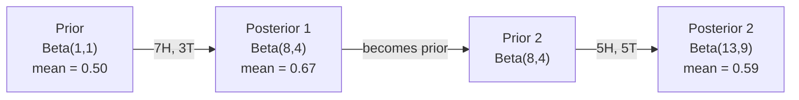

# Bayes' Theorem (Bayes' Theorem)

> 機率談的是你預期什麼。Bayes' theorem 談的是你學到了什麼。

**Type:** Build
**Language:** Python
**Prerequisites:** Phase 1, Lesson 06 (Probability Fundamentals)
**Time:** ~75 分鐘

## 學習目標 (Learning Objectives)

- 運用 Bayes' theorem，從 prior、likelihood 與 evidence 計算 posterior 機率
- 從零打造一個 Naive Bayes 文字分類器，包含 Laplace smoothing 與 log-space 運算
- 比較 MLE 與 MAP 估計，並說明 MAP 如何對應到 L2 regularization
- 用 Beta-Binomial conjugate prior 實作循序 (sequential) 的 Bayesian 更新，應用在 A/B testing

## 問題 (The Problem)

某項醫療檢驗的準確率是 99%。你的檢驗結果呈陽性。你真的得病的機率有多高？

大多數人會說 99%。真正的答案取決於這個病有多罕見。如果每 10,000 人只有 1 人得病，陽性結果只代表你大約有 1% 的機率生病。其餘 99% 的陽性結果，都是健康的人被誤報。

這不是什麼腦筋急轉彎，這就是 Bayes' theorem。每個垃圾郵件過濾器、每個醫療診斷、每個量化不確定性的機器學習模型，都用這套推理。你從一個信念出發，看到證據，然後更新信念。

如果你在不懂這件事的情況下打造 ML 系統，你會誤讀模型輸出、設錯門檻，並且交付過度自信的預測。

## 核心概念 (The Concept)

### 從 joint probability 到 Bayes (From joint probability to Bayes)

你在 Lesson 06 已經知道，條件機率是：

```math
P(A \mid B) = \frac{P(A \text{ and } B)}{P(B)}
```

對稱地：

```math
P(B \mid A) = \frac{P(A \text{ and } B)}{P(A)}
```

兩個式子的分子相同：$P(A \text{ and } B)$。把它們設成相等，再整理：

```math
\begin{aligned}
P(A \text{ and } B) &= P(A \mid B) \cdot P(B) = P(B \mid A) \cdot P(A) \\[4pt]
&\text{Therefore:} \\[4pt]
P(A \mid B) &= \frac{P(B \mid A) \cdot P(A)}{P(B)}
\end{aligned}
```

這就是 Bayes' theorem。四個量，一條等式。

### 四個部分 (The four parts)

| 部分 | 名稱 | 意義 |
|------|------|---------------|
| $P(A \mid B)$ | Posterior | 看到證據 $B$ 之後，你對 $A$ 更新後的信念 |
| $P(B \mid A)$ | Likelihood | 如果 $A$ 為真，證據 $B$ 出現的可能性有多高 |
| $P(A)$ | Prior | 在看到任何證據之前，你對 $A$ 的信念 |
| $P(B)$ | Evidence | 在所有可能情況下，看到 $B$ 的總機率 |

Evidence 項 $P(B)$ 的作用是 normalizer。你可以用 law of total probability 把它展開：

```math
P(B) = P(B \mid A) \cdot P(A) + P(B \mid \text{not } A) \cdot P(\text{not } A)
```

### 醫療檢驗範例 (Medical test example)

某疾病影響每 10,000 人中的 1 人。檢驗的準確率是 99%（能抓到 99% 的病人，有 1% 的機率出現偽陽性）。

```math
\begin{aligned}
P(\text{sick}) &= 0.0001 \quad \text{(prior: disease is rare)} \\
P(\text{positive} \mid \text{sick}) &= 0.99 \quad \text{(likelihood: test catches it)} \\
P(\text{positive} \mid \text{healthy}) &= 0.01 \quad \text{(false positive rate)} \\[6pt]
P(\text{positive}) &= P(\text{positive} \mid \text{sick}) \cdot P(\text{sick}) + P(\text{positive} \mid \text{healthy}) \cdot P(\text{healthy}) \\
&= 0.99 \cdot 0.0001 + 0.01 \cdot 0.9999 \\
&= 0.000099 + 0.009999 \\
&= 0.010098 \\[6pt]
P(\text{sick} \mid \text{positive}) &= P(\text{positive} \mid \text{sick}) \cdot P(\text{sick}) / P(\text{positive}) \\
&= 0.99 \cdot 0.0001 / 0.010098 \\
&= 0.0098 \\
&= 0.98\%
\end{aligned}
```

不到 1%。Prior 佔了主導。當某個狀況很罕見時，即使檢驗很準，產生的結果仍多半是偽陽性。這就是為什麼醫生會安排複檢。

### 垃圾郵件範例 (Spam filter example)

你收到一封含有「lottery」這個字的電子郵件。它是垃圾郵件嗎？

```math
\begin{aligned}
P(\text{spam}) &= 0.3 \quad \text{(30\% of email is spam)} \\
P(\text{"lottery"} \mid \text{spam}) &= 0.05 \quad \text{(5\% of spam emails contain "lottery")} \\
P(\text{"lottery"} \mid \text{not spam}) &= 0.001 \quad \text{(0.1\% of legitimate emails contain "lottery")} \\[6pt]
P(\text{"lottery"}) &= 0.05 \cdot 0.3 + 0.001 \cdot 0.7 \\
&= 0.015 + 0.0007 \\
&= 0.0157 \\[6pt]
P(\text{spam} \mid \text{"lottery"}) &= 0.05 \cdot 0.3 / 0.0157 \\
&= 0.955 \\
&= 95.5\%
\end{aligned}
```

一個字就把機率從 30% 推到 95.5%。真正的垃圾郵件過濾器會同時對數百個字套用 Bayes。

### Naive Bayes：獨立性假設 (Naive Bayes: independence assumption)

Naive Bayes 把這個做法擴展到多個 feature，假設在給定類別的條件下，所有 feature 都條件獨立：

```math
P(\text{class} \mid \text{feature}_1, \text{feature}_2, \ldots, \text{feature}_n) = \frac{P(\text{class}) \cdot P(\text{feature}_1 \mid \text{class}) \cdot P(\text{feature}_2 \mid \text{class}) \cdots P(\text{feature}_n \mid \text{class})}{P(\text{feature}_1, \text{feature}_2, \ldots, \text{feature}_n)}
```

「naive」指的就是獨立性假設。在文字裡，字詞的出現並不獨立（「New」和「York」是相關的）。但這個假設在實務上出奇地好用，因為分類器只需要對類別排序，不需要產生校準過的機率。

由於分母對所有類別都一樣，你可以略過它，只比較分子：

```math
\text{score}(\text{class}) = P(\text{class}) \cdot \prod_i P(\text{feature}_i \mid \text{class})
```

選出分數最高的類別。

### Maximum likelihood estimation (MLE)

你怎麼從訓練資料得到 $P(\text{feature} \mid \text{class})$？用數的。

```math
P(\text{"free"} \mid \text{spam}) = \frac{\text{number of spam emails containing "free"}}{\text{total spam emails}}
```

這就是 MLE：選出讓觀察到的資料最有可能出現的參數值。你是在最大化 likelihood function，對離散計數來說，這就化簡成相對頻率。

問題是：如果某個字在訓練期間從未出現在垃圾郵件裡，MLE 會給它機率零。一個沒見過的字，就會讓整個乘積歸零。用 Laplace smoothing 來解決：

```math
P(\text{word} \mid \text{class}) = \frac{\text{count}(\text{word}, \text{class}) + 1}{\text{total\_words\_in\_class} + \text{vocabulary\_size}}
```

每個計數都加 1，就能確保沒有任何機率是零。

### Maximum a posteriori (MAP)

MLE 問的是：哪些參數能最大化 $P(\text{data} \mid \text{parameters})$？

MAP 問的是：哪些參數能最大化 $P(\text{parameters} \mid \text{data})$？

根據 Bayes' theorem：

```math
P(\text{parameters} \mid \text{data}) \propto P(\text{data} \mid \text{parameters}) \cdot P(\text{parameters})
```

MAP 對參數本身加上一個 prior。如果你相信參數應該要小，就把這個信念編碼成懲罰大數值的 prior。這與 ML 裡的 L2 regularization 完全相同。Ridge regression 的「ridge」懲罰項，其實就是 weight 上的 Gaussian prior。

| 估計方法 | 最佳化 | ML 中的對應 |
|------------|-----------|---------------|
| MLE | $P(\text{data} \mid \text{params})$ | 沒有 regularization 的訓練 |
| MAP | $P(\text{data} \mid \text{params}) \cdot P(\text{params})$ | L2 / L1 regularization |

### Bayesian 與 frequentist：實務上的差異 (Bayesian vs frequentist: the practical difference)

Frequentist 把參數視為固定但未知的值。他們問：「如果我把這個實驗重複很多次，會發生什麼事？」

Bayesian 把參數視為分佈。他們問：「根據我觀察到的資料，我對這些參數有什麼信念？」

對於打造 ML 系統，實務上的差異是：

| 面向 | Frequentist | Bayesian |
|--------|-------------|----------|
| 輸出 | Point estimate | 數值上的分佈 |
| 不確定性 | Confidence interval（針對程序） | Credible interval（針對參數） |
| 資料少時 | 可能 overfit | Prior 充當 regularization |
| 運算 | 通常較快 | 常需要取樣 (MCMC) |

大多數正式環境的 ML 是 frequentist（SGD、point estimate）。當你需要校準過的不確定性（醫療決策、安全攸關系統），或資料稀少時（few-shot learning、cold start），Bayesian 方法就能發揮所長。

### 為什麼 Bayesian 思維對 ML 很重要 (Why Bayesian thinking matters for ML)

這個連結比類比更深：

**Prior 就是 regularization。** Weight 上的 Gaussian prior 就是 L2 regularization。Laplace prior 則是 L1。每次你加入 regularization 項，就是在做一個 Bayesian 宣告，說明你預期參數值該是什麼樣子。

**Posterior 就是不確定性。** 單一的預測機率，無法告訴你模型對這個估計有多有信心。Bayesian 方法給你一個分佈：「我認為 $P(\text{spam})$ 介於 0.8 到 0.95 之間。」

**Bayes 更新就是 online learning。** 今天的 posterior 成為明天的 prior。當模型看到新資料時，它會漸進地更新信念，而不是從頭重新訓練。

**模型比較是 Bayesian 的。** Bayesian information criterion (BIC)、marginal likelihood 與 Bayes factor，都用 Bayesian 推理來挑選模型，同時避免 overfitting。

```figure
bayes-update
```

## 動手做 (Build It)

### 步驟 1：Bayes theorem 函式

```python
def bayes(prior, likelihood, false_positive_rate):
    evidence = likelihood * prior + false_positive_rate * (1 - prior)
    posterior = likelihood * prior / evidence
    return posterior

result = bayes(prior=0.0001, likelihood=0.99, false_positive_rate=0.01)
print(f"P(sick|positive) = {result:.4f}")
```

### 步驟 2：Naive Bayes 分類器

```python
import math
from collections import defaultdict

class NaiveBayes:
    def __init__(self, smoothing=1.0):
        self.smoothing = smoothing
        self.class_counts = defaultdict(int)
        self.word_counts = defaultdict(lambda: defaultdict(int))
        self.class_word_totals = defaultdict(int)
        self.vocab = set()

    def train(self, documents, labels):
        for doc, label in zip(documents, labels):
            self.class_counts[label] += 1
            words = doc.lower().split()
            for word in words:
                self.word_counts[label][word] += 1
                self.class_word_totals[label] += 1
                self.vocab.add(word)

    def predict(self, document):
        words = document.lower().split()
        total_docs = sum(self.class_counts.values())
        vocab_size = len(self.vocab)
        best_class = None
        best_score = float("-inf")
        for cls in self.class_counts:
            score = math.log(self.class_counts[cls] / total_docs)
            for word in words:
                count = self.word_counts[cls].get(word, 0)
                total = self.class_word_totals[cls]
                score += math.log((count + self.smoothing) / (total + self.smoothing * vocab_size))
            if score > best_score:
                best_score = score
                best_class = cls
        return best_class
```

Log probability 可以避免 underflow。把許多很小的機率相乘，會產生浮點數放不下的極小數字。把 log-probability 相加在數值上很穩定，而且數學上等價。

### 步驟 3：在垃圾郵件資料上訓練

```python
train_docs = [
    "win free money now",
    "free lottery ticket winner",
    "claim your prize today free",
    "urgent offer free cash",
    "congratulations you won free",
    "meeting tomorrow at noon",
    "project update attached",
    "can we schedule a call",
    "quarterly report review",
    "lunch on thursday sounds good",
    "team standup notes attached",
    "please review the pull request",
]

train_labels = [
    "spam", "spam", "spam", "spam", "spam",
    "ham", "ham", "ham", "ham", "ham", "ham", "ham",
]

classifier = NaiveBayes()
classifier.train(train_docs, train_labels)

test_messages = [
    "free money waiting for you",
    "meeting rescheduled to friday",
    "you won a free prize",
    "please review the attached report",
]

for msg in test_messages:
    print(f"  '{msg}' -> {classifier.predict(msg)}")
```

### 步驟 4：檢視學到的機率

```python
def show_top_words(classifier, cls, n=5):
    vocab_size = len(classifier.vocab)
    total = classifier.class_word_totals[cls]
    probs = {}
    for word in classifier.vocab:
        count = classifier.word_counts[cls].get(word, 0)
        probs[word] = (count + classifier.smoothing) / (total + classifier.smoothing * vocab_size)
    sorted_words = sorted(probs.items(), key=lambda x: x[1], reverse=True)
    for word, prob in sorted_words[:n]:
        print(f"    {word}: {prob:.4f}")

print("\nTop spam words:")
show_top_words(classifier, "spam")
print("\nTop ham words:")
show_top_words(classifier, "ham")
```

## 實際使用 (Use It)

Scikit-learn 內建可直接用於正式環境的 naive Bayes 實作：

```python
from sklearn.feature_extraction.text import CountVectorizer
from sklearn.naive_bayes import MultinomialNB
from sklearn.metrics import classification_report

vectorizer = CountVectorizer()
X_train = vectorizer.fit_transform(train_docs)
clf = MultinomialNB()
clf.fit(X_train, train_labels)

X_test = vectorizer.transform(test_messages)
predictions = clf.predict(X_test)
for msg, pred in zip(test_messages, predictions):
    print(f"  '{msg}' -> {pred}")
```

同樣的演算法。CountVectorizer 處理 tokenization 與詞彙表建立。MultinomialNB 在內部處理 smoothing 與 log-probability。你從零寫的版本用 40 行就做到同樣的事。

## 交付 (Ship It)

這裡打造的 NaiveBayes class 展示了完整的流程：tokenization、搭配 Laplace smoothing 的機率估計，以及在 log space 進行預測。`code/bayes.py` 的程式碼可以端到端執行，除了 Python 標準函式庫之外沒有任何其他相依套件。

### Conjugate Prior (Conjugate Priors)

當 prior 與 posterior 屬於同一個分佈家族時，這個 prior 就稱為「conjugate」。這讓 Bayesian 更新在代數上很乾淨：你不必做數值積分，就能得到封閉形式的 posterior。

| Likelihood | Conjugate Prior | Posterior | 範例 |
|-----------|----------------|-----------|---------|
| Bernoulli | $\text{Beta}(a, b)$ | $\text{Beta}(a + \text{successes}, b + \text{failures})$ | 估計硬幣的偏差 |
| Normal（已知 variance） | $\text{Normal}(\mu_0, \sigma_0)$ | Normal(加權 mean, 較小的 variance) | 感測器校準 |
| Poisson | $\text{Gamma}(a, b)$ | $\text{Gamma}(a + \text{sum of counts}, b + n)$ | 建模抵達率 |
| Multinomial | $\text{Dirichlet}(\alpha)$ | $\text{Dirichlet}(\alpha + \text{counts})$ | Topic modeling、語言模型 |

為什麼這很重要：沒有 conjugate prior，你需要 Monte Carlo 取樣或 variational inference 來近似 posterior。有了 conjugate prior，你只要更新兩個數字。

Beta 分佈是實務上最常見的 conjugate prior。$\text{Beta}(a, b)$ 代表你對某個機率參數的信念。Mean 是 $a/(a+b)$。$a+b$ 越大，分佈越集中（越有信心）。

Beta prior 的特例：
- $\text{Beta}(1, 1)$ = uniform。你對這個參數沒有任何意見。
- $\text{Beta}(10, 10)$ = 在 0.5 附近有峰值。你強烈相信這個參數接近 0.5。
- $\text{Beta}(1, 10)$ = 偏向 0。你相信這個參數很小。

更新規則簡單到不行：

```math
\begin{aligned}
\text{Prior:} \quad & \text{Beta}(a, b) \\
\text{Data:} \quad & s \text{ successes}, f \text{ failures} \\
\text{Posterior:} \quad & \text{Beta}(a + s, b + f)
\end{aligned}
```

沒有積分，沒有取樣，只有加法。

### 循序 Bayesian 更新 (Sequential Bayesian Updating)

Bayesian 推論天生就是循序的。今天的 posterior 成為明天的 prior。真實的系統就是這樣漸進學習，而不必重新處理所有歷史資料。

具體範例：估計一枚硬幣是否公平。

**第 1 天：還沒有資料。**
從 $\text{Beta}(1, 1)$ 開始，這是 uniform prior。你沒有任何意見。
- Prior mean：0.5
- Prior 在 [0, 1] 上是平的

**第 2 天：觀察到 7 次正面、3 次反面。**
$\text{Posterior} = \text{Beta}(1 + 7, 1 + 3) = \text{Beta}(8, 4)$
- Posterior mean：$8/12 = 0.667$
- 證據顯示這枚硬幣偏向正面

**第 3 天：再觀察到 5 次正面、5 次反面。**
把昨天的 posterior 當作今天的 prior。
$\text{Posterior} = \text{Beta}(8 + 5, 4 + 5) = \text{Beta}(13, 9)$
- Posterior mean：$13/22 = 0.591$
- 平衡的新資料把估計拉回 0.5 附近



觀察的順序並不重要。把 $\text{Beta}(1,1)$ 一次用全部 12 次正面和 8 次反面更新，得到 $\text{Beta}(13, 9)$，結果相同。循序更新與批次更新在數學上是等價的。但循序更新讓你能在每一步做決策，而不必儲存原始資料。

這是正式 ML 系統中 online learning 的基礎。Bandit 的 Thompson sampling、增量式推薦系統，以及串流異常偵測器，全都用這個模式。

### 與 A/B Testing 的關聯 (Connection to A/B Testing)

A/B testing 其實就是披著外衣的 Bayesian 推論。

情境：你在測試兩種按鈕顏色。變體 A（藍色）和變體 B（綠色）。你想知道哪一個的點擊數比較多。

Bayesian A/B test：

1. **Prior。** 兩個變體都從 $\text{Beta}(1, 1)$ 開始。沒有事先的偏好。
2. **資料。** 變體 A：1000 次瀏覽中有 50 次點擊。變體 B：1000 次瀏覽中有 65 次點擊。
3. **Posterior。**
   - A：$\text{Beta}(1 + 50, 1 + 950) = \text{Beta}(51, 951)$。Mean = 0.051
   - B：$\text{Beta}(1 + 65, 1 + 935) = \text{Beta}(66, 936)$。Mean = 0.066
4. **決策。** 計算 $P(B > A)$：B 的真實轉換率高於 A 的機率。

用解析方式計算 $P(B > A)$ 很難。但 Monte Carlo 讓它變得很簡單：

```
1. Draw 100,000 samples from Beta(51, 951)  -> samples_A
2. Draw 100,000 samples from Beta(66, 936)  -> samples_B
3. P(B > A) = fraction of samples where B > A
```

如果 $P(B > A) > 0.95$，就上線變體 B。如果介於 0.05 和 0.95 之間，就繼續收集資料。如果 $P(B > A) < 0.05$，就上線變體 A。

相較於 frequentist A/B testing 的優點：
- 你得到直接的機率陳述：「有 97% 的機率 B 比較好」
- 沒有 p-value 的混淆。沒有「無法拒絕虛無假設」的模糊說法。
- 你可以隨時檢查結果，而不會拉高偽陽性率（沒有「偷看問題」(peeking problem)）
- 你可以納入先驗知識（例如：先前的測試顯示轉換率通常在 3-8%）

| 面向 | Frequentist A/B | Bayesian A/B |
|--------|----------------|--------------|
| 輸出 | p-value | $P(B > A)$ |
| 解讀 | 「如果 A=B，這筆資料有多令人意外？」 | 「B 比 A 好的可能性有多高？」 |
| 提早停止 | 會拉高偽陽性 | 任何時間點都安全（前提是 prior 選得好、模型設定正確） |
| 先驗知識 | 不使用 | 編碼為 Beta prior |
| 決策規則 | $p < 0.05$ | $P(B > A) > \text{threshold}$ |

## 練習 (Exercises)

1. **多次檢驗。** 一位病人在兩次獨立的檢驗中都呈陽性（兩者準確率都是 99%，疾病盛行率為每 10,000 人 1 人）。兩次檢驗之後 $P(\text{sick})$ 是多少？把第一次檢驗的 posterior 當作第二次的 prior。

2. **Smoothing 的影響。** 用 0.01、0.1、1.0 和 10.0 的 smoothing 值執行垃圾郵件分類器。排名靠前的字的機率如何變化？當 smoothing=0，而某個字只出現在 ham 裡，會發生什麼事？

3. **新增 feature。** 擴充 NaiveBayes class，除了字數統計之外，也把訊息長度（短/長）當作 feature。從訓練資料估計 $P(\text{short} \mid \text{spam})$ 與 $P(\text{short} \mid \text{ham})$，並把它納入預測分數。

4. **手算 MAP。** 給定觀察到的資料（10 次擲硬幣中有 7 次正面），用 $\text{Beta}(2,2)$ prior 計算偏差的 MAP 估計。並與 MLE 估計（$7/10$）比較。

### 提示 (Hints)

**練習 1。** 呼叫一次 `bayes` 取得第 1 次檢驗後的 posterior，再把這個 posterior 當作 prior 再呼叫一次。`sequential_bayes(prior, likelihood, false_positive_rate, 2)` 必須給出相同的值，接近 0.5。

**練習 2。** 對每個值各建立一個 `NaiveBayes(smoothing=s)`，用相同資料訓練，並印出各自的 `top_words`。當 smoothing 為 0 時，從未出現在垃圾郵件中的字，機率會是 0，所以它的 log 沒有定義。

**練習 3。** 數出垃圾郵件與 ham 各有多少則是短訊息，除以各類別的訊息數量，並把這個比例的 log 加到 `predict` 的分數裡。檢查每個類別的兩個機率加起來等於 1。

**練習 4。** 使用 $\text{Beta}(\alpha, \beta)$ prior 時，MAP 估計是 $\frac{h + \alpha - 1}{n + \alpha + \beta - 2}$。代入 $h = 7$、$n = 10$；結果必須介於 MLE (0.7) 和 prior 的 mode (0.5) 之間。

## 關鍵術語 (Key Terms)

| 術語 | 一般人怎麼說 | 實際意思 |
|------|----------------|----------------------|
| Prior | 「我最初的猜測」 | 觀察到證據之前的 $P(\text{hypothesis})$。在 ML 中：就是 regularization 項。 |
| Likelihood | 「資料符合得多好」 | $P(\text{evidence} \mid \text{hypothesis})$。在特定假設下，觀察到的資料有多大的可能性。 |
| Posterior | 「我更新後的信念」 | $P(\text{hypothesis} \mid \text{evidence})$。Prior 乘上 likelihood，再做 normalization。 |
| Evidence | 「normalizing constant」 | 跨所有假設的 $P(\text{data})$。確保 posterior 加總為 1。 |
| Naive Bayes | 「那個簡單的文字分類器」 | 假設在給定類別下 feature 彼此獨立的分類器。儘管假設不成立，效果依然不錯。 |
| Laplace smoothing | 「Add-one smoothing」 | 對每個 feature 加上一個小的計數，避免沒見過的資料造成零機率。 |
| MLE | 「直接用頻率」 | 選出能最大化 $P(\text{data} \mid \text{parameters})$ 的參數。沒有 prior。資料少時可能 overfit。 |
| MAP | 「帶有 prior 的 MLE」 | 選出能最大化 $P(\text{data} \mid \text{parameters}) \cdot P(\text{parameters})$ 的參數。等同於有 regularization 的 MLE。 |
| Log-probability | 「在 log space 運算」 | 用 $\log(P)$ 取代 $P$，避免在相乘許多小數字時發生浮點數 underflow。 |
| False positive | 「錯誤的警報」 | 檢驗結果為陽性，但實際狀態為陰性。是造成 base rate fallacy 的原因。 |

## 延伸閱讀 (Further Reading)

- [3Blue1Brown: Bayes' theorem](https://www.youtube.com/watch?v=HZGCoVF3YvM) - 以醫療檢驗範例做視覺化解釋
- [Stanford CS229: Generative Learning Algorithms](https://cs229.stanford.edu/main_notes.pdf) - naive Bayes 及其與 discriminative model 的關聯
- [Think Bayes](https://greenteapress.com/wp/think-bayes/) - 免費的書，用 Python 程式碼講解 Bayesian 統計
- [scikit-learn Naive Bayes](https://scikit-learn.org/stable/modules/naive_bayes.html) - 可用於正式環境的實作，以及各種變體的使用時機
