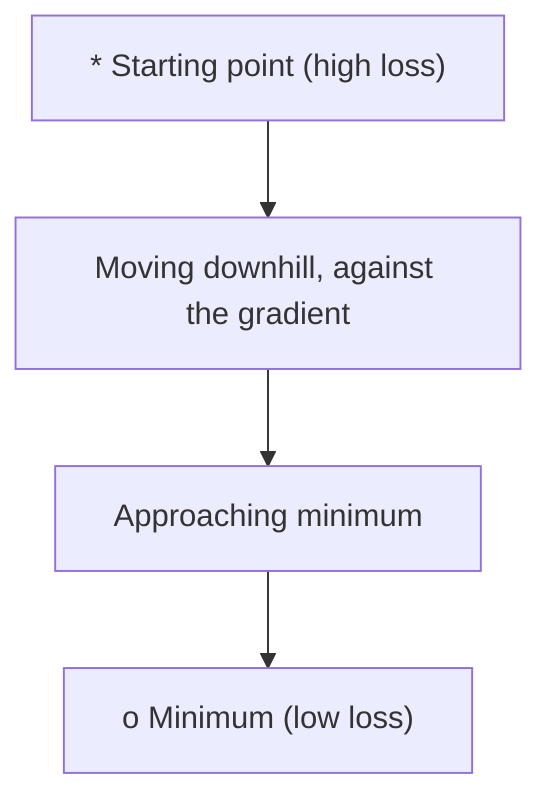
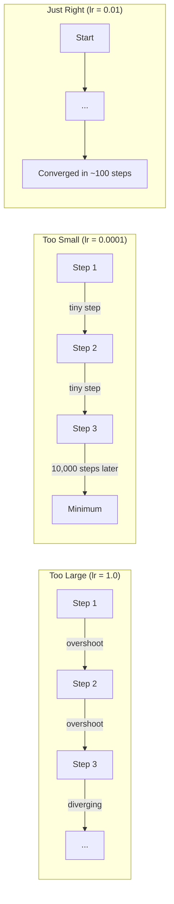
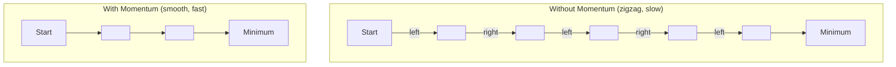
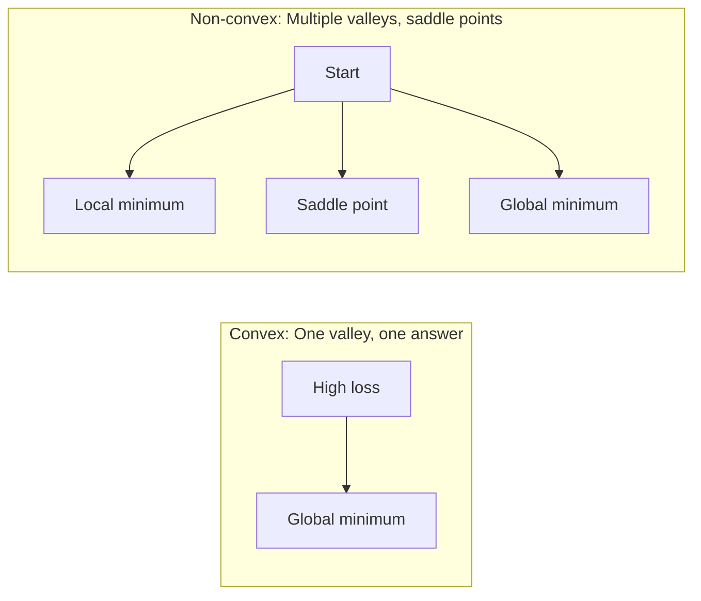
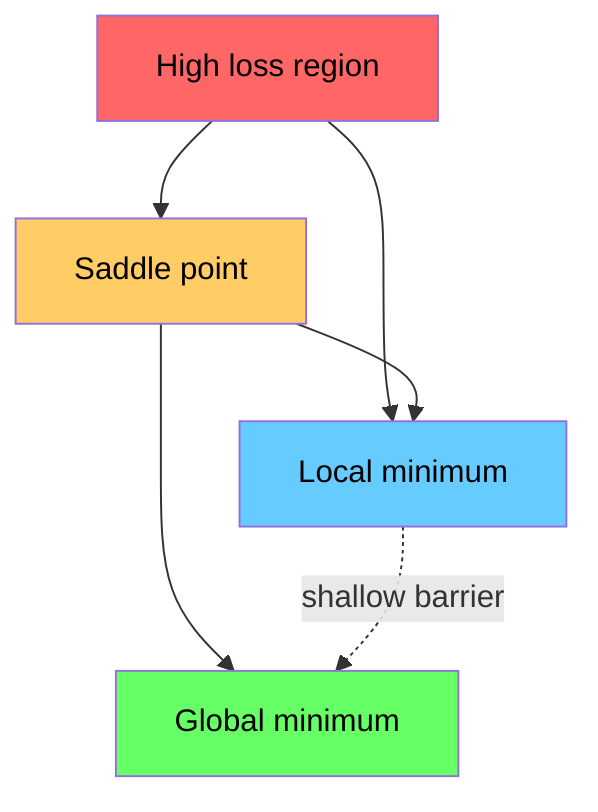

# 最佳化 (Optimization)

> 訓練 neural network，不過就是找到山谷的最底部。

**Type:** Build
**Language:** Python
**Prerequisites:** Phase 1, Lessons 04-05 (Derivatives, Gradients)
**Time:** ~75 分鐘

## 學習目標 (Learning Objectives)

- 從零實作 vanilla gradient descent、帶 momentum 的 SGD 與 Adam
- 在 Rosenbrock 函數上比較各 optimizer 的收斂，並說明 Adam 為什麼能為每個 weight 調整 learning rate
- 區分 convex 與 non-convex 的 loss landscape，並說明 saddle point 在高維空間中的角色
- 設定 learning rate schedule（step decay、cosine annealing、warmup）以維持訓練穩定

## 問題 (The Problem)

你有一個 loss function，它告訴你模型錯得多離譜。你有 gradient，它告訴你哪個方向會讓 loss 變得更糟。現在你需要一套往下坡走的策略。

最簡單的做法很直接：往 gradient 的反方向移動，用一個叫 learning rate 的數字縮放步伐，然後重複。這就是 gradient descent，而且它有效。但「有效」是有但書的。Learning rate 太大，你會完全衝過山谷，在兩側山壁之間來回彈跳。太小，你要花上數千個不必要的步驟才能慢慢爬向答案。碰上 saddle point，即使還沒找到 minimum，你也會停止移動。

深度學習裡的每個 optimizer，都是在回答同一個問題：如何更快、更可靠地走到山谷底部？

## 核心概念 (The Concept)

### 最佳化是什麼意思 (What optimization means)

最佳化就是找出能最小化（或最大化）某個函數的輸入值。在機器學習裡，這個函數是 loss，輸入是模型的 weight。訓練就是最佳化。

```
minimize L(w) where:
  L = loss function
  w = model weights (could be millions of parameters)
```

### Gradient descent（vanilla） (Gradient descent (vanilla))

最簡單的 optimizer。計算 loss 對每個 weight 的 gradient，把每個 weight 往 gradient 的反方向移動，並用 learning rate 縮放步伐。

```math
w = w - \text{lr} \cdot \text{gradient}
```

整個演算法就是這樣，只有一行。



### Learning rate：最重要的 hyperparameter (Learning rate: the most important hyperparameter)

Learning rate 控制步伐大小。它決定了收斂的一切。



正確的 learning rate 沒有公式，你要靠實驗找出來。常見的起點：Adam 用 0.001，帶 momentum 的 SGD 用 0.01。

### SGD、batch 與 mini-batch (SGD vs batch vs mini-batch)

Vanilla gradient descent 會先對整個資料集計算 gradient，才走一步。這稱為 batch gradient descent。它很穩定，但很慢。

Stochastic gradient descent (SGD) 對單一隨機樣本計算 gradient，然後立刻走一步。它有雜訊，但很快。

Mini-batch gradient descent 取兩者的折衷。對一小批資料（32、64、128、256 個樣本）計算 gradient，然後走一步。這是大家實際上使用的方式。

| 變體 | Batch size | Gradient 品質 | 每步速度 | 雜訊 |
|---------|-----------|-----------------|---------------|-------|
| Batch GD | 整個資料集 | 精確 | 慢 | 無 |
| SGD | 1 個樣本 | 雜訊很大 | 快 | 高 |
| Mini-batch | 32-256 | 不錯的估計 | 均衡 | 中等 |

SGD 與 mini-batch 的雜訊不是 bug。它有助於跳出淺的 local minimum 與 saddle point。

### Momentum：滾下山的球 (Momentum: the ball rolling downhill)

Vanilla gradient descent 只看目前的 gradient。如果 gradient 呈鋸齒狀（在狹窄山谷中很常見），進展就會很慢。Momentum 把過去的 gradient 累積成一個 velocity 項來解決這個問題。

```math
\begin{aligned}
v &= \beta \cdot v + \text{gradient} \\
w &= w - \text{lr} \cdot v
\end{aligned}
```

類比：一顆滾下山的球。它不會在每個小凸起處停下再重新啟動。它在一致的方向上累積速度，並抑制震盪。



`beta`（通常是 0.9）控制要保留多少歷史。Beta 越高，momentum 越大，路徑越平滑，但對方向改變的反應也越慢。

### Adam：自適應 learning rate (Adam: adaptive learning rates)

不同的 weight 需要不同的 learning rate。一個很少拿到大 gradient 的 weight，在它終於拿到時應該走比較大的步伐。一個持續拿到巨大 gradient 的 weight，則應該走比較小的步伐。

Adam (Adaptive Moment Estimation) 為每個 weight 追蹤兩樣東西：

1. 一階 moment ($m$)：gradient 的移動平均（類似 momentum）
2. 二階 moment ($v$)：gradient 平方的移動平均（gradient 的大小）

```math
\begin{aligned}
m &= \beta_1 \cdot m + (1 - \beta_1) \cdot \text{gradient} \\
v &= \beta_2 \cdot v + (1 - \beta_2) \cdot \text{gradient}^2 \\[4pt]
\hat{m} &= m / (1 - \beta_1^t) \quad \text{bias correction} \\
\hat{v} &= v / (1 - \beta_2^t) \quad \text{bias correction} \\[4pt]
w &= w - \text{lr} \cdot \hat{m} / (\sqrt{\hat{v}} + \epsilon)
\end{aligned}
```

除以 `sqrt(v_hat)` 是關鍵洞見。Gradient 大的 weight 會被除以一個大數字（有效步伐小）。Gradient 小的 weight 會被除以一個小數字（有效步伐大）。每個 weight 都有自己的自適應 learning rate。

預設的 hyperparameter：`lr=0.001, beta1=0.9, beta2=0.999, epsilon=1e-8`。這些預設值在大多數問題上都表現不錯。

### Learning rate schedule (Learning rate schedules)

固定的 learning rate 是一種妥協。訓練初期，你想要大步伐來快速進展。訓練後期，你想要小步伐在 minimum 附近微調。

常見的 schedule：

| Schedule | 公式 | 使用情境 |
|----------|---------|----------|
| Step decay | 每 $N$ 個 epoch 執行 $\text{lr} = \text{lr} \cdot \text{factor}$ | 簡單、可手動控制 |
| Exponential decay | $\text{lr} = \text{lr}_0 \cdot \text{decay}^t$ | 平滑地降低 |
| Cosine annealing | $\text{lr} = \text{lr} _{\min} + 0.5 \cdot (\text{lr} _{\max} - \text{lr} _{\min}) \cdot (1 + \cos(\pi t / T))$ | Transformer、現代訓練 |
| Warmup + decay | 線性上升，然後衰減 | 大型模型，避免早期不穩定 |

### Convex 與 non-convex (Convex vs non-convex)

Convex 函數沒有不好的 local minimum：每個 local minimum 都是 global minimum。對於有 minimum 的平滑 convex 函數，只要 learning rate 夠小，gradient descent 就會收斂到它。像 $f(x) = x^2$ 這樣的二次函數是 convex 的，它的 minimum 是唯一的。

Neural network 的 loss function 是 non-convex 的。它們有許多 local minimum、saddle point 和平坦區域。



實務上，高維 neural network 中的 local minimum 很少成為問題。大多數 local minimum 的 loss 值都接近 global minimum。Saddle point（在某些方向平坦、在其他方向彎曲）才是真正的障礙。Momentum 和 mini-batch 的雜訊有助於跳出它們。

### Loss landscape 視覺化 (Loss landscape visualization)

Loss 是所有 weight 的函數。對一個有 100 萬個 weight 的模型，loss landscape 存在於 1,000,001 維的空間中。我們的視覺化方式是在 weight 空間挑兩個隨機方向，沿著這兩個方向畫出 loss，得到一個 2D 曲面。



尖銳的 minimum 泛化能力差，平坦的 minimum 泛化能力好。這是帶 momentum 的 SGD 在最終 test accuracy 上常常勝過 Adam 的原因之一：它的雜訊避免了停在尖銳的 minimum。

```figure
gradient-descent
```

## 動手做 (Build It)

### 步驟 1：定義一個測試函數

Rosenbrock 函數是經典的最佳化 benchmark。它的 minimum 在 (1, 1)，位於一個狹窄彎曲的山谷中，很容易找到，卻很難順著走。

```math
f(x, y) = (1 - x)^2 + 100 \cdot (y - x^2)^2
```

```python
def rosenbrock(params):
    x, y = params
    return (1 - x) ** 2 + 100 * (y - x ** 2) ** 2

def rosenbrock_gradient(params):
    x, y = params
    df_dx = -2 * (1 - x) + 200 * (y - x ** 2) * (-2 * x)
    df_dy = 200 * (y - x ** 2)
    return [df_dx, df_dy]
```

### 步驟 2：Vanilla gradient descent

```python
class GradientDescent:
    def __init__(self, lr=0.001):
        self.lr = lr

    def step(self, params, grads):
        return [p - self.lr * g for p, g in zip(params, grads)]
```

### 步驟 3：帶 momentum 的 SGD

```python
class SGDMomentum:
    def __init__(self, lr=0.001, momentum=0.9):
        self.lr = lr
        self.momentum = momentum
        self.velocity = None

    def step(self, params, grads):
        if self.velocity is None:
            self.velocity = [0.0] * len(params)
        self.velocity = [
            self.momentum * v + g
            for v, g in zip(self.velocity, grads)
        ]
        return [p - self.lr * v for p, v in zip(params, self.velocity)]
```

### 步驟 4：Adam

```python
class Adam:
    def __init__(self, lr=0.001, beta1=0.9, beta2=0.999, epsilon=1e-8):
        self.lr = lr
        self.beta1 = beta1
        self.beta2 = beta2
        self.epsilon = epsilon
        self.m = None
        self.v = None
        self.t = 0

    def step(self, params, grads):
        if self.m is None:
            self.m = [0.0] * len(params)
            self.v = [0.0] * len(params)

        self.t += 1

        self.m = [
            self.beta1 * m + (1 - self.beta1) * g
            for m, g in zip(self.m, grads)
        ]
        self.v = [
            self.beta2 * v + (1 - self.beta2) * g ** 2
            for v, g in zip(self.v, grads)
        ]

        m_hat = [m / (1 - self.beta1 ** self.t) for m in self.m]
        v_hat = [v / (1 - self.beta2 ** self.t) for v in self.v]

        return [
            p - self.lr * mh / (vh ** 0.5 + self.epsilon)
            for p, mh, vh in zip(params, m_hat, v_hat)
        ]
```

### 步驟 5：執行並比較

```python
def optimize(optimizer, func, grad_func, start, steps=5000):
    params = list(start)
    history = [params[:]]
    for _ in range(steps):
        grads = grad_func(params)
        params = optimizer.step(params, grads)
        history.append(params[:])
    return history

start = [-1.0, 1.0]

gd_history = optimize(GradientDescent(lr=0.0005), rosenbrock, rosenbrock_gradient, start)
sgd_history = optimize(SGDMomentum(lr=0.0001, momentum=0.9), rosenbrock, rosenbrock_gradient, start)
adam_history = optimize(Adam(lr=0.01), rosenbrock, rosenbrock_gradient, start)

for name, history in [("GD", gd_history), ("SGD+M", sgd_history), ("Adam", adam_history)]:
    final = history[-1]
    loss = rosenbrock(final)
    print(f"{name:6s} -> x={final[0]:.6f}, y={final[1]:.6f}, loss={loss:.8f}")
```

預期的輸出：Adam 收斂最快。帶 momentum 的 SGD 走的路徑比較平滑。Vanilla GD 沿著狹窄山谷前進得很慢。

## 實際使用 (Use It)

實務上，請使用 PyTorch 或 JAX 的 optimizer。它們處理 parameter group、weight decay、gradient clipping 與 GPU 加速。

```python
import torch

model = torch.nn.Linear(784, 10)

sgd = torch.optim.SGD(model.parameters(), lr=0.01, momentum=0.9)
adam = torch.optim.Adam(model.parameters(), lr=0.001)
adamw = torch.optim.AdamW(model.parameters(), lr=0.001, weight_decay=0.01)

scheduler = torch.optim.lr_scheduler.CosineAnnealingLR(adam, T_max=100)
```

經驗法則：

- 從 Adam (lr=0.001) 開始。它在大多數問題上不用調整就能運作。
- 當你需要最好的最終 accuracy，而且負擔得起更多調整時，改用帶 momentum 的 SGD (lr=0.01, momentum=0.9)。
- Transformer 使用 AdamW（具備 decoupled weight decay 的 Adam）。
- 訓練超過幾個 epoch 時，一律使用 learning rate schedule。
- 如果訓練不穩定，就降低 learning rate。如果訓練太慢，就提高它。

## 交付 (Ship It)

這堂課會產出一份用來挑選合適 optimizer 的 prompt。請見 `outputs/prompt-optimizer-guide.md`。

這裡打造的 optimizer class，會在 Phase 3 從零訓練 neural network 時再次出現。

## 練習 (Exercises)

1. **Learning rate 掃描。** 用 learning rate [0.0001, 0.0005, 0.001, 0.005, 0.01] 在 Rosenbrock 函數上執行 vanilla gradient descent。畫出或印出每一個在 5000 步之後的最終 loss。找出仍然能收斂的最大 learning rate。

2. **Momentum 比較。** 用 momentum 值 [0.0, 0.5, 0.9, 0.99] 在 Rosenbrock 函數上執行 SGD。追蹤每一步的 loss。哪個 momentum 值收斂最快？哪個會衝過頭？

3. **逃離 saddle point。** 定義函數 $f(x, y) = x^2 - y^2$（原點處有一個 saddle point）。從 (0.01, 0.01) 出發。比較 vanilla GD、帶 momentum 的 SGD 和 Adam 的表現。哪一個能逃離 saddle point？

4. **實作 learning rate decay。** 在 GradientDescent class 中加入 exponential decay schedule：`lr = lr_0 * 0.999^step`。在 Rosenbrock 函數上比較有無 decay 的收斂情況。

### 提示 (Hints)

**練習 1。** 對每個 learning rate 跑迴圈，為每個建立一個 `GradientDescent(lr=...)`，並連同 `rosenbrock` 和 `rosenbrock_gradient` 傳給 `optimize`。發散的執行會顯示 loss 變大或變成 `nan`；minimum 在 $(1, 1)$，loss 為 0。

**練習 2。** 為每個值建立 `SGDMomentum(momentum=m)`，並記錄每一步之後的 loss。用 `find_convergence_step` 比較速度，並尋找忽上忽下的 loss 來判斷是否衝過頭。

**練習 3。** 寫出 gradient $(2x, -2y)$，並從 (0.01, 0.01) 執行這三個 optimizer。每 100 步印出 $y$：能逃離的 optimizer，就是 $\lvert y \rvert$ 變得很大的那個。

**練習 4。** 在 `GradientDescent` 中儲存 `lr_0` 和一個步數計數器，並在 `step` 內計算 `lr = lr_0 * 0.999 ** step`。印出第 0 步和第 1000 步的 learning rate；它必須從 `lr_0` 降到約 $0.37 \times \text{lr}_0$。

## 關鍵術語 (Key Terms)

| 術語 | 一般人怎麼說 | 實際意思 |
|------|----------------|----------------------|
| Gradient descent | 「往下坡走」 | 用 weight 減去乘上 learning rate 的 gradient 來更新。最基本的 optimizer。 |
| Learning rate | 「步長」 | 控制每次更新讓 weight 移動多遠的純量。太大會發散，太小會浪費運算。 |
| Momentum | 「繼續滾」 | 把過去的 gradient 累積成 velocity vector。抑制震盪，並在一致的方向上加速移動。 |
| SGD | 「隨機取樣」 | Stochastic gradient descent。對隨機子集而非完整資料集計算 gradient。實務上幾乎都是指 mini-batch SGD。 |
| Mini-batch | 「一小塊資料」 | 用來估計 gradient 的一小部分訓練資料（32-256 個樣本）。在速度與 gradient 準確度之間取得平衡。 |
| Adam | 「預設的 optimizer」 | Adaptive Moment Estimation。追蹤每個 weight 的 gradient 與 gradient 平方的移動平均，讓每個 weight 有自己的 learning rate。 |
| Bias correction | 「修正冷啟動」 | Adam 的一階與二階 moment 初始化為零。Bias correction 除以 $(1 - \beta^t)$，在早期步驟中進行補償。 |
| Learning rate schedule | 「讓 lr 隨時間改變」 | 在訓練期間調整 learning rate 的函數。前期大步，後期小步。 |
| Convex function | 「只有一個山谷」 | 任何 local minimum 都是 global minimum 的函數。Gradient descent 一定找得到。Neural network 的 loss 不是 convex。 |
| Saddle point | 「平坦但不是 minimum」 | Gradient 為零的點，但它在某些方向是 minimum，在其他方向是 maximum。在高維空間很常見。 |
| Loss landscape | 「地形」 | 在 weight 空間上畫出的 loss function。透過沿兩個隨機方向切片來視覺化。 |
| Convergence | 「快到了」 | Optimizer 已到達一個點，再走更多步也無法有意義地降低 loss。 |

## 延伸閱讀 (Further Reading)

- [Sebastian Ruder: An overview of gradient descent optimization algorithms](https://ruder.io/optimizing-gradient-descent/) - 涵蓋所有主要 optimizer 的完整綜述
- [Why Momentum Really Works (Distill)](https://distill.pub/2017/momentum/) - momentum 動態的互動式視覺化
- [Adam: A Method for Stochastic Optimization (Kingma & Ba, 2014)](https://arxiv.org/abs/1412.6980) - 原始的 Adam 論文，易讀又簡短
- [Visualizing the Loss Landscape of Neural Nets (Li et al., 2018)](https://arxiv.org/abs/1712.09913) - 展示尖銳與平坦 minimum 的論文
