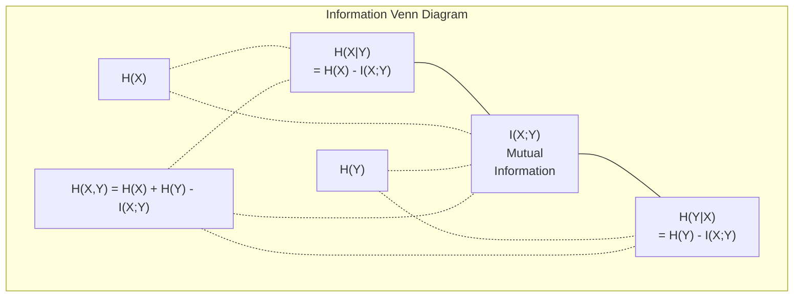

# 資訊理論 (Information Theory)

> 資訊理論衡量的是「驚訝程度」。Loss function 就是建立在它之上。

**Type:** Learn
**Language:** Python
**Prerequisites:** Phase 1, Lesson 06 (Probability)
**Time:** ~60 分鐘

## 學習目標 (Learning Objectives)

- 從零計算 entropy、cross-entropy 與 KL divergence，並說明它們之間的關係
- 推導為什麼最小化 cross-entropy loss 等同於最大化 log-likelihood
- 計算 feature 與目標之間的 mutual information，用來為 feature 的重要性排序
- 把 perplexity 解釋為語言模型實際從中挑選的有效詞彙量

## 問題 (The Problem)

你訓練的每個分類模型都會呼叫 `CrossEntropyLoss()`。每篇語言模型論文都會出現「perplexity」。你在 VAE、distillation 和 RLHF 裡讀到 KL divergence。這些不是互不相干的概念，它們全都是同一個想法換了不同的帽子。

資訊理論給你一套語言，用來推理不確定性、壓縮與預測。Claude Shannon 在 1948 年發明它，是為了解決通訊問題。結果發現，訓練 neural network 也是個通訊問題：模型試圖透過一個由學到的 weight 組成的雜訊通道，傳送正確的標籤。

這堂課從零推導每個公式，讓你看到它們從哪裡來、為什麼有效。

## 核心概念 (The Concept)

### 資訊量（驚訝程度） (Information Content (Surprise))

當不太可能的事情發生時，它帶有更多資訊。硬幣擲出正面？不意外。中樂透？非常意外。

一個機率為 $p$ 的事件，其資訊量是：

```math
I(x) = -\log(p(x))
```

用以 2 為底的 log 會得到 bit。用自然 log 則得到 nat。想法相同，只是單位不同。

```
Event              Probability    Surprise (bits)
Fair coin heads    0.5            1.0
Rolling a 6        0.167          2.58
1-in-1000 event    0.001          9.97
Certain event      1.0            0.0
```

確定會發生的事件帶有零資訊。你本來就知道它會發生。

### Entropy（平均驚訝程度） (Entropy (Average Surprise))

Entropy 是一個分佈在所有可能結果上的期望驚訝程度。

```math
H(P) = -\sum_{x} p(x) \log(p(x))
```

公平硬幣在二元變數中有最大的 entropy：1 bit。偏頗的硬幣（99% 正面）有很低的 entropy：0.08 bit。你已經知道會發生什麼，所以每次擲硬幣幾乎不會告訴你任何事。

```math
\begin{aligned}
\text{Fair coin:} \quad & H = -(0.5 \log_2(0.5) + 0.5 \log_2(0.5)) = 1.0 \text{ bit} \\
\text{Biased coin:} \quad & H = -(0.99 \log_2(0.99) + 0.01 \log_2(0.01)) = 0.08 \text{ bits}
\end{aligned}
```

Entropy 衡量的是分佈中無法消除的不確定性。你無法壓縮到比它更小。

### Cross-Entropy（你每天都在用的 loss function） (Cross-Entropy (The Loss Function You Use Every Day))

Cross-entropy 衡量的是：當你用分佈 $Q$ 去編碼實際上來自分佈 $P$ 的事件時，平均的驚訝程度。

```math
H(P, Q) = -\sum_{x} p(x) \log(q(x))
```

$P$ 是真實分佈（標籤）。$Q$ 是模型的預測。如果 $Q$ 完全符合 $P$，cross-entropy 就等於 entropy。任何不吻合都會讓它變大。

在分類中，$P$ 是一個 one-hot vector（真實類別的機率為 1，其他都是 0）。這讓 cross-entropy 簡化成：

```math
H(P, Q) = -\log(q(\text{true\_class}))
```

這就是分類用的完整 cross-entropy loss 公式。最大化正確類別的預測機率。

### KL Divergence（分佈之間的距離） (KL Divergence (Distance Between Distributions))

KL divergence 衡量的是：用 $Q$ 取代 $P$ 時，你會多出多少驚訝程度。

```math
\begin{aligned}
D_{KL}(P \,\|\, Q) &= \sum_{x} p(x) \log(p(x) / q(x)) \\
&= H(P, Q) - H(P)
\end{aligned}
```

Cross-entropy 等於 entropy 加上 KL divergence。由於真實分佈的 entropy 在訓練期間是常數，最小化 cross-entropy 就等同於最小化 KL divergence。你是在把模型的分佈推向真實分佈。

KL divergence 不是對稱的：$D_{KL}(P \Vert Q) \ne D_{KL}(Q \Vert P)$。它不是真正的距離度量。

### Mutual Information (Mutual Information)

Mutual information 衡量的是：知道一個變數，能告訴你多少關於另一個變數的資訊。

```math
\begin{aligned}
I(X; Y) &= H(X) - H(X \mid Y) \\
&= H(X) + H(Y) - H(X, Y)
\end{aligned}
```

如果 $X$ 與 $Y$ 獨立，mutual information 為零。知道其中一個，完全不會告訴你另一個的資訊。如果它們完全相關，mutual information 就等於任一變數的 entropy。

在 feature selection 中，feature 與目標之間的 mutual information 高，代表這個 feature 有用。Mutual information 低，則代表它是雜訊。

### Conditional Entropy (Conditional Entropy)

$H(Y \mid X)$ 衡量在你觀察到 $X$ 之後，關於 $Y$ 還剩下多少不確定性。

```math
H(Y \mid X) = H(X,Y) - H(X)
```

兩個極端：
- 如果 $X$ 完全決定 $Y$，則 $H(Y \mid X) = 0$。知道 $X$ 就消除了關於 $Y$ 的所有不確定性。例如：$X$ = 攝氏溫度，$Y$ = 華氏溫度。
- 如果 $X$ 完全不會告訴你關於 $Y$ 的資訊，則 $H(Y \mid X) = H(Y)$。知道 $X$ 完全不會降低你的不確定性。例如：$X$ = 擲硬幣的結果，$Y$ = 明天的天氣。

Conditional entropy 永遠不為負，而且絕不會超過 $H(Y)$：

```math
0 \le H(Y \mid X) \le H(Y)
```

在機器學習中，conditional entropy 出現在 decision tree 裡。在每次分裂時，演算法會挑出讓 $H(Y \mid X)$ 最小的 feature $X$，也就是消除關於標籤 $Y$ 最多不確定性的 feature。

### Joint Entropy (Joint Entropy)

$H(X,Y)$ 是 $X$ 與 $Y$ 合在一起的 joint distribution 的 entropy。

```math
H(X,Y) = -\sum_{x} \sum_{y} p(x,y) \log(p(x,y))
```

關鍵性質：

```math
H(X,Y) \le H(X) + H(Y)
```

當 $X$ 與 $Y$ 獨立時，等號成立。如果它們共享資訊，joint entropy 就會小於各自 entropy 的總和。「消失」的那部分 entropy，剛好就是 mutual information。



這些關係：
- $H(X,Y) = H(X) + H(Y \mid X) = H(Y) + H(X \mid Y)$
- $I(X;Y) = H(X) - H(X \mid Y) = H(Y) - H(Y \mid X)$
- $H(X,Y) = H(X) + H(Y) - I(X;Y)$

### Mutual Information（深入探討） (Mutual Information (Deep Dive))

Mutual information $I(X;Y)$ 量化了：知道一個變數，能減少多少關於另一個變數的不確定性。

```math
\begin{aligned}
I(X;Y) &= H(X) - H(X \mid Y) \\
&= H(Y) - H(Y \mid X) \\
&= H(X) + H(Y) - H(X,Y) \\
&= \sum_{x} \sum_{y} p(x,y) \log\left(\frac{p(x,y)}{p(x) \, p(y)}\right)
\end{aligned}
```

性質：
- $I(X;Y) \ge 0$ 永遠成立。觀察某件事絕不會讓你失去資訊。
- 若且唯若 $X$ 與 $Y$ 獨立，則 $I(X;Y) = 0$。
- $I(X;Y) = I(Y;X)$。它是對稱的，這點和 KL divergence 不同。
- $I(X;X) = H(X)$。一個變數與自己共享所有的資訊。

**用 mutual information 做 feature selection。** 在 ML 裡，你想要對目標有資訊量的 feature。Mutual information 給你一個有原則的方式來為 feature 排序：

1. 對每個 feature $X_i$，計算 $I(X_i; Y)$，其中 $Y$ 是目標變數。
2. 依 MI 分數為 feature 排序。
3. 保留前 $k$ 個 feature。

這對 feature 與目標之間的任何關係都適用：線性、非線性、單調或非單調。Pearson correlation 只能抓到線性關係。MI 能抓到任何相依性，不過在資料有限時，它的估計需要足夠的樣本與合理的分箱 (binning)。

| 方法 | 偵測什麼 | 運算成本 | 能處理 categorical 嗎？ |
|--------|---------|-------------------|---------------------|
| Pearson correlation | 線性關係 | $O(n)$ | 不行 |
| Spearman correlation | 單調關係 | $O(n \log n)$ | 不行 |
| Mutual information | 任何統計相依性 | 搭配分箱為 $O(n \log n)$ | 可以 |

### Label Smoothing 與 Cross-Entropy (Label Smoothing and Cross-Entropy)

標準的分類使用 hard target：[0, 0, 1, 0]。真實類別得到機率 1，其他都是 0。Label smoothing 把這些換成 soft target：

```math
\text{soft\_target} = (1 - \epsilon) \cdot \text{hard\_target} + \epsilon / \text{num\_classes}
```

當 $\epsilon = 0.1$ 且有 4 個類別時：
- Hard target：[0, 0, 1, 0]
- Soft target：[0.025, 0.025, 0.925, 0.025]

從資訊理論的角度看，label smoothing 會增加目標分佈的 entropy。Hard one-hot target 的 entropy 是 0，沒有任何不確定性。Soft target 則有正的 entropy。

為什麼這樣有幫助：
- 避免模型把 logits 推到極端值（在 cross-entropy 下，要完美吻合 one-hot target 需要無限大的 logits）
- 充當 regularization：模型不可能 100% 有把握
- 改善 calibration：預測的機率更能反映真實的不確定性
- 縮小訓練與推論行為之間的差距

使用 label smoothing 的 cross-entropy loss 變成：

```math
L = (1 - \epsilon) \cdot \text{CE}(\text{hard\_target}, \text{prediction}) + \epsilon \cdot H_{\text{uniform}}(\text{prediction})
```

第二項會懲罰與 uniform 相差甚遠的預測，這是對信心程度的直接 regularization。

### 為什麼 Cross-Entropy 是「那個」分類 loss (Why Cross-Entropy Is THE Classification Loss)

三種觀點，同一個結論。

**資訊理論觀點。** Cross-entropy 衡量的是：用模型的分佈取代真實分佈，你浪費了多少 bit。最小化它，會讓你的模型成為最有效率的現實編碼器。

**Maximum likelihood 觀點。** 對 $N$ 個真實類別為 $y_i$ 的訓練樣本：

```math
\begin{aligned}
\text{Likelihood} &= \prod_i q(y_i) \\
\text{Log-likelihood} &= \sum_i \log(q(y_i)) \\
\text{Negative log-likelihood} &= -\sum_i \log(q(y_i))
\end{aligned}
```

最後一行就是 cross-entropy loss。最小化 cross-entropy = 最大化訓練資料在你的模型下的 likelihood。

**Gradient 觀點。** Cross-entropy 對 logits 的 gradient 就是（預測值 - 真實值）。乾淨、穩定，而且計算很快。這就是它和 softmax 能完美搭配的原因。

### Bit 與 Nat (Bits vs Nats)

唯一的差別是 log 的底。

```
log base 2   -> bits      (information theory tradition)
log base e   -> nats      (machine learning convention)
log base 10  -> hartleys  (rarely used)
```

1 nat = $1/\ln(2)$ bit = 1.4427 bit。PyTorch 和 TensorFlow 預設使用自然 log（nat）。

### Perplexity (Perplexity)

Perplexity 是 cross-entropy 的指數。它告訴你模型在多少個「同樣可能」的選項之間猶豫不決。

```math
\begin{aligned}
\text{Perplexity} &= 2^{H(P,Q)} \quad \text{(if using bits)} \\
\text{Perplexity} &= e^{H(P,Q)} \quad \text{(if using nats)}
\end{aligned}
```

Perplexity 為 50 的語言模型，平均而言，困惑的程度就像是必須從 50 個可能的下一個 token 中均勻地挑一個。越低越好。

GPT-2 在常見的 benchmark 上達到約 30 的 perplexity。現代模型在資料充足的領域，已經降到個位數。

```figure
entropy-kl
```

## 動手做 (Build It)

### 步驟 1：資訊量與 entropy

```python
import math

def information_content(p, base=2):
    if p <= 0 or p > 1:
        return float('inf') if p <= 0 else 0.0
    return -math.log(p) / math.log(base)

def entropy(probs, base=2):
    return sum(
        p * information_content(p, base)
        for p in probs if p > 0
    )

fair_coin = [0.5, 0.5]
biased_coin = [0.99, 0.01]
fair_die = [1/6] * 6

print(f"Fair coin entropy:   {entropy(fair_coin):.4f} bits")
print(f"Biased coin entropy: {entropy(biased_coin):.4f} bits")
print(f"Fair die entropy:    {entropy(fair_die):.4f} bits")
```

### 步驟 2：Cross-entropy 與 KL divergence

```python
def cross_entropy(p, q, base=2):
    total = 0.0
    for pi, qi in zip(p, q):
        if pi > 0:
            if qi <= 0:
                return float('inf')
            total += pi * (-math.log(qi) / math.log(base))
    return total

def kl_divergence(p, q, base=2):
    return cross_entropy(p, q, base) - entropy(p, base)

true_dist = [0.7, 0.2, 0.1]
good_model = [0.6, 0.25, 0.15]
bad_model = [0.1, 0.1, 0.8]

print(f"Entropy of true dist:     {entropy(true_dist):.4f} bits")
print(f"CE (good model):          {cross_entropy(true_dist, good_model):.4f} bits")
print(f"CE (bad model):           {cross_entropy(true_dist, bad_model):.4f} bits")
print(f"KL divergence (good):     {kl_divergence(true_dist, good_model):.4f} bits")
print(f"KL divergence (bad):      {kl_divergence(true_dist, bad_model):.4f} bits")
```

### 步驟 3：把 cross-entropy 當作分類 loss

```python
def softmax(logits):
    max_logit = max(logits)
    exps = [math.exp(z - max_logit) for z in logits]
    total = sum(exps)
    return [e / total for e in exps]

def cross_entropy_loss(true_class, logits):
    probs = softmax(logits)
    return -math.log(probs[true_class])

logits = [2.0, 1.0, 0.1]
true_class = 0

probs = softmax(logits)
loss = cross_entropy_loss(true_class, logits)

print(f"Logits:      {logits}")
print(f"Softmax:     {[f'{p:.4f}' for p in probs]}")
print(f"True class:  {true_class}")
print(f"Loss:        {loss:.4f} nats")
print(f"Perplexity:  {math.exp(loss):.2f}")
```

### 步驟 4：Cross-entropy 等於 negative log-likelihood

```python
import random

random.seed(42)

n_samples = 1000
n_classes = 3
true_labels = [random.randint(0, n_classes - 1) for _ in range(n_samples)]
model_logits = [[random.gauss(0, 1) for _ in range(n_classes)] for _ in range(n_samples)]

ce_loss = sum(
    cross_entropy_loss(label, logits)
    for label, logits in zip(true_labels, model_logits)
) / n_samples

nll = -sum(
    math.log(softmax(logits)[label])
    for label, logits in zip(true_labels, model_logits)
) / n_samples

print(f"Cross-entropy loss:      {ce_loss:.6f}")
print(f"Negative log-likelihood: {nll:.6f}")
print(f"Difference:              {abs(ce_loss - nll):.2e}")
```

### 步驟 5：Mutual information

```python
def mutual_information(joint_probs, base=2):
    rows = len(joint_probs)
    cols = len(joint_probs[0])

    margin_x = [sum(joint_probs[i][j] for j in range(cols)) for i in range(rows)]
    margin_y = [sum(joint_probs[i][j] for i in range(rows)) for j in range(cols)]

    mi = 0.0
    for i in range(rows):
        for j in range(cols):
            pxy = joint_probs[i][j]
            if pxy > 0:
                mi += pxy * math.log(pxy / (margin_x[i] * margin_y[j])) / math.log(base)
    return mi

independent = [[0.25, 0.25], [0.25, 0.25]]
dependent = [[0.45, 0.05], [0.05, 0.45]]

print(f"MI (independent): {mutual_information(independent):.4f} bits")
print(f"MI (dependent):   {mutual_information(dependent):.4f} bits")
```

## 實際使用 (Use It)

用 NumPy 實作同樣的概念，這就是你實務上會用的方式：

```python
import numpy as np

def np_entropy(p):
    p = np.asarray(p, dtype=float)
    mask = p > 0
    result = np.zeros_like(p)
    result[mask] = p[mask] * np.log(p[mask])
    return -result.sum()

def np_cross_entropy(p, q):
    p, q = np.asarray(p, dtype=float), np.asarray(q, dtype=float)
    mask = p > 0
    return -(p[mask] * np.log(q[mask])).sum()

def np_kl_divergence(p, q):
    return np_cross_entropy(p, q) - np_entropy(p)

true = np.array([0.7, 0.2, 0.1])
pred = np.array([0.6, 0.25, 0.15])
print(f"Entropy:    {np_entropy(true):.4f} nats")
print(f"Cross-ent:  {np_cross_entropy(true, pred):.4f} nats")
print(f"KL div:     {np_kl_divergence(true, pred):.4f} nats")
```

你剛剛從零做出了 `torch.nn.CrossEntropyLoss()` 在內部做的事。現在你知道為什麼訓練時 loss 會下降：模型預測的分佈越來越接近真實分佈，而這個差距是用浪費掉的資訊 nat 數來衡量的。

## 練習 (Exercises)

1. 假設英文字母是 uniform 分佈（26 個字母），計算它的 entropy。接著用實際的字母頻率估計一次。哪個比較高？為什麼？

2. 一個模型對真實類別為 1 的樣本輸出 logits [5.0, 2.0, 0.5]。手算 cross-entropy loss，再用你的 `cross_entropy_loss` 函式驗證。什麼樣的 logits 會讓 loss 為零？

3. 證明 KL divergence 不是對稱的。挑兩個分佈 $P$ 與 $Q$，計算 $D_{KL}(P \Vert Q)$ 和 $D_{KL}(Q \Vert P)$。解釋它們為什麼不同。

4. 建立一個函式，計算一串 token 預測的 perplexity。給定一串 (true_token_index, predicted_logits) 配對，回傳這個序列的 perplexity。

### 提示 (Hints)

**練習 1。** 用 26 個相等的機率呼叫 `entropy`；結果必須是 $\log_2 26 \approx 4.70$ bit。真實的字母頻率並非 uniform，所以用它們算出的 entropy 必須比較低。

**練習 2。** 計算 logits 的 `softmax`，再對 index 1 的機率取 $-\ln$，並與 `cross_entropy_loss(1, logits)` 比較；兩者都必須接近 3.06。只有當類別 1 的 logit 遠大於另外兩個時，loss 才會趨近 0。

**練習 3。** 使用兩個形狀不同的小分佈，例如 $P = [0.9, 0.1]$ 和 $Q = [0.5, 0.5]$，並以兩種順序呼叫 `kl_divergence`。兩個值必須不同，因為每個方向都是用不同的分佈來加權 log 比值。

**練習 4。** 對每一對計算 `cross_entropy_loss(true_token_index, predicted_logits)`，取平均，再傳給 `perplexity`。用涵蓋 $V$ 個 token 的 uniform logits 檢查：perplexity 必須是 $V$。

## 關鍵術語 (Key Terms)

| 術語 | 一般人怎麼說 | 實際意思 |
|------|----------------|----------------------|
| Information content | 「驚訝程度」 | 編碼一個事件所需的 bit（或 nat）數：$-\log(p)$ |
| Entropy | 「隨機性」 | 一個分佈在所有結果上的平均驚訝程度。衡量無法消除的不確定性。 |
| Cross-entropy | 「那個 loss function」 | 用模型分佈 $Q$ 去編碼來自真實分佈 $P$ 的事件時的平均驚訝程度。 |
| KL divergence | 「分佈之間的距離」 | 用 $Q$ 取代 $P$ 所浪費的額外 bit。等於 cross-entropy 減去 entropy。不對稱。 |
| Mutual information | 「X 和 Y 有多相關」 | 知道 $Y$ 之後，關於 $X$ 的不確定性減少了多少。為零代表獨立。 |
| Softmax | 「把 logits 變成機率」 | 取指數再做 normalization。把任何實數值 vector 映射成有效的機率分佈。 |
| Perplexity | 「模型有多困惑」 | Cross-entropy 的指數。模型在每一步所選擇的有效詞彙量。 |
| Bits | 「Shannon 的單位」 | 用以 2 為底的 log 衡量的資訊。一個 bit 可以解開一次公平的擲硬幣。 |
| Nats | 「ML 的單位」 | 用自然 log 衡量的資訊。PyTorch 和 TensorFlow 預設使用。 |
| Negative log-likelihood | 「NLL loss」 | 對 one-hot 標籤來說，與 cross-entropy loss 相同。最小化它就是最大化正確預測的機率。 |

## 延伸閱讀 (Further Reading)

- [Shannon 1948: A Mathematical Theory of Communication](https://people.math.harvard.edu/~ctm/home/text/others/shannon/entropy/entropy.pdf) - 原始論文，至今仍然好讀
- [Visual Information Theory (Chris Olah)](https://colah.github.io/posts/2015-09-Visual-Information/) - 對 entropy 與 KL divergence 最好的視覺化解釋
- [PyTorch CrossEntropyLoss docs](https://pytorch.org/docs/stable/generated/torch.nn.CrossEntropyLoss.html) - 框架如何實作你剛剛做出來的東西
