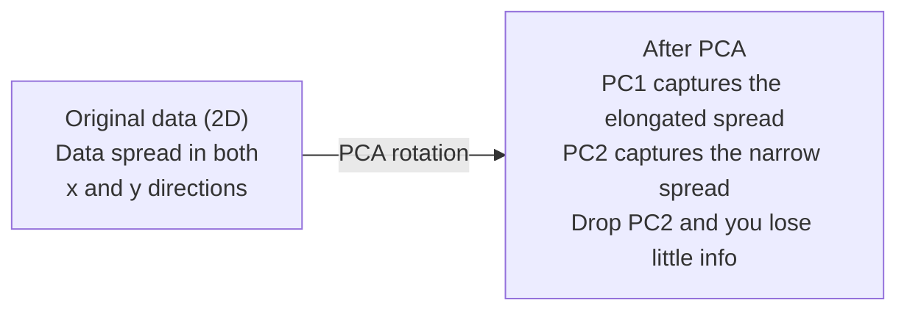

# 降維 (Dimensionality Reduction)

> 高維資料有它的結構。你要從對的角度去看，才找得到。

**Type:** Build
**Language:** Python
**Prerequisites:** Phase 1, Lessons 01 (Linear Algebra Intuition), 02 (Vectors, Matrices & Operations), 03 (Eigenvalues & Eigenvectors), 06 (Probability & Distributions)
**Time:** ~90 分鐘

## 學習目標 (Learning Objectives)

- 從零實作 PCA：將資料置中、計算 covariance matrix、做 eigendecomposition，再做投影
- 用 explained variance ratio 和 elbow method 選擇 principal component 的數量
- 比較 PCA、t-SNE 與 UMAP 在 2D 視覺化 MNIST 數字上的表現，並說明它們的取捨
- 套用帶 RBF kernel 的 kernel PCA，分離標準 PCA 處理不了的非線性資料結構

## 問題 (The Problem)

你有一個資料集，每個樣本有 784 個 feature。也許是手寫數字的像素值，也許是基因表現量，也許是使用者行為訊號。你無法把 784 個維度視覺化，無法把它們畫出來，甚至連想都沒辦法想。

但這 784 個 feature 大多是冗餘的。真正的資訊存在於一個小得多的曲面上。描述一個手寫的「7」，不需要 784 個獨立的數字。只需要幾個：筆劃的角度、橫槓的長度、傾斜的程度。其餘都是雜訊。

降維就是要找到那個更小的曲面。它把你 784 維的資料壓縮成 2、10 或 50 個維度，同時保留重要的結構。

## 核心概念 (The Concept)

### 維度詛咒 (The curse of dimensionality)

高維空間違反直覺。隨著維度增加，有三件事會出問題。

**距離變得沒有意義。** 在高維空間中，任意兩個隨機點之間的距離會收斂到相同的值。如果每個點與其他每個點的距離大致相同，最近鄰搜尋就失效了。

```
Dimension    Avg distance ratio (max/min between random points)
2            ~5.0
10           ~1.8
100          ~1.2
1000         ~1.02
```

**體積集中在角落。** $d$ 維的單位超立方體有 $2^d$ 個角落。在 100 維中，幾乎所有體積都在角落，遠離中心。資料點散布到邊緣，你的模型在內部區域就缺乏資料。

**你需要指數級增加的資料。** 為了在空間中維持相同的樣本密度，從 2D 到 20D 意味著你需要多 $10^{18}$ 倍的資料。你永遠不會有足夠的資料。降低維度能讓資料密度回到可行的範圍。

### PCA：找出重要的方向 (PCA: find the directions that matter)

Principal Component Analysis (PCA) 找出資料變異最大的軸。它旋轉你的座標系，讓第一個軸涵蓋最多的 variance，第二個軸涵蓋次多的，依此類推。

演算法：

```
1. Center the data        (subtract the mean from each feature)
2. Compute covariance     (how features move together)
3. Eigendecomposition     (find the principal directions)
4. Sort by eigenvalue     (biggest variance first)
5. Project               (keep top k eigenvectors, drop the rest)
```

為什麼用 eigendecomposition？Covariance matrix 是對稱且 positive semi-definite 的。它的 eigenvector 是 feature 空間中互相正交的方向。Eigenvalue 告訴你每個方向涵蓋了多少 variance。Eigenvalue 最大的 eigenvector，指向 variance 最大的方向。



- **PCA 之前：** 資料雲沿對角線散布在 x 軸和 y 軸上
- **PCA 之後：** 座標系被旋轉，讓 PC1 對齊 variance 最大的方向（拉長的散布），PC2 對齊 variance 最小的方向（狹窄的散布）
- **降維：** 捨棄 PC2，等於把資料投影到 PC1 上，損失的資訊非常少

### Explained variance ratio

每個 principal component 涵蓋了總 variance 的一部分。Explained variance ratio 告訴你是多少。

```
Component    Eigenvalue    Explained ratio    Cumulative
PC1          4.73          0.473              0.473
PC2          2.51          0.251              0.724
PC3          1.12          0.112              0.836
PC4          0.89          0.089              0.925
...
```

當累積的 explained variance 達到 0.95，你就知道這麼多個 component 涵蓋了 95% 的資訊。之後的部分大多是雜訊。

### 選擇 component 的數量 (Choosing the number of components)

三種策略：

1. **門檻。** 保留足夠的 component，解釋 90-95% 的 variance。
2. **Elbow method。** 畫出每個 component 的 explained variance。尋找急遽下降的地方。
3. **下游表現。** 把 PCA 當作前處理。掃描 $k$ 並衡量模型的 accuracy。最佳的 $k$ 就是 accuracy 趨於平穩的地方。

### t-SNE：保留鄰近關係 (t-SNE: preserve neighborhoods)

t-Distributed Stochastic Neighbor Embedding (t-SNE) 是為視覺化設計的。它把高維資料對應到 2D（或 3D），同時保留哪些點彼此靠近。

直覺：在原始空間中，根據點與點之間的距離，計算成對點的機率分佈。近的點得到高機率，遠的點得到低機率。接著找出一個 2D 的排列，讓同樣的機率分佈成立。在 784 維中是鄰居的點，在 2D 中仍然是鄰居。

t-SNE 的關鍵性質：
- 非線性。它能展開 PCA 無法展開的複雜 manifold。
- 隨機性。每次執行會產生不同的版面。
- Perplexity 參數控制要考慮多少個鄰居（常見範圍：5-50）。
- 輸出中 cluster 之間的距離沒有意義。只有 cluster 本身有意義。
- 在大型資料集上很慢。預設為 $O(n^2)$。

### UMAP：更快，全局結構更好 (UMAP: faster, better global structure)

Uniform Manifold Approximation and Projection (UMAP) 的運作方式與 t-SNE 類似，但有兩個優點：
- 更快。它用近似的最近鄰圖，而不是計算所有成對距離。
- 全局結構更好。輸出中 cluster 的相對位置，往往比 t-SNE 更有意義。

UMAP 在高維空間中建立一張加權圖（「fuzzy topological representation」），然後找出一個盡可能保留這張圖的低維版面。

關鍵參數：
- `n_neighbors`：多少個鄰居定義了局部結構（類似 perplexity）。值越高，保留越多全局結構。
- `min_dist`：輸出中點擠得有多緊。值越低，cluster 越密。

### 何時用哪一種 (When to use which)

| 方法 | 使用情境 | 保留什麼 | 速度 |
|--------|----------|-----------|-------|
| PCA | 訓練前的前處理 | 全局 variance | 快（精確），可處理數百萬個樣本 |
| PCA | 快速的探索式視覺化 | 線性結構 | 快 |
| t-SNE | 可用於發表的 2D 圖 | 局部鄰近關係 | 慢（理想是 < 1 萬個樣本） |
| UMAP | 大規模的 2D 視覺化 | 局部 + 部分全局結構 | 中等（可處理數百萬個） |
| PCA | 為模型做 feature 縮減 | 依 variance 排序的 feature | 快 |
| t-SNE / UMAP | 理解 cluster 結構 | Cluster 的分離 | 中等到慢 |

經驗法則：前處理與資料壓縮用 PCA。需要在 2D 中視覺化結構時，用 t-SNE 或 UMAP。

### Kernel PCA (Kernel PCA)

標準 PCA 找的是線性 subspace。它旋轉你的座標系並捨棄一些軸。但如果資料位於非線性的 manifold 上呢？2D 中的一個圓，沒有任何直線能把它分開。標準 PCA 幫不上忙。

Kernel PCA 在由 kernel function 誘導出的高維 feature 空間中套用 PCA，而不必明確計算那個空間中的座標。這就是 kernel trick，與 SVM 背後是同一個概念。

演算法：
1. 計算 kernel matrix $K$，其中 $K_{ij} = k(x_i, x_j)$
2. 在 feature 空間中對 kernel matrix 做置中
3. 對置中後的 kernel matrix 做 eigendecomposition
4. 最大的幾個 eigenvector（乘上 $1/\sqrt{\text{eigenvalue}}$ 縮放）就是投影

常見的 kernel function：

| Kernel | 公式 | 適用於 |
|--------|---------|----------|
| RBF (Gaussian) | $\exp(-\gamma \lVert x - y \rVert^2)$ | 大多數非線性資料、平滑的 manifold |
| Polynomial | $(x \cdot y + c)^d$ | 多項式關係 |
| Sigmoid | $\tanh(\alpha x \cdot y + c)$ | 類似 neural network 的映射 |

何時用 kernel PCA、何時用標準 PCA：

| 準則 | 標準 PCA | Kernel PCA |
|-----------|-------------|------------|
| 資料結構 | 線性 subspace | 非線性 manifold |
| 速度 | $O(\min(n^2 d, d^2 n))$ | $O(n^2 d + n^3)$ |
| 可解釋性 | Component 是 feature 的線性組合 | Component 缺乏直接的 feature 解釋 |
| 擴展性 | 可處理數百萬個樣本 | Kernel matrix 是 $n \times n$，受記憶體限制 |
| 重建 | 直接的反向轉換 | 需要 pre-image 近似 |

經典的例子：2D 中的同心圓。兩圈點，一圈在另一圈裡面。標準 PCA 會把兩者投影到同一條線上，對分類毫無用處。使用 RBF kernel 的 kernel PCA 則會把內圈和外圈對應到不同的區域，讓它們變得 linearly separable。

### 重建誤差 (Reconstruction Error)

你的降維做得好不好？你把 784 個維度壓縮成 50 個。你損失了什麼？

衡量重建誤差：
1. 投影到 $k$ 維：$X_{\text{reduced}} = X W_k$
2. 重建：$\hat{X} = X_{\text{reduced}} W_k^T$
3. 計算 MSE：$\text{mean}((X - \hat{X})^2)$

對 PCA 而言，重建誤差與 explained variance 有一個乾淨的關係：

```math
\begin{aligned}
\text{Reconstruction error} &= \text{sum of eigenvalues NOT included} \\
\text{Total variance} &= \text{sum of ALL eigenvalues} \\
\text{Fraction lost} &= \frac{\text{sum of dropped eigenvalues}}{\text{sum of all eigenvalues}}
\end{aligned}
```

每個 component 的 explained variance ratio 是：

```math
\text{explained\_ratio}_k = \frac{\text{eigenvalue}_k}{\sum \text{all eigenvalues}}
```

把累積的 explained variance 對 component 數量作圖，就得到「elbow」曲線。合適的 component 數量落在：
- 曲線變平的地方（報酬遞減）
- 累積 variance 越過你的門檻（通常是 0.90 或 0.95）
- 下游任務的表現趨於平穩

重建誤差的用途不只是選擇 $k$。你也可以用它做異常偵測：重建誤差高的樣本，是不符合所學 subspace 的 outlier。這就是正式系統中以 PCA 為基礎的異常偵測的原理。

```figure
pca-axes
```

## 動手做 (Build It)

### 步驟 1：從零寫 PCA

```python
import numpy as np

class PCA:
    def __init__(self, n_components):
        self.n_components = n_components
        self.components = None
        self.mean = None
        self.eigenvalues = None
        self.explained_variance_ratio_ = None

    def fit(self, X):
        self.mean = np.mean(X, axis=0)
        X_centered = X - self.mean

        cov_matrix = np.cov(X_centered, rowvar=False)

        eigenvalues, eigenvectors = np.linalg.eigh(cov_matrix)

        sorted_idx = np.argsort(eigenvalues)[::-1]
        eigenvalues = eigenvalues[sorted_idx]
        eigenvectors = eigenvectors[:, sorted_idx]

        self.components = eigenvectors[:, :self.n_components].T
        self.eigenvalues = eigenvalues[:self.n_components]
        total_var = np.sum(eigenvalues)
        self.explained_variance_ratio_ = self.eigenvalues / total_var

        return self

    def transform(self, X):
        X_centered = X - self.mean
        return X_centered @ self.components.T

    def fit_transform(self, X):
        self.fit(X)
        return self.transform(X)
```

### 步驟 2：在合成資料上測試

```python
np.random.seed(42)
n_samples = 500

t = np.random.uniform(0, 2 * np.pi, n_samples)
x1 = 3 * np.cos(t) + np.random.normal(0, 0.2, n_samples)
x2 = 3 * np.sin(t) + np.random.normal(0, 0.2, n_samples)
x3 = 0.5 * x1 + 0.3 * x2 + np.random.normal(0, 0.1, n_samples)

X_synthetic = np.column_stack([x1, x2, x3])

pca = PCA(n_components=2)
X_reduced = pca.fit_transform(X_synthetic)

print(f"Original shape: {X_synthetic.shape}")
print(f"Reduced shape:  {X_reduced.shape}")
print(f"Explained variance ratios: {pca.explained_variance_ratio_}")
print(f"Total variance captured: {sum(pca.explained_variance_ratio_):.4f}")
```

### 步驟 3：2D 的 MNIST 數字

```python
from sklearn.datasets import fetch_openml

mnist = fetch_openml("mnist_784", version=1, as_frame=False, parser="auto")
X_mnist = mnist.data[:5000].astype(float)
y_mnist = mnist.target[:5000].astype(int)

pca_mnist = PCA(n_components=50)
X_pca50 = pca_mnist.fit_transform(X_mnist)
print(f"50 components capture {sum(pca_mnist.explained_variance_ratio_):.2%} of variance")

pca_2d = PCA(n_components=2)
X_pca2d = pca_2d.fit_transform(X_mnist)
print(f"2 components capture {sum(pca_2d.explained_variance_ratio_):.2%} of variance")
```

### 步驟 4：與 sklearn 比較

```python
from sklearn.decomposition import PCA as SklearnPCA
from sklearn.manifold import TSNE

sklearn_pca = SklearnPCA(n_components=2)
X_sklearn_pca = sklearn_pca.fit_transform(X_mnist)

print(f"\nOur PCA explained variance:     {pca_2d.explained_variance_ratio_}")
print(f"Sklearn PCA explained variance: {sklearn_pca.explained_variance_ratio_}")

diff = np.abs(np.abs(X_pca2d) - np.abs(X_sklearn_pca))
print(f"Max absolute difference: {diff.max():.10f}")

tsne = TSNE(n_components=2, perplexity=30, random_state=42)
X_tsne = tsne.fit_transform(X_mnist)
print(f"\nt-SNE output shape: {X_tsne.shape}")
```

### 步驟 5：UMAP 比較

```python
try:
    from umap import UMAP

    reducer = UMAP(n_components=2, n_neighbors=15, min_dist=0.1, random_state=42)
    X_umap = reducer.fit_transform(X_mnist)
    print(f"UMAP output shape: {X_umap.shape}")
except ImportError:
    print("Install umap-learn: pip install umap-learn")
```

## 實際使用 (Use It)

把 PCA 當作分類器之前的前處理：

```python
from sklearn.decomposition import PCA as SklearnPCA
from sklearn.linear_model import LogisticRegression
from sklearn.model_selection import train_test_split
from sklearn.metrics import accuracy_score

X_train, X_test, y_train, y_test = train_test_split(
    X_mnist, y_mnist, test_size=0.2, random_state=42
)

results = {}
for k in [10, 30, 50, 100, 200]:
    pca_k = SklearnPCA(n_components=k)
    X_tr = pca_k.fit_transform(X_train)
    X_te = pca_k.transform(X_test)

    clf = LogisticRegression(max_iter=1000, random_state=42)
    clf.fit(X_tr, y_train)
    acc = accuracy_score(y_test, clf.predict(X_te))
    var_captured = sum(pca_k.explained_variance_ratio_)
    results[k] = (acc, var_captured)
    print(f"k={k:>3d}  accuracy={acc:.4f}  variance={var_captured:.4f}")
```

表現遠在 784 個維度之前就趨於平穩。那個平穩點就是你的操作點。

## 交付 (Ship It)

這堂課會產出：
- `outputs/skill-dimensionality-reduction.md`：一個 skill，用來為特定任務選擇合適的降維技術

## 練習 (Exercises)

1. 修改 PCA class 以支援 `inverse_transform`。用 10、50 和 200 個 component 重建 MNIST 數字。印出每一種的重建誤差（與原始資料的均方差）。

2. 用 5、30 和 100 的 perplexity 值，在相同的 MNIST 子集上執行 t-SNE。描述輸出如何改變。為什麼 perplexity 會影響 cluster 的緊密程度？

3. 取一個有 50 個 feature、但只有 5 個具資訊量的資料集（用 `sklearn.datasets.make_classification` 產生一個）。套用 PCA，並檢查 explained variance 曲線是否正確辨識出這份資料實際上是 5 維的。

### 提示 (Hints)

**練習 1。** 讀 `PCA` class 裡的 `inverse_transform`，並為每個 component 數量各 fit 一個模型。計算 10、50 和 200 個 component 的 `reconstruction_error`；component 數量增加時，誤差必須下降。

**練習 2。** 在相同的子集上 fit 三次 `sklearn.manifold.TSNE`，只改變 `perplexity`，並使用相同的 `random_state`。Perplexity 低時只看少數鄰居，所以預期會得到小而緊密的群組；perplexity 高時看較多鄰居，所以預期會得到較大、較平滑的群組。

**練習 3。** 呼叫 `make_classification(n_features=50, n_informative=5, n_redundant=45)`，fit `PCA`，並印出累積的 explained variance。冗餘的 feature 是具資訊量 feature 的線性組合，所以曲線在 5 個 component 時就幾乎到達 1.0。接著試試 `n_redundant=0`：其他 45 個 feature 是獨立的雜訊，曲線就不會變平。

## 關鍵術語 (Key Terms)

| 術語 | 一般人怎麼說 | 實際意思 |
|------|----------------|----------------------|
| Curse of dimensionality | 「feature 太多了」 | 隨著維度增加，距離、體積和資料密度的行為都違反直覺。模型需要指數級增加的資料來補償。 |
| PCA | 「降低維度」 | 旋轉你的座標系，讓各軸對齊 variance 最大的方向，然後捨棄 variance 低的軸。 |
| Principal component | 「一個重要的方向」 | Covariance matrix 的 eigenvector。是 feature 空間中資料變異最大的方向。 |
| Explained variance ratio | 「這個 component 有多少資訊」 | 單一個 principal component 涵蓋的總 variance 比例。把前 $k$ 個比例加總，就知道 $k$ 個 component 保留了多少。 |
| Covariance matrix | 「feature 之間如何相關」 | 一個對稱 matrix，其中第 $(i,j)$ 項衡量 feature $i$ 與 feature $j$ 如何一起變動。對角線上是各自的 variance。 |
| t-SNE | 「那張 cluster 圖」 | 一種非線性方法，透過保留成對的鄰近機率，把高維資料對應到 2D。適合視覺化，不適合前處理。 |
| UMAP | 「更快的 t-SNE」 | 一種基於拓樸資料分析的非線性方法。同時保留局部與部分全局結構。比 t-SNE 更能擴展。 |
| Perplexity | 「t-SNE 的一個旋鈕」 | 控制每個點所考慮的有效鄰居數量。Perplexity 低時專注於非常局部的結構，高時則捕捉較廣的模式。 |
| Manifold | 「資料所在的曲面」 | 嵌入在較高維空間中的低維曲面。一張在 3D 中被揉皺的紙，就是一個 2D manifold。 |

## 延伸閱讀 (Further Reading)

- [A Tutorial on Principal Component Analysis](https://arxiv.org/abs/1404.1100) (Shlens) - 從基礎開始、清楚地推導 PCA
- [How to Use t-SNE Effectively](https://distill.pub/2016/misread-tsne/) (Wattenberg et al.) - t-SNE 陷阱與參數選擇的互動式指南
- [UMAP documentation](https://umap-learn.readthedocs.io/) - UMAP 作者提供的理論與實務指引
