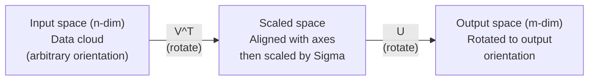
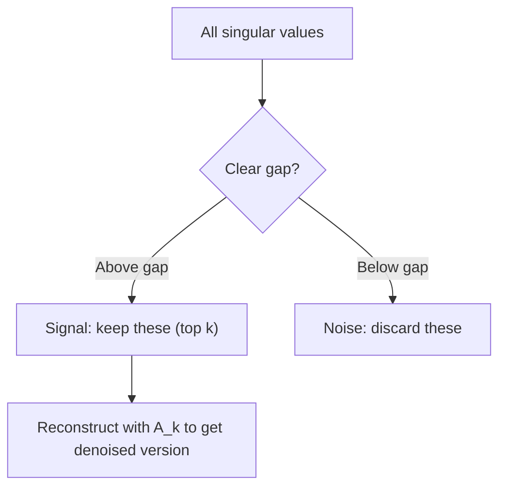

# Singular Value Decomposition (Singular Value Decomposition)

> SVD 是線性代數的瑞士刀。每個 matrix 都有一個 SVD，每位資料科學家都需要它。

**Type:** Build
**Languages:** Python, Julia
**Prerequisites:** Phase 1, Lessons 01 (Linear Algebra Intuition), 02 (Vectors & Matrices Operations), 03 (Matrix Transformations)
**Time:** ~120 分鐘

## 學習目標 (Learning Objectives)

- 用 power iteration 實作 SVD，並說明 $U$、$\Sigma$ 與 $V^T$ 的幾何意義
- 將 truncated SVD 應用在影像壓縮，並衡量壓縮比與重建誤差的取捨
- 透過 SVD 計算 Moore-Penrose pseudoinverse，解決 overdetermined 的 least-squares 方程組
- 把 SVD 連結到 PCA、推薦系統（latent factor）以及 NLP 中的 Latent Semantic Analysis

## 問題 (The Problem)

你有一個 1000x2000 的 matrix。也許是使用者對電影的評分，也許是文件與詞彙的頻率表，也許是一張影像的像素值。你需要壓縮它、去除它的雜訊、找出藏在裡面的結構，或用它解一個 least-squares 方程組。Eigendecomposition 只適用於方陣 (square matrix)。就算是方陣，也要求這個 matrix 有一整組 linearly independent 的 eigenvector。

SVD 適用於任何 matrix。任何形狀、任何 rank，沒有任何條件。它把 matrix 分解成三個因子，揭露這個 matrix 對空間做了什麼的幾何樣貌。它是整個線性代數中最通用、最有用的分解。

## 核心概念 (The Concept)

### SVD 在幾何上做什麼 (What SVD does geometrically)

每個 matrix，不論形狀，都依序執行三個運算：旋轉、縮放、旋轉。SVD 讓這個分解變得明確。

```math
\underset{\substack{m \times n \\ \text{(any)}}}{A} = \underset{\substack{m \times m \\ \text{(rotate)}}}{U} \cdot \underset{\substack{m \times n \\ \text{(scale)}}}{\Sigma} \cdot \underset{\substack{n \times n \\ \text{(rotate)}}}{V^T}
```

對任何 matrix $A$，SVD 把它分解成：
- $V^T$ 旋轉輸入空間（$n$ 維）中的 vector
- $\Sigma$ 沿著每個軸縮放（拉伸或壓縮）
- $U$ 把結果旋轉到輸出空間（$m$ 維）



可以這樣想。你把一個 matrix 交給 SVD。它告訴你：「這個 matrix 會取一個由輸入組成的球，先用 $V^T$ 旋轉它，再用 $\Sigma$ 把它拉伸成橢球，最後用 $U$ 旋轉這個橢球。」Singular value 就是橢球各軸的長度。

### 完整分解 (The full decomposition)

對一個形狀為 $m \times n$ 的 matrix $A$：

```math
\begin{aligned}
& A = U \cdot \Sigma \cdot V^T \\[6pt]
& \text{where:} \\
& \quad U \text{ is } m \times m, \text{ orthogonal } (U^T U = I) \\
& \quad \Sigma \text{ is } m \times n, \text{ diagonal (singular values on the diagonal)} \\
& \quad V \text{ is } n \times n, \text{ orthogonal } (V^T V = I) \\[6pt]
& \text{The singular values } \sigma_1 \ge \sigma_2 \ge \cdots \ge \sigma_r > 0 \\
& \text{where } r = \mathop{\mathrm{rank}}(A)
\end{aligned}
```

$U$ 的欄稱為 left singular vector。$V$ 的欄稱為 right singular vector。$\Sigma$ 的對角線元素稱為 singular value。它們永遠不為負，而且依慣例由大到小排序。

### Left singular vector、singular value、right singular vector (Left singular vectors, singular values, right singular vectors)

SVD 的每個部分都有各自獨特的幾何意義。

**Right singular vector（$V$ 的欄）：** 它們構成輸入空間 ($\mathbb{R}^n$) 的 orthonormal basis。它們是輸入空間中的方向，matrix 會把這些方向映射到輸出空間中彼此正交的方向。可以把它們看成定義域的自然座標系。

**Singular value（$\Sigma$ 的對角線）：** 這些是縮放倍率。第 i 個 singular value 告訴你，matrix 沿著第 i 個 right singular vector 把 vector 拉伸了多少。Singular value 為零，代表 matrix 完全壓扁了那個方向。

**Left singular vector（$U$ 的欄）：** 它們構成輸出空間 ($\mathbb{R}^m$) 的 orthonormal basis。第 i 個 left singular vector 是輸出空間中，第 i 個 right singular vector（縮放後）落下的方向。

它們之間的關係：

```
A * v_i = sigma_i * u_i

The matrix A takes the i-th right singular vector v_i,
scales it by sigma_i, and maps it to the i-th left singular vector u_i.
```

這讓你一個座標一個座標地看清楚，任何 matrix 到底做了什麼。

### Outer product 形式 (Outer product form)

SVD 可以寫成 rank-1 matrix 的總和：

```
A = sigma_1 * u_1 * v_1^T + sigma_2 * u_2 * v_2^T + ... + sigma_r * u_r * v_r^T

Each term sigma_i * u_i * v_i^T is a rank-1 matrix (an outer product).
The full matrix is the sum of r such matrices, where r is the rank.
```

這個形式是 low-rank 近似的基礎。每一項都增加一層結構。第一項捕捉最重要的單一模式，第二項捕捉次重要的模式，依此類推。截斷這個總和，就能得到在任何給定 rank 下可能的最佳近似。

```math
\begin{aligned}
\text{Rank-1 approx:} \quad & A_1 = \sigma_1 u_1 v_1^T \\
& \text{(captures the dominant pattern)} \\[6pt]
\text{Rank-2 approx:} \quad & A_2 = \sigma_1 u_1 v_1^T + \sigma_2 u_2 v_2^T \\
& \text{(captures the two most important patterns)} \\[6pt]
\text{Rank-}k\text{ approx:} \quad & A_k = \text{sum of top } k \text{ terms} \\
& \text{(optimal by the Eckart-Young theorem)}
\end{aligned}
```

### 與 eigendecomposition 的關係 (Relationship to eigendecomposition)

SVD 與 eigendecomposition 有深刻的關聯。$A$ 的 singular value 與 singular vector，直接來自 $A^T A$ 和 $A A^T$ 的 eigenvalue 與 eigenvector。

```
A^T A = V * Sigma^T * U^T * U * Sigma * V^T
      = V * Sigma^T * Sigma * V^T
      = V * D * V^T

where D = Sigma^T * Sigma is a diagonal matrix with sigma_i^2 on the diagonal.

So:
- The right singular vectors (V) are eigenvectors of A^T A
- The singular values squared (sigma_i^2) are eigenvalues of A^T A

Similarly:
A A^T = U * Sigma * V^T * V * Sigma^T * U^T
      = U * Sigma * Sigma^T * U^T

So:
- The left singular vectors (U) are eigenvectors of A A^T
- The eigenvalues of A A^T are also sigma_i^2
```

這個關聯告訴你三件事：
1. Singular value 永遠是實數且不為負（它們是 positive semi-definite matrix 的 eigenvalue 的平方根）。
2. 你可以透過 $A^T A$ 的 eigendecomposition 來計算 SVD，但這會讓 condition number 平方，並損失數值精度。專用的 SVD 演算法可以避免這個問題。
3. 當 $A$ 是方陣且為對稱 positive semi-definite 時，SVD 與 eigendecomposition 是同一件事。

### Truncated SVD：low-rank 近似 (Truncated SVD: low-rank approximation)

Eckart-Young-Mirsky theorem 指出，$A$ 的最佳 $\text{rank-}k$ 近似（在 Frobenius norm 和 spectral norm 下都成立），是只保留前 $k$ 個 singular value 及其對應的 vector 所得到的：

```math
\begin{aligned}
& A_k = U_k \cdot \Sigma_k \cdot V_k^T \\[6pt]
& \text{where:} \\
& \quad U_k \text{ is } m \times k \quad \text{(first } k \text{ columns of } U\text{)} \\
& \quad \Sigma_k \text{ is } k \times k \quad \text{(top-left } k \times k \text{ block of } \Sigma\text{)} \\
& \quad V_k \text{ is } n \times k \quad \text{(first } k \text{ columns of } V\text{)} \\[6pt]
& \text{Approximation error} = \sigma_{k+1} \quad \text{(in spectral norm)} \\
& \text{Approximation error} = \sqrt{\sigma_{k+1}^2 + \cdots + \sigma_r^2} \quad \text{(in Frobenius norm)}
\end{aligned}
```

這不只是「一個不錯的」近似，它在數學上被證明是 rank $k$ 的最佳近似。沒有任何其他 $\text{rank-}k$ matrix 比它更接近 $A$。

| Component | 相對大小 | 在 rank-3 近似中保留嗎？ |
|-----------|-------------------|------------------------|
| $\sigma_1$ | 最大 | 是 |
| $\sigma_2$ | 大 | 是 |
| $\sigma_3$ | 中大 | 是 |
| $\sigma_4$ | 中 | 否（誤差） |
| $\sigma_5$ | 中小 | 否（誤差） |
| $\sigma_6$ | 小 | 否（誤差） |
| $\sigma_7$ | 非常小 | 否（誤差） |
| $\sigma_8$ | 極小 | 否（誤差） |

保留前 3 個：$A_3$ 捕捉最大的三個 singular value。誤差 = 其餘的值（$\sigma_4$ 到 $\sigma_8$）。

如果 singular value 衰減得很快，小的 $k$ 就能捕捉 matrix 的大部分。如果衰減得很慢，這個 matrix 就沒有 low-rank 結構。

### 用 SVD 做影像壓縮 (Image compression with SVD)

灰階影像是一個像素強度的 matrix。一張 800x600 的影像有 480,000 個值。SVD 讓你用少得多的值來近似它。

```
Original image: 800 x 600 = 480,000 values

SVD with rank k:
  U_k:      800 x k values
  Sigma_k:  k values
  V_k:      600 x k values
  Total:    k * (800 + 600 + 1) = k * 1401 values

  k=10:   14,010 values   (2.9% of original)
  k=50:   70,050 values  (14.6% of original)
  k=100: 140,100 values  (29.2% of original)

  The compression ratio improves as k gets smaller,
  but visual quality degrades.
```

關鍵洞見：自然影像的 singular value 衰減得很快。前幾個 singular value 捕捉大範圍的結構（形狀、漸層），後面的則捕捉細節與雜訊。在 rank 50 處截斷，常常能產生一張看起來幾乎與原圖一模一樣的影像，卻少用 85% 的儲存空間。

### 用 SVD 做推薦系統 (SVD for recommendation systems)

Netflix Prize 讓這個做法出名。你有一個使用者對電影的評分 matrix，其中大部分的項目都是缺失的。

```
             Movie1  Movie2  Movie3  Movie4  Movie5
  User1      [  5      ?       3       ?       1  ]
  User2      [  ?      4       ?       2       ?  ]
  User3      [  3      ?       5       ?       ?  ]
  User4      [  ?      ?       ?       4       3  ]

  ? = unknown rating
```

想法是：這個評分 matrix 的 rank 很低。使用者的品味並非完全獨立。有少數幾個 latent factor（動作 vs. 劇情、老片 vs. 新片、燒腦 vs. 直覺）解釋了大部分的偏好。

對（補齊後的）評分 matrix 做 SVD，會把它分解成：
- $U$：使用者在 latent factor 空間中的 profile
- $\Sigma$：每個 latent factor 的重要性
- $V^T$：電影在 latent factor 空間中的 profile

使用者對某部電影的預測評分，就是該使用者的 profile 與電影的 profile 的 dot product（以 singular value 加權）。Low-rank 近似會補上缺失的項目。

實務上，你會用像 Simon Funk 的 incremental SVD 或 ALS（alternating least squares）這類能直接處理缺失資料的變體。但核心想法相同：透過 SVD 做 latent factor 分解。

### NLP 中的 SVD：Latent Semantic Analysis (SVD in NLP: Latent Semantic Analysis)

Latent Semantic Analysis (LSA)，又稱 Latent Semantic Indexing (LSI)，把 SVD 套用在 term-document matrix 上。

```
             Doc1   Doc2   Doc3   Doc4
  "cat"      [  3      0      1      0  ]
  "dog"      [  2      0      0      1  ]
  "fish"     [  0      4      1      0  ]
  "pet"      [  1      1      1      1  ]
  "ocean"    [  0      3      0      0  ]

After SVD with rank k=2:

  Each document becomes a point in 2D "concept space."
  Each term becomes a point in the same 2D space.
  Documents about similar topics cluster together.
  Terms with similar meanings cluster together.

  "cat" and "dog" end up near each other (land pets).
  "fish" and "ocean" end up near each other (water concepts).
  Doc1 and Doc3 cluster if they share similar topics.
```

LSA 是最早成功從原始文字中捕捉語意相似度的方法之一。它之所以有效，是因為同義的詞彙往往出現在相似的文件中，所以 SVD 把它們分到相同的 latent 維度。現代的 word embedding（Word2Vec、GloVe）可以看作是這個想法的後代。

### 用 SVD 降噪 (SVD for noise reduction)

有雜訊的資料，其訊號集中在最大的幾個 singular value，而雜訊則分散在所有 singular value 上。截斷可以移除雜訊底線 (noise floor)。

**乾淨訊號的 singular value：**

| Component | 大小 | 類型 |
|-----------|-----------|------|
| $\sigma_1$ | 非常大 | 訊號 |
| $\sigma_2$ | 大 | 訊號 |
| $\sigma_3$ | 中 | 訊號 |
| $\sigma_4$ | 接近零 | 可忽略 |
| $\sigma_5$ | 接近零 | 可忽略 |

**有雜訊訊號的 singular value（雜訊加到所有項目上）：**

| Component | 大小 | 類型 |
|-----------|-----------|------|
| $\sigma_1$ | 非常大 | 訊號 |
| $\sigma_2$ | 大 | 訊號 |
| $\sigma_3$ | 中 | 訊號 |
| $\sigma_4$ | 小 | 雜訊 |
| $\sigma_5$ | 小 | 雜訊 |
| $\sigma_6$ | 小 | 雜訊 |
| $\sigma_7$ | 小 | 雜訊 |



這用在訊號處理、科學量測與資料清理。只要你有一個被加性雜訊汙染的 matrix，truncated SVD 就是分離訊號與雜訊的一個有原則的方法。

### 用 SVD 求 pseudoinverse (Pseudoinverse via SVD)

Moore-Penrose pseudoinverse $A^+$ 把 matrix 求反推廣到非方陣與 singular matrix。SVD 讓計算它變得很簡單。

```
If A = U * Sigma * V^T, then:

A+ = V * Sigma+ * U^T

where Sigma+ is formed by:
  1. Transpose Sigma (swap rows and columns)
  2. Replace each non-zero diagonal entry sigma_i with 1/sigma_i
  3. Leave zeros as zeros

For A (m x n):      A+ is (n x m)
For Sigma (m x n):  Sigma+ is (n x m)
```

Pseudoinverse 能解 least-squares 問題。如果 $Ax = b$ 沒有精確解（overdetermined 方程組），那麼 $x = A^+ b$ 就是 least-squares 解（最小化 $\lVert Ax - b \rVert$）。

```
Overdetermined system (more equations than unknowns):

  [1  1]         [3]
  [2  1] x   =   [5]       No exact solution exists.
  [3  1]         [6]

  x_ls = A+ b = V * Sigma+ * U^T * b

  This gives the x that minimizes the sum of squared residuals.
  Same result as the normal equations (A^T A)^(-1) A^T b,
  but numerically more stable.
```

### 數值穩定性的優勢 (Numerical stability advantages)

對 $A^T A$ 做 eigendecomposition，會讓 singular value 平方（$A^T A$ 的 eigenvalue 是 $\sigma_i^2$）。這會讓 condition number 平方，放大數值誤差。

```
Example:
  A has singular values [1000, 1, 0.001]
  Condition number of A: 1000 / 0.001 = 10^6

  A^T A has eigenvalues [10^6, 1, 10^{-6}]
  Condition number of A^T A: 10^6 / 10^{-6} = 10^{12}

  Computing SVD directly: works with condition number 10^6
  Computing via A^T A:     works with condition number 10^{12}
                           (6 extra digits of precision lost)
```

現代的 SVD 演算法（Golub-Kahan bidiagonalization）直接作用在 $A$ 上，絕不形成 $A^T A$。這就是為什麼你應該永遠優先用 `np.linalg.svd(A)`，而不是 `np.linalg.eig(A.T @ A)`。

### 與 PCA 的關聯 (Connection to PCA)

PCA 就是對置中資料做的 SVD。這不是類比，而是完全相同的計算。

```
Given data matrix X (n_samples x n_features), centered (mean subtracted):

Covariance matrix: C = (1/(n-1)) * X^T X

PCA finds eigenvectors of C. But:

  X = U * Sigma * V^T    (SVD of X)

  X^T X = V * Sigma^2 * V^T

  C = (1/(n-1)) * V * Sigma^2 * V^T

So the principal components are exactly the right singular vectors V.
The explained variance for each component is sigma_i^2 / (n-1).

In sklearn, PCA is implemented using SVD, not eigendecomposition.
It is faster and more numerically stable.
```

這代表你在 Lesson 10 學到的所有降維內容，底層都是 SVD。PCA 是 SVD 在機器學習中最常見的應用。

```figure
svd-rank-reconstruction
```

## 動手做 (Build It)

### 步驟 1：用 power iteration 從零寫 SVD

想法：要找出最大的 singular value 及其 vector，對 $A^T A$（或 $A A^T$）做 power iteration。接著對 matrix 做 deflation，再重複以找出下一個 singular value。

```python
import numpy as np

def power_iteration(M, num_iters=100):
    n = M.shape[1]
    v = np.random.randn(n)
    v = v / np.linalg.norm(v)

    for _ in range(num_iters):
        Mv = M @ v
        v = Mv / np.linalg.norm(Mv)

    eigenvalue = v @ M @ v
    return eigenvalue, v

def svd_from_scratch(A, k=None):
    m, n = A.shape
    if k is None:
        k = min(m, n)

    sigmas = []
    us = []
    vs = []

    A_residual = A.copy().astype(float)

    for _ in range(k):
        AtA = A_residual.T @ A_residual
        eigenvalue, v = power_iteration(AtA, num_iters=200)

        if eigenvalue < 1e-10:
            break

        sigma = np.sqrt(eigenvalue)
        u = A_residual @ v / sigma

        sigmas.append(sigma)
        us.append(u)
        vs.append(v)

        A_residual = A_residual - sigma * np.outer(u, v)

    U = np.column_stack(us) if us else np.empty((m, 0))
    S = np.array(sigmas)
    V = np.column_stack(vs) if vs else np.empty((n, 0))

    return U, S, V
```

### 步驟 2：測試並與 NumPy 比較

```python
np.random.seed(42)
A = np.random.randn(5, 4)

U_ours, S_ours, V_ours = svd_from_scratch(A)
U_np, S_np, Vt_np = np.linalg.svd(A, full_matrices=False)

print("Our singular values:", np.round(S_ours, 4))
print("NumPy singular values:", np.round(S_np, 4))

A_reconstructed = U_ours @ np.diag(S_ours) @ V_ours.T
print(f"Reconstruction error: {np.linalg.norm(A - A_reconstructed):.8f}")
```

### 步驟 3：影像壓縮示範

```python
def compress_image_svd(image_matrix, k):
    U, S, Vt = np.linalg.svd(image_matrix, full_matrices=False)
    compressed = U[:, :k] @ np.diag(S[:k]) @ Vt[:k, :]
    return compressed

image = np.random.seed(42)
rows, cols = 200, 300
image = np.random.randn(rows, cols)

for k in [1, 5, 10, 20, 50]:
    compressed = compress_image_svd(image, k)
    error = np.linalg.norm(image - compressed) / np.linalg.norm(image)
    original_size = rows * cols
    compressed_size = k * (rows + cols + 1)
    ratio = compressed_size / original_size
    print(f"k={k:>3d}  error={error:.4f}  storage={ratio:.1%}")
```

### 步驟 4：降噪

```python
np.random.seed(42)
clean = np.outer(np.sin(np.linspace(0, 4*np.pi, 100)),
                 np.cos(np.linspace(0, 2*np.pi, 80)))
noise = 0.3 * np.random.randn(100, 80)
noisy = clean + noise

U, S, Vt = np.linalg.svd(noisy, full_matrices=False)
denoised = U[:, :5] @ np.diag(S[:5]) @ Vt[:5, :]

print(f"Noisy error:    {np.linalg.norm(noisy - clean):.4f}")
print(f"Denoised error: {np.linalg.norm(denoised - clean):.4f}")
print(f"Improvement:    {(1 - np.linalg.norm(denoised - clean) / np.linalg.norm(noisy - clean)):.1%}")
```

### 步驟 5：Pseudoinverse

```python
A = np.array([[1, 1], [2, 1], [3, 1]], dtype=float)
b = np.array([3, 5, 6], dtype=float)

U, S, Vt = np.linalg.svd(A, full_matrices=False)
S_inv = np.diag(1.0 / S)
A_pinv = Vt.T @ S_inv @ U.T

x_svd = A_pinv @ b
x_lstsq = np.linalg.lstsq(A, b, rcond=None)[0]
x_pinv = np.linalg.pinv(A) @ b

print(f"SVD pseudoinverse solution:  {x_svd}")
print(f"np.linalg.lstsq solution:   {x_lstsq}")
print(f"np.linalg.pinv solution:    {x_pinv}")
```

## 實際使用 (Use It)

完整的可執行示範在 `code/svd.py`。執行它，看看 SVD 應用在影像壓縮、推薦系統、latent semantic analysis 與降噪上的樣子。

```bash
python svd.py
```

`code/svd.jl` 裡的 Julia 版本，用 Julia 原生的 `svd()` 函式與 `LinearAlgebra` 套件，示範了相同的概念。

```bash
julia svd.jl
```

## 交付 (Ship It)

這堂課會產出：
- `outputs/skill-svd.md`：一個 skill，用來判斷在真實專案中何時、如何套用 SVD

## 練習 (Exercises)

1. 不使用 power iteration，從零實作完整的 SVD。改為計算 $A^T A$ 的 eigendecomposition 來取得 $V$ 和 singular value，再計算 $U = A V \Sigma^{-1}$。將數值精度與你的 power iteration 版本以及 NumPy 比較。

2. 載入一張真實的灰階影像（或把一張影像轉成灰階）。用 rank 1、5、10、25、50、100 壓縮它。對每個 rank，計算壓縮比與相對誤差。找出影像在視覺上變得可接受的 rank。

3. 打造一個小型推薦系統。建立一個 10x8 的使用者對電影評分 matrix，其中有一些已知的項目。用各列的平均值填補缺失的項目。計算 SVD，並重建 rank-3 的近似。用重建出的 matrix 預測缺失的評分。驗證預測是合理的。

4. 建立一個 100x50 的 document-term matrix，包含 3 個合成主題。每個主題有 5 個相關的詞彙。加入雜訊。套用 SVD，並驗證前 3 個 singular value 遠大於其餘的。把文件投影到 3D 的 latent 空間，並檢查來自同一主題的文件會聚在一起。

5. 產生一個乾淨的 low-rank matrix（rank 3，大小 50x40），並加入不同強度的 Gaussian 雜訊（$\sigma$ = 0.1、0.5、1.0、2.0）。對每個雜訊強度，掃描 $k$ 從 1 到 40，並衡量對乾淨 matrix 的重建誤差，藉此找出最佳的截斷 rank。畫出最佳 $k$ 如何隨雜訊強度變化。

### 提示 (Hints)

**練習 1。** 計算 $A^T A$，用 `np.linalg.eigh` 取得它的 eigenvalue 和 eigenvector，並依降序排序。Singular value 是 eigenvalue 的平方根；檢查 $U \Sigma V^T$ 能重建 $A$，並將誤差與 `svd_from_scratch` 和 `np.linalg.svd` 比較。

**練習 2。** 對每個 rank 呼叫 `truncated_svd`，用 `reconstruct` 重建影像，並用 `compression_ratio(m, n, k)` 計算大小。相對誤差必須隨 rank 增加而下降，而你第一次看不到明顯色塊的 rank 就是答案。

**練習 3。** 標出缺失的格子，用列平均值填補，再用 `truncated_svd` 和 `reconstruct` 重建 rank 3 的近似。接著衡量結果：計算超出評分範圍的預測數量，並印出已知格子中最大的變化。Rank 3 的近似並不保證這兩項性質，所以如果你需要有效的評分，請把預測裁剪到範圍內。

**練習 4。** 給每個主題一塊 5 個詞彙，在其文件中有高計數，然後加入小的雜訊。印出 singular value：前 3 個必須遠大於第 4 個。接著依主題為 3D 座標上色，並檢查每個主題形成一個群組。

**練習 5。** 將乾淨的 matrix 做成 50x3 和 3x40 隨機 matrix 的乘積，然後為每個 $\sigma$ 加入雜訊。對每個 $k$，比較 rank $k$ 的重建結果與乾淨 matrix；預期低雜訊時最佳 $k$ 接近 3，高雜訊時則更小。

## 關鍵術語 (Key Terms)

| 術語 | 一般人怎麼說 | 實際意思 |
|------|----------------|----------------------|
| SVD | 「分解任何 matrix」 | 把 $A$ 分解成 $U \Sigma V^T$，其中 $U$ 和 $V$ 是 orthogonal，$\Sigma$ 是對角且元素不為負。適用於任何形狀的任何 matrix。 |
| Singular value | 「這個 component 有多重要」 | $\Sigma$ 的第 $i$ 個對角線元素。衡量 matrix 沿著第 i 個主方向拉伸多少。永遠不為負，由大到小排序。 |
| Left singular vector | 「輸出方向」 | $U$ 的一欄。輸出空間中，第 $i$ 個 right singular vector 映射到的方向（以 $\sigma_i$ 縮放後）。 |
| Right singular vector | 「輸入方向」 | $V$ 的一欄。輸入空間中，matrix 映射到第 $i$ 個 left singular vector 的方向（以 $\sigma_i$ 縮放後）。 |
| Truncated SVD | 「Low-rank 近似」 | 只保留最大的 $k$ 個 singular value 及其 vector。產生原 matrix 在數學上被證明最佳的 $\text{rank-}k$ 近似（Eckart-Young theorem）。 |
| Rank | 「真正的維度」 | 非零 singular value 的數量。告訴你這個 matrix 實際用到多少個獨立方向。 |
| Pseudoinverse | 「廣義反矩陣」 | $V \Sigma^+ U^T$。對非零 singular value 取倒數，零則維持為零。解決非方陣或 singular matrix 的 least-squares 問題。 |
| Condition number | 「對誤差有多敏感」 | $\sigma_{\max} / \sigma_{\min}$。Condition number 大，代表輸入的小變動會造成輸出的大變動。SVD 直接揭露了這一點。 |
| Latent factor | 「隱藏變數」 | SVD 發現的 low-rank 空間中的一個維度。在推薦中，latent factor 可能對應類型偏好。在 NLP 中，可能對應一個主題。 |
| Frobenius norm | 「整個 matrix 的總大小」 | 各元素平方和的平方根。等於 singular value 平方和的平方根。用來衡量近似誤差。 |
| Eckart-Young theorem | 「SVD 給出最佳壓縮」 | 對任何目標 rank $k$，truncated SVD 在所有可能的 $\text{rank-}k$ matrix 中，最小化近似誤差。 |
| Power iteration | 「找出最大的 eigenvector」 | 反覆把隨機 vector 乘上 matrix 並做 normalization。會收斂到 eigenvalue 最大的 eigenvector。是許多 SVD 演算法的基本單元。 |

## 延伸閱讀 (Further Reading)

- [Gilbert Strang: Linear Algebra and Its Applications, Chapter 7](https://math.mit.edu/~gs/linearalgebra/) - SVD 及其應用的完整論述
- [3Blue1Brown: But what is the SVD?](https://www.youtube.com/watch?v=vSczTbgc8Rc) - SVD 的幾何直覺
- [We Recommend a Singular Value Decomposition](https://www.ams.org/publicoutreach/feature-column/fcarc-svd) - 美國數學學會提供的淺顯概述
- [Netflix Prize and Matrix Factorization](https://sifter.org/~simon/journal/20061211.html) - Simon Funk 關於用 SVD 做推薦的原始部落格文章
- [Latent Semantic Analysis](https://en.wikipedia.org/wiki/Latent_semantic_analysis) - SVD 最早的 NLP 應用
- [Numerical Linear Algebra by Trefethen and Bau](https://people.maths.ox.ac.uk/trefethen/text.html) - 理解 SVD 演算法及其數值性質的黃金標準
