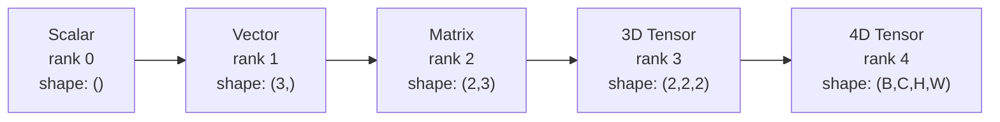
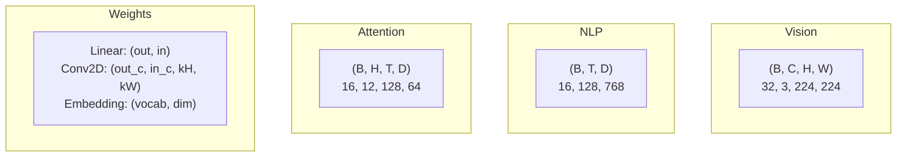
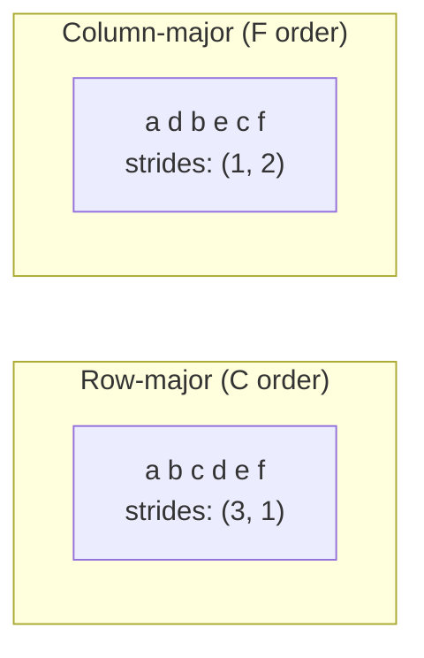
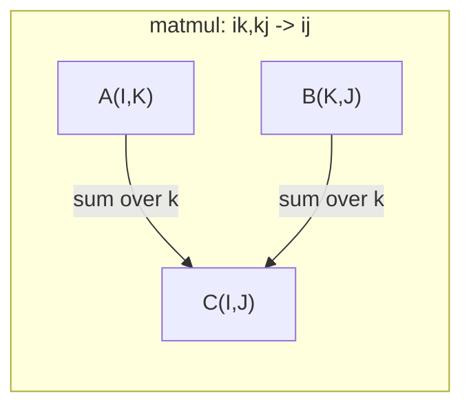

# Tensor 運算 (Tensor Operations)

> Tensor 是資料與 deep learning 之間共通的語言。每張圖片、每個句子、每個 gradient，都流經它們。

**Type:** Build
**Language:** Python
**Prerequisites:** Phase 1, Lessons 01 (Linear Algebra Intuition), 02 (Vectors, Matrices & Operations)
**Time:** ~90 分鐘

## 學習目標 (Learning Objectives)

- 從零實作一個 tensor class，包含 shape、stride、reshape、transpose 與 element-wise 運算
- 套用 broadcasting 規則，在不複製資料的情況下對不同 shape 的 tensor 做運算
- 為 dot product、matrix multiplication、outer product 與 batched 運算寫出 einsum 運算式
- 追蹤 multi-head attention 每一個步驟中 tensor 的確切 shape

## 問題 (The Problem)

你打造了一個 transformer。Forward pass 看起來很乾淨。你執行它，卻得到：`RuntimeError: mat1 and mat2 shapes cannot be multiplied (32x768 and 512x768)`。你盯著那些 shape 看。你試著加一個 transpose。現在它說 `Expected 4D input (got 3D input)`。你加了一個 unsqueeze。別的地方又壞了。

Shape 錯誤是 deep learning 程式碼中最常見的 bug。它們在概念上不難，每個運算都有一份 shape 契約，但會快速倍增。一個 transformer 裡有幾十個 reshape、transpose 和 broadcast 串在一起。只要一個軸錯了，錯誤就會一路連鎖。更糟的是，有些 shape 錯誤根本不會丟出錯誤。它們沿著錯誤的維度 broadcast，或對錯誤的軸加總，悄悄地產生垃圾結果。

Matrix 處理的是兩組東西之間的成對關係。真實的資料無法塞進兩個維度。一個 batch 有 32 張 224x224 的 RGB 影像，是一個 4D tensor：`(32, 3, 224, 224)`。有 12 個 head 的 self-attention 也是 4D：`(batch, heads, seq_len, head_dim)`。你需要一種能推廣到任意維度數量的資料結構，並且擁有能在所有維度上乾淨組合的運算。這個結構就是 tensor。精通它的運算，shape 錯誤就會變得很容易除錯。

## 核心概念 (The Concept)

### Tensor 是什麼 (What a tensor is)

Tensor 是具有統一資料型別的多維數字陣列。維度的數量稱為 **rank**（或 **order**）。每個維度是一個 **axis**。**Shape** 是一個 tuple，列出每個軸上的大小。



總元素數 = 所有大小的乘積。Shape `(2, 3, 4)` 包含 $2 \cdot 3 \cdot 4 = 24$ 個元素。

### Deep learning 中的 tensor shape (Tensor shapes in deep learning)

依慣例，不同的資料型別對應到特定的 tensor shape。



PyTorch 使用 NCHW（channels-first）。TensorFlow 預設為 NHWC（channels-last）。Layout 不一致會造成不易察覺的變慢或錯誤。

### 記憶體 layout 如何運作 (How memory layout works)

記憶體中的 2D 陣列其實是一維的位元組序列。**Stride** 告訴你，沿著每個軸前進一步要跳過多少個元素。



Transpose 不會移動資料。它只是交換 stride，讓 tensor 變成 **non-contiguous**：同一列的元素不再於記憶體中相鄰。

### Broadcasting 規則 (Broadcasting rules)

Broadcasting 讓你在不複製資料的情況下，對不同 shape 的 tensor 做運算。把 shape 從右邊對齊。兩個維度相容的條件是它們相等，或其中一個是 1。維度較少的一方，會在左邊補上 1。

```
Tensor A:     (8, 1, 6, 1)
Tensor B:        (7, 1, 5)
Padded B:     (1, 7, 1, 5)
Result:       (8, 7, 6, 5)
```

### Einsum：通用的 tensor 運算 (Einsum: the universal tensor operation)

Einstein summation 用一個字母標記每個軸。只出現在輸入、沒出現在輸出的軸會被加總，兩邊都有的軸則保留。



關鍵模式：`i,i->`（dot product）、`i,j->ij`（outer product）、`ii->`（trace）、`ij->ji`（transpose）、`bij,bjk->bik`（batch matmul）、`bhtd,bhsd->bhts`（attention score）。

```figure
tensor-broadcast
```

## 動手做 (Build It)

程式碼在 `code/tensors.py`。每個步驟都對應到那裡的實作。

### 步驟 1：Tensor 儲存與 stride

Tensor 儲存一個扁平的數字清單，加上 shape 的 metadata。Stride 告訴索引邏輯，如何把多維索引對應到扁平位置。

```python
class Tensor:
    def __init__(self, data, shape=None):
        if isinstance(data, (list, tuple)):
            self._data, self._shape = self._flatten_nested(data)
        elif isinstance(data, np.ndarray):
            self._data = data.flatten().tolist()
            self._shape = tuple(data.shape)
        else:
            self._data = [data]
            self._shape = ()

        if shape is not None:
            total = reduce(lambda a, b: a * b, shape, 1)
            if total != len(self._data):
                raise ValueError(
                    f"Cannot reshape {len(self._data)} elements into shape {shape}"
                )
            self._shape = tuple(shape)

        self._strides = self._compute_strides(self._shape)

    @staticmethod
    def _compute_strides(shape):
        if len(shape) == 0:
            return ()
        strides = [1] * len(shape)
        for i in range(len(shape) - 2, -1, -1):
            strides[i] = strides[i + 1] * shape[i + 1]
        return tuple(strides)
```

對於 shape `(3, 4)`，stride 是 `(4, 1)`：要前進一列，跳過 4 個元素；要前進一欄，跳過 1 個元素。

### 步驟 2：Reshape、squeeze、unsqueeze

Reshape 改變 shape，但不改變元素順序。元素的總數必須維持不變。對其中一個維度使用 `-1`，可以讓它自動推算大小。

```python
t = Tensor(list(range(12)), shape=(2, 6))
r = t.reshape((3, 4))
r = t.reshape((-1, 3))
```

Squeeze 移除大小為 1 的軸。Unsqueeze 則插入一個。Unsqueeze 對 broadcasting 很關鍵：一個 bias vector `(D,)` 要加到一個 batch `(B, T, D)` 上，需要先 unsqueeze 成 `(1, 1, D)`。

```python
t = Tensor(list(range(6)), shape=(1, 3, 1, 2))
s = t.squeeze()
v = Tensor([1, 2, 3])
u = v.unsqueeze(0)
```

### 步驟 3：Transpose 與 permute

Transpose 交換兩個軸。Permute 重新排列所有軸。這就是你在 NCHW 與 NHWC 之間轉換的方式。

```python
mat = Tensor(list(range(6)), shape=(2, 3))
tr = mat.transpose(0, 1)

t4d = Tensor(list(range(24)), shape=(1, 2, 3, 4))
perm = t4d.permute((0, 2, 3, 1))
```

Transpose 或 permute 之後，tensor 在記憶體中是 non-contiguous 的。在 PyTorch 中，`view` 對 non-contiguous 的 tensor 會失敗：請改用 `reshape`，或先呼叫 `.contiguous()`。

### 步驟 4：Element-wise 運算與 reduction

Element-wise 運算（加、乘、減）獨立套用到每個元素，並保留 shape。Reduction（sum、mean、max）則收合一個或多個軸。

```python
a = Tensor([[1, 2], [3, 4]])
b = Tensor([[10, 20], [30, 40]])
c = a + b
d = a * 2
s = a.sum(axis=0)
```

CNN 中的 global average pooling：`(B, C, H, W).mean(axis=[2, 3])` 產生 `(B, C)`。NLP 中的序列 mean pooling：`(B, T, D).mean(axis=1)` 產生 `(B, D)`。

### 步驟 5：用 NumPy 做 broadcasting

`tensors.py` 裡的 `demo_broadcasting_numpy()` 函式展示了核心模式。

```python
activations = np.random.randn(4, 3)
bias = np.array([0.1, 0.2, 0.3])
result = activations + bias

images = np.random.randn(2, 3, 4, 4)
scale = np.array([0.5, 1.0, 1.5]).reshape(1, 3, 1, 1)
result = images * scale

a = np.array([1, 2, 3]).reshape(-1, 1)
b = np.array([10, 20, 30, 40]).reshape(1, -1)
outer = a * b
```

用 broadcasting 計算成對距離：把 `(M, 2)` reshape 成 `(M, 1, 2)`、把 `(N, 2)` reshape 成 `(1, N, 2)`，相減、平方、沿最後一個軸加總，再取平方根。結果：`(M, N)`。

### 步驟 6：Einsum 運算

`demo_einsum()` 與 `demo_einsum_gallery()` 函式會帶你走過每個常見的模式。

```python
a = np.array([1.0, 2.0, 3.0])
b = np.array([4.0, 5.0, 6.0])
dot = np.einsum("i,i->", a, b)

A = np.array([[1, 2], [3, 4], [5, 6]], dtype=float)
B = np.array([[7, 8, 9], [10, 11, 12]], dtype=float)
matmul = np.einsum("ik,kj->ij", A, B)

batch_A = np.random.randn(4, 3, 5)
batch_B = np.random.randn(4, 5, 2)
batch_mm = np.einsum("bij,bjk->bik", batch_A, batch_B)
```

一個 contraction 的運算成本，是所有索引大小（保留的與被加總的）的乘積。對 `bij,bjk->bik`，$B=32$、$I=128$、$J=64$、$K=128$：$32 \cdot 128 \cdot 64 \cdot 128 = 33{,}554{,}432$ 次 multiply-add。

### 步驟 7：用 einsum 實作 attention 機制

`demo_attention_einsum()` 函式端到端地實作了 multi-head attention。

```python
B, H, T, D = 2, 4, 8, 16
E = H * D

X = np.random.randn(B, T, E)
W_q = np.random.randn(E, E) * 0.02

Q = np.einsum("bte,ek->btk", X, W_q)
Q = Q.reshape(B, T, H, D).transpose(0, 2, 1, 3)

scores = np.einsum("bhtd,bhsd->bhts", Q, K) / np.sqrt(D)
weights = softmax(scores, axis=-1)
attn_output = np.einsum("bhts,bhsd->bhtd", weights, V)

concat = attn_output.transpose(0, 2, 1, 3).reshape(B, T, E)
output = np.einsum("bte,ek->btk", concat, W_o)
```

每一步都是 tensor 運算：projection（透過 einsum 做 matmul）、拆分 head（reshape + transpose）、attention score（透過 einsum 做 batch matmul）、加權總和（透過 einsum 做 batch matmul）、合併 head（transpose + reshape）、output projection（透過 einsum 做 matmul）。

## 實際使用 (Use It)

### 從零實作 vs NumPy (Scratch vs NumPy)

| 運算 | 從零實作 (Tensor class) | NumPy |
|---|---|---|
| 建立 | `Tensor([[1,2],[3,4]])` | `np.array([[1,2],[3,4]])` |
| Reshape | `t.reshape((3,4))` | `a.reshape(3,4)` |
| Transpose | `t.transpose(0,1)` | `a.T` 或 `a.transpose(0,1)` |
| Squeeze | `t.squeeze(0)` | `np.squeeze(a, 0)` |
| Sum | `t.sum(axis=0)` | `a.sum(axis=0)` |
| Einsum | 無 | `np.einsum("ij,jk->ik", a, b)` |

### 從零實作 vs PyTorch (Scratch vs PyTorch)

```python
import torch

t = torch.tensor([[1, 2, 3], [4, 5, 6]], dtype=torch.float32)
t.shape
t.stride()
t.is_contiguous()

t.reshape(3, 2)
t.unsqueeze(0)
t.transpose(0, 1)
t.transpose(0, 1).contiguous()

torch.einsum("ik,kj->ij", A, B)
```

PyTorch 額外提供 autograd、GPU 支援與最佳化的 BLAS kernel。Shape 的語意完全相同。如果你理解從零實作的版本，PyTorch 的 shape 錯誤就會變得看得懂。

### 每個 neural network layer 都是一個 tensor 運算 (Every neural network layer as a tensor operation)

| 運算 | Tensor 形式 | Einsum |
|---|---|---|
| Linear layer | `Y = X @ W.T + b` | `"bd,od->bo"` + bias |
| Attention QKV | `Q = X @ W_q` | `"btd,dh->bth"` |
| Attention score | `Q @ K.T / sqrt(d)` | `"bhtd,bhsd->bhts"` |
| Attention 輸出 | `softmax(scores) @ V` | `"bhts,bhsd->bhtd"` |
| Batch norm | `(X - mu) / sigma * gamma` | element-wise + broadcast |
| Softmax | `exp(x) / sum(exp(x))` | element-wise + reduction |

## 交付 (Ship It)

這堂課會產出兩份可重複使用的 prompt：

1. **`outputs/prompt-tensor-shapes.md`**：一份系統化的 prompt，用來偵錯 tensor shape 不符的問題。包含每個常見運算（matmul、broadcast、cat、Linear、Conv2d、BatchNorm、softmax）的決策表，以及一份修正對照表。

2. **`outputs/prompt-tensor-debugger.md`**：一份逐步的偵錯 prompt，當 shape 錯誤擋住你時，可以貼到任何 AI 助理。把錯誤訊息和你的 tensor shape 丟給它，就能拿回確切的修正方式。

## 練習 (Exercises)

1. **簡單：Reshape 來回轉換。** 取一個 shape 為 `(2, 3, 4)` 的 tensor。把它 reshape 成 `(6, 4)`，再成 `(24,)`，然後再變回 `(2, 3, 4)`。每一步都印出扁平資料，驗證元素順序有被保留。

2. **中等：實作 broadcasting。** 為 `Tensor` class 擴充一個 `broadcast_to(shape)` 方法，把大小為 1 的維度擴展成目標 shape。接著修改 `_elementwise_op`，讓它在運算前自動 broadcast。用 shape `(3, 1)` 和 `(1, 4)` 產生 `(3, 4)` 來測試。

3. **困難：從零打造 einsum。** 實作一個基本的 `einsum(subscripts, *tensors)` 函式，至少要處理：dot product（`i,i->`）、matrix multiply（`ij,jk->ik`）、outer product（`i,j->ij`）和 transpose（`ij->ji`）。解析 subscript 字串，找出被 contract 的索引，並對所有索引組合做迴圈。將結果與 `np.einsum` 比較。

4. **困難：Attention shape 追蹤器。** 寫一個函式，接收 `batch_size`、`seq_len`、`embed_dim` 與 `num_heads` 作為輸入，並印出 multi-head attention 每一步的確切 shape：輸入、Q/K/V projection、head 拆分、attention score、softmax weight、加權總和、head 合併、output projection。對照 `demo_attention_einsum()` 的輸出來驗證。

### 提示 (Hints)

**練習 1。** 用 `list(range(24))` 建立 tensor，讓每個元素都顯示自己的位置。每次呼叫 `reshape` 之後，印出 `flatten().to_list()`，並檢查它仍然是依序的 0 到 23。

**練習 2。** 只有當兩個大小相等，或其中一個是 1 時，維度才能 broadcast，所以先檢查這條規則，不符合時就丟出錯誤。對 shape `(3, 1)` 和 `(1, 4)`，檢查結果的 `[i][j]` 項等於 `a[i][0] + b[0][j]`，並把完整結果與 NumPy 比較。

**練習 3。** 用 `->` 切開 subscript。出現在輸入但不在輸出中的字母，就是被加總的索引，所以對每個字母的所有值做迴圈，並加到輸出的對應位置。用小型的隨機陣列，以 `np.allclose(mine, np.einsum(...))` 測試四種情況。

**練習 4。** 從 head 大小 `embed_dim // num_heads` 開始，並 assert `embed_dim % num_heads == 0`。Attention score 的 shape 是 `(batch_size, num_heads, seq_len, seq_len)`，所以把你的輸出與這個 shape，以及 `demo_attention_einsum()` 印出的 shape 做比對。

## 關鍵術語 (Key Terms)

| 術語 | 一般人怎麼說 | 實際意思 |
|---|---|---|
| Tensor | 「維度更多的 matrix」 | 具有統一型別、並定義了 shape、stride 與運算的多維陣列 |
| Rank | 「維度的數量」 | 軸的數量。Matrix 的 rank 是 2，不是指它的 matrix rank |
| Shape | 「tensor 的大小」 | 列出每個軸上大小的 tuple。`(2, 3)` 代表 2 列、3 欄 |
| Stride | 「記憶體如何排列」 | 沿著每個軸前進一個位置時，要跳過的元素數量 |
| Broadcasting | 「shape 不同時它就是會動」 | 一組嚴格的規則：從右邊對齊，維度必須相等，或其中一個必須是 1 |
| Contiguous | 「這個 tensor 是正常的」 | 元素在記憶體中依序儲存，沒有空隙，也沒有與邏輯 layout 不同的重新排序 |
| Einsum | 「寫 matmul 的花俏方式」 | 一種通用的記號，用一行就能表達任何 tensor contraction、outer product、trace 或 transpose |
| View | 「跟 reshape 一樣」 | 共用同一塊記憶體 buffer、但 shape/stride metadata 不同的 tensor。對 non-contiguous 的資料會失敗 |
| Contraction | 「對一個索引加總」 | 一般性的運算：tensor 之間共有的索引被相乘並加總，產生較低 rank 的結果 |
| NCHW / NHWC | 「PyTorch 與 TensorFlow 的格式」 | 影像 tensor 的記憶體 layout 慣例。NCHW 把 channel 放在空間維度之前，NHWC 則放在之後 |

## 延伸閱讀 (Further Reading)

- [NumPy Broadcasting](https://numpy.org/doc/stable/user/basics.broadcasting.html) -- 附視覺化範例的標準規則
- [PyTorch Tensor Views](https://pytorch.org/docs/stable/tensor_view.html) -- view 何時有效、何時會複製
- [einops](https://github.com/arogozhnikov/einops) -- 讓 tensor reshape 變得易讀又安全的函式庫
- [The Illustrated Transformer](https://jalammar.github.io/illustrated-transformer/) -- 視覺化流經 attention 的 tensor shape
- [Einstein Summation in NumPy](https://numpy.org/doc/stable/reference/generated/numpy.einsum.html) -- 附範例的完整 einsum 文件
