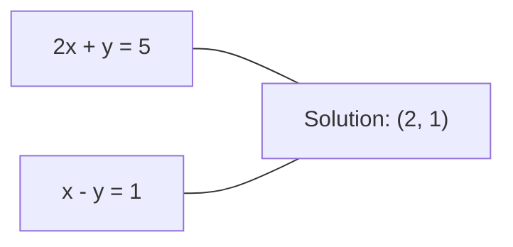
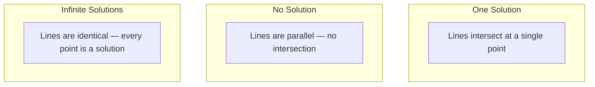

# 線性方程組 (Linear Systems)

> 解 $Ax = b$ 是數學中最古老、卻仍在驅動你的 neural network 的問題。

**Type:** Build
**Language:** Python
**Prerequisites:** Phase 1, Lessons 01 (Linear Algebra Intuition), 02 (Vectors & Matrices), 03 (Matrix Transformations)
**Time:** ~120 分鐘

## 學習目標 (Learning Objectives)

- 用帶 partial pivoting 的 Gaussian elimination 與 back substitution 解 $Ax = b$
- 用 LU、QR 與 Cholesky decomposition 分解 matrix，並說明各自適用的時機
- 推導 least squares 的 normal equations，並把它們連結到 linear regression 與 ridge regression
- 用 condition number 診斷 ill-conditioned 的方程組，並套用 regularization 來穩定它們

## 問題 (The Problem)

每次你訓練 linear regression，你都在解一個 linear system。每次你計算 least-squares fit，你都在解一個 linear system。每次 neural network 的某一層計算 `y = Wx + b`，它都是在計算 linear system 的一側。當你加入 regularization，你就是在修改這個方程組。當你使用 Gaussian process，你要分解一個 matrix。當你為了 Mahalanobis distance 而對 covariance matrix 求反，你就是在解一個 linear system。

方程式 $Ax = b$ 無所不在。$A$ 是已知係數組成的 matrix。$b$ 是已知輸出組成的 vector。$x$ 是你想找出的未知數 vector。在 linear regression 中，$A$ 是你的資料 matrix，$b$ 是你的目標 vector，$x$ 是 weight vector。整個模型簡化成：找出 $x$，使 $Ax$ 盡可能接近 $b$。

這堂課從零打造解這個方程式的每個主要方法。你會理解為什麼有些方法快、有些方法穩定，為什麼有些只適用於方陣、有些能處理 overdetermined 的方程組，以及為什麼你的 matrix 的 condition number 決定了你的答案到底有沒有意義。

## 核心概念 (The Concept)

### Ax = b 在幾何上的意義 (What Ax = b means geometrically)

線性方程組有一個幾何解釋。每個方程式定義一個 hyperplane。解就是所有 hyperplane 相交的點（或點的集合）。

```
2x + y = 5          Two lines in 2D.
x - y  = 1          They intersect at x=2, y=1.
```



可能發生三種情況：



用 matrix 的形式來說，「一個解」代表 $A$ 是可逆的。「無解」代表方程組不一致。「無限多個解」代表 $A$ 有 null space。大多數 ML 問題都落在「沒有精確解」這一類，因為你的方程式（資料點）比未知數（參數）多。這就是 least squares 登場的地方。

### Column picture 與 row picture (Column picture vs row picture)

讀 $Ax = b$ 有兩種方式。

**Row picture。** $A$ 的每一列定義一個方程式。每個方程式是一個 hyperplane。解就是它們全部相交的地方。

**Column picture。** $A$ 的每一欄是一個 vector。問題變成：$A$ 的欄的哪種 linear combination 會產生 $b$？

```
A = | 2  1 |    b = | 5 |
    | 1 -1 |        | 1 |

Row picture: solve 2x + y = 5 and x - y = 1 simultaneously.

Column picture: find x1, x2 such that:
  x1 * [2, 1] + x2 * [1, -1] = [5, 1]
  2 * [2, 1] + 1 * [1, -1] = [4+1, 2-1] = [5, 1]   check.
```

Column picture 更根本。如果 $b$ 位於 $A$ 的 column space 中，方程組就有解。如果不在，你就找 column space 中最接近的點。那個最接近的點就是 least-squares 解。

### Gaussian elimination (Gaussian elimination)

Gaussian elimination 把 $Ax = b$ 轉換成一個 upper triangular 方程組 $Ux = c$，再用 back substitution 求解。這是最直接的方法。

演算法：

```
1. For each column k (the pivot column):
   a. Find the largest entry in column k at or below row k (partial pivoting).
   b. Swap that row with row k.
   c. For each row i below k:
      - Compute multiplier m = A[i][k] / A[k][k]
      - Subtract m times row k from row i.
2. Back substitute: solve from the last equation upward.
```

範例：

```
Original:
| 2  1  1 | 8 |       R2 = R2 - (2)R1     | 2  1   1 |  8 |
| 4  3  3 |20 |  -->  R3 = R3 - (1)R1 --> | 0  1   1 |  4 |
| 2  3  1 |12 |                            | 0  2   0 |  4 |

                       R3 = R3 - (2)R2     | 2  1   1 |  8 |
                                       --> | 0  1   1 |  4 |
                                           | 0  0  -2 | -4 |

Back substitute:
  -2 * x3 = -4    -->  x3 = 2
  x2 + 2  = 4     -->  x2 = 2
  2*x1 + 2 + 2 = 8 --> x1 = 2
```

Gaussian elimination 的成本是 $O(n^3)$ 次運算。對一個 $1000 \times 1000$ 的方程組，那大約是十億次浮點運算。很快，但如果你需要用同一個 $A$ 解多個方程組，你可以做得更好。

### Partial pivoting：為什麼重要 (Partial pivoting: why it matters)

沒有 pivoting，Gaussian elimination 可能失敗或產生垃圾。如果 pivot 元素是零，你會除以零。如果它很小，你會放大捨入誤差。

```
Bad pivot:                       With partial pivoting:
| 0.001  1 | 1.001 |            Swap rows first:
| 1      1 | 2     |            | 1      1 | 2     |
                                 | 0.001  1 | 1.001 |
m = 1/0.001 = 1000              m = 0.001/1 = 0.001
R2 = R2 - 1000*R1               R2 = R2 - 0.001*R1
| 0.001  1     | 1.001   |      | 1      1     | 2     |
| 0     -999   | -999.0  |      | 0      0.999 | 0.999 |

x2 = 1.000 (correct)            x2 = 1.000 (correct)
x1 = (1.001 - 1)/0.001          x1 = (2 - 1)/1 = 1.000 (correct)
   = 0.001/0.001 = 1.000        Stable because the multiplier is small.
```

在精度有限的浮點運算中，沒有 pivot 的版本可能損失有效數字。Partial pivoting 永遠選擇可用的最大 pivot，以將誤差放大降到最低。

### LU decomposition (LU decomposition)

LU decomposition 把 $A$ 分解成 lower triangular matrix $L$ 與 upper triangular matrix $U$：$A = LU$。$L$ matrix 儲存 Gaussian elimination 的乘數。$U$ matrix 是 elimination 的結果。

```
A = L @ U

| 2  1  1 |   | 1  0  0 |   | 2  1   1 |
| 4  3  3 | = | 2  1  0 | @ | 0  1   1 |
| 2  3  1 |   | 1  2  1 |   | 0  0  -2 |
```

為什麼要分解，而不是直接做 elimination？因為一旦你有了 $L$ 和 $U$，對任何新的 $b$ 解 $Ax = b$ 只需 $O(n^2)$：

```math
\begin{aligned}
Ax &= b \\
LUx &= b \\
&\text{Let } y = Ux\text{:} \\
Ly &= b \quad \text{(forward substitution, } O(n^2)\text{)} \\
Ux &= y \quad \text{(back substitution, } O(n^2)\text{)}
\end{aligned}
```

$O(n^3)$ 的成本在分解時只付一次。之後每次求解都是 $O(n^2)$。如果你需要用同一個 $A$ 但不同的 $b$ vector 解 1000 個方程組，LU 在總工作量上省下 1000/3 倍。

有了 partial pivoting，你會得到 $PA = LU$，其中 $P$ 是記錄列交換的 permutation matrix。

### QR decomposition (QR decomposition)

QR decomposition 把 $A$ 分解成 orthogonal matrix $Q$ 與 upper triangular matrix $R$：$A = QR$。

Orthogonal matrix 具有 $Q^T Q = I$ 的性質。它的欄是 orthonormal vector。乘上 $Q$ 會保持長度與角度。

```
A = Q @ R

Q has orthonormal columns: Q^T Q = I
R is upper triangular

To solve Ax = b:
  QRx = b
  Rx = Q^T b    (just multiply by Q^T, no inversion needed)
  Back substitute to get x.
```

對於解 least-squares 問題，QR 在數值上比 LU 更穩定。Gram-Schmidt process 一欄一欄地建構 $Q$：

```
Given columns a1, a2, ... of A:

q1 = a1 / ||a1||

q2 = a2 - (a2 . q1) * q1        (subtract projection onto q1)
q2 = q2 / ||q2||                (normalize)

q3 = a3 - (a3 . q1) * q1 - (a3 . q2) * q2
q3 = q3 / ||q3||

R[i][j] = qi . aj    for i <= j
```

每一步都移除沿著所有先前 $q$ vector 的分量，只留下新的正交方向。

### Cholesky decomposition (Cholesky decomposition)

當 $A$ 是對稱的 ($A = A^T$) 且為 positive definite（所有 eigenvalue 為正）時，你可以把它分解為 $A = L L^T$，其中 $L$ 是 lower triangular。這就是 Cholesky decomposition。

```
A = L @ L^T

| 4  2 |   | 2  0 |   | 2  1 |
| 2  5 | = | 1  2 | @ | 0  2 |

L[i][i] = sqrt(A[i][i] - sum(L[i][k]^2 for k < i))
L[i][j] = (A[i][j] - sum(L[i][k]*L[j][k] for k < j)) / L[j][j]    for i > j
```

Cholesky 比 LU 快兩倍，且只需要一半的儲存空間。它只適用於對稱 positive definite 的 matrix，但這類 matrix 經常出現：

- Covariance matrix 是對稱 positive semi-definite（加上 regularization 後為 positive definite）。
- Gaussian process 中的 kernel matrix 是對稱 positive definite。
- Convex 函數在最小值處的 Hessian 是對稱 positive definite。
- $A^T A$ 永遠是對稱 positive semi-definite。

在 Gaussian process 中，你用 Cholesky 分解 kernel matrix $K$，然後解 $K \alpha = y$ 來取得預測的 mean。Cholesky factor 也給你 marginal likelihood 所需的 log-determinant：$\log \det(K) = 2 \sum \log(\mathop{\mathrm{diag}}(L))$。

### Least squares：當 Ax = b 沒有精確解時 (Least squares: when Ax = b has no exact solution)

如果 $A$ 是 $m \times n$ 且 $m > n$（方程式比未知數多），這個方程組就是 overdetermined。沒有精確解。取而代之的是，你最小化平方誤差：

```
minimize ||Ax - b||^2

This is the sum of squared residuals:
  sum((A[i,:] @ x - b[i])^2 for i in range(m))
```

最小化的解滿足 normal equations：

```math
A^T A x = A^T b
```

推導：展開 $\lVert Ax - b \rVert^2 = (Ax - b)^T (Ax - b) = x^T A^T A x - 2 x^T A^T b + b^T b$。對 $x$ 取 gradient，並令其為零：$2 A^T A x - 2 A^T b = 0$。

```
Original system (overdetermined, 4 equations, 2 unknowns):
| 1  1 |         | 3 |
| 1  2 | x     = | 5 |       No exact x satisfies all 4 equations.
| 1  3 |         | 6 |
| 1  4 |         | 8 |

Normal equations:
A^T A = | 4  10 |    A^T b = | 22 |
        | 10 30 |            | 63 |

Solve: x = [1.5, 1.7]

This is linear regression. x[0] is the intercept, x[1] is the slope.
```

### Normal equations = linear regression (Normal equations = linear regression)

這個關聯是精確的。在 linear regression 中，你的資料 matrix $X$ 每個樣本一列、每個 feature 一欄。你的目標 vector $y$ 每個樣本有一個元素。Weight vector $w$ 滿足：

```math
\begin{aligned}
X^T X w &= X^T y \\
w &= (X^T X)^{-1} X^T y
\end{aligned}
```

這就是 linear regression 的封閉形式解。每次呼叫 `sklearn.linear_model.LinearRegression.fit()` 都會計算這個（或透過 QR 或 SVD 的等價形式）。

在 matrix 上加一個 regularization 項 $\lambda I$，就得到 ridge regression：

```math
\begin{aligned}
(X^T X + \lambda I) w &= X^T y \\
w &= (X^T X + \lambda I)^{-1} X^T y
\end{aligned}
```

Regularization 讓 matrix 的 condition 更好（更容易準確求反），並透過把 weight 縮向零來防止 overfitting。當 $\lambda > 0$ 時，matrix $X^T X + \lambda I$ 永遠是對稱 positive definite，所以你可以用 Cholesky 來解它。

### Pseudoinverse (Moore-Penrose) (Pseudoinverse (Moore-Penrose))

Pseudoinverse $A^+$ 把 matrix 求反推廣到非方陣與 singular matrix。對任何 matrix $A$：

```math
\begin{aligned}
x &= A^+ b \\[4pt]
\text{where } A^+ &= V \Sigma^+ U^T \quad \text{(computed via SVD)}
\end{aligned}
```

$\Sigma^+$ 的形成方式是對每個非零 singular value 取倒數，然後轉置結果。如果 $A = U \Sigma V^T$，則 $A^+ = V \Sigma^+ U^T$。

```
A = U Sigma V^T        (SVD)

Sigma = | 5  0 |       Sigma+ = | 1/5  0  0 |
        | 0  2 |                | 0  1/2  0 |
        | 0  0 |

A+ = V Sigma+ U^T
```

Pseudoinverse 給出 minimum-norm 的 least-squares 解。如果方程組有：
- 一個解：$A^+ b$ 給出它。
- 無解：$A^+ b$ 給出 least-squares 解。
- 無限多個解：$A^+ b$ 給出 $\lVert x \rVert$ 最小的那一個。

NumPy 的 `np.linalg.lstsq` 與 `np.linalg.pinv` 在內部都使用 SVD。

### Condition number (Condition number)

Condition number 衡量解對輸入的微小變動有多敏感。對一個 matrix $A$，condition number 是：

```math
\kappa(A) = \lVert A \rVert \cdot \lVert A^{-1} \rVert = \frac{\sigma_{\max}}{\sigma_{\min}}
```

其中 $\sigma_{\max}$ 與 $\sigma_{\min}$ 是最大與最小的 singular value。

```
Well-conditioned (kappa ~ 1):        Ill-conditioned (kappa ~ 10^15):
Small change in b -->                Small change in b -->
small change in x                    huge change in x

| 2  0 |   kappa = 2/1 = 2          | 1   1          |   kappa ~ 10^15
| 0  1 |   safe to solve            | 1   1+10^(-15) |   solution is garbage
```

經驗法則：
- $\kappa < 100$：安全，解是準確的。
- $\kappa \approx 10^k$：你會從浮點運算中損失約 $k$ 位的精度。
- $\kappa \approx 10^{16}$（對 float64）：解毫無意義。這個 matrix 實際上是 singular 的。

在 ML 中，當 feature 幾乎共線時就會發生 ill-conditioning。Regularization（加上 $\lambda I$）把 condition number 從 $\sigma_{\max} / \sigma_{\min}$ 改善為 $(\sigma_{\max} + \lambda) / (\sigma_{\min} + \lambda)$。

### 迭代方法：conjugate gradient (Iterative methods: conjugate gradient)

對於非常大的稀疏方程組（數百萬個未知數），像 LU 或 Cholesky 這類直接方法太昂貴。迭代方法透過在許多次迭代中改進一個猜測來近似解。

當 $A$ 是對稱 positive definite 時，Conjugate gradient (CG) 解 $Ax = b$。它在最多 $n$ 次迭代內找到精確解（在精確算術下），但如果 $A$ 的 eigenvalue 聚集，通常收斂得快得多。

```
Algorithm sketch:
  x0 = initial guess (often zero)
  r0 = b - A x0           (residual)
  p0 = r0                 (search direction)

  For k = 0, 1, 2, ...:
    alpha = (rk . rk) / (pk . A pk)
    x_{k+1} = xk + alpha * pk
    r_{k+1} = rk - alpha * A pk
    beta = (r_{k+1} . r_{k+1}) / (rk . rk)
    p_{k+1} = r_{k+1} + beta * pk
    if ||r_{k+1}|| < tolerance: stop
```

CG 用於：
- 大規模最佳化（Newton-CG 方法）
- 求解 PDE 離散化
- Kernel matrix 大到無法分解的 kernel 方法
- 作為其他迭代求解器的 preconditioning

收斂速度取決於 condition number。Condition 越好的方程組收斂越快，這是 regularization 有幫助的另一個原因。

### 全貌：何時用哪種方法 (The full picture: which method when)

| 方法 | 需求 | 成本 | 使用情境 |
|--------|-------------|------|----------|
| Gaussian elimination | 方陣、非 singular 的 $A$ | $O(n^3)$ | 一次性求解方陣方程組 |
| LU decomposition | 方陣、非 singular 的 $A$ | $O(n^3)$ 分解 + $O(n^2)$ 求解 | 用同一個 $A$ 多次求解 |
| QR decomposition | 任何 $A$ ($m \ge n$) | $O(mn^2)$ | Least squares，數值穩定 |
| Cholesky | 對稱 positive definite 的 $A$ | $O(n^3/3)$ | Covariance matrix、Gaussian process、ridge regression |
| Normal equations | Overdetermined ($m > n$) | $O(mn^2 + n^3)$ | Linear regression（$n$ 小時） |
| SVD / pseudoinverse | 任何 $A$ | $O(mn^2)$ | Rank-deficient 的方程組、minimum-norm 解 |
| Conjugate gradient | 對稱 positive definite、稀疏的 $A$ | $O(n \cdot k \cdot \text{nnz})$ | 大型稀疏方程組，$k$ = 迭代次數 |

### 與 ML 的關聯 (Connection to ML)

這堂課的每個方法都出現在正式環境的 ML 中：

**Linear regression。** 封閉形式解求解 normal equations $X^T X w = X^T y$。這是透過 Cholesky（若 $n$ 小）、QR（若數值穩定性重要）或 SVD（若 matrix 可能 rank-deficient）完成的。

**Ridge regression。** 在 $X^T X$ 上加 $\lambda I$。正則化後的方程組 $(X^T X + \lambda I) w = X^T y$ 永遠可以用 Cholesky 求解，因為當 $\lambda > 0$ 時，$X^T X + \lambda I$ 是對稱 positive definite。

**Gaussian process。** 預測的 mean 需要解 $K \alpha = y$，其中 $K$ 是 kernel matrix。對 $K$ 做 Cholesky 分解是標準做法。Log marginal likelihood 使用 $\log \det(K) = 2 \sum \log(\mathop{\mathrm{diag}}(L))$。

**Neural network 初始化。** Orthogonal 初始化用 QR decomposition 建立欄為 orthonormal 的 weight matrix。這可以防止深層網路中訊號崩潰。

**Preconditioning。** 大規模 optimizer 使用 incomplete Cholesky 或 incomplete LU，作為 conjugate gradient 求解器的 preconditioner。

**Feature engineering。** $X^T X$ 的 condition number 告訴你 feature 是否共線。如果 $\kappa$ 很大，就移除 feature 或加入 regularization。

```figure
linear-system-conditioning
```

## 動手做 (Build It)

### 步驟 1：帶 partial pivoting 的 Gaussian elimination

```python
import numpy as np

def gaussian_elimination(A, b):
    n = len(b)
    Ab = np.hstack([A.astype(float), b.reshape(-1, 1).astype(float)])

    for k in range(n):
        max_row = k + np.argmax(np.abs(Ab[k:, k]))
        Ab[[k, max_row]] = Ab[[max_row, k]]

        if abs(Ab[k, k]) < 1e-12:
            raise ValueError(f"Matrix is singular or nearly singular at pivot {k}")

        for i in range(k + 1, n):
            m = Ab[i, k] / Ab[k, k]
            Ab[i, k:] -= m * Ab[k, k:]

    x = np.zeros(n)
    for i in range(n - 1, -1, -1):
        x[i] = (Ab[i, -1] - Ab[i, i+1:n] @ x[i+1:n]) / Ab[i, i]

    return x
```

### 步驟 2：LU decomposition

```python
def lu_decompose(A):
    n = A.shape[0]
    L = np.eye(n)
    U = A.astype(float).copy()
    P = np.eye(n)

    for k in range(n):
        max_row = k + np.argmax(np.abs(U[k:, k]))
        if max_row != k:
            U[[k, max_row]] = U[[max_row, k]]
            P[[k, max_row]] = P[[max_row, k]]
            if k > 0:
                L[[k, max_row], :k] = L[[max_row, k], :k]

        for i in range(k + 1, n):
            L[i, k] = U[i, k] / U[k, k]
            U[i, k:] -= L[i, k] * U[k, k:]

    return P, L, U

def lu_solve(P, L, U, b):
    n = len(b)
    Pb = P @ b.astype(float)

    y = np.zeros(n)
    for i in range(n):
        y[i] = Pb[i] - L[i, :i] @ y[:i]

    x = np.zeros(n)
    for i in range(n - 1, -1, -1):
        x[i] = (y[i] - U[i, i+1:] @ x[i+1:]) / U[i, i]

    return x
```

### 步驟 3：Cholesky decomposition

```python
def cholesky(A):
    n = A.shape[0]
    L = np.zeros_like(A, dtype=float)

    for i in range(n):
        for j in range(i + 1):
            s = A[i, j] - L[i, :j] @ L[j, :j]
            if i == j:
                if s <= 0:
                    raise ValueError("Matrix is not positive definite")
                L[i, j] = np.sqrt(s)
            else:
                L[i, j] = s / L[j, j]

    return L
```

### 步驟 4：透過 normal equations 做 least squares

```python
def least_squares_normal(A, b):
    AtA = A.T @ A
    Atb = A.T @ b
    return gaussian_elimination(AtA, Atb)

def ridge_regression(A, b, lam):
    n = A.shape[1]
    AtA = A.T @ A + lam * np.eye(n)
    Atb = A.T @ b
    L = cholesky(AtA)
    y = np.zeros(n)
    for i in range(n):
        y[i] = (Atb[i] - L[i, :i] @ y[:i]) / L[i, i]
    x = np.zeros(n)
    for i in range(n - 1, -1, -1):
        x[i] = (y[i] - L.T[i, i+1:] @ x[i+1:]) / L.T[i, i]
    return x
```

### 步驟 5：Condition number

```python
def condition_number(A):
    U, S, Vt = np.linalg.svd(A)
    return S[0] / S[-1]
```

## 實際使用 (Use It)

把這些部分組合起來，對真實資料做 linear regression 與 ridge regression：

```python
np.random.seed(42)
X_raw = np.random.randn(100, 3)
w_true = np.array([2.0, -1.0, 0.5])
y = X_raw @ w_true + np.random.randn(100) * 0.1

X = np.column_stack([np.ones(100), X_raw])

w_ols = least_squares_normal(X, y)
print(f"OLS weights (ours):    {w_ols}")

w_np = np.linalg.lstsq(X, y, rcond=None)[0]
print(f"OLS weights (numpy):   {w_np}")
print(f"Max difference: {np.max(np.abs(w_ols - w_np)):.2e}")

w_ridge = ridge_regression(X, y, lam=1.0)
print(f"Ridge weights (ours):  {w_ridge}")

from sklearn.linear_model import Ridge
ridge_sk = Ridge(alpha=1.0, fit_intercept=False)
ridge_sk.fit(X, y)
print(f"Ridge weights (sklearn): {ridge_sk.coef_}")
```

## 交付 (Ship It)

這堂課會產出：
- `code/linear_systems.py`，包含從零實作的 Gaussian elimination、LU decomposition、Cholesky decomposition、least squares 與 ridge regression
- 一個可運作的示範，證明 normal equations 與 sklearn 的 LinearRegression 產生相同的 weight

## 練習 (Exercises)

1. 用你的 Gaussian elimination、你的 LU 求解器與 `np.linalg.solve`，解方程組 `[[1,2,3],[4,5,6],[7,8,10]] x = [6, 15, 27]`。驗證三者在浮點誤差容許範圍內給出相同的答案。

2. 產生一個 50x5 的隨機 matrix X 以及目標 y = X @ w_true + noise。用 normal equations、QR（透過 `np.linalg.qr`）、SVD（透過 `np.linalg.svd`）和 `np.linalg.lstsq` 求解 w。比較全部四個解。衡量 $X^T X$ 的 condition number，並說明它如何影響你該信任哪種方法。

3. 把兩欄做成幾乎相同，建立一個近乎 singular 的 matrix（例如：column 2 = column 1 + 1e-10 * noise）。計算它的 condition number。分別在有與沒有 regularization（加上 $0.01 I$）的情況下解 $Ax = b$。比較解與殘差。說明為什麼 regularization 有幫助。

4. 為一個 100x100 的隨機對稱 positive definite matrix 實作 conjugate gradient 演算法。計算要經過多少次迭代才收斂到容許誤差 1e-8。與理論上最多 $n$ 次迭代的上限比較。

5. 在大小為 10、50、200、500 的對稱 positive definite matrix 上，計時你的 Cholesky 求解器、你的 LU 求解器與 `np.linalg.solve`。畫出結果。驗證 Cholesky 大約比 LU 快 2 倍。

### 提示 (Hints)

**練習 1。** 呼叫 `gaussian_elimination(A, b)`，然後 `lu_decompose(A)` 接著 `lu_solve(P, L, U, b)`，再來 `np.linalg.solve(A, b)`。用 `np.allclose(A @ x, b)` 檢查每個答案，並用 `np.allclose` 比較這三個答案。

**練習 2。** normal equations 使用 `least_squares_normal`，其他方法使用三個 NumPy 函式。全部四個答案都應接近 `w_true`。比較 `condition_number(X.T @ X)` 和 `condition_number(X)`：前者是後者的平方，所以 normal equations 損失的精度最多。

**練習 3。** 預期 condition number 超過 $10^{9}$。用 `np.linalg.solve` 和 `ridge_regression(A, b, 0.01)` 求解，然後比較每個解的 `np.linalg.norm(x)` 與殘差 norm。兩個殘差都可能很小，但沒有 regularization 的解通常有非常大的元素。

**練習 4。** 用 `B @ B.T + n * np.eye(n)` 建立一個對稱 positive definite matrix，讓每個 eigenvalue 都是正的。在你的 `conjugate_gradient` 副本的迴圈中加一個計數器，然後檢查最終殘差 norm 低於 1e-8，且次數至多為 100。

**練習 5。** 三個求解器都使用同樣的 `B @ B.T + n * np.eye(n)` matrix，並用 `time.perf_counter` 計時每次求解，取幾次執行中最好的。Cholesky 需要的運算量約為 LU 的一半，所以比值在較大的尺寸上最明顯。

## 關鍵術語 (Key Terms)

| 術語 | 一般人怎麼說 | 實際意思 |
|------|----------------|----------------------|
| Linear system | 「解 x」 | 一組線性方程式 $Ax = b$。找出 $x$ 就是找出在轉換 $A$ 下產生輸出 $b$ 的輸入。 |
| Gaussian elimination | 「列簡化」 | 用列運算有系統地把對角線以下的元素歸零，產生可用 back substitution 求解的 upper triangular 方程組。$O(n^3)$。 |
| Partial pivoting | 「為了穩定而交換列」 | 在消去第 $k$ 欄之前，把該欄中絕對值最大的列交換到 pivot 的位置。防止除以很小的數。 |
| LU decomposition | 「分解成三角形」 | 寫成 $A = LU$，其中 $L$ 是 lower triangular（儲存乘數），$U$ 是 upper triangular（消去後的 matrix）。把 $O(n^3)$ 的成本攤到多次求解上。 |
| QR decomposition | 「Orthogonal 分解」 | 寫成 $A = QR$，其中 $Q$ 的欄是 orthonormal，$R$ 是 upper triangular。對 least squares 比 LU 更穩定。 |
| Cholesky decomposition | 「matrix 的平方根」 | 對於對稱 positive definite 的 $A$，寫成 $A = LL^T$。成本是 LU 的一半。用於 covariance matrix、kernel matrix 與 ridge regression。 |
| Least squares | 「無法精確時的最佳擬合」 | 當方程組是 overdetermined（方程式比未知數多）時，最小化殘差平方和 $\lVert Ax - b \rVert^2$。 |
| Normal equations | 「微積分的捷徑」 | $A^T A x = A^T b$。令 $\lVert Ax - b \rVert^2$ 的 gradient 為零。這正是 linear regression 的封閉形式解。 |
| Pseudoinverse | 「非方陣的求反」 | 透過 SVD 得到 $A^+ = V \Sigma^+ U^T$。對任何 matrix（方陣或矩形、singular 與否）給出 minimum-norm 的 least-squares 解。 |
| Condition number | 「這個答案有多可信」 | $\kappa = \sigma_{\max} / \sigma_{\min}$。衡量對輸入擾動的敏感度。會損失約 $\log_{10}(\kappa)$ 位的精度。 |
| Ridge regression | 「正則化的 least squares」 | 解 $(X^T X + \lambda I) w = X^T y$。加上 $\lambda I$ 改善 conditioning，並把 weight 縮向零。防止 overfitting。 |
| Conjugate gradient | 「用於大 matrix 的迭代式 Ax=b」 | 對稱 positive definite 方程組的迭代求解器。最多 $n$ 步收斂。適用於分解太昂貴的大型稀疏方程組。 |
| Overdetermined system | 「資料比參數多」 | $m \times n$ 方程組中 $m > n$。沒有精確解。Least squares 找出最佳近似。每個 regression 問題都是如此。 |
| Back substitution | 「由下往上解」 | 給定 upper triangular 方程組，先解最後一個方程式，再往回代入。$O(n^2)$。 |
| Forward substitution | 「由上往下解」 | 給定 lower triangular 方程組，先解第一個方程式，再往前代入。$O(n^2)$。用於 LU 求解的 L 步驟。 |

## 延伸閱讀 (Further Reading)

- [MIT 18.06: Linear Algebra](https://ocw.mit.edu/courses/18-06-linear-algebra-spring-2010/) (Gilbert Strang) -- 線性方程組與 matrix 分解的決定性課程
- [Numerical Linear Algebra](https://people.maths.ox.ac.uk/trefethen/text.html) (Trefethen & Bau) -- 理解數值穩定性、conditioning 以及演算法為何失敗的標準參考書
- [Matrix Computations](https://www.press.jhu.edu/books/title/10678/matrix-computations) (Golub & Van Loan) -- 涵蓋每個 matrix 演算法的百科全書式參考書
- [3Blue1Brown: Inverse Matrices](https://www.3blue1brown.com/lessons/inverse-matrices) -- 解 $Ax = b$ 在幾何上意義的視覺化直覺
