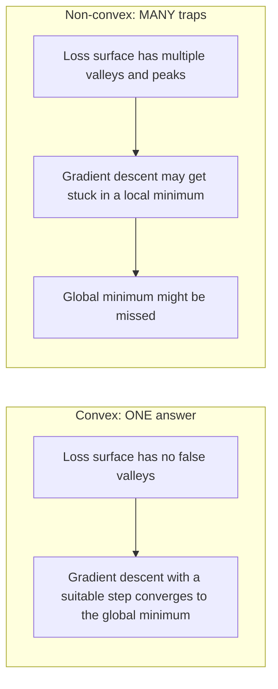
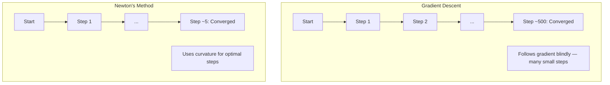
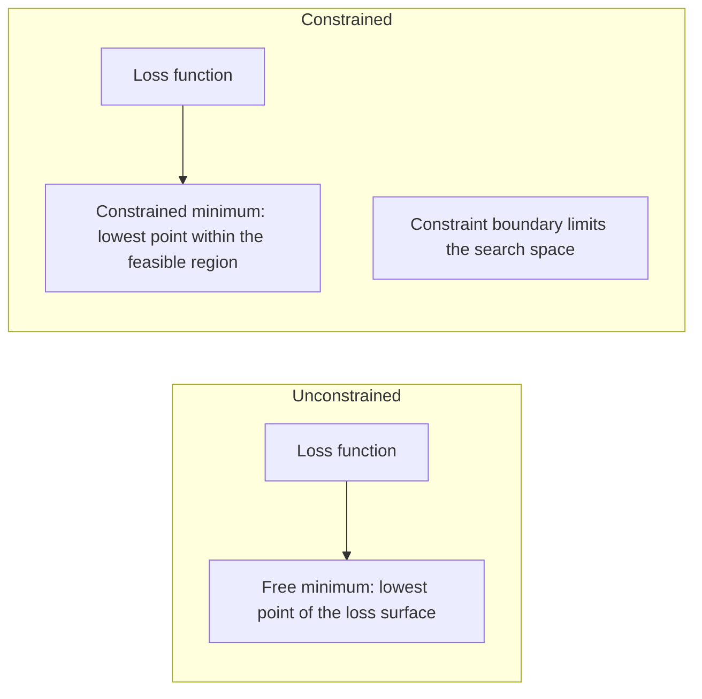
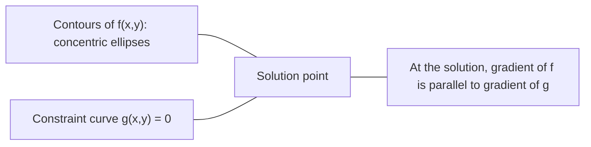

# Convex 最佳化 (Convex Optimization)

> Convex 問題只有一個山谷。Neural network 有數百萬個。知道其中的差別很重要。

**Type:** Build
**Language:** Python
**Prerequisites:** Phase 1, Lessons 04 (Calculus for ML), 08 (Optimization)
**Time:** ~90 分鐘

## 學習目標 (Learning Objectives)

- 用定義、二階 derivative 與 Hessian 準則，測試一個函數是否為 convex
- 實作 Newton's method，並比較它的 quadratic convergence 與 gradient descent
- 用 Lagrange multiplier 解有約束的最佳化問題，並解讀 KKT 條件
- 說明為什麼 neural network 的 loss landscape 是 non-convex，SGD 卻仍能找到好的解

## 問題 (The Problem)

Lesson 08 教了你 gradient descent、momentum 與 Adam。那些 optimizer 能在任何曲面上往下坡走。但它們沒有任何保證。在 non-convex 的 landscape 上做 gradient descent，可能會落入不好的 local minimum、卡在 saddle point，或永遠震盪。你還是用了它，因為 neural network 是 non-convex 的，沒有其他選擇。

但機器學習中有許多問題是 convex 的。Linear regression、logistic regression、SVM、LASSO、ridge regression。對這些問題，存在更強的東西：帶有數學保證的最佳化。Convex 問題沒有假的山谷：每個 local minimum 都是 global minimum。對於有 minimum 的平滑 convex 函數，使用適當步長的 gradient descent 會收斂到它。不需要重新啟動，不需要 learning rate schedule，也不需要祈禱。

理解 convexity 有三個作用。第一，它告訴你你的問題何時簡單（convex）、何時困難（non-convex）。第二，它給你像 Newton's method 這種針對 convex 問題更快的工具。第三，它解釋了 ML 中處處出現的概念：作為約束的 regularization、SVM 中的 duality，以及為什麼 deep learning 儘管違反 convexity 給你的每一項好處，卻仍然有效。

## 核心概念 (The Concept)

### Convex 集合 (Convex sets)

如果對集合 $S$ 中任意兩個點，連接它們的線段也完全位於 $S$ 中，則 $S$ 是 convex 集合。

| Convex 集合 | 非 convex |
|---|---|
| **長方形**：內部任兩點都能以一條留在內部的線段連接 | **星形/新月形**：兩個內部點之間的連線可能穿出集合之外 |
| **三角形**：所有內部點都具有相同的性質 | **甜甜圈/環形**：中間的洞表示有些線段會離開集合 |
| 任兩點之間的線段都留在集合之內 | 有些成對的點之間的線段會離開集合 |

正式的測試：對 $S$ 中任意點 $x, y$ 以及任意 $t \in [0, 1]$，點 $tx + (1-t)y$ 也在 $S$ 中。

Convex 集合的例子：
- 一條線、一個平面、整個 $\mathbb{R}^n$
- 一個球（圓、球面、超球面）
- 一個 halfspace：$\lbrace x : a^T x \le b \rbrace$
- 任意數量 convex 集合的交集

非 convex 集合的例子：
- 甜甜圈（環形）
- 兩個不相交的圓的聯集
- 任何有「凹陷」或「洞」的集合

### Convex 函數 (Convex functions)

如果函數 $f$ 的定義域是 convex 集合，且對定義域中任意兩點 $x, y$ 以及任意 $t \in [0, 1]$ 都有：

```math
f(tx + (1-t)y) \le t f(x) + (1-t) f(y)
```

幾何上：圖形上任意兩點之間的線段，位於圖形之上或與圖形重合。

| 性質 | Convex 函數 | 非 convex 函數 |
|---|---|---|
| **線段測試** | 圖形上任兩點之間的連線位於曲線**之上或與其重合** | 圖形上某些點之間的連線會落到曲線**之下** |
| **形狀** | 單一個向上彎曲的碗/山谷 | 有多個山峰與山谷，曲率混合 |
| **Local minimum** | 每個 local minimum 都是 global minimum | 可能存在多個高度不同的 local minimum |

常見的 convex 函數：
- $f(x) = x^2$（拋物線）
- $f(x) = \lvert x \rvert$（絕對值）
- $f(x) = e^x$（指數）
- $f(x) = \max(0, x)$（ReLU，雖然是分段線性）
- $f(x) = -\log(x)$，$x > 0$（負 log）
- 任何線性函數 $f(x) = a^T x + b$（同時是 convex 與 concave）

### 測試 convexity (Testing for convexity)

三個實用的測試，從最簡單到最嚴謹。

**測試 1：二階 derivative 測試（1D）。** 如果對所有 $x$ 都有 $f''(x) \ge 0$，則 $f$ 是 convex。

- $f(x) = x^2$：$f''(x) = 2 \ge 0$。Convex。
- $f(x) = x^3$：$f''(x) = 6x$。當 $x < 0$ 時為負。不是 convex。
- $f(x) = e^x$：$f''(x) = e^x > 0$。Convex。

**測試 2：Hessian 測試（多變量）。** 如果對所有 $x$，Hessian matrix $H(x)$ 都是 positive semidefinite，則 $f$ 是 convex。Hessian 是二階 partial derivative 組成的 matrix。

**測試 3：定義測試。** 直接檢查不等式 $f(tx + (1-t)y) \le t f(x) + (1-t) f(y)$。適用於 derivative 難以計算的函數。

### 為什麼 convexity 很重要 (Why convexity matters)

Convex 最佳化的核心定理：

**對 convex 函數而言，每個 local minimum 都是 global minimum。**

這代表 gradient descent 不會困在不好的 local minimum 裡。它所能到達的每個 minimum 都有相同的 loss。對於有 minimum 的平滑 convex 函數，使用適當步長的 gradient descent 保證收斂到最佳值。



後果：
- 不需要隨機重新啟動
- 不需要精密的 learning rate schedule
- 可以做收斂性證明（速率取決於函數的性質）
- 解是唯一的（除了平坦區域之外）

### ML 中的 convex 與 non-convex (Convex vs non-convex in ML)

| 問題 | Convex？ | 原因 |
|---------|---------|-----|
| Linear regression (MSE) | 是 | Loss 對 weight 是二次的 |
| Logistic regression | 是 | Log-loss 對 weight 是 convex |
| SVM (hinge loss) | 是 | 線性函數的最大值 |
| LASSO (L1 regression) | 是 | Convex 函數的和仍是 convex |
| Ridge regression (L2) | 是 | 二次 + 二次 = convex |
| Neural network（任何 loss） | 否 | 非線性 activation 造成 non-convex 的 landscape |
| k-means clustering | 否 | 離散的指派步驟 |
| Matrix factorization | 否 | 未知數的乘積 |

使用 convex loss 的線性模型是 convex 的。一旦你加入帶非線性 activation 的 hidden layer，convexity 就被破壞了。

### Hessian matrix (The Hessian matrix)

函數 $f: \mathbb{R}^n \to \mathbb{R}$ 的 Hessian $H$ 是由二階 partial derivative 組成的 $n \times n$ matrix。

```math
H_{ij} = \frac{\partial^2 f}{\partial x_i \, \partial x_j}
```

對 $f(x, y) = x^2 + 3xy + y^2$：

```math
\begin{gathered}
\begin{aligned}
\frac{\partial f}{\partial x} &= 2x + 3y & \frac{\partial^2 f}{\partial x^2} &= 2 & \frac{\partial^2 f}{\partial x \, \partial y} &= 3 \\
\frac{\partial f}{\partial y} &= 3x + 2y & \frac{\partial^2 f}{\partial y \, \partial x} &= 3 & \frac{\partial^2 f}{\partial y^2} &= 2
\end{aligned} \\[8pt]
H = \begin{bmatrix} 2 & 3 \\ 3 & 2 \end{bmatrix}
\end{gathered}
```

Hessian 告訴你曲率：
- Eigenvalue 全為正：函數在每個方向上都向上彎曲（在該點是 convex）
- Eigenvalue 全為負：在每個方向上都向下彎曲（concave，一個 local max）
- 正負混合：saddle point（在某些方向向上彎曲，在其他方向向下）
- Eigenvalue 為零：在該方向是平的（degenerate）

要有 convexity，Hessian 必須在處處（而不只是某一點）都是 positive semidefinite（所有 eigenvalue $\ge 0$）。

### Newton's method (Newton's method)

Gradient descent 使用一階資訊（gradient）。Newton's method 使用二階資訊（Hessian）。它在當前點擬合一個二次近似，並直接跳到那個二次函數的最小值。

```math
\begin{aligned}
\text{Update rule:} \quad & x_{\text{new}} = x - H^{-1} \cdot \text{gradient} \\
\text{Compare to gradient descent:} \quad & x_{\text{new}} = x - \text{lr} \cdot \text{gradient}
\end{aligned}
```

Newton's method 用 inverse Hessian 取代純量的 learning rate。這會根據局部曲率自動調整步長與方向。



優點：
- 在 minimum 附近有 quadratic convergence（誤差每一步都平方）
- 沒有 learning rate 需要調整
- 具尺度不變性（不論你如何參數化問題都有效）

缺點：
- 計算 Hessian 需要 $O(n^2)$ 記憶體，求反需要 $O(n^3)$
- 對一個有 100 萬個 weight 的 neural network，那是 $10^{12}$ 個元素與 $10^{18}$ 次運算
- 不適用於 deep learning

### 有約束的最佳化 (Constrained optimization)

無約束最佳化：在所有 $x$ 上最小化 $f(x)$。
有約束最佳化：在約束條件下最小化 $f(x)$。

真實的問題都有約束。你想最小化成本，但預算有限。你想最小化誤差，但模型複雜度有上限。



### Lagrange multiplier (Lagrange multipliers)

Lagrange multiplier 方法把有約束的問題轉換成無約束的問題。

問題：在 $g(x) = 0$ 的條件下最小化 $f(x)$。

解法：引入一個新變數（Lagrange multiplier $\lambda$），並解無約束的問題：

```math
L(x, \lambda) = f(x) + \lambda g(x)
```

在解處，$L$ 的 gradient 為零：

```math
\begin{aligned}
\frac{\partial L}{\partial x} &= \frac{\partial f}{\partial x} + \lambda \frac{\partial g}{\partial x} = 0 \\
\frac{\partial L}{\partial \lambda} &= g(x) = 0
\end{aligned}
```

幾何直覺：在有約束的 minimum 處，$f$ 的 gradient 必須與約束 $g$ 的 gradient 平行。如果它們不平行，你就可以沿著約束曲面移動並進一步降低 $f$。



範例：在 $x + y = 1$ 的條件下最小化 $f(x,y) = x^2 + y^2$。

```math
\begin{aligned}
L &= x^2 + y^2 + \lambda(x + y - 1) \\[4pt]
\frac{\partial L}{\partial x} &= 2x + \lambda = 0 \implies x = -\lambda/2 \\
\frac{\partial L}{\partial y} &= 2y + \lambda = 0 \implies y = -\lambda/2 \\
\frac{\partial L}{\partial \lambda} &= x + y - 1 = 0 \\[4pt]
&\text{From first two: } x = y \\
&\text{Substituting: } 2x = 1, \text{ so } x = y = 0.5, \ \lambda = -1
\end{aligned}
```

直線 $x + y = 1$ 上離原點最近的點是 $(0.5, 0.5)$。

### KKT 條件 (KKT conditions)

Karush-Kuhn-Tucker 條件把 Lagrange multiplier 擴展到不等式約束。

問題：在 $g_i(x) \le 0$（$i = 1, \ldots, m$）的條件下最小化 $f(x)$。

KKT 條件（最佳性的必要條件）：

```math
\begin{aligned}
&\text{1. Stationarity:} && \frac{\partial f}{\partial x} + \sum_i \lambda_i \frac{\partial g_i}{\partial x} = 0 \\
&\text{2. Primal feasibility:} && g_i(x) \le 0 \quad \text{for all } i \\
&\text{3. Dual feasibility:} && \lambda_i \ge 0 \quad \text{for all } i \\
&\text{4. Complementary slackness:} && \lambda_i \, g_i(x) = 0 \quad \text{for all } i
\end{aligned}
```

Complementary slackness 是關鍵洞見：不是約束處於作用狀態 ($g_i = 0$，解位於邊界上)，就是 multiplier 為零（約束不重要）。不影響解的約束，其 $\lambda = 0$。

KKT 條件是 SVM 的核心。Support vector 是約束處於作用狀態 ($\lambda > 0$) 的資料點。所有其他資料點的 $\lambda = 0$，不影響 decision boundary。

### 把 regularization 看成有約束的最佳化 (Regularization as constrained optimization)

L1 和 L2 regularization 不是任意的小技巧。它們其實是披著外衣的有約束最佳化問題。

**L2 regularization (Ridge)：**

```math
\begin{aligned}
&\text{minimize } \text{Loss}(w) \text{ subject to } \lVert w \rVert^2 \le t \\[4pt]
&\text{Equivalent unconstrained form:} \\
&\text{minimize } \text{Loss}(w) + \lambda \lVert w \rVert^2
\end{aligned}
```

約束 $\lVert w \rVert^2 \le t$ 定義了一個球（2D 中是圓，3D 中是球面）。解就是 loss 等高線第一次碰到這個球的地方。

**L1 regularization (LASSO)：**

```math
\begin{aligned}
&\text{minimize } \text{Loss}(w) \text{ subject to } \lVert w \rVert_1 \le t \\[4pt]
&\text{Equivalent unconstrained form:} \\
&\text{minimize } \text{Loss}(w) + \lambda \lVert w \rVert_1
\end{aligned}
```

約束 $\lVert w \rVert_1 \le t$ 定義了一個菱形（2D 中旋轉的正方形）。

| 性質 | L2 約束（圓） | L1 約束（菱形） |
|---|---|---|
| **約束形狀** | 圓（更高維度中是球） | 菱形（2D 中旋轉的正方形） |
| **Loss 等高線接觸的位置** | 平滑的邊界：圓上的任何點 | 角落：與某條軸對齊 |
| **解的行為** | Weight 很小但不為零 | 有些 weight 恰好為零（稀疏） |
| **結果** | Weight 收縮 | Feature selection |

這解釋了為什麼 L1 產生稀疏模型（feature selection），而 L2 只是收縮 weight。菱形的角落與軸對齊。Loss 等高線比較可能碰到角落，把一個或多個 weight 設成恰好為零。

### Duality (Duality)

每個有約束的最佳化問題（primal）都有一個伴隨的問題（dual）。對 convex 問題，primal 和 dual 有相同的最佳值。這就是 strong duality。

Lagrangian dual 函數：

```math
\begin{aligned}
&\text{Primal:} && \text{minimize } f(x) \text{ subject to } g(x) \le 0 \\
&\text{Lagrangian:} && L(x, \lambda) = f(x) + \lambda g(x) \\
&\text{Dual function:} && d(\lambda) = \min_x L(x, \lambda) \\
&\text{Dual problem:} && \text{maximize } d(\lambda) \text{ subject to } \lambda \ge 0
\end{aligned}
```

為什麼 duality 很重要：
- Dual 問題有時比 primal 更容易解
- SVM 是以 dual 形式求解的，其問題取決於資料點之間的 dot product（讓 kernel trick 成為可能）
- Dual 提供 primal 最佳值的下界，可用於檢查解的品質

專門針對 SVM：

```
Primal: find w, b that maximize the margin 2/||w|| subject to
        y_i(w^T x_i + b) >= 1 for all i

Dual:   maximize sum(alpha_i) - 0.5 * sum_ij(alpha_i * alpha_j * y_i * y_j * x_i^T x_j)
        subject to alpha_i >= 0 and sum(alpha_i * y_i) = 0

The dual only involves dot products x_i^T x_j.
Replace x_i^T x_j with K(x_i, x_j) to get the kernel trick.
```

### 為什麼 deep learning 儘管是 non-convex 卻有效 (Why deep learning works despite non-convexity)

Neural network 的 loss function 極度 non-convex。依照所有古典的標準，最佳化它們應該會失敗。然而 stochastic gradient descent 卻能穩定地找到好的解。有幾個因素解釋了這一點。

**大多數 local minimum 已經夠好了。** 在高維空間中，隨機的 critical point（gradient 為零之處）絕大多數是 saddle point，而不是 local minimum。少數存在的 local minimum，其 loss 值往往接近 global minimum。當參數空間有數百萬個維度時，困在糟糕的 local minimum 中是極不可能的。

**真正的障礙是 saddle point，不是 local minimum。** 在有 $n$ 個參數的函數中，saddle point 同時有正與負的曲率方向。對高維空間中的隨機 critical point，所有 $n$ 個 eigenvalue 都為正（local minimum）的機率大約是 $2^{-n}$。幾乎所有 critical point 都是 saddle point。SGD 的雜訊有助於跳出它們。

**Overparameterization 讓 landscape 變平滑。** 參數比訓練樣本多的網路，有更平滑、連通性更好的 loss 曲面。更寬的網路有更少不好的 local minimum。這違反直覺，但在經驗上是一致的。

**Loss landscape 的結構：**

| 性質 | 低維空間 | 高維空間 |
|---|---|---|
| **Landscape** | 許多孤立的山峰與山谷 | 平滑連通的山谷 |
| **Minima** | 許多孤立的 local minimum | 不好的 local minimum 很少；大多接近最佳 |
| **導航** | 難以找到 global minimum | 許多路徑都通往好的解 |
| **Critical point** | local minimum 與 saddle point 混合 | 絕大多數是 saddle point，而非 local minimum |

**Stochastic 雜訊充當隱含的 regularization。** Mini-batch SGD 加入的雜訊，避免停在尖銳的 minimum。尖銳的 minimum 會 overfit；平坦的 minimum 能泛化。雜訊讓最佳化偏向 loss landscape 中平坦的區域。

### 實務上的二階方法 (Second-order methods in practice)

純粹的 Newton's method 對大型模型不切實際。有幾種近似法讓二階資訊變得可用。

**L-BFGS (Limited-memory BFGS)：** 用最近 $m$ 次 gradient 差來近似 inverse Hessian。需要 $O(mn)$ 記憶體，而不是 $O(n^2)$。對最多約 10,000 個參數的問題效果良好。用於傳統 ML（logistic regression、CRF），但不用於 deep learning。

**Natural gradient：** 使用 Fisher information matrix（log-likelihood 的期望 Hessian）取代標準的 Hessian。這考慮了機率分佈的幾何結構。K-FAC (Kronecker-Factored Approximate Curvature) 把 Fisher matrix 近似為 Kronecker 積，使其適用於 neural network。

**Hessian-free 最佳化：** 使用 conjugate gradient 解 $Hx = g$，完全不形成 $H$。只需要 Hessian-vector product，可透過 automatic differentiation 在 $O(n)$ 時間內計算。

**對角近似：** Adam 的二階 moment 是 Hessian 對角線的對角近似。AdaHessian 透過 Hutchinson estimator 使用實際的 Hessian 對角元素，擴充了這個做法。

| 方法 | 記憶體 | 每步成本 | 何時使用 |
|--------|--------|--------------|-------------|
| Gradient descent | $O(n)$ | $O(n)$ | 基準、大型模型 |
| Newton's method | $O(n^2)$ | $O(n^3)$ | 小型 convex 問題 |
| L-BFGS | $O(mn)$ | $O(mn)$ | 中型 convex 問題 |
| Adam | $O(n)$ | $O(n)$ | Deep learning 的預設選擇 |
| K-FAC | $O(n)$ | 每層 $O(n)$ | 研究、大 batch 訓練 |

```figure
convex-vs-nonconvex
```

## 動手做 (Build It)

### 步驟 1：Convexity 檢查器

建立一個函式，透過取樣點並檢查定義，以經驗方式測試 convexity。

```python
import random
import math

def check_convexity(f, dim, bounds=(-5, 5), samples=1000):
    violations = 0
    for _ in range(samples):
        x = [random.uniform(*bounds) for _ in range(dim)]
        y = [random.uniform(*bounds) for _ in range(dim)]
        t = random.uniform(0, 1)
        mid = [t * xi + (1 - t) * yi for xi, yi in zip(x, y)]
        lhs = f(mid)
        rhs = t * f(x) + (1 - t) * f(y)
        if lhs > rhs + 1e-10:
            violations += 1
    return violations == 0, violations
```

### 步驟 2：2D 的 Newton's method

用明確的 Hessian 實作 Newton's method。比較它與 gradient descent 的收斂速度。

```python
def newtons_method(f, grad_f, hessian_f, x0, steps=50, tol=1e-12):
    x = list(x0)
    history = [x[:]]
    for _ in range(steps):
        g = grad_f(x)
        H = hessian_f(x)
        det = H[0][0] * H[1][1] - H[0][1] * H[1][0]
        if abs(det) < 1e-15:
            break
        H_inv = [
            [H[1][1] / det, -H[0][1] / det],
            [-H[1][0] / det, H[0][0] / det],
        ]
        dx = [
            H_inv[0][0] * g[0] + H_inv[0][1] * g[1],
            H_inv[1][0] * g[0] + H_inv[1][1] * g[1],
        ]
        x = [x[0] - dx[0], x[1] - dx[1]]
        history.append(x[:])
        if sum(gi ** 2 for gi in g) < tol:
            break
    return history
```

### 步驟 3：Lagrange multiplier 求解器

對 Lagrangian 做 gradient descent，來解有約束的最佳化。

```python
def lagrange_solve(f_grad, g_val, g_grad, x0, lr=0.01,
                   lr_lambda=0.01, steps=5000):
    x = list(x0)
    lam = 0.0
    history = []
    for _ in range(steps):
        fg = f_grad(x)
        gv = g_val(x)
        gg = g_grad(x)
        x = [
            xi - lr * (fgi + lam * ggi)
            for xi, fgi, ggi in zip(x, fg, gg)
        ]
        lam = lam + lr_lambda * gv
        history.append((x[:], lam, gv))
    return history
```

### 步驟 4：比較一階與二階方法

在同一個二次函數上執行 gradient descent 與 Newton's method。計算收斂所需的步數。

```python
def quadratic(x):
    return 5 * x[0] ** 2 + x[1] ** 2

def quadratic_grad(x):
    return [10 * x[0], 2 * x[1]]

def quadratic_hessian(x):
    return [[10, 0], [0, 2]]
```

Newton's method 會在 1 步內收斂（對二次函數它是精確的）。Gradient descent 會需要數百步，因為 Hessian 的 eigenvalue 相差 5 倍，造成一個被拉長的山谷。

## 實際使用 (Use It)

Convexity 分析可直接應用於選擇 ML 模型與求解器。

對 convex 問題（logistic regression、SVM、LASSO）：
- 使用專用的求解器（liblinear、CVXPY、搭配 method='L-BFGS-B' 的 scipy.optimize.minimize）
- 預期有唯一的 global 解
- 二階方法既實用又快

對 non-convex 問題（neural network）：
- 使用一階方法（SGD、Adam）
- 接受解取決於初始化與隨機性
- 使用 overparameterization、雜訊與 learning rate schedule 作為隱含的 regularization
- 不要浪費時間去搜尋 global minimum。一個好的 local minimum 就夠了。

```python
from scipy.optimize import minimize

result = minimize(
    fun=lambda w: sum((y - X @ w) ** 2) + 0.1 * sum(w ** 2),
    x0=np.zeros(d),
    method='L-BFGS-B',
    jac=lambda w: -2 * X.T @ (y - X @ w) + 0.2 * w,
)
```

對 SVM，dual 形式讓你能使用 kernel trick：

```python
from sklearn.svm import SVC

svm = SVC(kernel='rbf', C=1.0)
svm.fit(X_train, y_train)
print(f"Support vectors: {svm.n_support_}")
```

## 練習 (Exercises)

1. **Convexity 圖鑑。** 用檢查器測試這些函數是否為 convex：$f(x) = x^4$、$f(x) = \sin(x)$、$f(x,y) = x^2 + y^2$、$f(x,y) = xy$、$f(x) = \max(x, 0)$。解釋為什麼每個結果都說得通。

2. **Newton 對 gradient descent 的競賽。** 從起點 $(10, 10)$ 對 $f(x,y) = 50x^2 + y^2$ 執行這兩種方法。各需要多少步才能讓 loss < 1e-10？當 condition number（最大與最小 Hessian eigenvalue 的比值）增加時，gradient descent 會發生什麼事？

3. **Lagrange multiplier 的幾何。** 在 $x + 2y = 4$ 的條件下最小化 $f(x,y) = (x-3)^2 + (y-3)^2$。透過檢查在解處 $f$ 的 gradient 是否與 $g$ 的 gradient 平行，來驗證解。

4. **Regularization 約束。** 實作 L1 約束的最佳化：在 $\lvert x \rvert + \lvert y \rvert \le 1$ 的條件下最小化 $(x-3)^2 + (y-2)^2$。證明解有一個座標等於零（來自菱形約束的稀疏性）。

5. **Hessian eigenvalue 分析。** 計算 Rosenbrock 函數在 (1,1) 和 (-1,1) 處的 Hessian。計算兩點的 eigenvalue。這些 eigenvalue 告訴你 minimum 處與遠離 minimum 處的曲率有什麼差別？

### 提示 (Hints)

**練習 1。** 執行 `check_convexity` 之前先預測每個結果：在一維中，看 $f''(x)$ 的正負號；在二維中，看 Hessian 的 eigenvalue。對 $f(x,y) = xy$，Hessian 的 eigenvalue 是 1 和 -1，所以檢查器必須回報它不是 convex。

**練習 2。** 用 $f$ 的 gradient 和 Hessian 呼叫 `optimize_gd` 和 `newtons_method`。Newton's method 一步就能解二次函數。對 gradient descent 來說，由於 $50x^2$ 這一項，learning rate 必須小於 $2/100$，所以 $y$ 方向移動得很慢。用 $100x^2$ 重複一次，再計算一次步數。

**練習 3。** 以 $g(x,y) = x + 2y - 4$ 使用 `lagrange_solve`。在答案處，檢查 $x + 2y = 4$，且 $\nabla f = (2(x-3), 2(y-3))$ 是 $\nabla g = (1, 2)$ 的倍數。

**練習 4。** 無約束的 minimum (3, 2) 在菱形之外，所以答案在它的邊界上。使用 projected gradient descent：先走一步 gradient，再投影回 $\lvert x \rvert + \lvert y \rvert \le 1$。檢查結果使約束式取等號，並與 `demo_regularization_geometry` 比較。

**練習 5。** 在每個點呼叫 `rosenbrock_hessian`，並把結果傳給 `hessian_eigenvalues_2d`。在 (1, 1) 處，兩個 eigenvalue 都是正的，而且比值非常大，所以山谷在一個方向上狹窄、在另一個方向上平坦。把那個比值與 (-1, 1) 處的比值比較。

## 關鍵術語 (Key Terms)

| 術語 | 意義 |
|------|---------------|
| Convex set | 集合中任兩點之間的線段都留在集合內的集合 |
| Convex function | 圖形上任兩點之間的連線位於圖形之上或與其重合的函數。等價地說，Hessian 在處處都是 positive semidefinite |
| Local minimum | 比所有鄰近點都低的點。對 convex 函數而言，每個 local minimum 都是 global minimum |
| Global minimum | 函數在整個定義域上的最低點 |
| Hessian matrix | 所有二階 partial derivative 組成的 matrix。編碼曲率資訊 |
| Positive semidefinite | eigenvalue 全部不為負的 matrix。是「二階 derivative >= 0」的多維類比 |
| Condition number | Hessian 最大與最小 eigenvalue 的比值。Condition number 高代表山谷被拉長，gradient descent 變慢 |
| Newton's method | 使用 inverse Hessian 決定步伐方向與大小的二階 optimizer。在 minimum 附近有 quadratic convergence |
| Lagrange multiplier | 為了把有約束的最佳化問題轉換成無約束問題而引入的變數 |
| KKT conditions | 有不等式約束時最佳性的必要條件。是 Lagrange multiplier 的推廣 |
| Complementary slackness | 在解處，不是約束處於作用狀態，就是它的 multiplier 為零。兩者不會同時非零 |
| Duality | 每個有約束的問題都有一個伴隨的 dual 問題。對 convex 問題，兩者有相同的最佳值 |
| Strong duality | Primal 與 dual 的最佳值相等。對滿足 Slater 條件的 convex 問題成立 |
| L-BFGS | 近似的二階方法，儲存最近 $m$ 次 gradient 差，而不是完整的 Hessian |
| Saddle point | Gradient 為零，但在某些方向是 minimum、在其他方向是 maximum 的點 |
| Overparameterization | 使用比訓練樣本更多的參數。讓 loss landscape 變平滑，並減少不好的 local minimum |

## 延伸閱讀 (Further Reading)

- [Boyd & Vandenberghe: Convex Optimization](https://web.stanford.edu/~boyd/cvxbook/) - 標準教科書，可在網路上免費取得
- [Bottou, Curtis, Nocedal: Optimization Methods for Large-Scale Machine Learning (2018)](https://arxiv.org/abs/1606.04838) - 連結 convex 最佳化理論與 deep learning 實務
- [Choromanska et al.: The Loss Surfaces of Multilayer Networks (2015)](https://arxiv.org/abs/1412.0233) - 為什麼 non-convex 的 neural network landscape 沒有看起來那麼糟
- [Nocedal & Wright: Numerical Optimization](https://link.springer.com/book/10.1007/978-0-387-40065-5) - 涵蓋 Newton's method、L-BFGS 與有約束最佳化的完整參考書
