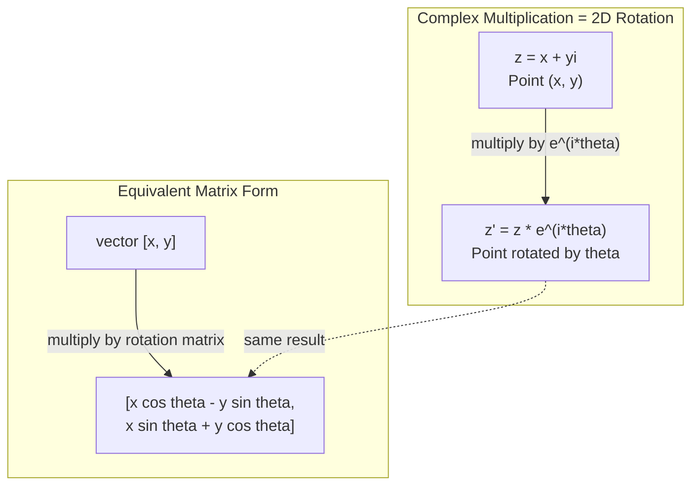
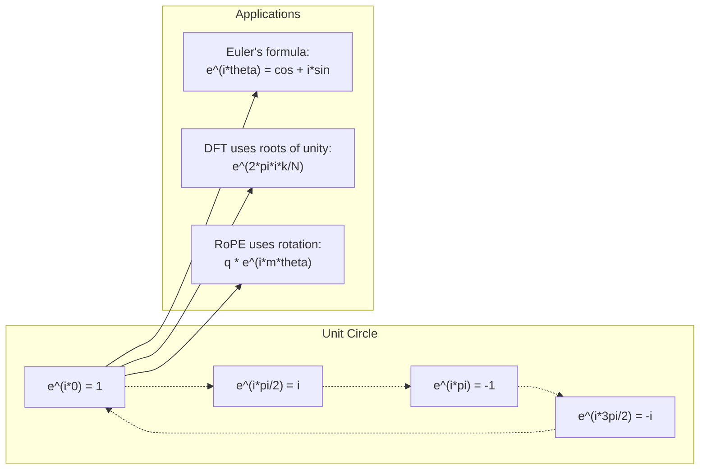

# AI 的複數 (Complex Numbers for AI)

> -1 的平方根並不「虛」。它是旋轉、頻率，以及一半訊號處理的關鍵。

**Type:** Learn
**Language:** Python
**Prerequisites:** Phase 1, Lessons 01-04 (linear algebra, calculus)
**Time:** ~60 分鐘

## 學習目標 (Learning Objectives)

- 以直角座標形式與極座標形式，執行複數運算（加、乘、除、共軛）
- 運用 Euler's formula，在複數指數與三角函數之間轉換
- 利用單位根 (roots of unity) 實作 Discrete Fourier Transform
- 說明複數旋轉如何構成 transformer 中 RoPE 與 sinusoidal positional encoding 的基礎

## 問題 (The Problem)

你打開一篇談 Fourier transform 的論文，到處都是 `i`。你看 transformer 的 positional encoding，看到不同頻率的 `sin` 和 `cos`，它們是複數指數的實部與虛部。你讀到量子運算，發現一切都用複數向量空間來表達。

複數看起來很抽象。一個建立在 -1 的平方根之上的數系，感覺像個數學把戲。但它不是把戲。它是旋轉與振盪的天然語言。每當有東西在旋轉、震動或振盪，複數就是正確的工具。

不懂複數，你就無法理解 Discrete Fourier Transform。你無法理解 FFT。你無法理解 RoPE (Rotary Position Embedding) 在現代語言模型中如何運作。你也無法理解為什麼原始 Transformer 論文中的 sinusoidal positional encoding 要使用那些頻率。

這堂課從零打造複數運算，把它連結到幾何，並精確地告訴你複數在機器學習中出現在哪裡。

## 核心概念 (The Concept)

### 什麼是複數？ (What is a complex number?)

複數有兩個部分：實部與虛部。

```
z = a + bi

where:
  a is the real part
  b is the imaginary part
  i is the imaginary unit, defined by i^2 = -1
```

就是這樣。你把數線延伸成一個平面。實數放在一條軸上，虛數放在另一條軸上。每個複數都是這個平面上的一個點。

### 複數運算 (Complex arithmetic)

**加法。** 實部相加，虛部相加。

```math
\begin{aligned}
(a + bi) + (c + di) &= (a + c) + (b + d)i \\[4pt]
\text{Example: } (3 + 2i) + (1 + 4i) &= 4 + 6i
\end{aligned}
```

**乘法。** 使用分配律，並記得 $i^2 = -1$。

```math
\begin{aligned}
(a + bi)(c + di) &= ac + adi + bci + bdi^2 \\
&= ac + adi + bci - bd \\
&= (ac - bd) + (ad + bc)i \\[8pt]
\text{Example: } (3 + 2i)(1 + 4i) &= 3 + 12i + 2i + 8i^2 \\
&= 3 + 14i - 8 \\
&= -5 + 14i
\end{aligned}
```

**共軛 (Conjugate)。** 翻轉虛部的正負號。

```math
\text{conjugate of } (a + bi) = a - bi
```

複數與它的共軛的乘積永遠是實數：

```math
(a + bi)(a - bi) = a^2 + b^2
```

**除法。** 把分子與分母同乘以分母的共軛。

```math
\frac{a + bi}{c + di} = \frac{(a + bi)(c - di)}{c^2 + d^2}
```

這會消除分母中的虛部，給你一個乾淨的複數。

### 複數平面 (The complex plane)

複數平面把每個複數對應到一個 2D 的點。水平軸是實軸，垂直軸是虛軸。

```
z = 3 + 2i  corresponds to the point (3, 2)
z = -1 + 0i corresponds to the point (-1, 0) on the real axis
z = 0 + 4i  corresponds to the point (0, 4) on the imaginary axis
```

複數同時是一個點，也是一個從原點出發的 vector。這種雙重詮釋讓複數在幾何上很有用。

### 極座標形式 (Polar form)

平面上的任何點，都可以用它與原點的距離，以及它與正實軸的夾角來描述。

```math
\begin{aligned}
z &= r (\cos\theta + i \sin\theta) \\[4pt]
\text{where: } r &= |z| = \sqrt{a^2 + b^2} \quad \text{(magnitude, or modulus)} \\
\theta &= \mathop{\mathrm{atan2}}(b, a) \quad \text{(phase, or argument)}
\end{aligned}
```

直角座標形式 $(a + bi)$ 適合做加法。極座標形式 $(r, \theta)$ 適合做乘法。

**極座標形式的乘法。** 大小相乘，角度相加。

```math
\begin{aligned}
z_1 &= r_1 e^{i\theta_1} \\
z_2 &= r_2 e^{i\theta_2} \\[4pt]
z_1 z_2 &= (r_1 r_2) \, e^{i(\theta_1 + \theta_2)}
\end{aligned}
```

這就是複數非常適合處理旋轉的原因。乘以一個大小為 1 的複數，就是純粹的旋轉。

### Euler's formula (Euler's formula)

連結複數指數與三角函數的橋樑：

```math
e^{i\theta} = \cos\theta + i \sin\theta
```

這是這堂課最重要的公式。當 $\theta = \pi$ 時：

```math
\begin{aligned}
e^{i\pi} &= \cos\pi + i \sin\pi = -1 + 0i = -1 \\[4pt]
\text{Therefore: } e^{i\pi} + 1 &= 0
\end{aligned}
```

五個基本常數（$e$、$i$、$\pi$、1、0）被連結在同一個方程式中。

### 為什麼 Euler's formula 對 ML 很重要 (Why Euler's formula matters for ML)

Euler's formula 說明，當 $\theta$ 變化時，$e^{i\theta}$ 會描出單位圓。在 $\theta = 0$ 時，你在 $(1, 0)$。在 $\theta = \pi/2$ 時，你在 $(0, 1)$。在 $\theta = \pi$ 時，你在 $(-1, 0)$。在 $\theta = 3\pi/2$ 時，你在 $(0, -1)$。完整的一圈是 $\theta = 2\pi$。

這代表複數指數就是旋轉。而旋轉在訊號處理和 ML 中無所不在。

### 與 2D 旋轉的關聯 (Connection to 2D rotations)

把複數 $(x + yi)$ 乘上 $e^{i\theta}$，會把點 $(x, y)$ 繞原點旋轉角度 $\theta$。

```math
\begin{aligned}
&\text{Rotation via complex multiplication:} \\
&\quad (x + yi)(\cos\theta + i \sin\theta) = (x \cos\theta - y \sin\theta) + (x \sin\theta + y \cos\theta)i \\[8pt]
&\text{Rotation via matrix multiplication:} \\
&\quad \begin{bmatrix} \cos\theta & -\sin\theta \\ \sin\theta & \cos\theta \end{bmatrix} \begin{bmatrix} x \\ y \end{bmatrix} = \begin{bmatrix} x \cos\theta - y \sin\theta \\ x \sin\theta + y \cos\theta \end{bmatrix}
\end{aligned}
```

它們產生完全相同的結果。複數乘法就是 2D 旋轉。旋轉 matrix 其實只是用 matrix 記號寫出的複數乘法。



### Phasor 與旋轉訊號 (Phasors and rotating signals)

複數指數 $e^{i\omega t}$ 是一個以角頻率 $\omega$ 繞著單位圓旋轉的點。隨著 $t$ 增加，這個點描出整個圓。

這個旋轉點的實部是 $\cos(\omega t)$，虛部是 $\sin(\omega t)$。正弦訊號就是旋轉複數的影子。

```math
\begin{aligned}
e^{i\omega t} &= \cos(\omega t) + i \sin(\omega t) \\[4pt]
\text{Real part: } & \cos(\omega t) \quad \text{-- a cosine wave} \\
\text{Imaginary part: } & \sin(\omega t) \quad \text{-- a sine wave}
\end{aligned}
```

這就是 phasor 表示法。與其追蹤一條搖擺的正弦波，你追蹤的是一支平滑旋轉的箭頭。相位偏移變成角度偏移。振幅變化變成大小變化。訊號相加變成 vector 相加。

### 單位根 (Roots of unity)

第 $N$ 個單位根，是單位圓上 $N$ 個等距分布的點：

```math
w_k = e^{2\pi i k/N} \quad \text{for } k = 0, 1, 2, \ldots, N-1
```

當 $N = 4$ 時，這些根是：$1, i, -1, -i$（四個羅盤方位）。
當 $N = 8$ 時，你會得到四個羅盤方位，再加上四個對角方向。

單位根是 Discrete Fourier Transform 的基礎。DFT 把訊號分解成這 $N$ 個等間距頻率上的成分。

### 與 DFT 的關聯 (Connection to the DFT)

訊號 $x[0], x[1], \ldots, x[N-1]$ 的 Discrete Fourier Transform 是：

```math
X[k] = \sum_{n=0}^{N-1} x[n] \, e^{-2\pi i k n/N}
```

每個 $X[k]$ 衡量訊號與第 $k$ 個單位根（頻率為 $k$ 的複數正弦波）的相關程度。DFT 把訊號拆成 $N$ 個旋轉的 phasor，並告訴你每一個的振幅與相位。

### 為什麼 i 並不「虛」 (Why i is not imaginary)

「虛數 (imaginary)」這個詞是歷史上的意外。Descartes 是帶著輕蔑使用它的。但 $i$ 並不比人們最初拒絕時的負數更「虛」。負數回答的是「3 要減去多少才能得到 5？」虛數單位回答的是「什麼數平方後會得到 -1？」

更實用的看法是：$i$ 是一個 90 度的旋轉運算子。把實數乘以 $i$ 一次，你會旋轉 90 度到虛軸上。再乘以 $i$ 一次 ($i^2$)，你又旋轉 90 度，現在指向負實數的方向。這就是 $i^2 = -1$ 的原因。這並不神祕。它是由兩個四分之一轉組成的半圈。

這就是複數在工程中無所不在的原因。任何會旋轉的東西，電磁波、量子態、訊號振盪、positional encoding，都能自然地用複數描述。

### 複數指數與三角函數 (Complex exponentials vs trigonometric functions)

在 Euler's formula 之前，工程師把訊號寫成 $A \cos(\omega t + \phi)$，也就是振幅 $A$、頻率 $\omega$、相位 $\phi$。這樣可行，但讓運算很痛苦。把兩個相位不同的 cosine 相加，需要三角恆等式。

用複數指數，同一個訊號是 $A e^{i(\omega t + \phi)}$。把兩個訊號相加，就只是把兩個複數相加。相乘（調變）就只是大小相乘、角度相加。相位偏移變成角度相加。頻率偏移變成乘以 phasor。

整個訊號處理領域都改用複數指數記號，因為數學更乾淨。「真實的訊號」永遠只是複數表示法的實部。虛部是為了記帳而一路帶著的，讓所有代數自然地運作。

### 與 transformer 的關聯 (Connection to transformers)

**Sinusoidal positional encoding**（原始 Transformer 論文）：

```math
\begin{aligned}
PE(pos, 2i) &= \sin\left(pos / 10000^{2i/d}\right) \\
PE(pos, 2i+1) &= \cos\left(pos / 10000^{2i/d}\right)
\end{aligned}
```

這些 sin 與 cos 的配對，是不同頻率的複數指數的實部與虛部。每個頻率提供不同的「解析度」來編碼位置。低頻變化緩慢（粗略的位置），高頻變化快速（精細的位置）。合在一起，它們為每個位置提供獨一無二的頻率指紋。

**RoPE (Rotary Position Embedding)** 更進一步。它明確地把 query 和 key vector 乘上複數旋轉 matrix。兩個 token 之間的相對位置變成一個旋轉角度。Attention 是用這些旋轉後的 vector 計算的，讓模型透過複數乘法對相對位置變得敏感。

| 運算 | 代數形式 | 幾何意義 |
|-----------|---------------|-------------------|
| 加法 | $(a+c) + (b+d)i$ | 平面上的 vector 加法 |
| 乘法 | $(ac-bd) + (ad+bc)i$ | 旋轉並縮放 |
| 共軛 | $a - bi$ | 對實軸鏡射 |
| 大小 (Magnitude) | $\sqrt{a^2 + b^2}$ | 與原點的距離 |
| 相位 (Phase) | $\mathop{\mathrm{atan2}}(b, a)$ | 與正實軸的夾角 |
| 除法 | 乘以共軛 | 反向旋轉並重新縮放 |
| 次方 | $r^n e^{in\theta}$ | 旋轉 $n$ 次，縮放 $r^n$ |



```figure
roots-of-unity
```

## 動手做 (Build It)

### 步驟 1：Complex class

打造一個 Complex 數字 class，支援運算、大小、相位，以及直角座標與極座標形式之間的轉換。

```python
import math

class Complex:
    def __init__(self, real, imag=0.0):
        self.real = real
        self.imag = imag

    def __add__(self, other):
        return Complex(self.real + other.real, self.imag + other.imag)

    def __mul__(self, other):
        r = self.real * other.real - self.imag * other.imag
        i = self.real * other.imag + self.imag * other.real
        return Complex(r, i)

    def __truediv__(self, other):
        denom = other.real ** 2 + other.imag ** 2
        r = (self.real * other.real + self.imag * other.imag) / denom
        i = (self.imag * other.real - self.real * other.imag) / denom
        return Complex(r, i)

    def magnitude(self):
        return math.sqrt(self.real ** 2 + self.imag ** 2)

    def phase(self):
        return math.atan2(self.imag, self.real)

    def conjugate(self):
        return Complex(self.real, -self.imag)
```

### 步驟 2：極座標轉換與 Euler's formula

```python
def to_polar(z):
    return z.magnitude(), z.phase()

def from_polar(r, theta):
    return Complex(r * math.cos(theta), r * math.sin(theta))

def euler(theta):
    return Complex(math.cos(theta), math.sin(theta))
```

驗證：`euler(theta).magnitude()` 應該永遠是 1.0。`euler(0)` 應該給出 (1, 0)。`euler(pi)` 應該給出 (-1, 0)。

### 步驟 3：旋轉

把點 $(x, y)$ 旋轉角度 $\theta$，只需要一次複數乘法：

```python
point = Complex(3, 4)
rotated = point * euler(math.pi / 4)
```

大小保持不變。只有角度改變。

### 步驟 4：用複數運算做 DFT

```python
def dft(signal):
    N = len(signal)
    result = []
    for k in range(N):
        total = Complex(0, 0)
        for n in range(N):
            angle = -2 * math.pi * k * n / N
            total = total + Complex(signal[n], 0) * euler(angle)
        result.append(total)
    return result
```

這是 $O(N^2)$ 的 DFT。每個輸出 $X[k]$ 是訊號樣本乘上單位根之後的總和。

### 步驟 5：Inverse DFT

Inverse DFT 從頻譜重建原始訊號。與 forward DFT 唯一的差別：把指數中的正負號翻轉，並除以 $N$。

```python
def idft(spectrum):
    N = len(spectrum)
    result = []
    for n in range(N):
        total = Complex(0, 0)
        for k in range(N):
            angle = 2 * math.pi * k * n / N
            total = total + spectrum[k] * euler(angle)
        result.append(Complex(total.real / N, total.imag / N))
    return result
```

這給你完美的重建。先做 DFT，再做 IDFT，你就能在機器精度內拿回原始訊號。沒有任何資訊遺失。

### 步驟 6：單位根

```python
def roots_of_unity(N):
    return [euler(2 * math.pi * k / N) for k in range(N)]
```

驗證兩個性質：
- 每個根的大小都恰好是 1。
- 全部 $N$ 個根的總和為零（它們因對稱性而互相抵銷）。

這些性質是 DFT 可逆的原因。單位根構成頻域的一組 orthogonal basis。

## 實際使用 (Use It)

Python 內建支援複數。字面值 `j` 代表虛數單位。

```python
z = 3 + 2j
w = 1 + 4j

print(z + w)
print(z * w)
print(abs(z))

import cmath
print(cmath.phase(z))
print(cmath.exp(1j * cmath.pi))
```

對於陣列，numpy 原生處理複數：

```python
import numpy as np

z = np.array([1+2j, 3+4j, 5+6j])
print(np.abs(z))
print(np.angle(z))
print(np.conj(z))
print(np.real(z))
print(np.imag(z))

signal = np.sin(2 * np.pi * 5 * np.linspace(0, 1, 128))
spectrum = np.fft.fft(signal)
freqs = np.fft.fftfreq(128, d=1/128)
```

## 交付 (Ship It)

執行 `code/complex_numbers.py` 以產生 `outputs/skill-complex-arithmetic.md`。

## 練習 (Exercises)

1. **手算複數運算。** 計算 $(2 + 3i)(4 - i)$ 並用程式碼驗證。接著計算 $(5 + 2i) / (1 - 3i)$。把兩個結果畫在複數平面上，並檢查乘法確實旋轉並縮放了第一個數。

2. **旋轉序列。** 從點 $(1, 0)$ 開始。乘以 $e^{i\pi/6}$ 十二次。驗證 12 次乘法之後你回到 $(1, 0)$。印出每一步的座標，並確認它們描出一個正 12 邊形。

3. **已知訊號的 DFT。** 建立一個訊號，是 $\sin(2\pi \cdot 3t)$ 與 $0.5 \sin(2\pi \cdot 7t)$ 之和，在 32 個點上取樣。執行你的 DFT。驗證大小頻譜在頻率 3 和 7 處有峰值，且 7 處的峰值高度是 3 處的一半。

4. **單位根視覺化。** 計算第 8 個單位根。驗證它們的和為零。驗證將任一個根乘以原根 (primitive root) $e^{2\pi i/8}$ 會得到下一個根。

5. **旋轉 matrix 的等價性。** 對 10 個隨機角度和 10 個隨機點，驗證複數乘法給出的結果，與使用 2x2 旋轉 matrix 做 matrix-vector 乘法相同。印出最大的數值差異。

### 提示 (Hints)

**練習 1。** 用 $i^2 = -1$ 展開乘積，然後將分子與分母同乘共軛 $1 + 3i$ 來做除法。用 `Complex(2, 3) * Complex(4, -1)` 檢查乘積：它的 `magnitude()` 必須等於兩個大小的乘積，它的 `phase()` 必須等於兩個相位的和。

**練習 2。** 用 `euler(math.pi / 6)` 做出步伐並乘 12 次。每一步檢查大小維持 1，且角度增加 30 度。最終的點必須與 (1, 0) 相差約 1e-12 以內。

**練習 3。** 用 $t = n/32$ 製作時間點並呼叫 `dft`。只看 bin 0 到 15，因為上半部是鏡像。振幅為 $A$ 的 sine 在 bin $k$ 的大小是 $AN/2$，所以預期 bin 3 約為 16，bin 7 約為 8。

**練習 4。** 呼叫 `roots_of_unity(8)` 並把根加起來：總和的大小必須接近 0。把每個根除以前一個根，並檢查每個結果都等於 `euler(2 * math.pi / 8)`。

**練習 5。** 旋轉 matrix 是 [[cos t, -sin t], [sin t, cos t]]。對每個角度和點，計算 `euler(t) * Complex(x, y)` 與 matrix 乘積，然後記錄最大的絕對差。預期值接近 $10^{-15}$。

## 關鍵術語 (Key Terms)

| 術語 | 意義 |
|------|---------------|
| Complex number | 形如 $a + bi$ 的數，其中 $a$ 是實部，$b$ 是虛部，且 $i^2 = -1$ |
| Imaginary unit | 由 $i^2 = -1$ 定義的數 $i$。在哲學意義上並不「虛」，它是一個旋轉運算子 |
| Complex plane | x 軸為實、y 軸為虛的 2D 平面。也稱為 Argand plane |
| Magnitude (modulus) | 與原點的距離：$\sqrt{a^2 + b^2}$。寫作 $\lvert z \rvert$ |
| Phase (argument) | 與正實軸的夾角：$\mathop{\mathrm{atan2}}(b, a)$。寫作 $\arg(z)$ |
| Conjugate | 對實軸的鏡像：$a + bi$ 的共軛是 $a - bi$ |
| Polar form | 把 $z$ 表示成 $r e^{i\theta}$ 而非 $a + bi$。讓乘法變得容易 |
| Euler's formula | $e^{i\theta} = \cos\theta + i \sin\theta$。把指數與三角函數連結起來 |
| Phasor | 一個旋轉的複數 $e^{i\omega t}$，代表正弦訊號 |
| Roots of unity | $k = 0$ 到 $N-1$ 的 $N$ 個複數 $e^{2\pi i k/N}$。單位圓上 $N$ 個等距的點 |
| DFT | Discrete Fourier Transform。利用單位根把訊號分解成複數正弦成分 |
| RoPE | Rotary Position Embedding。用複數乘法在 transformer attention 中編碼相對位置 |

## 延伸閱讀 (Further Reading)

- [Visual Introduction to Euler's Formula](https://betterexplained.com/articles/intuitive-understanding-of-eulers-formula/) - 不使用繁重的記號就建立幾何直覺
- [Su et al.: RoFormer (2021)](https://arxiv.org/abs/2104.09864) - 提出使用複數旋轉的 Rotary Position Embedding 的論文
- [Vaswani et al.: Attention Is All You Need (2017)](https://arxiv.org/abs/1706.03762) - 帶有 sinusoidal positional encoding 的原始 Transformer 論文
- [3Blue1Brown: Euler's formula with introductory group theory](https://www.youtube.com/watch?v=mvmuCPvRoWQ) - 視覺化解釋為什麼 $e^{i\pi} = -1$
- [Needham: Visual Complex Analysis](https://global.oup.com/academic/product/visual-complex-analysis-9780198534464) - 對複數最好的視覺化論述，充滿幾何洞見
- [Strang: Introduction to Linear Algebra, Ch. 10](https://math.mit.edu/~gs/linearalgebra/) - 在線性代數與 eigenvalue 脈絡下的複數
