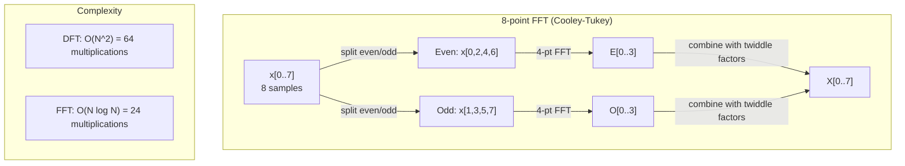
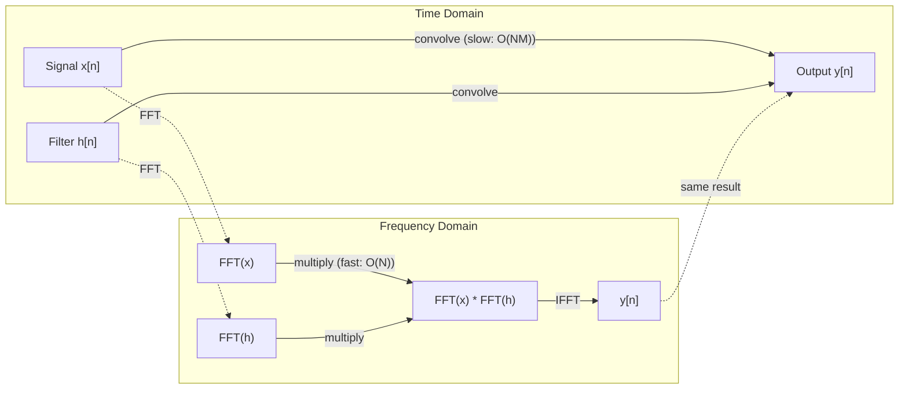

# Fourier Transform (The Fourier Transform)

> 每個訊號都是一堆正弦波的總和。Fourier transform 告訴你是哪幾個。

**Type:** Build
**Language:** Python
**Prerequisites:** Phase 1, Lessons 01-04, 19 (complex numbers)
**Time:** ~90 分鐘

## 學習目標 (Learning Objectives)

- 從零實作 DFT，並對照 $O(N \log N)$ 的 Cooley-Tukey FFT 驗證
- 解讀頻率係數：從訊號中取出振幅、相位與 power spectrum
- 運用 convolution theorem，透過 FFT 相乘來執行 convolution
- 把 Fourier 的頻率分解連結到 transformer 的 positional encoding 與 CNN 的 convolution layer

## 問題 (The Problem)

一段錄音是一連串隨時間變化的壓力量測值。股價是一連串隨日子變化的數值。影像是一個隨空間分布的像素強度格子。這些全都是 time domain（或 space domain）中的資料。你看到的是數值沿著某個索引變化。

但許多模式在 time domain 中是看不見的。這段音訊是單一純音還是和弦？這支股價有每週的週期嗎？這張影像有重複的紋理嗎？這些問題問的是頻率成分，而 time domain 把它藏起來了。

Fourier transform 把資料從 time domain 轉換到 frequency domain。它取一個訊號，並把它分解成不同頻率的正弦波。每個正弦波都有振幅（有多強）和相位（從哪裡開始）。Fourier transform 兩者都告訴你。

這對 ML 很重要，因為頻域思維無所不在。Convolutional neural network 執行 convolution，而它在頻域中就是相乘。Transformer 的 positional encoding 用頻率分解來表示位置。音訊模型（語音辨識、音樂生成）作用在 spectrogram 上，也就是聲音的頻率表示。時間序列模型尋找週期性的模式。理解 Fourier transform，給你處理這一切所需的詞彙。

## 核心概念 (The Concept)

### DFT 的定義 (The DFT definition)

給定 $N$ 個樣本 $x[0], x[1], \ldots, x[N-1]$，Discrete Fourier Transform 產生 $N$ 個頻率係數 $X[0], X[1], \ldots, X[N-1]$：

```math
X[k] = \sum_{n=0}^{N-1} x[n] \, e^{-2\pi i k n/N} \qquad \text{for } k = 0, 1, \ldots, N-1
```

每個 $X[k]$ 都是一個複數。它的大小 $\lvert X[k] \rvert$ 正比於頻率 $k$ 的振幅。在沒有 normalization 的情況下，一個恰好落在 bin $k$ 上、振幅為 $A$ 的實數 sine 會給出 $\lvert X[k] \rvert = AN/2$，所以要除以 $N/2$ 才能讀出振幅。它的相位 $\angle X[k]$ 告訴你該頻率的相位偏移。

關鍵洞見：$e^{-2\pi i k n/N}$ 是頻率為 $k$ 的旋轉 phasor。DFT 計算訊號與 $N$ 個等間距頻率中每一個之間的相關性。如果訊號在頻率 $k$ 含有能量，相關性就很大；如果沒有，就接近零。

### 每個係數的意義 (What each coefficient means)

**$X[0]$：DC 分量。** 這是所有樣本的總和，正比於平均值。它代表訊號的常數（零頻率）偏移。

```math
X[0] = \sum_{n=0}^{N-1} x[n] \, e^0 = \text{sum of all samples}
```

**$1 \le k \le N/2$ 的 $X[k]$：正頻率。** $X[k]$ 代表每 $N$ 個樣本內有 $k$ 個週期的頻率。$k$ 越高，頻率越高（振盪越快）。

**$X[N/2]$：Nyquist 頻率。** 用 $N$ 個樣本所能表示的最高頻率。超過這個頻率，你會得到 aliasing，也就是高頻偽裝成低頻。

**$N/2 < k < N$ 的 $X[k]$：負頻率。** 對實數值訊號，$X[N-k] = \overline{X[k]}$。負頻率是正頻率的鏡像。這就是為什麼有用的資訊都在前 $N/2 + 1$ 個係數裡。

### Inverse DFT (Inverse DFT)

Inverse DFT 從頻率係數重建原始訊號：

```math
x[n] = \frac{1}{N} \sum_{k=0}^{N-1} X[k] \, e^{2\pi i k n/N} \qquad \text{for } n = 0, 1, \ldots, N-1
```

與 forward DFT 唯一的差別：指數中的正負號是正的（不是負的），並且多了一個 $1/N$ 的 normalization 係數。

Inverse DFT 是完美的重建。沒有任何資訊遺失。你可以從 time domain 轉到 frequency domain 再轉回來，不會有任何誤差。DFT 是一種基底變換 (change of basis)，它在不同的座標系中重新表達相同的資訊。

### FFT：讓它變快 (The FFT: making it fast)

上面定義的 DFT 是 $O(N^2)$：對 $N$ 個輸出係數中的每一個，你都要對 $N$ 個輸入樣本做加總。當 $N$ = 100 萬時，那是 $10^{12}$ 次運算。

Fast Fourier Transform (FFT) 以 $O(N \log N)$ 算出相同的結果。當 $N$ = 100 萬時，約是 2000 萬次運算而不是一兆次。這就是讓頻率分析變得可行的原因。

Cooley-Tukey 演算法（最常見的 FFT）以 divide and conquer 的方式運作：

1. 把訊號分成偶數索引與奇數索引的樣本。
2. 對每一半遞迴地計算 DFT。
3. 用「twiddle factor」$e^{-2\pi i k/N}$ 把兩個一半大小的 DFT 合併起來。

```math
\begin{aligned}
X[k] &= E[k] + e^{-2\pi i k/N} \, O[k] && \text{for } k = 0, \ldots, N/2 - 1 \\
X[k + N/2] &= E[k] - e^{-2\pi i k/N} \, O[k] && \text{for } k = 0, \ldots, N/2 - 1 \\[6pt]
\text{where } E &= \text{DFT of even-indexed samples} \\
O &= \text{DFT of odd-indexed samples}
\end{aligned}
```

這個對稱性代表遞迴的每一層做 $O(N)$ 的工作，而且有 $\log_2(N)$ 層。總計：$O(N \log N)$。



這裡打造的 radix-2 FFT 在訊號長度為 2 的次方時最快。每當某個子問題的長度為奇數，它就會退回使用單純的 `dft`，所以訊號常被補零到下一個 2 的次方以求速度。像 `numpy.fft` 這樣的函式庫 FFT 用 mixed-radix 演算法處理任何長度，但在質因數較小的長度上最快。

### 頻譜分析 (Spectral analysis)

**Power spectrum** 是 $\lvert X[k] \rvert^2$，也就是每個頻率係數大小的平方。它顯示每個頻率上有多少能量。

**Phase spectrum** 是 $\angle X[k]$，也就是每個頻率的相位偏移。在大多數分析任務中，你在意的是 power spectrum，而忽略相位。

```math
\begin{aligned}
\text{Power at frequency } k: \quad P[k] &= |X[k]|^2 = \mathop{\mathrm{Re}}(X[k])^2 + \mathop{\mathrm{Im}}(X[k])^2 \\
\text{Phase at frequency } k: \quad \phi[k] &= \mathop{\mathrm{atan2}}(\mathop{\mathrm{Im}}(X[k]), \mathop{\mathrm{Re}}(X[k]))
\end{aligned}
```

### 頻率解析度 (Frequency resolution)

DFT 的頻率解析度取決於樣本數 $N$ 與取樣率 $f_s$。

```math
\begin{aligned}
\text{Frequency of bin } k: \quad & f_k = k \cdot f_s / N \\
\text{Frequency resolution:} \quad & \Delta f = f_s / N \\
\text{Maximum frequency:} \quad & f_{\max} = f_s / 2 \quad \text{(Nyquist)}
\end{aligned}
```

要分辨兩個彼此靠近的頻率，你需要更多樣本。要捕捉高頻，你需要更高的取樣率。

### Convolution theorem (The convolution theorem)

這是訊號處理中最重要的結果之一，且與 CNN 直接相關。

**Time domain 中的 convolution，等於 frequency domain 中的逐點相乘。**

```math
\begin{aligned}
& x * h = \text{IFFT}(\text{FFT}(x) \cdot \text{FFT}(h)) \\[4pt]
& \text{where } * \text{ is convolution and } \cdot \text{ is element-wise multiplication}
\end{aligned}
```

為什麼這很重要：

- 兩個長度分別為 $N$ 與 $M$ 的訊號做直接 convolution，需要 $O(NM)$ 次運算。
- 以 FFT 為基礎的 convolution 需要 $O(N \log N)$：兩個都轉換、相乘、再轉換回來。
- 對大的 kernel，FFT convolution 快得多。
- 這正是具有大感受野 (receptive field) 的 convolutional layer 中所發生的事。

注意：DFT 計算的是 circular convolution（訊號會繞回來）。若要 linear convolution（不繞回），請在計算前把兩個訊號都補零到長度 $N + M - 1$。



### Windowing (Windowing)

DFT 假設訊號是週期性的，它把這 $N$ 個樣本視為無限重複訊號中的一個週期。如果訊號的起點與終點數值不同，就會在邊界處產生不連續，在頻譜中顯示為虛假的高頻成分。這稱為 spectral leakage。

Windowing 在計算 DFT 之前，先讓訊號兩端逐漸收斂到零，藉此降低 leakage。

常見的 window：

| Window | 形狀 | Main lobe 寬度 | Side lobe 水準 | 使用情境 |
|--------|-------|----------------|-----------------|----------|
| Rectangular | 平的（不加 window） | 最窄 | 最高 (-13 dB) | 訊號在 N 個樣本內恰好為週期性時 |
| Hann | 升餘弦 | 中等 | 低 (-31 dB) | 通用的頻譜分析 |
| Hamming | 修正的餘弦 | 中等 | 較低 (-42 dB) | 音訊處理、語音分析 |
| Blackman | 三重餘弦 | 寬 | 非常低 (-58 dB) | 當抑制 side lobe 至關重要時 |

```math
\begin{aligned}
\text{Hann window:} \quad & w[n] = 0.5 \left(1 - \cos\frac{2\pi n}{N-1}\right) \\
\text{Hamming window:} \quad & w[n] = 0.54 - 0.46 \cos\frac{2\pi n}{N-1}
\end{aligned}
```

在做 DFT 之前，將 window 與訊號逐元素相乘來套用：`X = DFT(x * w)`。

### DFT 的性質 (DFT properties)

| 性質 | Time Domain | Frequency Domain |
|----------|-------------|-----------------|
| 線性 | $ax + by$ | $aX + bY$ |
| 時間平移 | $x[n - k]$ | $X[f] e^{-2\pi i f k/N}$ |
| 頻率平移 | $x[n] e^{2\pi i f_0 n/N}$ | $X[f - f_0]$ |
| Convolution | $x * h$ | $X \cdot H$（逐點） |
| 乘法 | $x \cdot h$（逐點） | $X * H$（circular convolution，以 $1/N$ 縮放） |
| Parseval 定理 | $\sum \lvert x[n] \rvert^2$ | $\frac{1}{N} \sum \lvert X[k] \rvert^2$ |
| 共軛對稱（實數輸入） | $x[n]$ 為實數 | $X[k] = \overline{X[N-k]}$ |

Parseval 定理說明，總能量在兩個域中是相同的。能量在轉換過程中守恆。

### 與 positional encoding 的關聯 (Connection to positional encodings)

原始的 Transformer 使用 sinusoidal positional encoding：

```math
\begin{aligned}
PE(pos, 2i) &= \sin\left(pos / 10000^{2i/d_{\text{model}}}\right) \\
PE(pos, 2i+1) &= \cos\left(pos / 10000^{2i/d_{\text{model}}}\right)
\end{aligned}
```

每一對維度 $(2i, 2i+1)$ 以不同的頻率振盪。頻率以等比的方式分布，從高（維度 0,1）到低（最後的維度）。這讓每個位置在所有頻帶上都有獨一無二的模式，類似 Fourier 係數能唯一識別一個訊號的方式。

它所提供的關鍵性質：

- **唯一性：** 沒有兩個位置有相同的編碼。
- **有界的值：** sin 和 cos 永遠落在 $[-1, 1]$ 中。
- **相對位置：** 位置 $p+k$ 的編碼可以表示成位置 $p$ 編碼的線性函數。模型可以學會去關注相對位置。

### 與 CNN 的關聯 (Connection to CNNs)

Convolution layer 透過把學到的 filter（kernel）滑過訊號或影像，套用到輸入上。數學上，這就是 convolution 運算。

根據 convolution theorem，這等價於：
1. 對輸入做 FFT
2. 對 kernel 做 FFT
3. 在頻域中相乘
4. 對結果做 IFFT

標準的 CNN 實作使用直接 convolution（對小的 3x3 kernel 比較快）。但對大的 kernel 或全域 convolution，以 FFT 為基礎的做法明顯更快。有些架構（像 FNet）完全以 FFT 取代 attention，用 $O(N \log N)$ 而非 $O(N^2)$ 的複雜度達到有競爭力的 accuracy。

### Spectrogram 與 Short-Time Fourier Transform (Spectrograms and the Short-Time Fourier Transform)

單次 FFT 給你整個訊號的頻率成分，但無法告訴你這些頻率在何時出現。Chirp（頻率隨時間增加的訊號）和和弦（所有頻率同時存在）可以有相同的大小頻譜。

Short-Time Fourier Transform (STFT) 透過對訊號的重疊 window 計算 FFT 來解決這個問題。結果是 spectrogram：一個 2D 表示，一軸是時間，另一軸是頻率。每個點的強度顯示該時間、該頻率上的能量。

```
STFT procedure:
1. Choose a window size (e.g., 1024 samples)
2. Choose a hop size (e.g., 256 samples -- 75% overlap)
3. For each window position:
   a. Extract the windowed segment
   b. Apply a Hann/Hamming window
   c. Compute FFT
   d. Store the magnitude spectrum as one column of the spectrogram
```

Spectrogram 是音訊 ML 模型的標準輸入表示。語音辨識模型（Whisper、DeepSpeech）作用在 mel-spectrogram 上，也就是把頻率對應到 mel 刻度的 spectrogram，這更符合人類對音高的感知。

### Aliasing (Aliasing)

如果訊號含有高於 $f_s/2$（Nyquist 頻率）的頻率，以取樣率 $f_s$ 取樣會產生 aliased 的複本。以 100 Hz 取樣的 90 Hz 訊號，看起來與 10 Hz 訊號完全一樣。光靠樣本無法區分它們。

```
Example:
  True signal: 90 Hz sine wave
  Sampling rate: 100 Hz
  Apparent frequency: 100 - 90 = 10 Hz

  The samples from the 90 Hz signal at 100 Hz sampling rate
  are identical to the samples from a 10 Hz signal.
  No amount of math can recover the original 90 Hz.
```

這就是類比數位轉換器 (ADC) 內含 anti-aliasing filter，在取樣前移除高於 Nyquist 的頻率的原因。在 ML 中，當對 feature map 做降採樣卻沒有適當的低通濾波時就會出現 aliasing，有些架構用 anti-aliased pooling layer 來處理它。

### 補零並不會提高解析度 (Zero-padding does not increase resolution)

一個常見的誤解：在 FFT 之前對訊號補零可以改善頻率解析度。其實不會。補零是在現有的頻率 bin 之間做內插，讓頻譜看起來比較平滑。但它無法揭露原始樣本中不存在的頻率細節。

真正的頻率解析度只取決於觀測時間 $T = N / f_s$。要分辨相距 $\Delta f$ 的兩個頻率，你至少需要 $T = 1 / \Delta f$ 秒的資料。無論補多少零，都無法改變這個基本極限。

```figure
fourier-synthesis
```

## 動手做 (Build It)

### 步驟 1：從零寫 DFT

$O(N^2)$ 的 DFT 直接依照定義寫出。

```python
import math

class Complex:
    ...

def dft(x):
    N = len(x)
    result = []
    for k in range(N):
        total = Complex(0, 0)
        for n in range(N):
            angle = -2 * math.pi * k * n / N
            w = Complex(math.cos(angle), math.sin(angle))
            xn = x[n] if isinstance(x[n], Complex) else Complex(x[n])
            total = total + xn * w
        result.append(total)
    return result
```

### 步驟 2：Inverse DFT

相同的結構，指數為正，除以 $N$。

```python
def idft(X):
    N = len(X)
    result = []
    for n in range(N):
        total = Complex(0, 0)
        for k in range(N):
            angle = 2 * math.pi * k * n / N
            w = Complex(math.cos(angle), math.sin(angle))
            total = total + X[k] * w
        result.append(Complex(total.real / N, total.imag / N))
    return result
```

### 步驟 3：FFT (Cooley-Tukey)

遞迴版 FFT 需要長度為 2 的次方。分成偶數與奇數，遞迴，再用 twiddle factor 合併。

```python
def fft(x):
    N = len(x)
    if N <= 1:
        return [x[0] if isinstance(x[0], Complex) else Complex(x[0])]
    if N % 2 != 0:
        return dft(x)

    even = fft([x[i] for i in range(0, N, 2)])
    odd = fft([x[i] for i in range(1, N, 2)])

    result = [Complex(0)] * N
    for k in range(N // 2):
        angle = -2 * math.pi * k / N
        twiddle = Complex(math.cos(angle), math.sin(angle))
        t = twiddle * odd[k]
        result[k] = even[k] + t
        result[k + N // 2] = even[k] - t
    return result
```

### 步驟 4：頻譜分析的輔助函式

```python
def power_spectrum(X):
    return [xk.real ** 2 + xk.imag ** 2 for xk in X]

def convolve_fft(x, h):
    N = len(x) + len(h) - 1
    padded_N = 1
    while padded_N < N:
        padded_N *= 2

    x_padded = x + [0.0] * (padded_N - len(x))
    h_padded = h + [0.0] * (padded_N - len(h))

    X = fft(x_padded)
    H = fft(h_padded)

    Y = [xk * hk for xk, hk in zip(X, H)]

    y = idft(Y)
    return [y[n].real for n in range(N)]
```

## 實際使用 (Use It)

實際工作時，請使用 numpy 的 FFT，它背後由高度最佳化的 C 函式庫支援。

```python
import numpy as np

signal = np.sin(2 * np.pi * 5 * np.arange(256) / 256)
spectrum = np.fft.fft(signal)
freqs = np.fft.fftfreq(256, d=1/256)

power = np.abs(spectrum) ** 2

positive_freqs = freqs[:len(freqs)//2]
positive_power = power[:len(power)//2]
```

對於 windowing 與更進階的頻譜分析：

```python
from scipy.signal import windows, stft

window = windows.hann(256)
windowed = signal * window
spectrum = np.fft.fft(windowed)
```

對於 convolution：

```python
from scipy.signal import fftconvolve

result = fftconvolve(signal, kernel, mode='full')
```

對於 spectrogram：

```python
from scipy.signal import stft

frequencies, times, Zxx = stft(signal, fs=sample_rate, nperseg=256)
spectrogram = np.abs(Zxx) ** 2
```

Spectrogram matrix 的 shape 是 (n_frequencies, n_time_frames)。每一欄是一個時間 window 的 power spectrum。這就是音訊 ML 模型作為輸入所吃進去的東西。

## 交付 (Ship It)

執行 `code/fourier.py` 以產生 `outputs/prompt-spectral-analyzer.md`。

## 練習 (Exercises)

1. **辨識純音。** 建立一個只有單一個正弦波、頻率未知（介於 1 到 50 Hz）的訊號，以 128 Hz 取樣 1 秒。用你的 DFT 辨識頻率。驗證答案相符。現在加入標準差為 0.5 的 Gaussian 雜訊並重複一次。雜訊如何影響頻譜？

2. **FFT 與 DFT 的驗證。** 產生一個長度為 64 的隨機訊號。同時計算 DFT ($O(N^2){}$) 與 FFT。驗證所有係數在 1e-10 內相符。在長度為 256、512、1024 和 2048 的訊號上，為兩個函式計時。畫出 DFT 時間對 FFT 時間的比值。

3. **用範例證明 convolution theorem。** 建立訊號 x = [1, 2, 3, 4, 0, 0, 0, 0] 與 filter h = [1, 1, 1, 0, 0, 0, 0, 0]。直接計算它們的 circular convolution（巢狀迴圈）。接著透過 FFT 計算（轉換、相乘、反轉換）。驗證結果相符。現在適當地補零，做 linear convolution。

4. **Windowing 的效果。** 建立一個訊號，是 10 Hz 和 12 Hz（非常接近）兩個正弦波的總和。以 128 Hz 取樣 1 秒。分別計算不加 window、Hann window 與 Hamming window 的 power spectrum。哪個 window 最容易分辨兩個峰值？為什麼？

5. **Positional encoding 分析。** 為 d_model = 128 與 max_pos = 512 產生 sinusoidal positional encoding。對每一對位置 $(p_1, p_2)$，計算它們編碼的 dot product。證明這個 dot product 只取決於 $\lvert p_1 - p_2 \rvert$，而不取決於絕對位置。當距離增加時，dot product 會如何變化？

### 提示 (Hints)

**練習 1。** 128 個樣本、取樣 1 秒時，bin $k$ 就是 $k$ Hz，所以對整數頻率，bin 1 到 63 中最大值的索引就是頻率。請挑選整數個赫茲。位於兩個 bin 之間的頻率會擴散到相鄰的 bin，而峰值只會給出最近的 bin。使用 `generate_signal` 和 `magnitude_spectrum`。加入雜訊後，檢查峰值仍在同一個 bin，而其他 bin 的值上升了。

**練習 2。** 使用 2 的次方長度，因為 `fft` 會把訊號分成兩半。對所有係數檢查 `max(abs(a - b))`。時間比值應大致按 $N / \log_2 N$ 成長。

**練習 3。** 對 circular convolution，對 $n$ = 0、1 和 2 手算 $y[n] = \sum_k h[k] x[(n-k) \bmod 8]$，並與 `convolve_direct` 和 `convolve_fft` 的前三個值比較。Linear convolution 的長度是 4 + 3 - 1 = 6，所以先檢查長度 8 是否已經足夠長。

**練習 4。** 使用 `hann_window`、`hamming_window`、`apply_window` 和 `power_spectrum`，並計算 9 到 13 Hz 之間分開的峰值數量。10 Hz 與 12 Hz 在 1 秒內都完成整數個週期，所以可能沒有哪個 window 看起來最好。用 10.5 Hz 和 12.5 Hz 重複一次，看看 window 所降低的 leakage。

**練習 5。** 用 `positional_encoding(pos, 128)` 計算每個編碼。比較位置 (0, 10) 的 dot product 與 (100, 110) 的 dot product：兩個值必須在約 1e-10 內相符。接著對一個固定的 $p_1$，畫出 dot product 對 $\lvert p_1 - p_2 \rvert$ 的圖。

## 關鍵術語 (Key Terms)

| 術語 | 意義 |
|------|---------------|
| DFT (Discrete Fourier Transform) | 把 $N$ 個 time-domain 樣本轉換成 $N$ 個 frequency-domain 係數。每個係數是與該頻率的複數正弦波的相關性 |
| FFT (Fast Fourier Transform) | 計算 DFT 的 $O(N \log N)$ 演算法。Cooley-Tukey 演算法遞迴地拆分偶數/奇數索引 |
| Inverse DFT | 從頻率係數重建 time-domain 訊號。與 DFT 公式相同，但指數正負號翻轉，並以 $1/N$ 縮放 |
| Frequency bin | DFT 輸出中的每個索引 $k$ 代表頻率 $k f_s/N$ Hz。「bin」就是離散的頻率格子 |
| DC component | $X[0]$，零頻率的係數。正比於訊號的平均值 |
| Nyquist frequency | $f_s/2$，在取樣率 $f_s$ 下所能表示的最高頻率。高於此的頻率會 alias |
| Power spectrum | $\lvert X[k] \rvert^2$，每個頻率係數大小的平方。顯示能量在各頻率上的分布 |
| Phase spectrum | $\angle X[k]$，每個頻率成分的相位偏移。分析時常被忽略 |
| Spectral leakage | 把非週期訊號當成週期訊號所造成的虛假頻率成分。可用 windowing 降低 |
| Window function | 在 DFT 之前套用的收斂函數（Hann、Hamming、Blackman），用來降低 spectral leakage |
| Twiddle factor | 複數指數 $e^{-2\pi i k/N}$，用於在 FFT butterfly 運算中合併子 DFT |
| Convolution theorem | Time domain 的 convolution 等於 frequency domain 的逐點相乘。是訊號處理與 CNN 的基礎 |
| Circular convolution | 訊號會繞回來的 convolution。這是 DFT 自然計算出來的東西 |
| Linear convolution | 沒有繞回的標準 convolution。透過在 DFT 之前補零來達成 |
| Parseval's theorem | 總能量在 Fourier transform 中守恆。$\sum \lvert x[n] \rvert^2 = \frac{1}{N} \sum \lvert X[k] \rvert^2$ |
| Aliasing | 由於取樣率不足，高於 Nyquist 的頻率以較低頻率的樣貌出現 |

## 延伸閱讀 (Further Reading)

- [Cooley & Tukey: An Algorithm for the Machine Calculation of Complex Fourier Series (1965)](https://www.ams.org/journals/mcom/1965-19-090/S0025-5718-1965-0178586-1/) - 改變運算世界的原始 FFT 論文
- [3Blue1Brown: But what is the Fourier Transform?](https://www.youtube.com/watch?v=spUNpyF58BY) - 對 Fourier transform 最好的視覺化入門
- [Lee-Thorp et al.: FNet: Mixing Tokens with Fourier Transforms (2021)](https://arxiv.org/abs/2105.03824) - 在 transformer 中以 FFT 取代 self-attention
- [Smith: The Scientist and Engineer's Guide to Digital Signal Processing](http://www.dspguide.com/) - 免費的線上教科書，深入涵蓋 FFT、windowing 與頻譜分析
- [Vaswani et al.: Attention Is All You Need (2017)](https://arxiv.org/abs/1706.03762) - 源自 Fourier 頻率分解的 sinusoidal positional encoding
- [Radford et al.: Whisper (2022)](https://arxiv.org/abs/2212.04356) - 以 mel-spectrogram 作為輸入表示的語音辨識
