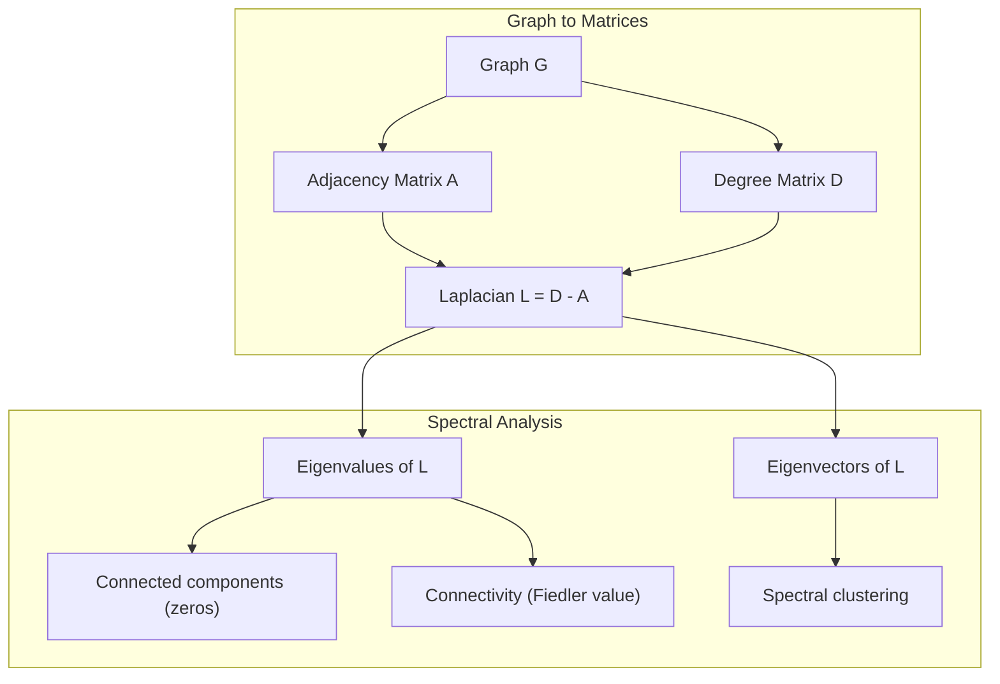
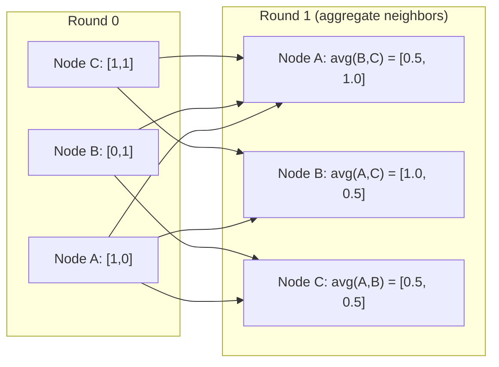

# 機器學習的圖論 (Graph Theory for Machine Learning)

> Graph 是描述關係的資料結構。只要你的資料有連結，你就需要圖論。

**Type:** Build
**Language:** Python
**Prerequisites:** Phase 1, Lessons 01-03 (linear algebra, matrices)
**Time:** ~90 分鐘

## 學習目標 (Learning Objectives)

- 打造一個 graph class，支援 adjacency matrix/list 表示法，並實作 BFS 與 DFS 走訪
- 計算 graph Laplacian，並利用它的 eigenvalue 偵測 connected component 與對節點分群
- 把一輪 GNN 風格的 message passing，實作成 normalized adjacency matrix 的乘法
- 運用 spectral clustering 與 Fiedler vector 來切分 graph

## 問題 (The Problem)

社群網路、分子、知識庫、引用網路、道路地圖，全都是 graph。傳統 ML 把資料視為平面的表格。每一列彼此獨立，每個 feature 是一欄。但當連結的結構很重要時，表格就不夠用了。

想想社群網路。你想預測使用者會買哪個產品。他們的購買紀錄很重要。但他們朋友的購買紀錄更重要。連結帶有訊號。

或者想想分子。你想預測它是否會與蛋白質結合。原子很重要，但真正重要的是原子之間如何鍵結。結構本身就是資料。

Graph Neural Network (GNN) 是 deep learning 中成長最快的領域。它們驅動藥物探索、社群推薦、詐欺偵測與知識圖譜推理。每個 GNN 都建立在同一個基礎之上：基本的圖論。

你需要四樣東西：
1. 把 graph 表示成 matrix 的方法（這樣你才能對它們做乘法）
2. 探索 graph 結構的走訪演算法
3. Laplacian：spectral graph theory 中最重要的單一 matrix
4. Message passing：讓 GNN 運作的運算

## 核心概念 (The Concept)

### Graph：節點與邊 (Graphs: Nodes and Edges)

Graph $G = (V, E)$ 由頂點（節點）$V$ 與邊 $E$ 組成。每條邊連接兩個節點。

**有向與無向。** 在無向圖中，邊 $(u, v)$ 代表 $u$ 連到 $v$，而且 $v$ 也連到 $u$。在有向圖 (digraph) 中，邊 $(u, v)$ 代表 $u$ 指向 $v$，但不一定反過來。

**加權與無權。** 在無權圖中，邊只有存在或不存在。在加權圖中，每條邊都有一個數值權重，可以是距離、成本或強度。

| Graph 類型 | 範例 |
|-----------|---------|
| 無向、無權 | Facebook 好友網路 |
| 有向、無權 | Twitter 追蹤網路 |
| 無向、加權 | 道路地圖（距離） |
| 有向、加權 | 網頁連結（PageRank 分數） |

### Adjacency Matrix (The Adjacency Matrix)

Adjacency matrix $A$ 是核心的表示法。對一個有 $n$ 個節點的 graph：

```math
A[i][j] = \begin{cases} 1 & \text{if there is an edge from node } i \text{ to node } j \\ 0 & \text{otherwise} \end{cases}
```

對無向圖，$A$ 是對稱的：$A[i][j] = A[j][i]$。對加權圖，$A[i][j]$ = 邊 $(i, j)$ 的權重。

**範例：三角形**

```
Nodes: 0, 1, 2
Edges: (0,1), (1,2), (0,2)

A = [[0, 1, 1],
     [1, 0, 1],
     [1, 1, 0]]
```

Adjacency matrix 是每個 GNN 的輸入。對 $A$ 做的 matrix 運算，對應到對 graph 做的運算。

### Degree (Degree)

節點的 degree 是連接到它的邊的數量。對有向圖，你有 in-degree（進入的邊）和 out-degree（出去的邊）。

Degree matrix $D$ 是對角的：

```math
\begin{aligned}
D[i][i] &= \text{degree of node } i \\
D[i][j] &= 0 \quad \text{for } i \ne j
\end{aligned}
```

對三角形的例子：$D = \mathop{\mathrm{diag}}(2, 2, 2)$，因為每個節點都連到另外兩個節點。

Degree 告訴你節點的重要性。High degree = hub 節點。網路的 degree 分佈揭露了它的結構。社群網路遵循 power law（少數 hub，許多葉節點）。隨機圖的 degree 呈 Poisson 分佈。

### BFS 與 DFS (BFS and DFS)

兩個基本的 graph 走訪演算法。兩個你都需要。

**Breadth-First Search (BFS)：** 先探索所有鄰居，再探索鄰居的鄰居。使用 queue（FIFO）。

```
BFS from node 0:
  Visit 0
  Queue: [1, 2]        (neighbors of 0)
  Visit 1
  Queue: [2, 3]        (add neighbors of 1)
  Visit 2
  Queue: [3]           (neighbors of 2 already visited)
  Visit 3
  Queue: []            (done)
```

BFS 在無權圖中找出最短路徑。從起點到任何節點的距離，等於該節點第一次被發現時的 BFS 層級。這就是為什麼 BFS 被用於社群網路中的 hop 數距離。

**Depth-First Search (DFS)：** 盡可能深入，再回溯。使用 stack (LIFO) 或遞迴。

```
DFS from node 0:
  Visit 0
  Stack: [1, 2]        (neighbors of 0)
  Visit 2               (pop from stack)
  Stack: [1, 3]         (add neighbors of 2)
  Visit 3               (pop from stack)
  Stack: [1]
  Visit 1               (pop from stack)
  Stack: []             (done)
```

DFS 適用於：
- 尋找 connected component（從未造訪的節點執行 DFS）
- 偵測環（DFS tree 中的 back edge）
- Topological sorting（DFS 完成順序的反向）

| 演算法 | 資料結構 | 找出 | 使用情境 |
|-----------|---------------|-------|----------|
| BFS | Queue | 最短路徑 | 社群網路距離、知識圖譜走訪 |
| DFS | Stack | Component、環 | 連通性、topological sort |

### Graph Laplacian (The Graph Laplacian)

$L = D - A$。Spectral graph theory 中最重要的 matrix。

對三角形：

```math
D = \begin{bmatrix} 2 & 0 & 0 \\ 0 & 2 & 0 \\ 0 & 0 & 2 \end{bmatrix} \qquad A = \begin{bmatrix} 0 & 1 & 1 \\ 1 & 0 & 1 \\ 1 & 1 & 0 \end{bmatrix} \qquad L = \begin{bmatrix} 2 & -1 & -1 \\ -1 & 2 & -1 \\ -1 & -1 & 2 \end{bmatrix}
```

Laplacian 有一些很了不起的性質：

1. **$L$ 是 positive semi-definite。** 所有 eigenvalue 都 $\ge 0$。

2. **零 eigenvalue 的數量等於 connected component 的數量。** 一個連通圖恰好有一個零 eigenvalue。一個有 3 個互不連通 component 的圖，有三個零 eigenvalue。

3. **最小的非零 eigenvalue（Fiedler value）衡量連通性。** Fiedler value 大，代表 graph 連得很好。Fiedler value 小，代表 graph 有一個弱點，也就是瓶頸。

4. **Fiedler value 對應的 eigenvector（Fiedler vector）揭露最佳的切分。** 數值為正的節點放進一組，數值為負的節點放進另一組。這就是 spectral clustering。



### Spectral 性質 (Spectral Properties)

Adjacency matrix 與 Laplacian 的 eigenvalue，不需要任何走訪就能揭露結構性質。

**Spectral clustering** 的運作方式：
1. 計算 Laplacian $L$
2. 找出 $L$ 最小的 $k$ 個 eigenvector（略過第一個，對連通圖它全為 1）
3. 把這些 eigenvector 當作每個節點的新座標
4. 對這些座標執行 $k$-means

為什麼有效？$L$ 的 eigenvector 編碼了 graph 上「最平滑」的函數。連得很好的節點會得到相似的 eigenvector 值。被瓶頸隔開的節點會得到不同的值。Eigenvector 自然地把 cluster 分開。

**與隨機漫步的關聯。** Normalized Laplacian 與 graph 上的隨機漫步有關。隨機漫步的 stationary distribution 正比於節點的 degree。混合時間 (mixing time)（漫步收斂得多快）取決於 spectral gap。

### Message Passing (Message Passing)

Graph Neural Network 的核心運算。每個節點收集來自鄰居的訊息、聚合它們，並更新自己的狀態。

```math
h_v^{(k+1)} = \text{UPDATE}\left(h_v^{(k)}, \text{AGGREGATE}\left(\{h_u^{(k)} : u \in \text{neighbors}(v)\}\right)\right)
```

在最簡單的形式中，AGGREGATE = mean，UPDATE = 線性轉換 + activation：

```math
h_v^{(k+1)} = \sigma\left(W \cdot \text{mean}\left(\{h_u^{(k)} : u \in \text{neighbors}(v)\}\right)\right)
```

這其實是披著外衣的 matrix 乘法。如果 $H$ 是所有節點 feature 組成的 matrix，$A$ 是 adjacency matrix：

```math
H^{(k+1)} = \sigma\left(A_{\text{norm}} H^{(k)} W\right)
```

其中 $A_{\text{norm}}$ 是 normalized adjacency matrix（每一列的和為 1）。

一輪 message passing 讓每個節點「看見」它的直接鄰居。兩輪讓它看見鄰居的鄰居。$K$ 輪則讓每個節點獲得來自其 $K$-hop 鄰域的資訊。



### 概念與 ML 應用 (Concepts and ML Applications)

| 概念 | ML 應用 |
|---------|---------------|
| Adjacency matrix | GNN 的輸入表示 |
| Graph Laplacian | Spectral clustering、社群偵測 |
| BFS/DFS | 知識圖譜走訪、路徑搜尋 |
| Degree 分佈 | 節點重要性、feature engineering |
| Message passing | GNN layer（GCN、GAT、GraphSAGE） |
| L 的 eigenvalue | 社群偵測、graph 分割 |
| Spectral clustering | 非監督式的節點分組 |
| PageRank | 節點重要性、網頁搜尋 |

```figure
graph-degree-distribution
```

## 動手做 (Build It)

### 步驟 1：從零寫 Graph class

```python
class Graph:
    def __init__(self, n_nodes, directed=False):
        self.n = n_nodes
        self.directed = directed
        self.adj = {i: {} for i in range(n_nodes)}

    def add_edge(self, u, v, weight=1.0):
        self.adj[u][v] = weight
        if not self.directed:
            self.adj[v][u] = weight

    def neighbors(self, node):
        return list(self.adj[node].keys())

    def degree(self, node):
        return len(self.adj[node])

    def weighted_degree(self, node):
        return sum(self.adj[node].values())

    def adjacency_matrix(self):
        import numpy as np
        A = np.zeros((self.n, self.n))
        for u in range(self.n):
            for v, w in self.adj[u].items():
                A[u][v] = w
        return A

    def degree_matrix(self):
        import numpy as np
        D = np.zeros((self.n, self.n))
        for i in range(self.n):
            D[i][i] = self.weighted_degree(i)
        return D

    def laplacian(self):
        return self.degree_matrix() - self.adjacency_matrix()
```

Adjacency list (`self.adj`) 能有效率地儲存鄰居。Adjacency matrix 的轉換使用 numpy，因為所有 spectral 運算都需要它。

### 步驟 2：BFS 與 DFS

```python
from collections import deque

def bfs(graph, start):
    visited = set()
    order = []
    distances = {}
    queue = deque([(start, 0)])
    visited.add(start)
    while queue:
        node, dist = queue.popleft()
        order.append(node)
        distances[node] = dist
        for neighbor in graph.neighbors(node):
            if neighbor not in visited:
                visited.add(neighbor)
                queue.append((neighbor, dist + 1))
    return order, distances


def dfs(graph, start):
    visited = set()
    order = []
    stack = [start]
    while stack:
        node = stack.pop()
        if node in visited:
            continue
        visited.add(node)
        order.append(node)
        for neighbor in reversed(graph.neighbors(node)):
            if neighbor not in visited:
                stack.append(neighbor)
    return order
```

BFS 使用 deque（雙端 queue），讓 popleft 為 $O(1)$。DFS 用 list 當作 stack。兩者都恰好造訪每個節點一次，時間為 $O(V + E)$。

### 步驟 3：Connected component 與 Laplacian eigenvalue

```python
def connected_components(graph):
    visited = set()
    components = []
    for node in range(graph.n):
        if node not in visited:
            order, _ = bfs(graph, node)
            visited.update(order)
            components.append(order)
    return components


def laplacian_eigenvalues(graph):
    import numpy as np
    L = graph.laplacian()
    eigenvalues = np.linalg.eigvalsh(L)
    return eigenvalues
```

`eigvalsh` 用於對稱 matrix，而無向圖的 Laplacian 永遠是對稱的。它以遞增順序回傳 eigenvalue。數一數零的個數，就能知道 connected component 的數量。

### 步驟 4：Spectral clustering

```python
def spectral_clustering(graph, k=2):
    import numpy as np
    L = graph.laplacian()
    eigenvalues, eigenvectors = np.linalg.eigh(L)
    features = eigenvectors[:, 1:k+1]

    labels = np.zeros(graph.n, dtype=int)
    for i in range(graph.n):
        if features[i, 0] >= 0:
            labels[i] = 0
        else:
            labels[i] = 1
    return labels
```

對 $k=2$，Fiedler vector 的正負號把 graph 切成兩個 cluster。對 $k>2$，你會對前 $k$ 個 eigenvector（排除沒有資訊的全 1 eigenvector）執行 $k$-means。

### 步驟 5：Message passing

```python
def message_passing(graph, features, weight_matrix):
    import numpy as np
    A = graph.adjacency_matrix()
    row_sums = A.sum(axis=1, keepdims=True)
    row_sums[row_sums == 0] = 1
    A_norm = A / row_sums
    aggregated = A_norm @ features
    output = aggregated @ weight_matrix
    return output
```

這就是一輪 GNN message passing。每個節點的新 feature，是其鄰居 feature 的加權平均，再經過 weight matrix 轉換。堆疊多輪就能把資訊傳得更遠。

## 實際使用 (Use It)

有了 networkx 與 numpy，同樣的運算只要一行：

```python
import networkx as nx
import numpy as np

G = nx.karate_club_graph()

A = nx.adjacency_matrix(G).toarray()
L = nx.laplacian_matrix(G).toarray()

eigenvalues = np.linalg.eigvalsh(L.astype(float))
print(f"Smallest eigenvalues: {eigenvalues[:5]}")
print(f"Connected components: {nx.number_connected_components(G)}")

communities = nx.community.greedy_modularity_communities(G)
print(f"Communities found: {len(communities)}")

pr = nx.pagerank(G)
top_nodes = sorted(pr.items(), key=lambda x: x[1], reverse=True)[:5]
print(f"Top 5 PageRank nodes: {top_nodes}")
```

networkx 以最佳化的 C 後端處理任何大小的 graph。正式環境請使用它。用你從零寫的實作來理解它在做什麼。

### numpy 的 spectral 分析

```python
import numpy as np

A = np.array([
    [0, 1, 1, 0, 0],
    [1, 0, 1, 0, 0],
    [1, 1, 0, 1, 0],
    [0, 0, 1, 0, 1],
    [0, 0, 0, 1, 0]
])

D = np.diag(A.sum(axis=1))
L = D - A

eigenvalues, eigenvectors = np.linalg.eigh(L)
print(f"Eigenvalues: {np.round(eigenvalues, 4)}")
print(f"Fiedler value: {eigenvalues[1]:.4f}")
print(f"Fiedler vector: {np.round(eigenvectors[:, 1], 4)}")

fiedler = eigenvectors[:, 1]
group_a = np.where(fiedler >= 0)[0]
group_b = np.where(fiedler < 0)[0]
print(f"Cluster A: {group_a}")
print(f"Cluster B: {group_b}")
```

Fiedler vector 負責最吃重的工作。正值的項目在一個 cluster，負值的在另一個。不需要迭代式最佳化，只要一次 eigendecomposition。

## 交付 (Ship It)

這堂課會產出：
- `outputs/skill-graph-analysis.md`：用於分析圖結構資料的 skill 參考資料

## 關聯 (Connections)

| 概念 | 出現的地方 |
|---------|------------------|
| Adjacency matrix | GCN、GAT、GraphSAGE 的輸入 |
| Laplacian | Spectral clustering、ChebNet filter |
| BFS | 知識圖譜走訪、最短路徑查詢 |
| Message passing | 每個 GNN layer、neural message passing |
| Spectral gap | Graph 連通性、隨機漫步的混合時間 |
| Degree 分佈 | Power-law 網路、節點 feature engineering |
| Connected component | 前處理、處理不連通的 graph |
| PageRank | 節點重要性排名、attention 初始化 |

GNN 值得特別一提。GCN (Kipf & Welling, 2017) 中的 graph convolution 運算，使用加上 self-loop 的 adjacency matrix，$\hat{A} = A + I$：

```math
H^{(l+1)} = \sigma\left(\hat{D}^{-1/2} \hat{A} \hat{D}^{-1/2} H^{(l)} W^{(l)}\right)
```

其中 $\hat{A} = A + I$（adjacency 加上 self-loop），$\hat{D}$ 是 $\hat{A}$ 的 degree matrix。Self-loop 確保每個節點在聚合時也包含自己的 feature。這正是帶有對稱 normalization 的 message passing。$\hat{D}^{-1/2} \hat{A} \hat{D}^{-1/2}$ 是 normalized adjacency matrix。Laplacian 會出現，是因為這個 normalization 與 $L_{\text{sym}} = I - D^{-1/2} A D^{-1/2}$ 有關。理解 Laplacian，就是理解 GCN 為什麼有效。

## 練習 (Exercises)

1. **從零實作 PageRank。** 從均勻的分數開始。每一步：score(v) = (1-d)/n + d * sum(score(u)/out_degree(u))，其中 u 涵蓋所有指向 v 的節點。使用 d=0.85。執行到收斂為止（變化 < 1e-6）。在一個小型網頁 graph 上測試。

2. **用 spectral clustering 找出社群。** 建立一個有兩個明顯分離 cluster 的 graph（例如：由單一條邊連接的兩個 clique）。執行 spectral clustering，並驗證它找到正確的切分。當你加入更多跨 cluster 的邊時會發生什麼事？

3. **實作 Dijkstra 演算法**，用於加權 graph 的最短路徑。將結果與同一個 graph 在權重一致時的 BFS 比較。

4. **打造 2 層的 message passing 網路。** 用不同的 weight matrix 套用 message passing 兩次。證明在 2 輪之後，每個節點都擁有來自其 2-hop 鄰域的資訊。

5. **分析真實世界的 graph。** 使用 Karate Club graph（34 個節點、78 條邊）。計算 degree 分佈、Laplacian eigenvalue 與 spectral clustering。將 spectral clustering 的結果與已知的真實切分比較。

### 提示 (Hints)

**練習 1。** 使用練習中的公式。沒有出邊的節點必須把它的分數平均分給所有節點，否則總和會低於 1。檢查每一步之後分數加起來是 1，並將你的結果與 `pagerank(graph)` 比較。

**練習 2。** 用 `add_edge` 建立兩個 clique，用一條邊連接它們，並呼叫 `spectral_clustering(graph, k=2)`。檢查每個 clique 得到一個標籤。當你加入跨越的邊時，印出 `laplacian()` 第二小的 eigenvalue，它會隨著兩組合併而增加。

**練習 3。** 用 `heapq` 維護一個 priority queue，並永遠展開已知距離最小的節點。把每個權重都設為 1，並檢查每個 Dijkstra 距離都等於該節點在 `bfs(graph, start)` 中的 BFS 層級。

**練習 4。** 使用 identity matrix 作為 `features`，讓每一欄標記一個節點，並套用 `message_passing` 兩次。接著，節點 $v$ 那一列中的非零項目，顯示哪些節點到達了 $v$。將那個集合與廣度優先搜尋中距離在 2 以內的節點比較。

**練習 5。** `networkx.karate_club_graph()` 給出邊清單，以及節點屬性 `club` 中的真實標籤。把邊複製到一個 `Graph` 中，並檢查它有 34 個節點和 78 條邊。將 `spectral_clustering` 的標籤與 `club` 的值比較，並允許兩個標籤名稱互換。

## 關鍵術語 (Key Terms)

| 術語 | 一般人怎麼說 | 實際意思 |
|------|----------------|----------------------|
| Graph | 「節點和邊」 | 一種數學結構 $G=(V,E)$，編碼成對的關係 |
| Adjacency matrix | 「連結表」 | 一個 $n \times n$ 的 matrix，若節點 $i$ 與 $j$ 相連則 $A[i][j] = 1$ |
| Degree | 「節點連得多緊」 | 接觸某個節點的邊的數量 |
| Laplacian | 「D 減 A」 | $L = D - A$，其 eigenvalue 揭露 graph 結構的 matrix |
| Fiedler value | 「代數連通度」 | $L$ 最小的非零 eigenvalue，衡量 graph 連得多好 |
| BFS | 「逐層搜尋」 | 先造訪所有鄰居再往深處走的走訪方式，可找出最短路徑 |
| DFS | 「先往深處走」 | 沿著一條路徑走到底再回溯的走訪方式 |
| Message passing | 「節點和鄰居交談」 | 每個節點聚合來自鄰居的資訊，是 GNN 的核心 |
| Spectral clustering | 「用 eigenvector 分群」 | 使用 Laplacian 的 eigenvector 來切分 graph |
| Connected component | 「一個獨立的片段」 | 一個最大的子圖，其中每個節點都能到達其他每個節點 |

## 延伸閱讀 (Further Reading)

- **Kipf & Welling (2017)**：「Semi-Supervised Classification with Graph Convolutional Networks」。開啟現代 GNN 的論文。證明 spectral graph convolution 可以簡化成 message passing。
- **Spielman (2012)**：「Spectral Graph Theory」講義。對 Laplacian、spectral gap 與 graph 分割的決定性入門。
- **Hamilton (2020)**：「Graph Representation Learning」。從基礎到應用涵蓋 GNN 的書。
- **Bronstein et al. (2021)**：「Geometric Deep Learning: Grids, Groups, Graphs, Geodesics, and Gauges」。統一的框架論文。
- **Veličković et al. (2018)**：「Graph Attention Networks」。以 attention 機制擴充 message passing。
