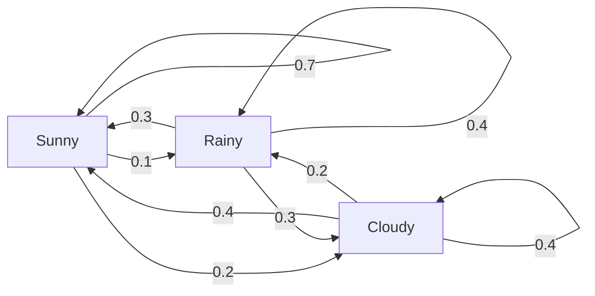
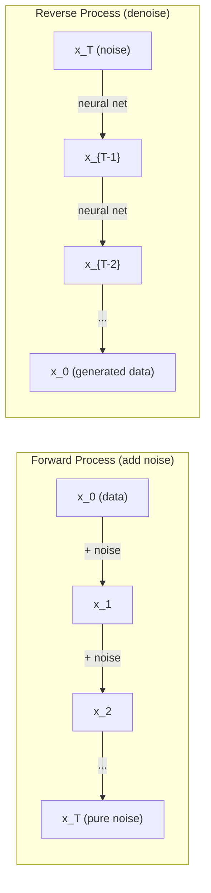

# 隨機過程 (Stochastic Processes)

> 有結構的隨機性。這是 random walk、Markov chain 與 diffusion model 背後的數學。

**Type:** Learn
**Language:** Python
**Prerequisites:** Phase 1, Lessons 06-07 (probability, Bayes)
**Time:** ~75 分鐘

## 學習目標 (Learning Objectives)

- 模擬 1D 與 2D 的 random walk，並驗證位移的 $\sqrt{n}$ 縮放
- 打造 Markov chain 模擬器，並透過 eigendecomposition 計算它的 stationary distribution
- 實作 Metropolis-Hastings MCMC 與 Langevin dynamics，從目標分佈中取樣
- 把 forward diffusion 過程連結到 Brownian motion，並說明 reverse 過程如何生成資料

## 問題 (The Problem)

許多 AI 系統都涉及隨時間演變的隨機性。不是靜態的隨機，而是有結構、有順序的隨機，每一步都取決於先前發生的事。

語言模型一次生成一個 token。每個 token 取決於先前的上下文。模型輸出一個機率分佈，從中取樣，然後繼續往下。這就是一個隨機過程。

Diffusion model 一步一步地對影像加入雜訊，直到它變成純粹的雜點。接著它們反轉這個過程，一步步去噪，直到一張新的影像出現。Forward 過程是一條 Markov chain。Reverse 過程則是一條學來的、反向執行的 Markov chain。

強化學習的 agent 在環境中採取動作。每個動作都以某種機率導向新的狀態。Agent 在一個隨機的世界中遵循一個隨機的 policy。整件事就是一個 Markov decision process。

MCMC 取樣是 Bayesian inference 的骨幹，它建構一條 Markov chain，其 stationary distribution 就是你想取樣的 posterior。

所有這些都建立在四個基本想法之上：
1. Random walk：最簡單的隨機過程
2. Markov chain：以 transition matrix 描述的、有結構的隨機性
3. Langevin dynamics：帶有雜訊的 gradient descent
4. Metropolis-Hastings：從任何分佈取樣

## 核心概念 (The Concept)

### Random Walk (Random Walks)

從位置 0 出發。每一步擲一枚公平硬幣。正面：向右移動 (+1)。反面：向左移動 (-1)。

經過 $n$ 步後，你的位置是 $n$ 個隨機 $\pm 1$ 值的總和。期望位置是 0（這個漫步沒有偏向）。但與原點的期望距離按 $\sqrt{n}$ 成長。

這違反直覺。這個漫步是公平的，在任一方向上都沒有漂移。但隨著時間推移，它會離起點越來越遠。$n$ 步之後的標準差是 $\sqrt{n}$。

```
Step 0:  Position = 0
Step 1:  Position = +1 or -1
Step 2:  Position = +2, 0, or -2
...
Step 100: Expected distance from origin ~ 10 (sqrt(100))
Step 10000: Expected distance from origin ~ 100 (sqrt(10000))
```

**在 2D 中**，漫步以相等的機率向上、下、左或右移動。與原點距離的 $\sqrt{n}$ 縮放同樣適用。路徑描出類似碎形的圖案。

**為什麼是 $\sqrt{n}$？** 每一步以相等的機率是 +1 或 -1。$n$ 步之後，位置 $S_n = X_1 + X_2 + \cdots + X_n$，其中每個 $X_i$ 是 $\pm 1$。每一步的 variance 是 1，而且各步彼此獨立，所以 $\mathop{\mathrm{Var}}(S_n) = n$。標準差 = $\sqrt{n}$。根據 central limit theorem，$S_n / \sqrt{n}$ 會收斂到標準 normal 分佈。

這個 $\sqrt{n}$ 縮放在 ML 中處處可見。SGD 的雜訊按 1/sqrt(batch_size) 縮放。Embedding 維度按 $\sqrt{d}$ 縮放。平方根就是獨立隨機相加的標誌。

**與 Brownian motion 的關聯。** 取步長為 $1/\sqrt{n}$、每單位時間 $n$ 步的 random walk。當 $n$ 趨近無限大時，這個漫步會收斂到 Brownian motion $B(t)$：一個連續時間的過程，其中 $B(t)$ 服從 mean 為 0、variance 為 $t$ 的 normal 分佈。

Brownian motion 是 diffusion 的數學基礎。它模擬流體中粒子的隨機抖動、股價的波動，以及，關鍵的是，diffusion model 中的雜訊過程。

**賭徒破產 (Gambler's ruin)。** 一個隨機漫步者從位置 $k$ 出發，在 0 與 $N$ 處有吸收障壁。在碰到 0 之前先到達 $N$ 的機率是多少？對公平的漫步：$P(\text{reach } N) = k/N$。這出奇地簡單而優雅。它連結到 martingale 理論：公平的 random walk 是一個 martingale（未來的期望值 = 目前的值）。

### Markov Chain (Markov Chains)

Markov chain 是一個依照固定機率在各狀態之間轉移的系統。關鍵性質：下一個狀態只取決於當前狀態，而不取決於歷史。

```math
P(X_{t+1} = j \mid X_t = i, X_{t-1} = \ldots) = P(X_{t+1} = j \mid X_t = i)
```

這就是 Markov property。它代表你可以用一個 transition matrix $P$ 描述整個動態：

```math
P[i][j] = \text{probability of going from state } i \text{ to state } j
```

$P$ 的每一列總和為 1（你一定會去某個地方）。

**範例：天氣**

```
States: Sunny (0), Rainy (1), Cloudy (2)

P = [[0.7, 0.1, 0.2],    (if sunny: 70% sunny, 10% rainy, 20% cloudy)
     [0.3, 0.4, 0.3],    (if rainy: 30% sunny, 40% rainy, 30% cloudy)
     [0.4, 0.2, 0.4]]    (if cloudy: 40% sunny, 20% rainy, 40% cloudy)
```

從任何狀態出發。經過許多次轉移後，狀態的分佈會收斂到 stationary distribution $\pi$，其中 $\pi P = \pi$。這是 $P$ 對應 eigenvalue 1 的 left eigenvector。

對這個天氣 chain，stationary distribution 是 [0.55, 0.18, 0.27]：長期來看，不論起始狀態為何，有 55% 的時間是晴天。



**計算 stationary distribution。** 有兩種方法：

1. **Power method**：把任何初始分佈反覆乘上 $P$。經過足夠多次迭代後，它會收斂。
2. **Eigenvalue 方法**：找出 $P$ 對應 eigenvalue 1 的 left eigenvector。這是 $P^T$ 對應 eigenvalue 1 的 eigenvector。

兩種方法都要求 chain 滿足收斂條件。

**收斂條件。** 若 Markov chain 滿足以下條件，它就會收斂到唯一的 stationary distribution：
- **Irreducible**：每個狀態都可以從其他每個狀態到達
- **Aperiodic**：chain 不會以固定週期循環

你在 ML 中遇到的大多數 chain 都滿足這兩個條件。

**吸收狀態 (Absorbing state)。** 如果一個狀態一旦進入就不會離開 ($P[i][i] = 1$)，它就是吸收狀態。Absorbing Markov chain 模擬具有終止狀態的過程：一局結束的遊戲、流失的客戶、碰到 end-of-text token 的 token 序列。

**混合時間 (Mixing time)。** 要多少步，chain 才會「接近」stationary distribution？正式的說法是，與 stationary 的 total variation distance 降到某個門檻以下所需的步數。快速混合 = 需要的步數少。對可逆 (reversible) 的 chain，$P$ 的 spectral gap（1 減去除了 eigenvalue 1 以外最大的 eigenvalue 絕對值）控制混合時間。Gap 越大 = 混合越快。

### 與語言模型的關聯 (Connection to Language Models)

語言模型中的 token 生成，大致上是一個 Markov 過程。給定當前的上下文，模型輸出下一個 token 的分佈。Temperature 控制分佈的尖銳程度：

```math
P(\text{token}_i) = \frac{\exp(\text{logit}_i / \text{temperature})}{\sum_j \exp(\text{logit}_j / \text{temperature})}
```

- Temperature = 1.0：標準分佈
- Temperature < 1.0：更尖銳（更具決定性）
- Temperature > 1.0：更平坦（更隨機）
- Temperature $\to 0$：argmax（greedy）

Top-k sampling 截斷到機率最高的 $k$ 個 token。Top-p (nucleus) sampling 截斷到累積機率超過 $p$ 的最小 token 集合。兩者都修改了 Markov 的轉移機率。

### Brownian Motion (Brownian Motion)

Random walk 的連續時間極限。位置 $B(t)$ 有三個性質：
1. $B(0) = 0$
2. $B(t) - B(s)$ 服從 mean 為 0、variance 為 $t - s$ 的 normal 分佈（對 $t > s$）
3. 不重疊區間上的增量彼此獨立

Brownian motion 是連續的，但處處不可微，它在每個尺度上都在抖動。路徑在平面上的碎形維度為 2。

在離散模擬中，你這樣近似 Brownian motion：

```math
B(t + dt) = B(t) + \sqrt{dt} \, z, \quad \text{where } z \sim \mathcal{N}(0, 1)
```

$\sqrt{dt}$ 的縮放很重要。它來自套用在 random walk 上的 central limit theorem。

### Langevin Dynamics (Langevin Dynamics)

Gradient descent 找出函數的最小值。Langevin dynamics 找出正比於 $\exp(-U(x)/T)$ 的機率分佈，其中 $U$ 是 energy function，$T$ 是 temperature。

```math
x_{t+1} = x_t - dt \, \nabla U(x_t) + \sqrt{2 T \, dt} \, z_t
```

有兩種力作用在粒子上：
1. **Gradient 力** ($-dt \cdot \nabla U$)：推向低能量（像 gradient descent）
2. **隨機力** ($\sqrt{2T dt} \cdot z$)：推向隨機方向（探索）

在 temperature $T = 0$ 時，這就是純粹的 gradient descent。在高 temperature 時，它幾乎就是 random walk。在合適的 temperature 下，粒子會探索能量地形，並花更多時間待在低能量區域。

**與 diffusion model 的關聯。** Diffusion model 的 forward 過程是：

```math
x_t = \sqrt{\alpha_t} \, x_{t-1} + \sqrt{1 - \alpha_t} \cdot \text{noise}
```

這是一條逐漸把資料與雜訊混合的 Markov chain。經過足夠多步後，$x_T$ 就是純 Gaussian 雜訊。

Reverse 過程，也就是從雜訊走回資料，同樣是一條 Markov chain，但它的轉移機率是由 neural network 學來的。網路學會預測每一步所加入的雜訊，然後把它減掉。



### MCMC：Markov Chain Monte Carlo (MCMC: Markov Chain Monte Carlo)

有時你需要從一個你能計算（至多差一個常數）但無法直接取樣的分佈 $p(x)$ 取樣。Bayesian posterior 是典型的例子：你知道 likelihood 乘上 prior，但 normalizing constant 是無法精確計算的。

**Metropolis-Hastings** 建構一條 stationary distribution 為 $p(x)$ 的 Markov chain：

1. 從某個位置 $x$ 出發
2. 從 proposal 分佈 $Q(x' \mid x)$ 提出一個新位置 $x'$
3. 計算接受比率：$a = p(x') Q(x \mid x') / (p(x) Q(x' \mid x))$
4. 以機率 $\min(1, a)$ 接受 $x'$。否則留在 $x$。
5. 重複。

如果 $Q$ 是對稱的（例如 $Q(x' \mid x) = Q(x \mid x') = \mathcal{N}(x, \sigma^2){}$），比率簡化為 $a = p(x') / p(x)$。你只需要機率的比值，normalizing constant 會抵銷。

在溫和的條件下，這條 chain 保證收斂到 $p(x)$。但如果 proposal 太小（random walk）或太大（高拒絕率），收斂可能很慢。調整 proposal 是 MCMC 的藝術。

**為什麼有效。** 接受比率確保了 detailed balance：位於 $x$ 並移動到 $x'$ 的機率，等於位於 $x'$ 並移動到 $x$ 的機率。Detailed balance 蘊含 $p(x)$ 是這條 chain 的 stationary distribution。所以經過足夠多步後，樣本就來自 $p(x)$。

**實務上的考量：**
- **Burn-in**：丟棄前 $N$ 個樣本。Chain 需要時間從它的起點到達 stationary distribution。
- **Thinning**：每 $k$ 個樣本保留一個，以降低 autocorrelation。
- **多條 chain**：從不同起點執行數條 chain。如果它們收斂到相同的分佈，你就有收斂的證據。
- **接受率**：對 $d$ 維中的 Gaussian proposal，最佳接受率約為 23%（Roberts & Rosenthal, 2001）。太高代表 chain 幾乎沒在動。太低代表它什麼都拒絕。

### AI 中的隨機過程 (Stochastic Processes in AI)

| 過程 | AI 應用 |
|---------|---------------|
| Random walk | RL 中的探索、Node2Vec embedding |
| Markov chain | 文字生成、MCMC 取樣 |
| Brownian motion | Diffusion model（forward 過程） |
| Langevin dynamics | Score-based 生成模型、SGLD |
| Markov decision process | 強化學習 |
| Metropolis-Hastings | Bayesian inference、posterior 取樣 |

```figure
random-walk-diffusion
```

## 動手做 (Build It)

### 步驟 1：Random walk 模擬器

```python
import numpy as np

def random_walk_1d(n_steps, seed=None):
    rng = np.random.RandomState(seed)
    steps = rng.choice([-1, 1], size=n_steps)
    positions = np.concatenate([[0], np.cumsum(steps)])
    return positions


def random_walk_2d(n_steps, seed=None):
    rng = np.random.RandomState(seed)
    directions = rng.choice(4, size=n_steps)
    dx = np.zeros(n_steps)
    dy = np.zeros(n_steps)
    dx[directions == 0] = 1   # right
    dx[directions == 1] = -1  # left
    dy[directions == 2] = 1   # up
    dy[directions == 3] = -1  # down
    x = np.concatenate([[0], np.cumsum(dx)])
    y = np.concatenate([[0], np.cumsum(dy)])
    return x, y
```

1D 漫步儲存累積和。每一步是 +1 或 -1。$n$ 步之後，位置就是總和。Variance 隨 $n$ 線性成長，所以標準差按 $\sqrt{n}$ 成長。

### 步驟 2：Markov chain

```python
class MarkovChain:
    def __init__(self, transition_matrix, state_names=None):
        self.P = np.array(transition_matrix, dtype=float)
        self.n_states = len(self.P)
        self.state_names = state_names or [str(i) for i in range(self.n_states)]

    def step(self, current_state, rng=None):
        if rng is None:
            rng = np.random.RandomState()
        probs = self.P[current_state]
        return rng.choice(self.n_states, p=probs)

    def simulate(self, start_state, n_steps, seed=None):
        rng = np.random.RandomState(seed)
        states = [start_state]
        current = start_state
        for _ in range(n_steps):
            current = self.step(current, rng)
            states.append(current)
        return states

    def stationary_distribution(self):
        eigenvalues, eigenvectors = np.linalg.eig(self.P.T)
        idx = np.argmin(np.abs(eigenvalues - 1.0))
        stationary = np.real(eigenvectors[:, idx])
        stationary = stationary / stationary.sum()
        return np.abs(stationary)
```

Stationary distribution 是 $P$ 對應 eigenvalue 1 的 left eigenvector。我們透過計算 $P^T$ 的 eigenvector 來找到它（轉置會把 left eigenvector 變成 right eigenvector）。

### 步驟 3：Langevin dynamics

```python
def langevin_dynamics(grad_U, x0, dt, temperature, n_steps, seed=None):
    rng = np.random.RandomState(seed)
    x = np.array(x0, dtype=float)
    trajectory = [x.copy()]
    for _ in range(n_steps):
        noise = rng.randn(*x.shape)
        x = x - dt * grad_U(x) + np.sqrt(2 * temperature * dt) * noise
        trajectory.append(x.copy())
    return np.array(trajectory)
```

Gradient 把 $x$ 推向低能量。雜訊避免它卡住。在平衡時，樣本的分佈正比於 $\exp(-U(x)/\text{temperature})$。

### 步驟 4：Metropolis-Hastings

```python
def metropolis_hastings(target_log_prob, proposal_std, x0, n_samples, seed=None):
    rng = np.random.RandomState(seed)
    x = np.array(x0, dtype=float)
    samples = [x.copy()]
    accepted = 0
    for _ in range(n_samples - 1):
        x_proposed = x + rng.randn(*x.shape) * proposal_std
        log_ratio = target_log_prob(x_proposed) - target_log_prob(x)
        if np.log(rng.rand()) < log_ratio:
            x = x_proposed
            accepted += 1
        samples.append(x.copy())
    acceptance_rate = accepted / (n_samples - 1)
    return np.array(samples), acceptance_rate
```

演算法提出一個新點，檢查它的機率是否較高（或以正比於比率的機率接受），然後重複。接受率應大約落在 23-50%，才有良好的混合。

## 實際使用 (Use It)

實務上，你會使用成熟的函式庫來執行這些演算法。但理解其中的機制，對於除錯和調整很重要。

```python
import numpy as np

rng = np.random.RandomState(42)
walk = np.cumsum(rng.choice([-1, 1], size=10000))
print(f"Final position: {walk[-1]}")
print(f"Expected distance: {np.sqrt(10000):.1f}")
print(f"Actual distance: {abs(walk[-1])}")
```

### 用 numpy 處理 transition matrix

```python
import numpy as np

P = np.array([[0.7, 0.1, 0.2],
              [0.3, 0.4, 0.3],
              [0.4, 0.2, 0.4]])

distribution = np.array([1.0, 0.0, 0.0])
for _ in range(100):
    distribution = distribution @ P

print(f"Stationary distribution: {np.round(distribution, 4)}")
```

把初始分佈反覆乘上 $P$。經過足夠多次迭代後，不論你從哪裡開始，它都會收斂到 stationary distribution。這就是尋找主導 left eigenvector 的 power method。

### 與真實框架的關聯 (Connections to real frameworks)

- **PyTorch diffusion：** Hugging Face `diffusers` 中的 `DDPMScheduler` 實作了 forward 與 reverse 的 Markov chain
- **NumPyro / PyMC：** 使用 MCMC（NUTS 取樣器，它改良了 Metropolis-Hastings）做 Bayesian inference
- **Gymnasium (RL)：** 環境的 step 函式定義了一個 Markov decision process

### 驗證 Markov chain 的收斂 (Verifying Markov chain convergence)

```python
import numpy as np

P = np.array([[0.9, 0.1], [0.3, 0.7]])

eigenvalues = np.linalg.eigvals(P)
spectral_gap = 1 - sorted(np.abs(eigenvalues))[-2]
print(f"Eigenvalues: {eigenvalues}")
print(f"Spectral gap: {spectral_gap:.4f}")
print(f"Approximate mixing time: {1/spectral_gap:.1f} steps")
```

Spectral gap 告訴你 chain 多快忘記它的初始狀態。Gap 為 0.2 代表大約 5 步就混合完成。Gap 為 0.01 代表大約 100 步。在執行長時間的模擬之前，一定要檢查這一點，混合緩慢的 chain 會浪費運算資源。

## 交付 (Ship It)

這堂課會產出：
- `outputs/prompt-stochastic-process-advisor.md`：一份 prompt，幫助判斷哪個隨機過程框架適用於特定問題

## 關聯 (Connections)

| 概念 | 出現的地方 |
|---------|------------------|
| Random walk | Node2Vec graph embedding、RL 中的探索 |
| Markov chain | LLM 中的 token 生成、MCMC 取樣 |
| Brownian motion | DDPM 中的 forward diffusion 過程、SDE-based 模型 |
| Langevin dynamics | Score-based 生成模型、stochastic gradient Langevin dynamics (SGLD) |
| Stationary distribution | MCMC 的收斂目標、PageRank |
| Metropolis-Hastings | Bayesian posterior 取樣、simulated annealing |
| Temperature | LLM 取樣、RL 中的 Boltzmann 探索、simulated annealing |
| Mixing time | MCMC 的收斂速度、spectral gap 分析 |
| Absorbing state | End-of-sequence token、RL 中的終止狀態 |
| Detailed balance | MCMC 取樣器的正確性保證 |

Diffusion model 值得特別關注。DDPM (Ho et al., 2020) 定義了一條 forward Markov chain：

```math
q(x_t \mid x_{t-1}) = \mathcal{N}\left(x_t; \sqrt{1-\beta_t} \, x_{t-1}, \beta_t I\right)
```

其中 $\beta_t$ 是雜訊排程。經過 $T$ 步後，$x_T$ 近似為 $\mathcal{N}(0, I)$。Reverse 過程由一個預測雜訊的 neural network 參數化：

```math
p_\theta(x_{t-1} \mid x_t) = \mathcal{N}\left(x_{t-1}; \mu_\theta(x_t, t), \sigma_t^2 I\right)
```

生成的每一步，都是一條學來的 Markov chain 中的一步。理解 Markov chain，就是理解 diffusion model 如何、為何能生成資料。

SGLD (Stochastic Gradient Langevin Dynamics) 把 mini-batch gradient descent 與 Langevin 雜訊結合。你不計算完整的 gradient，而是使用隨機估計，並加入經過校準的雜訊。隨著 learning rate 衰減，SGLD 會從最佳化轉變為取樣，你免費得到近似的 Bayesian posterior 樣本。這是從 neural network 取得不確定性估計最簡單的方法之一。

所有這些關聯背後的關鍵洞見：隨機過程不只是理論工具。它們是現代 AI 系統內部的計算機制。當你調整 LLM 的 temperature，你是在調整一條 Markov chain。當你訓練 diffusion model，你是在學習反轉一個類似 Brownian motion 的過程。當你執行 Bayesian inference，你是在建構一條收斂到 posterior 的 chain。

## 練習 (Exercises)

1. **模擬 1000 個 10000 步的 random walk。** 畫出最終位置的分佈。驗證它近似 Gaussian，mean 為 0，標準差為 $\sqrt{10000} = 100$。

2. **用 Markov chain 打造文字生成器。** 在一個小型語料庫上訓練：對每個詞，計算它到下一個詞的轉移次數。建立 transition matrix。透過從 chain 中取樣來生成新句子。

3. **用 Metropolis-Hastings 實作 simulated annealing。** 從高 temperature 開始（幾乎接受一切），逐漸降溫（只接受改進）。用它找出一個有許多 local minimum 的函數的最小值。

4. **比較不同 temperature 下的 Langevin dynamics。** 從雙井位能 $U(x) = (x^2 - 1)^2$ 取樣。在低 temperature 時，樣本聚集在一個井裡。在高 temperature 時，它們分散在兩個井裡。找出 chain 在兩個井之間混合的臨界 temperature。

5. **實作 forward diffusion 過程。** 從一個 1D 訊號（例如正弦波）開始。以線性雜訊排程，在 100 步內逐步加入雜訊。展示訊號如何退化成純雜訊。接著實作一個簡單的 denoiser 來反轉這個過程（即使只是個單純減去估計雜訊的天真做法）。

### 提示 (Hints)

**練習 1。** 對 1000 個 seed 呼叫 `random_walk_1d(10000, seed=i)`，並保留每個最終位置。檢查 mean 接近 0、標準差接近 100，且約 68% 的最終位置介於 -100 和 100 之間。

**練習 2。** 計算每個詞對的次數，然後把每一列除以它的總和，讓每一列加起來是 1。將 matrix 傳給 `MarkovChain(transition_matrix, state_names)` 並呼叫 `simulate`。檢查你輸出中的每一對詞也都出現在語料庫中。

**練習 3。** 以機率 $\exp(-\Delta / T)$ 接受較差的點，並在每一步之後把 $T$ 乘以像 0.99 這樣的係數。在你知道最小值的函數上測試，並用精細的網格搜尋檢查你的答案。

**練習 4。** Gradient 是 $4x(x^2 - 1)$，所以把它傳給 `langevin_dynamics(grad_U, x0, dt, temperature, n_steps)`。$x = 0$ 處的障壁高度為 1，所以對 0.05 到 1 之間的 temperature，計算 $x$ 的正負號改變的次數，並找出計數開始快速上升的 temperature。

**練習 5。** 呼叫 `diffusion_forward(signal, 100)`，並把最後一步的 $\bar{\alpha}$ 計算為 $(1 - \beta_t)$ 的乘積。如果 $\bar{\alpha}$ 離 0 很遠，代表訊號還不是純雜訊，所以請提高 `beta_end`。先用真實的雜訊測試你的 denoiser：此時 $(x_t - \sqrt{1 - \bar{\alpha}_t} \epsilon)/\sqrt{\bar{\alpha}_t}$ 必須完全還原出原始訊號。

## 關鍵術語 (Key Terms)

| 術語 | 一般人怎麼說 | 實際意思 |
|------|----------------|----------------------|
| Random walk | 「擲硬幣式的移動」 | 一個每一步位置都以隨機增量改變的過程 |
| Markov property | 「沒有記憶」 | 未來只取決於當前狀態，而不取決於歷史 |
| Transition matrix | 「機率表」 | $P[i][j]$ = 從狀態 $i$ 移動到狀態 $j$ 的機率 |
| Stationary distribution | 「長期平均」 | 滿足 $\pi P = \pi$ 的分佈 $\pi$，也就是 chain 的平衡狀態 |
| Brownian motion | 「隨機抖動」 | Random walk 的連續時間極限，$B(t) \sim \mathcal{N}(0, t)$ |
| Langevin dynamics | 「帶雜訊的 gradient descent」 | 結合決定性 gradient 與隨機擾動的更新規則 |
| MCMC | 「朝目標前進的漫步」 | 建構一條 stationary distribution 就是你想要的分佈的 Markov chain |
| Metropolis-Hastings | 「提出候選再接受/拒絕」 | 利用接受比率確保收斂的 MCMC 演算法 |
| Temperature | 「隨機性旋鈕」 | 控制探索與利用之間取捨的參數 |
| Diffusion process | 「雜訊進、雜訊出」 | Forward：逐漸加入雜訊。Reverse：逐漸移除雜訊。藉此生成資料。 |

## 延伸閱讀 (Further Reading)

- **Ho, Jain, Abbeel (2020)**：「Denoising Diffusion Probabilistic Models」。開啟 diffusion model 革命的 DDPM 論文。清楚推導 forward 與 reverse Markov chain。
- **Song & Ermon (2019)**：「Generative Modeling by Estimating Gradients of the Data Distribution」。使用 Langevin dynamics 取樣的 score-based 方法。
- **Roberts & Rosenthal (2004)**：「General state space Markov chains and MCMC algorithms」。關於 MCMC 何時、為何有效的理論。
- **Norris (1997)**：「Markov Chains」。標準教科書。涵蓋收斂、stationary distribution 與 hitting time。
- **Welling & Teh (2011)**：「Bayesian Learning via Stochastic Gradient Langevin Dynamics」。結合 SGD 與 Langevin dynamics，做可擴展的 Bayesian inference。
