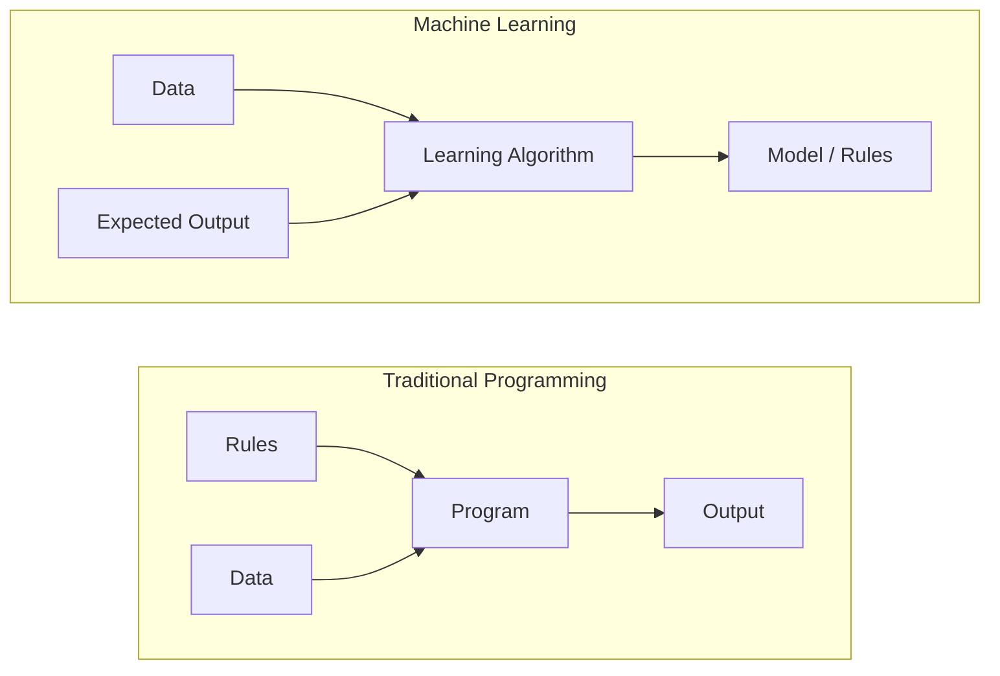
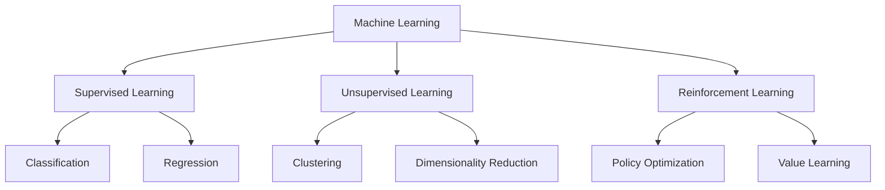
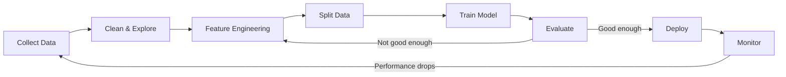
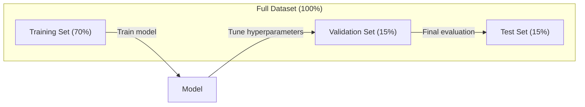
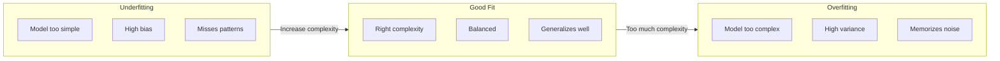
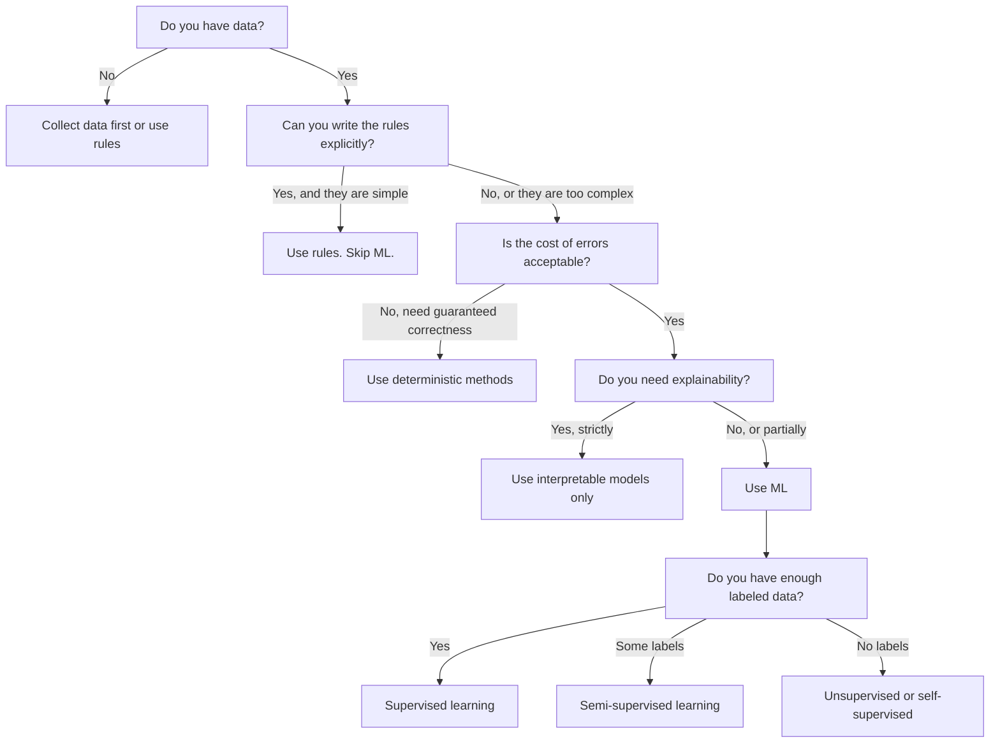

# 什麼是機器學習 (What Is Machine Learning)

> 機器學習是教電腦自己從資料中找出模式，而不是由你手寫規則。

**Type:** Learn
**Languages:** Python
**Prerequisites:** Phase 1 (Math Foundations)
**Time:** ~45 分鐘

## 學習目標 (Learning Objectives)

- 說明 supervised、unsupervised 與 reinforcement learning 的差異，並判斷某個問題屬於哪一種
- 從零實作 nearest centroid classifier，並與隨機 baseline 比較
- 區分 classification 與 regression 任務，並為各自選擇合適的 loss function
- 評估某個商業問題適合用 ML，還是用確定性規則解決比較好

## 問題 (The Problem)

假設你想做一個垃圾郵件過濾器。傳統做法是坐下來寫上百條規則。「如果信件包含 'FREE MONEY'，就標成垃圾郵件。如果驚嘆號超過 3 個，就標成垃圾郵件。」你花了好幾週寫規則。然後垃圾郵件發送者換了說法，你的規則就失效了。你再寫更多規則。這個循環永遠沒完沒了。

機器學習把這件事反過來。你不寫規則，而是給電腦幾千封已標記的信件（「垃圾」或「非垃圾」），讓它自己找出規則。電腦會發現你根本想不到的模式。當發送者改變手法，你只要用新資料重新訓練，不必重寫程式。

從「寫程式規則」轉變為「從資料中學習」，就是機器學習的核心。每一個推薦引擎、語音助理、自駕車和語言模型，都是這樣運作的。

## 核心概念 (The Concept)

### 從資料學習，而不是靠規則 (Learning From Data, Not Rules)

傳統程式設計與機器學習解決問題的方向剛好相反。



傳統程式設計：你寫規則。程式把規則套用在資料上，產生輸出。

機器學習：你提供資料與預期的輸出。演算法自己找出規則。

訓練之後得到的「model」就是規則本身，只是被編碼成數字（weights、parameters）。它能從看過的範例推廣，對從沒見過的資料做出預測。

### 機器學習的三種類型 (The Three Types of Machine Learning)



**Supervised Learning**：你有輸入與輸出的配對。模型學習把輸入對應到輸出。
- 「這裡有 10,000 張標記為貓或狗的照片。學會分辨牠們。」
- 「這裡有房屋特徵與價格。學會預測價格。」

**Unsupervised Learning**：你只有輸入，沒有標籤。模型自己找出結構。
- 「這裡有 10,000 筆顧客購買紀錄。找出自然的分群。」
- 「這裡有 1,000 維的資料點。降到 2 維，同時保留結構。」

**Reinforcement Learning**：agent 在環境中採取行動，並獲得獎勵或懲罰。它學習一套策略 (policy)，讓總獎勵最大化。
- 「玩這個遊戲。贏了 +1，輸了 -1。想出一套策略。」
- 「控制這隻機械手臂。撿起物體 +1，每浪費一秒 -0.01。」

實務上你會做的大多數東西都用 supervised learning。Unsupervised learning 常用於前處理與資料探索。Reinforcement learning 則驅動遊戲 AI、機器人，以及語言模型的 RLHF。

### 三大類之外 (Beyond the Big Three)

上面三種分類很清楚，但真實世界的 ML 常常模糊了界線。

**Semi-supervised learning** 使用少量已標記資料與大量未標記資料。例如你可能有 100 張標記過的醫學影像，以及 100,000 張未標記的。常見技術包括：

- **Label propagation：**建立一張連接相似資料點的圖。標籤會沿著圖，從已標記的節點傳到未標記的鄰居。
- **Pseudo-labeling：**先用已標記資料訓練模型，再用它預測未標記資料的標籤，然後把全部資料拿來重新訓練。模型自己撐起自己的訓練集。
- **Consistency regularization：**對同一個輸入，以及稍微擾動過的版本，模型應該給出相同的預測。這在沒有標籤時也成立。

**Self-supervised learning** 從資料本身產生監督訊號。完全不需要人工標籤。模型從資料結構中自己建立預測任務。

- **Masked language modeling (BERT)：**把句子中 15% 的字遮住，訓練模型預測被遮住的字。「標籤」來自原始文字。
- **Contrastive learning (SimCLR)：**取一張影像，產生兩個擴增版本。訓練模型認出它們來自同一張影像，同時能與其他影像的擴增版本區分開來。
- **Next-token prediction (GPT)：**根據前面所有的字，預測下一個字。每份文字文件都變成訓練範例。

這些並不是與三大類並列的獨立類別，而是結合 supervised 與 unsupervised 想法的策略。Self-supervised learning 技術上算 supervised（模型要預測某個東西），只是標籤是自動產生的，不是人工標的。

### Classification 與 Regression (Classification vs Regression)

這是 supervised learning 的兩大任務。

| 面向 | Classification | Regression |
|--------|---------------|------------|
| 輸出 | 離散的類別 | 連續的數值 |
| 範例 | 「這封信是垃圾郵件嗎？」 | 「房價會是多少？」 |
| 輸出空間 | {cat, dog, bird} | 任意實數 |
| Loss function | Cross-entropy、accuracy | Mean squared error、MAE |
| 決策 | 類別之間的邊界 | 一條擬合資料的曲線 |

Classification 回答「哪一類？」Regression 回答「多少？」

有些問題兩種方式都能設定。預測股票漲或跌是 classification，預測確切價格則是 regression。

### ML 工作流程 (The ML Workflow)

不管用哪種演算法，每個機器學習專案都遵循同樣的 pipeline。



**Collect Data（收集資料）**：蒐集原始資料。資料量幾乎總是越多越好，但品質比數量更重要。

**Clean & Explore（清理與探索）**：處理缺失值、移除重複項、視覺化分布、找出異常。這個步驟通常佔整個專案 60-80% 的時間。

**Feature Engineering**：把原始資料轉換成模型可用的 feature。例如把日期轉成星期幾、正規化數值欄位、編碼類別變數。好的 feature 比花俏的演算法更重要。

**Split Data（切分資料）**：分成 training、validation 與 test 三組。模型在 training data 上訓練，你在 validation data 上調整 hyperparameter，最後在 test data 上回報最終表現。

**Train Model（訓練模型）**：把 training data 餵給演算法。演算法會調整內部參數，使 loss function 最小化。

**Evaluate（評估）**：在 validation/test data 上衡量表現。如果表現不理想，就回頭嘗試不同的 feature、演算法或 hyperparameter。

**Deploy（部署）**：把模型放到正式環境，對新資料做預測。

**Monitor（監控）**：長期追蹤表現。資料分布會改變（data drift），模型也會退化。表現下降時就重新訓練。

### Training、Validation 與 Test 切分 (Training, Validation, and Test Splits)

這是初學者最常搞錯的重要觀念。你必須在模型訓練期間從未見過的資料上評估它。否則你衡量的是記憶，而不是學習。



| 切分 | 用途 | 使用時機 | 典型比例 |
|-------|---------|-----------|-------------|
| Training | 模型從這份資料學習 | 訓練期間 | 60-80% |
| Validation | 調整 hyperparameter、比較模型 | 每次訓練之後 | 10-20% |
| Test | 最終無偏差的表現估計 | 只用一次，在最後 | 10-20% |

Test set 是神聖的。你只能看它一次。如果你一直根據 test 表現來調整模型，實際上就是在 test set 上訓練，你回報的數字也就毫無意義。

資料集很小時，使用 k-fold cross-validation：把資料分成 $k$ 份，用 $k-1$ 份訓練，用剩下那份驗證，輪流進行，再把結果平均。

### Overfitting 與 Underfitting (Overfitting vs Underfitting)



**Underfitting**：模型太簡單，抓不到資料中的模式。就像用一條直線去擬合彎曲的關係。Training error 高，test error 也高。

**Overfitting**：模型太複雜，把 training data 連同雜訊都背下來了。就像一條蜿蜒的曲線穿過每個訓練點，卻在新資料上失敗。Training error 低，test error 高。

**Good fit**：模型抓到真正的模式，而沒有記住雜訊。Training error 與 test error 都相當低。

Overfitting 的徵兆：
- Training accuracy 遠高於 validation accuracy
- 模型在 training data 上表現良好，在新資料上卻很差
- 增加訓練資料能提升表現（代表模型原本是在記憶，而不是學習）

Overfitting 的解法：
- 取得更多訓練資料
- 降低模型複雜度（更少參數、更簡單的架構）
- Regularization（對過大的 weights 加上懲罰）
- Dropout（訓練時隨機把神經元歸零）
- Early stopping（validation error 開始上升時就停止訓練）

Underfitting 的解法：
- 使用更複雜的模型
- 加入更多 feature
- 減少 regularization
- 訓練更久

### Bias-Variance Tradeoff (The Bias-Variance Tradeoff)

這是 overfitting 與 underfitting 背後的數學框架。

**Bias**：來自模型錯誤假設的誤差。當真實關係是非線性時，線性模型就有高 bias。高 bias 會導致 underfitting。

**Variance**：來自對訓練資料小幅波動過度敏感的誤差。高 variance 的模型，用不同的資料子集訓練，會給出差異很大的預測。高 variance 會導致 overfitting。

| 模型複雜度 | Bias | Variance | 結果 |
|-----------------|------|----------|--------|
| 太低（用線性模型擬合彎曲資料） | 高 | 低 | Underfitting |
| 剛剛好 | 中 | 中 | 良好的 generalization |
| 太高（用 20 次多項式擬合 10 個點） | 低 | 高 | Overfitting |

$\text{Total error} = \text{Bias}^2 + \text{Variance} + \text{Irreducible noise}$

Irreducible noise 無法降低（它是資料本身的隨機性）。你要找的是讓 $\text{bias}^2 + \text{variance}$ 最小的甜蜜點。

### No Free Lunch 定理 (No Free Lunch Theorem)

沒有任何單一演算法能在所有問題上都表現最好。在某一類問題上表現優異的演算法，換到另一類問題可能表現很差。這就是為什麼資料科學家會嘗試多種演算法並比較結果。

實務上，選擇取決於：
- 你有多少資料
- 有多少個 feature
- 關係是線性還是非線性
- 是否需要可解釋性
- 你負擔得起多少運算資源

### 什麼時候不該用機器學習 (When NOT to Use Machine Learning)

ML 很強大，但不一定是對的工具。在動手建模之前，先問問自己是否真的需要。

**以下情況不要用 ML：**

- **規則簡單且定義明確。**例如稅額計算、排序演算法、單位換算。如果幾個 if 敘述就能寫完邏輯，用模型只會增加複雜度，沒有任何好處。
- **你沒有資料，或資料很少。**ML 需要範例才能學習。只有 10 筆資料，什麼有意義的東西都訓練不出來。先去收集資料。
- **出錯的代價是災難性的，而且你需要保證正確。**例如藥物劑量計算、核反應爐控制、密碼學驗證。ML 模型是機率性的，有時就是會錯。如果「有時會錯」無法接受，就用確定性的方法。
- **查表或啟發式規則就能解決問題。**如果一個簡單的門檻或表格就涵蓋 99% 的情況，加上 ML 只會增加維護成本，沒有實質改善。
- **你無法解釋決策，但可解釋性是必要的。**受監管的產業（貸款、保險、刑事司法）有時要求每個決策都必須完整可解釋。有些 ML 模型是可解釋的（linear regression、小型 decision tree），但大多數不是。
- **問題變化的速度比你重新訓練的速度還快。**如果規則每天都在變，而重新訓練要一週，模型就永遠是過時的。

用這張決策流程圖來判斷：



```figure
f3-learning-boundary
```

## 動手做 (Build It)

`code/ml_intro.py` 中的程式碼從零實作了 nearest centroid classifier，這是最簡單的 ML 演算法。它展示了核心概念：從資料學習，然後對新資料做預測。

### 步驟 1：從零實作 Nearest Centroid Classifier

Nearest centroid classifier 會計算 training data 中每個類別的中心（平均值）。預測時，它把每個新的點指派給中心最近的那個類別。

```python
class NearestCentroid:
    def fit(self, X, y):
        self.classes = np.unique(y)
        self.centroids = np.array([
            X[y == c].mean(axis=0) for c in self.classes
        ])

    def predict(self, X):
        distances = np.array([
            np.sqrt(((X - c) ** 2).sum(axis=1))
            for c in self.centroids
        ])
        return self.classes[distances.argmin(axis=0)]
```

整個演算法就這樣。Fit 計算兩個平均值，Predict 計算距離。沒有 gradient descent，沒有迭代，也沒有 hyperparameter。

### 步驟 2：在合成資料上訓練

我們產生一個 2D 的 classification 資料集，兩個類別略有重疊。Centroid classifier 會在兩個類別中心之間畫出一條線性的 decision boundary。

```python
rng = np.random.RandomState(42)
X_class0 = rng.randn(100, 2) + np.array([1.0, 1.0])
X_class1 = rng.randn(100, 2) + np.array([-1.0, -1.0])
X = np.vstack([X_class0, X_class1])
y = np.array([0] * 100 + [1] * 100)
```

### 步驟 3：與 Baseline 比較

每個 ML 模型都應該和一個簡單的 baseline 比較。這裡的 baseline 是隨機預測一個類別。如果你的 ML 模型贏不了隨機猜測，那一定哪裡出了問題。

```python
baseline_preds = rng.choice([0, 1], size=len(y_test))
baseline_acc = np.mean(baseline_preds == y_test)
```

在這個乾淨的資料集上，centroid classifier 應該能達到約 90% 以上的 accuracy。隨機 baseline 大約是 50%。

### 為什麼這很重要 (Why This Matters)

Nearest centroid classifier 簡單到不行。它沒有 hyperparameter、沒有迭代、沒有 gradient descent。然而它抓住了 ML 的基本模式：

1. 從 training data **學習**一個表示（centroids）
2. 用這個表示對新資料**預測**（最近距離）
3. 與 baseline（隨機猜測）**評估**

從 logistic regression 到 transformer，每個 ML 演算法都遵循這個相同的三步驟模式。表示會越來越複雜，但工作流程不變。

### 步驟 4：Centroid Classifier 做不到的事

Nearest centroid classifier 假設每個類別只形成單一團塊，畫出的是線性 decision boundary。以下情況它就會失敗：

- 類別有多個群集（例如數字「1」有好幾種不同的寫法）
- Decision boundary 是非線性的（例如一個類別包圍另一個類別）
- Feature 的尺度差異很大（距離會被尺度最大的 feature 主導）

這些限制正是你接下來要學的每個演算法的動機。K-nearest neighbors 處理多個群集，decision tree 處理非線性邊界，feature scaling 解決尺度問題。每一堂課都建立在前一堂課的限制之上。

## 實際使用 (Use It)

sklearn 提供 `NearestCentroid` 與合成資料產生器：

```python
from sklearn.neighbors import NearestCentroid
from sklearn.datasets import make_classification
from sklearn.model_selection import train_test_split

X, y = make_classification(
    n_samples=500, n_features=2, n_redundant=0,
    n_clusters_per_class=1, random_state=42
)
X_train, X_test, y_train, y_test = train_test_split(X, y, test_size=0.3)

clf = NearestCentroid()
clf.fit(X_train, y_train)
print(f"Accuracy: {clf.score(X_test, y_test):.3f}")
```

## 交付 (Ship It)

這堂課會產出 `outputs/prompt-ml-problem-framer.md`，這是一個把模糊的商業問題轉成具體 ML 任務的 prompt。給它一段問題描述（「我們想降低流失率」或「預測下一季的需求」），它會判斷學習類型、定義預測目標、列出候選 feature、挑選成功指標、建立 baseline，並標出 data leakage 或 class imbalance 之類的陷阱。在任何 ML 專案開始時使用它，避免做出錯誤的東西。

## 關鍵術語 (Key Terms)

| 術語 | 大家怎麼說 | 實際意義 |
|------|----------------|----------------------|
| Model | 「那個 AI」 | 一個帶有可學習參數、把輸入對應到輸出的數學函數 |
| Training | 「教 AI」 | 執行最佳化演算法來調整模型參數，使預測符合已知的輸出 |
| Feature | 「一個輸入欄位」 | 資料中可量測的屬性，模型用它來做預測 |
| Label | 「答案」 | 訓練範例的已知輸出，用來計算誤差訊號 |
| Hyperparameter | 「一個你要調的設定」 | 訓練前設定、控制學習過程的參數（learning rate、層數） |
| Loss function | 「模型錯得有多離譜」 | 衡量預測輸出與實際輸出差距的函數，訓練會試圖將它最小化 |
| Overfitting | 「它把考題背起來了」 | 模型學到的是訓練資料特有的雜訊，而不是一般模式，所以在新資料上失敗 |
| Underfitting | 「它什麼都沒學到」 | 模型太簡單，抓不到資料中真正的模式 |
| Generalization | 「它在新資料上也行」 | 模型對未訓練過的資料做出準確預測的能力 |
| Cross-validation | 「在不同區塊上測試」 | 反覆把資料切成 train/test fold 並平均結果，得到更穩健的表現估計 |
| Regularization | 「讓 weights 保持小」 | 在 loss function 加上懲罰項，抑制過度複雜的模型 |
| Data drift | 「世界變了」 | 進來的資料的統計分布隨時間改變，導致模型表現下降 |

## 練習 (Exercises)

1. 拿任何一個資料集（例如 Iris、Titanic），以 70/15/15 切成 train/validation/test。解釋為什麼不該在 test set 上調整 hyperparameter。
2. 列出三個真實世界的問題。針對每一個，判斷它是 classification、regression 還是 clustering，以及是 supervised 還是 unsupervised。
3. 某個模型在 training data 上有 99% 的 accuracy，在 test data 上卻只有 60%。診斷問題，並列出三件你會嘗試的修正方法。

## 延伸閱讀 (Further Reading)

- [An Introduction to Statistical Learning](https://www.statlearning.com/) - 免費教科書，涵蓋所有經典 ML 方法並附實務範例
- [Google's Machine Learning Crash Course](https://developers.google.com/machine-learning/crash-course) - 簡明、視覺化的 ML 概念入門
- [Scikit-learn User Guide](https://scikit-learn.org/stable/user_guide.html) - 在 Python 中實作 ML 的實用參考
