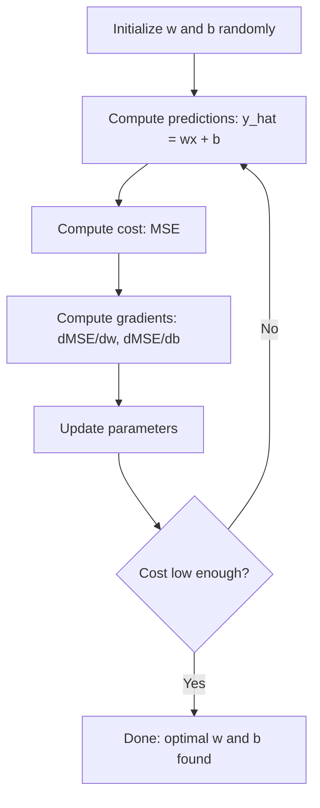

# Linear Regression

> Linear regression 在你的資料中畫出最適合的那條直線。它是機器學習的「hello world」。

**Type:** Build
**Languages:** Python
**Prerequisites:** Phase 1 (Linear Algebra, Calculus, Optimization), Phase 2 Lesson 1
**Time:** ~90 分鐘

## 學習目標 (Learning Objectives)

- 推導 mean squared error 的 gradient descent 更新規則，並從零實作 linear regression
- 比較 gradient descent 與 normal equation 的計算複雜度，以及各自的適用時機
- 建立帶有 feature standardization 的 multiple linear regression 模型，並解讀學到的 weights
- 說明 Ridge regression（L2 regularization）如何透過懲罰過大的 weights 來防止 overfitting

## 問題 (The Problem)

你有一份資料：房屋大小與成交價格。你想根據大小預測一棟新房子的價格。你可以在散布圖上目測，但你需要的是一個公式。你需要一條最符合資料的線，這樣不管輸入什麼大小，都能得到價格預測。

Linear regression 給你這條線。更重要的是，它引入了整個 ML 訓練迴圈：定義模型、定義 cost function、最佳化參數。每個 ML 演算法都遵循這個相同的模式。在最簡單的情況下把它學通，你就會在各處認出它。

它不只適用於簡單問題。Linear regression 被用在需求預測、A/B test 分析、財務建模等正式環境系統中，也是每個 regression 任務的 baseline。

## 核心概念 (The Concept)

### 模型 (The Model)

Linear regression 假設輸入 ($x$) 與輸出 ($y$) 之間是線性關係：

```math
y = wx + b
```

- `w`（weight/斜率）：$x$ 增加 1 時，$y$ 改變多少
- `b`（bias/截距）：$x = 0$ 時 $y$ 的值

對於多個輸入（feature），可以擴充為：

```math
y = w_1 x_1 + w_2 x_2 + \cdots + w_n x_n + b
```

或寫成向量形式：$y = w^T x + b$

目標：找出 $w$ 與 $b$ 的值，讓預測的 $y$ 在所有訓練範例上都盡可能接近實際的 $y$。

### Cost Function (Mean Squared Error) (The Cost Function)

怎麼衡量「盡可能接近」？你需要一個數字，來表示預測錯得有多嚴重。最常見的選擇是 Mean Squared Error (MSE)：

```math
\text{MSE} = \frac{1}{n} \sum (y_{\text{predicted}} - y_{\text{actual}})^2
```

為什麼要平方？有兩個原因。第一，它對大誤差的懲罰比小誤差更重（誤差 10 比誤差 1 糟 100 倍，而不是 10 倍）。第二，平方函數處處平滑且可微分，讓最佳化變得直接。

Cost function 會形成一個曲面。對單一個 weight $w$ 和 bias $b$ 來說，MSE 曲面看起來像一個碗（凸的拋物面）。碗底就是 MSE 最小的地方。訓練就是去找那個碗底。

### Gradient Descent

Gradient descent 透過一步步往下坡走，來找到碗底。



Gradient 告訴你兩件事：每個參數該往哪個方向移動，以及要移動多少。

對於 $\hat{y} = wx + b$ 的 MSE：

```math
\begin{aligned}
\frac{\partial \text{MSE}}{\partial w} &= \frac{2}{n} \sum (\hat{y} - y) \, x \\
\frac{\partial \text{MSE}}{\partial b} &= \frac{2}{n} \sum (\hat{y} - y)
\end{aligned}
```

更新規則：

```math
\begin{aligned}
w &= w - \text{learning\_rate} \cdot \frac{\partial \text{MSE}}{\partial w} \\
b &= b - \text{learning\_rate} \cdot \frac{\partial \text{MSE}}{\partial b}
\end{aligned}
```

Learning rate 控制步伐大小。太大：你會衝過最小值而發散。太小：訓練要花很久。常見的起始值：0.01、0.001 或 0.0001。

### Normal Equation (閉式解) (The Normal Equation)

對 linear regression 來說，有一個直接的公式，不需要任何迭代就能得到最佳 weights：

```math
w = (X^T X)^{-1} X^T y
```

它透過一次矩陣求逆，一步解出 $w$。對小型資料集效果完美。對大型資料集（百萬筆資料或數千個 feature），則偏好用 gradient descent，因為矩陣求逆對 feature 數量是 $O(n^3)$。

### Multiple Linear Regression

有多個 feature 時，模型變成：

```math
y = w_1 x_1 + w_2 x_2 + \cdots + w_n x_n + b
```

一切運作方式都相同：MSE 是 cost function，gradient descent 同時更新所有 weights。唯一的差別是你擬合的是超平面，而不是一條線。

Feature scaling 在這裡很重要。如果某個 feature 的範圍是 0 到 1，另一個是 0 到 1,000,000，gradient descent 會很吃力，因為 cost 曲面會被拉得很長。訓練前先把 feature standardize（減去平均值，除以標準差）。

### Polynomial Regression

如果關係不是線性的呢？你仍然可以建立多項式 feature，繼續使用 linear regression：

```math
y = w_1 x + w_2 x^2 + w_3 x^3 + b
```

這仍然是「線性」regression，因為模型對 weights ($w_1, w_2, w_3$) 是線性的。你只是用了 $x$ 的非線性 feature。

高次多項式可以擬合更複雜的曲線，但有 overfitting 的風險。10 次多項式會穿過 10 筆資料集中的每一個點，卻對新資料預測得很差。

### R-Squared 分數 (R-Squared Score)

MSE 告訴你錯得多嚴重，但這個數字取決於 $y$ 的尺度。R-squared ($R^2$) 提供一個與尺度無關的衡量方式：

```math
\begin{aligned}
R^2 &= 1 - \frac{\text{sum of squared residuals}}{\text{sum of squared deviations from mean}} \\
&= 1 - \frac{SS_{\text{res}}}{SS_{\text{tot}}}
\end{aligned}
```

- $R^2 = 1.0$：完美預測
- $R^2 = 0.0$：模型不比每次都預測平均值更好
- $R^2 < 0.0$：模型比預測平均值還差

### Regularization 預覽 (Ridge Regression) (Regularization Preview)

當 feature 很多時，模型可能會因為指派很大的 weights 而 overfit。Ridge regression（L2 regularization）加上一項懲罰：

```math
\text{Cost} = \text{MSE} + \lambda \sum w_i^2
```

懲罰項會抑制過大的 weights。Hyperparameter $\lambda$ 控制取捨：$\lambda$ 越大，weights 越小，regularization 越強。後面的課程會深入討論。現在只要知道它的存在，以及它為什麼有幫助。

```figure
linear-regression-fit
```

## 動手做 (Build It)

### 步驟 1：產生範例資料

```python
import random
import math

random.seed(42)

TRUE_W = 3.0
TRUE_B = 7.0
N_SAMPLES = 100

X = [random.uniform(0, 10) for _ in range(N_SAMPLES)]
y = [TRUE_W * x + TRUE_B + random.gauss(0, 2.0) for x in X]

print(f"Generated {N_SAMPLES} samples")
print(f"True relationship: y = {TRUE_W}x + {TRUE_B} (+ noise)")
print(f"First 5 points: {[(round(X[i], 2), round(y[i], 2)) for i in range(5)]}")
```

### 步驟 2：用 gradient descent 從零實作 linear regression

```python
class LinearRegression:
    def __init__(self, learning_rate=0.01):
        self.w = 0.0
        self.b = 0.0
        self.lr = learning_rate
        self.cost_history = []

    def predict(self, X):
        return [self.w * x + self.b for x in X]

    def compute_cost(self, X, y):
        predictions = self.predict(X)
        n = len(y)
        cost = sum((pred - actual) ** 2 for pred, actual in zip(predictions, y)) / n
        return cost

    def compute_gradients(self, X, y):
        predictions = self.predict(X)
        n = len(y)
        dw = (2 / n) * sum((pred - actual) * x for pred, actual, x in zip(predictions, y, X))
        db = (2 / n) * sum(pred - actual for pred, actual in zip(predictions, y))
        return dw, db

    def fit(self, X, y, epochs=1000, print_every=200):
        for epoch in range(epochs):
            dw, db = self.compute_gradients(X, y)
            self.w -= self.lr * dw
            self.b -= self.lr * db
            cost = self.compute_cost(X, y)
            self.cost_history.append(cost)
            if epoch % print_every == 0:
                print(f"  Epoch {epoch:4d} | Cost: {cost:.4f} | w: {self.w:.4f} | b: {self.b:.4f}")
        return self

    def r_squared(self, X, y):
        predictions = self.predict(X)
        y_mean = sum(y) / len(y)
        ss_res = sum((actual - pred) ** 2 for actual, pred in zip(y, predictions))
        ss_tot = sum((actual - y_mean) ** 2 for actual in y)
        return 1 - (ss_res / ss_tot)


print("=== Training Linear Regression (Gradient Descent) ===")
model = LinearRegression(learning_rate=0.005)
model.fit(X, y, epochs=1000, print_every=200)
print(f"\nLearned: y = {model.w:.4f}x + {model.b:.4f}")
print(f"True:    y = {TRUE_W}x + {TRUE_B}")
print(f"R-squared: {model.r_squared(X, y):.4f}")
```

### 步驟 3：Normal equation（閉式解）

```python
class LinearRegressionNormal:
    def __init__(self):
        self.w = 0.0
        self.b = 0.0

    def fit(self, X, y):
        n = len(X)
        x_mean = sum(X) / n
        y_mean = sum(y) / n
        numerator = sum((X[i] - x_mean) * (y[i] - y_mean) for i in range(n))
        denominator = sum((X[i] - x_mean) ** 2 for i in range(n))
        self.w = numerator / denominator
        self.b = y_mean - self.w * x_mean
        return self

    def predict(self, X):
        return [self.w * x + self.b for x in X]

    def r_squared(self, X, y):
        predictions = self.predict(X)
        y_mean = sum(y) / len(y)
        ss_res = sum((actual - pred) ** 2 for actual, pred in zip(y, predictions))
        ss_tot = sum((actual - y_mean) ** 2 for actual in y)
        return 1 - (ss_res / ss_tot)


print("\n=== Normal Equation (Closed-Form) ===")
model_normal = LinearRegressionNormal()
model_normal.fit(X, y)
print(f"Learned: y = {model_normal.w:.4f}x + {model_normal.b:.4f}")
print(f"R-squared: {model_normal.r_squared(X, y):.4f}")
```

### 步驟 4：Multiple linear regression

```python
class MultipleLinearRegression:
    def __init__(self, n_features, learning_rate=0.01):
        self.weights = [0.0] * n_features
        self.bias = 0.0
        self.lr = learning_rate
        self.cost_history = []

    def predict_single(self, x):
        return sum(w * xi for w, xi in zip(self.weights, x)) + self.bias

    def predict(self, X):
        return [self.predict_single(x) for x in X]

    def compute_cost(self, X, y):
        predictions = self.predict(X)
        n = len(y)
        return sum((pred - actual) ** 2 for pred, actual in zip(predictions, y)) / n

    def fit(self, X, y, epochs=1000, print_every=200):
        n = len(y)
        n_features = len(X[0])
        for epoch in range(epochs):
            predictions = self.predict(X)
            errors = [pred - actual for pred, actual in zip(predictions, y)]
            for j in range(n_features):
                grad = (2 / n) * sum(errors[i] * X[i][j] for i in range(n))
                self.weights[j] -= self.lr * grad
            grad_b = (2 / n) * sum(errors)
            self.bias -= self.lr * grad_b
            cost = self.compute_cost(X, y)
            self.cost_history.append(cost)
            if epoch % print_every == 0:
                print(f"  Epoch {epoch:4d} | Cost: {cost:.4f}")
        return self

    def r_squared(self, X, y):
        predictions = self.predict(X)
        y_mean = sum(y) / len(y)
        ss_res = sum((actual - pred) ** 2 for actual, pred in zip(y, predictions))
        ss_tot = sum((actual - y_mean) ** 2 for actual in y)
        return 1 - (ss_res / ss_tot)


random.seed(42)
N = 100
X_multi = []
y_multi = []
for _ in range(N):
    size = random.uniform(500, 3000)
    bedrooms = random.randint(1, 5)
    age = random.uniform(0, 50)
    price = 50 * size + 10000 * bedrooms - 1000 * age + 50000 + random.gauss(0, 20000)
    X_multi.append([size, bedrooms, age])
    y_multi.append(price)


def standardize(X):
    n_features = len(X[0])
    means = [sum(X[i][j] for i in range(len(X))) / len(X) for j in range(n_features)]
    stds = []
    for j in range(n_features):
        variance = sum((X[i][j] - means[j]) ** 2 for i in range(len(X))) / len(X)
        stds.append(variance ** 0.5)
    X_scaled = []
    for i in range(len(X)):
        row = [(X[i][j] - means[j]) / stds[j] if stds[j] > 0 else 0 for j in range(n_features)]
        X_scaled.append(row)
    return X_scaled, means, stds


y_mean_val = sum(y_multi) / len(y_multi)
y_std_val = (sum((yi - y_mean_val) ** 2 for yi in y_multi) / len(y_multi)) ** 0.5
y_scaled = [(yi - y_mean_val) / y_std_val for yi in y_multi]

X_scaled, x_means, x_stds = standardize(X_multi)

print("\n=== Multiple Linear Regression (3 features) ===")
print("Features: house size, bedrooms, age")
multi_model = MultipleLinearRegression(n_features=3, learning_rate=0.01)
multi_model.fit(X_scaled, y_scaled, epochs=1000, print_every=200)

print(f"\nWeights (standardized): {[round(w, 4) for w in multi_model.weights]}")
print(f"Bias (standardized): {multi_model.bias:.4f}")
print(f"R-squared: {multi_model.r_squared(X_scaled, y_scaled):.4f}")
```

### 步驟 5：Polynomial regression

```python
class PolynomialRegression:
    def __init__(self, degree, learning_rate=0.01):
        self.degree = degree
        self.weights = [0.0] * degree
        self.bias = 0.0
        self.lr = learning_rate

    def make_features(self, X):
        return [[x ** (d + 1) for d in range(self.degree)] for x in X]

    def predict(self, X):
        features = self.make_features(X)
        return [sum(w * f for w, f in zip(self.weights, row)) + self.bias for row in features]

    def fit(self, X, y, epochs=1000, print_every=200):
        features = self.make_features(X)
        n = len(y)
        for epoch in range(epochs):
            predictions = [sum(w * f for w, f in zip(self.weights, row)) + self.bias for row in features]
            errors = [pred - actual for pred, actual in zip(predictions, y)]
            for j in range(self.degree):
                grad = (2 / n) * sum(errors[i] * features[i][j] for i in range(n))
                self.weights[j] -= self.lr * grad
            grad_b = (2 / n) * sum(errors)
            self.bias -= self.lr * grad_b
            if epoch % print_every == 0:
                cost = sum(e ** 2 for e in errors) / n
                print(f"  Epoch {epoch:4d} | Cost: {cost:.6f}")
        return self

    def r_squared(self, X, y):
        predictions = self.predict(X)
        y_mean = sum(y) / len(y)
        ss_res = sum((actual - pred) ** 2 for actual, pred in zip(y, predictions))
        ss_tot = sum((actual - y_mean) ** 2 for actual in y)
        return 1 - (ss_res / ss_tot)


random.seed(42)
X_poly = [x / 10.0 for x in range(0, 50)]
y_poly = [0.5 * x ** 2 - 2 * x + 3 + random.gauss(0, 1.0) for x in X_poly]

x_max = max(abs(x) for x in X_poly)
X_poly_norm = [x / x_max for x in X_poly]
y_poly_mean = sum(y_poly) / len(y_poly)
y_poly_std = (sum((yi - y_poly_mean) ** 2 for yi in y_poly) / len(y_poly)) ** 0.5
y_poly_norm = [(yi - y_poly_mean) / y_poly_std for yi in y_poly]

print("\n=== Polynomial Regression (degree 2 vs degree 5) ===")
print("True relationship: y = 0.5x^2 - 2x + 3")

print("\nDegree 2:")
poly2 = PolynomialRegression(degree=2, learning_rate=0.1)
poly2.fit(X_poly_norm, y_poly_norm, epochs=2000, print_every=500)
print(f"  R-squared: {poly2.r_squared(X_poly_norm, y_poly_norm):.4f}")

print("\nDegree 5:")
poly5 = PolynomialRegression(degree=5, learning_rate=0.1)
poly5.fit(X_poly_norm, y_poly_norm, epochs=2000, print_every=500)
print(f"  R-squared: {poly5.r_squared(X_poly_norm, y_poly_norm):.4f}")

print("\nDegree 2 fits the true curve well. Degree 5 fits training data slightly better")
print("but risks overfitting on new data.")
```

### 步驟 6：Ridge regression（L2 regularization）

```python
class RidgeRegression:
    def __init__(self, n_features, learning_rate=0.01, alpha=1.0):
        self.weights = [0.0] * n_features
        self.bias = 0.0
        self.lr = learning_rate
        self.alpha = alpha

    def predict_single(self, x):
        return sum(w * xi for w, xi in zip(self.weights, x)) + self.bias

    def predict(self, X):
        return [self.predict_single(x) for x in X]

    def fit(self, X, y, epochs=1000, print_every=200):
        n = len(y)
        n_features = len(X[0])
        for epoch in range(epochs):
            predictions = self.predict(X)
            errors = [pred - actual for pred, actual in zip(predictions, y)]
            mse = sum(e ** 2 for e in errors) / n
            reg_term = self.alpha * sum(w ** 2 for w in self.weights)
            cost = mse + reg_term
            for j in range(n_features):
                grad = (2 / n) * sum(errors[i] * X[i][j] for i in range(n))
                grad += 2 * self.alpha * self.weights[j]
                self.weights[j] -= self.lr * grad
            grad_b = (2 / n) * sum(errors)
            self.bias -= self.lr * grad_b
            if epoch % print_every == 0:
                print(f"  Epoch {epoch:4d} | Cost: {cost:.4f} | L2 penalty: {reg_term:.4f}")
        return self


print("\n=== Ridge Regression (L2 Regularization) ===")
print("Same data as multiple regression, with alpha=0.1")
ridge = RidgeRegression(n_features=3, learning_rate=0.01, alpha=0.1)
ridge.fit(X_scaled, y_scaled, epochs=1000, print_every=200)
print(f"\nRidge weights: {[round(w, 4) for w in ridge.weights]}")
print(f"Plain weights: {[round(w, 4) for w in multi_model.weights]}")
print("Ridge weights are smaller (shrunk toward zero) due to the L2 penalty.")
```

## 實際使用 (Use It)

現在用 scikit-learn 做同樣的事，這才是你在正式環境中真正會用的工具。

```python
from sklearn.linear_model import LinearRegression as SklearnLR
from sklearn.linear_model import Ridge
from sklearn.preprocessing import PolynomialFeatures, StandardScaler
from sklearn.model_selection import train_test_split
from sklearn.metrics import mean_squared_error, r2_score
import numpy as np

np.random.seed(42)
X_sk = np.random.uniform(0, 10, (100, 1))
y_sk = 3.0 * X_sk.squeeze() + 7.0 + np.random.normal(0, 2.0, 100)

X_train, X_test, y_train, y_test = train_test_split(X_sk, y_sk, test_size=0.2, random_state=42)

lr = SklearnLR()
lr.fit(X_train, y_train)
y_pred = lr.predict(X_test)

print("=== Scikit-learn Linear Regression ===")
print(f"Coefficient (w): {lr.coef_[0]:.4f}")
print(f"Intercept (b): {lr.intercept_:.4f}")
print(f"R-squared (test): {r2_score(y_test, y_pred):.4f}")
print(f"MSE (test): {mean_squared_error(y_test, y_pred):.4f}")

poly = PolynomialFeatures(degree=2, include_bias=False)
X_poly_sk = poly.fit_transform(X_train)
X_poly_test = poly.transform(X_test)

lr_poly = SklearnLR()
lr_poly.fit(X_poly_sk, y_train)
print(f"\nPolynomial degree 2 R-squared: {r2_score(y_test, lr_poly.predict(X_poly_test)):.4f}")

scaler = StandardScaler()
X_train_scaled = scaler.fit_transform(X_train)
X_test_scaled = scaler.transform(X_test)

ridge = Ridge(alpha=1.0)
ridge.fit(X_train_scaled, y_train)
print(f"Ridge R-squared: {r2_score(y_test, ridge.predict(X_test_scaled)):.4f}")
print(f"Ridge coefficient: {ridge.coef_[0]:.4f}")
```

你從零實作的版本與 scikit-learn 會得到相同的結果。差別在於：scikit-learn 處理了邊界情況、數值穩定性與效能最佳化。正式環境用函式庫；想了解背後發生什麼事，就用從零實作的版本。

## 交付 (Ship It)

這堂課會產出：
- `outputs/skill-regression.md` - 一個根據問題選擇合適 regression 方法的 skill

## 練習 (Exercises)

1. 實作 batch gradient descent、stochastic gradient descent (SGD) 與 mini-batch gradient descent。在同一份資料集上比較收斂速度。哪個收斂最快？哪個的 cost 曲線最平滑？
2. 從三次函數產生資料（$y = ax^3 + bx^2 + cx + d + \text{noise}$）。擬合 1 次、3 次與 10 次的多項式。比較 training $R^2$ 與 test $R^2$。幾次時 overfitting 會變得明顯？
3. 實作 Lasso regression（L1 regularization：$\text{penalty} = \alpha \sum \lvert w_i \rvert$）。在多 feature 的房屋資料上訓練，比較哪些 weights 會變成零，並與 Ridge 對照。為什麼 L1 會產生稀疏解，而 L2 不會？

## 關鍵術語 (Key Terms)

| 術語 | 大家怎麼說 | 實際意義 |
|------|----------------|----------------------|
| Linear regression | 「在資料中畫一條線」 | 找出 weight $w$ 與 bias $b$，使 $wx+b$ 與實際 $y$ 值之間的平方差總和最小 |
| Cost function | 「模型有多糟」 | 把模型參數對應到單一數字、用來衡量預測誤差的函數，最佳化就是要將它最小化 |
| Mean squared error | 「平方誤差的平均」 | $\frac{1}{n} \sum (\text{predicted} - \text{actual})^2$，對大誤差的懲罰不成比例地加重 |
| Gradient descent | 「往下坡走」 | 利用偏導數，沿著能降低 cost function 的方向反覆調整參數 |
| Learning rate | 「步伐大小」 | 控制每個 gradient descent 步驟中參數改變多少的純量 |
| Normal equation | 「直接解出來」 | 閉式解 $w = (X^T X)^{-1} X^T y$，不需迭代就能得到最佳 weights |
| R-squared | 「擬合得有多好」 | 模型所解釋的 $y$ 變異比例，範圍從負無限大到 1.0 |
| Feature scaling | 「讓 feature 可以比較」 | 把 feature 轉換到相近的範圍（例如平均為零、變異數為一），讓 gradient descent 收斂更快 |
| Regularization | 「懲罰複雜度」 | 在 cost function 加上一項來縮小 weights，防止 overfitting |
| Ridge regression | 「L2 regularization」 | 在 MSE 上加入 $\lambda \sum w_i^2$ 懲罰的 linear regression |
| Polynomial regression | 「用線性數學擬合曲線」 | 對多項式 feature（$x, x^2, x^3, \ldots$）做 linear regression，對 weights 仍是線性的 |
| Overfitting | 「背下訓練資料」 | 模型複雜到擬合了 training data 中的雜訊，在新資料上失敗 |

## 延伸閱讀 (Further Reading)

- [An Introduction to Statistical Learning (ISLR)](https://www.statlearning.com/) -- 免費 PDF，第 3 與第 6 章以實務的 R 範例介紹 linear regression 與 regularization
- [The Elements of Statistical Learning (ESL)](https://hastie.su.domains/ElemStatLearn/) -- 免費 PDF，ISLR 偏數學的進階版，對 ridge 與 lasso 有更深入的探討
- [Stanford CS229 Lecture Notes on Linear Regression](https://cs229.stanford.edu/main_notes.pdf) -- Andrew Ng 的筆記，從基本原理推導 normal equation 與 gradient descent
- [scikit-learn LinearRegression documentation](https://scikit-learn.org/stable/modules/linear_model.html) -- LinearRegression、Ridge、Lasso 與 ElasticNet 的實用參考，附程式碼範例
