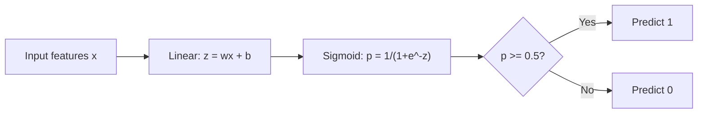
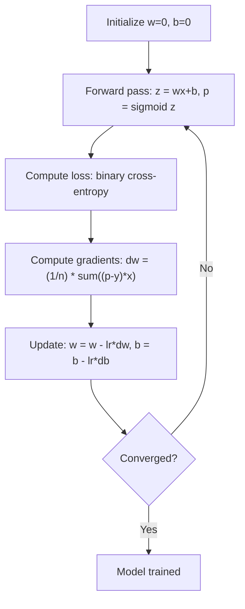

# Logistic Regression

> Logistic regression 把直線彎成 S 形曲線，用機率來回答是非題。

**Type:** Build
**Languages:** Python
**Prerequisites:** Phase 2 Lesson 1-2 (What Is ML, Linear Regression)
**Time:** ~90 分鐘

## 學習目標 (Learning Objectives)

- 使用 sigmoid function 與 binary cross-entropy loss，從零實作 logistic regression
- 計算並解讀 binary classification 的 precision、recall、F1 score 與 confusion matrix
- 說明為什麼 MSE 不適用於 classification，以及為什麼 binary cross-entropy 會產生 convex 的 cost 曲面
- 建立用於 multi-class classification 的 softmax regression 模型，並評估 threshold 調整的取捨

## 問題 (The Problem)

你想根據腫瘤大小，預測它是惡性還是良性。你試了 linear regression，它輸出的是 0.3、1.7 或 -0.5 這類數字。這些代表什麼？1.7 是「非常惡性」嗎？-0.5 是「非常良性」嗎？Linear regression 輸出的是沒有界限的數字。Classification 需要介於 0 到 1 之間、有界限的機率，以及一個明確的決定：是或不是。

Logistic regression 解決了這個問題。它取同樣的線性組合 ($wx + b$)，再通過 sigmoid function，把任何數字壓縮到 (0, 1) 的範圍。輸出就是機率。你設定一個 threshold（通常是 0.5），然後做出決定。

這是實務上使用最廣泛的演算法之一。儘管名字裡有 regression，logistic regression 其實是 classification 演算法，不是 regression 演算法。名字來自它使用的 logistic（sigmoid）函數。

## 核心概念 (The Concept)

### 為什麼 Linear Regression 不適用於 Classification (Why Linear Regression Fails for Classification)

想像根據讀書時數預測及格/不及格（1/0）。Linear regression 會在資料中擬合一條線：

```
hours:  1   2   3   4   5   6   7   8   9   10
actual: 0   0   0   0   1   1   1   1   1   1
```

線性擬合可能在第 1 小時預測出 -0.2，在第 10 小時預測出 1.3。這些值不是機率，它們會低於 0，也會高於 1。更糟的是，單一個 outlier（有人讀了 50 小時）就會拉動整條線，改變所有人的預測。

Classification 需要一個函數，它要：
- 輸出介於 0 與 1 之間的值（機率）
- 產生明確的轉折（decision boundary）
- 不會被遠離邊界的 outlier 扭曲

### Sigmoid Function

Sigmoid function 正好做到這些：

```math
\sigma(z) = \frac{1}{1 + e^{-z}}
```

性質：
- 當 $z$ 是很大的正數，$\sigma(z)$ 趨近 1
- 當 $z$ 是很大的負數，$\sigma(z)$ 趨近 0
- 當 $z = 0$，$\sigma(z) = 0.5$
- 輸出永遠介於 0 與 1 之間
- 函數處處平滑且可微分

它的導數形式很方便：$\sigma'(z) = \sigma(z) (1 - \sigma(z))$。這讓 gradient 的計算很有效率。

### Logistic Regression = 線性模型 + Sigmoid (Logistic Regression = Linear Model + Sigmoid)

模型先計算 $z = wx + b$（與 linear regression 相同），再套用 sigmoid：



輸出 $p$ 被解讀為 $P(y=1 \mid x)$，也就是輸入屬於類別 1 的機率。Decision boundary 在 $wx + b = 0$ 的位置，此時 sigmoid 的輸出剛好是 0.5。

### Binary Cross-Entropy Loss

Logistic regression 不能用 MSE。MSE 搭配 sigmoid 會產生有許多 local minima 的非 convex cost 曲面。取而代之，使用 binary cross-entropy（log loss）：

```math
\text{Loss} = -\frac{1}{n} \sum \left( y \log(p) + (1-y) \log(1-p) \right)
```

為什麼這樣可行：
- 當 $y=1$ 且 $p$ 接近 1：$\log(1) = 0$，所以 loss 接近 0（預測正確，成本低）
- 當 $y=1$ 且 $p$ 接近 0：$\log(0)$ 趨近負無限大，所以 loss 非常大（預測錯誤，成本高）
- 當 $y=0$ 且 $p$ 接近 0：$\log(1) = 0$，所以 loss 接近 0（預測正確，成本低）
- 當 $y=0$ 且 $p$ 接近 1：$\log(0)$ 趨近負無限大，所以 loss 非常大（預測錯誤，成本高）

對 logistic regression 來說，這個 loss function 是 convex 的，所以每個 local minimum 都是 global minimum，gradient descent 不會卡在壞的 minimum。在完全可分的資料上，weights 越大 loss 就越小，所以不存在有限的 minimum；L2 regularization 可以解決這件事，並讓 minimum 變得唯一。

### Logistic Regression 的 Gradient Descent (Gradient Descent for Logistic Regression)

Sigmoid 搭配 binary cross-entropy 的 gradient 形式很簡潔：

```math
\begin{aligned}
\frac{\partial L}{\partial w} &= \frac{1}{n} \sum (p - y) \, x \\
\frac{\partial L}{\partial b} &= \frac{1}{n} \sum (p - y)
\end{aligned}
```

這看起來和 linear regression 的 gradient 一模一樣。差別在於這裡是 $p = \sigma(wx + b)$，而不是 $p = wx + b$。Sigmoid 帶進了非線性，但 gradient 更新規則維持不變。



### Decision Boundary (The Decision Boundary)

對於 2D 輸入（兩個 feature），decision boundary 是滿足下式的那條線：

```math
w_1 x_1 + w_2 x_2 + b = 0
```

在線一側的點被分類為 1，另一側的點被分類為 0。Logistic regression 永遠產生線性的 decision boundary。如果你需要彎曲的邊界，就要加入多項式 feature，或使用非線性模型。

### 用 Softmax 做 Multi-Class Classification (Multi-Class Classification with Softmax)

Binary logistic regression 處理兩個類別。對於 $k$ 個類別，使用 softmax function：

```math
\text{softmax}(z_i) = \frac{e^{z_i}}{\sum_j e^{z_j}}
```

每個類別都有自己的 weight 向量。模型為每個類別計算一個分數 $z_i$，再由 softmax 把分數轉成總和為 1 的機率。預測的類別就是機率最高的那個。

Loss function 變成 categorical cross-entropy：

```math
\text{Loss} = -\frac{1}{n} \sum \sum_k y_k \log(p_k)
```

其中 $y_k$ 對真實類別是 1，其餘都是 0（one-hot encoding）。

### 評估指標 (Evaluation Metrics)

只看 accuracy 是不夠的。對於 95% 是負例、5% 是正例的資料集，一個永遠預測負例的模型就有 95% 的 accuracy，卻毫無用處。

**Confusion Matrix**：

| | 預測為正 | 預測為負 |
|---|---|---|
| 實際為正 | True Positive (TP) | False Negative (FN) |
| 實際為負 | False Positive (FP) | True Negative (TN) |

**Precision**：在所有預測為正的樣本中，有多少實際上是正的？
```math
\text{Precision} = \frac{TP}{TP + FP}
```

**Recall**（Sensitivity）：在所有實際為正的樣本中，我們抓到了多少？
```math
\text{Recall} = \frac{TP}{TP + FN}
```

**F1 Score**：Precision 與 recall 的調和平均數，兩個指標兼顧。
```math
F_1 = 2 \cdot \frac{\text{Precision} \cdot \text{Recall}}{\text{Precision} + \text{Recall}}
```

何時優先考慮哪個：
- **Precision**：false positive 的代價很高時（垃圾郵件過濾器，你不想擋掉正常信件）
- **Recall**：false negative 的代價很高時（癌症篩檢，你不想漏掉腫瘤）
- **F1**：你需要單一的平衡指標時

```figure
logistic-sigmoid
```

## 動手做 (Build It)

### 步驟 1：Sigmoid function 與資料產生

```python
import random
import math

def sigmoid(z):
    z = max(-500, min(500, z))
    return 1.0 / (1.0 + math.exp(-z))


random.seed(42)
N = 200
X = []
y = []

for _ in range(N // 2):
    X.append([random.gauss(2, 1), random.gauss(2, 1)])
    y.append(0)

for _ in range(N // 2):
    X.append([random.gauss(5, 1), random.gauss(5, 1)])
    y.append(1)

combined = list(zip(X, y))
random.shuffle(combined)
X, y = zip(*combined)
X = list(X)
y = list(y)

print(f"Generated {N} samples (2 classes, 2 features)")
print(f"Class 0 center: (2, 2), Class 1 center: (5, 5)")
print(f"First 5 samples:")
for i in range(5):
    print(f"  Features: [{X[i][0]:.2f}, {X[i][1]:.2f}], Label: {y[i]}")
```

### 步驟 2：從零實作 logistic regression

```python
class LogisticRegression:
    def __init__(self, n_features, learning_rate=0.01):
        self.weights = [0.0] * n_features
        self.bias = 0.0
        self.lr = learning_rate
        self.loss_history = []

    def predict_proba(self, x):
        z = sum(w * xi for w, xi in zip(self.weights, x)) + self.bias
        return sigmoid(z)

    def predict(self, x, threshold=0.5):
        return 1 if self.predict_proba(x) >= threshold else 0

    def compute_loss(self, X, y):
        n = len(y)
        total = 0.0
        for i in range(n):
            p = self.predict_proba(X[i])
            p = max(1e-15, min(1 - 1e-15, p))
            total += y[i] * math.log(p) + (1 - y[i]) * math.log(1 - p)
        return -total / n

    def fit(self, X, y, epochs=1000, print_every=200):
        n = len(y)
        n_features = len(X[0])
        for epoch in range(epochs):
            dw = [0.0] * n_features
            db = 0.0
            for i in range(n):
                p = self.predict_proba(X[i])
                error = p - y[i]
                for j in range(n_features):
                    dw[j] += error * X[i][j]
                db += error
            for j in range(n_features):
                self.weights[j] -= self.lr * (dw[j] / n)
            self.bias -= self.lr * (db / n)
            loss = self.compute_loss(X, y)
            self.loss_history.append(loss)
            if epoch % print_every == 0:
                print(f"  Epoch {epoch:4d} | Loss: {loss:.4f} | w: [{self.weights[0]:.3f}, {self.weights[1]:.3f}] | b: {self.bias:.3f}")
        return self

    def accuracy(self, X, y):
        correct = sum(1 for i in range(len(y)) if self.predict(X[i]) == y[i])
        return correct / len(y)


split = int(0.8 * N)
X_train, X_test = X[:split], X[split:]
y_train, y_test = y[:split], y[split:]

print("\n=== Training Logistic Regression ===")
model = LogisticRegression(n_features=2, learning_rate=0.1)
model.fit(X_train, y_train, epochs=1000, print_every=200)

print(f"\nTrain accuracy: {model.accuracy(X_train, y_train):.4f}")
print(f"Test accuracy:  {model.accuracy(X_test, y_test):.4f}")
print(f"Weights: [{model.weights[0]:.4f}, {model.weights[1]:.4f}]")
print(f"Bias: {model.bias:.4f}")
```

### 步驟 3：從零實作 confusion matrix 與指標

```python
class ClassificationMetrics:
    def __init__(self, y_true, y_pred):
        self.tp = sum(1 for t, p in zip(y_true, y_pred) if t == 1 and p == 1)
        self.tn = sum(1 for t, p in zip(y_true, y_pred) if t == 0 and p == 0)
        self.fp = sum(1 for t, p in zip(y_true, y_pred) if t == 0 and p == 1)
        self.fn = sum(1 for t, p in zip(y_true, y_pred) if t == 1 and p == 0)

    def accuracy(self):
        total = self.tp + self.tn + self.fp + self.fn
        return (self.tp + self.tn) / total if total > 0 else 0

    def precision(self):
        denom = self.tp + self.fp
        return self.tp / denom if denom > 0 else 0

    def recall(self):
        denom = self.tp + self.fn
        return self.tp / denom if denom > 0 else 0

    def f1(self):
        p = self.precision()
        r = self.recall()
        return 2 * p * r / (p + r) if (p + r) > 0 else 0

    def print_confusion_matrix(self):
        print(f"\n  Confusion Matrix:")
        print(f"                  Predicted")
        print(f"                  Pos   Neg")
        print(f"  Actual Pos     {self.tp:4d}  {self.fn:4d}")
        print(f"  Actual Neg     {self.fp:4d}  {self.tn:4d}")

    def print_report(self):
        self.print_confusion_matrix()
        print(f"\n  Accuracy:  {self.accuracy():.4f}")
        print(f"  Precision: {self.precision():.4f}")
        print(f"  Recall:    {self.recall():.4f}")
        print(f"  F1 Score:  {self.f1():.4f}")


y_pred_test = [model.predict(x) for x in X_test]
print("\n=== Classification Report (Test Set) ===")
metrics = ClassificationMetrics(y_test, y_pred_test)
metrics.print_report()
```

### 步驟 4：Decision boundary 分析

```python
print("\n=== Decision Boundary ===")
w1, w2 = model.weights
b = model.bias
print(f"Decision boundary: {w1:.4f}*x1 + {w2:.4f}*x2 + {b:.4f} = 0")
if abs(w2) > 1e-10:
    print(f"Solved for x2:     x2 = {-w1/w2:.4f}*x1 + {-b/w2:.4f}")

print("\nSample predictions near the boundary:")
test_points = [
    [3.0, 3.0],
    [3.5, 3.5],
    [4.0, 4.0],
    [2.5, 2.5],
    [5.0, 5.0],
]
for point in test_points:
    prob = model.predict_proba(point)
    pred = model.predict(point)
    print(f"  [{point[0]}, {point[1]}] -> prob={prob:.4f}, class={pred}")
```

### 步驟 5：用 softmax 做 multi-class

```python
class SoftmaxRegression:
    def __init__(self, n_features, n_classes, learning_rate=0.01):
        self.n_features = n_features
        self.n_classes = n_classes
        self.lr = learning_rate
        self.weights = [[0.0] * n_features for _ in range(n_classes)]
        self.biases = [0.0] * n_classes

    def softmax(self, scores):
        max_score = max(scores)
        exp_scores = [math.exp(s - max_score) for s in scores]
        total = sum(exp_scores)
        return [e / total for e in exp_scores]

    def predict_proba(self, x):
        scores = [
            sum(self.weights[k][j] * x[j] for j in range(self.n_features)) + self.biases[k]
            for k in range(self.n_classes)
        ]
        return self.softmax(scores)

    def predict(self, x):
        probs = self.predict_proba(x)
        return probs.index(max(probs))

    def fit(self, X, y, epochs=1000, print_every=200):
        n = len(y)
        for epoch in range(epochs):
            grad_w = [[0.0] * self.n_features for _ in range(self.n_classes)]
            grad_b = [0.0] * self.n_classes
            total_loss = 0.0
            for i in range(n):
                probs = self.predict_proba(X[i])
                for k in range(self.n_classes):
                    target = 1.0 if y[i] == k else 0.0
                    error = probs[k] - target
                    for j in range(self.n_features):
                        grad_w[k][j] += error * X[i][j]
                    grad_b[k] += error
                true_prob = max(probs[y[i]], 1e-15)
                total_loss -= math.log(true_prob)
            for k in range(self.n_classes):
                for j in range(self.n_features):
                    self.weights[k][j] -= self.lr * (grad_w[k][j] / n)
                self.biases[k] -= self.lr * (grad_b[k] / n)
            if epoch % print_every == 0:
                print(f"  Epoch {epoch:4d} | Loss: {total_loss / n:.4f}")
        return self

    def accuracy(self, X, y):
        correct = sum(1 for i in range(len(y)) if self.predict(X[i]) == y[i])
        return correct / len(y)


random.seed(42)
X_3class = []
y_3class = []

centers = [(1, 1), (5, 1), (3, 5)]
for label, (cx, cy) in enumerate(centers):
    for _ in range(50):
        X_3class.append([random.gauss(cx, 0.8), random.gauss(cy, 0.8)])
        y_3class.append(label)

combined = list(zip(X_3class, y_3class))
random.shuffle(combined)
X_3class, y_3class = zip(*combined)
X_3class = list(X_3class)
y_3class = list(y_3class)

split_3 = int(0.8 * len(X_3class))
X_train_3 = X_3class[:split_3]
y_train_3 = y_3class[:split_3]
X_test_3 = X_3class[split_3:]
y_test_3 = y_3class[split_3:]

print("\n=== Multi-class Softmax Regression (3 classes) ===")
softmax_model = SoftmaxRegression(n_features=2, n_classes=3, learning_rate=0.1)
softmax_model.fit(X_train_3, y_train_3, epochs=1000, print_every=200)
print(f"\nTrain accuracy: {softmax_model.accuracy(X_train_3, y_train_3):.4f}")
print(f"Test accuracy:  {softmax_model.accuracy(X_test_3, y_test_3):.4f}")

print("\nSample predictions:")
for i in range(5):
    probs = softmax_model.predict_proba(X_test_3[i])
    pred = softmax_model.predict(X_test_3[i])
    print(f"  True: {y_test_3[i]}, Predicted: {pred}, Probs: [{', '.join(f'{p:.3f}' for p in probs)}]")
```

### 步驟 6：Threshold 調整

```python
print("\n=== Threshold Tuning ===")
print("Default threshold: 0.5. Adjusting the threshold trades precision for recall.\n")

thresholds = [0.3, 0.4, 0.5, 0.6, 0.7]
print(f"{'Threshold':>10} {'Accuracy':>10} {'Precision':>10} {'Recall':>10} {'F1':>10}")
print("-" * 52)

for t in thresholds:
    y_pred_t = [1 if model.predict_proba(x) >= t else 0 for x in X_test]
    m = ClassificationMetrics(y_test, y_pred_t)
    print(f"{t:>10.1f} {m.accuracy():>10.4f} {m.precision():>10.4f} {m.recall():>10.4f} {m.f1():>10.4f}")
```

## 實際使用 (Use It)

現在用 scikit-learn 做同樣的事。

```python
from sklearn.linear_model import LogisticRegression as SklearnLR
from sklearn.metrics import accuracy_score, precision_score, recall_score, f1_score
from sklearn.metrics import confusion_matrix, classification_report
from sklearn.model_selection import train_test_split
from sklearn.preprocessing import StandardScaler
import numpy as np

np.random.seed(42)
X_0 = np.random.randn(100, 2) + [2, 2]
X_1 = np.random.randn(100, 2) + [5, 5]
X_sk = np.vstack([X_0, X_1])
y_sk = np.array([0] * 100 + [1] * 100)

X_tr, X_te, y_tr, y_te = train_test_split(X_sk, y_sk, test_size=0.2, random_state=42)

scaler = StandardScaler()
X_tr_sc = scaler.fit_transform(X_tr)
X_te_sc = scaler.transform(X_te)

lr = SklearnLR()
lr.fit(X_tr_sc, y_tr)
y_pred = lr.predict(X_te_sc)

print("=== Scikit-learn Logistic Regression ===")
print(f"Accuracy:  {accuracy_score(y_te, y_pred):.4f}")
print(f"Precision: {precision_score(y_te, y_pred):.4f}")
print(f"Recall:    {recall_score(y_te, y_pred):.4f}")
print(f"F1:        {f1_score(y_te, y_pred):.4f}")
print(f"\nConfusion Matrix:\n{confusion_matrix(y_te, y_pred)}")
print(f"\nClassification Report:\n{classification_report(y_te, y_pred)}")
```

你從零實作的版本會產生相同的 decision boundary 與指標。Scikit-learn 另外提供 solver 選項（liblinear、lbfgs、saga）、自動 regularization、multi-class 策略（one-vs-rest、multinomial），以及數值穩定性的最佳化。

## 交付 (Ship It)

這堂課會產出：
- `code/logistic_regression.py` - 從零實作、附指標的 logistic regression

## 練習 (Exercises)

1. 產生一個「不是」線性可分的資料集（例如兩個同心圓）。訓練 logistic regression 並觀察它的失敗。接著加入多項式 feature ($x_1^2, x_2^2, x_1 x_2$) 再訓練一次，證明 accuracy 有所提升。
2. 為 3 類別的 softmax 模型實作 multi-class confusion matrix。計算每個類別的 precision 與 recall。哪個類別最難分類？
3. 從零建立 ROC curve。在 0 到 1 之間取 100 個 threshold 值，計算 true positive rate 與 false positive rate。用梯形法則計算 AUC（曲線下面積）。

## 關鍵術語 (Key Terms)

| 術語 | 大家怎麼說 | 實際意義 |
|------|----------------|----------------------|
| Logistic regression | 「用來做 classification 的 regression」 | 線性模型後面接一個 sigmoid function，輸出類別機率 |
| Sigmoid function | 「S 形曲線」 | 函數 $1/(1+e^{-z})$，把任何實數對應到 (0, 1) 的範圍 |
| Binary cross-entropy | 「Log loss」 | Loss function $-[y \log(p) + (1-y) \log(1-p)]$，對高信心的錯誤預測施以嚴厲懲罰 |
| Decision boundary | 「分界線」 | 模型輸出機率等於 0.5 的曲面，用來分隔預測的類別 |
| Softmax | 「Multi-class 的 sigmoid」 | 把分數向量轉成總和為 1 的機率的函數 |
| Precision | 「選出來的有多少是相關的」 | $TP / (TP + FP)$，預測為正的樣本中實際為正的比例 |
| Recall | 「相關的有多少被選出來」 | $TP / (TP + FN)$，實際為正的樣本中被模型正確辨認的比例 |
| F1 score | 「平衡的 accuracy」 | Precision 與 recall 的調和平均數：$2PR / (P+R)$ |
| Confusion matrix | 「錯誤明細」 | 顯示每個類別組合的 TP、TN、FP、FN 數量的表格 |
| Threshold | 「截斷值」 | 模型預測為類別 1 所需超過的機率值（預設 0.5，可調整） |
| One-hot encoding | 「類別的二元欄位」 | 把類別 $k$ 表示成全為零、只有第 $k$ 個位置是 1 的向量 |
| Categorical cross-entropy | 「Multi-class 的 log loss」 | Binary cross-entropy 推廣到 $k$ 個類別，使用 one-hot 編碼的標籤 |
