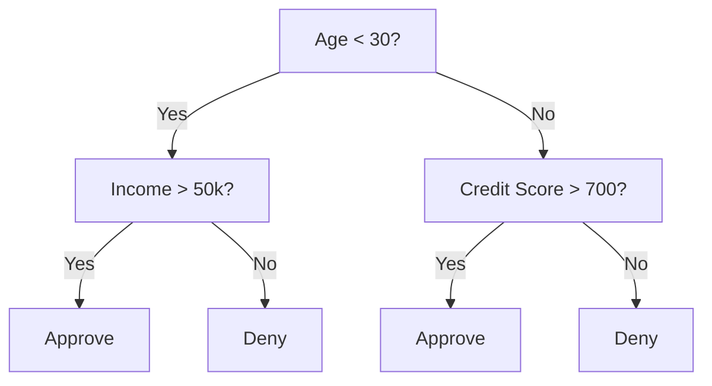
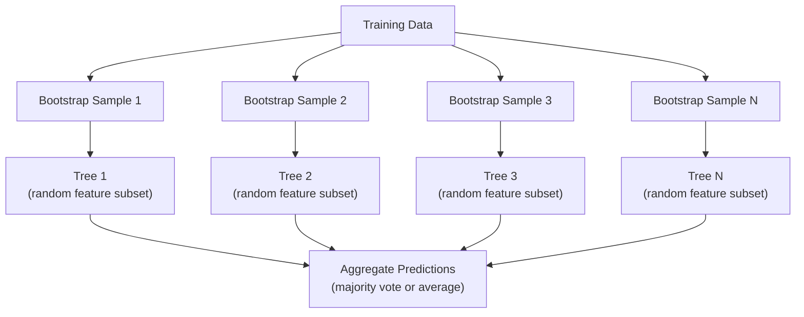

# Decision Trees 與 Random Forests

> Decision tree 不過就是一張流程圖。但一整片由它們組成的森林，是 ML 裡最強大的工具之一。

**Type:** Build
**Language:** Python
**Prerequisites:** Phase 1 (Lessons 09 Information Theory, 06 Probability)
**Time:** ~90 分鐘

## 學習目標 (Learning Objectives)

- 實作 Gini impurity、entropy 與 information gain 的計算，找出最佳的 decision tree 切分
- 從零建立帶有 pre-pruning 控制（max depth、min samples）的 decision tree classifier
- 使用 bootstrap sampling 與 feature randomization 建立 random forest，並說明它為什麼能降低 variance
- 比較 MDI feature importance 與 permutation importance，並辨識 MDI 何時會有偏差

## 問題 (The Problem)

你有表格型資料。每一列是樣本，每一欄是 feature，還有一個你想預測的目標欄位。你當然可以丟一個 neural network 上去。但在表格型資料上，以樹為基礎的模型（decision tree、random forest、gradient boosted tree）表現一致地勝過 deep learning。Kaggle 上結構化資料的競賽，是 XGBoost 和 LightGBM 的天下，不是 transformer。

為什麼？樹可以不經前處理就處理混合型態的 feature（數值與類別）。它們不需要 feature engineering 就能處理非線性關係。它們也具備可解釋性：你可以看著這棵樹，清楚知道預測是怎麼做出來的。而 random forest 會把許多棵樹平均起來，在中等大小的資料集上對 overfitting 有很強的抵抗力。

這堂課用遞迴切分從零建立 decision tree，再在它之上建立 random forest。你會實作切分準則背後的數學（Gini impurity、entropy、information gain），並理解為什麼一群弱學習器 (weak learner) 的集合會變成強學習器。

## 核心概念 (The Concept)

### Decision tree 在做什麼 (What a decision tree does)

Decision tree 透過一連串是/否的問題，把 feature 空間切成矩形區域。



每個內部節點用一個 threshold 測試某個 feature。每個葉節點做出一個預測。要分類一個新的資料點，你從根節點開始，沿著分支走到葉節點為止。

這棵樹是由上而下建立的：在每個節點，選出最能分開資料的 feature 與 threshold。「最好」由切分準則 (split criterion) 定義。

### 切分準則：衡量 impurity (Split criteria: measuring impurity)

在每個節點，我們有一組樣本。我們希望切分之後的子節點盡可能「純」，也就是每個子節點大多只含一個類別。

**Gini impurity** 衡量的是：如果依照該節點的類別分布來標記，隨機挑出一個樣本被分錯的機率。

```math
\text{Gini}(S) = 1 - \sum_k p_k^2 \quad \text{where } p_k \text{ is the proportion of class } k \text{ in set } S.
```

純節點（全部同一類別）的 Gini = 0。50/50 類別的二元切分，Gini = 0.5。越低越好。

```
Example: 6 cats, 4 dogs

Gini = 1 - (0.6^2 + 0.4^2) = 1 - (0.36 + 0.16) = 0.48
```

**Entropy** 衡量節點中的資訊量（混亂程度）。在 Phase 1 Lesson 09 介紹過。

```math
\text{Entropy}(S) = -\sum_k p_k \log_2(p_k)
```

純節點的 entropy = 0。50/50 的二元切分，entropy = 1.0。越低越好。

```
Example: 6 cats, 4 dogs

Entropy = -(0.6 * log2(0.6) + 0.4 * log2(0.4))
        = -(0.6 * -0.737 + 0.4 * -1.322)
        = 0.442 + 0.529
        = 0.971 bits
```

**Information gain** 是切分後 impurity（entropy 或 Gini）的減少量。

```math
\begin{aligned}
& IG(S, \text{feature}, \text{threshold}) = \text{Impurity}(S) - \text{weighted\_avg}(\text{Impurity}(S_{\text{left}}), \text{Impurity}(S_{\text{right}})) \\[4pt]
& \text{where the weights are the proportions of samples in each child.}
\end{aligned}
```

每個節點上的貪婪 (greedy) 演算法：嘗試每個 feature 與每個可能的 threshold，選出使 information gain 最大的 (feature, threshold) 組合。

### 切分如何運作 (How splitting works)

對於目前節點上有 $n$ 個 feature 和 $m$ 個樣本的資料集：

1. 對每個 feature $j$（$j = 1$ 到 $n$）：
   - 依 feature $j$ 對樣本排序
   - 把相鄰且相異的值之間的每個中點，當作 threshold 試試看
   - 計算每個 threshold 的 information gain
2. 選擇 information gain 最高的 feature 與 threshold
3. 把資料切成左邊（feature <= threshold）和右邊（feature > threshold）
4. 對每個子節點遞迴進行

這種貪婪做法不保證得到全域最佳的樹。找出最佳的樹是 NP-hard。但貪婪切分在實務上效果很好。

### 停止條件 (Stopping conditions)

沒有停止條件的話，樹會一直長到每片葉子都是純的，或再也沒有切分能分開它的樣本，通常會長到每片葉子只剩一個樣本。這會完美記住 training data，推廣能力卻糟透了。

**Pre-pruning** 在樹完全長大之前就停止：
- 最大深度：樹達到設定深度時停止切分
- 每片葉子的最少樣本數：節點的樣本數少於 $k$ 就停止
- 最小 information gain：最佳切分對 impurity 的改善小於某個 threshold 就停止
- 最大葉節點數：限制葉子的總數

**Post-pruning** 先讓整棵樹長完，再修剪回來：
- Cost-complexity pruning（scikit-learn 使用）：加上與葉子數量成正比的懲罰。提高懲罰就能得到更小的樹
- Reduced error pruning：如果 validation error 不會上升，就移除某個子樹

Pre-pruning 比較簡單也比較快。Post-pruning 通常能得到更好的樹，因為它不會過早停止那些可能帶來後續有用切分的切分。

### 用於 regression 的 decision tree (Decision trees for regression)

對於 regression，葉子的預測值是該葉子中目標值的平均。切分準則也跟著改變：

**Variance reduction** 取代 information gain：

```math
VR(S, \text{feature}, \text{threshold}) = \text{Var}(S) - \text{weighted\_avg}(\text{Var}(S_{\text{left}}), \text{Var}(S_{\text{right}}))
```

挑選讓 variance 降低最多的切分。樹把輸入空間切成許多區域，並在每個區域預測一個常數（平均值）。

### Random forest：集成的力量 (Random forests: the power of ensembles)

單一 decision tree 的 variance 很高。資料的小小改變就可能產生完全不同的樹。Random forest 透過平均許多棵樹來解決這個問題。



兩個隨機性的來源讓樹彼此多樣化：

**Bagging (bootstrap aggregating)：**每棵樹都用一個 bootstrap sample 訓練，也就是從 training data 中有放回地隨機抽樣。每個 bootstrap 中大約會出現 63% 的原始樣本（其餘是 out-of-bag 樣本，可用於驗證）。

**Feature randomization：**每次切分時，只考慮隨機選出的一部分 feature。對 classification，預設是 $\sqrt{n_{\text{features}}}$。對 regression 則是 $n_{\text{features}}/3$。這能避免所有的樹都在同一個佔主導地位的 feature 上切分。

關鍵洞見：把許多彼此去相關 (decorrelated) 的樹平均起來，可以降低 variance，而不增加 bias。每一棵樹可能都很普通，但整體集成很強。

### Feature importance (Feature importance)

Random forest 自然就能提供 feature importance 分數。最常見的方法：

**Mean Decrease in Impurity (MDI)：**對每個 feature，把所有樹、所有用到該 feature 的節點所帶來的 impurity 總減少量加總。越早的切分帶來越大 impurity 減少量的 feature，就越重要。

```math
\text{importance}(\text{feature}_j) = \sum_{\text{nodes where feature}_j \text{ is used}} \frac{n_{\text{samples at node}}}{n_{\text{total samples}}} \cdot \text{impurity\_decrease}
```

這個方法很快（訓練時就算好），但會偏向高 cardinality 的 feature，以及有許多可能切分點的 feature。

**Permutation importance** 是另一種做法：打亂一個 feature 的值，量測模型 accuracy 掉了多少。比較可靠但比較慢。

### 樹何時勝過 neural network (When trees beat neural networks)

在表格型資料上，樹與森林勝過 neural network。有幾個原因：

| 因素 | 樹 | Neural network |
|--------|-------|----------------|
| 混合型態（數值 + 類別） | 原生支援 | 需要編碼 |
| 小型資料集（< 10k 列） | 表現良好 | 容易 overfit |
| Feature 之間的交互作用 | 靠切分找出 | 需要設計架構 |
| 可解釋性 | 完全透明 | 黑盒子 |
| 訓練時間 | 數分鐘 | 數小時 |
| 對 hyperparameter 的敏感度 | 低 | 高 |

當資料具有空間或序列結構（影像、文字、音訊）時，neural network 才會勝出。對於扁平的 feature 表格，樹是預設選擇。

```figure
decision-tree-depth
```

## 動手做 (Build It)

### 步驟 1：Gini impurity 與 entropy

從零建立兩種切分準則，並驗證它們對哪些切分是好的看法一致。

```python
import math

def gini_impurity(labels):
    n = len(labels)
    if n == 0:
        return 0.0
    counts = {}
    for label in labels:
        counts[label] = counts.get(label, 0) + 1
    return 1.0 - sum((c / n) ** 2 for c in counts.values())

def entropy(labels):
    n = len(labels)
    if n == 0:
        return 0.0
    counts = {}
    for label in labels:
        counts[label] = counts.get(label, 0) + 1
    return -sum(
        (c / n) * math.log2(c / n) for c in counts.values() if c > 0
    )
```

### 步驟 2：找出最佳切分

嘗試每個 feature 與每個 threshold，回傳 information gain 最高的那個。

```python
def information_gain(parent_labels, left_labels, right_labels, criterion="gini"):
    measure = gini_impurity if criterion == "gini" else entropy
    n = len(parent_labels)
    n_left = len(left_labels)
    n_right = len(right_labels)
    if n_left == 0 or n_right == 0:
        return 0.0
    parent_impurity = measure(parent_labels)
    child_impurity = (
        (n_left / n) * measure(left_labels) +
        (n_right / n) * measure(right_labels)
    )
    return parent_impurity - child_impurity
```

### 步驟 3：建立 DecisionTree 類別

遞迴切分、預測，以及 feature importance 追蹤。`_build` 是這棵樹的核心：當節點是純的或碰到 pre-pruning 的限制時就停止，否則就取最佳切分，並遞迴進入兩個子節點。

```python
import random

class DecisionTree:
    def __init__(self, max_depth=None, min_samples_split=2,
                 min_samples_leaf=1, criterion="gini",
                 max_features=None):
        self.max_depth = max_depth
        self.min_samples_split = min_samples_split
        self.min_samples_leaf = min_samples_leaf
        self.criterion = criterion
        self.max_features = max_features
        self.tree = None
        self.feature_importances_ = None

    def fit(self, X, y):
        self.n_features = len(X[0])
        self.feature_importances_ = [0.0] * self.n_features
        self.n_samples = len(X)
        self.tree = self._build(X, y, depth=0)
        total = sum(self.feature_importances_)
        if total > 0:
            self.feature_importances_ = [
                fi / total for fi in self.feature_importances_
            ]

    def predict(self, X):
        return [self._predict_one(x, self.tree) for x in X]

    def _build(self, X, y, depth):
        if len(set(y)) == 1:
            return {"leaf": True, "value": y[0]}

        if self.max_depth is not None and depth >= self.max_depth:
            return self._make_leaf(y)

        if len(y) < self.min_samples_split:
            return self._make_leaf(y)

        best_feature, best_threshold, best_gain = self._best_split(X, y)

        if best_feature is None or best_gain <= 0:
            return self._make_leaf(y)

        left_X, left_y, right_X, right_y = self._split_data(
            X, y, best_feature, best_threshold
        )

        if len(left_y) < self.min_samples_leaf or len(right_y) < self.min_samples_leaf:
            return self._make_leaf(y)

        weight = len(y) / self.n_samples
        self.feature_importances_[best_feature] += weight * best_gain

        return {
            "leaf": False,
            "feature": best_feature,
            "threshold": best_threshold,
            "left": self._build(left_X, left_y, depth + 1),
            "right": self._build(right_X, right_y, depth + 1),
        }

    def _make_leaf(self, y):
        counts = {}
        for label in y:
            counts[label] = counts.get(label, 0) + 1
        return {"leaf": True, "value": max(counts, key=counts.get)}

    def _best_split(self, X, y):
        best_feature = None
        best_threshold = None
        best_gain = -1.0

        if self.max_features == "sqrt":
            k = max(1, int(math.sqrt(self.n_features)))
            feature_indices = random.sample(range(self.n_features), k)
        elif isinstance(self.max_features, int):
            if self.max_features < 1:
                raise ValueError("max_features must be at least 1 when given as an integer")
            k = min(self.max_features, self.n_features)
            feature_indices = random.sample(range(self.n_features), k)
        else:
            feature_indices = list(range(self.n_features))

        for feature_idx in feature_indices:
            values = sorted(set(X[i][feature_idx] for i in range(len(X))))
            if len(values) <= 1:
                continue

            for i in range(len(values) - 1):
                threshold = (values[i] + values[i + 1]) / 2.0
                left_y = [y[j] for j in range(len(X)) if X[j][feature_idx] <= threshold]
                right_y = [y[j] for j in range(len(X)) if X[j][feature_idx] > threshold]

                if len(left_y) < self.min_samples_leaf or len(right_y) < self.min_samples_leaf:
                    continue

                gain = information_gain(y, left_y, right_y, self.criterion)
                if gain > best_gain:
                    best_gain = gain
                    best_feature = feature_idx
                    best_threshold = threshold

        return best_feature, best_threshold, best_gain

    def _split_data(self, X, y, feature, threshold):
        left_X, left_y, right_X, right_y = [], [], [], []
        for i in range(len(X)):
            if X[i][feature] <= threshold:
                left_X.append(X[i])
                left_y.append(y[i])
            else:
                right_X.append(X[i])
                right_y.append(y[i])
        return left_X, left_y, right_X, right_y

    def _predict_one(self, x, node):
        if node["leaf"]:
            return node["value"]
        if x[node["feature"]] <= node["threshold"]:
            return self._predict_one(x, node["left"])
        return self._predict_one(x, node["right"])
```

### 步驟 4：建立 RandomForest 類別

Bootstrap sampling、feature randomization 與多數決投票。

```python
class RandomForest:
    def __init__(self, n_trees=100, max_depth=None,
                 min_samples_split=2, max_features="sqrt",
                 criterion="gini"):
        self.n_trees = n_trees
        self.max_depth = max_depth
        self.min_samples_split = min_samples_split
        self.max_features = max_features
        self.criterion = criterion
        self.trees = []

    def fit(self, X, y):
        n = len(X)
        for _ in range(self.n_trees):
            indices = [random.randint(0, n - 1) for _ in range(n)]
            X_boot = [X[i] for i in indices]
            y_boot = [y[i] for i in indices]
            tree = DecisionTree(
                max_depth=self.max_depth,
                min_samples_split=self.min_samples_split,
                max_features=self.max_features,
                criterion=self.criterion,
            )
            tree.fit(X_boot, y_boot)
            self.trees.append(tree)

    def predict(self, X):
        all_preds = [tree.predict(X) for tree in self.trees]
        predictions = []
        for i in range(len(X)):
            votes = {}
            for preds in all_preds:
                v = preds[i]
                votes[v] = votes.get(v, 0) + 1
            predictions.append(max(votes, key=votes.get))
        return predictions
```

完整實作與所有輔助方法請見 `code/trees.py`。

## 實際使用 (Use It)

用 scikit-learn，訓練一個 random forest 只要三行：

```python
from sklearn.ensemble import RandomForestClassifier
from sklearn.datasets import load_iris
from sklearn.model_selection import train_test_split

X, y = load_iris(return_X_y=True)
X_train, X_test, y_train, y_test = train_test_split(X, y, random_state=42)

rf = RandomForestClassifier(n_estimators=100, random_state=42)
rf.fit(X_train, y_train)
print(f"Accuracy: {rf.score(X_test, y_test):.4f}")
print(f"Feature importances: {rf.feature_importances_}")
```

實務上，gradient boosted tree（XGBoost、LightGBM、CatBoost）通常比 random forest 更強，因為它們是依序建立樹，每棵樹都修正前一棵的錯誤。但 random forest 比較不容易設定錯，而且幾乎不需要調整 hyperparameter。

## 交付 (Ship It)

這堂課會產出 `outputs/prompt-tree-interpreter.md`，這是一個為商業關係人解讀 decision tree 切分的 prompt。把訓練好的樹的結構（深度、feature、切分 threshold、accuracy）餵給它，它會把模型翻譯成白話規則、排序 feature importance、標出 overfitting 或 leakage，並建議下一步。任何時候你需要向不看程式碼的人解釋以樹為基礎的模型，都可以用它。

## 練習 (Exercises)

1. 在一個有 3 個類別的 2D 資料集上訓練單一 decision tree。手動追蹤各次切分，並畫出矩形的 decision boundary。比較 max_depth=2 與 max_depth=10 時的邊界。

2. 為 regression tree 實作 variance reduction 切分。對 200 個點產生 $y = \sin(x) + \text{noise}$，並擬合你的 regression tree。把樹的分段常數預測與真實曲線畫在一起。

3. 建立 1、5、10、50 與 200 棵樹的 random forest。畫出 training accuracy 與 test accuracy 對樹數量的關係。觀察 test accuracy 會趨於平穩但不會下降（森林能抵抗 overfitting）。

4. 在 5 個不同的資料集上，比較 Gini impurity 與 entropy 作為切分準則。量測 accuracy 與樹的深度。大多數情況下，它們的結果幾乎一樣。解釋原因。

5. 實作 permutation importance。在一個有某個 feature 是隨機雜訊、但 cardinality 很高的資料集上，將它與 MDI importance 比較。MDI 會把雜訊 feature 排得很高，permutation importance 則不會。

## 關鍵術語 (Key Terms)

| 術語 | 大家怎麼說 | 實際意義 |
|------|----------------|----------------------|
| Decision tree | 「用來預測的流程圖」 | 透過學習一連串 if/else 切分，把 feature 空間切成矩形區域的模型 |
| Gini impurity | 「節點有多混雜」 | 在節點上隨機樣本被分錯的機率。0 = 純，0.5 = 二元分類的最大 impurity |
| Entropy | 「節點裡的混亂程度」 | 節點上的資訊量。0 = 純，1.0 = 二元分類的最大不確定性。來自資訊理論 |
| Information gain | 「切分有多好」 | 切分後 impurity 的減少量。選擇切分時使用的貪婪準則 |
| Pre-pruning | 「提早讓樹停下來」 | 透過設定最大深度、最少樣本數或最小 gain threshold，提早停止樹的成長 |
| Post-pruning | 「事後修剪樹」 | 先讓整棵樹長完，再移除沒有改善 validation 表現的子樹 |
| Bagging | 「用隨機子集訓練」 | Bootstrap aggregating。每個模型用不同的有放回隨機樣本訓練 |
| Random forest | 「一堆樹」 | Decision tree 的集成，每棵樹用一個 bootstrap sample 訓練，並在每次切分時使用隨機的 feature 子集 |
| Feature importance (MDI) | 「哪些 feature 重要」 | 每個 feature 貢獻的 impurity 總減少量，跨所有樹與節點加總 |
| Permutation importance | 「打亂再檢查」 | 隨機打亂某個 feature 的值後 accuracy 的下降量。對有雜訊的 feature 比 MDI 更可靠 |
| Variance reduction | 「Regression 版的 info gain」 | Regression tree 對應 information gain 的準則。選出讓目標變異數降低最多的切分 |
| Bootstrap sample | 「有重複的隨機樣本」 | 從原始資料集有放回抽出的隨機樣本。大小相同，但含有重複項 |

## 延伸閱讀 (Further Reading)

- [Breiman: Random Forests (2001)](https://link.springer.com/article/10.1023/A:1010933404324) - 最原始的 random forest 論文
- [Grinsztajn et al.: Why do tree-based models still outperform deep learning on tabular data? (2022)](https://arxiv.org/abs/2207.08815) - 在表格任務上嚴謹比較樹與 neural network
- [scikit-learn Decision Trees documentation](https://scikit-learn.org/stable/modules/tree.html) - 附視覺化工具的實用指南
- [XGBoost: A Scalable Tree Boosting System (Chen & Guestrin, 2016)](https://arxiv.org/abs/1603.02754) - 稱霸 Kaggle 的 gradient boosting 論文
