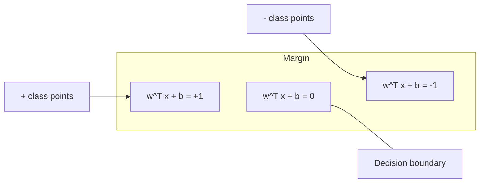
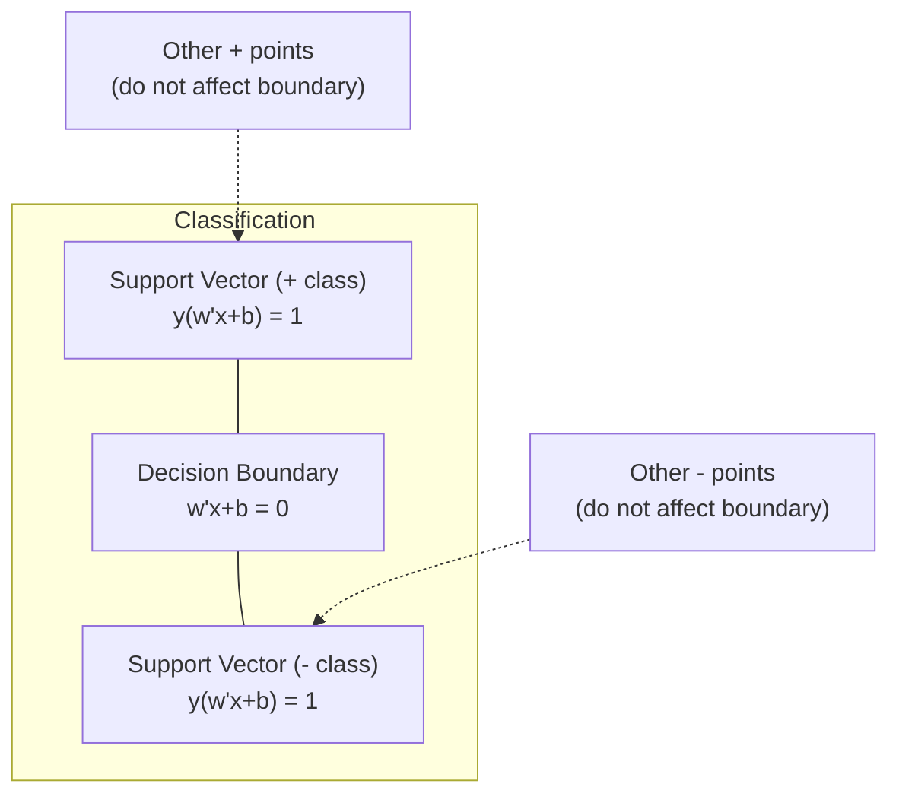
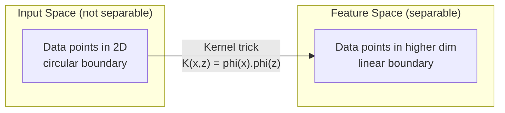

# Support Vector Machines

> 在兩個類別之間找出最寬的那條街。整個概念就是這樣。

**Type:** Build
**Language:** Python
**Prerequisites:** Phase 1 (Lessons 08 Optimization, 14 Norms and Distances, 18 Convex Optimization)
**Time:** ~90 分鐘

## 學習目標 (Learning Objectives)

- 使用 hinge loss 與 primal formulation 上的 gradient descent，從零實作 linear SVM
- 說明 maximum margin 原則，並從訓練好的模型中辨認出 support vector
- 比較 linear、polynomial 與 RBF kernel，並說明 kernel trick 如何避免顯式的高維度映射
- 評估由 C 參數控制的 margin 寬度與分類錯誤之間的取捨

## 問題 (The Problem)

你有兩個類別的資料點，需要畫一條線（或超平面）把它們分開。有無限多條線都可以。你該選哪一條？

選 margin 最大的那條。Margin 是 decision boundary 與兩側最近資料點之間的距離。Margin 越寬，代表分類器越有把握，對沒看過的資料推廣得也越好。

這個直覺帶出了 Support Vector Machines，這是 ML 裡數學上最優雅的演算法之一。SVM 在 deep learning 興起之前是主流的分類方法，對於小型資料集、高維度資料，以及需要有原理依據、被充分理解且有理論保證的模型的問題，至今仍是最佳選擇。

SVM 直接連結到 Phase 1：最佳化是 convex 的（Lesson 18），margin 用 norm 來衡量（Lesson 14），而 kernel trick 利用內積來處理非線性邊界，完全不必在高維空間中計算。

## 核心概念 (The Concept)

### Maximum margin classifier (The maximum margin classifier)

給定線性可分的資料，標籤為 $y_i \in \lbrace -1, +1 \rbrace$，feature 向量為 $x_i$，我們想要一個超平面 $w^T x + b = 0$ 把類別分開。

點 $x_i$ 到超平面的距離是：

```math
\text{distance} = \frac{\lvert w^T x_i + b \rvert}{\lVert w \rVert}
```

對於分類正確的點：$y_i (w^T x_i + b) > 0$。Margin 是超平面到兩側最近點的距離的兩倍。



最佳化問題：

```math
\begin{aligned}
\text{maximize} \quad & \frac{2}{\lVert w \rVert} \quad \text{(the margin width)} \\
\text{subject to} \quad & y_i (w^T x_i + b) \ge 1 \quad \text{for all } i
\end{aligned}
```

等價地（最小化 $\lVert w \rVert^2$ 比較容易最佳化）：

```math
\begin{aligned}
\text{minimize} \quad & \frac{1}{2} \lVert w \rVert^2 \\
\text{subject to} \quad & y_i (w^T x_i + b) \ge 1 \quad \text{for all } i
\end{aligned}
```

這是一個 convex quadratic program，有唯一的全域解。剛好落在 margin 邊界上的資料點（$y_i (w^T x_i + b) = 1$）就是 support vector。只有它們決定 decision boundary。移動或移除任何非 support vector 的點，邊界都不會改變。

### Support vector：關鍵的少數 (Support vectors: the critical few)



大多數訓練點都不重要，只有 support vector 才算數。這就是為什麼 SVM 在預測時很省記憶體：你只需要儲存 support vector，不用儲存整個 training set。

Support vector 的數量也給出了 generalization error 的上界。相對於資料集大小，support vector 越少，generalization 越好。

### Soft margin：用 C 參數處理雜訊 (Soft margin: handling noise with the C parameter)

真實資料很少是完美可分的。有些點可能落在邊界的錯誤一側，或在 margin 之內。Soft margin 的公式透過引入 slack variable 來容許違反。

```math
\begin{aligned}
\text{minimize} \quad & \frac{1}{2} \lVert w \rVert^2 + C \sum_i \xi_i \\
\text{subject to} \quad & y_i (w^T x_i + b) \ge 1 - \xi_i \\
& \xi_i \ge 0 \quad \text{for all } i
\end{aligned}
```

Slack variable $\xi_i$ 衡量第 $i$ 個點違反 margin 的程度。$C$ 控制這個取捨：

| $C$ 值 | 行為 |
|---------|----------|
| 大的 $C$ | 重重懲罰違反。Margin 窄，誤分類較少。會 overfit |
| 小的 $C$ | 容許更多違反。Margin 寬，誤分類較多。會 underfit |

$C$ 是 regularization 強度的倒數。大 $C$ = 較少 regularization。小 $C$ = 較多 regularization。

### Hinge loss：SVM 的 loss function (Hinge loss: the SVM loss function)

Soft margin SVM 可以改寫成無限制的最佳化問題：

```math
\text{minimize} \quad \frac{1}{2} \lVert w \rVert^2 + C \sum_i \max(0, 1 - y_i (w^T x_i + b))
```

$\max(0, 1 - y_i f(x_i))$ 這一項就是 hinge loss。當點被正確分類且在 margin 之外時，它是零。當點在 margin 之內或被誤分類時，它是線性的。

```
Hinge loss for a single point:

loss
  |
  | \
  |  \
  |   \
  |    \
  |     \_______________
  |
  +-----|-----|-------->  y * f(x)
       0     1

Zero loss when y*f(x) >= 1 (correctly classified, outside margin).
Linear penalty when y*f(x) < 1.
```

與 logistic loss（logistic regression）比較：

```math
\begin{aligned}
\text{Hinge:} \quad & \max(0, 1 - y f(x)) && \text{Hard cutoff at margin} \\
\text{Logistic:} \quad & \log(1 + \exp(-y f(x))) && \text{Smooth, never exactly zero}
\end{aligned}
```

Hinge loss 產生稀疏解（只有 support vector 有非零的貢獻）。Logistic loss 則使用所有資料點。這讓 SVM 在預測時更省記憶體。

### 用 gradient descent 訓練 linear SVM (Training a linear SVM with gradient descent)

你可以在 hinge loss 加上 L2 regularization 上使用 gradient descent 來訓練 linear SVM，不必解有限制的 QP：

```math
\begin{aligned}
& L(w, b) = \frac{\lambda}{2} \lVert w \rVert^2 + \frac{1}{n} \sum_i \max(0, 1 - y_i (w^T x_i + b)) \\[6pt]
& \text{Gradient with respect to } w\text{:} \\
& \quad \text{If } y_i (w^T x_i + b) \ge 1\text{:} \quad \frac{\partial L}{\partial w} = \lambda w \\
& \quad \text{If } y_i (w^T x_i + b) < 1\text{:} \quad \frac{\partial L}{\partial w} = \lambda w - y_i x_i \\[6pt]
& \text{Gradient with respect to } b\text{:} \\
& \quad \text{If } y_i (w^T x_i + b) \ge 1\text{:} \quad \frac{\partial L}{\partial b} = 0 \\
& \quad \text{If } y_i (w^T x_i + b) < 1\text{:} \quad \frac{\partial L}{\partial b} = -y_i
\end{aligned}
```

這稱為 primal formulation。每個 epoch 的複雜度是 $O(n \cdot d)$，其中 $n$ 是樣本數，$d$ 是 feature 數。對於大型、稀疏、高維度的資料（文字分類），這很快。

### Dual formulation 與 kernel trick (The dual formulation and the kernel trick)

SVM 問題的 Lagrangian dual（來自 Phase 1 Lesson 18，KKT 條件）是：

```math
\begin{aligned}
\text{maximize} \quad & \sum_i \alpha_i - \frac{1}{2} \sum_{i,j} \alpha_i \alpha_j y_i y_j (x_i \cdot x_j) \\
\text{subject to} \quad & 0 \le \alpha_i \le C \\
& \sum_i \alpha_i y_i = 0
\end{aligned}
```

Dual 只涉及資料點之間的內積 $x_i \cdot x_j$。這是關鍵洞見。把每個內積換成 kernel function $K(x_i, x_j)$，SVM 就能學到非線性邊界，完全不用顯式計算轉換。

```math
\begin{aligned}
\text{Linear kernel:} \quad & K(x, z) = x \cdot z \\
\text{Polynomial kernel:} \quad & K(x, z) = (x \cdot z + c)^d \\
\text{RBF (Gaussian):} \quad & K(x, z) = \exp(-\gamma \lVert x - z \rVert^2)
\end{aligned}
```

RBF kernel 把資料映射到無限維空間。在輸入空間中靠近的點，kernel 值接近 1；距離遠的點，kernel 值接近 0。它可以學到任何平滑的 decision boundary。



Kernel trick 在不真正進入高維空間的情況下，計算高維空間中的內積。對於 $D$ 維中 $d$ 次的 polynomial kernel，顯式的 feature 空間有 $O(D^d)$ 個維度。但 $K(x, z)$ 只需 $O(D)$ 時間就能算出。

### 用於 regression 的 SVM (SVR) (SVM for regression (SVR))

Support Vector Regression 在資料周圍擬合一條寬度為 $\epsilon$ 的管子。管子內的點 loss 為零。管子外的點則受到線性懲罰。

```math
\begin{aligned}
\text{minimize} \quad & \frac{1}{2} \lVert w \rVert^2 + C \sum_i (\xi_i + \xi_i^*) \\
\text{subject to} \quad & y_i - (w^T x_i + b) \le \epsilon + \xi_i \\
& (w^T x_i + b) - y_i \le \epsilon + \xi_i^* \\
& \xi_i, \xi_i^* \ge 0
\end{aligned}
```

$\epsilon$ 參數控制管子的寬度。管子越寬 = support vector 越少 = 擬合越平滑。管子越窄 = support vector 越多 = 擬合越緊。

### 為什麼 SVM 輸給了 deep learning（以及它何時仍然勝出） (Why SVMs lost to deep learning (and when they still win))

SVM 從 1990 年代末到 2010 年代初主宰了 ML。Deep learning 因為幾個原因超越了它：

| 因素 | SVM | Deep learning |
|--------|------|---------------|
| Feature engineering | 需要 | 自己學 feature |
| 擴展性 | Kernel 版本為 $O(n^2)$ 到 $O(n^3)$ | 用 SGD 每個 epoch 為 $O(n)$ |
| 影像/文字/音訊 | 需要手工設計的 feature | 從原始資料學習 |
| 大型資料集（>100k） | 慢 | 擴展性好 |
| GPU 加速 | 效益有限 | 大幅加速 |

SVM 在這些情況下仍然勝出：
- 小型資料集（數百到幾千筆樣本）
- 高維度稀疏資料（帶有 TF-IDF feature 的文字）
- 需要數學保證時（margin 上界）
- 訓練時間必須最短時（linear SVM 非常快）
- Margin 結構清楚的 binary classification
- 異常偵測 (anomaly detection)（one-class SVM）

```figure
svm-margin
```

## 動手做 (Build It)

### 步驟 1：Hinge loss 與 gradient

基礎。計算一個 batch 的 hinge loss 及其 gradient。

```python
def hinge_loss(X, y, w, b):
    n = len(X)
    total_loss = 0.0
    for i in range(n):
        margin = y[i] * (dot(w, X[i]) + b)
        total_loss += max(0.0, 1.0 - margin)
    return total_loss / n
```

### 步驟 2：用 gradient descent 實作 linear SVM

透過最小化加上 regularization 的 hinge loss 來訓練。不需要 QP solver。

```python
class LinearSVM:
    def __init__(self, lr=0.001, lambda_param=0.01, n_epochs=1000):
        self.lr = lr
        self.lambda_param = lambda_param
        self.n_epochs = n_epochs
        self.w = None
        self.b = 0.0

    def fit(self, X, y):
        n_features = len(X[0])
        self.w = [0.0] * n_features
        self.b = 0.0

        for epoch in range(self.n_epochs):
            for i in range(len(X)):
                margin = y[i] * (dot(self.w, X[i]) + self.b)
                if margin >= 1:
                    self.w = [wj - self.lr * self.lambda_param * wj
                              for wj in self.w]
                else:
                    self.w = [wj - self.lr * (self.lambda_param * wj - y[i] * X[i][j])
                              for j, wj in enumerate(self.w)]
                    self.b -= self.lr * (-y[i])

    def predict(self, X):
        return [1 if dot(self.w, x) + self.b >= 0 else -1 for x in X]
```

### 步驟 3：Kernel function

實作 linear、polynomial 與 RBF kernel。

```python
def linear_kernel(x, z):
    return dot(x, z)

def polynomial_kernel(x, z, degree=3, c=1.0):
    return (dot(x, z) + c) ** degree

def rbf_kernel(x, z, gamma=0.5):
    diff = [xi - zi for xi, zi in zip(x, z)]
    return math.exp(-gamma * dot(diff, diff))
```

### 步驟 4：Margin 與 support vector 的辨認

訓練後，辨認哪些點是 support vector，並計算 margin 寬度。

```python
def find_support_vectors(X, y, w, b, tol=1e-3):
    support_vectors = []
    for i in range(len(X)):
        margin = y[i] * (dot(w, X[i]) + b)
        if abs(margin - 1.0) < tol:
            support_vectors.append(i)
    return support_vectors
```

完整實作與所有 demo 請見 `code/svm.py`。

## 實際使用 (Use It)

使用 scikit-learn：

```python
from sklearn.svm import SVC, LinearSVC, SVR
from sklearn.preprocessing import StandardScaler
from sklearn.pipeline import Pipeline

clf = Pipeline([
    ("scaler", StandardScaler()),
    ("svm", SVC(kernel="rbf", C=1.0, gamma="scale")),
])
clf.fit(X_train, y_train)
print(f"Accuracy: {clf.score(X_test, y_test):.4f}")
print(f"Support vectors: {clf['svm'].n_support_}")
```

重要：訓練 SVM 之前務必先對 feature 做 scaling。SVM 對 feature 的量級很敏感，因為 margin 取決於 $\lVert w \rVert$，沒有 scaling 的 feature 會扭曲幾何結構。

對於大型資料集，請使用 `LinearSVC`（primal formulation，每個 epoch $O(n \cdot d)$，對 $n$ 為線性），而不是 `SVC`（dual formulation，$O(n^2)$ 到 $O(n^3){}$）：

```python
from sklearn.svm import LinearSVC

clf = Pipeline([
    ("scaler", StandardScaler()),
    ("svm", LinearSVC(C=1.0, max_iter=10000)),
])
```

## 練習 (Exercises)

1. 產生一個 2D 線性可分的資料集。訓練你的 LinearSVM 並辨認 support vector。驗證 support vector 就是最靠近 decision boundary 的那些點。

2. 在有雜訊的資料集上，把 $C$ 從 0.001 變化到 1000。為每個 $C$ 值畫出 decision boundary。觀察從寬 margin（underfitting）到窄 margin（overfitting）的轉變。

3. 建立一個類別邊界是圓形（非線性）的資料集。證明 linear SVM 會失敗。計算 RBF kernel matrix，並證明類別在 kernel 誘導的 feature 空間中變得可分。

4. 在同一份資料集上比較 hinge loss 與 logistic loss。訓練 linear SVM 與 logistic regression，數一數有多少訓練點對各自模型的 decision boundary 有貢獻（support vector 對比所有點）。

5. 實作 SVR（epsilon-insensitive loss）。把它擬合到 $y = \sin(x) + \text{noise}$。畫出預測周圍的 epsilon 管子，並標示 support vector（管子外的點）。

## 關鍵術語 (Key Terms)

| 術語 | 實際意義 |
|------|----------------------|
| Support vectors | 最靠近 decision boundary 的訓練點。唯一決定超平面的點 |
| Margin | Decision boundary 與最近 support vector 之間的距離。SVM 要將它最大化 |
| Hinge loss | $\max(0, 1 - y f(x))$。分類正確且在 margin 之外時為零，其他情況為線性懲罰 |
| C parameter | Margin 寬度與分類錯誤之間的取捨。大 $C$ = 窄 margin，小 $C$ = 寬 margin |
| Soft margin | 透過 slack variable 容許違反 margin 的 SVM 公式。可處理不可分的資料 |
| Kernel trick | 在高維 feature 空間中計算內積，而不必顯式映射到該空間 |
| Linear kernel | $K(x, z) = x \cdot z$。等同標準內積。適用於線性可分的資料 |
| RBF kernel | $K(x, z) = \exp(-\gamma \Vert x-z \Vert^2)$。映射到無限維。可學到任何平滑的邊界 |
| Polynomial kernel | $K(x, z) = (x \cdot z + c)^d$。映射到多項式組合的 feature 空間 |
| Dual formulation | SVM 問題的重新表述，只依賴資料點之間的內積。使 kernel 成為可能 |
| SVR | Support Vector Regression。在資料周圍擬合一條 epsilon 管子。管子內的點 loss 為零 |
| Slack variables | $\xi_i$：衡量一個點違反 margin 的程度。對 margin 外分類正確的點為零 |
| Maximum margin | 選擇使超平面到各類別最近點的距離最大的那個超平面的原則 |

## 延伸閱讀 (Further Reading)

- [Vapnik: The Nature of Statistical Learning Theory (1995)](https://link.springer.com/book/10.1007/978-1-4757-3264-1) - SVM 與統計學習理論的奠基著作
- [Cortes & Vapnik: Support-vector networks (1995)](https://link.springer.com/article/10.1007/BF00994018) - 最原始的 SVM 論文
- [Platt: Sequential Minimal Optimization (1998)](https://www.microsoft.com/en-us/research/publication/sequential-minimal-optimization-a-fast-algorithm-for-training-support-vector-machines/) - 讓 SVM 訓練變得實用的 SMO 演算法
- [scikit-learn SVM documentation](https://scikit-learn.org/stable/modules/svm.html) - 附實作細節的實用指南
- [LIBSVM: A Library for Support Vector Machines](https://www.csie.ntu.edu.tw/~cjlin/libsvm/) - 大多數 SVM 實作背後的 C++ 函式庫
