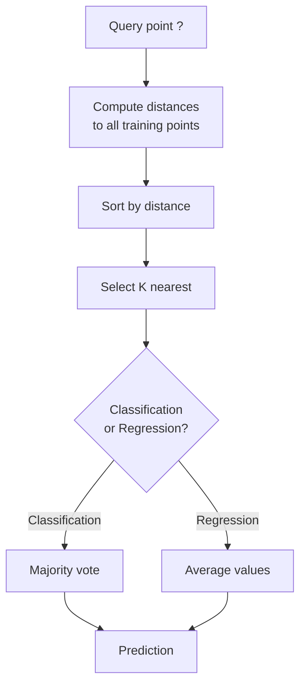
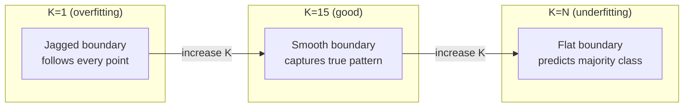
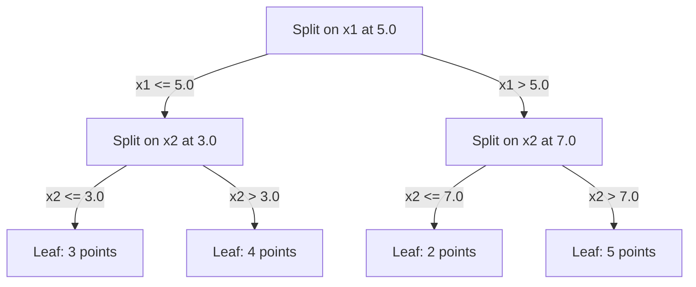

# K-Nearest Neighbors 與距離 (K-Nearest Neighbors and Distances)

> 把一切都存起來。看看你的鄰居，然後做預測。這是真的行得通的最簡單演算法。

**Type:** Build
**Language:** Python
**Prerequisites:** Phase 1 (Lesson 14 Norms and Distances)
**Time:** ~90 分鐘

## 學習目標 (Learning Objectives)

- 從零實作 KNN classification 與 regression，支援可設定的 K 與依距離加權的投票
- 比較 L1、L2、cosine 與 Minkowski 距離度量，並為特定資料類型選擇合適的一種
- 說明 curse of dimensionality，並示範為什麼 KNN 在高維空間中表現會變差
- 建立 KD-tree 做高效率的最近鄰搜尋，並分析它何時勝過暴力搜尋 (brute-force)

## 問題 (The Problem)

你有一份資料集。一個新的資料點進來了，你需要分類它或預測它的值。你不從資料中學習參數（像 linear regression 或 SVM 那樣），而是直接找出離新點最近的 K 個訓練點，讓它們投票。

這就是 K-nearest neighbors。沒有訓練階段，沒有要學的參數，也沒有要最小化的 loss function。你把整個 training set 存起來，在預測時才計算距離。

聽起來簡單到不可能有用。但 KNN 在許多問題上出乎意料地有競爭力，尤其是中小型資料集，而且深入理解它會揭示一些基本概念：距離度量的選擇（連結到 Phase 1 Lesson 14）、curse of dimensionality，以及 lazy learning 與 eager learning 的差異。

KNN 也以不同的名字出現在現代 AI 的各個角落。向量資料庫對 embedding 做 KNN 搜尋。Retrieval-augmented generation (RAG) 找出 K 個最近的文件片段。推薦系統找出相似的使用者或項目。演算法是一樣的，只是規模與資料結構不同。

## 核心概念 (The Concept)

### KNN 如何運作 (How KNN works)

給定一份已標記的資料集和一個新的查詢點：

1. 計算查詢點到資料集中每個點的距離
2. 依距離排序
3. 取最近的 K 個點
4. Classification：K 個鄰居的多數決
5. Regression：K 個鄰居數值的平均（或加權平均）



整個演算法就這樣。沒有 fitting，沒有 gradient descent，沒有 epoch。

### 選擇 K (Choosing K)

K 是唯一的 hyperparameter。它控制 bias-variance 的取捨：

| K | 行為 |
|---|----------|
| $K = 1$ | Decision boundary 緊貼每個點。Training error 為零。Variance 高。會 overfit |
| 小的 K (3-5) | 對局部結構敏感。可以捕捉複雜的邊界 |
| 大的 K | 邊界更平滑。對雜訊更穩健。可能會 underfit |
| $K = N$ | 對每個點都預測多數類別。Bias 最大 |

常見的起點是對 $N$ 個點的資料集取 $K = \sqrt{N}$。Binary classification 用奇數的 K 以避免平手。



### 距離度量 (Distance metrics)

距離函數定義了「近」是什麼意思。不同的度量會產生不同的鄰居，也就有不同的預測。

**L2 (Euclidean)** 是預設值。就是直線距離。

```math
d(a, b) = \sqrt{\sum_i (a_i - b_i)^2}
```

對 feature 的尺度敏感。在 KNN 搭配 L2 之前，務必先 standardize feature。

**L1 (Manhattan)** 把絕對差相加。因為不對差值平方，所以比 L2 更能抵抗 outlier。

```math
d(a, b) = \sum_i \lvert a_i - b_i \rvert
```

**Cosine distance** 衡量向量之間的夾角，忽略長度。對文字與 embedding 資料而言不可或缺。

```math
d(a, b) = 1 - \frac{a \cdot b}{\lVert a \rVert \, \lVert b \rVert}
```

**Minkowski** 用參數 $p$ 推廣 L1 與 L2。

```math
\begin{aligned}
& d(a, b) = \left( \sum_i \lvert a_i - b_i \rvert^p \right)^{1/p} \\[6pt]
& p=1\text{: Manhattan} \\
& p=2\text{: Euclidean} \\
& p \to \infty\text{: Chebyshev (max absolute difference)}
\end{aligned}
```

該用哪種度量取決於資料：

| 資料類型 | 最佳度量 | 原因 |
|-----------|------------|-----|
| 數值 feature，尺度相近 | L2 (Euclidean) | 預設選項，適用於空間資料 |
| 數值 feature，有 outlier | L1 (Manhattan) | 穩健，不會放大大的差異 |
| 文字 embedding | Cosine | 長度是雜訊，方向才是意義 |
| 高維稀疏資料 | Cosine 或 L1 | L2 會受 curse of dimensionality 影響 |
| 混合型態 | 自訂距離 | 依各 feature 類型組合不同度量 |

### 加權 KNN (Weighted KNN)

標準 KNN 給 K 個鄰居相同的權重。但距離 0.1 的鄰居應該比距離 5.0 的鄰居更重要。

**依距離加權的 KNN** 讓每個鄰居的權重與距離成反比：

```math
\begin{aligned}
& \text{weight}_i = \frac{1}{\text{distance}_i + \epsilon} \\[6pt]
& \text{For classification: weighted vote} \\
& \text{For regression: weighted average} = \frac{\sum_i w_i y_i}{\sum_i w_i}
\end{aligned}
```

$\epsilon$ 用來避免查詢點剛好與某個訓練點重合時除以零。

加權 KNN 對 K 的選擇比較不敏感，因為遠處的鄰居無論如何貢獻都很小。

### Curse of dimensionality (The curse of dimensionality)

KNN 的表現在高維度下會變差。這不是含糊的擔憂，而是數學事實。

**問題 1：距離會收斂。**隨著維度增加，最大距離與最小距離的比值趨近於 1。所有的點離查詢點都變得一樣「遠」。

```
In d dimensions, for random uniform points:

d=2:    max_dist / min_dist = varies widely
d=100:  max_dist / min_dist ~ 1.01
d=1000: max_dist / min_dist ~ 1.001

When all distances are nearly equal, "nearest" is meaningless.
```

**問題 2：體積爆炸。**為了在固定比例的資料中涵蓋 K 個鄰居，你必須把搜尋半徑擴大到涵蓋 feature 空間中大得多的比例。高維度中的「鄰域」包含了大部分的空間。

**問題 3：角落主導一切。**在 d 維的單位超立方體中，大部分體積集中在角落附近，而不是中心。隨著 d 增加，內切於立方體的球體所佔的體積比例會消失。

實務上的後果：KNN 大約在 20-50 個 feature 以內運作良好。超過之後，你需要先做降維 (PCA、UMAP、t-SNE) 再套用 KNN，或是使用能利用資料內在較低維度的樹狀搜尋結構。

### KD-tree：快速的最近鄰搜尋 (KD-trees: fast nearest neighbor search)

暴力搜尋 KNN 要計算查詢點到每個訓練點的距離。每次查詢是 $O(n \cdot d)$。對大型資料集來說太慢了。

KD-tree 沿著 feature 軸遞迴地切分空間。在每一層，它在某一個維度的中位數處切開。



要找最近的鄰居，先沿樹走到包含查詢點的葉節點，再回溯，只有在鄰近的分區可能包含更近的點時才去檢查。

低維度下的平均查詢時間：$O(\log n)$。但在高維度（$d > 20$）下，KD-tree 會退化成 $O(n)$，因為回溯能剪掉的分支越來越少。

### Ball tree：更適合中等維度 (Ball trees: better for moderate dimensions)

Ball tree 把資料切成巢狀的超球體，而不是與軸對齊的盒子。每個節點定義一個球（中心 + 半徑），包含該子樹中的所有點。

相對於 KD-tree 的優點：
- 在中等維度（最多約 50）表現更好
- 能處理不與軸對齊的結構
- 更緊的包圍體積意味著搜尋時能剪掉更多分支

KD-tree 與 ball tree 都是精確演算法。對於真正大規模的搜尋（數百萬個點、數百個維度），則改用近似最近鄰方法 (HNSW、IVF、product quantization)。這些在 Phase 1 Lesson 14 中介紹過。

### Lazy learning 與 eager learning (Lazy learning vs eager learning)

KNN 是 lazy learner：訓練時什麼都不做，所有工作都在預測時完成。其他大多數演算法（linear regression、SVM、neural network）是 eager learner：它們在訓練時做大量運算來建立精簡的模型，之後預測就很快。

| 面向 | Lazy (KNN) | Eager (SVM、neural net) |
|--------|------------|------------------------|
| 訓練時間 | $O(1)$，只要存資料 | $O(n \cdot \text{epochs})$ |
| 預測時間 | 每次查詢 $O(n \cdot d)$ | $O(d)$ 或 $O(\text{parameters})$ |
| 預測時的記憶體 | 儲存整個 training set | 只儲存模型參數 |
| 適應新資料 | 立刻新增資料點 | 重新訓練模型 |
| Decision boundary | 隱含的，即時計算 | 明確的，訓練後固定 |

Lazy learning 在這些情況下最理想：
- 資料集經常變動（新增/移除資料點，不必重新訓練）
- 你只需要為很少的查詢做預測
- 你要零訓練時間
- 資料集夠小，暴力搜尋也夠快

### 用於 regression 的 KNN (KNN for regression)

KNN regression 不做多數決，而是把 K 個鄰居的目標值取平均。

```math
\begin{aligned}
& \text{prediction} = \frac{1}{K} \sum_{i \in K \text{ nearest neighbors}} y_i \\[6pt]
& \text{Or with distance weighting:} \\
& \text{prediction} = \frac{\sum_i w_i y_i}{\sum_i w_i} \quad \text{where } w_i = \frac{1}{\text{distance}_i + \epsilon}
\end{aligned}
```

KNN regression 產生分段常數（加權時為分段平滑）的預測。它無法外插超出訓練資料的範圍。如果訓練目標全都介於 0 到 100 之間，KNN 永遠不會預測出 200。

```figure
knn-smoothness
```

## 動手做 (Build It)

### 步驟 1：距離函數

實作 L1、L2、cosine 與 Minkowski 距離。這些直接連結到 Phase 1 Lesson 14。

```python
import math

def l2_distance(a, b):
    return math.sqrt(sum((ai - bi) ** 2 for ai, bi in zip(a, b)))

def l1_distance(a, b):
    return sum(abs(ai - bi) for ai, bi in zip(a, b))

def cosine_distance(a, b):
    dot_val = sum(ai * bi for ai, bi in zip(a, b))
    norm_a = math.sqrt(sum(ai ** 2 for ai in a))
    norm_b = math.sqrt(sum(bi ** 2 for bi in b))
    if norm_a == 0 or norm_b == 0:
        return 1.0
    return 1.0 - dot_val / (norm_a * norm_b)

def minkowski_distance(a, b, p=2):
    if p == float('inf'):
        return max(abs(ai - bi) for ai, bi in zip(a, b))
    return sum(abs(ai - bi) ** p for ai, bi in zip(a, b)) ** (1 / p)
```

### 步驟 2：KNN classifier 與 regressor

建立完整的 KNN，支援可設定的 K、距離度量，以及可選的距離加權。

```python
class KNN:
    def __init__(self, k=5, distance_fn=l2_distance, weighted=False,
                 task="classification"):
        self.k = k
        self.distance_fn = distance_fn
        self.weighted = weighted
        self.task = task
        self.X_train = None
        self.y_train = None

    def fit(self, X, y):
        self.X_train = X
        self.y_train = y

    def predict(self, X):
        return [self._predict_one(x) for x in X]
```

### 步驟 3：用 KD-tree 做高效搜尋

從零建立 KD-tree，遞迴地在每個維度的中位數處切分。

```python
class KDTree:
    def __init__(self, X, indices=None, depth=0):
        # Recursively partition the data
        self.axis = depth % len(X[0])
        # Split on median of the current axis
        ...

    def query(self, point, k=1):
        # Traverse to leaf, then backtrack
        ...
```

完整實作與所有輔助方法、demo 請見 `code/knn.py`。

### 步驟 4：Feature scaling

KNN 需要 feature scaling，因為距離對 feature 的量級很敏感。範圍 0 到 1000 的 feature 會主導範圍 0 到 1 的 feature。

```python
def standardize(X):
    n = len(X)
    d = len(X[0])
    means = [sum(X[i][j] for i in range(n)) / n for j in range(d)]
    stds = [
        max(1e-10, (sum((X[i][j] - means[j]) ** 2 for i in range(n)) / n) ** 0.5)
        for j in range(d)
    ]
    return [[((X[i][j] - means[j]) / stds[j]) for j in range(d)] for i in range(n)], means, stds
```

## 實際使用 (Use It)

使用 scikit-learn：

```python
from sklearn.neighbors import KNeighborsClassifier
from sklearn.preprocessing import StandardScaler
from sklearn.pipeline import Pipeline

clf = Pipeline([
    ("scaler", StandardScaler()),
    ("knn", KNeighborsClassifier(n_neighbors=5, metric="euclidean")),
])
clf.fit(X_train, y_train)
print(f"Accuracy: {clf.score(X_test, y_test):.4f}")
```

當資料集夠大、維度夠低時，scikit-learn 會自動使用 KD-tree 或 ball tree。對高維度資料，它會退回暴力搜尋。你可以用 `algorithm` 參數控制這一點。

對於大規模最近鄰搜尋（數百萬個向量），請使用 FAISS、Annoy 或向量資料庫：

```python
import faiss

index = faiss.IndexFlatL2(dimension)
index.add(embeddings)
distances, indices = index.search(query_vectors, k=5)
```

## 練習 (Exercises)

1. 在一個有 3 個類別的 2D 資料集上實作 KNN classification。畫出 $K=1$、$K=5$、$K=15$ 與 $K=N$ 的 decision boundary。觀察從 overfitting 到 underfitting 的轉變。

2. 在 2、5、10、50、100 與 500 維中各產生 1000 個隨機點。對每個維度，計算最大兩兩距離與最小兩兩距離的比值。畫出比值對維度的關係，視覺化 curse of dimensionality。

3. 在文字分類問題上（使用 TF-IDF 向量）比較 KNN 的 L1、L2 與 cosine 距離。哪個度量的 accuracy 最好？為什麼 cosine 在文字上往往勝出？

4. 實作 KD-tree，並在 2D、10D 與 50D 下，對 1k、10k 與 100k 個點的資料集，量測查詢時間並與暴力搜尋比較。在多少維度時，KD-tree 不再比暴力搜尋快？

5. 為 $y = \sin(x) + \text{noise}$ 建立加權的 KNN regressor。在 $K=3, 10, 30$ 時與未加權的 KNN 比較。證明加權能產生更平滑的預測，尤其是在 K 很大時。

## 關鍵術語 (Key Terms)

| 術語 | 實際意義 |
|------|----------------------|
| K-nearest neighbors | 非參數演算法，透過找出離查詢點最近的 K 個訓練點來預測 |
| Lazy learning | 訓練時不做任何計算，所有工作都在預測時完成。KNN 是典型範例 |
| Eager learning | 訓練時做大量運算來建立精簡的模型。大多數 ML 演算法都是 eager |
| Curse of dimensionality | 在高維度下，距離會收斂，鄰域會擴張到涵蓋大部分空間，使 KNN 失效 |
| KD-tree | 沿 feature 軸遞迴切分空間的二元樹。低維度下查詢為 $O(\log n)$ |
| Ball tree | 巢狀超球體組成的樹。在中等維度（最多約 50）比 KD-tree 表現更好 |
| Weighted KNN | 鄰居的權重與距離成反比。越近的鄰居對預測的影響越大 |
| Feature scaling | 把 feature 正規化到可比較的範圍。KNN 這類以距離為基礎的方法所必需 |
| Majority vote | 透過計算 K 個鄰居中哪個類別最常見來做分類 |
| Brute force search | 計算到每個訓練點的距離。每次查詢 $O(n \cdot d)$。精確但對大的 $n$ 很慢 |
| Approximate nearest neighbor | 能比精確搜尋快得多地找到近似最近點的演算法 (HNSW、LSH、IVF) |
| Voronoi diagram | 空間的分割，每個區域包含離某個訓練點比離其他任何訓練點都近的所有點。$K=1$ 的 KNN 會產生 Voronoi 邊界 |

## 延伸閱讀 (Further Reading)

- [Cover & Hart: Nearest Neighbor Pattern Classification (1967)](https://ieeexplore.ieee.org/document/1053964) - KNN 的奠基論文，證明其錯誤率至多是 Bayes optimal 的兩倍
- [Friedman, Bentley, Finkel: An Algorithm for Finding Best Matches in Logarithmic Expected Time (1977)](https://dl.acm.org/doi/10.1145/355744.355745) - 最原始的 KD-tree 論文
- [Beyer et al.: When Is "Nearest Neighbor" Meaningful? (1999)](https://link.springer.com/chapter/10.1007/3-540-49257-7_15) - 對最近鄰的 curse of dimensionality 所做的形式化分析
- [scikit-learn Nearest Neighbors documentation](https://scikit-learn.org/stable/modules/neighbors.html) - 附演算法選擇的實用指南
- [FAISS: A Library for Efficient Similarity Search](https://github.com/facebookresearch/faiss) - Meta 的十億規模近似最近鄰搜尋函式庫
