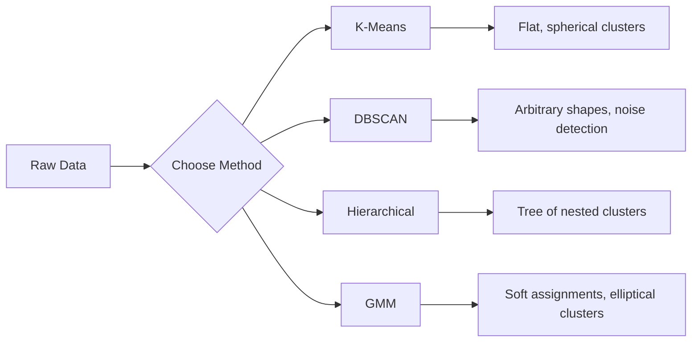

# Unsupervised Learning

> 沒有標籤，沒有老師。演算法自己找出結構。

**Type:** Build
**Languages:** Python
**Prerequisites:** Phase 1 (Norms & Distances, Probability & Distributions), Phase 2 Lessons 1-6
**Time:** ~90 分鐘

## 學習目標 (Learning Objectives)

- 從零實作 K-Means、DBSCAN 與 Gaussian Mixture Model，並比較它們的分群行為
- 使用 silhouette score 與 elbow method 評估分群品質，選出最佳的 K
- 說明 DBSCAN 何時勝過 K-Means，並辨認哪個演算法能處理非球形的群集與 outlier
- 使用分群方法建立 anomaly detection pipeline，標出偏離正常模式的點

## 問題 (The Problem)

到目前為止，每一堂 ML 課都假設有標記過的資料：「這是輸入，這是正確的輸出。」在真實世界裡，標籤很昂貴。醫院有數百萬筆病患紀錄，但沒有人手動為每一筆標上疾病類別。電商網站有數百萬個使用者 session，但沒有人手動標好顧客區隔。資安團隊有網路日誌，但沒有人標出每一個異常。

Unsupervised learning 在沒有被告知要找什麼的情況下找出模式。它把相似的資料點分組、發現隱藏的結構，並浮現異常。如果說 supervised learning 是帶著解答本讀教科書，那 unsupervised learning 就是盯著原始資料看，直到模式自己顯現。

麻煩的地方在於：沒有標籤，你就無法直接衡量「對」或「錯」。你需要不同的工具，來評估演算法找到的結構是否有意義。

## 核心概念 (The Concept)

### Clustering：把相似的東西分在一起 (Clustering: Grouping Similar Things Together)

Clustering 把每個資料點指派到一個群組（cluster），讓同一群組內的點彼此之間，比與其他群組的點更相似。問題永遠是：「相似」是什麼意思？



### K-Means：主力演算法 (K-Means: The Workhorse)

K-Means 把資料切成剛好 K 個群集。每個群集有一個 centroid（質心），每個點都屬於最近的 centroid。

Lloyd 演算法：

1. 隨機挑選 K 個點作為初始 centroid
2. 把每個資料點指派給最近的 centroid
3. 把每個 centroid 重新計算為其所屬點的平均值
4. 重複步驟 2-3，直到指派結果不再改變

目標函數（inertia）衡量每個點到其所屬 centroid 的總平方距離。K-Means 會將它最小化，但只能找到 local minimum。不同的初始化可能得到不同的結果。

### 選擇 K (Choosing K)

兩個標準方法：

**Elbow method：**對 $K = 1, 2, 3, \ldots, n$ 執行 K-Means。畫出 inertia 對 K 的圖。找出「手肘」，也就是再增加群集已不能顯著降低 inertia 的地方。

**Silhouette score：**對每個點，衡量它與自己所屬群集的相似度 ($a$)，相對於與最近的其他群集的相似度 ($b$)。Silhouette coefficient 是 $(b - a) / \max(a, b)$，範圍從 -1（分錯群）到 +1（分群良好）。對所有點取平均得到整體分數。

### DBSCAN：以密度為基礎的分群 (DBSCAN: Density-Based Clustering)

K-Means 假設群集是球形的，而且需要你事先指定 K。DBSCAN 兩者都不假設。它把群集視為被稀疏區域隔開的稠密區域。

兩個參數：
- **eps**：鄰域的半徑
- **min_samples**：形成稠密區域所需的最少點數

三種類型的點：
- **Core point**：在 eps 距離內至少有 min_samples 個點
- **Border point**：落在某個 core point 的 eps 範圍內，但自己不是 core point
- **Noise point**：既不是 core 也不是 border。這些是 outlier。

DBSCAN 把彼此相距在 eps 以內的 core point 連成同一個群集。Border point 加入附近 core point 的群集。Noise point 不屬於任何群集。

優點：能找出任何形狀的群集、自動決定群集數量、辨認 outlier。缺點：難以處理密度不一的群集。

### Hierarchical Clustering

建立巢狀群集的樹（dendrogram）。

Agglomerative（由下而上）：
1. 從每個點各自為一個群集開始
2. 合併最接近的兩個群集
3. 重複直到只剩一個群集
4. 在想要的層級切開 dendrogram，得到 K 個群集

群集之間的「接近程度」可以用以下方式衡量：
- **Single linkage**：兩個群集中任意兩點之間的最小距離
- **Complete linkage**：任意兩點之間的最大距離
- **Average linkage**：所有點對之間的平均距離
- **Ward's method**：造成群集內總變異數增加量最小的合併

### Gaussian Mixture Models (GMM)

K-Means 給出 hard assignment：每個點剛好屬於一個群集。GMM 給出 soft assignment：每個點屬於每個群集都有一個機率。

GMM 假設資料是由 K 個 Gaussian 分布混合產生的，每個分布有自己的平均值與 covariance。Expectation-Maximization (EM) 演算法在以下兩步之間交替：

- **E-step**：計算每個點屬於每個 Gaussian 的機率
- **M-step**：更新每個 Gaussian 的平均值、covariance 與混合權重，使資料的 likelihood 最大化

GMM 可以對橢圓形群集建模（不像 K-Means 只能是球形），也能自然地處理重疊的群集。

### 何時使用哪一種 (When to Use Which)

| 方法 | 最適合 | 避免使用的情況 |
|--------|----------|------------|
| K-Means | 大型資料集、球形群集、已知 K | 不規則形狀、有 outlier |
| DBSCAN | K 未知、任意形狀、outlier 偵測 | 密度不一、維度非常高 |
| Hierarchical | 小型資料集、需要 dendrogram、K 未知 | 大型資料集（$O(n^2)$ 記憶體） |
| GMM | 重疊的群集、需要 soft assignment | 非常大的資料集、維度太多 |

### 用 Clustering 做 Anomaly Detection (Anomaly Detection with Clustering)

Clustering 很自然地支援 anomaly detection：
- **K-Means**：離任何 centroid 都很遠的點是異常
- **DBSCAN**：noise point 依定義就是異常
- **GMM**：在所有 Gaussian 下機率都很低的點是異常

```figure
kmeans-step
```

## 動手做 (Build It)

### 步驟 1：從零實作 K-Means

```python
import math
import random


def euclidean_distance(a, b):
    return math.sqrt(sum((ai - bi) ** 2 for ai, bi in zip(a, b)))


def kmeans(data, k, max_iterations=100, seed=42):
    random.seed(seed)
    n_features = len(data[0])

    centroids = random.sample(data, k)

    for iteration in range(max_iterations):
        clusters = [[] for _ in range(k)]
        assignments = []

        for point in data:
            distances = [euclidean_distance(point, c) for c in centroids]
            nearest = distances.index(min(distances))
            clusters[nearest].append(point)
            assignments.append(nearest)

        new_centroids = []
        for cluster in clusters:
            if len(cluster) == 0:
                new_centroids.append(random.choice(data))
                continue
            centroid = [
                sum(point[j] for point in cluster) / len(cluster)
                for j in range(n_features)
            ]
            new_centroids.append(centroid)

        if all(
            euclidean_distance(old, new) < 1e-6
            for old, new in zip(centroids, new_centroids)
        ):
            print(f"  Converged at iteration {iteration + 1}")
            break

        centroids = new_centroids

    return assignments, centroids
```

### 步驟 2：Elbow method 與 silhouette score

```python
def compute_inertia(data, assignments, centroids):
    total = 0.0
    for point, cluster_id in zip(data, assignments):
        total += euclidean_distance(point, centroids[cluster_id]) ** 2
    return total


def silhouette_score(data, assignments):
    n = len(data)
    if n < 2:
        return 0.0

    clusters = {}
    for i, c in enumerate(assignments):
        clusters.setdefault(c, []).append(i)

    if len(clusters) < 2:
        return 0.0

    scores = []
    for i in range(n):
        own_cluster = assignments[i]
        own_members = [j for j in clusters[own_cluster] if j != i]

        if len(own_members) == 0:
            scores.append(0.0)
            continue

        a = sum(euclidean_distance(data[i], data[j]) for j in own_members) / len(own_members)

        b = float("inf")
        for cluster_id, members in clusters.items():
            if cluster_id == own_cluster:
                continue
            avg_dist = sum(euclidean_distance(data[i], data[j]) for j in members) / len(members)
            b = min(b, avg_dist)

        if max(a, b) == 0:
            scores.append(0.0)
        else:
            scores.append((b - a) / max(a, b))

    return sum(scores) / len(scores)


def find_best_k(data, max_k=10):
    print("Elbow method:")
    inertias = []
    for k in range(1, max_k + 1):
        assignments, centroids = kmeans(data, k)
        inertia = compute_inertia(data, assignments, centroids)
        inertias.append(inertia)
        print(f"  K={k}: inertia={inertia:.2f}")

    print("\nSilhouette scores:")
    for k in range(2, max_k + 1):
        assignments, centroids = kmeans(data, k)
        score = silhouette_score(data, assignments)
        print(f"  K={k}: silhouette={score:.4f}")

    return inertias
```

### 步驟 3：從零實作 DBSCAN

```python
def dbscan(data, eps, min_samples):
    n = len(data)
    labels = [-1] * n
    cluster_id = 0

    def region_query(point_idx):
        neighbors = []
        for i in range(n):
            if euclidean_distance(data[point_idx], data[i]) <= eps:
                neighbors.append(i)
        return neighbors

    visited = [False] * n

    for i in range(n):
        if visited[i]:
            continue
        visited[i] = True

        neighbors = region_query(i)

        if len(neighbors) < min_samples:
            labels[i] = -1
            continue

        labels[i] = cluster_id
        seed_set = list(neighbors)
        seed_set.remove(i)

        j = 0
        while j < len(seed_set):
            q = seed_set[j]

            if not visited[q]:
                visited[q] = True
                q_neighbors = region_query(q)
                if len(q_neighbors) >= min_samples:
                    for nb in q_neighbors:
                        if nb not in seed_set:
                            seed_set.append(nb)

            if labels[q] == -1:
                labels[q] = cluster_id

            j += 1

        cluster_id += 1

    return labels
```

### 步驟 4：Gaussian Mixture Model（EM 演算法）

```python
def gmm(data, k, max_iterations=100, seed=42):
    random.seed(seed)
    n = len(data)
    d = len(data[0])

    indices = random.sample(range(n), k)
    means = [list(data[i]) for i in indices]
    variances = [1.0] * k
    weights = [1.0 / k] * k

    def gaussian_pdf(x, mean, variance):
        d = len(x)
        coeff = 1.0 / ((2 * math.pi * variance) ** (d / 2))
        exponent = -sum((xi - mi) ** 2 for xi, mi in zip(x, mean)) / (2 * variance)
        return coeff * math.exp(max(exponent, -500))

    for iteration in range(max_iterations):
        responsibilities = []
        for i in range(n):
            probs = []
            for j in range(k):
                probs.append(weights[j] * gaussian_pdf(data[i], means[j], variances[j]))
            total = sum(probs)
            if total == 0:
                total = 1e-300
            responsibilities.append([p / total for p in probs])

        old_means = [list(m) for m in means]

        for j in range(k):
            r_sum = sum(responsibilities[i][j] for i in range(n))
            if r_sum < 1e-10:
                continue

            weights[j] = r_sum / n

            for dim in range(d):
                means[j][dim] = sum(
                    responsibilities[i][j] * data[i][dim] for i in range(n)
                ) / r_sum

            variances[j] = sum(
                responsibilities[i][j]
                * sum((data[i][dim] - means[j][dim]) ** 2 for dim in range(d))
                for i in range(n)
            ) / (r_sum * d)
            variances[j] = max(variances[j], 1e-6)

        shift = sum(
            euclidean_distance(old_means[j], means[j]) for j in range(k)
        )
        if shift < 1e-6:
            print(f"  GMM converged at iteration {iteration + 1}")
            break

    assignments = []
    for i in range(n):
        assignments.append(responsibilities[i].index(max(responsibilities[i])))

    return assignments, means, weights, responsibilities
```

### 步驟 5：產生測試資料並執行全部演算法

```python
def make_blobs(centers, n_per_cluster=50, spread=0.5, seed=42):
    random.seed(seed)
    data = []
    true_labels = []
    for label, (cx, cy) in enumerate(centers):
        for _ in range(n_per_cluster):
            x = cx + random.gauss(0, spread)
            y = cy + random.gauss(0, spread)
            data.append([x, y])
            true_labels.append(label)
    return data, true_labels


def make_moons(n_samples=200, noise=0.1, seed=42):
    random.seed(seed)
    data = []
    labels = []
    n_half = n_samples // 2
    for i in range(n_half):
        angle = math.pi * i / n_half
        x = math.cos(angle) + random.gauss(0, noise)
        y = math.sin(angle) + random.gauss(0, noise)
        data.append([x, y])
        labels.append(0)
    for i in range(n_half):
        angle = math.pi * i / n_half
        x = 1 - math.cos(angle) + random.gauss(0, noise)
        y = 1 - math.sin(angle) - 0.5 + random.gauss(0, noise)
        data.append([x, y])
        labels.append(1)
    return data, labels


if __name__ == "__main__":
    centers = [[2, 2], [8, 3], [5, 8]]
    data, true_labels = make_blobs(centers, n_per_cluster=50, spread=0.8)

    print("=== K-Means on 3 blobs ===")
    assignments, centroids = kmeans(data, k=3)
    print(f"  Centroids: {[[round(c, 2) for c in cent] for cent in centroids]}")
    sil = silhouette_score(data, assignments)
    print(f"  Silhouette score: {sil:.4f}")

    print("\n=== Elbow Method ===")
    find_best_k(data, max_k=6)

    print("\n=== DBSCAN on 3 blobs ===")
    db_labels = dbscan(data, eps=1.5, min_samples=5)
    n_clusters = len(set(db_labels) - {-1})
    n_noise = db_labels.count(-1)
    print(f"  Found {n_clusters} clusters, {n_noise} noise points")

    print("\n=== GMM on 3 blobs ===")
    gmm_assignments, gmm_means, gmm_weights, _ = gmm(data, k=3)
    print(f"  Means: {[[round(m, 2) for m in mean] for mean in gmm_means]}")
    print(f"  Weights: {[round(w, 3) for w in gmm_weights]}")
    gmm_sil = silhouette_score(data, gmm_assignments)
    print(f"  Silhouette score: {gmm_sil:.4f}")

    print("\n=== DBSCAN on moons (non-spherical clusters) ===")
    moon_data, moon_labels = make_moons(n_samples=200, noise=0.1)
    moon_db = dbscan(moon_data, eps=0.3, min_samples=5)
    n_moon_clusters = len(set(moon_db) - {-1})
    n_moon_noise = moon_db.count(-1)
    print(f"  Found {n_moon_clusters} clusters, {n_moon_noise} noise points")

    print("\n=== K-Means on moons (will fail to separate) ===")
    moon_km, moon_centroids = kmeans(moon_data, k=2)
    moon_sil = silhouette_score(moon_data, moon_km)
    print(f"  Silhouette score: {moon_sil:.4f}")
    print("  K-Means splits moons poorly because they are not spherical")

    print("\n=== Anomaly detection with DBSCAN ===")
    anomaly_data = list(data)
    anomaly_data.append([20.0, 20.0])
    anomaly_data.append([-5.0, -5.0])
    anomaly_data.append([15.0, 0.0])
    anomaly_labels = dbscan(anomaly_data, eps=1.5, min_samples=5)
    anomalies = [
        anomaly_data[i]
        for i in range(len(anomaly_labels))
        if anomaly_labels[i] == -1
    ]
    print(f"  Detected {len(anomalies)} anomalies")
    for a in anomalies[-3:]:
        print(f"    Point {[round(v, 2) for v in a]}")
```

## 實際使用 (Use It)

用 scikit-learn，同樣的演算法只要一行：

```python
from sklearn.cluster import KMeans, DBSCAN, AgglomerativeClustering
from sklearn.mixture import GaussianMixture
from sklearn.metrics import silhouette_score as sklearn_silhouette

km = KMeans(n_clusters=3, random_state=42).fit(data)
db = DBSCAN(eps=1.5, min_samples=5).fit(data)
agg = AgglomerativeClustering(n_clusters=3).fit(data)
gmm_model = GaussianMixture(n_components=3, random_state=42).fit(data)
```

從零實作的版本讓你看到這些函式庫到底算了什麼。K-Means 在指派與重新計算之間反覆進行。DBSCAN 從稠密的種子長出群集。GMM 在 expectation 與 maximization 之間交替。函式庫版本加上了數值穩定性、更聰明的初始化 (K-Means++) 與 GPU 加速，但核心邏輯是一樣的。

## 交付 (Ship It)

這堂課產出 K-Means、DBSCAN 與 GMM 的從零實作。這些分群程式碼可以重複使用，作為更進階 unsupervised 方法的基礎。

## 練習 (Exercises)

1. 實作 K-Means++ 初始化：不要隨機挑選 centroid，而是隨機挑第一個，之後每個 centroid 被挑中的機率與它到最近現有 centroid 的平方距離成正比。與隨機初始化比較收斂速度。
2. 在程式碼中加入 hierarchical agglomerative clustering。實作 Ward's linkage，並產生 dendrogram（以合併紀錄的巢狀 list 表示）。在不同層級切開，並與 K-Means 的結果比較。
3. 建立一個簡單的 anomaly detection pipeline：在同一份資料上執行 DBSCAN 與 GMM，標出兩種方法都同意是 outlier 的點（DBSCAN 的 noise、GMM 的低機率）。量測重疊程度，並討論兩種方法何時意見不同。

## 關鍵術語 (Key Terms)

| 術語 | 大家怎麼說 | 實際意義 |
|------|----------------|----------------------|
| Clustering | 「把相似的東西分組」 | 把資料分成子集，使組內相似度超過組間相似度，以特定的距離度量衡量 |
| Centroid | 「群集的中心」 | 指派到某個群集的所有點的平均值；K-Means 用它代表該群集 |
| Inertia | 「群集有多緊密」 | 每個點到其所屬 centroid 的平方距離總和；越低越緊密 |
| Silhouette score | 「群集分得有多開」 | 對每個點，$(b - a) / \max(a, b)$，其中 $a$ 是群集內平均距離，$b$ 是到最近其他群集的平均距離 |
| Core point | 「稠密區域中的點」 | 在 DBSCAN 中，於 eps 距離內至少有 min_samples 個鄰居的點 |
| EM algorithm | 「Soft K-Means」 | Expectation-Maximization：反覆計算歸屬機率（E-step）並更新分布參數（M-step） |
| Dendrogram | 「群集的樹」 | 顯示 hierarchical clustering 中群集合併的順序與距離的樹狀圖 |
| Anomaly | 「outlier」 | 不符合預期模式的資料點，在 DBSCAN 中被識別為 noise，在 GMM 中被識別為低機率 |

## 延伸閱讀 (Further Reading)

- [Stanford CS229 - Unsupervised Learning](https://cs229.stanford.edu/notes2022fall/main_notes.pdf) - Andrew Ng 關於 clustering 與 EM 的講義
- [scikit-learn Clustering Guide](https://scikit-learn.org/stable/modules/clustering.html) - 所有 clustering 演算法的實用比較，附視覺化範例
- [DBSCAN original paper (Ester et al., 1996)](https://www.aaai.org/Papers/KDD/1996/KDD96-037.pdf) - 提出 density-based clustering 的論文
