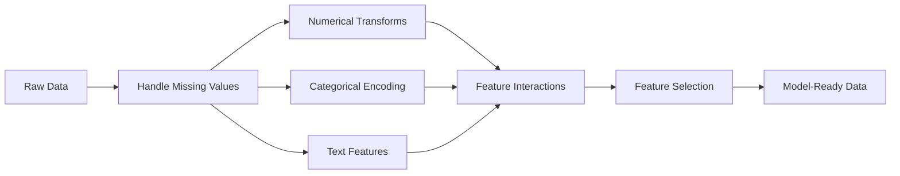

# Feature Engineering 與 Selection (Feature Engineering & Selection)

> 一個好的 feature，抵得上一千筆資料點。

**Type:** Build
**Languages:** Python
**Prerequisites:** Phase 1 (Statistics for ML, Linear Algebra), Phase 2 Lessons 1-7
**Time:** ~90 分鐘

## 學習目標 (Learning Objectives)

- 實作數值轉換（standardization、min-max scaling、log transform、binning），並說明各自適用的時機
- 為類別型 feature 建立 one-hot、label 與 target encoding，並辨認 target encoding 的 data leakage 風險
- 從零建立 TF-IDF vectorizer，並說明為什麼它在文字分類上優於原始的詞頻計數
- 套用以 filter 為基礎的 feature selection（variance threshold、correlation、mutual information）來降低維度

## 問題 (The Problem)

你有一份資料集。你挑了一個演算法，訓練它。結果普普通通。你換了更花俏的演算法，還是普普通通。你花了一週調 hyperparameter，只有微幅改善。

然後有人把原始資料轉換成更好的 feature，一個簡單的 logistic regression 就打敗了你調過參的 gradient-boosted ensemble。

這種事一直在發生。在傳統 ML 中，資料的表示方式比演算法的選擇更重要。一個使用「坪數」和「臥室數」的房價模型，不管學習器多精密，都會勝過使用「原始字串地址」的模型。演算法只能處理你給它的東西。

Feature engineering 是把原始資料轉換成讓模型更容易找出模式的表示的過程。Feature selection 則是丟掉那些只增加雜訊、沒有增加訊號的 feature 的過程。兩者合起來，是傳統 ML 中槓桿效果最高的工作。

## 核心概念 (The Concept)

### Feature Pipeline (The Feature Pipeline)



### 數值型 Feature (Numerical Features)

原始數字很少能直接餵給模型。常見的轉換：

**Scaling：**讓 feature 落在相同範圍，使以距離為基礎的演算法（K-Means、KNN、SVM）對所有 feature 一視同仁。Min-max scaling 映射到 [0, 1]。Standardization（z-score）映射到 mean=0、std=1。

**Log transform：**壓縮右偏的分布（收入、人口、詞頻）。把乘法關係變成加法關係。

**Binning：**把連續值轉成類別。當 feature 與目標之間的關係是非線性但呈階梯狀時很有用（例如年齡層）。

**Polynomial features：**建立 $x^2$、$x^3$、$x_1 x_2$ 等項。讓線性模型能捕捉非線性關係，代價是 feature 變多。

### 類別型 Feature (Categorical Features)

模型需要數字。類別需要編碼。

**One-hot encoding：**為每個類別建立一個二元欄位。「color = red/blue/green」會變成三個欄位：is_red、is_blue、is_green。對低 cardinality 的 feature 效果很好，但類別很多時欄位數會爆炸。

**Label encoding：**把每個類別對應到一個整數：red=0、blue=1、green=2。這會引入錯誤的順序（模型可能以為 green > blue > red）。只適合依單一值做切分的樹狀模型。

**Target encoding：**把每個類別換成該類別對應的目標變數平均值。強大但危險：有很高的 data leakage 風險。必須只用 training data 計算，再套用到 test data。

### 文字型 Feature (Text Features)

**Count vectorizer：**計算每個字在文件中出現的次數。「the cat sat on the mat」變成 {the: 2, cat: 1, sat: 1, on: 1, mat: 1}。

**TF-IDF：**Term Frequency-Inverse Document Frequency。依字詞在各文件中有多獨特來加權。像 「the」這樣的常見字權重低，罕見又有辨識度的字權重高。

```math
\begin{aligned}
\text{TF}(\text{word}, \text{doc}) &= \frac{\text{count(word in doc)}}{\text{total words in doc}} \\
\text{IDF}(\text{word}) &= \log \frac{\text{total docs}}{\text{docs containing word}} \\
\text{TF-IDF} &= \text{TF} \cdot \text{IDF}
\end{aligned}
```

### 缺失值 (Missing Values)

真實資料有破洞。處理策略：

- **Drop rows：**只在缺失資料稀少且隨機時使用
- **Mean/median imputation：**簡單，保留 feature 的中心（median 對 outlier 更穩健），但會縮小它的 variance，並把所有補上的值堆在同一個尖峰上，所以分布的形狀會改變
- **Mode imputation：**用於類別型 feature
- **Indicator column：**在 imputation 之前，加上一個二元欄位「was_this_missing」。資料缺失這件事本身可能就帶有資訊
- **Forward/backward fill：**用於時間序列資料

### Feature 交互作用 (Feature Interaction)

有時候關係藏在組合裡。單獨的「身高」和「體重」，預測力不如 $\text{BMI} = \text{weight} / \text{height}^2$。Feature 交互作用會讓 feature 空間成倍增加，所以要用領域知識來挑出對的那些。

### Feature Selection

Feature 越多不一定越好。無關的 feature 會增加雜訊、拉長訓練時間，還可能造成 overfitting。

**Filter 方法（模型之前）：**
- Correlation：移除彼此高度相關的 feature（冗餘）
- Mutual information：衡量知道某個 feature 後，對目標的不確定性減少多少
- Variance threshold：移除幾乎不變動的 feature

**Wrapper 方法（以模型為基礎）：**
- L1 regularization (Lasso)：把無關 feature 的 weights 逼到剛好為零
- Recursive feature elimination：訓練、移除最不重要的 feature、重複

**為什麼 selection 很重要：**一個有 10 個好 feature 的模型，通常會勝過有 10 個好 feature 加上 90 個雜訊 feature 的模型。雜訊 feature 給了模型機會，去 overfit 那些無法推廣的 training data 模式。

```figure
feature-scaling
```

## 動手做 (Build It)

### 步驟 1：從零實作數值轉換

```python
import math


def min_max_scale(values):
    min_val = min(values)
    max_val = max(values)
    if max_val == min_val:
        return [0.0] * len(values)
    return [(v - min_val) / (max_val - min_val) for v in values]


def standardize(values):
    n = len(values)
    mean = sum(values) / n
    variance = sum((v - mean) ** 2 for v in values) / n
    std = math.sqrt(variance) if variance > 0 else 1.0
    return [(v - mean) / std for v in values]


def log_transform(values):
    return [math.log(v + 1) for v in values]


def bin_values(values, n_bins=5):
    min_val = min(values)
    max_val = max(values)
    bin_width = (max_val - min_val) / n_bins
    if bin_width == 0:
        return [0] * len(values)
    result = []
    for v in values:
        bin_idx = int((v - min_val) / bin_width)
        bin_idx = min(bin_idx, n_bins - 1)
        result.append(bin_idx)
    return result


def polynomial_features(row, degree=2):
    n = len(row)
    result = list(row)
    if degree >= 2:
        for i in range(n):
            result.append(row[i] ** 2)
        for i in range(n):
            for j in range(i + 1, n):
                result.append(row[i] * row[j])
    return result
```

### 步驟 2：從零實作類別編碼

```python
def one_hot_encode(values):
    categories = sorted(set(values))
    cat_to_idx = {cat: i for i, cat in enumerate(categories)}
    n_cats = len(categories)

    encoded = []
    for v in values:
        row = [0] * n_cats
        row[cat_to_idx[v]] = 1
        encoded.append(row)

    return encoded, categories


def label_encode(values):
    categories = sorted(set(values))
    cat_to_int = {cat: i for i, cat in enumerate(categories)}
    return [cat_to_int[v] for v in values], cat_to_int


def target_encode(feature_values, target_values, smoothing=10):
    global_mean = sum(target_values) / len(target_values)

    category_stats = {}
    for feat, target in zip(feature_values, target_values):
        if feat not in category_stats:
            category_stats[feat] = {"sum": 0.0, "count": 0}
        category_stats[feat]["sum"] += target
        category_stats[feat]["count"] += 1

    encoding = {}
    for cat, stats in category_stats.items():
        cat_mean = stats["sum"] / stats["count"]
        weight = stats["count"] / (stats["count"] + smoothing)
        encoding[cat] = weight * cat_mean + (1 - weight) * global_mean

    return [encoding[v] for v in feature_values], encoding
```

### 步驟 3：從零實作文字 feature

```python
def count_vectorize(documents):
    vocab = {}
    idx = 0
    for doc in documents:
        for word in doc.lower().split():
            if word not in vocab:
                vocab[word] = idx
                idx += 1

    vectors = []
    for doc in documents:
        vec = [0] * len(vocab)
        for word in doc.lower().split():
            vec[vocab[word]] += 1
        vectors.append(vec)

    return vectors, vocab


def tfidf(documents):
    n_docs = len(documents)

    vocab = {}
    idx = 0
    for doc in documents:
        for word in doc.lower().split():
            if word not in vocab:
                vocab[word] = idx
                idx += 1

    doc_freq = {}
    for doc in documents:
        seen = set()
        for word in doc.lower().split():
            if word not in seen:
                doc_freq[word] = doc_freq.get(word, 0) + 1
                seen.add(word)

    vectors = []
    for doc in documents:
        words = doc.lower().split()
        word_count = len(words)
        tf_map = {}
        for word in words:
            tf_map[word] = tf_map.get(word, 0) + 1

        vec = [0.0] * len(vocab)
        for word, count in tf_map.items():
            tf = count / word_count
            idf = math.log(n_docs / doc_freq[word])
            vec[vocab[word]] = tf * idf
        vectors.append(vec)

    return vectors, vocab
```

### 步驟 4：從零實作缺失值 imputation

```python
def impute_mean(values):
    present = [v for v in values if v is not None]
    if not present:
        return [0.0] * len(values), 0.0
    mean = sum(present) / len(present)
    return [v if v is not None else mean for v in values], mean


def impute_median(values):
    present = sorted(v for v in values if v is not None)
    if not present:
        return [0.0] * len(values), 0.0
    n = len(present)
    if n % 2 == 0:
        median = (present[n // 2 - 1] + present[n // 2]) / 2
    else:
        median = present[n // 2]
    return [v if v is not None else median for v in values], median


def impute_mode(values):
    present = [v for v in values if v is not None]
    if not present:
        return values, None
    counts = {}
    for v in present:
        counts[v] = counts.get(v, 0) + 1
    mode = max(counts, key=counts.get)
    return [v if v is not None else mode for v in values], mode


def add_missing_indicator(values):
    return [0 if v is not None else 1 for v in values]
```

### 步驟 5：從零實作 feature selection

```python
def correlation(x, y):
    n = len(x)
    mean_x = sum(x) / n
    mean_y = sum(y) / n
    cov = sum((xi - mean_x) * (yi - mean_y) for xi, yi in zip(x, y)) / n
    std_x = math.sqrt(sum((xi - mean_x) ** 2 for xi in x) / n)
    std_y = math.sqrt(sum((yi - mean_y) ** 2 for yi in y) / n)
    if std_x == 0 or std_y == 0:
        return 0.0
    return cov / (std_x * std_y)


def mutual_information(feature, target, n_bins=10):
    feat_min = min(feature)
    feat_max = max(feature)
    bin_width = (feat_max - feat_min) / n_bins if feat_max != feat_min else 1.0
    feat_binned = [
        min(int((f - feat_min) / bin_width), n_bins - 1) for f in feature
    ]

    n = len(feature)
    target_classes = sorted(set(target))

    feat_bins = sorted(set(feat_binned))
    p_feat = {}
    for b in feat_bins:
        p_feat[b] = feat_binned.count(b) / n

    p_target = {}
    for t in target_classes:
        p_target[t] = target.count(t) / n

    mi = 0.0
    for b in feat_bins:
        for t in target_classes:
            joint_count = sum(
                1 for fb, tv in zip(feat_binned, target) if fb == b and tv == t
            )
            p_joint = joint_count / n
            if p_joint > 0:
                mi += p_joint * math.log(p_joint / (p_feat[b] * p_target[t]))

    return mi


def variance_threshold(features, threshold=0.01):
    n_features = len(features[0])
    n_samples = len(features)
    selected = []

    for j in range(n_features):
        col = [features[i][j] for i in range(n_samples)]
        mean = sum(col) / n_samples
        var = sum((v - mean) ** 2 for v in col) / n_samples
        if var >= threshold:
            selected.append(j)

    return selected


def remove_correlated(features, threshold=0.9):
    n_features = len(features[0])
    n_samples = len(features)

    to_remove = set()
    for i in range(n_features):
        if i in to_remove:
            continue
        col_i = [features[r][i] for r in range(n_samples)]
        for j in range(i + 1, n_features):
            if j in to_remove:
                continue
            col_j = [features[r][j] for r in range(n_samples)]
            corr = abs(correlation(col_i, col_j))
            if corr >= threshold:
                to_remove.add(j)

    return [i for i in range(n_features) if i not in to_remove]
```

### 步驟 6：完整 pipeline 與 demo

```python
import random


def make_housing_data(n=200, seed=42):
    random.seed(seed)
    data = []
    for _ in range(n):
        sqft = random.uniform(500, 5000)
        bedrooms = random.choice([1, 2, 3, 4, 5])
        age = random.uniform(0, 50)
        neighborhood = random.choice(["downtown", "suburbs", "rural"])
        has_pool = random.choice([True, False])

        sqft_with_missing = sqft if random.random() > 0.05 else None
        age_with_missing = age if random.random() > 0.08 else None

        price = (
            50 * sqft
            + 20000 * bedrooms
            - 1000 * age
            + (50000 if neighborhood == "downtown" else 10000 if neighborhood == "suburbs" else 0)
            + (15000 if has_pool else 0)
            + random.gauss(0, 20000)
        )

        data.append({
            "sqft": sqft_with_missing,
            "bedrooms": bedrooms,
            "age": age_with_missing,
            "neighborhood": neighborhood,
            "has_pool": has_pool,
            "price": price,
        })
    return data


if __name__ == "__main__":
    data = make_housing_data(200)

    print("=== Raw Data Sample ===")
    for row in data[:3]:
        print(f"  {row}")

    sqft_raw = [d["sqft"] for d in data]
    age_raw = [d["age"] for d in data]
    prices = [d["price"] for d in data]

    print("\n=== Missing Value Handling ===")
    sqft_missing = sum(1 for v in sqft_raw if v is None)
    age_missing = sum(1 for v in age_raw if v is None)
    print(f"  sqft missing: {sqft_missing}/{len(sqft_raw)}")
    print(f"  age missing: {age_missing}/{len(age_raw)}")

    sqft_indicator = add_missing_indicator(sqft_raw)
    age_indicator = add_missing_indicator(age_raw)
    sqft_imputed, sqft_fill = impute_median(sqft_raw)
    age_imputed, age_fill = impute_mean(age_raw)
    print(f"  sqft filled with median: {sqft_fill:.0f}")
    print(f"  age filled with mean: {age_fill:.1f}")

    print("\n=== Numerical Transforms ===")
    sqft_scaled = standardize(sqft_imputed)
    age_scaled = min_max_scale(age_imputed)
    sqft_log = log_transform(sqft_imputed)
    age_binned = bin_values(age_imputed, n_bins=5)
    print(f"  sqft standardized: mean={sum(sqft_scaled)/len(sqft_scaled):.4f}, std={math.sqrt(sum(v**2 for v in sqft_scaled)/len(sqft_scaled)):.4f}")
    print(f"  age min-max: [{min(age_scaled):.2f}, {max(age_scaled):.2f}]")
    print(f"  age bins: {sorted(set(age_binned))}")

    print("\n=== Categorical Encoding ===")
    neighborhoods = [d["neighborhood"] for d in data]

    ohe, ohe_cats = one_hot_encode(neighborhoods)
    print(f"  One-hot categories: {ohe_cats}")
    print(f"  Sample encoding: {neighborhoods[0]} -> {ohe[0]}")

    le, le_map = label_encode(neighborhoods)
    print(f"  Label encoding map: {le_map}")

    te, te_map = target_encode(neighborhoods, prices, smoothing=10)
    print(f"  Target encoding: {({k: round(v) for k, v in te_map.items()})}")

    print("\n=== Text Features ===")
    descriptions = [
        "large modern house with pool",
        "small cozy cottage near downtown",
        "spacious family home with large yard",
        "modern apartment downtown with view",
        "rustic cabin in rural area",
    ]
    cv, cv_vocab = count_vectorize(descriptions)
    print(f"  Vocabulary size: {len(cv_vocab)}")
    print(f"  Doc 0 non-zero features: {sum(1 for v in cv[0] if v > 0)}")

    tf, tf_vocab = tfidf(descriptions)
    print(f"  TF-IDF vocabulary size: {len(tf_vocab)}")
    top_words = sorted(tf_vocab.keys(), key=lambda w: tf[0][tf_vocab[w]], reverse=True)[:3]
    print(f"  Doc 0 top TF-IDF words: {top_words}")

    print("\n=== Polynomial Features ===")
    sample_row = [sqft_scaled[0], age_scaled[0]]
    poly = polynomial_features(sample_row, degree=2)
    print(f"  Input: {[round(v, 4) for v in sample_row]}")
    print(f"  Polynomial: {[round(v, 4) for v in poly]}")
    print(f"  Features: [x1, x2, x1^2, x2^2, x1*x2]")

    print("\n=== Feature Selection ===")
    feature_matrix = [
        [sqft_scaled[i], age_scaled[i], float(sqft_indicator[i]), float(age_indicator[i])]
        + ohe[i]
        for i in range(len(data))
    ]

    print(f"  Total features: {len(feature_matrix[0])}")

    surviving_var = variance_threshold(feature_matrix, threshold=0.01)
    print(f"  After variance threshold (0.01): {len(surviving_var)} features kept")

    surviving_corr = remove_correlated(feature_matrix, threshold=0.9)
    print(f"  After correlation filter (0.9): {len(surviving_corr)} features kept")

    binary_prices = [1 if p > sum(prices) / len(prices) else 0 for p in prices]
    print("\n  Mutual information with target:")
    feature_names = ["sqft", "age", "sqft_missing", "age_missing"] + [f"neigh_{c}" for c in ohe_cats]
    for j in range(len(feature_matrix[0])):
        col = [feature_matrix[i][j] for i in range(len(feature_matrix))]
        mi = mutual_information(col, binary_prices, n_bins=10)
        print(f"    {feature_names[j]}: MI={mi:.4f}")

    print("\n  Correlation with price:")
    for j in range(len(feature_matrix[0])):
        col = [feature_matrix[i][j] for i in range(len(feature_matrix))]
        corr = correlation(col, prices)
        print(f"    {feature_names[j]}: r={corr:.4f}")
```

## 實際使用 (Use It)

用 scikit-learn，這些轉換都是可組合的 pipeline：

```python
from sklearn.preprocessing import StandardScaler, OneHotEncoder, PolynomialFeatures
from sklearn.impute import SimpleImputer
from sklearn.feature_extraction.text import TfidfVectorizer
from sklearn.feature_selection import mutual_info_classif, VarianceThreshold
from sklearn.compose import ColumnTransformer
from sklearn.pipeline import Pipeline

numeric_pipe = Pipeline([
    ("imputer", SimpleImputer(strategy="median")),
    ("scaler", StandardScaler()),
])

categorical_pipe = Pipeline([
    ("encoder", OneHotEncoder(sparse_output=False)),
])

preprocessor = ColumnTransformer([
    ("num", numeric_pipe, ["sqft", "age"]),
    ("cat", categorical_pipe, ["neighborhood"]),
])
```

從零實作的版本讓你看到每個轉換內部到底發生了什麼。函式庫版本加上了邊界情況處理、稀疏矩陣支援與 pipeline 組合，但數學是一樣的。

## 交付 (Ship It)

這堂課會產出：
- `outputs/prompt-feature-engineer.md` - 用來系統化地從原始資料進行 feature engineering 的 prompt

## 練習 (Exercises)

1. 在數值轉換中加入 robust scaling（使用 median 與四分位距，而不是 mean 與標準差）。在有極端 outlier 的資料上，與 standard scaling 比較。
2. 實作 leave-one-out target encoding：對每一列，計算排除該列自己目標值後的目標平均值。展示它相較於單純的 target encoding 如何減少 overfitting。
3. 建立一個自動化的 feature selection pipeline，結合 variance threshold、correlation 過濾與 mutual information 排名。把它套用在房屋資料集上，並比較使用全部 feature 與使用挑選後 feature 的模型表現（使用簡單的 linear regression）。

## 關鍵術語 (Key Terms)

| 術語 | 大家怎麼說 | 實際意義 |
|------|----------------|----------------------|
| Feature engineering | 「製造新欄位」 | 把原始資料轉換成能讓模型看見模式的表示 |
| Standardization | 「讓它變正態」 | 減去平均值再除以標準差，使 feature 的 mean=0、std=1 |
| One-hot encoding | 「做 dummy variable」 | 為每個類別建立一個二元欄位，每一列剛好有一個欄位是 1 |
| Target encoding | 「用答案來編碼」 | 把每個類別換成該類別的平均目標值，並用 smoothing 防止 overfitting |
| TF-IDF | 「花俏的詞頻」 | Term Frequency 乘以 Inverse Document Frequency：依字詞在整個語料庫中有多獨特來加權 |
| Imputation | 「填空」 | 用估計值（mean、median、mode 或模型預測值）取代缺失值 |
| Feature selection | 「丟掉不好的欄位」 | 移除增加雜訊或冗餘的 feature，只保留對目標帶有訊號的 |
| Mutual information | 「一件事能告訴你多少另一件事」 | 衡量觀察變數 X 後，對變數 Y 的不確定性減少了多少 |
| Data leakage | 「不小心作弊」 | 在訓練期間使用了預測時拿不到的資訊，導致結果虛假地樂觀 |

## 延伸閱讀 (Further Reading)

- [Feature Engineering and Selection (Max Kuhn & Kjell Johnson)](http://www.feat.engineering/) - 涵蓋 feature engineering 全貌的免費線上書籍
- [scikit-learn Preprocessing Guide](https://scikit-learn.org/stable/modules/preprocessing.html) - 所有標準轉換的實用參考
- [Target Encoding Done Right (Micci-Barreca, 2001)](https://dl.acm.org/doi/10.1145/507533.507538) - 帶有 smoothing 的 target encoding 原始論文
