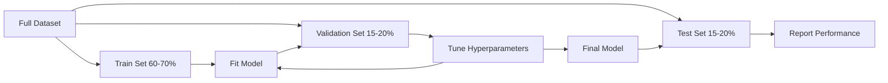

# Model Evaluation

> 模型的好壞，取決於你怎麼衡量它。

**Type:** Build
**Languages:** Python
**Prerequisites:** Phase 1 (Probability & Distributions, Statistics for ML), Phase 2 Lessons 1-8
**Time:** ~90 分鐘

## 學習目標 (Learning Objectives)

- 從零實作 K-fold 與 stratified K-fold cross-validation，並說明為什麼 stratification 對不平衡資料很重要
- 從零計算 precision、recall、F1、AUC-ROC 與 regression 指標（MSE、RMSE、MAE、R-squared）
- 解讀 learning curve，診斷模型是 high bias 還是 high variance
- 辨認常見的評估錯誤，包括 data leakage、選錯指標，以及 test set 汙染

## 問題 (The Problem)

你訓練了一個模型。它在你的資料上有 95% 的 accuracy。這樣好嗎？

也許好，也許不好。如果你 95% 的資料都屬於同一個類別，那個永遠預測該類別的模型就有 95% 的 accuracy，卻完全沒用。如果你在訓練用的同一份資料上評估，95% 這個數字毫無意義，因為模型只是把答案背下來了。如果你的資料集有時間成分，而你在切分前隨機打亂了，模型可能是在用未來的資料預測過去。

模型評估是大多數 ML 專案出錯的地方。錯的指標讓壞模型看起來很好。錯的切分讓模型作弊。錯的比較讓你選到比較差的模型。把評估做對不是可有可無，它決定了模型是能在正式環境運作，還是一碰到真實資料就失敗。

## 核心概念 (The Concept)

### Train、Validation、Test (Train, Validation, Test)



三種切分，三種用途：

- **Training set**：模型從這份資料學習。訓練期間它會看到這些範例。
- **Validation set**：用來調整 hyperparameter 與在模型之間做選擇。模型從不在這份資料上訓練，但你的決策會受到它的影響。
- **Test set**：只碰一次，在最後，用來回報最終表現。如果你看了 test 表現，然後回頭修改模型，它就不再是 test set 了，而是變成第二個 validation set。

Test set 是你的 hold-out 保證，確保回報的表現反映模型在真正沒看過的資料上會如何。

### K-Fold Cross-Validation

資料集小的時候，單一一次 train/validation 切分既浪費資料，估計值也很不穩定。K-fold cross-validation 讓所有資料同時用於訓練與驗證：

```mermaid
flowchart TB
    subgraph Fold1["Fold 1"]
        direction LR
        V1["Val"] --- T1a["Train"] --- T1b["Train"] --- T1c["Train"] --- T1d["Train"]
    end
    subgraph Fold2["Fold 2"]
        direction LR
        T2a["Train"] --- V2["Val"] --- T2b["Train"] --- T2c["Train"] --- T2d["Train"]
    end
    subgraph Fold3["Fold 3"]
        direction LR
        T3a["Train"] --- T3b["Train"] --- V3["Val"] --- T3c["Train"] --- T3d["Train"]
    end
    subgraph Fold4["Fold 4"]
        direction LR
        T4a["Train"] --- T4b["Train"] --- T4c["Train"] --- V4["Val"] --- T4d["Train"]
    end
    subgraph Fold5["Fold 5"]
        direction LR
        T5a["Train"] --- T5b["Train"] --- T5c["Train"] --- T5d["Train"] --- V5["Val"]
    end
    Fold1 --> R["Average scores"]
    Fold2 --> R
    Fold3 --> R
    Fold4 --> R
    Fold5 --> R
```



1. 把資料切成 $K$ 個大小相等的 fold
2. 對每個 fold，用 $K-1$ 個 fold 訓練，用剩下的那個 fold 驗證
3. 把 $K$ 個 validation 分數取平均

$K=5$ 或 $K=10$ 是標準選擇。每個資料點剛好會被用來驗證一次。平均分數是比任何單一切分都更穩定的估計。

**Stratified K-fold**：在每個 fold 中保留類別分布。如果你的資料集是 70% 類別 A、30% 類別 B，每個 fold 的比例都會大致相同。這對不平衡資料集很重要，因為隨機切分可能會把所有少數類別樣本放進同一個 fold。

### Classification 指標 (Classification Metrics)

**Confusion matrix**：基礎。對 binary classification：

|  | 預測為正 | 預測為負 |
|--|---|---|
| 實際為正 | True Positive (TP) | False Negative (FN) |
| 實際為負 | False Positive (FP) | True Negative (TN) |

所有其他指標都由這個矩陣衍生：

- **Accuracy** = $(TP + TN) / (TP + TN + FP + FN)$。預測正確的比例。當類別不平衡時會有誤導性。
- **Precision** = $TP / (TP + FP)$。在所有預測為正的樣本中，實際為正的有多少？在 false positive 代價高時使用（例如垃圾郵件過濾器把正常信件標成垃圾）。
- **Recall**（sensitivity）= $TP / (TP + FN)$。在所有實際為正的樣本中，我們抓到多少？在 false negative 代價高時使用（例如癌症篩檢漏掉腫瘤）。
- **F1 score** = $2 \cdot \text{precision} \cdot \text{recall} / (\text{precision} + \text{recall})$。Precision 與 recall 的調和平均數。當兩者沒有明顯孰重孰輕時，用來平衡兩者。
- **AUC-ROC**：Receiver Operating Characteristic 曲線下面積。繪製在不同分類 threshold 下 true positive rate 對 false positive rate 的關係。AUC = 0.5 代表隨機猜測，AUC = 1.0 代表完美分離。它與 threshold 無關：衡量的是模型把正例排在負例之前的能力，不管你選哪個截斷值。

### Regression 指標 (Regression Metrics)

- **MSE**（Mean Squared Error）= $\text{mean}((y_{\text{true}} - y_{\text{pred}})^2)$。以平方方式懲罰大誤差。對 outlier 敏感。
- **RMSE**（Root Mean Squared Error）= $\sqrt{\text{MSE}}$。單位與目標變數相同。比 MSE 更容易解讀。
- **MAE**（Mean Absolute Error）= $\text{mean}(\lvert y_{\text{true}} - y_{\text{pred}} \rvert)$。以線性方式對待所有誤差。比 MSE 更能抵抗 outlier。
- **R-squared** = $1 - SS_{\text{res}} / SS_{\text{tot}}$，其中 $SS_{\text{res}} = \sum (y_{\text{true}} - y_{\text{pred}})^2$，$SS_{\text{tot}} = \sum (y_{\text{true}} - y_{\text{mean}})^2$。模型所解釋的變異比例。$R^2 = 1.0$ 是完美。$R^2 = 0.0$ 代表模型不比永遠預測平均值更好。如果模型比平均值還差，$R^2$ 可以是負的。

### Learning Curve (Learning Curves)

把 training 與 validation 分數畫成 training set 大小的函數：

- **High bias（underfitting）**：兩條曲線收斂到低分。增加更多資料沒有幫助，你需要更複雜的模型。
- **High variance（overfitting）**：training 分數高，但 validation 分數低很多。兩者之間的差距很大。增加更多資料應該有幫助。

### Validation Curve (Validation Curves)

把 training 與 validation 分數畫成某個 hyperparameter 的函數：

- 複雜度低時：兩個分數都低（underfitting）
- 複雜度剛好時：兩個分數都高且很接近
- 複雜度高時：training 分數維持高檔，但 validation 分數下降（overfitting）

最佳的 hyperparameter 值落在 validation 分數的峰值。

### 常見的評估錯誤 (Common Evaluation Mistakes)

**Data leakage**：test set 的資訊洩漏到訓練中。例子：在切分前就用完整資料集 fit scaler、在時間序列預測中納入未來的資料、使用由目標衍生出來的 feature。永遠先切分，再做前處理。

**Class imbalance**：99% 的交易是合法的，1% 是詐欺。永遠預測「合法」的模型就有 99% 的 accuracy。改用 precision、recall、F1 或 AUC-ROC。

**選錯指標**：在該最佳化 recall 的時候（醫療診斷）去最佳化 accuracy，或是在資料有嚴重 outlier 時去最佳化 RMSE（應改用 MAE）。

**沒有使用 stratified 切分**：資料不平衡時，隨機切分可能讓 validation fold 裡只有極少數的少數類別樣本，造成不穩定的估計。

**太常測試**：每次你看了 test 表現就去調整，你就是在對 test set 做 overfitting。Test set 只能用一次。

```figure
precision-recall-threshold
```

## 動手做 (Build It)

### 步驟 1：Train/validation/test 切分

```python
import random
import math


def train_val_test_split(X, y, train_ratio=0.6, val_ratio=0.2, seed=42):
    random.seed(seed)
    n = len(X)
    indices = list(range(n))
    random.shuffle(indices)

    train_end = int(n * train_ratio)
    val_end = int(n * (train_ratio + val_ratio))

    train_idx = indices[:train_end]
    val_idx = indices[train_end:val_end]
    test_idx = indices[val_end:]

    X_train = [X[i] for i in train_idx]
    y_train = [y[i] for i in train_idx]
    X_val = [X[i] for i in val_idx]
    y_val = [y[i] for i in val_idx]
    X_test = [X[i] for i in test_idx]
    y_test = [y[i] for i in test_idx]

    return X_train, y_train, X_val, y_val, X_test, y_test
```

### 步驟 2：K-fold 與 stratified K-fold cross-validation

```python
def kfold_split(n, k=5, seed=42):
    random.seed(seed)
    indices = list(range(n))
    random.shuffle(indices)

    fold_size = n // k
    folds = []

    for i in range(k):
        start = i * fold_size
        end = start + fold_size if i < k - 1 else n
        val_idx = indices[start:end]
        train_idx = indices[:start] + indices[end:]
        folds.append((train_idx, val_idx))

    return folds


def stratified_kfold_split(y, k=5, seed=42):
    random.seed(seed)

    class_indices = {}
    for i, label in enumerate(y):
        class_indices.setdefault(label, []).append(i)

    for label in class_indices:
        random.shuffle(class_indices[label])

    folds = [{"train": [], "val": []} for _ in range(k)]

    for label, indices in class_indices.items():
        fold_size = len(indices) // k
        for i in range(k):
            start = i * fold_size
            end = start + fold_size if i < k - 1 else len(indices)
            val_part = indices[start:end]
            train_part = indices[:start] + indices[end:]
            folds[i]["val"].extend(val_part)
            folds[i]["train"].extend(train_part)

    return [(f["train"], f["val"]) for f in folds]


def cross_validate(X, y, model_fn, k=5, metric_fn=None, stratified=False):
    n = len(X)

    if stratified:
        folds = stratified_kfold_split(y, k)
    else:
        folds = kfold_split(n, k)

    scores = []
    for train_idx, val_idx in folds:
        X_train = [X[i] for i in train_idx]
        y_train = [y[i] for i in train_idx]
        X_val = [X[i] for i in val_idx]
        y_val = [y[i] for i in val_idx]

        model = model_fn()
        model.fit(X_train, y_train)
        predictions = [model.predict(x) for x in X_val]

        if metric_fn:
            score = metric_fn(y_val, predictions)
        else:
            score = sum(1 for yt, yp in zip(y_val, predictions) if yt == yp) / len(y_val)
        scores.append(score)

    return scores
```

### 步驟 3：Confusion matrix 與 classification 指標

```python
def confusion_matrix(y_true, y_pred):
    tp = sum(1 for yt, yp in zip(y_true, y_pred) if yt == 1 and yp == 1)
    tn = sum(1 for yt, yp in zip(y_true, y_pred) if yt == 0 and yp == 0)
    fp = sum(1 for yt, yp in zip(y_true, y_pred) if yt == 0 and yp == 1)
    fn = sum(1 for yt, yp in zip(y_true, y_pred) if yt == 1 and yp == 0)
    return tp, tn, fp, fn


def accuracy(y_true, y_pred):
    tp, tn, fp, fn = confusion_matrix(y_true, y_pred)
    total = tp + tn + fp + fn
    return (tp + tn) / total if total > 0 else 0.0


def precision(y_true, y_pred):
    tp, tn, fp, fn = confusion_matrix(y_true, y_pred)
    return tp / (tp + fp) if (tp + fp) > 0 else 0.0


def recall(y_true, y_pred):
    tp, tn, fp, fn = confusion_matrix(y_true, y_pred)
    return tp / (tp + fn) if (tp + fn) > 0 else 0.0


def f1_score(y_true, y_pred):
    p = precision(y_true, y_pred)
    r = recall(y_true, y_pred)
    return 2 * p * r / (p + r) if (p + r) > 0 else 0.0


def roc_curve(y_true, y_scores):
    thresholds = sorted(set(y_scores), reverse=True)
    tpr_list = []
    fpr_list = []

    total_positives = sum(y_true)
    total_negatives = len(y_true) - total_positives

    for threshold in thresholds:
        y_pred = [1 if s >= threshold else 0 for s in y_scores]
        tp = sum(1 for yt, yp in zip(y_true, y_pred) if yt == 1 and yp == 1)
        fp = sum(1 for yt, yp in zip(y_true, y_pred) if yt == 0 and yp == 1)

        tpr = tp / total_positives if total_positives > 0 else 0.0
        fpr = fp / total_negatives if total_negatives > 0 else 0.0

        tpr_list.append(tpr)
        fpr_list.append(fpr)

    return fpr_list, tpr_list, thresholds


def auc_roc(y_true, y_scores):
    fpr_list, tpr_list, _ = roc_curve(y_true, y_scores)

    pairs = sorted(zip(fpr_list, tpr_list))
    fpr_sorted = [p[0] for p in pairs]
    tpr_sorted = [p[1] for p in pairs]

    area = 0.0
    for i in range(1, len(fpr_sorted)):
        width = fpr_sorted[i] - fpr_sorted[i - 1]
        height = (tpr_sorted[i] + tpr_sorted[i - 1]) / 2
        area += width * height

    return area
```

### 步驟 4：Regression 指標

```python
def mse(y_true, y_pred):
    n = len(y_true)
    return sum((yt - yp) ** 2 for yt, yp in zip(y_true, y_pred)) / n


def rmse(y_true, y_pred):
    return math.sqrt(mse(y_true, y_pred))


def mae(y_true, y_pred):
    n = len(y_true)
    return sum(abs(yt - yp) for yt, yp in zip(y_true, y_pred)) / n


def r_squared(y_true, y_pred):
    mean_y = sum(y_true) / len(y_true)
    ss_res = sum((yt - yp) ** 2 for yt, yp in zip(y_true, y_pred))
    ss_tot = sum((yt - mean_y) ** 2 for yt in y_true)
    if ss_tot == 0:
        return 0.0
    return 1.0 - ss_res / ss_tot
```

### 步驟 5：Learning curve

```python
def learning_curve(X, y, model_fn, metric_fn, train_sizes=None, val_ratio=0.2, seed=42):
    random.seed(seed)
    n = len(X)
    indices = list(range(n))
    random.shuffle(indices)

    val_size = int(n * val_ratio)
    val_idx = indices[:val_size]
    pool_idx = indices[val_size:]

    X_val = [X[i] for i in val_idx]
    y_val = [y[i] for i in val_idx]

    if train_sizes is None:
        train_sizes = [int(len(pool_idx) * r) for r in [0.1, 0.2, 0.4, 0.6, 0.8, 1.0]]

    train_scores = []
    val_scores = []

    for size in train_sizes:
        subset = pool_idx[:size]
        X_train = [X[i] for i in subset]
        y_train = [y[i] for i in subset]

        model = model_fn()
        model.fit(X_train, y_train)

        train_pred = [model.predict(x) for x in X_train]
        val_pred = [model.predict(x) for x in X_val]

        train_scores.append(metric_fn(y_train, train_pred))
        val_scores.append(metric_fn(y_val, val_pred))

    return train_sizes, train_scores, val_scores
```

### 步驟 6：用於測試的簡單 classifier，加上完整 demo

```python
class SimpleLogistic:
    def __init__(self, lr=0.1, epochs=100):
        self.lr = lr
        self.epochs = epochs
        self.weights = None
        self.bias = 0.0

    def sigmoid(self, z):
        z = max(-500, min(500, z))
        return 1.0 / (1.0 + math.exp(-z))

    def fit(self, X, y):
        n_features = len(X[0])
        self.weights = [0.0] * n_features
        self.bias = 0.0

        for _ in range(self.epochs):
            for xi, yi in zip(X, y):
                z = sum(w * x for w, x in zip(self.weights, xi)) + self.bias
                pred = self.sigmoid(z)
                error = yi - pred
                for j in range(n_features):
                    self.weights[j] += self.lr * error * xi[j]
                self.bias += self.lr * error

    def predict_proba(self, x):
        z = sum(w * xi for w, xi in zip(self.weights, x)) + self.bias
        return self.sigmoid(z)

    def predict(self, x):
        return 1 if self.predict_proba(x) >= 0.5 else 0


class SimpleLinearRegression:
    def __init__(self, lr=0.001, epochs=200):
        self.lr = lr
        self.epochs = epochs
        self.weights = None
        self.bias = 0.0

    def fit(self, X, y):
        n_features = len(X[0])
        self.weights = [0.0] * n_features
        self.bias = 0.0
        n = len(X)

        for _ in range(self.epochs):
            for xi, yi in zip(X, y):
                pred = sum(w * x for w, x in zip(self.weights, xi)) + self.bias
                error = yi - pred
                for j in range(n_features):
                    self.weights[j] += self.lr * error * xi[j] / n
                self.bias += self.lr * error / n

    def predict(self, x):
        return sum(w * xi for w, xi in zip(self.weights, x)) + self.bias


def standardize(values):
    n = len(values)
    mean = sum(values) / n
    var = sum((v - mean) ** 2 for v in values) / n
    std = math.sqrt(var) if var > 0 else 1.0
    return [(v - mean) / std for v in values], mean, std


def make_classification_data(n=300, seed=42):
    random.seed(seed)
    X = []
    y = []
    for _ in range(n):
        x1 = random.gauss(0, 1)
        x2 = random.gauss(0, 1)
        label = 1 if (x1 + x2 + random.gauss(0, 0.5)) > 0 else 0
        X.append([x1, x2])
        y.append(label)
    return X, y


def make_regression_data(n=200, seed=42):
    random.seed(seed)
    X = []
    y = []
    for _ in range(n):
        x1 = random.uniform(0, 10)
        x2 = random.uniform(0, 5)
        target = 3 * x1 + 2 * x2 + random.gauss(0, 2)
        X.append([x1, x2])
        y.append(target)
    return X, y


def make_imbalanced_data(n=300, minority_ratio=0.05, seed=42):
    random.seed(seed)
    X = []
    y = []
    for _ in range(n):
        if random.random() < minority_ratio:
            x1 = random.gauss(3, 0.5)
            x2 = random.gauss(3, 0.5)
            label = 1
        else:
            x1 = random.gauss(0, 1)
            x2 = random.gauss(0, 1)
            label = 0
        X.append([x1, x2])
        y.append(label)
    return X, y


if __name__ == "__main__":
    X_clf, y_clf = make_classification_data(300)

    print("=== Train/Validation/Test Split ===")
    X_train, y_train, X_val, y_val, X_test, y_test = train_val_test_split(X_clf, y_clf)
    print(f"  Train: {len(X_train)}, Val: {len(X_val)}, Test: {len(X_test)}")
    print(f"  Train class distribution: {sum(y_train)}/{len(y_train)} positive")
    print(f"  Val class distribution: {sum(y_val)}/{len(y_val)} positive")

    model = SimpleLogistic(lr=0.1, epochs=200)
    model.fit(X_train, y_train)

    print("\n=== Classification Metrics ===")
    y_pred = [model.predict(x) for x in X_test]
    tp, tn, fp, fn = confusion_matrix(y_test, y_pred)
    print(f"  Confusion matrix: TP={tp}, TN={tn}, FP={fp}, FN={fn}")
    print(f"  Accuracy:  {accuracy(y_test, y_pred):.4f}")
    print(f"  Precision: {precision(y_test, y_pred):.4f}")
    print(f"  Recall:    {recall(y_test, y_pred):.4f}")
    print(f"  F1 Score:  {f1_score(y_test, y_pred):.4f}")

    y_scores = [model.predict_proba(x) for x in X_test]
    auc = auc_roc(y_test, y_scores)
    print(f"  AUC-ROC:   {auc:.4f}")

    print("\n=== K-Fold Cross-Validation (K=5) ===")
    cv_scores = cross_validate(
        X_clf, y_clf,
        model_fn=lambda: SimpleLogistic(lr=0.1, epochs=200),
        k=5,
        metric_fn=accuracy,
    )
    mean_cv = sum(cv_scores) / len(cv_scores)
    std_cv = math.sqrt(sum((s - mean_cv) ** 2 for s in cv_scores) / len(cv_scores))
    print(f"  Fold scores: {[round(s, 4) for s in cv_scores]}")
    print(f"  Mean: {mean_cv:.4f} (+/- {std_cv:.4f})")

    print("\n=== Stratified K-Fold Cross-Validation (K=5) ===")
    strat_scores = cross_validate(
        X_clf, y_clf,
        model_fn=lambda: SimpleLogistic(lr=0.1, epochs=200),
        k=5,
        metric_fn=accuracy,
        stratified=True,
    )
    strat_mean = sum(strat_scores) / len(strat_scores)
    strat_std = math.sqrt(sum((s - strat_mean) ** 2 for s in strat_scores) / len(strat_scores))
    print(f"  Fold scores: {[round(s, 4) for s in strat_scores]}")
    print(f"  Mean: {strat_mean:.4f} (+/- {strat_std:.4f})")

    print("\n=== Imbalanced Data: Why Accuracy Lies ===")
    X_imb, y_imb = make_imbalanced_data(300, minority_ratio=0.05)
    positives = sum(y_imb)
    print(f"  Class distribution: {positives} positive, {len(y_imb) - positives} negative ({positives/len(y_imb)*100:.1f}% positive)")

    always_negative = [0] * len(y_imb)
    print(f"  Always-negative baseline:")
    print(f"    Accuracy:  {accuracy(y_imb, always_negative):.4f}")
    print(f"    Precision: {precision(y_imb, always_negative):.4f}")
    print(f"    Recall:    {recall(y_imb, always_negative):.4f}")
    print(f"    F1 Score:  {f1_score(y_imb, always_negative):.4f}")

    X_tr_i, y_tr_i, X_v_i, y_v_i, X_te_i, y_te_i = train_val_test_split(X_imb, y_imb)
    model_imb = SimpleLogistic(lr=0.5, epochs=500)
    model_imb.fit(X_tr_i, y_tr_i)
    y_pred_imb = [model_imb.predict(x) for x in X_te_i]
    print(f"\n  Trained model on imbalanced data:")
    print(f"    Accuracy:  {accuracy(y_te_i, y_pred_imb):.4f}")
    print(f"    Precision: {precision(y_te_i, y_pred_imb):.4f}")
    print(f"    Recall:    {recall(y_te_i, y_pred_imb):.4f}")
    print(f"    F1 Score:  {f1_score(y_te_i, y_pred_imb):.4f}")

    print("\n=== Regression Metrics ===")
    X_reg, y_reg = make_regression_data(200)

    col0 = [x[0] for x in X_reg]
    col1 = [x[1] for x in X_reg]
    col0_s, m0, s0 = standardize(col0)
    col1_s, m1, s1 = standardize(col1)
    X_reg_scaled = [[col0_s[i], col1_s[i]] for i in range(len(X_reg))]

    X_tr_r, y_tr_r, X_v_r, y_v_r, X_te_r, y_te_r = train_val_test_split(X_reg_scaled, y_reg)
    reg_model = SimpleLinearRegression(lr=0.01, epochs=500)
    reg_model.fit(X_tr_r, y_tr_r)
    y_pred_r = [reg_model.predict(x) for x in X_te_r]

    print(f"  MSE:       {mse(y_te_r, y_pred_r):.4f}")
    print(f"  RMSE:      {rmse(y_te_r, y_pred_r):.4f}")
    print(f"  MAE:       {mae(y_te_r, y_pred_r):.4f}")
    print(f"  R-squared: {r_squared(y_te_r, y_pred_r):.4f}")

    mean_baseline = [sum(y_tr_r) / len(y_tr_r)] * len(y_te_r)
    print(f"\n  Mean baseline:")
    print(f"    MSE:       {mse(y_te_r, mean_baseline):.4f}")
    print(f"    R-squared: {r_squared(y_te_r, mean_baseline):.4f}")

    print("\n=== Learning Curve ===")
    sizes, train_sc, val_sc = learning_curve(
        X_clf, y_clf,
        model_fn=lambda: SimpleLogistic(lr=0.1, epochs=200),
        metric_fn=accuracy,
    )
    print(f"  {'Size':>6} {'Train':>8} {'Val':>8}")
    for s, tr, va in zip(sizes, train_sc, val_sc):
        print(f"  {s:>6} {tr:>8.4f} {va:>8.4f}")

    print("\n=== Statistical Model Comparison ===")
    model_a_scores = cross_validate(
        X_clf, y_clf,
        model_fn=lambda: SimpleLogistic(lr=0.1, epochs=100),
        k=5, metric_fn=accuracy,
    )
    model_b_scores = cross_validate(
        X_clf, y_clf,
        model_fn=lambda: SimpleLogistic(lr=0.1, epochs=500),
        k=5, metric_fn=accuracy,
    )
    diffs = [a - b for a, b in zip(model_a_scores, model_b_scores)]
    mean_diff = sum(diffs) / len(diffs)
    std_diff = math.sqrt(sum((d - mean_diff) ** 2 for d in diffs) / len(diffs))
    t_stat = mean_diff / (std_diff / math.sqrt(len(diffs))) if std_diff > 0 else 0.0
    print(f"  Model A (100 epochs) mean: {sum(model_a_scores)/len(model_a_scores):.4f}")
    print(f"  Model B (500 epochs) mean: {sum(model_b_scores)/len(model_b_scores):.4f}")
    print(f"  Mean difference: {mean_diff:.4f}")
    print(f"  Paired t-statistic: {t_stat:.4f}")
    print(f"  (|t| > 2.78 for significance at p<0.05 with df=4)")
```

## 實際使用 (Use It)

用 scikit-learn，評估已內建在工作流程中：

```python
from sklearn.model_selection import cross_val_score, StratifiedKFold, learning_curve
from sklearn.metrics import (
    accuracy_score, precision_score, recall_score, f1_score,
    roc_auc_score, confusion_matrix, mean_squared_error, r2_score,
)
from sklearn.linear_model import LogisticRegression

model = LogisticRegression()
scores = cross_val_score(model, X, y, cv=StratifiedKFold(5), scoring="f1")
```

從零實作的版本讓你看到 cross-validation 到底做了什麼（沒有魔法，只有 for 迴圈和索引追蹤）、每個指標是怎麼計算的（只是數 TP/FP/TN/FN），以及 stratification 為什麼重要（在每個 fold 中保留類別比例）。函式庫版本加上了平行運算、更多評分選項，以及與 pipeline 的整合。

## 交付 (Ship It)

這堂課會產出：
- `outputs/skill-evaluation.md` - 涵蓋 classification 與 regression 模型評估策略的 skill

## 練習 (Exercises)

1. 實作 precision-recall curve：畫出在不同 threshold 下 precision 對 recall 的關係。計算 average precision（PR 曲線下面積）。在不平衡資料集上比較 PR 曲線與 ROC 曲線，並說明各自在什麼時候更有資訊量。
2. 建立 nested cross-validation 迴圈：外層迴圈評估模型表現，內層迴圈調整 hyperparameter。用它公平地比較兩個模型，同時避免 validation 資料洩漏到評估中。
3. 實作用於模型比較的 permutation test：打亂標籤、重新訓練並量測表現。重複 100 次建立 null distribution。針對觀察到的模型表現，對照這個分布計算 p-value。

## 關鍵術語 (Key Terms)

| 術語 | 大家怎麼說 | 實際意義 |
|------|----------------|----------------------|
| Overfitting | 「背下訓練資料」 | 模型捕捉到 training data 中的雜訊，在訓練時表現良好，卻在沒看過的資料上表現不佳 |
| Cross-validation | 「在不同子集上測試」 | 有系統地輪換用於驗證的資料部分，並對所有輪換的結果取平均 |
| Precision | 「預測為正的有多少是對的」 | $TP / (TP + FP)$：正向預測中實際為正的比例 |
| Recall | 「實際為正的我們找到多少」 | $TP / (TP + FN)$：實際為正的樣本中被正確辨認的比例 |
| AUC-ROC | 「模型把類別分得多開」 | 跨所有 threshold 的 true positive rate 對 false positive rate 曲線下面積，從 0.5（隨機）到 1.0（完美） |
| R-squared | 「解釋了多少變異」 | $1 - (\text{sum of squared residuals} / \text{total sum of squares})$：模型捕捉到的目標變異比例 |
| Data leakage | 「模型作弊了」 | 在訓練期間使用了預測時拿不到的資訊，導致評估過於樂觀 |
| Learning curve | 「效能如何隨資料增加而改變」 | training 與 validation 分數對 training set 大小的圖，用來揭示 underfitting 或 overfitting |
| Stratified split | 「讓類別比例保持平衡」 | 切分資料，使每個子集中各類別的比例與完整資料集相同 |

## 延伸閱讀 (Further Reading)

- [scikit-learn Model Selection Guide](https://scikit-learn.org/stable/model_selection.html) - 關於 cross-validation、指標與 hyperparameter 調整的完整參考
- [Beyond Accuracy: Precision and Recall (Google ML Crash Course)](https://developers.google.com/machine-learning/crash-course/classification/precision-and-recall) - 附互動範例的清楚解說
- [A Survey of Cross-Validation Procedures (Arlot & Celisse, 2010)](https://projecteuclid.org/journals/statistics-surveys/volume-4/issue-none/A-survey-of-cross-validation-procedures-for-model-selection/10.1214/09-SS054.full) - 嚴謹討論不同 CV 策略何時以及為何有效
