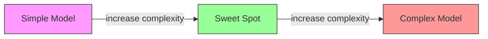
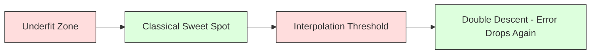
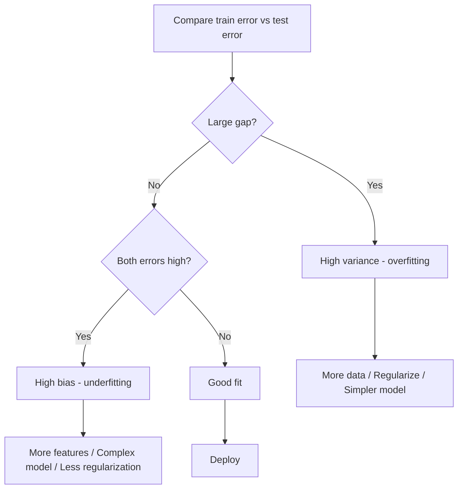
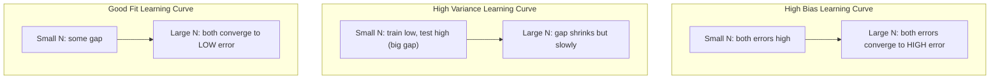
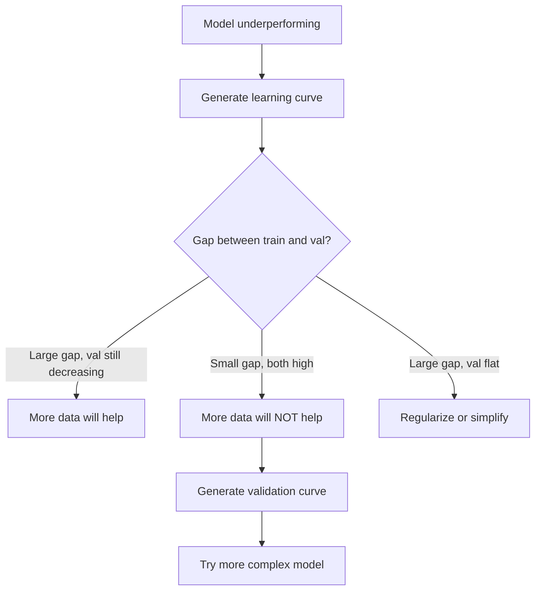

# Bias-Variance Tradeoff

> 每個模型的誤差都來自三個來源之一：bias、variance 或 noise。你只能控制前兩個。

**Type:** Learn
**Language:** Python
**Prerequisites:** Phase 2, Lessons 01-09 (ML basics, regression, classification, evaluation)
**Time:** ~75 分鐘

## 學習目標 (Learning Objectives)

- 推導預期預測誤差的 bias-variance 分解，並說明 irreducible noise 的角色
- 利用 training 與 test error 的型態，診斷模型是 high bias 還是 high variance
- 說明 regularization 技術（L1、L2、dropout、early stopping）如何用 bias 換取 variance
- 實作實驗，視覺化複雜度遞增的模型上的 bias-variance tradeoff

## 問題 (The Problem)

你訓練了一個模型。它在 test data 上有一些誤差。這個誤差是從哪來的？

如果你的模型太簡單（對彎曲的資料集用 linear regression），它會一直抓不到真正的模式。這就是 bias。如果你的模型太複雜（對 15 個資料點用 20 次多項式），它能完美擬合 training data，卻會在新資料上給出天差地遠的預測。這就是 variance。

對固定的模型容量，你無法同時把兩者都最小化。壓低 bias，variance 就會上升；壓低 variance，bias 就會上升。理解這個 tradeoff 是機器學習中最有用的單一診斷技能。它告訴你該讓模型更複雜還是更簡單、該取得更多資料還是設計更好的 feature、該加強還是放鬆 regularization。

## 核心概念 (The Concept)

### Bias：系統性誤差 (Bias: Systematic Error)

Bias 衡量模型的平均預測離真實值有多遠。如果你在許多從同一分布抽出的不同 training set 上訓練同一個模型，並將預測取平均，bias 就是這個平均值與真實值之間的差距。

High bias 代表模型太僵硬，抓不到真正的模式。用直線去擬合拋物線，不管給它多少資料，都永遠抓不到那個彎曲。這就是 underfitting。

```
High bias (underfitting):
  Model always predicts roughly the same wrong thing.
  Training error: HIGH
  Test error: HIGH
  Gap between them: SMALL
```

### Variance：對訓練資料的敏感度 (Variance: Sensitivity to Training Data)

Variance 衡量在不同資料子集上訓練時，你的預測會改變多少。如果 training set 的小變動導致模型的大變動，variance 就高。

High variance 代表模型擬合的是 training data 中的雜訊，而不是底層的訊號。20 次多項式會穿過每個訓練點，卻在它們之間劇烈震盪。這就是 overfitting。

```
High variance (overfitting):
  Model fits training data perfectly but fails on new data.
  Training error: LOW
  Test error: HIGH
  Gap between them: LARGE
```

### 分解 (The Decomposition)

對於任何一點 $x$，squared loss 下的預期預測誤差可以精確分解：

```math
\begin{aligned}
& \text{Expected Error} = \text{Bias}^2 + \text{Variance} + \text{Irreducible Noise} \\[6pt]
& \text{where:} \\
& \quad \text{Bias}^2 = (\mathbb{E}[\hat{f}(x)] - f(x))^2 \\
& \quad \text{Variance} = \mathbb{E}[(\hat{f}(x) - \mathbb{E}[\hat{f}(x)])^2] \\
& \quad \text{Noise} = \mathbb{E}[(y - f(x))^2] \quad (\sigma^2)
\end{aligned}
```

- $f(x)$ 是真實函數
- $\hat{f}(x)$ 是模型的預測
- $\mathbb{E}[\ldots]$ 是對不同 training set 的期望值
- $y$ 是觀察到的標籤（真實函數加上雜訊）

Noise 這一項是 irreducible 的。在有雜訊的資料上，沒有任何模型能做得比 $\sigma^2$ 更好。你的工作是在 $\text{bias}^2$ 與 variance 之間找到適當的平衡。

### 模型複雜度與誤差 (Model Complexity vs Error)



經典的 U 形曲線：

| 複雜度 | Bias | Variance | 總誤差 |
|-----------|------|----------|-------------|
| 太低 | 高 | 低 | 高 (underfitting) |
| 剛剛好 | 中等 | 中等 | 最低 |
| 太高 | 低 | 高 | 高 (overfitting) |

### 把 Regularization 當作 Bias-Variance 的控制旋鈕 (Regularization as Bias-Variance Control)

Regularization 刻意增加 bias 來降低 variance。它限制模型，使它無法去追逐雜訊。

- **L2 (Ridge)：**把所有 weights 往零收縮。保留所有 feature，但降低它們的影響力。
- **L1 (Lasso)：**把部分 weights 推到剛好為零。等於做了 feature selection。
- **Dropout：**訓練時隨機停用神經元。迫使網路產生冗餘的表示。
- **Early stopping：**在模型完全擬合 training data 之前停止訓練。

Regularization 的強度（lambda、dropout rate、epoch 數）直接控制你落在 bias-variance 曲線上的哪個位置。Regularization 越多，bias 越高，variance 越低。

### Double Descent：現代觀點 (Double Descent: The Modern Perspective)

經典理論說：過了甜蜜點之後，更多的複雜度永遠只會有害。但 2019 年以來的研究顯示了出人意料的現象。如果你持續提高模型容量，遠超過 interpolation threshold（模型擁有足夠的參數去完美擬合 training data 的地方），test error 可以再次下降。



這個「double descent」現象解釋了為什麼大幅 overparameterized 的 neural network（參數遠多於訓練範例）仍然能夠良好地 generalize。經典的 bias-variance tradeoff 並沒有錯，但對現代的範圍來說並不完整。

關於 double descent 的重要觀察：
- 它出現在線性模型、decision tree 和 neural network 中
- 在 interpolation 區域，更多資料實際上可能有害（sample-wise double descent）
- 更多的訓練 epoch 也可能造成它（epoch-wise double descent）
- Regularization 會讓峰值變平滑，但不會消除它

為什麼會這樣？在 interpolation threshold 上，模型剛好有足夠的容量去擬合所有訓練點。它被迫走向一個穿過每個點的非常特定的解，資料的微小擾動就會造成擬合結果的大幅改變。這就是 variance 的峰值。越過這個 threshold 之後，模型有許多可以完美擬合資料的解。學習演算法（例如帶有隱含 regularization 的 gradient descent）傾向於在其中挑選最簡單的那個。這種對簡單解的隱含偏好，就是 overparameterized 模型能夠 generalize 的原因。

| 範圍 | 參數 vs 樣本 | 行為 |
|--------|----------------------|----------|
| Underparameterized | $p \ll n$ | 適用經典 tradeoff |
| Interpolation threshold | $p \sim n$ | Variance 達到峰值，test error 飆升 |
| Overparameterized | $p \gg n$ | 隱含 regularization 開始作用，test error 下降 |

實務上：如果你使用 neural network 或大型 tree ensemble，不要停在 interpolation threshold。要嘛遠低於它（搭配明確的 regularization），要嘛遠超過它。最糟的位置就是正好在 threshold 上。

### 診斷你的模型 (Diagnosing Your Model)



| 症狀 | 診斷 | 解法 |
|---------|-----------|-----|
| Train error 高，test error 高 | Bias | 更多 feature、更複雜的模型、較少 regularization |
| Train error 低，test error 高 | Variance | 更多資料、regularization、更簡單的模型、dropout |
| Train error 低，test error 低 | 擬合良好 | 可以上線了 |
| Train error 下降，test error 上升 | Overfitting 進行中 | Early stopping |

### 實務策略 (Practical Strategies)

**當問題是 bias：**
- 加入多項式或交互作用 feature
- 使用更有彈性的模型（用 tree ensemble 取代線性模型）
- 降低 regularization 強度
- 訓練更久（如果還沒收斂）

**當問題是 variance：**
- 取得更多訓練資料
- 使用 bagging（random forest）
- 增加 regularization（更高的 lambda、更多 dropout）
- Feature selection（移除有雜訊的 feature）
- 使用 cross-validation 及早偵測

### Ensemble 方法與降低 Variance (Ensemble Methods and Variance Reduction)

Ensemble 方法是對抗 variance 最實用的工具。

**Bagging (Bootstrap Aggregating)** 在 training data 的不同 bootstrap sample 上訓練多個模型，然後將預測取平均。每個個別模型的 variance 都很高，但平均後的 variance 低得多。Random forest 就是把 bagging 套用在 decision tree 上。

數學上為什麼有效：如果你平均 $N$ 個獨立的預測，每個的 variance 為 $\sigma^2$，那麼平均值的 variance 是 $\sigma^2 / N$。這些模型並非真正獨立（它們看到的資料很相似），所以降低幅度小於 $1/N$，但仍然相當可觀。

**Boosting** 透過依序建立模型來降低 bias，每個新模型都專注於目前集成的錯誤。Gradient boosting 與 AdaBoost 是主要的例子。如果加入太多模型，boosting 可能會 overfit，所以需要 early stopping 或 regularization。

| 方法 | 主要效果 | Bias 變化 | Variance 變化 |
|--------|---------------|-------------|-----------------|
| Bagging | 降低 variance | 不變 | 下降 |
| Boosting | 降低 bias | 下降 | 可能上升 |
| Stacking | 兩者都降低 | 取決於 meta-learner | 取決於 base model |
| Dropout | 隱含的 bagging | 略微上升 | 下降 |

**實務經驗法則：**如果你的 base model 有 high variance（深的樹、高次多項式），用 bagging。如果你的 base model 有 high bias（淺的 stump、簡單的線性模型），用 boosting。

### Learning Curve (Learning Curves)

Learning curve 把 training 與 validation error 畫成 training set 大小的函數。它們是你手上最實用的診斷工具。和單一的 train/test 比較不同，learning curve 讓你看到模型的軌跡，並告訴你更多資料是否有幫助。



怎麼讀它們：

| 情境 | Training Error | Validation Error | 差距 | 代表什麼 | 該怎麼做 |
|----------|---------------|-----------------|-----|---------------|------------|
| High bias | 高 | 高 | 小 | 模型無法捕捉模式 | 更多 feature、更複雜的模型、較少 regularization |
| High variance | 低 | 高 | 大 | 模型記住了 training data | 更多資料、regularization、更簡單的模型 |
| 擬合良好 | 中等 | 中等 | 小 | 模型 generalize 良好 | 可以上線了 |
| High variance，持續改善中 | 低 | 隨資料增加而下降 | 縮小中 | 資料能修正的 variance 問題 | 收集更多資料 |
| High bias，趨於平坦 | 高 | 高且平坦 | 小且平坦 | 更多資料「不會」有幫助 | 更換模型架構 |

關鍵洞見：如果兩條曲線都已趨於平緩，差距很小但兩個 error 都很高，更多資料是沒用的，你需要更好的模型。如果差距很大而且還在縮小，更多資料就會有幫助。

### 如何產生 Learning Curve (How to Generate Learning Curves)

有兩種做法：

**做法 1：改變 training set 大小，固定模型。**保持模型與 hyperparameter 不變。在逐漸變大的 training data 子集上訓練。在每個大小下量測 training error 與 validation error。這是標準的 learning curve。

**做法 2：改變模型複雜度，固定資料。**保持資料不變。掃過一個複雜度參數（多項式次數、樹的深度、層數）。在每個複雜度下量測 training error 與 validation error。這是 validation curve，直接顯示 bias-variance tradeoff。

兩種做法互補。第一種告訴你更多資料是否有幫助，第二種告訴你換一個模型是否有幫助。在決定下一步之前，兩種都跑一遍。



```figure
bias-variance
```

## 動手做 (Build It)

`code/bias_variance.py` 中的程式碼執行完整的 bias-variance 分解實驗。以下是一步一步的做法。

### 步驟 1：從已知函數產生合成資料

我們使用 `f(x) = sin(1.5x) + 0.5x` 加上 Gaussian 雜訊。知道真實函數，讓我們可以計算出精確的 bias 與 variance。

```python
def true_function(x):
    return np.sin(1.5 * x) + 0.5 * x

def generate_data(n_samples=30, noise_std=0.5, x_range=(-3, 3), seed=None):
    rng = np.random.RandomState(seed)
    x = rng.uniform(x_range[0], x_range[1], n_samples)
    y = true_function(x) + rng.normal(0, noise_std, n_samples)
    return x, y
```

### 步驟 2：Bootstrap 抽樣與多項式擬合

對每個多項式次數，我們抽取許多 bootstrap training set，擬合多項式，並記錄在固定測試格點上的預測。這讓我們得到每個測試點上預測的分布。

```python
def fit_polynomial(x_train, y_train, degree, lam=0.0):
    X = np.column_stack([x_train ** d for d in range(degree + 1)])
    if lam > 0:
        penalty = lam * np.eye(X.shape[1])
        penalty[0, 0] = 0
        w = np.linalg.solve(X.T @ X + penalty, X.T @ y_train)
    else:
        w = np.linalg.lstsq(X, y_train, rcond=None)[0]
    return w
```

我們在 200 個不同的 bootstrap sample 上擬合。每個 bootstrap sample 都從相同的底層分布抽出，但包含不同的點。

### 步驟 3：計算 Bias^2 與 Variance 分解

有了每個測試點的 200 組預測，我們就可以直接依定義計算分解：

```python
mean_pred = predictions.mean(axis=0)
bias_sq = np.mean((mean_pred - y_true) ** 2)
variance = np.mean(predictions.var(axis=0))
total_error = np.mean(np.mean((predictions - y_true) ** 2, axis=1))
```

- `mean_pred` 是由 bootstrap sample 估計的 $\mathbb{E}[\hat{f}(x)]$
- `bias_sq` 是平均預測與真實值之間差距的平方
- `variance` 是預測在 bootstrap sample 之間的平均離散程度
- `total_error` 應該大約等於 $\text{bias}^2 + \text{variance} + \text{noise}$

### 步驟 4：Learning Curve

Learning curve 在固定模型複雜度的情況下，掃過 training set 大小。它們顯示你的模型是受限於資料，還是受限於容量。

```python
def demo_learning_curves():
    sizes = [10, 15, 20, 30, 50, 75, 100, 150, 200, 300]
    degree = 5

    for n in sizes:
        train_errors = []
        test_errors = []
        for seed in range(50):
            x_train, y_train = generate_data(n_samples=n, seed=seed * 100)
            w = fit_polynomial(x_train, y_train, degree)
            train_pred = predict_polynomial(x_train, w)
            train_mse = np.mean((train_pred - y_train) ** 2)
            test_pred = predict_polynomial(x_test, w)
            test_mse = np.mean((test_pred - y_test) ** 2)
            train_errors.append(train_mse)
            test_errors.append(test_mse)
        # Average over runs gives the learning curve point
```

對於 high-variance 的模型（資料少時的 5 次多項式），你會看到：
- Training error 一開始很低，隨著更多資料讓記憶變困難而上升
- Test error 一開始很高，隨著模型獲得更多訊號而下降
- 差距隨資料增加而縮小

對於 high-bias 的模型（1 次），兩個 error 都很快收斂到同一個很高的值，更多資料沒有幫助。

### 步驟 5：Regularization 掃描

程式碼中還包含 `demo_regularization_sweep()`，它固定一個高次多項式（15 次），並把 Ridge regularization 強度從 0.001 掃到 100。這從另一個角度展示 bias-variance tradeoff：我們不是改變模型複雜度，而是改變限制的強度。

```python
def demo_regularization_sweep():
    alphas = [0.001, 0.005, 0.01, 0.05, 0.1, 0.5, 1.0, 5.0, 10.0, 50.0, 100.0]
    for alpha in alphas:
        results = bias_variance_decomposition([15], lam=alpha)
        r = results[15]
        print(f"alpha={alpha:.3f}  bias={r['bias_sq']:.4f}  var={r['variance']:.4f}")
```

alpha 低時，15 次多項式幾乎不受限制。Variance 佔主導，因為模型在每個 bootstrap sample 上都去追逐雜訊。alpha 高時，懲罰強到模型實際上變成近乎常數函數。Bias 佔主導。最佳的 alpha 落在這兩個極端之間。

這是和改變多項式次數時相同的 U 形曲線，只是用連續的旋鈕取代離散的旋鈕來控制。實務上，regularization 是控制這個 tradeoff 的首選方式，因為它可以在不改變 feature 集合的情況下做細緻的調整。

## 實際使用 (Use It)

sklearn 提供 `learning_curve` 與 `validation_curve`，讓你不必自己寫 bootstrap 迴圈就能自動化這些診斷。

### Validation Curve：掃過模型複雜度

```python
from sklearn.model_selection import validation_curve
from sklearn.pipeline import make_pipeline
from sklearn.preprocessing import PolynomialFeatures
from sklearn.linear_model import Ridge

degrees = list(range(1, 16))
train_scores_all = []
val_scores_all = []

for d in degrees:
    pipe = make_pipeline(PolynomialFeatures(d), Ridge(alpha=0.01))
    train_scores, val_scores = validation_curve(
        pipe, X, y, param_name="polynomialfeatures__degree",
        param_range=[d], cv=5, scoring="neg_mean_squared_error"
    )
    train_scores_all.append(-train_scores.mean())
    val_scores_all.append(-val_scores.mean())
```

這直接給你 bias-variance tradeoff 曲線。Validation 分數相對於 train 分數最差的地方，是 variance 佔主導。兩者都差的地方，是 bias 佔主導。

### Learning Curve：掃過 Training Set 大小

```python
from sklearn.model_selection import learning_curve

pipe = make_pipeline(PolynomialFeatures(5), Ridge(alpha=0.01))
train_sizes, train_scores, val_scores = learning_curve(
    pipe, X, y, train_sizes=np.linspace(0.1, 1.0, 10),
    cv=5, scoring="neg_mean_squared_error"
)
train_mse = -train_scores.mean(axis=1)
val_mse = -val_scores.mean(axis=1)
```

把 `train_mse` 與 `val_mse` 對 `train_sizes` 畫出來。曲線的形狀告訴你關於模型的一切。

### 搭配 Regularization 掃描的 Cross-Validation

```python
from sklearn.model_selection import cross_val_score

alphas = [0.001, 0.01, 0.1, 1.0, 10.0, 100.0]
for alpha in alphas:
    pipe = make_pipeline(PolynomialFeatures(10), Ridge(alpha=alpha))
    scores = cross_val_score(pipe, X, y, cv=5, scoring="neg_mean_squared_error")
    print(f"alpha={alpha:>7.3f}  MSE={-scores.mean():.4f} +/- {scores.std():.4f}")
```

這會針對固定的模型複雜度掃過 regularization 強度。你會看到同樣的 bias-variance tradeoff：alpha 低代表 variance 高，alpha 高代表 bias 高。

### 整合起來：完整的診斷工作流程 (Putting It All Together: A Complete Diagnostic Workflow)

實務上，你會依序執行這些診斷：

1. 訓練你的模型。計算 train 與 test error。
2. 如果兩者都高：你有 bias 問題。跳到步驟 4。
3. 如果 train 低但 test 高：你有 variance 問題。產生 learning curve，看更多資料是否有幫助。如果沒有，就做 regularization。
4. 產生 validation curve，掃過你的主要複雜度參數。找到甜蜜點。
5. 在甜蜜點上，產生 learning curve。如果差距仍然很大，你需要更多資料或 regularization。
6. 用 `cross_val_score` 試試不同 alpha 值的 Ridge/Lasso。挑選 cross-validated error 最低的 alpha。

對大多數表格型資料集，這需要 10-15 分鐘的運算，卻能省下好幾個小時的瞎猜。

## 交付 (Ship It)

這堂課會產出：`outputs/prompt-model-diagnostics.md`

## 練習 (Exercises)

1. 用 `noise_std=0`（沒有雜訊）執行分解。irreducible error 這一項會怎樣？最佳複雜度有改變嗎？

2. 把 training set 大小從 30 增加到 300。這對 variance 成分有什麼影響？最佳多項式次數會移動嗎？

3. 在實驗中加入 L2 regularization（Ridge regression）。對固定的高次多項式（15 次），把 lambda 從 0 掃到 100。把 $\text{bias}^2$ 與 variance 畫成 lambda 的函數。

4. 把真實函數從多項式改成 `sin(x)`。bias-variance 分解會如何改變？仍然有明確的最佳次數嗎？

5. 實作一個簡單的 bootstrap aggregating（bagging）包裝器：在 bootstrap sample 上訓練 10 個模型並平均預測。證明這能降低 variance，而 bias 沒有增加太多。

## 關鍵術語 (Key Terms)

| 術語 | 大家怎麼說 | 實際意義 |
|------|----------------|----------------------|
| Bias | 「模型太簡單」 | 來自錯誤假設的系統性誤差。模型平均預測與真實值之間的差距。 |
| Variance | 「模型 overfit 了」 | 來自對 training data 敏感的誤差。預測在不同 training set 之間改變多少。 |
| Irreducible error | 「資料中的雜訊」 | 來自真實資料產生過程中隨機性的誤差。沒有任何模型能消除它。 |
| Underfitting | 「學得不夠」 | 模型有 high bias。即使在 training data 上也抓不到真正的模式。 |
| Overfitting | 「背下資料」 | 模型有 high variance。它擬合了無法 generalize 的 training data 雜訊。 |
| Regularization | 「限制模型」 | 加上懲罰來降低模型複雜度，用 bias 換取較低的 variance。 |
| Double descent | 「更多參數也可能有幫助」 | 當模型容量遠超過 interpolation threshold 時，test error 再次下降。 |
| Model complexity | 「模型有多靈活」 | 模型擬合任意模式的容量。由架構、feature 或 regularization 控制。 |

## 延伸閱讀 (Further Reading)

- [Hastie, Tibshirani, Friedman: Elements of Statistical Learning, Ch. 7](https://hastie.su.domains/ElemStatLearn/) -- bias-variance 分解的權威論述
- [Belkin et al., Reconciling modern machine learning practice and the bias-variance trade-off (2019)](https://arxiv.org/abs/1812.11118) -- double descent 論文
- [Nakkiran et al., Deep Double Descent (2019)](https://arxiv.org/abs/1912.02292) -- epoch-wise 與 sample-wise double descent
- [Scott Fortmann-Roe: Understanding the Bias-Variance Tradeoff](http://scott.fortmann-roe.com/docs/BiasVariance.html) -- 清楚的視覺化解說
