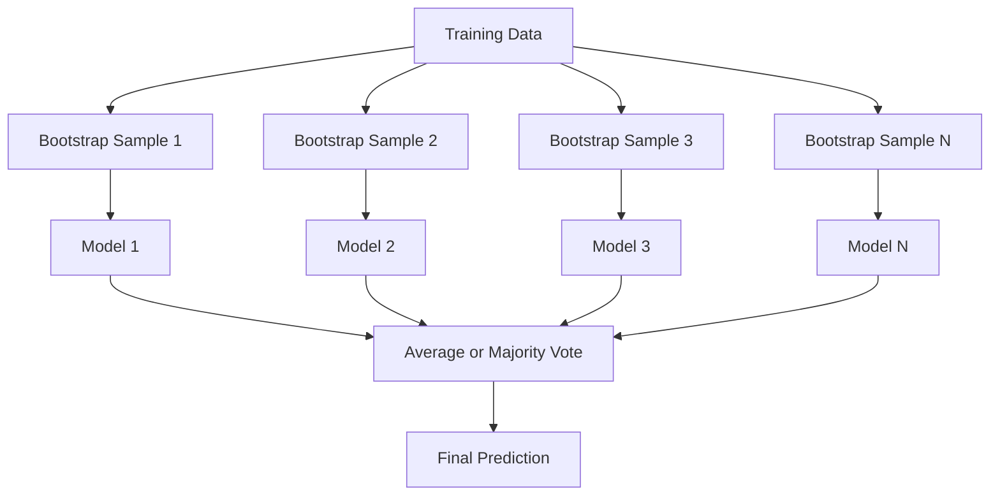
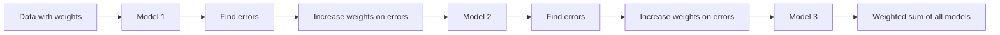
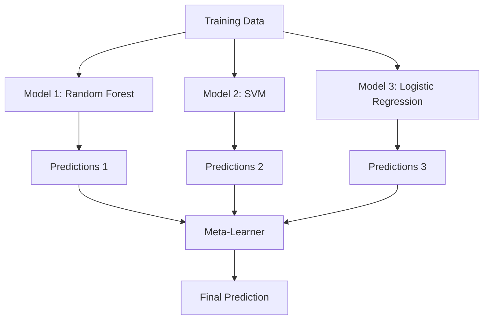

# Ensemble Methods

> 一群弱學習器 (weak learner)，只要組合得當，就會變成強學習器。這不是比喻，而是定理。

**Type:** Build
**Language:** Python
**Prerequisites:** Phase 2, Lesson 10 (Bias-Variance Tradeoff)
**Time:** ~120 分鐘

## 學習目標 (Learning Objectives)

- 從零實作 AdaBoost 與 gradient boosting，並說明 boosting 如何依序降低 bias
- 建立 bagging ensemble，並示範平均去相關 (decorrelated) 的模型如何在不增加 bias 的情況下降低 variance
- 比較 bagging、boosting 與 stacking 各自針對哪一種誤差成分
- 評估 ensemble 的多樣性 (diversity)，並說明為什麼獨立的弱學習器越多，多數決的 accuracy 就越高

## 問題 (The Problem)

單一 decision tree 訓練快、容易解讀，但會 overfit。單一線性模型在複雜邊界上會 underfit。你可以花好幾天去設計完美的模型架構，或者你可以把一堆不完美的模型組合起來，得到比其中任何一個都更好的東西。

Ensemble 方法正是這麼做。它們是在表格型資料的 Kaggle 競賽中獲勝最可靠的技巧，驅動著大多數正式環境的 ML 系統，也展示了 bias-variance tradeoff 的實際運作。Bagging 降低 variance，boosting 降低 bias，stacking 則學習在哪些輸入上該信任哪些模型。

## 核心概念 (The Concept)

### Ensemble 為什麼有效 (Why Ensembles Work)

假設你有 $N$ 個獨立的 classifier，每個的 accuracy 為 $p > 0.5$。多數決的 accuracy 是：

```math
P(\text{majority correct}) = \sum_{k > N/2} \binom{N}{k} p^k (1-p)^{N-k}
```

21 個 classifier、每個 accuracy 60%，多數決的 accuracy 約 74%。有 101 個 classifier 時，會升到 84%。當模型犯的是不同的錯誤時，錯誤就會互相抵銷。

關鍵要求是**多樣性 (diversity)**。如果所有模型都犯同樣的錯，把它們組合起來毫無幫助。Ensemble 之所以有效，是因為它們透過以下方式產生多樣化的模型：

- 不同的訓練子集 (bagging)
- 不同的 feature 子集 (random forest)
- 依序修正錯誤 (boosting)
- 不同的模型家族 (stacking)

### Bagging (Bootstrap Aggregating)

Bagging 透過讓每個模型在 training data 的不同 bootstrap sample 上訓練，來製造多樣性。



Bootstrap sample 是從原始資料有放回抽樣，大小與原始資料相同。每個 bootstrap 中大約會出現 63.2% 的獨特樣本。其餘 36.8%（out-of-bag 樣本）提供了免費的 validation set。

Bagging 在不太增加 bias 的情況下降低 variance。每棵樹各自對它的 bootstrap sample overfit，但每棵樹的 overfitting 都不同，所以平均之後雜訊就抵銷了。

**Random Forest** 是多加了一個轉折的 bagging：在每次切分時，只考慮隨機選出的 feature 子集。這會讓樹之間更加多樣。候選 feature 的典型數量，classification 是 `sqrt(n_features)`，regression 是 `n_features / 3`。

### Boosting（依序修正錯誤） (Boosting (Sequential Error Correction))

Boosting 依序訓練模型。每個新模型專注於前面模型預測錯誤的樣本。



Boosting 降低 bias。每個新模型修正目前集成的系統性錯誤。最終預測是所有模型的加權和，表現越好的模型權重越高。

取捨：如果跑太多輪，boosting 可能會 overfit，因為它不斷擬合更難的樣本，而其中有些可能是雜訊。

### AdaBoost

AdaBoost (Adaptive Boosting) 是第一個實用的 boosting 演算法。它可搭配任何 base learner，通常是 decision stump（深度為 1 的樹）。

演算法：

```
1. Initialize sample weights: w_i = 1/N for all i

2. For t = 1 to T:
   a. Train weak learner h_t on weighted data
   b. Compute weighted error:
      err_t = sum(w_i * I(h_t(x_i) != y_i)) / sum(w_i)
   c. Compute model weight:
      alpha_t = 0.5 * ln((1 - err_t) / err_t)
   d. Update sample weights:
      w_i = w_i * exp(-alpha_t * y_i * h_t(x_i))
   e. Normalize weights to sum to 1

3. Final prediction: H(x) = sign(sum(alpha_t * h_t(x)))
```

Error 越低的模型 alpha 越高。被誤分類的樣本權重變高，讓下一個模型專注於它們。

### Gradient Boosting

Gradient boosting 把 boosting 推廣到任意 loss function。它不重新加權樣本，而是讓每個新模型去擬合目前集成的 residual（loss 的負 gradient）。

```
1. Initialize: F_0(x) = argmin_c sum(L(y_i, c))

2. For t = 1 to T:
   a. Compute pseudo-residuals:
      r_i = -dL(y_i, F_{t-1}(x_i)) / dF_{t-1}(x_i)
   b. Fit a tree h_t to the residuals r_i
   c. Find optimal step size:
      gamma_t = argmin_gamma sum(L(y_i, F_{t-1}(x_i) + gamma * h_t(x_i)))
   d. Update:
      F_t(x) = F_{t-1}(x) + learning_rate * gamma_t * h_t(x)

3. Final prediction: F_T(x)
```

對於 squared error loss，pseudo-residual 就是實際的 residual：$r_i = y_i - F_{t-1}(x_i)$。每棵樹確實就是在擬合前一個集成的誤差。

Learning rate（shrinkage）控制每棵樹的貢獻程度。較小的 learning rate 需要更多棵樹，但 generalize 得更好。典型值：0.01 到 0.3。

### XGBoost：為什麼它稱霸表格型資料 (XGBoost: Why It Dominates Tabular Data)

XGBoost (eXtreme Gradient Boosting) 是加上工程最佳化的 gradient boosting，讓它又快、又準、又能抵抗 overfitting：

- **Regularized objective：**對葉節點 weights 加上 L1 與 L2 懲罰，避免個別的樹過度自信
- **二階近似：**同時使用 loss 的一階與二階導數，做出更好的切分決策
- **Sparsity-aware splits：**透過在每次切分時學習缺失資料的最佳方向，原生處理缺失值
- **Column subsampling：**如同 random forest，在每次切分時對 feature 抽樣以增加多樣性
- **Weighted quantile sketch：**在分散式資料上有效率地找出連續 feature 的切分點
- **Cache-aware block structure：**針對 CPU cache line 最佳化的記憶體配置

在表格型資料上，XGBoost（以及它的後繼者 LightGBM）一貫勝過 neural network。這在短期內不會改變。如果你的資料可以放進有列有欄的表格，就從 gradient boosting 開始。

### Stacking (Meta-Learning)

Stacking 把多個 base model 的預測當作 meta-learner 的 feature。



Meta-learner 學習在哪些輸入上該信任哪個 base model。如果 random forest 在某些區域比較強、SVM 在其他區域比較強，meta-learner 就會學會依此分配。

為了避免 data leakage，base model 的預測必須透過對 training set 做 cross-validation 來產生。你絕不能在同一份資料上既訓練 base model、又產生 meta-feature。

### Voting

最簡單的 ensemble。直接組合預測即可。

- **Hard voting：**對類別標籤做多數決。
- **Soft voting：**把預測的機率取平均，選出平均機率最高的類別。通常更好，因為它用到了信心程度的資訊。

```figure
f3-ensemble-average
```

## 動手做 (Build It)

### 步驟 1：Decision Stump (Base Learner)

`code/ensembles.py` 中的程式碼從零實作了所有東西。我們從 decision stump 開始：只有一次切分的樹。

```python
class DecisionStump:
    def __init__(self):
        self.feature_idx = None
        self.threshold = None
        self.polarity = 1
        self.alpha = None

    def fit(self, X, y, weights):
        n_samples, n_features = X.shape
        best_error = float("inf")

        for f in range(n_features):
            thresholds = np.unique(X[:, f])
            for thresh in thresholds:
                for polarity in [1, -1]:
                    pred = np.ones(n_samples)
                    pred[polarity * X[:, f] < polarity * thresh] = -1
                    error = np.sum(weights[pred != y])
                    if error < best_error:
                        best_error = error
                        self.feature_idx = f
                        self.threshold = thresh
                        self.polarity = polarity

    def predict(self, X):
        n = X.shape[0]
        pred = np.ones(n)
        idx = self.polarity * X[:, self.feature_idx] < self.polarity * self.threshold
        pred[idx] = -1
        return pred
```

### 步驟 2：從零實作 AdaBoost

```python
class AdaBoostScratch:
    def __init__(self, n_estimators=50):
        self.n_estimators = n_estimators
        self.stumps = []
        self.alphas = []

    def fit(self, X, y):
        n = X.shape[0]
        weights = np.full(n, 1 / n)

        for _ in range(self.n_estimators):
            stump = DecisionStump()
            stump.fit(X, y, weights)
            pred = stump.predict(X)

            err = np.sum(weights[pred != y])
            err = np.clip(err, 1e-10, 1 - 1e-10)

            alpha = 0.5 * np.log((1 - err) / err)
            weights *= np.exp(-alpha * y * pred)
            weights /= weights.sum()

            stump.alpha = alpha
            self.stumps.append(stump)
            self.alphas.append(alpha)

    def predict(self, X):
        total = sum(a * s.predict(X) for a, s in zip(self.alphas, self.stumps))
        return np.sign(total)
```

### 步驟 3：從零實作 Gradient Boosting

```python
class GradientBoostingScratch:
    def __init__(self, n_estimators=100, learning_rate=0.1, max_depth=3):
        self.n_estimators = n_estimators
        self.lr = learning_rate
        self.max_depth = max_depth
        self.trees = []
        self.initial_pred = None

    def fit(self, X, y):
        self.initial_pred = np.mean(y)
        current_pred = np.full(len(y), self.initial_pred)

        for _ in range(self.n_estimators):
            residuals = y - current_pred
            tree = SimpleRegressionTree(max_depth=self.max_depth)
            tree.fit(X, residuals)
            update = tree.predict(X)
            current_pred += self.lr * update
            self.trees.append(tree)

    def predict(self, X):
        pred = np.full(X.shape[0], self.initial_pred)
        for tree in self.trees:
            pred += self.lr * tree.predict(X)
        return pred
```

### 步驟 4：與 sklearn 比較

程式碼會驗證我們從零實作的版本，與 sklearn 的 `AdaBoostClassifier` 和 `GradientBoostingClassifier` 達到相近的 accuracy，並把所有方法並排比較。

## 實際使用 (Use It)

### 何時使用哪種方法 (When to Use Each Method)

| 方法 | 降低 | 最適合 | 注意事項 |
|--------|---------|----------|---------------|
| Bagging / Random Forest | Variance | 有雜訊的資料、feature 很多 | 對 bias 沒有幫助 |
| AdaBoost | Bias | 乾淨的資料、簡單的 base learner | 對 outlier 與雜訊敏感 |
| Gradient Boosting | Bias | 表格型資料、競賽 | 訓練慢，不調參容易 overfit |
| XGBoost / LightGBM | 兩者 | 正式環境的表格型 ML | Hyperparameter 很多 |
| Stacking | 兩者 | 榨出最後 1-2% 的 accuracy | 複雜，meta-learner 有 overfitting 風險 |
| Voting | Variance | 快速組合多樣的模型 | 只有在模型多樣時才有幫助 |

### 表格型資料的正式環境技術堆疊 (The Production Stack for Tabular Data)

對大多數表格型預測問題，建議的嘗試順序如下：

1. 使用預設參數的 **LightGBM 或 XGBoost**
2. 調整 n_estimators、learning_rate、max_depth、min_child_weight
3. 如果你需要最後那 0.5%，用 3-5 個多樣的模型建立 stacking ensemble
4. 全程使用 cross-validation

儘管研究持續嘗試，在表格型資料上的 neural network 幾乎總是不如 gradient boosting。TabNet、NODE 與類似的架構偶爾能追平，但很少能勝過調得好的 XGBoost。

## 交付 (Ship It)

這堂課會產出 `outputs/prompt-ensemble-selector.md`，這是一個幫你為特定資料集挑選合適 ensemble 方法的 prompt。描述你的資料（大小、feature 類型、雜訊程度、類別平衡）以及你要解決的問題。這個 prompt 會逐步走過一份決策檢查表、推薦一個方法、建議起始 hyperparameter，並警告該方法的常見錯誤。同時也會產出 `outputs/skill-ensemble-builder.md`，內含完整的選擇指南。

## 練習 (Exercises)

1. 修改 AdaBoost 實作，在每一輪之後追蹤 training accuracy。畫出 accuracy 對 estimator 數量的關係。它何時收斂？

2. 在 regression tree 中加入隨機 feature 子抽樣，從零實作 random forest。用 `max_features=sqrt(n_features)` 訓練 100 棵樹並平均預測。與單一棵樹比較 variance 的降低。

3. 在 gradient boosting 實作中加入 early stopping：在每一輪之後追蹤 validation loss，連續 10 輪沒有改善就停止。它實際上需要多少棵樹？

4. 用三個 base model（logistic regression、decision tree、k-nearest neighbors）和一個 logistic regression meta-learner 建立 stacking ensemble。用 5-fold cross-validation 產生 meta-feature。與每個單獨的 base model 比較。

5. 在同一份資料集上用預設參數執行 XGBoost。將它的 accuracy 與你從零實作的 gradient boosting 比較。兩者都計時。速度差異有多大？

## 關鍵術語 (Key Terms)

| 術語 | 大家怎麼說 | 實際意義 |
|------|----------------|----------------------|
| Bagging | 「在隨機子集上訓練」 | Bootstrap aggregating：在 bootstrap sample 上訓練模型，平均預測以降低 variance |
| Boosting | 「專注在困難的樣本」 | 依序訓練模型，每個都修正目前集成的錯誤，以降低 bias |
| AdaBoost | 「重新加權資料」 | 透過更新樣本權重來 boosting；被誤分類的點在下一個學習器中權重較高 |
| Gradient boosting | 「擬合 residual」 | 讓每個新模型擬合 loss function 的負 gradient 來 boosting |
| XGBoost | 「Kaggle 的武器」 | 加上 regularization、二階最佳化與系統層級加速技巧的 gradient boosting |
| Stacking | 「模型上面再疊模型」 | 把 base model 的預測當作 meta-learner 的輸入 feature |
| Random forest | 「許多隨機化的樹」 | 以 decision tree 做 bagging，並在每次切分時加入隨機 feature 子抽樣以增加多樣性 |
| Ensemble diversity | 「犯不同的錯」 | 模型的錯誤必須彼此不相關，ensemble 才會比個別模型更好 |
| Out-of-bag error | 「免費的 validation」 | 沒有出現在 bootstrap 抽樣中的樣本（約 36.8%）可當作 validation set，不需要另外保留 holdout |

## 延伸閱讀 (Further Reading)

- [Schapire & Freund: Boosting: Foundations and Algorithms](https://mitpress.mit.edu/9780262526036/) -- AdaBoost 的創造者所寫的書
- [Friedman: Greedy Function Approximation: A Gradient Boosting Machine (2001)](https://doi.org/10.1214/aos/1013203451) -- 最原始的 gradient boosting 論文
- [Chen & Guestrin: XGBoost (2016)](https://arxiv.org/abs/1603.02754) -- XGBoost 論文
- [Wolpert: Stacked Generalization (1992)](https://www.sciencedirect.com/science/article/abs/pii/S0893608005800231) -- 最原始的 stacking 論文
- [scikit-learn Ensemble Methods](https://scikit-learn.org/stable/modules/ensemble.html) -- 實用參考
