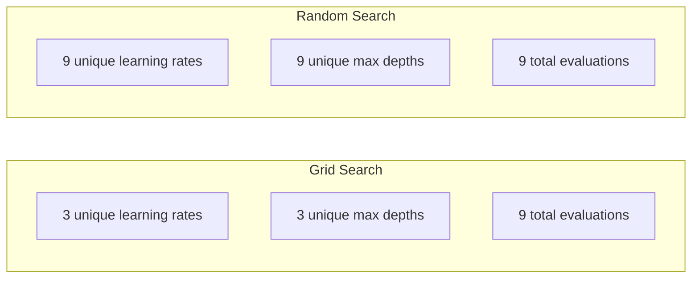
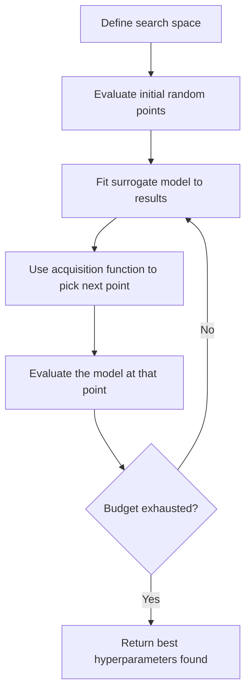
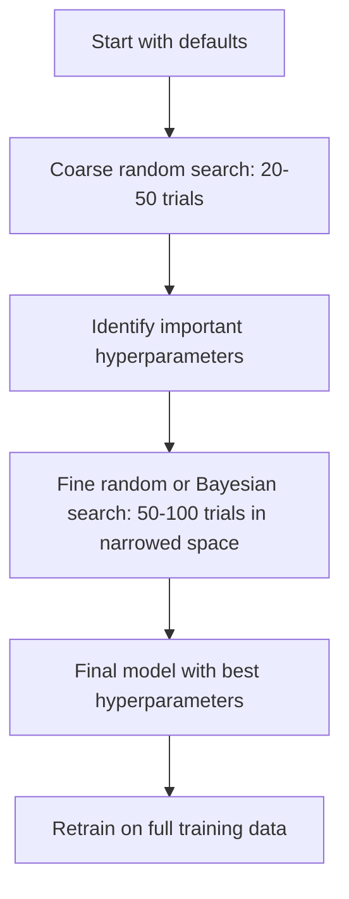
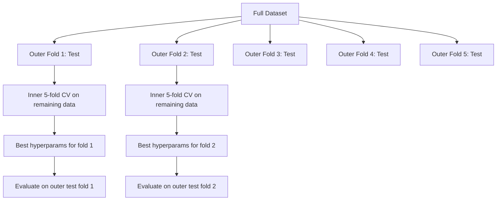

# Hyperparameter Tuning

> Hyperparameter 是訓練開始前你要轉的旋鈕。轉得好不好，決定了模型是平庸還是出色。

**Type:** Build
**Language:** Python
**Prerequisites:** Phase 2, Lesson 11 (Ensemble Methods)
**Time:** ~90 分鐘

## 學習目標 (Learning Objectives)

- 從零實作 grid search、random search 與 Bayesian optimization，並比較它們的樣本效率
- 說明當大多數 hyperparameter 的有效維度很低時，為什麼 random search 會勝過 grid search
- 使用 surrogate model 與 acquisition function 建立 Bayesian optimization 迴圈來引導搜尋
- 設計 hyperparameter 調整策略，透過適當的 cross-validation 避免對 validation set 產生 overfitting

## 問題 (The Problem)

你的 gradient boosting 模型有 learning rate、樹的數量、max depth、每片葉子的最少樣本數、subsample ratio 和 column sample ratio。這是六個 hyperparameter。如果每個有 5 個合理的值，grid 就有 $5^6 = 15{,}625$ 種組合。每次訓練花 10 秒。全部試過一輪要 43 小時的運算。

Grid search 是最顯而易見的做法，也是規模一大就最糟的做法。Random search 用更少的運算就做得更好。Bayesian optimization 則透過從過去的評估中學習，做得更好。知道該用哪種策略，以及哪些 hyperparameter 真正重要，可以省下好幾天白白浪費的 GPU 時間。

## 核心概念 (The Concept)

### Parameter 與 Hyperparameter (Parameters vs Hyperparameters)

Parameter 是在訓練期間學習到的（weights、biases、切分 threshold）。Hyperparameter 是在訓練開始前設定的，控制學習如何進行。

| Hyperparameter | 控制什麼 | 典型範圍 |
|---------------|-----------------|---------------|
| Learning rate | 每次更新的步伐大小 | 0.001 到 1.0 |
| 樹的數量/epoch | 訓練多久 | 10 到 10,000 |
| Max depth | 模型複雜度 | 1 到 30 |
| Regularization ($\lambda$) | 防止 overfitting | 0.0001 到 100 |
| Batch size | Gradient 估計的雜訊 | 16 到 512 |
| Dropout rate | 被丟棄的神經元比例 | 0.0 到 0.5 |

### Grid Search

Grid search 評估指定值的每一種組合。它很徹底也容易理解，但會隨 hyperparameter 數量呈指數成長。

```
Grid for 2 hyperparameters:

  learning_rate: [0.01, 0.1, 1.0]
  max_depth:     [3, 5, 7]

  Evaluations: 3 x 3 = 9 combinations

  (0.01, 3)  (0.01, 5)  (0.01, 7)
  (0.1,  3)  (0.1,  5)  (0.1,  7)
  (1.0,  3)  (1.0,  5)  (1.0,  7)
```

Grid search 有個根本缺陷：如果一個 hyperparameter 重要而另一個不重要，大多數評估就浪費掉了。9 次評估中，你只能得到重要參數的 3 個不同的值。

### Random Search

Random search 從分布中抽樣 hyperparameter，而不是用 grid。在同樣 9 次評估的預算下，你會得到每個 hyperparameter 的 9 個不同的值。



為什麼 random 勝過 grid（Bergstra & Bengio, 2012）：

- 大多數 hyperparameter 的有效維度很低。對於特定問題，6 個 hyperparameter 中通常只有 1-2 個真正重要。
- Grid search 把評估浪費在不重要的維度上。
- 相同預算下，random search 對重要的維度覆蓋得更密。
- 做 60 次隨機試驗，你有 95% 的機率能找到距離最佳值 5% 以內的點（如果搜尋空間中存在這樣的點）。

### Bayesian Optimization

Random search 忽略結果。它不會學到太高的 learning rate 會導致發散，或是深度 3 一貫勝過深度 10。Bayesian optimization 利用過去的評估來決定下一步往哪裡搜尋。



兩個關鍵元件：

**Surrogate model：**一個評估成本低的模型（通常是 Gaussian process），用來近似昂貴的目標函數。它在搜尋空間的任何一點，都能給出預測值與不確定性估計。

**Acquisition function：**透過平衡 exploitation（在已知的好點附近搜尋）與 exploration（在不確定性高的地方搜尋）來決定下一個評估的位置。常見選擇：

- **Expected Improvement (EI)：**預期在這個點上，比目前最佳值能改善多少？
- **Upper Confidence Bound (UCB)：**預測值加上不確定性的倍數。UCB 越高，代表要嘛有希望，要嘛尚未探索。
- **Probability of Improvement (PI)：**這個點勝過目前最佳值的機率是多少？

Bayesian optimization 通常能以少 2-5 倍的評估次數，找到比 random search 更好的 hyperparameter。擬合 surrogate model 的額外開銷，和訓練實際模型相比可以忽略不計。

### Early Stopping

不是每次訓練都需要跑完。如果某個設定在 10 個 epoch 後明顯很差，就停掉它換下一個。這就是 hyperparameter 搜尋情境下的 early stopping。

策略：
- **Patience-based：**如果 validation loss 連續 N 個 epoch 沒有改善就停止
- **Median pruning：**如果某次試驗的中間結果，比同一步驟上已完成試驗的 median 還差就停止
- **Hyperband：**先給許多設定很小的預算，再逐步提高最佳設定的預算

Hyperband 特別有效。它先以每個 1 個 epoch 啟動 81 個設定，保留前三分之一，給它們 3 個 epoch，再保留前三分之一，依此類推。這比讓所有設定都跑完整個預算，快 10-50 倍找到好的設定。

### Learning Rate Scheduler

Learning rate 幾乎總是最重要的 hyperparameter。與其固定不變，scheduler 會在訓練期間調整它。

| Scheduler | 公式 | 何時使用 |
|-----------|---------|-------------|
| Step decay | 每 N 個 epoch 乘以 0.1 | 經典的 CNN 訓練 |
| Cosine annealing | $\text{lr} \cdot 0.5 \cdot (1 + \cos(\pi t / T))$ | 現代的預設選項 |
| Warmup + decay | 線性上升再 cosine 衰減 | Transformer |
| One-cycle | 在一個週期內先升後降 | 快速收斂 |
| Reduce on plateau | 指標停滯時依比例降低 | 安全的預設選項 |

### Hyperparameter 的重要性 (Hyperparameter Importance)

並非所有 hyperparameter 都同等重要。針對 random forest（Probst et al., 2019）和 gradient boosting 的研究顯示出一致的模式：

**重要性高：**
- Learning rate（永遠先調它）
- 估計器數量 / epoch（改用 early stopping，而不是調整它）
- Regularization 強度

**重要性中等：**
- Max depth / 層數
- 每片葉子的最少樣本數 / weight decay
- Subsample ratio

**重要性低：**
- Max features（對 random forest）
- 特定 activation function 的選擇
- Batch size（在合理範圍內）

先調整重要的，其餘保持預設值。

### 實務策略 (Practical Strategy)



具體的工作流程：

1. **從函式庫的預設值開始。**它們由有經驗的實務者選定，通常已經走了 80% 的路。
2. **粗略的 random search。**範圍寬、20-50 次試驗。使用 early stopping 快速淘汰差的嘗試。
3. **分析結果。**哪些 hyperparameter 與表現相關？縮小搜尋空間。
4. **精細搜尋。**在縮小後的空間中使用 Bayesian optimization 或聚焦的 random search。50-100 次試驗。
5. **用找到的最佳 hyperparameter，在全部的 training data 上重新訓練。**

### 整合 Cross-Validation (Cross-Validation Integration)

只在單一個 validation 切分上調整 hyperparameter 是有風險的。最佳的 hyperparameter 可能對特定的 validation fold 發生 overfit。Nested cross-validation 用兩層迴圈解決這個問題：

- **外層迴圈**（評估）：把資料切成 train+val 與 test。回報無偏差的表現。
- **內層迴圈**（調整）：把 train+val 切成 train 與 val。找出最佳 hyperparameter。



每個外層 fold 都獨立找出自己的最佳 hyperparameter。外層分數是 generalization 表現的無偏差估計。

用 sklearn：

```python
from sklearn.model_selection import cross_val_score, GridSearchCV
from sklearn.ensemble import GradientBoostingRegressor

inner_cv = GridSearchCV(
    GradientBoostingRegressor(),
    param_grid={
        "learning_rate": [0.01, 0.05, 0.1],
        "max_depth": [2, 3, 5],
        "n_estimators": [50, 100, 200],
    },
    cv=5,
    scoring="neg_mean_squared_error",
)

outer_scores = cross_val_score(
    inner_cv, X, y, cv=5, scoring="neg_mean_squared_error"
)

print(f"Nested CV MSE: {-outer_scores.mean():.4f} +/- {outer_scores.std():.4f}")
```

這很昂貴（5 個外層 fold x 5 個內層 fold x 27 個 grid 點 = 675 次模型擬合），但它給你值得信賴的表現估計。在論文中回報最終結果，或決策的風險很高時使用它。

### 實務小技巧 (Practical Tips)

**從 learning rate 開始。**對以 gradient 為基礎的方法，它永遠是最重要的 hyperparameter。糟糕的 learning rate 會讓其他一切都變得無關緊要。把其他 hyperparameter 固定在預設值，先掃 learning rate。

**對 learning rate 與 regularization 使用 log-uniform 分布。**0.001 與 0.01 之間的差異，和 0.1 與 1.0 之間的差異一樣重要。線性搜尋會把預算浪費在大的那端。

**用 early stopping 取代調整 n_estimators。**對 boosting 和 neural network，把 n_estimators 或 epoch 設得很高，讓 early stopping 決定何時停止。這樣就從搜尋中去掉一個 hyperparameter。

**預算分配。**把 60% 的調整預算花在最重要的前 2 個 hyperparameter 上，其餘 40% 花在其他所有的東西。前 2 個佔了大部分的表現變異。

**尺度很重要。**不要用 log scale 搜尋 batch size（16、32、64 就可以）。永遠用 log scale 搜尋 learning rate。讓搜尋分布符合該 hyperparameter 影響模型的方式。

| 模型類型 | 主要 Hyperparameter | 建議的搜尋方式 | 預算 |
|-----------|--------------------|--------------------|--------|
| Random Forest | n_estimators, max_depth, min_samples_leaf | Random search，50 次試驗 | 低（訓練快） |
| Gradient Boosting | learning_rate, n_estimators, max_depth | Bayesian，100 次試驗 + early stopping | 中 |
| Neural Network | learning_rate, weight_decay, batch_size | Bayesian 或 random，100+ 次試驗 | 高（訓練慢） |
| SVM | C, gamma (RBF kernel) | 在 log scale 上做 grid，25-50 次試驗 | 低（2 個參數） |
| Lasso/Ridge | alpha | 在 log scale 上做一維搜尋，20 次試驗 | 非常低 |
| XGBoost | learning_rate, max_depth, subsample, colsample | Bayesian，100-200 次試驗 + early stopping | 中 |

**有疑慮時：**用 random search，試驗次數是 hyperparameter 數量的 2 倍（例如 6 個 hyperparameter = 至少 12 次以上的試驗）。你會驚訝地發現，50 次試驗的 random search 經常勝過精心設計的 grid search。

```figure
k-fold-cv
```

## 動手做 (Build It)

### 步驟 1：從零實作 Grid Search

`code/tuning.py` 中的程式碼從零實作了 grid search、random search 與一個簡單的 Bayesian optimizer。

```python
def grid_search(model_fn, param_grid, X_train, y_train, X_val, y_val):
    keys = list(param_grid.keys())
    values = list(param_grid.values())
    best_score = -float("inf")
    best_params = None
    n_evals = 0

    for combo in itertools.product(*values):
        params = dict(zip(keys, combo))
        model = model_fn(**params)
        model.fit(X_train, y_train)
        score = evaluate(model, X_val, y_val)
        n_evals += 1

        if score > best_score:
            best_score = score
            best_params = params

    return best_params, best_score, n_evals
```

### 步驟 2：從零實作 Random Search

```python
def random_search(model_fn, param_distributions, X_train, y_train,
                  X_val, y_val, n_iter=50, seed=42):
    rng = np.random.RandomState(seed)
    best_score = -float("inf")
    best_params = None

    for _ in range(n_iter):
        params = {k: sample(v, rng) for k, v in param_distributions.items()}
        model = model_fn(**params)
        model.fit(X_train, y_train)
        score = evaluate(model, X_val, y_val)

        if score > best_score:
            best_score = score
            best_params = params

    return best_params, best_score, n_iter
```

### 步驟 3：Bayesian Optimization（簡化版）

核心概念：把 Gaussian process 擬合到觀察到的 (hyperparameter, score) 配對上，再用 acquisition function 決定下一步看哪裡。

```python
class SimpleBayesianOptimizer:
    def __init__(self, search_space, n_initial=5):
        self.search_space = search_space
        self.n_initial = n_initial
        self.X_observed = []
        self.y_observed = []

    def _kernel(self, x1, x2, length_scale=1.0):
        dists = np.sum((x1[:, None, :] - x2[None, :, :]) ** 2, axis=2)
        return np.exp(-0.5 * dists / length_scale ** 2)

    def _fit_gp(self, X_new):
        X_obs = np.array(self.X_observed)
        y_obs = np.array(self.y_observed)
        y_mean = y_obs.mean()
        y_centered = y_obs - y_mean

        K = self._kernel(X_obs, X_obs) + 1e-4 * np.eye(len(X_obs))
        K_star = self._kernel(X_new, X_obs)

        L = np.linalg.cholesky(K)
        alpha = np.linalg.solve(L.T, np.linalg.solve(L, y_centered))
        mu = K_star @ alpha + y_mean

        v = np.linalg.solve(L, K_star.T)
        var = 1.0 - np.sum(v ** 2, axis=0)
        var = np.maximum(var, 1e-6)

        return mu, var

    def _expected_improvement(self, mu, var, best_y):
        sigma = np.sqrt(var)
        z = (mu - best_y) / (sigma + 1e-10)
        ei = sigma * (z * norm_cdf(z) + norm_pdf(z))
        return ei

    def suggest(self):
        if len(self.X_observed) < self.n_initial:
            return sample_random(self.search_space)

        candidates = [sample_random(self.search_space) for _ in range(500)]
        X_cand = np.array([to_vector(c) for c in candidates])
        mu, var = self._fit_gp(X_cand)
        ei = self._expected_improvement(mu, var, max(self.y_observed))
        return candidates[np.argmax(ei)]

    def observe(self, params, score):
        self.X_observed.append(to_vector(params))
        self.y_observed.append(score)
```

GP surrogate 在每個候選點給出兩樣東西：預測分數 (mu) 與不確定性 (var)。Expected Improvement 平衡這兩者：它偏好模型預測高分的點，或不確定性高的點。一開始，大多數點的不確定性都很高，所以 optimizer 會探索。之後，它會集中在最有希望的區域。

### 步驟 4：比較所有方法

在相同的合成目標函數上執行這三種方法並比較。這個比較使用一個簡化的包裝器，直接以目標函數呼叫每個 optimizer（沒有模型訓練），所以 API 與上面以模型為基礎的實作不同：

```python
def synthetic_objective(params):
    lr = params["learning_rate"]
    depth = params["max_depth"]
    return -(np.log10(lr) + 2) ** 2 - (depth - 4) ** 2 + 10

param_grid = {
    "learning_rate": [0.001, 0.01, 0.1, 1.0],
    "max_depth": [2, 3, 4, 5, 6, 7, 8],
}

grid_best = None
grid_score = -float("inf")
grid_history = []
for combo in itertools.product(*param_grid.values()):
    params = dict(zip(param_grid.keys(), combo))
    score = synthetic_objective(params)
    grid_history.append((params, score))
    if score > grid_score:
        grid_score = score
        grid_best = params

param_dist = {
    "learning_rate": ("log_float", 0.001, 1.0),
    "max_depth": ("int", 2, 8),
}

rand_best = None
rand_score = -float("inf")
rand_history = []
rng = np.random.RandomState(42)
for _ in range(28):
    params = {k: sample(v, rng) for k, v in param_dist.items()}
    score = synthetic_objective(params)
    rand_history.append((params, score))
    if score > rand_score:
        rand_score = score
        rand_best = params

optimizer = SimpleBayesianOptimizer(param_dist, n_initial=5)
bayes_history = []
for _ in range(28):
    params = optimizer.suggest()
    score = synthetic_objective(params)
    optimizer.observe(params, score)
    bayes_history.append((params, score))
bayes_score = max(s for _, s in bayes_history)

print(f"{'Method':<20} {'Best Score':>12} {'Evaluations':>12}")
print("-" * 50)
print(f"{'Grid Search':<20} {grid_score:>12.4f} {len(grid_history):>12}")
print(f"{'Random Search':<20} {rand_score:>12.4f} {len(rand_history):>12}")
print(f"{'Bayesian Opt':<20} {bayes_score:>12.4f} {len(bayes_history):>12}")
```

在相同預算下，Bayesian optimization 通常最快找到最佳分數，因為它不會把評估浪費在明顯很差的區域。Random search 比 grid search 涵蓋更多範圍。Grid search 只在 hyperparameter 非常少、且負擔得起徹底搜尋時才會勝出。

## 實際使用 (Use It)

### 實務上的 Optuna (Optuna in Practice)

Optuna 是認真進行 hyperparameter 調整時推薦的函式庫。它開箱即支援 pruning、分散式搜尋與視覺化。

```python
import optuna

def objective(trial):
    lr = trial.suggest_float("learning_rate", 1e-4, 1e-1, log=True)
    n_est = trial.suggest_int("n_estimators", 50, 500)
    max_depth = trial.suggest_int("max_depth", 2, 10)

    model = GradientBoostingRegressor(
        learning_rate=lr,
        n_estimators=n_est,
        max_depth=max_depth,
    )
    model.fit(X_train, y_train)
    return mean_squared_error(y_val, model.predict(X_val))

study = optuna.create_study(direction="minimize")
study.optimize(objective, n_trials=100)

print(f"Best params: {study.best_params}")
print(f"Best MSE: {study.best_value:.4f}")
```

Optuna 的主要功能：
- `suggest_float(..., log=True)` 用於最適合在 log scale 上搜尋的參數（learning rate、regularization）
- `suggest_int` 用於整數參數
- `suggest_categorical` 用於離散選項
- 內建 MedianPruner，用於提早停止差的試驗
- `study.trials_dataframe()` 用於分析

### 帶有 Pruning 的 Optuna (Optuna with Pruning)

Pruning 提早停止沒有希望的試驗，節省大量運算。模式如下：

```python
import optuna
from sklearn.model_selection import cross_val_score

def objective(trial):
    params = {
        "learning_rate": trial.suggest_float("lr", 1e-4, 0.5, log=True),
        "max_depth": trial.suggest_int("max_depth", 2, 10),
        "n_estimators": trial.suggest_int("n_estimators", 50, 500),
        "subsample": trial.suggest_float("subsample", 0.5, 1.0),
    }

    model = GradientBoostingRegressor(**params)
    scores = cross_val_score(model, X_train, y_train, cv=3,
                             scoring="neg_mean_squared_error")
    mean_score = -scores.mean()

    trial.report(mean_score, step=0)
    if trial.should_prune():
        raise optuna.TrialPruned()

    return mean_score

pruner = optuna.pruners.MedianPruner(n_startup_trials=10, n_warmup_steps=5)
study = optuna.create_study(direction="minimize", pruner=pruner)
study.optimize(objective, n_trials=200)
```

`MedianPruner` 在某次試驗的中間值比同一步驟上所有已完成試驗的 median 還差時，就停止該試驗。Pruning 需要呼叫 `trial.report()` 回報中間指標，並呼叫 `trial.should_prune()` 檢查是否應該停止該試驗。`n_startup_trials=10` 確保在 pruning 開始作用前，至少有 10 次試驗完整跑完。這通常能節省 40-60% 的總運算量。

### sklearn 內建的調整工具 (sklearn's Built-in Tuners)

做快速實驗時，sklearn 提供 `GridSearchCV`、`RandomizedSearchCV` 與 `HalvingRandomSearchCV`：

```python
from sklearn.model_selection import RandomizedSearchCV
from scipy.stats import loguniform, randint

param_dist = {
    "learning_rate": loguniform(1e-4, 0.5),
    "max_depth": randint(2, 10),
    "n_estimators": randint(50, 500),
}

search = RandomizedSearchCV(
    GradientBoostingRegressor(),
    param_dist,
    n_iter=100,
    cv=5,
    scoring="neg_mean_squared_error",
    random_state=42,
    n_jobs=-1,
)
search.fit(X_train, y_train)
print(f"Best params: {search.best_params_}")
print(f"Best CV MSE: {-search.best_score_:.4f}")
```

對 learning rate 與 regularization 使用 scipy 的 `loguniform`。對整數 hyperparameter 使用 `randint`。`n_jobs=-1` 旗標會跨所有 CPU 核心平行運算。

### Hyperparameter 調整的常見錯誤 (Common Mistakes in Hyperparameter Tuning)

**透過前處理造成 data leakage。**如果你在 cross-validation 之前就對完整資料集 fit scaler，validation fold 的資訊就會洩漏到訓練中。永遠把前處理放進 `Pipeline` 裡，這樣它只會在 training fold 上 fit。

**對 validation set 發生 overfitting。**執行數千次試驗，實際上就是在 validation set 上訓練。最終表現估計請用 nested cross-validation，或保留一份在調整期間完全不碰的獨立 test set。

**搜尋範圍太窄。**如果你的最佳值落在搜尋空間的邊界，代表你搜尋得不夠廣。最佳值可能在你的範圍之外。永遠檢查最佳參數是否落在邊緣。

**忽略交互作用效應。**在 boosting 中，learning rate 與估計器數量彼此強烈交互影響。低 learning rate 需要更多估計器。分別獨立調整它們，結果會比一起調整還差。

**對迭代式模型沒有使用 early stopping。**對 gradient boosting 和 neural network，把 n_estimators 或 epoch 設成很高的值，並使用 early stopping。這絕對優於把迭代次數當成 hyperparameter 來調整。

## 練習 (Exercises)

1. 用相同的總預算（例如 50 次評估）執行 grid search 與 random search。比較找到的最佳分數。用不同的 seed 重複實驗 10 次。Random search 多常勝出？

2. 從零實作 Hyperband。從 81 個設定開始，每個訓練 1 個 epoch。每一輪保留前 1/3，並將它們的預算變為三倍。比較總運算量（所有設定的所有 epoch 總和）與讓 81 個設定都跑完整個預算的運算量。

3. 在 Lesson 11 的 gradient boosting 實作中加入 learning rate scheduler（cosine annealing）。與固定的 learning rate 相比，有幫助嗎？

4. 用 Optuna 在真實資料集（例如 sklearn 的 breast cancer 資料集）上調整 RandomForestClassifier。使用 `optuna.visualization.plot_param_importances(study)` 查看哪些 hyperparameter 最重要。它符合這堂課中的重要性排序嗎？

5. 實作一個簡單的 acquisition function（Expected Improvement），並示範 exploration 與 exploitation。畫出 surrogate model 的平均值與不確定性，並顯示 EI 選擇下一個評估的位置。

## 關鍵術語 (Key Terms)

| 術語 | 大家怎麼說 | 實際意義 |
|------|----------------|----------------------|
| Hyperparameter | 「你選擇的設定」 | 在訓練前設定、控制學習過程的值，不是從資料中學來的 |
| Grid search | 「試遍每一種組合」 | 對指定的參數 grid 進行窮舉搜尋。成本呈指數成長。 |
| Random search | 「就隨機抽樣」 | 從分布中抽樣 hyperparameter。比 grid search 更能涵蓋重要的維度。 |
| Bayesian optimization | 「聰明的搜尋」 | 使用目標函數的 surrogate model 來決定下一步評估的位置，平衡 exploration 與 exploitation |
| Surrogate model | 「便宜的近似」 | 根據觀察到的評估結果，近似昂貴目標函數的模型（通常是 Gaussian process） |
| Acquisition function | 「下一步看哪裡」 | 透過平衡預期改善與不確定性，為候選點打分數。EI 與 UCB 是常見選擇。 |
| Early stopping | 「別再浪費時間」 | 當 validation 表現不再改善時，提早終止訓練 |
| Hyperband | 「設定的淘汰賽對戰表」 | 自適應資源分配：以小預算啟動許多設定，保留最好的並增加它們的預算 |
| Learning rate scheduler | 「訓練中改變 lr」 | 在訓練過程中調整 learning rate、以獲得更好收斂的函數 |

## 延伸閱讀 (Further Reading)

- [Bergstra & Bengio: Random Search for Hyper-Parameter Optimization (2012)](https://jmlr.org/papers/v13/bergstra12a.html) -- 證明 random 勝過 grid 的論文
- [Snoek et al., Practical Bayesian Optimization of Machine Learning Algorithms (2012)](https://arxiv.org/abs/1206.2944) -- 用於 ML 的 Bayesian optimization
- [Li et al., Hyperband: A Novel Bandit-Based Approach (2018)](https://jmlr.org/papers/v18/16-558.html) -- Hyperband 論文
- [Optuna: A Next-generation Hyperparameter Optimization Framework](https://arxiv.org/abs/1907.10902) -- Optuna 論文
- [Probst et al., Tunability: Importance of Hyperparameters (2019)](https://jmlr.org/papers/v20/18-444.html) -- 哪些 hyperparameter 重要
