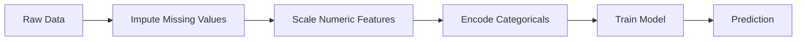
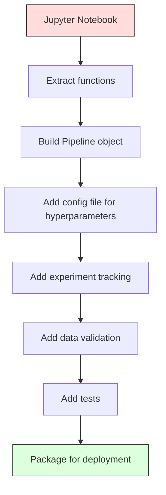

# ML Pipelines

> 模型不是產品，pipeline 才是。Pipeline 涵蓋從原始資料到部署預測的一切，而且每個步驟都必須可重現。

**Type:** Build
**Language:** Python
**Prerequisites:** Phase 2, Lesson 12 (Hyperparameter Tuning)
**Time:** ~120 分鐘

## 學習目標 (Learning Objectives)

- 從零建立 ML pipeline，把 imputation、scaling、encoding 與模型訓練串成單一可重現的物件
- 辨認 data leakage 的情境，並說明 pipeline 如何透過只在 training data 上 fit transformer 來避免它們
- 建立 ColumnTransformer，對數值型與類別型 feature 套用不同的前處理
- 實作 pipeline 序列化，並示範同一個 fit 好的 pipeline 在訓練與正式環境中產生相同的結果

## 問題 (The Problem)

你有一個 notebook，它載入資料、用 median 填補缺失值、對 feature 做 scaling、訓練模型，然後印出 accuracy。它能運作。你把它上線了。

一個月後，有人重新訓練模型，得到不同的結果。Median 是在包含 test data 的完整資料集上計算的（data leakage）。Scaling 的參數沒有被儲存，所以推論時用的是不同的統計量。Feature engineering 的程式碼在訓練與服務之間被複製貼上，而兩份副本逐漸分歧。某個類別欄位在正式環境中出現了 encoder 從沒見過的新值。

這些不是假設的情境。它們是 ML 系統在正式環境中失敗最常見的原因。Pipeline 把每個轉換步驟打包成單一、有順序、可重現的物件，解決了這所有問題。

## 核心概念 (The Concept)

### 什麼是 Pipeline (What a Pipeline Is)

Pipeline 是一連串有順序的資料轉換，後面接著一個模型。每個步驟以前一步驟的輸出作為輸入。整個 pipeline 只在 training data 上 fit 一次。推論時，同一個 fit 好的 pipeline 轉換新資料並產生預測。



Pipeline 保證：
- 轉換只在 training data 上 fit（沒有 leakage）
- 推論時套用相同的轉換
- 整個物件可以序列化，並作為單一 artifact 部署
- Cross-validation 對每個 fold 各自套用 pipeline，避免細微的 leakage

### Data Leakage：無聲的殺手 (Data Leakage: The Silent Killer)

當 test set 或未來資料的資訊汙染了訓練，就會發生 data leakage。Pipeline 能避免最常見的形式。

**有 leakage（錯誤）：**
```python
X = df.drop("target", axis=1)
y = df["target"]

scaler = StandardScaler()
X_scaled = scaler.fit_transform(X)

X_train, X_test = X_scaled[:800], X_scaled[800:]
y_train, y_test = y[:800], y[800:]
```

Scaler 看到了 test data。平均值與標準差包含了 test 樣本。這會讓 accuracy 估計值虛高。

**正確：**
```python
X_train, X_test = X[:800], X[800:]

scaler = StandardScaler()
X_train_scaled = scaler.fit_transform(X_train)
X_test_scaled = scaler.transform(X_test)
```

使用 pipeline 的話，你不需要去想這件事。Pipeline 會自動處理。

### sklearn Pipeline

sklearn 的 `Pipeline` 串接 transformer 與 estimator。它提供 `.fit()`、`.predict()` 與 `.score()`，會依序套用所有步驟。

```python
from sklearn.pipeline import Pipeline
from sklearn.preprocessing import StandardScaler
from sklearn.linear_model import LogisticRegression

pipe = Pipeline([
    ("scaler", StandardScaler()),
    ("model", LogisticRegression()),
])

pipe.fit(X_train, y_train)
predictions = pipe.predict(X_test)
```

當你呼叫 `pipe.fit(X_train, y_train)`：
1. Scaler 對 X_train 呼叫 `fit_transform`
2. 模型對縮放後的 X_train 呼叫 `fit`

當你呼叫 `pipe.predict(X_test)`：
1. Scaler 對 X_test 呼叫 `transform`（不是 fit_transform）
2. 模型對縮放後的 X_test 呼叫 `predict`

Scaler 在 fit 期間從沒看過 test data。這就是整個重點。

### ColumnTransformer：不同欄位用不同 Pipeline (ColumnTransformer: Different Pipelines for Different Columns)

真實的資料集有數值型與類別型欄位，需要不同的前處理。`ColumnTransformer` 處理這件事。

```python
from sklearn.compose import ColumnTransformer
from sklearn.preprocessing import StandardScaler, OneHotEncoder
from sklearn.impute import SimpleImputer

numeric_pipe = Pipeline([
    ("impute", SimpleImputer(strategy="median")),
    ("scale", StandardScaler()),
])

categorical_pipe = Pipeline([
    ("impute", SimpleImputer(strategy="most_frequent")),
    ("encode", OneHotEncoder(handle_unknown="ignore")),
])

preprocessor = ColumnTransformer([
    ("num", numeric_pipe, ["age", "income", "score"]),
    ("cat", categorical_pipe, ["city", "gender", "plan"]),
])

full_pipeline = Pipeline([
    ("preprocess", preprocessor),
    ("model", GradientBoostingClassifier()),
])
```

OneHotEncoder 中的 `handle_unknown="ignore"` 對正式環境至關重要。當出現新類別（模型從沒見過的城市）時，它會產生零向量，而不是當機。

### 實驗追蹤 (Experiment Tracking)

Pipeline 讓訓練可重現，但你還需要追蹤各個實驗中發生了什麼事：用了哪些 hyperparameter、哪個版本的資料集、指標是多少、當時執行的是哪份程式碼。

**MLflow** 是最常見的開源解決方案：

```python
import mlflow

with mlflow.start_run():
    mlflow.log_param("max_depth", 5)
    mlflow.log_param("n_estimators", 100)
    mlflow.log_param("learning_rate", 0.1)

    pipe.fit(X_train, y_train)
    accuracy = pipe.score(X_test, y_test)

    mlflow.log_metric("accuracy", accuracy)
    mlflow.sklearn.log_model(pipe, "model")
```

每次執行都會記錄參數、指標、artifact 和完整的模型。你可以比較不同次執行、重現任何實驗，並部署任何版本的模型。

**Weights & Biases (wandb)** 以託管的 dashboard 提供相同的功能：

```python
import wandb

wandb.init(project="my-pipeline")
wandb.config.update({"max_depth": 5, "n_estimators": 100})

pipe.fit(X_train, y_train)
accuracy = pipe.score(X_test, y_test)

wandb.log({"accuracy": accuracy})
```

### 模型版本管理 (Model Versioning)

在實驗追蹤之後，你需要管理模型版本。哪個模型在正式環境？哪個在 staging？哪個是上週的？

MLflow 的 Model Registry 提供：
- **版本追蹤：**每個儲存的模型都有一個版本號
- **階段轉換：**「Staging」、「Production」、「Archived」
- **核准流程：**模型必須被明確升級才能進入 production
- **Rollback：**立即切換回先前的版本

### 用 DVC 做資料版本管理 (Data Versioning with DVC)

程式碼用 git 做版本管理。資料也該做版本管理，但 git 處理不了大型檔案。DVC (Data Version Control) 解決了這個問題。

```
dvc init
dvc add data/training.csv
git add data/training.csv.dvc data/.gitignore
git commit -m "Track training data"
dvc push
```

DVC 把實際資料存在遠端儲存（S3、GCS、Azure），並在 git 中保留一個記錄 hash 的小型 `.dvc` 檔案。當你 checkout 某個 git commit 時，`dvc checkout` 會還原當時使用的確切資料。

這代表每個 git commit 同時固定了程式碼與資料。完整的可重現性。

### 可重現的實驗 (Reproducible Experiments)

可重現的實驗需要四件事：

1. **固定的 random seed：**為 numpy、random 與框架（torch、sklearn）設定 seed
2. **固定版本的相依套件：**使用精確版本的 requirements.txt 或 poetry.lock
3. **有版本管理的資料：**DVC 或類似工具
4. **設定檔：**所有 hyperparameter 都放在設定檔裡，不要寫死在程式中

```python
import numpy as np
import random

def set_seed(seed=42):
    random.seed(seed)
    np.random.seed(seed)
    try:
        import torch
        torch.manual_seed(seed)
        torch.cuda.manual_seed_all(seed)
        torch.backends.cudnn.deterministic = True
    except ImportError:
        pass
```

### 從 Notebook 到正式環境的 Pipeline (From Notebook to Production Pipeline)



典型的演進過程：

1. **Notebook 探索：**快速實驗、視覺化、feature 想法
2. **抽出函式：**把前處理、feature engineering、評估搬進模組
3. **建立 Pipeline：**把轉換串成 sklearn Pipeline 或自訂類別
4. **設定管理：**把所有 hyperparameter 搬進 YAML/JSON 設定檔
5. **實驗追蹤：**加入 MLflow 或 wandb 記錄
6. **資料驗證：**訓練前檢查 schema、分布與缺失值的型態
7. **測試：**對 transformer 做單元測試，對完整 pipeline 做整合測試
8. **部署：**序列化 pipeline，包進 API（FastAPI、Flask），並容器化

### 常見的 Pipeline 錯誤 (Common Pipeline Mistakes)

| 錯誤 | 為什麼不好 | 解法 |
|---------|-------------|-----|
| 切分前就在完整資料上 fit | Data leakage | 搭配 cross_val_score 使用 Pipeline |
| 在 pipeline 之外做 feature engineering | 訓練與服務時的轉換不同 | 把所有轉換放進 Pipeline |
| 沒有處理未知類別 | 新值在正式環境造成當機 | OneHotEncoder(handle_unknown="ignore") |
| 寫死的欄位名稱 | Schema 改變時會壞掉 | 使用設定檔中的欄位名稱清單 |
| 沒有資料驗證 | 對壞資料靜默地產生錯誤預測 | 在預測前加入 schema 檢查 |
| Training/serving skew | 模型在正式環境看到不同的 feature | 兩者使用同一個 Pipeline 物件 |

```figure
f3-pipeline-flow
```

## 動手做 (Build It)

`code/pipeline.py` 中的程式碼從零建立完整的 ML pipeline：

### 步驟 1：自訂 Transformer

```python
class CustomTransformer:
    def __init__(self):
        self.means = None
        self.stds = None

    def fit(self, X):
        self.means = np.mean(X, axis=0)
        self.stds = np.std(X, axis=0)
        self.stds[self.stds == 0] = 1.0
        return self

    def transform(self, X):
        return (X - self.means) / self.stds

    def fit_transform(self, X):
        return self.fit(X).transform(X)
```

### 步驟 2：從零實作 Pipeline

```python
class PipelineFromScratch:
    def __init__(self, steps):
        self.steps = steps

    def fit(self, X, y=None):
        X_current = X.copy()
        for name, step in self.steps[:-1]:
            X_current = step.fit_transform(X_current)
        name, model = self.steps[-1]
        model.fit(X_current, y)
        return self

    def predict(self, X):
        X_current = X.copy()
        for name, step in self.steps[:-1]:
            X_current = step.transform(X_current)
        name, model = self.steps[-1]
        return model.predict(X_current)
```

### 步驟 3：搭配 Pipeline 的 Cross-Validation

程式碼示範搭配 pipeline 的 cross-validation 如何避免 data leakage：scaler 會在每個 fold 的 training data 上各自 fit。

### 步驟 4：使用 sklearn 的完整正式環境 Pipeline

一個完整的 pipeline，包含 `ColumnTransformer`、多條前處理路徑與一個模型，並以適當的 cross-validation 與實驗記錄來訓練。

## 交付 (Ship It)

這堂課會產出：
- `outputs/prompt-ml-pipeline.md` -- 用於建立與除錯 ML pipeline 的 skill
- `code/pipeline.py` -- 從零開始到 sklearn 的完整 pipeline

## 練習 (Exercises)

1. 建立一個 pipeline，處理有 3 個數值欄位和 2 個類別欄位的資料集。使用 `ColumnTransformer`，對數值欄位套用 median imputation + scaling，對類別欄位套用 most-frequent imputation + one-hot encoding。用 5-fold cross-validation 訓練。

2. 故意引入 data leakage：在切分前就對完整資料集 fit scaler。比較 cross-validation 分數（有 leakage）與 pipeline 的 cross-validation 分數（乾淨）。差異有多大？

3. 用 `joblib.dump` 序列化你的 pipeline。在另一個腳本中載入並執行預測。驗證預測結果完全相同。

4. 在 pipeline 中加入一個自訂 transformer，為兩個最重要的數值欄位建立多項式 feature（2 次）。它應該放在 pipeline 的哪個位置？

5. 為 pipeline 設定 MLflow 追蹤。用不同的 hyperparameter 執行 5 個實驗。使用 MLflow UI（`mlflow ui`）比較各次執行，並挑出最佳模型。

## 關鍵術語 (Key Terms)

| 術語 | 大家怎麼說 | 實際意義 |
|------|----------------|----------------------|
| Pipeline | 「轉換 + 模型的串接」 | 一連串有順序、已 fit 的 transformer 與一個模型，作為單一單元套用以避免 leakage |
| Data leakage | 「test 的資訊洩漏到訓練中」 | 使用 training set 以外的資訊來建立模型，使效能估計虛高 |
| ColumnTransformer | 「每個欄位用不同的前處理」 | 對欄位的不同子集套用不同的 pipeline，再合併結果 |
| Experiment tracking | 「記錄你的執行」 | 為每次訓練執行記錄參數、指標、artifact 與程式碼版本 |
| MLflow | 「追蹤並部署模型」 | 用於實驗追蹤、model registry 與部署的開源平台 |
| DVC | 「資料用的 Git」 | 大型資料檔案的版本控制系統，把 hash 存在 git，把資料存在遠端儲存 |
| Model registry | 「模型版本目錄」 | 用階段標籤（staging、production、archived）追蹤模型版本的系統 |
| Training/serving skew | 「在 notebook 裡明明可以」 | 訓練與推論期間資料處理方式的差異，造成靜默的錯誤 |
| Reproducibility | 「同樣的程式碼，同樣的結果」 | 用相同的程式碼、資料與設定得到相同結果的能力 |

## 延伸閱讀 (Further Reading)

- [scikit-learn Pipeline docs](https://scikit-learn.org/stable/modules/compose.html) -- 官方的 pipeline 參考文件
- [MLflow documentation](https://mlflow.org/docs/latest/index.html) -- 實驗追蹤與 model registry
- [DVC documentation](https://dvc.org/doc) -- 資料版本管理
- [Sculley et al., Hidden Technical Debt in Machine Learning Systems (2015)](https://papers.nips.cc/paper/2015/hash/86df7dcfd896fcaf2674f757a2463eba-Abstract.html) -- 關於 ML 系統複雜度的開創性論文
- [Google ML Best Practices: Rules of ML](https://developers.google.com/machine-learning/guides/rules-of-ml) -- 實用的正式環境 ML 建議
