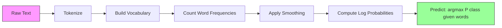

# Naive Bayes

> 「naive」的假設是錯的，但它照樣有效。這就是它的美妙之處。

**Type:** Build
**Language:** Python
**Prerequisites:** Phase 2, Lessons 01-07 (classification, Bayes' theorem)
**Time:** ~75 分鐘

## 學習目標 (Learning Objectives)

- 從零實作帶有 Laplace smoothing 的 Multinomial Naive Bayes，用於文字分類
- 說明為什麼 naive 獨立性假設在數學上是錯的，但實務上仍能產生正確的類別排序
- 比較 Multinomial、Bernoulli 與 Gaussian Naive Bayes 的變體，並為特定 feature 類型選擇合適的一種
- 在高維度稀疏資料上評估 Naive Bayes 對比 logistic regression，並說明其中的 bias-variance tradeoff

## 問題 (The Problem)

你需要分類文字。把信件分成垃圾郵件或非垃圾郵件，把顧客評論分成正面或負面，把客服工單分成各種類別。你有數千個 feature（每個字一個），而訓練資料有限。

大多數 classifier 在這裡都會卡關。Logistic regression 需要足夠的樣本才能可靠地估計數千個 weights。Decision tree 一次只對一個字切分，會嚴重 overfit。KNN 在 10,000 維中毫無意義，因為每個點離其他每個點的距離都差不多。

Naive Bayes 處理得了這件事。它做了一個數學上錯誤的假設（給定類別後，每個 feature 彼此獨立），卻在文字分類上仍然勝過「更聰明」的模型，尤其是在 training set 很小的時候。它只需要走訪資料一遍就能訓練完成。它能擴展到數百萬個 feature。它會產生機率估計（不過由於獨立性假設，通常校準得不好）。

理解為什麼錯誤的假設能帶來好的預測，會教你一件機器學習的根本道理：最好的模型不是最正確的那個，而是對你的資料有最佳 bias-variance tradeoff 的那個。

## 核心概念 (The Concept)

### Bayes 定理（快速複習） (Bayes' Theorem (Quick Review))

Bayes 定理把條件機率翻轉過來：

```math
P(\text{class} \mid \text{features}) = \frac{P(\text{features} \mid \text{class}) \cdot P(\text{class})}{P(\text{features})}
```

我們想要 `P(class | features)`，也就是在已知文件中的字詞時，文件屬於某個類別的機率。我們可以由以下幾項算出：
- `P(features | class)` -- 在這個類別的文件中看到這些字詞的 likelihood
- `P(class)` -- 類別的 prior 機率（一般來說垃圾郵件有多常見？）
- `P(features)` -- evidence，所有類別都相同，所以比較時可以忽略

`P(class | features)` 最高的類別獲勝。

### Naive 獨立性假設 (The Naive Independence Assumption)

精確計算 `P(features | class)` 需要估計所有 feature 一起的聯合機率。詞彙表有 10,000 個字的話，你得估計 $2^{10{,}000}$ 種可能組合上的分布。這是不可能的。

Naive 假設：給定類別後，每個 feature 彼此條件獨立。

```math
P(w_1, w_2, \ldots, w_n \mid \text{class}) = P(w_1 \mid \text{class}) \cdot P(w_2 \mid \text{class}) \cdots P(w_n \mid \text{class})
```

你不用估計一個不可能的聯合分布，而是估計 $n$ 個簡單的各 feature 分布。每一個只需要一個計數。

這個假設顯然是錯的。「machine」和「learning」這兩個字在任何文件中都不是獨立的。但 classifier 不需要正確的機率估計，它需要的是正確的排序 -- 哪個類別的機率最高。獨立性假設會引入系統性誤差，但這些誤差對所有類別的影響相似，所以排序仍然是正確的。

### 為什麼它仍然有效 (Why It Still Works)

三個原因：

1. **排序重於校準。**Classification 只需要排名最高的類別是對的。即使真實機率是 0.7 而 $P(\text{spam}) = 0.99999$，classifier 仍然會正確選出 spam。我們不需要正確的機率，我們需要正確的贏家。

2. **High bias、low variance。**獨立性假設是很強的 prior。它大幅限制模型，因而避免了 overfitting。在訓練資料有限時，一個略微錯誤但穩定的模型，勝過理論上正確但極不穩定的模型。這就是 bias-variance tradeoff 的實際運作。

3. **Feature 冗餘會互相抵銷。**相關的 feature 提供冗餘的證據。Classifier 會重複計算這些證據，但它也對正確的類別重複計算。如果「machine」和「learning」總是一起出現，兩者都為「tech」類別提供證據。NB 把它們算了兩次，但是是對正確的類別算了兩次。

第四個實務上的原因：Naive Bayes 極其快速。訓練就是走訪資料一遍，計算頻率。預測是一次矩陣乘法。你可以在幾秒內訓練一百萬份文件。這個速度代表你可以比使用較慢的模型迭代更快、嘗試更多 feature 集合，並執行更多實驗。

### 一步一步的數學 (The Math Step by Step)

我們來追蹤一個具體的例子。假設有兩個類別：spam 和 not-spam。詞彙表有三個字：「free」、「money」、「meeting」。

訓練資料：
- 垃圾郵件提到「free」80 次、「money」60 次、「meeting」10 次（共 150 個字）
- 非垃圾郵件提到「free」5 次、「money」10 次、「meeting」100 次（共 115 個字）
- 40% 的信件是垃圾郵件，60% 是非垃圾郵件

使用 Laplace smoothing（$\alpha=1$）：

```math
\begin{aligned}
P(\text{free} \mid \text{spam}) &= (80 + 1) / (150 + 3) = 81/153 = 0.529 \\
P(\text{money} \mid \text{spam}) &= (60 + 1) / (150 + 3) = 61/153 = 0.399 \\
P(\text{meeting} \mid \text{spam}) &= (10 + 1) / (150 + 3) = 11/153 = 0.072 \\[6pt]
P(\text{free} \mid \text{not-spam}) &= (5 + 1) / (115 + 3) = 6/118 = 0.051 \\
P(\text{money} \mid \text{not-spam}) &= (10 + 1) / (115 + 3) = 11/118 = 0.093 \\
P(\text{meeting} \mid \text{not-spam}) &= (100 + 1) / (115 + 3) = 101/118 = 0.856
\end{aligned}
```

新信件包含：「free」（2 次）、「money」（1 次）、「meeting」（0 次）。

```math
\begin{aligned}
\log P(\text{spam} \mid \text{email}) &= \log(0.4) + 2 \log(0.529) + 1 \log(0.399) + 0 \log(0.072) \\
&= -0.916 + 2(-0.637) + (-0.919) + 0 \\
&= -3.109 \\[6pt]
\log P(\text{not-spam} \mid \text{email}) &= \log(0.6) + 2 \log(0.051) + 1 \log(0.093) + 0 \log(0.856) \\
&= -0.511 + 2(-2.976) + (-2.375) + 0 \\
&= -8.838
\end{aligned}
```

Spam 以很大的差距獲勝。「free」出現兩次是強烈的垃圾郵件證據。注意，「meeting」沒有出現，對兩邊的 log 總和貢獻都是零（$0 \cdot \log P$）-- 在 Multinomial NB 中，沒出現的字沒有影響。明確對字詞缺席建模的是 Bernoulli NB。

### 三種變體 (Three Variants)

Naive Bayes 有三種口味。每一種對 `P(feature | class)` 的建模方式不同。

#### Multinomial Naive Bayes

把每個 feature 建模為計數。最適合 feature 是詞頻或 TF-IDF 值的文字資料。

```math
P(\text{word}_i \mid \text{class}) = \frac{\text{count of } \text{word}_i \text{ in class} + \alpha}{\text{total words in class} + \alpha \cdot \text{vocab\_size}}
```

`alpha` 是 Laplace smoothing（下面會解釋）。這個變體是文字分類的主力。

#### Gaussian Naive Bayes

把每個 feature 建模為常態分布。最適合連續型 feature。

```math
P(x_i \mid \text{class}) = \frac{1}{\sqrt{2 \pi \cdot \text{var}}} \cdot \exp\left(-\frac{(x_i - \text{mean})^2}{2 \cdot \text{var}}\right)
```

每個類別的每個 feature 都有自己的平均值與變異數。當 feature 在每個類別內確實呈鐘形曲線時，這種做法效果很好。

#### Bernoulli Naive Bayes

把每個 feature 建模為二元（出現或不出現）。最適合短文字或二元 feature 向量。

```math
P(\text{word}_i \mid \text{class}) = \frac{\text{docs in class containing } \text{word}_i + \alpha}{\text{total docs in class} + 2 \alpha}
```

和 Multinomial 不同，Bernoulli 會明確地懲罰字詞的缺席。如果「free」通常出現在垃圾郵件中，但這封信裡沒有，Bernoulli 會把這視為反對 spam 的證據。

### 何時使用哪種變體 (When to Use Each Variant)

| 變體 | Feature 類型 | 最適合 | 範例 |
|---------|-------------|----------|---------|
| Multinomial | 計數或頻率 | 文字分類、bag-of-words | 垃圾郵件、主題分類 |
| Gaussian | 連續值 | feature 接近常態的表格型資料 | Iris 分類、感測器資料 |
| Bernoulli | 二元 (0/1) | 短文字、二元 feature 向量 | 簡訊垃圾訊息、出現/缺席 feature |

### Laplace Smoothing

如果某個字出現在 test data 中，但在某個特定類別的訓練資料中從沒出現過，會發生什麼事？

沒有 smoothing：`P(word | class) = 0/N = 0`。一個零乘過整個連乘積，就讓 `P(class | features) = 0`，無視所有其他證據。單單一個沒見過的字就毀掉整個預測，不管有多少其他證據支持它。

Laplace smoothing 對每個 feature 計數加上一個很小的計數 `alpha`（通常是 1）：

```math
P(\text{word}_i \mid \text{class}) = \frac{\text{count}(\text{word}_i, \text{class}) + \alpha}{\text{total\_words\_in\_class} + \alpha \cdot \text{vocab\_size}}
```

在 $\alpha=1$ 下，每個字至少都有微小的機率。測試信件中出現「discombobulate」這個字，不再會殺死 spam 的機率。這種 smoothing 有 Bayesian 的詮釋：它等同於對字詞分布放上均勻的 Dirichlet prior。

Alpha 越高代表 smoothing 越強（分布更均勻）。Alpha 越低代表模型更信任資料。Alpha 是你要調整的 hyperparameter。

Alpha 的效果：

| Alpha | 效果 | 何時使用 |
|-------|--------|-------------|
| 0.001 | 幾乎沒有 smoothing，信任資料 | 非常大的 training set，預期不會有沒見過的 feature |
| 0.1 | 輕度 smoothing | 大的 training set |
| 1.0 | 標準 Laplace smoothing | 預設的起點 |
| 10.0 | 重度 smoothing，讓分布變平坦 | 非常小的 training set，預期有許多沒見過的 feature |

### 在 Log 空間中計算 (Log-Space Computation)

把數百個機率（每個都小於 1）相乘，會造成浮點數 underflow。即使真實值是一個非常小的正數，乘積在浮點數中也會變成零。

解法：在 log 空間中運算。不是把機率相乘，而是把它們的對數相加：

```math
\log P(\text{class} \mid x_1, x_2, \ldots, x_n) = \log P(\text{class}) + \sum_i \log P(x_i \mid \text{class})
```

這把預測變成一個內積：

```
log_scores = X @ log_feature_probs.T + log_class_priors
prediction = argmax(log_scores)
```

矩陣乘法。這就是為什麼 Naive Bayes 的預測這麼快 -- 它跟單層線性模型是同樣的運算。

### Naive Bayes vs Logistic Regression (Naive Bayes vs Logistic Regression)

兩者都是用於文字的線性 classifier。差別在於它們建模的對象。

| 面向 | Naive Bayes | Logistic Regression |
|--------|------------|-------------------|
| 類型 | Generative（建模 $P(X \mid Y){}$） | Discriminative（建模 $P(Y \mid X){}$） |
| 訓練 | 計算頻率 | 最佳化 loss function |
| 小資料 | 較好（強 prior 有幫助） | 較差（不足以估計 weights） |
| 大資料 | 較差（錯誤假設造成傷害） | 較好（彈性的邊界） |
| Feature | 假設獨立 | 能處理相關性 |
| 速度 | 走訪一遍，非常快 | 迭代式最佳化 |
| 校準 | 機率較差 | 機率較好 |

經驗法則：從 Naive Bayes 開始。如果你有足夠的資料而 NB 進入瓶頸，就換成 logistic regression。

### 分類 Pipeline (Classification Pipeline)



實務上，我們在 log 空間中運算以避免浮點數 underflow。我們不是把許多小機率相乘，而是把它們的對數相加：

```math
\log P(\text{class} \mid \text{features}) = \log P(\text{class}) + \sum_i \log P(\text{feature}_i \mid \text{class})
```

```figure
naive-bayes
```

## 動手做 (Build It)

`code/naive_bayes.py` 中的程式碼從零實作了 MultinomialNB 與 GaussianNB。

### MultinomialNB

從零實作：

1. **fit(X, y)**：對每個類別，計算每個 feature 的頻率。加上 Laplace smoothing。計算 log 機率。儲存類別 prior（類別頻率的 log）。

2. **predict_log_proba(X)**：對每個樣本，對所有類別計算 $\log P(\text{class})$ + 所有 $\log P(\text{feature}_i \mid \text{class})$ 的總和。這是一次矩陣乘法：X @ log_probs.T + log_priors。

3. **predict(X)**：回傳 log 機率最高的類別。

```python
class MultinomialNB:
    def __init__(self, alpha=1.0):
        self.alpha = alpha

    def fit(self, X, y):
        classes = np.unique(y)
        n_classes = len(classes)
        n_features = X.shape[1]

        self.classes_ = classes
        self.class_log_prior_ = np.zeros(n_classes)
        self.feature_log_prob_ = np.zeros((n_classes, n_features))

        for i, c in enumerate(classes):
            X_c = X[y == c]
            self.class_log_prior_[i] = np.log(X_c.shape[0] / X.shape[0])
            counts = X_c.sum(axis=0) + self.alpha
            self.feature_log_prob_[i] = np.log(counts / counts.sum())

        return self
```

關鍵洞見：fit 之後，預測就只是矩陣乘法加上一個 bias。這就是為什麼 Naive Bayes 這麼快。

### GaussianNB

對連續型 feature，我們針對每個類別、每個 feature 估計平均值與變異數：

```python
class GaussianNB:
    def __init__(self):
        pass

    def fit(self, X, y):
        classes = np.unique(y)
        self.classes_ = classes
        self.means_ = np.zeros((len(classes), X.shape[1]))
        self.vars_ = np.zeros((len(classes), X.shape[1]))
        self.priors_ = np.zeros(len(classes))

        for i, c in enumerate(classes):
            X_c = X[y == c]
            self.means_[i] = X_c.mean(axis=0)
            self.vars_[i] = X_c.var(axis=0) + 1e-9
            self.priors_[i] = X_c.shape[0] / X.shape[0]

        return self
```

預測時，對每個 feature 使用 Gaussian PDF，然後跨 feature 相乘（在 log 空間中則是相加）。

### Demo：文字分類

程式碼產生模擬兩個類別（科技文章 vs 體育文章）的合成 bag-of-words 資料。每個類別有不同的字詞頻率分布。MultinomialNB 使用詞頻對它們分類。

合成資料的做法如下：我們建立 200 個「字」（feature 欄位）。字 0-39 在科技文章中頻率高、在體育文章中頻率低。字 80-119 在體育文章中頻率高、在科技文章中頻率低。字 40-79 在兩者中頻率中等。這創造了一個逼真的情境：有些字是強烈的類別指標，有些則是雜訊。

### Demo：連續型 Feature

程式碼產生類似 Iris 的資料（3 個類別、4 個 feature、Gaussian 群集）。GaussianNB 使用每個類別的平均值與變異數來分類。每個類別有不同的中心（平均向量）與不同的分散程度（變異數），模擬真實世界中不同類別之間量測值有系統性差異的資料。

程式碼也示範了：
- **Smoothing 比較：**用不同的 alpha 值訓練 MultinomialNB，顯示 smoothing 強度對 accuracy 的影響。
- **Training size 實驗：**當訓練資料從 20 增加到 1600 筆樣本時，NB 的 accuracy 如何提升。即使樣本非常少，NB 也能達到不錯的 accuracy -- 這是它的主要優點。
- **Confusion matrix：**每個類別的 precision、recall 與 F1 score，顯示 NB 在哪裡出錯。

### 預測速度 (Prediction Speed)

Naive Bayes 的預測就是矩陣乘法。對於 $n$ 個樣本、$d$ 個 feature、$k$ 個類別：
- MultinomialNB：一次矩陣乘法 $(n \times d) \mathbin{@} (d \times k) = O(n \cdot d \cdot k)$
- GaussianNB：$n \cdot k$ 次 Gaussian PDF 評估，每次涵蓋 $d$ 個 feature = $O(n \cdot d \cdot k)$

兩者在每個維度上都是線性的。與 KNN（需要計算到所有訓練點的距離）或使用 RBF kernel 的 SVM（需要對所有 support vector 計算 kernel）相比，NB 在預測時快了好幾個數量級。

## 實際使用 (Use It)

用 sklearn，兩種變體都只要一行：

```python
from sklearn.naive_bayes import GaussianNB, MultinomialNB

gnb = GaussianNB()
gnb.fit(X_train, y_train)
print(f"GaussianNB accuracy: {gnb.score(X_test, y_test):.3f}")

mnb = MultinomialNB(alpha=1.0)
mnb.fit(X_train_counts, y_train)
print(f"MultinomialNB accuracy: {mnb.score(X_test_counts, y_test):.3f}")
```

用 sklearn 做文字分類：

```python
from sklearn.feature_extraction.text import CountVectorizer
from sklearn.naive_bayes import MultinomialNB
from sklearn.pipeline import Pipeline

text_clf = Pipeline([
    ("vectorizer", CountVectorizer()),
    ("classifier", MultinomialNB(alpha=1.0)),
])

text_clf.fit(train_texts, train_labels)
accuracy = text_clf.score(test_texts, test_labels)
```

`naive_bayes.py` 中的程式碼會把從零實作的版本與 sklearn 在相同資料上比較，以驗證正確性。

### TF-IDF 搭配 Naive Bayes (TF-IDF with Naive Bayes)

原始詞頻讓每個字的每次出現都有相同的權重。但像「the」和「is」這種常見字在每個類別中都頻繁出現 -- 它們不帶任何資訊。TF-IDF (Term Frequency - Inverse Document Frequency) 降低常見字的權重，並提高罕見且有辨識力的字的權重。

```python
from sklearn.feature_extraction.text import TfidfVectorizer
from sklearn.naive_bayes import MultinomialNB
from sklearn.pipeline import Pipeline

text_clf = Pipeline([
    ("tfidf", TfidfVectorizer()),
    ("classifier", MultinomialNB(alpha=0.1)),
])
```

TF-IDF 的值是非負的，所以可以搭配 MultinomialNB 使用。TF-IDF + MultinomialNB 的組合是文字分類最強的 baseline 之一。在訓練樣本少於 10,000 筆的資料集上，它經常勝過更複雜的模型。

### 用 BernoulliNB 處理短文字 (BernoulliNB for Short Text)

對於短文字（推文、簡訊、聊天訊息），BernoulliNB 可能表現得比 MultinomialNB 更好。短文字的詞數很少，所以 MultinomialNB 所依賴的頻率資訊帶有雜訊。BernoulliNB 只在乎出現或缺席，在短文字上更可靠。

```python
from sklearn.naive_bayes import BernoulliNB
from sklearn.feature_extraction.text import CountVectorizer

text_clf = Pipeline([
    ("vectorizer", CountVectorizer(binary=True)),
    ("classifier", BernoulliNB(alpha=1.0)),
])
```

CountVectorizer 中的 `binary=True` 旗標會把所有計數轉成 0/1。沒有它的話，BernoulliNB 仍然能運作，但它看到的是並非它所設計處理的計數。

### 校準 NB 的機率 (Calibrating NB Probabilities)

NB 的機率校準得很差。當 NB 說 $P(\text{spam}) = 0.95$ 時，真實機率可能是 0.7。如果你需要可靠的機率估計（例如要設定 threshold，或與其他模型組合），請使用 sklearn 的 CalibratedClassifierCV：

```python
from sklearn.calibration import CalibratedClassifierCV

calibrated_nb = CalibratedClassifierCV(MultinomialNB(), cv=5, method="sigmoid")
calibrated_nb.fit(X_train, y_train)
proba = calibrated_nb.predict_proba(X_test)
```

它透過 cross-validation，在 NB 的原始分數之上 fit 一個 logistic regression。得到的機率更接近真實的類別頻率。

### 常見的陷阱 (Common Gotchas)

1. **負的 feature 值。**MultinomialNB 要求非負的 feature。如果你有負值（例如某些設定下的 TF-IDF，或 standardize 過的 feature），改用 GaussianNB，或把 feature 平移成正數。

2. **零變異數的 feature。**GaussianNB 會除以變異數。如果某個 feature 在某個類別中變異數為零（所有值都相同），機率計算就會壞掉。程式碼對所有變異數加上一個很小的 smoothing 項 (1e-9) 來避免這件事。

3. **Class imbalance。**如果 99% 的信件是非垃圾郵件，prior $P(\text{not-spam}) = 0.99$ 強到會壓倒 likelihood 證據。你可以手動設定類別 prior，或使用 sklearn 中的 class_prior 參數。

4. **Feature scaling。**MultinomialNB 不需要 scaling（它處理的是計數）。GaussianNB 也不需要 scaling（它估計每個 feature 的統計量）。相較於對 feature 尺度敏感的 logistic regression 與 SVM，這是一個優點。

## 交付 (Ship It)

這堂課會產出：
- `outputs/skill-naive-bayes-chooser.md` -- 用於挑選合適 NB 變體的決策 skill
- `code/naive_bayes.py` -- 從零實作的 MultinomialNB 與 GaussianNB，附 sklearn 比較

### Naive Bayes 何時會失敗 (When Naive Bayes Fails)

當獨立性假設造成不正確的排序（而不只是不正確的機率）時，NB 就會失敗。這發生在：

1. **強烈的 feature 交互作用。**如果類別取決於兩個 feature 的組合，而單看任何一個都沒用（類似 XOR 的模式），NB 會完全錯過。每個 feature 單獨都不提供證據，而 NB 無法以非線性方式把它們組合起來。

2. **高度相關且證據相反的 feature。**如果 feature A 說「spam」而 feature B 說「not-spam」，但 A 與 B 完全相關（實際上它們總是一致），NB 會在沒有衝突的地方看到衝突的證據。

3. **非常大的 training set。**資料足夠時，像 logistic regression 這類 discriminative 模型會學到真正的 decision boundary，並勝過 NB。原本在小資料上有幫助的獨立性假設，現在反而拖住了模型。

實務上，這些失敗模式在文字分類中很少見。文字 feature 數量眾多、個別都很弱，獨立性假設的誤差往往會互相抵銷。對於只有少數強相關 feature 的表格型資料，請先考慮 logistic regression 或以樹為基礎的模型。

## 練習 (Exercises)

1. **Smoothing 實驗。**用 0.01、0.1、1.0、10.0 和 100.0 的 alpha 值，在文字資料上訓練 MultinomialNB。畫出 accuracy 對 alpha 的關係。表現在哪裡達到峰值？為什麼非常高的 alpha 會有害？

2. **Feature 獨立性測試。**取一份真實的文字資料集。挑出兩個明顯相關的字（「machine」和「learning」）。計算 $P(\text{word}_1 \mid \text{class}) \cdot P(\text{word}_2 \mid \text{class})$，並與 $P(\text{word}_1 \text{ AND } \text{word}_2 \mid \text{class})$ 比較。獨立性假設錯得有多離譜？它會影響分類 accuracy 嗎？

3. **Bernoulli 實作。**擴充程式碼，加入 BernoulliNB 類別。把 bag-of-words 轉成二元（出現/缺席），並在文字資料上與 MultinomialNB 比較 accuracy。Bernoulli 何時會勝出？

4. **NB vs Logistic Regression。**在文字資料上訓練兩者。從 100 筆訓練樣本開始，增加到 10,000 筆。畫出兩者的 accuracy 對 training set 大小的關係。Logistic Regression 在什麼時候超越 Naive Bayes？

5. **垃圾郵件過濾器。**建立一個完整的垃圾郵件 classifier：對原始信件文字做 tokenize、建立詞彙表、建立 bag-of-words feature、訓練 MultinomialNB，並用 precision 和 recall 評估（不只看 accuracy -- 為什麼？）。

## 關鍵術語 (Key Terms)

| 術語 | 大家怎麼說 | 實際意義 |
|------|----------------|----------------------|
| Naive Bayes | 「簡單的機率 classifier」 | 套用 Bayes 定理的 classifier，假設給定類別後 feature 之間條件獨立 |
| Conditional independence | 「feature 不會互相影響」 | $P(A, B \mid C) = P(A \mid C) \cdot P(B \mid C)$ -- 一旦知道 $C$，知道 $B$ 並不會告訴你關於 $A$ 的新資訊 |
| Laplace smoothing | 「加一 smoothing」 | 對每個 feature 加上很小的計數，防止零機率主導預測 |
| Prior | 「看到資料之前你相信的」 | $P(\text{class})$ -- 在觀察任何 feature 之前，每個類別的機率 |
| Likelihood | 「資料吻合得有多好」 | $P(\text{features} \mid \text{class})$ -- 在已知類別時觀察到這些 feature 的機率 |
| Posterior | 「看到資料之後你相信的」 | $P(\text{class} \mid \text{features})$ -- 觀察到 feature 之後，類別更新後的機率 |
| Generative model | 「建模資料如何產生」 | 學習 $P(X \mid Y)$ 與 $P(Y)$，再用 Bayes 定理得到 $P(Y \mid X)$ 的模型 |
| Discriminative model | 「建模 decision boundary」 | 直接學習 $P(Y \mid X)$，而不建模 $X$ 如何產生的模型 |
| Log probability | 「避免 underflow」 | 使用 $\log P$ 而不是 $P$ 運算，以避免許多小數字的乘積在浮點數中變成零 |

## 延伸閱讀 (Further Reading)

- [scikit-learn Naive Bayes docs](https://scikit-learn.org/stable/modules/naive_bayes.html) -- 三種變體及其數學細節
- [McCallum and Nigam, A Comparison of Event Models for Naive Bayes Text Classification (1998)](https://www.cs.cmu.edu/~knigam/papers/multinomial-aaaiws98.pdf) -- 文字分類中 Multinomial 對 Bernoulli 的經典比較
- [Rennie et al., Tackling the Poor Assumptions of Naive Bayes Text Classifiers (2003)](https://people.csail.mit.edu/jrennie/papers/icml03-nb.pdf) -- 針對文字改進 NB
- [Ng and Jordan, On Discriminative vs. Generative Classifiers (2001)](https://ai.stanford.edu/~ang/papers/nips01-discriminativegenerative.pdf) -- 證明在資料較少時 NB 比 LR 收斂得更快
