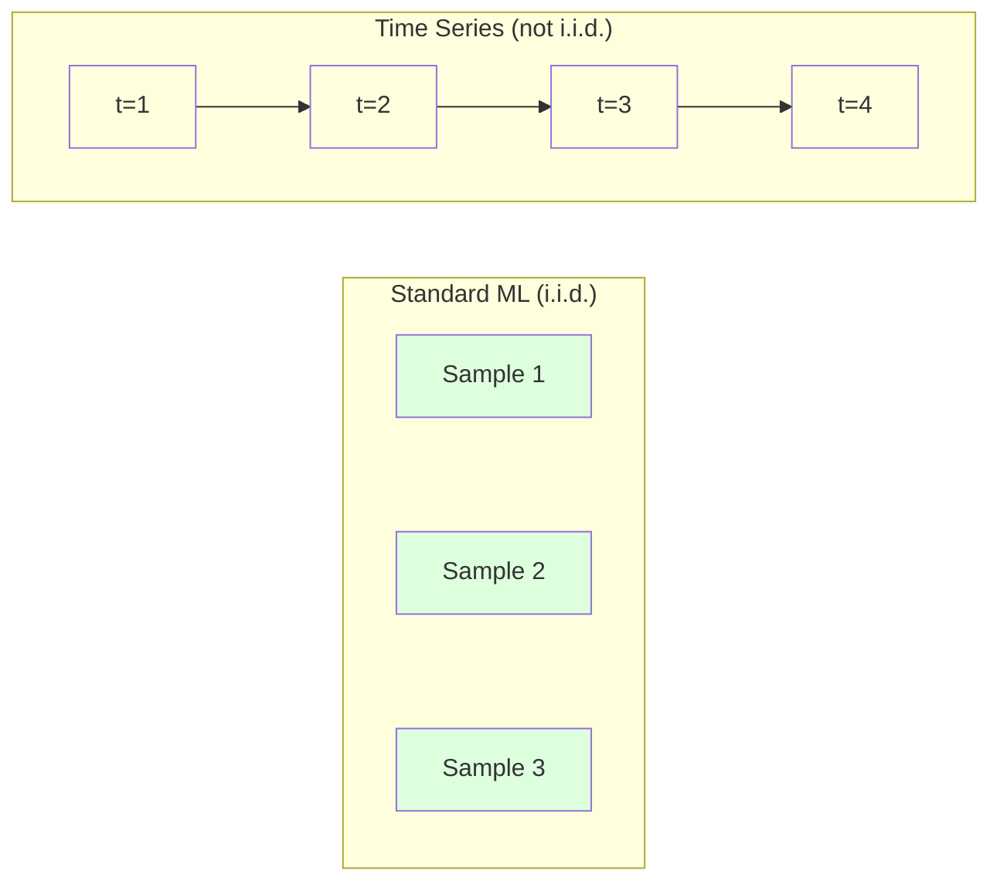
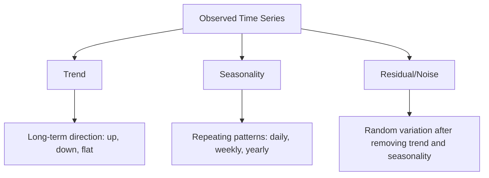
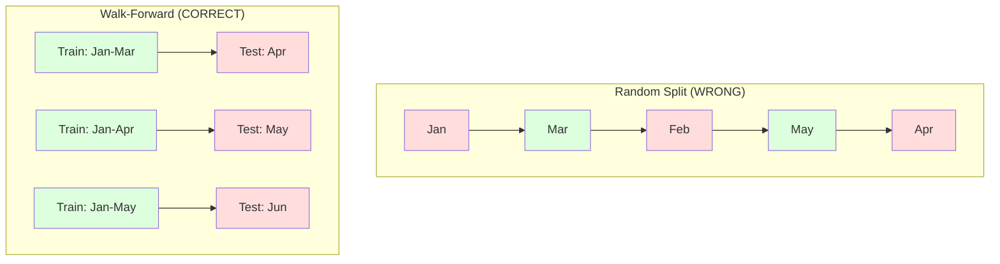

# 時間序列基礎 (Time Series Fundamentals)

> 過去的表現確實能預測未來的結果 -- 前提是你先檢查過 stationarity。

**Type:** Build
**Language:** Python
**Prerequisites:** Phase 2, Lessons 01-09
**Time:** ~90 分鐘

## 學習目標 (Learning Objectives)

- 把時間序列分解成 trend、seasonality 與 residual 成分，並檢驗 stationarity
- 實作 lag feature 與 rolling statistics，把時間序列轉換成 supervised learning 問題
- 建立 walk-forward validation 框架，避免未來資料洩漏到訓練中
- 說明為什麼隨機的 train/test 切分對時間序列無效，並示範它與正確的時間切分之間的效能差距

## 問題 (The Problem)

你有依時間排序的資料。每日銷售額、每小時氣溫、每分鐘 CPU 使用率、每週股價。你想預測下一個值、下一週、下一季。

你拿出標準的 ML 工具箱：隨機 train/test 切分、cross-validation、輸入 feature 矩陣、輸出預測。每一步都是錯的。

時間序列打破了標準 ML 所仰賴的假設。樣本不是獨立的 -- 今天的氣溫取決於昨天的。隨機切分會把未來的資訊洩漏到過去。在 backtest 中看起來很棒的 feature，到了正式環境就失敗，因為它們依賴的是會隨時間改變的模式。

一個在隨機 cross-validation 下有 95% accuracy 的模型，用正確的時間評估可能只剩 55%。這個差別不是技術細節，而是紙上談兵的模型與真正能在正式環境運作的模型之間的差別。

這堂課涵蓋基礎：時間資料有什麼不同、如何誠實地評估模型，以及如何把時間序列轉換成標準 ML 模型可以使用的 feature。

## 核心概念 (The Concept)

### 時間序列有什麼不同 (What Makes Time Series Different)

標準 ML 假設 i.i.d. -- 獨立且同分布 (independent and identically distributed)。每個樣本從相同的分布中抽出，且彼此獨立。時間序列兩點都違反：

- **不獨立。**今天的股價取決於昨天的。這週的銷售額與上週的相關。
- **不是同分布。**分布會隨時間改變。十二月的銷售額看起來和三月的不同。

這些違反並不輕微。它們改變你建立 feature 的方式、評估模型的方式，以及哪些演算法可用。



在標準 ML 中，樣本是可以互換的。打亂它們什麼都不會改變。在時間序列中，順序就是一切。打亂會破壞訊號。

### 時間序列的組成成分 (Components of a Time Series)

每個時間序列都是以下成分的組合：



- **Trend**：長期的方向。營收每年成長 10%。全球氣溫上升。
- **Seasonality**：在固定間隔重複出現的模式。零售銷售在十二月飆升。冷氣用量在七月達到高峰。
- **Residual**：移除 trend 和 seasonality 之後剩下的部分。如果 residual 看起來像 white noise，代表分解已經捕捉到訊號。

### Stationarity

如果一個時間序列的統計性質（平均值、變異數、autocorrelation）不隨時間改變，它就是 stationary。大多數預測方法都假設 stationarity。

**為什麼重要：**non-stationary 的序列，其平均值會漂移。用一月資料訓練的模型，學到的平均值和二月會呈現的不同，它會有系統性的錯誤。

**如何檢查：**在不同視窗上計算 rolling mean 與 rolling standard deviation。如果它們漂移，序列就是 non-stationary。

**如何修正：**Differencing。不對原始值建模，而是對連續值之間的變化建模：

```math
\text{diff}[t] = \text{value}[t] - \text{value}[t-1]
```

如果一輪 differencing 不足以讓序列 stationary，就再做一次（二階 differencing）。大多數真實世界的序列最多需要兩輪。

**範例：**

原始序列：[100, 102, 106, 112, 120]
一階差分：[2, 4, 6, 8]（仍然向上趨勢）
二階差分：[2, 2, 2]（常數 -- stationary）

原始序列有二次的趨勢。一階 differencing 把它變成線性趨勢。二階 differencing 讓它變平。實務上，你很少需要超過兩輪。

**正式檢定：**Augmented Dickey-Fuller (ADF) 檢定是 stationarity 的標準統計檢定。虛無假設是「序列是 non-stationary」。p-value 低於 0.05 代表你可以拒絕虛無假設，並得出 stationary 的結論。我們不從零實作 ADF（它需要漸近分布表），但我們程式碼中的 rolling statistics 方法提供了實用的視覺檢查。

### Autocorrelation

Autocorrelation 衡量時間 $t$ 的值與時間 $t-k$（過去 $k$ 步）的值有多相關。Autocorrelation function (ACF) 把每個 lag $k$ 的相關性畫出來。

**ACF 告訴你：**
- 序列能記得多久以前的事。如果 ACF 在 lag 5 之後降為零，超過 5 步之前的值就無關緊要。
- 是否存在 seasonality。如果 ACF 在 lag 12（月資料）出現尖峰，就有年度 seasonality。
- 該建立多少 lag feature。使用的 lag 數到 ACF 變得可忽略為止。

**PACF (Partial Autocorrelation Function)** 移除間接的相關性。如果今天與 3 天前相關，只是因為兩者都與昨天相關，那麼 PACF 在 lag 3 會是零，而 ACF 在 lag 3 則不會。

### Lag Feature：把時間序列變成 Supervised Learning (Lag Features: Turning Time Series into Supervised Learning)

標準 ML 模型需要 feature 矩陣 X 和目標 y。時間序列只給你單一欄位的值。橋樑就是 lag feature。

取序列 [10, 12, 14, 13, 15]，建立 lag-1 與 lag-2 feature：

| lag_2 | lag_1 | target |
|-------|-------|--------|
| 10    | 12    | 14     |
| 12    | 14    | 13     |
| 14    | 13    | 15     |

現在你有了標準的 regression 問題。任何 ML 模型（linear regression、random forest、gradient boosting）都可以根據 lag 預測目標。

你還可以設計的額外 feature：
- **Rolling statistics：**最近 k 個值的 mean、std、min、max
- **日曆 feature：**星期幾、月份、is_holiday、is_weekend
- **差分值：**相對於前一步的變化
- **Expanding statistics：**累積平均、累積總和
- **比率 feature：**目前值 / rolling mean（離近期平均有多遠）
- **交互作用 feature：**lag_1 * day_of_week（平日對動能的影響）

**要用多少個 lag？**使用 autocorrelation function。如果 ACF 到 lag 10 都顯著，就至少使用 10 個 lag。如果有每週的 seasonality，要包含 lag 7（可能還有 14）。更多 lag 給模型更多歷史，但也有更多 feature 要擬合，增加 overfitting 的風險。

**目標對齊的陷阱。**建立 lag feature 時，目標必須是時間 $t$ 的值，而所有 feature 都必須使用時間 $t-1$ 或更早的值。如果你不小心把時間 $t$ 的值納入 feature，你就有了完美的預測器 -- 以及一個完全沒用的模型。這是時間序列 feature engineering 中最常見的 bug。

### Walk-Forward Validation

這是這堂課最重要的概念。標準 k-fold cross-validation 會隨機把樣本分配給 train 和 test。對時間序列來說，這會洩漏未來的資訊。



Walk-forward validation：
1. 用時間 $t$ 之前的資料訓練
2. 預測時間 $t+1$（多步預測則是 $t+1$ 到 $t+k$）
3. 把視窗往前滑動
4. 重複

每個 test fold 只包含出現在所有訓練資料之後的資料。沒有未來洩漏。這讓你對模型部署後的表現有誠實的估計。

**Expanding window** 使用所有歷史資料來訓練（視窗持續變大）。**Sliding window** 使用固定大小的訓練視窗（視窗滑動）。當你認為較舊的資料仍然相關時，用 expanding。當世界在改變、舊資料有害時，用 sliding。

### ARIMA 直覺 (ARIMA Intuition)

ARIMA 是經典的時間序列模型。它有三個成分：

- **AR (Autoregressive)：**根據過去的值來預測。AR(p) 使用最近 $p$ 個值。
- **I (Integrated)：**透過 differencing 達到 stationarity。I(d) 套用 $d$ 輪 differencing。
- **MA (Moving Average)：**根據過去的預測誤差來預測。MA(q) 使用最近 $q$ 個誤差。

ARIMA(p, d, q) 結合這三者。你根據 ACF/PACF 分析或自動搜尋 (auto-ARIMA) 來選擇 $p$、$d$、$q$。

我們不從零實作 ARIMA -- 它需要超出這堂課範圍的數值最佳化。關鍵洞見在於理解每個成分的作用，讓你能解讀 ARIMA 的結果，並知道何時該使用它。

### 何時用哪一種 (When to Use What)

| 方法 | 最適合 | 能處理 Seasonality | 能處理外部 Feature |
|----------|---------|-------------------|------------------------|
| Lag feature + ML | 有許多外部 feature 的表格型資料 | 搭配日曆 feature | 可以 |
| ARIMA | 單一單變量序列、短期 | SARIMA 變體 | 不行（ARIMAX 有限度支援） |
| Exponential smoothing | 簡單的 trend + seasonality | 可以 (Holt-Winters) | 不行 |
| Prophet | 商業預測、假日 | 可以 (Fourier terms) | 有限 |
| Neural network (LSTM, Transformer) | 長序列、許多序列 | 自己學 | 可以 |

對大多數實務問題，lag feature + gradient boosting 是最強的起點。它自然地處理外部 feature、不要求 stationarity，而且容易除錯。

### 預測範圍與策略 (Forecasting Horizons and Strategies)

單步預測 (single-step) 預測前方一個時間步。多步預測 (multi-step) 預測多個步驟。有三種策略：

**Recursive（迭代式）：**預測一步，把預測值當作下一步的輸入。簡單但誤差會累積 -- 每個預測都用到前一個預測，所以錯誤會複合放大。

**Direct：**為每個預測範圍訓練一個獨立的模型。Model-1 預測 $t+1$，Model-5 預測 $t+5$。沒有誤差累積，但每個模型的訓練樣本較少，而且它們不共享資訊。

**Multi-output：**訓練一個同時輸出所有預測範圍的模型。跨範圍共享資訊，但需要支援多重輸出的模型（或自訂 loss function）。

對大多數實務問題，短範圍（1-5 步）從 recursive 開始，較長範圍則用 direct。

### 時間序列的常見錯誤 (Common Mistakes in Time Series)

| 錯誤 | 為什麼會發生 | 如何修正 |
|---------|---------------|-----------|
| 隨機的 train/test 切分 | 標準 ML 的習慣 | 使用 walk-forward 或時間切分 |
| 使用未來的 feature | 不小心納入了時間 $t$ 的 feature | 稽核每個 feature 的時間對齊 |
| 對 seasonality 發生 overfitting | 模型記住了日曆模式 | 在 test set 中保留一整個季節週期 |
| 忽略尺度變化 | 營收翻倍，但模式不變 | 對百分比變化建模，而不是絕對值 |
| 太多 lag feature | 「歷史越多越好」 | 用 ACF 決定相關的 lag |
| 沒有做 differencing | 「模型會自己搞定」 | 樹狀模型能處理 trend；線性模型需要 stationarity |

```figure
f3-series-decompose
```

## 動手做 (Build It)

`code/time_series.py` 中的程式碼從零實作了核心的建構區塊。

### Lag Feature 建立器

```python
def make_lag_features(series, n_lags):
    n = len(series)
    X = np.full((n, n_lags), np.nan)
    for lag in range(1, n_lags + 1):
        X[lag:, lag - 1] = series[:-lag]
    valid = ~np.isnan(X).any(axis=1)
    return X[valid], series[valid]
```

這會把一維序列轉換成 feature 矩陣，每一列以最近 `n_lags` 個值作為 feature，以目前的值作為目標。

### Walk-Forward Cross-Validation

```python
def walk_forward_split(n_samples, n_splits=5, min_train=50):
    assert min_train < n_samples, "min_train must be less than n_samples"
    step = max(1, (n_samples - min_train) // n_splits)
    for i in range(n_splits):
        train_end = min_train + i * step
        test_end = min(train_end + step, n_samples)
        if train_end >= n_samples:
            break
        yield slice(0, train_end), slice(train_end, test_end)
```

每次切分都確保訓練資料嚴格地出現在測試資料之前。訓練視窗隨每個 fold 擴大。

### 簡單的 Autoregressive 模型

純 AR 模型就是對 lag feature 做 linear regression：

```python
class SimpleAR:
    def __init__(self, n_lags=5):
        self.n_lags = n_lags
        self.weights = None
        self.bias = None

    def fit(self, series):
        X, y = make_lag_features(series, self.n_lags)
        # Solve via normal equations
        X_b = np.column_stack([np.ones(len(X)), X])
        theta = np.linalg.lstsq(X_b, y, rcond=None)[0]
        self.bias = theta[0]
        self.weights = theta[1:]
        return self
```

這在概念上與 Lesson 02 的 linear regression 完全相同，只是套用在同一個變數的時間延遲版本上。

### Stationarity 檢查

程式碼計算 rolling statistics，用視覺與數值方式評估 stationarity：

```python
def check_stationarity(series, window=50):
    rolling_mean = np.array([
        series[max(0, i - window):i].mean()
        for i in range(1, len(series) + 1)
    ])
    rolling_std = np.array([
        series[max(0, i - window):i].std()
        for i in range(1, len(series) + 1)
    ])
    return rolling_mean, rolling_std
```

如果 rolling mean 漂移，或 rolling std 改變，序列就是 non-stationary。套用 differencing，再檢查一次。

程式碼也透過比較序列的前半段與後半段來檢查 stationarity。如果平均值的差異超過半個標準差，或變異數比值超過 2 倍，序列就會被標記為 non-stationary。

### Autocorrelation

```python
def autocorrelation(series, max_lag=20):
    n = len(series)
    mean = series.mean()
    var = series.var()
    acf = np.zeros(max_lag + 1)
    for k in range(max_lag + 1):
        cov = np.mean((series[:n-k] - mean) * (series[k:] - mean))
        acf[k] = cov / var if var > 0 else 0
    return acf
```

## 實際使用 (Use It)

用 sklearn，你可以直接把 lag feature 配合任何 regressor 使用：

```python
from sklearn.linear_model import Ridge
from sklearn.ensemble import GradientBoostingRegressor

X, y = make_lag_features(series, n_lags=10)

for train_idx, test_idx in walk_forward_split(len(X)):
    model = Ridge(alpha=1.0)
    model.fit(X[train_idx], y[train_idx])
    predictions = model.predict(X[test_idx])
```

對 ARIMA，使用 statsmodels：

```python
from statsmodels.tsa.arima.model import ARIMA

model = ARIMA(train_series, order=(5, 1, 2))
fitted = model.fit()
forecast = fitted.forecast(steps=30)
```

`time_series.py` 中的程式碼示範兩種做法，並用 walk-forward validation 來比較它們。

### sklearn TimeSeriesSplit

sklearn 提供實作 walk-forward validation 的 `TimeSeriesSplit`：

```python
from sklearn.model_selection import TimeSeriesSplit

tscv = TimeSeriesSplit(n_splits=5)
for train_index, test_index in tscv.split(X):
    X_train, X_test = X[train_index], X[test_index]
    y_train, y_test = y[train_index], y[test_index]
    model.fit(X_train, y_train)
    score = model.score(X_test, y_test)
```

這等同於我們從零實作的 `walk_forward_split`，只是整合進 sklearn 的 cross-validation 框架。你可以將它與 `cross_val_score` 一起使用：

```python
from sklearn.model_selection import cross_val_score

scores = cross_val_score(model, X, y, cv=TimeSeriesSplit(n_splits=5))
print(f"Mean score: {scores.mean():.4f} +/- {scores.std():.4f}")
```

### 評估指標 (Evaluation Metrics)

時間序列預測使用 regression 指標，但要放在時間感知的脈絡中：

- **MAE (Mean Absolute Error)：**$\lvert y_{\text{true}} - y_{\text{pred}} \rvert$ 的平均。容易用原始單位解讀。「平均而言，預測誤差是 3.2 度。」
- **RMSE (Root Mean Squared Error)：**mean squared error 的平方根。對大誤差的懲罰比 MAE 更重。當大誤差比許多小誤差更糟時使用。
- **MAPE (Mean Absolute Percentage Error)：**|error / true_value| * 100 的平均。與尺度無關，適合用來比較不同的序列。但當真實值為零時沒有定義。
- **與 naive baseline 比較：**永遠與簡單的 baseline 比較。Seasonal naive baseline 預測一個週期前的值（昨天、上週）。如果你的模型打不過 naive，一定哪裡有問題。

### Rolling Feature

程式碼示範如何把 rolling statistics（7 天與 14 天視窗上的 mean、std、min、max）加到 lag feature 中。這些給模型關於近期趨勢與波動性的資訊，是單靠 lag feature 抓不到的。

例如，如果 rolling mean 在上升，暗示向上的趨勢。如果 rolling std 在增加，暗示波動性在增長。這些是以樹為基礎的模型能學到、但線性模型學不到的模式。

## 交付 (Ship It)

這堂課會產出：
- `outputs/prompt-time-series-advisor.md` -- 用來界定時間序列問題的 prompt
- `code/time_series.py` -- lag feature、walk-forward validation、AR 模型、stationarity 檢查

### 你必須打敗的 Baseline (Baselines You Must Beat)

在建立任何模型之前，先建立 baseline：

1. **最後一個值 (persistence)。**預測明天會和今天一樣。對許多序列來說，這出乎意料地難以打敗。
2. **Seasonal naive。**預測今天會和上週（或去年）的同一天一樣。如果你的模型打不過這個，代表它沒有學到 seasonality 之外任何有用的模式。
3. **Moving average。**預測最近 k 個值的平均。能平滑雜訊，但無法捕捉突然的變化。

如果你花俏的 ML 模型輸給 seasonal naive baseline，你一定有 bug。最常見的是：feature 中的未來洩漏、錯誤的評估方法，或是序列真的是隨機且不可預測的。

### 實務小技巧 (Practical Tips)

1. **從畫圖開始。**在任何建模之前，先畫出原始序列。找出趨勢、seasonality、outlier、結構性斷點（行為的突然改變）。30 秒的目視檢查，往往比一小時的自動分析告訴你更多。

2. **先做 differencing，再建模。**如果序列有明顯的趨勢，在建立 lag feature 之前先 difference 它。樹狀模型可以處理趨勢，但沒有明確趨勢項的線性模型不行。序列一旦 stationary 就停下來：每多一輪 differencing 都會增加雜訊並丟掉水準資訊。

3. **至少保留一整個季節週期。**如果你有每週的 seasonality，test set 至少需要一整週。如果是每月，至少一整個月。否則你無法評估模型是否捕捉到了季節模式。

4. **在正式環境中監控。**時間序列模型會隨著世界改變而退化。以 rolling 的方式追蹤預測誤差。當誤差開始增加時，用近期資料重新訓練模型。

5. **小心 regime change。**用疫情前資料訓練的模型，無法預測疫情後的行為。把已知 regime change 的指標納入 feature，或使用會遺忘舊資料的 sliding window。

6. **對偏斜的序列做 log transform。**營收、價格和計數通常是右偏的。取 log 可以穩定變異數，並把乘法模式變成加法模式，線性模型就能處理。在 log 空間中預測，再取指數還原成原始單位。

## 練習 (Exercises)

1. **Stationarity 實驗。**產生一個有線性趨勢的序列。用 rolling statistics 檢查 stationarity。套用一階 differencing，再檢查一次。對二次趨勢需要幾輪 differencing？

2. **Lag 選擇。**對一個有 seasonality 的序列（週期=7）計算 ACF。哪些 lag 的 autocorrelation 最高？只使用那些 lag（而不是連續的 lag）建立 lag feature。與使用 lag 1 到 7 相比，accuracy 有改善嗎？

3. **Walk-forward 對比隨機切分。**在 lag feature 上訓練 Ridge regression。用隨機 80/20 切分與 walk-forward validation 評估。隨機切分高估了多少表現？

4. **Feature engineering。**把 rolling mean (window=7)、rolling std (window=7) 與星期幾 feature 加到 lag feature 中。用 walk-forward validation 比較有無這些額外 feature 的 accuracy。

5. **多步預測。**修改 AR 模型，讓它預測 5 步而不是 1 步。比較兩種策略：(a) 預測一步，把預測值當作下一步的輸入 (recursive)，以及 (b) 為每個範圍訓練獨立的模型 (direct)。哪個更準確？

## 關鍵術語 (Key Terms)

| 術語 | 大家怎麼說 | 實際意義 |
|------|----------------|----------------------|
| Stationarity | 「統計量不隨時間改變」 | 平均值、變異數與 autocorrelation 結構都不隨時間改變的序列 |
| Differencing | 「相鄰值相減」 | 計算 $y[t] - y[t-1]$ 以移除趨勢並達到 stationarity |
| Autocorrelation (ACF) | 「序列與自己的相關性」 | 時間序列與其延遲副本之間的相關性，視為 lag 的函數 |
| Partial autocorrelation (PACF) | 「只看直接的相關性」 | 移除所有較短 lag 的影響之後，lag $k$ 上的 autocorrelation |
| Lag features | 「把過去的值當輸入」 | 使用 $y[t-1], y[t-2], \ldots, y[t-k]$ 作為 feature 來預測 $y[t]$ |
| Walk-forward validation | 「尊重時間的 cross-validation」 | 訓練資料在時間上永遠先於測試資料的評估方式 |
| ARIMA | 「經典的時間序列模型」 | AutoRegressive Integrated Moving Average：結合過去的值 (AR)、differencing (I) 與過去的誤差 (MA) |
| Seasonality | 「重複的日曆模式」 | 時間序列中與日曆週期（每日、每週、每年）相關、規律且可預測的循環 |
| Trend | 「長期的方向」 | 序列水準隨時間持續的上升或下降 |
| Expanding window | 「使用所有歷史」 | 訓練集隨每個 fold 增長的 walk-forward validation |
| Sliding window | 「固定大小的歷史」 | 訓練集是一個向前滑動的固定長度視窗的 walk-forward validation |

## 延伸閱讀 (Further Reading)

- [Hyndman and Athanasopoulos, Forecasting: Principles and Practice (3rd ed.)](https://otexts.com/fpp3/) -- 關於時間序列預測最好的免費教科書
- [scikit-learn Time Series Split](https://scikit-learn.org/stable/modules/generated/sklearn.model_selection.TimeSeriesSplit.html) -- sklearn 的 walk-forward 切分器
- [statsmodels ARIMA docs](https://www.statsmodels.org/stable/generated/statsmodels.tsa.arima.model.ARIMA.html) -- 附診斷功能的 ARIMA 實作
- [Makridakis et al., The M5 Competition (2022)](https://www.sciencedirect.com/science/article/pii/S0169207021001874) -- 大規模預測競賽，比較 ML 方法與統計方法
