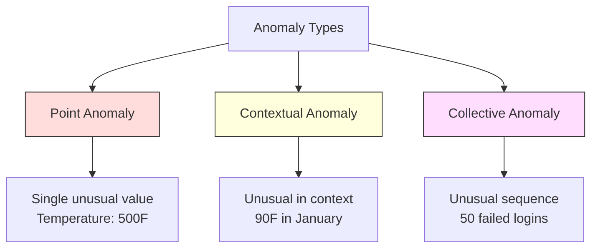
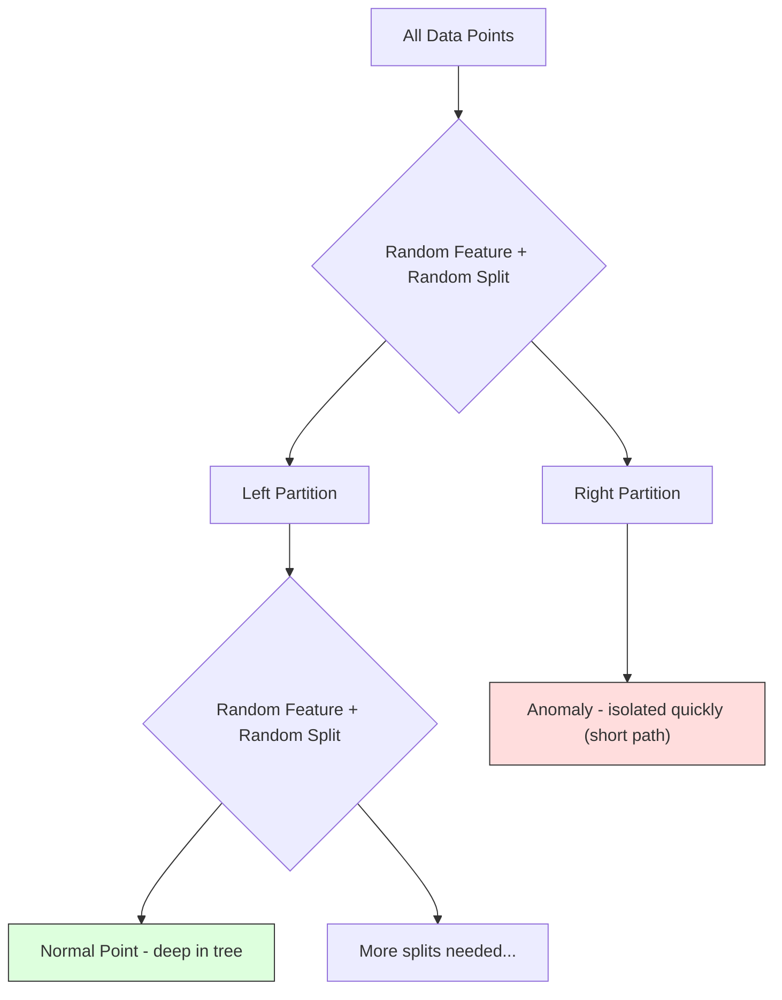
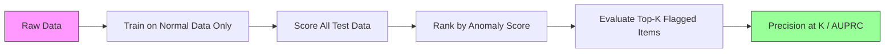

# Anomaly Detection

> 「正常」很容易定義。「異常」就是任何不符合的東西。

**Type:** Build
**Language:** Python
**Prerequisites:** Phase 2, Lessons 01-09
**Time:** ~75 分鐘

## 學習目標 (Learning Objectives)

- 從零實作 Z-score、IQR 與 Isolation Forest 的 anomaly detection 方法
- 區分 point、contextual 與 collective anomaly，並為各自選擇合適的偵測方法
- 說明為什麼 anomaly detection 的做法是對正常資料建模，而不是對異常進行分類
- 比較 unsupervised anomaly detection 與 supervised classification，並評估新穎異常的涵蓋率與 precision 之間的取捨

## 問題 (The Problem)

一張信用卡下午 2 點在紐約被使用，2 點 05 分又在東京被使用。工廠的感測器讀到 150 度，而正常範圍是 80-120。一台伺服器每秒收到 50,000 個請求，但每日平均只有 200。

這些都是異常。找出它們很重要。詐欺造成數十億的損失。設備故障造成停機。網路入侵造成資料外洩。

挑戰在於：你很少有異常的標記範例。詐欺只佔交易的 0.1%。設備故障一年只發生幾次。你無法訓練標準的 classifier，因為「異常」類別中幾乎沒有東西可以學。即使你有一些標籤，你見過的異常也不是你會遇到的唯一類型。明天的詐欺手法會和今天的不同。

Anomaly detection 把問題反過來。不是學習什麼是異常，而是學習什麼是正常。任何偏離正常的東西都是可疑的。這種做法不需要標籤、能適應新型態的異常，也能擴展到龐大的資料集。

## 核心概念 (The Concept)

### 異常的類型 (Types of Anomalies)

並非所有異常都一樣：

- **Point anomaly。**單一個資料點，不論脈絡都不尋常。500 度的溫度讀數。一個通常只花 $50 的帳戶出現 $50,000 的交易。
- **Contextual anomaly。**在其脈絡下不尋常的資料點。90 度的溫度在夏天是正常的，在冬天則是異常。相同的值，不同的脈絡。
- **Collective anomaly。**一連串資料點作為一個群體是不尋常的，儘管每個個別的點可能是正常的。登入失敗 5 次是正常的。連續 50 次就是暴力破解攻擊。

大多數方法偵測 point anomaly。Contextual anomaly 需要時間或位置的 feature。Collective anomaly 需要具備序列感知能力的方法。



### Unsupervised 的框架 (The Unsupervised Framing)

在標準 classification 中，兩個類別都有標籤。在 anomaly detection 中，你通常處於以下三種情況之一：

1. **完全 unsupervised。**完全沒有標籤。你在所有資料上 fit detector，並希望異常夠罕見，不會汙染「正常」模型。
2. **Semi-supervised。**你有一份只含正常資料的乾淨資料集。你在這份乾淨資料上 fit，並對其他所有資料打分數。這是可能時最強的設定。
3. **Weakly supervised。**你有少數已標記的異常。把它們用於評估，而不是訓練。以 unsupervised 方式訓練，然後在已標記的子集上量測 precision/recall。

關鍵洞見：anomaly detection 與 classification 在本質上不同。你是在對正常資料的分布建模，而不是對兩個類別之間的 decision boundary 建模。

### Supervised vs Unsupervised：取捨 (Supervised vs Unsupervised: The Tradeoff)

如果你確實有已標記的異常，應該把它們用於訓練（supervised classification），還是只用於評估（unsupervised detection）？

**Supervised（當成 classification）：**
- 抓得到你以前見過的那些確切類型的異常
- 對已知的異常類型有更高的 precision
- 完全漏掉新穎的異常類型
- 出現新的異常類型時需要重新訓練
- 需要足夠的異常範例（通常太少）

**Unsupervised（對正常建模，標出偏離者）：**
- 抓得到任何偏離正常的情況，包括新穎的類型
- 不需要已標記的異常
- False positive 率較高（不是所有不尋常的東西都是壞事）
- 對 distribution shift 更穩健

實務上，最好的系統會結合兩者：用 unsupervised detection 取得廣泛的涵蓋、用 supervised 模型處理已知的高優先順序異常類型，並對模稜兩可的案例進行人工審查。

### Z-Score 方法 (Z-Score Method)

最簡單的做法。計算每個 feature 的平均值與標準差。標出距離平均值超過 $k$ 個標準差的任何點。

```text
z_score = (x - mean) / std
anomaly if |z_score| > threshold
```

預設 threshold 是 3.0（對 Gaussian 分布，99.7% 的正常資料落在 3 個標準差之內）。

**優點：**簡單。快速。可解釋（「這個值距離正常有 4.5 個標準差」）。

**缺點：**假設資料呈常態分布。對 training data 中的 outlier 敏感（outlier 會移動平均值並放大 std，讓它們更難被偵測）。在多峰分布上會失敗。

**運作良好的時機：**資料大致呈鐘形的單一 feature 監控。伺服器回應時間、製造公差、基準穩定的感測器讀數。

**會失敗的時機：**多群集資料（兩個辦公室地點有不同的基準溫度）、偏斜的資料（交易金額中 $1000 很罕見但不算異常）、training set 中含有 outlier 的資料。

### IQR 方法 (IQR Method)

比 Z-score 更穩健。使用四分位距 (interquartile range)，而不是平均值與標準差。

```
Q1 = 25th percentile
Q3 = 75th percentile
IQR = Q3 - Q1
lower_bound = Q1 - factor * IQR
upper_bound = Q3 + factor * IQR
anomaly if x < lower_bound or x > upper_bound
```

預設的係數是 1.5。

**優點：**對 outlier 穩健（百分位數不受極端值影響）。適用於偏斜分布。不需要常態假設。

**缺點：**只能單變量（獨立套用於每個 feature）。無法偵測那些只有在一起考慮 feature 時才不尋常的異常（一個點在每個 feature 上單獨看可能是正常的，但在聯合空間中是異常的）。

**實務備註：**IQR 中的 1.5 係數對應箱形圖的鬚線。超出鬚線的點是潛在的 outlier。把 1.5 改成 3.0 會讓 detector 更保守（標記較少、false positive 較少）。正確的係數取決於你對誤報的容忍度。

### Isolation Forest

關鍵洞見：異常很少而且與眾不同。在對資料做隨機切分時，異常更容易被隔離 -- 它們只需要更少的隨機切分就能與其餘資料分開。



**運作方式：**
1. 建立許多隨機樹（isolation forest）
2. 在每個節點，隨機挑選一個 feature，並在該 feature 的最小值與最大值之間隨機選一個切分值
3. 持續切分，直到每個點都被隔離（在自己的葉節點）
4. 異常在所有樹上的平均路徑長度較短

**為什麼有效：**正常的點位在稠密區域。要把其中一個從鄰居中隔離出來，需要很多次隨機切分。異常位在稀疏區域。一兩次隨機切分就足以隔離它們。

Anomaly score 是基於所有樹的平均路徑長度，並以隨機二元搜尋樹的預期路徑長度做正規化：

```math
\text{score}(x) = 2^{-\text{average\_path\_length}(x) / c(n)}
```

其中 `c(n)` 是 $n$ 個樣本的預期路徑長度。分數接近 1 代表異常。分數接近 0.5 代表正常。分數接近 0 代表非常正常（深藏在稠密群集中）。

**優點：**沒有分布假設。能在高維度中運作。擴展性好（對樣本數是次線性的，因為每棵樹只用一個子樣本）。能處理混合型態的 feature。

**缺點：**難以處理位在稠密區域中的異常（masking 效應）。當許多 feature 無關時，隨機切分的效果較差。

**主要 hyperparameter：**
- `n_estimators`：樹的數量。通常 100 就夠了。更多的樹給出更穩定的分數，但計算更慢。
- `max_samples`：每棵樹的樣本數。原始論文的預設值是 256。較小的值讓個別的樹較不準確，但增加多樣性。子抽樣正是讓 Isolation Forest 很快的原因 -- 每棵樹只看到資料的一小部分。
- `contamination`：預期的異常比例。只用於設定 threshold。不影響分數本身。

### Local Outlier Factor (LOF)

LOF 比較一個點周圍的局部密度與其鄰居周圍的密度。一個位在稀疏區域、被稠密區域包圍的點是異常的。

**運作方式：**
1. 對每個點，找出它的 $k$ 個最近鄰居
2. 計算 local reachability density（鄰域有多稠密）
3. 比較每個點的密度與其鄰居的密度
4. 如果一個點的密度遠低於其鄰居，它就是 outlier

**LOF 分數：**
- LOF 接近 1.0 代表與鄰居的密度相近（正常）
- LOF 大於 1.0 代表密度低於鄰居（可能是異常）
- LOF 遠大於 1.0（例如 2.0+）代表密度顯著較低（很可能是異常）

「local」這部分至關重要。想像一個有兩個群集的資料集：一個有 1000 個點的稠密群集，和一個有 50 個點的稀疏群集。稀疏群集邊緣的一個點在全域上並不尋常 -- 它有 50 個鄰居。但如果它的近鄰比它更稠密，它在局部上就是不尋常的。LOF 捕捉到全域方法會漏掉的這種細微差異。

**優點：**能偵測局部異常（在其鄰域中不尋常的點，即使在全域上並不尋常）。適用於密度不同的群集。

**缺點：**在大型資料集上很慢（單純實作為 $O(n^2)$）。對 $k$ 的選擇敏感。在非常高的維度下表現不佳（curse of dimensionality 影響距離計算）。

### 比較 (Comparison)

| 方法 | 假設 | 速度 | 能處理高維度 | 能偵測局部異常 |
|--------|------------|-------|-------------------|------------------------|
| Z-score | 常態分布 | 非常快 | 可以（逐 feature） | 不行 |
| IQR | 無（逐 feature） | 非常快 | 可以（逐 feature） | 不行 |
| Isolation Forest | 無 | 快 | 可以 | 部分可以 |
| LOF | 距離有意義 | 慢 | 表現不佳 | 可以 |

### 評估的挑戰 (Evaluation Challenges)

評估 anomaly detector 比評估 classifier 更難：

- **極端的 class imbalance。**異常只有 0.1% 時，對所有東西都預測「正常」就有 99.9% 的 accuracy。Accuracy 毫無用處。
- **AUROC 具有誤導性。**在嚴重不平衡的情況下，即使模型在實際 threshold 下漏掉大多數異常，AUROC 也可能看起來不錯。
- **更好的指標：**Precision@k（在被標記的前 $k$ 個項目中，有多少是真正的異常）、AUPRC（precision-recall 曲線下面積），以及固定 false positive rate 下的 recall。



### Anomaly Detection Pipeline

實務上，anomaly detection 遵循這個工作流程：

1. **收集基準資料。**理想上，是一段你知道沒有（或幾乎沒有）異常的期間。
2. **Feature engineering。**原始 feature 加上衍生 feature（rolling statistics、時間 feature、比率）。
3. **訓練 detector。**在基準資料上 fit。模型學習「正常」長什麼樣子。
4. **對新資料打分數。**每個新的觀察值都會得到一個 anomaly score。
5. **選擇 threshold。**選定分數的截斷值。這是商業決策：threshold 越高，誤報越少，但漏掉的異常越多。
6. **警報與調查。**被標記的點交由人工審查或自動化回應。
7. **收集回饋。**記錄被標記的項目是真正的異常還是誤報。利用這些資料評估 detector，並隨時間調整 threshold。

這個 pipeline 永遠沒有「完成」的一天。資料分布會改變，新的異常類型會出現，threshold 也需要調整。把 anomaly detection 當成一個活的系統，而不是一次性的模型。

```figure
f3-anomaly-fence
```

## 動手做 (Build It)

`code/anomaly_detection.py` 中的程式碼從零實作了 Z-score、IQR 與 Isolation Forest。

### Z-Score Detector

```python
def zscore_detect(X, threshold=3.0):
    mean = X.mean(axis=0)
    std = X.std(axis=0)
    std[std == 0] = 1.0
    z = np.abs((X - mean) / std)
    return z.max(axis=1) > threshold
```

簡單且向量化。只要任何一個 feature 超過 threshold，就標記該點。

### IQR Detector

```python
def iqr_detect(X, factor=1.5):
    q1 = np.percentile(X, 25, axis=0)
    q3 = np.percentile(X, 75, axis=0)
    iqr = q3 - q1
    iqr[iqr == 0] = 1.0
    lower = q1 - factor * iqr
    upper = q3 + factor * iqr
    outside = (X < lower) | (X > upper)
    return outside.any(axis=1)
```

### 從零實作 Isolation Forest

從零實作的版本建立 isolation tree，隨機切分 feature 空間：

```python
def _c_factor(n):
    if n <= 1:
        return 0.0
    if n == 2:
        return 1.0
    return 2.0 * (np.log(n - 1) + 0.5772156649) - 2.0 * (n - 1.0) / n


class IsolationTree:
    def __init__(self, max_depth):
        self.max_depth = max_depth

    def fit(self, X, depth=0):
        n, p = X.shape
        if depth >= self.max_depth or n <= 1:
            self.is_leaf = True
            self.size = n
            return self
        self.is_leaf = False
        self.feature = np.random.randint(p)
        x_min = X[:, self.feature].min()
        x_max = X[:, self.feature].max()
        if x_min == x_max:
            self.is_leaf = True
            self.size = n
            return self
        self.threshold = np.random.uniform(x_min, x_max)
        left_mask = X[:, self.feature] < self.threshold
        self.left = IsolationTree(self.max_depth).fit(X[left_mask], depth + 1)
        self.right = IsolationTree(self.max_depth).fit(X[~left_mask], depth + 1)
        return self

    def path_length(self, x, depth=0):
        if self.is_leaf:
            return depth + _c_factor(self.size)
        if x[self.feature] < self.threshold:
            return self.left.path_length(x, depth + 1)
        return self.right.path_length(x, depth + 1)
```

隔離一個點所需的路徑長度決定它的 anomaly score。路徑越短，越異常。

`IsolationForest` 類別包裝了多棵樹：

```python
class IsolationForest:
    def __init__(self, n_estimators=100, max_samples=256, seed=42):
        self.n_estimators = n_estimators
        self.max_samples = max_samples
        self.seed = seed
        self.trees = []
        self.n_train = 0

    def fit(self, X):
        self.n_train = X.shape[0]
        rng = np.random.RandomState(self.seed)
        self.trees = []
        sample_size = min(self.max_samples, X.shape[0])
        max_depth = int(np.ceil(np.log2(sample_size)))
        for _ in range(self.n_estimators):
            idx = rng.choice(X.shape[0], size=sample_size, replace=False)
            tree = IsolationTree(max_depth=max_depth)
            tree.fit(X[idx])
            self.trees.append(tree)
        return self

    def anomaly_score(self, X):
        avg_path = np.zeros(X.shape[0])
        for tree in self.trees:
            for i in range(X.shape[0]):
                avg_path[i] += tree.path_length(X[i])
        avg_path /= self.n_estimators
        c = _c_factor(min(self.max_samples, self.n_train))
        return 2.0 ** (-avg_path / c) if c > 0 else np.zeros(X.shape[0])
```

正規化因子 `c(n)`（程式碼中的 `_c_factor`）是有 $n$ 個元素的二元搜尋樹中，不成功搜尋的預期路徑長度。它等於 `2 * H(n-1) - 2*(n-1)/n`，其中 `H` 是調和數 (harmonic number)。程式碼和原始 Isolation Forest 論文一樣，使用標準近似 `H(i) ≈ ln(i) + 0.5772`（Euler 常數）。這個正規化確保分數在不同大小的資料集之間是可比較的。

### Demo 情境 (Demo Scenarios)

程式碼產生多個測試情境：

1. **含 outlier 的單一群集。**一個 2D Gaussian 群集，異常被注入在遠離中心的位置。所有方法在這裡都應該能運作。
2. **多峰資料。**三個大小與密度不同的群集。群集之間的點是異常。Z-score 會吃力，因為每個 feature 的範圍都很寬。
3. **高維度資料。**50 個 feature，但異常只在其中 5 個上有所不同。測試各方法能否在 feature 的子集中找到異常。

每個 demo 都用 precision、recall、F1 和 Precision@k 比較所有方法。

## 實際使用 (Use It)

使用 sklearn（使用函式庫實作，不是從零實作的版本）：

```python
from sklearn.ensemble import IsolationForest
from sklearn.neighbors import LocalOutlierFactor

iso = IsolationForest(n_estimators=100, contamination=0.05, random_state=42)
iso.fit(X_train)
predictions = iso.predict(X_test)

lof = LocalOutlierFactor(n_neighbors=20, contamination=0.05, novelty=True)
lof.fit(X_train)
predictions = lof.predict(X_test)
```

注意 `contamination` 設定的是預期的異常比例。設對很重要 -- 太低會漏掉異常，太高會產生誤報。

`anomaly_detection.py` 中的程式碼會把從零實作的版本與 sklearn 在相同資料上比較。

### sklearn 的 Contamination 參數 (sklearn Contamination Parameter)

sklearn 中的 `contamination` 參數決定把連續的 anomaly score 轉成二元預測時的 threshold。它不會改變底層的分數。

```python
iso_5 = IsolationForest(contamination=0.05)
iso_10 = IsolationForest(contamination=0.10)
```

兩者產生相同的 anomaly score。但 `iso_5` 標記前 5%，而 `iso_10` 標記前 10%。如果你不知道真實的異常率（通常你不知道），就把 contamination 設為 "auto"，直接使用原始分數。依據 false positive 與 false negative 之間的成本取捨，自己設定 threshold。

### One-Class SVM

另一個值得認識的 unsupervised anomaly detector。One-Class SVM 在高維 feature 空間中（使用 kernel trick）對正常資料擬合出一個邊界。

```python
from sklearn.svm import OneClassSVM

oc_svm = OneClassSVM(kernel="rbf", gamma="auto", nu=0.05)
oc_svm.fit(X_train)
predictions = oc_svm.predict(X_test)
```

`nu` 參數近似異常的比例。One-Class SVM 在中小型資料集上運作良好，但無法擴展到非常大的資料（kernel matrix 的大小是二次方成長）。

### Autoencoder 做法（預覽） (Autoencoder Approach (Preview))

Autoencoder 是學習壓縮並重建資料的 neural network。在正常資料上訓練。測試時，異常會有很高的重建誤差，因為網路只學會重建正常的模式。

這在 Phase 3（Deep Learning）中涵蓋，但原則是相同的：對正常建模，標出偏離者。

### Ensemble Anomaly Detection

就像 ensemble 方法改善 classification（Lesson 11）一樣，組合多個 anomaly detector 也能改善偵測。最簡單的做法：

1. 執行多個 detector（Z-score、IQR、Isolation Forest、LOF）
2. 把每個 detector 的分數正規化到 [0, 1]
3. 對正規化後的分數取平均
4. 標記平均分數超過 threshold 的點

這降低了 false positive，因為不同方法有不同的失敗模式。被四種方法都標記的點幾乎肯定是異常。只被其中一種標記的點，可能只是該方法的怪癖。

更精細的 ensemble 會依據每個 detector 估計的可靠度加權（在有已知異常的 validation set 上量測，如果有的話）。

### 正式環境的考量 (Production Considerations)

1. **Threshold 漂移。**隨著資料分布改變，固定的 threshold 會過時。監控 anomaly score 的分布，並定期調整。
2. **警報疲勞。**誤報太多，操作人員就不再注意。從較高的 threshold 開始（較少但較可靠的警報），隨著信任建立再降低。
3. **Ensemble 做法。**在正式環境中，組合多個 detector。只有在多種方法都同意某個點是異常時才標記。這能大幅降低 false positive。
4. **Feature engineering。**原始 feature 很少足夠。加入 rolling statistics、比率、距上次事件的時間，以及領域特定的 feature。好的 feature 集合比 detector 的選擇更重要。
5. **回饋迴路。**當操作人員調查被標記的項目並確認或駁回它們時，把這些回饋送回系統。隨時間累積已標記的資料，以評估並改進 detector。

## 交付 (Ship It)

這堂課會產出：
- `outputs/skill-anomaly-detector.md` -- 用於挑選合適 detector 的決策 skill
- `code/anomaly_detection.py` -- 從零實作的 Z-score、IQR 與 Isolation Forest，附 sklearn 比較

### 選擇 Threshold (Choosing a Threshold)

Anomaly score 是連續的。你需要 threshold 來做二元決策。這是商業決策，不是技術決策。

考慮兩個情境：
- **詐欺偵測。**漏掉詐欺很昂貴（退單、客戶信任）。誤報讓人工分析師花 5 分鐘調查。把 threshold 設低以抓到更多詐欺，接受更多誤報。
- **設備維護。**誤報代表一次不必要的停機，花費 $50,000。漏掉一次故障則代表 $500,000 的維修。設定 threshold 來平衡這些成本。

在這兩種情況下，最佳 threshold 取決於 false positive 與 false negative 之間的成本比。畫出不同 threshold 下的 precision 與 recall，疊上成本函數，並挑選成本最低的點。

### 擴展到正式環境 (Scaling to Production)

對於正式環境中的即時 anomaly detection：

1. **批次訓練，線上打分數。**定期（每天、每週）用近期的正常資料訓練模型。每個新的觀察值一到就打分數。
2. **Feature 的計算必須一致。**如果你訓練時用了 30 天的 rolling statistics，就需要 30 天的歷史來計算新觀察值的 feature。要緩衝所需的歷史。
3. **監控分數分布。**追蹤 anomaly score 的分布隨時間的變化。如果 median 分數向上漂移，要嘛是資料在改變，要嘛是模型過時了。
4. **可解釋性。**標記異常時，要說明原因。Z-score：「Feature X 比正常高出 4.2 個標準差。」Isolation Forest：「這個點平均在 3.1 次切分內就被隔離（正常的點需要 8.5 次）。」

## 練習 (Exercises)

1. **Threshold 調整。**以 0.5 為步長，用 1.0 到 5.0 的 threshold 執行 Z-score detector。畫出每個 threshold 下的 precision 與 recall。你的資料的甜蜜點在哪裡？

2. **多變量異常。**建立 2D 資料，其中每個 feature 單獨看都是正常的，但組合起來是異常的（例如遠離主群集對角線的點）。證明逐 feature 的 Z-score 會漏掉這些，而 Isolation Forest 能抓到。

3. **從零實作 LOF。**使用 k-nearest neighbors 實作 Local Outlier Factor。在相同資料上與 sklearn 的 LocalOutlierFactor 比較。使用 $k=10$ 和 $k=50$ -- $k$ 的選擇如何影響結果？

4. **串流式 anomaly detection。**修改 Z-score detector 使其能在串流情境中運作：隨著新點到達，更新執行中的平均值與變異數（Welford 線上演算法）。在相同資料上與批次 Z-score 比較。

5. **真實世界評估。**取一份有已知異常的資料集（例如 Kaggle 的信用卡詐欺）。使用 precision@100、precision@500 和 AUPRC 評估四種方法。哪種方法最好？為什麼？

## 關鍵術語 (Key Terms)

| 術語 | 大家怎麼說 | 實際意義 |
|------|----------------|----------------------|
| Anomaly | 「outlier、不尋常的點」 | 顯著偏離正常資料預期模式的資料點 |
| Point anomaly | 「單一個怪值」 | 不論脈絡都不尋常的單一觀察值 |
| Contextual anomaly | 「值正常，脈絡不對」 | 在其脈絡（時間、位置等）下不尋常、但在另一種脈絡下可能是正常的觀察值 |
| Isolation Forest | 「用隨機切分找 outlier」 | 隨機樹的 ensemble，用比正常點更少的切分次數隔離異常 |
| Local Outlier Factor | 「把密度與鄰居比較」 | 標記局部密度遠低於鄰居密度的點的方法 |
| Z-score | 「離平均值幾個標準差」 | $(x - \text{mean}) / \text{std}$，以標準差為單位衡量一個點離中心有多遠 |
| IQR | 「四分位距」 | $Q3 - Q1$，衡量中間 50% 資料的分散程度，用於穩健的 outlier 偵測 |
| Contamination | 「預期的異常比例」 | 告訴 detector 應該把多少比例的資料標記為異常的 hyperparameter |
| Precision@k | 「前 k 個標記中有多少是真的」 | 只在最可疑的 $k$ 個點上計算的 precision，適用於不平衡的 anomaly detection |
| AUPRC | 「precision-recall 曲線下面積」 | 總結所有 threshold 上 precision-recall 表現的指標，對不平衡資料比 AUROC 更好 |

## 延伸閱讀 (Further Reading)

- [Liu et al., Isolation Forest (2008)](https://cs.nju.edu.cn/zhouzh/zhouzh.files/publication/icdm08b.pdf) -- 最原始的 Isolation Forest 論文
- [Breunig et al., LOF: Identifying Density-Based Local Outliers (2000)](https://dl.acm.org/doi/10.1145/342009.335388) -- 最原始的 LOF 論文
- [scikit-learn Outlier Detection docs](https://scikit-learn.org/stable/modules/outlier_detection.html) -- sklearn 所有 anomaly detector 的概覽
- [Chandola et al., Anomaly Detection: A Survey (2009)](https://dl.acm.org/doi/10.1145/1541880.1541882) -- anomaly detection 方法的全面性綜述
- [Goldstein and Uchida, A Comparative Evaluation of Unsupervised Anomaly Detection Algorithms (2016)](https://journals.plos.org/plosone/article?id=10.1371/journal.pone.0152173) -- 在真實資料集上對 10 種方法的實證比較
