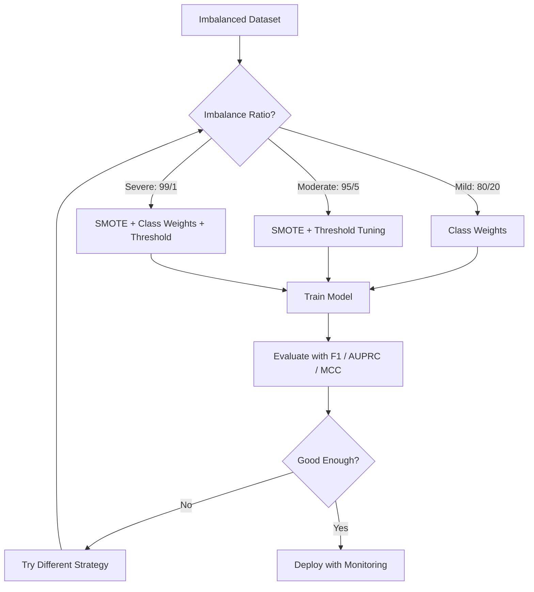
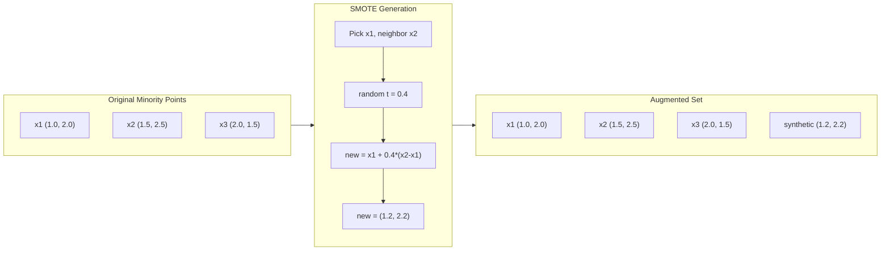
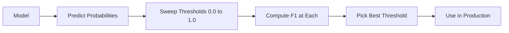
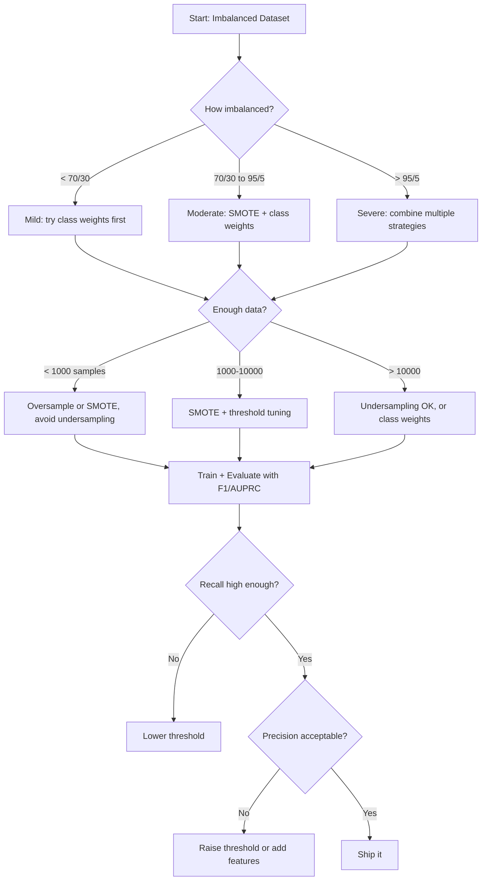

# 處理不平衡資料 (Handling Imbalanced Data)

> 當 99% 的資料都是「正常」的，accuracy 就是謊言。

**Type:** Build
**Language:** Python
**Prerequisites:** Phase 2, Lessons 01-09 (especially evaluation metrics)
**Time:** ~90 分鐘

## 學習目標 (Learning Objectives)

- 從零實作 SMOTE，並說明合成式 oversampling 與隨機複製有何不同
- 用 F1、AUPRC 與 Matthews Correlation Coefficient 取代 accuracy 來評估不平衡的 classifier
- 比較 class weighting、threshold tuning 與 resampling 策略，並依據不平衡比例選擇合適的做法
- 建立結合 SMOTE、class weight 與 threshold 最佳化的完整不平衡資料 pipeline

## 問題 (The Problem)

你建立了一個詐欺偵測模型。它有 99.9% 的 accuracy。你開心慶祝。然後你發現它對每一筆交易都預測「非詐欺」。

這不是 bug。當只有 0.1% 的交易是詐欺時，這是理性的做法。模型學到，永遠猜多數類別能讓整體誤差最小。技術上正確，卻完全沒用。

這種情況在所有真正重要的 classification 問題中到處都是。疾病診斷：1% 陽性率。網路入侵：0.01% 是攻擊。製造瑕疵：0.5% 有瑕疵。垃圾郵件過濾：20% 是垃圾。流失預測：5% 是流失者。少數類別越重要，往往越罕見。

Accuracy 會失敗，因為它對所有正確的預測一視同仁。正確標記一筆合法交易，和正確抓到一筆詐欺，都只算 accuracy 的一分。但抓到詐欺正是這個模型存在的全部理由。我們需要能迫使模型關注罕見但重要類別的指標、技巧與訓練策略。

## 核心概念 (The Concept)

### 為什麼 Accuracy 會失敗 (Why Accuracy Fails)

考慮一個有 1000 個樣本的資料集：990 個負例、10 個正例。一個永遠預測負例的模型：

|  | 預測為正 | 預測為負 |
|--|---|---|
| 實際為正 | 0 (TP) | 10 (FN) |
| 實際為負 | 0 (FP) | 990 (TN) |

```math
\text{Accuracy} = (0 + 990) / 1000 = 99.0\%
```

這個模型抓到零筆詐欺、零個疾病、零個瑕疵。但 accuracy 說有 99%。這就是為什麼 accuracy 對不平衡問題很危險。

### 更好的指標 (Better Metrics)

**Precision** = $\text{TP} / (\text{TP} + \text{FP})$。在所有被標記為正的樣本中，實際為正的有多少？High precision 代表誤報少。

**Recall** = $\text{TP} / (\text{TP} + \text{FN})$。在所有實際為正的樣本中，我們抓到多少？High recall 代表漏掉的正例少。

**F1 Score** = $2 \cdot \text{precision} \cdot \text{recall} / (\text{precision} + \text{recall})$。調和平均數。比算術平均數更能懲罰 precision 與 recall 之間的極端失衡。

**F-beta Score** = $(1 + \beta^2) \cdot \text{precision} \cdot \text{recall} / (\beta^2 \cdot \text{precision} + \text{recall})$。當 $\beta > 1$ 時，recall 更重要。當 $\beta < 1$ 時，precision 更重要。F2 在詐欺偵測中很常見（漏掉詐欺比誤報更糟）。

**AUPRC**（Precision-Recall 曲線下面積）。類似 AUC-ROC，但對不平衡資料更有資訊量。隨機 classifier 的 AUPRC 等於正類別的比例（不是 ROC 的 0.5）。這讓改善更容易被看見。

**Matthews Correlation Coefficient** = $(\text{TP} \cdot \text{TN} - \text{FP} \cdot \text{FN}) / \sqrt{(\text{TP}+\text{FP})(\text{TP}+\text{FN})(\text{TN}+\text{FP})(\text{TN}+\text{FN})}$。範圍從 -1 到 +1。只有在模型對兩個類別都表現良好時，才會給出高分。即使類別大小差異很大，也保持平衡。

對上面那個「永遠預測負例」的模型：$\text{precision} = 0/0$（未定義，通常設為 0），$\text{recall} = 0/10 = 0$，$\text{F1} = 0$，$\text{MCC} = 0$。這些指標正確地指出這個模型一文不值。

### 不平衡資料的 Pipeline (The Imbalanced Data Pipeline)



### SMOTE：Synthetic Minority Oversampling Technique (SMOTE: Synthetic Minority Oversampling Technique)

隨機 oversampling 會複製現有的少數類別樣本。這可行，但有 overfitting 的風險，因為模型會反覆看到完全相同的點。

SMOTE 會建立新的合成少數類別樣本，這些樣本合理但不是複本。演算法：

1. 對每個少數類別樣本 $x$，在其他少數類別樣本中找出它的 $k$ 個最近鄰居
2. 隨機挑一個鄰居
3. 在 $x$ 與該鄰居之間的線段上建立一個新樣本

公式：`new_sample = x + random(0, 1) * (neighbor - x)`

這在真實的少數類別點之間做內插，在 feature 空間的同一區域建立樣本，而不是單純複製現有資料。



### 比較各種取樣策略 (Sampling Strategies Compared)

**Random Oversampling**：複製少數類別樣本，使其與多數類別的數量相符。
- 優點：簡單，沒有資訊損失
- 缺點：完全相同的複本會造成 overfitting，並增加訓練時間

**Random Undersampling**：移除多數類別樣本，使其與少數類別的數量相符。
- 優點：訓練快、簡單
- 缺點：丟掉可能有用的多數類別資料，variance 較高

**SMOTE**：透過內插建立合成的少數類別樣本。
- 優點：產生新的資料點，相較於隨機 oversampling 降低 overfitting
- 缺點：可能在 decision boundary 附近產生有雜訊的樣本，且沒有考慮多數類別的分布

| 策略 | 資料如何改變 | 風險 | 何時使用 |
|----------|-------------|------|-------------|
| Oversample | 少數類別被複製 | Overfitting | 小型資料集、中度不平衡 |
| Undersample | 多數類別被移除 | 資訊損失 | 大型資料集、想要快速訓練 |
| SMOTE | 加入合成的少數類別 | 邊界雜訊 | 中度不平衡、少數類別樣本足以做 k-NN |

### Class Weight

不改變資料，而是改變模型對待錯誤的方式。給誤分類少數類別更高的權重。

對一個有 950 個負例和 50 個正例的 binary 問題：
- 負類別的權重 = $n_{\text{samples}} / (2 \cdot n_{\text{negative}}) = 1000 / (2 \cdot 950) = 0.526$
- 正類別的權重 = $n_{\text{samples}} / (2 \cdot n_{\text{positive}}) = 1000 / (2 \cdot 50) = 10.0$

正類別得到 19 倍的權重。誤分類一個正例的代價，等同誤分類 19 個負例。模型被迫關注少數類別。

在 logistic regression 中，這會修改 loss function：

```math
\text{weighted\_loss} = -\sum \bigl( w_i \cdot [y_i \log(p_i) + (1-y_i) \log(1-p_i)] \bigr)
```

其中 $w_i$ 取決於樣本 $i$ 的類別。

在期望值上，class weight 在數學上等同於 oversampling，但不需要建立新的資料點。這讓它更快，也避免了重複樣本的 overfitting 風險。

### Threshold Tuning

大多數 classifier 輸出機率。預設 threshold 是 0.5：如果 $P(\text{positive}) \ge 0.5$，就預測為正。但 0.5 是任意的。當類別不平衡時，最佳 threshold 通常低得多。

流程：
1. 訓練模型
2. 在 validation set 上取得預測機率
3. 從 0.0 到 1.0 掃描 threshold
4. 在每個 threshold 計算 F1（或你選擇的指標）
5. 挑選使指標最大化的 threshold



模型可能對一筆詐欺交易輸出 $P(\text{fraud}) = 0.15$。在 threshold 0.5 下，這會被分類為非詐欺。在 threshold 0.10 下，它就被正確抓到。機率校準的重要性比排序低 -- 只要詐欺得到比非詐欺更高的機率，就存在一個能分開它們的 threshold。

### Cost-Sensitive Learning

Class weight 的推廣。不使用一致的成本，而是指定特定的誤分類成本：

| | 預測為正 | 預測為負 |
|--|---|---|
| 實際為正 | 0（正確） | $C_{\text{FN}} = 100$ |
| 實際為負 | $C_{\text{FP}} = 1$ | 0（正確） |

漏掉一筆詐欺交易 (FN) 的代價是誤報 (FP) 的 100 倍。模型針對總成本最佳化，而不是總錯誤數。

當你能估計真實世界的成本時，這是最有原則的做法。漏診癌症的代價，與導致多做一次切片檢查的誤報截然不同。把這些成本明確化，會迫使你做出正確的取捨。

### 決策流程圖 (Decision Flowchart)



```figure
class-imbalance
```

## 動手做 (Build It)

### 步驟 1：產生不平衡資料集

```python
import numpy as np


def make_imbalanced_data(n_majority=950, n_minority=50, seed=42):
    rng = np.random.RandomState(seed)

    X_maj = rng.randn(n_majority, 2) * 1.0 + np.array([0.0, 0.0])
    X_min = rng.randn(n_minority, 2) * 0.8 + np.array([2.5, 2.5])

    X = np.vstack([X_maj, X_min])
    y = np.concatenate([np.zeros(n_majority), np.ones(n_minority)])

    shuffle_idx = rng.permutation(len(y))
    return X[shuffle_idx], y[shuffle_idx]
```

### 步驟 2：從零實作 SMOTE

```python
def euclidean_distance(a, b):
    return np.sqrt(np.sum((a - b) ** 2))


def find_k_neighbors(X, idx, k):
    distances = []
    for i in range(len(X)):
        if i == idx:
            continue
        d = euclidean_distance(X[idx], X[i])
        distances.append((i, d))
    distances.sort(key=lambda x: x[1])
    return [d[0] for d in distances[:k]]


def smote(X_minority, k=5, n_synthetic=100, seed=42):
    rng = np.random.RandomState(seed)
    n_samples = len(X_minority)
    k = min(k, n_samples - 1)
    synthetic = []

    for _ in range(n_synthetic):
        idx = rng.randint(0, n_samples)
        neighbors = find_k_neighbors(X_minority, idx, k)
        neighbor_idx = neighbors[rng.randint(0, len(neighbors))]
        t = rng.random()
        new_point = X_minority[idx] + t * (X_minority[neighbor_idx] - X_minority[idx])
        synthetic.append(new_point)

    return np.array(synthetic)
```

### 步驟 3：隨機 oversampling 與 undersampling

```python
def random_oversample(X, y, seed=42):
    rng = np.random.RandomState(seed)
    classes, counts = np.unique(y, return_counts=True)
    max_count = counts.max()

    X_resampled = list(X)
    y_resampled = list(y)

    for cls, count in zip(classes, counts):
        if count < max_count:
            cls_indices = np.where(y == cls)[0]
            n_needed = max_count - count
            chosen = rng.choice(cls_indices, size=n_needed, replace=True)
            X_resampled.extend(X[chosen])
            y_resampled.extend(y[chosen])

    X_out = np.array(X_resampled)
    y_out = np.array(y_resampled)
    shuffle = rng.permutation(len(y_out))
    return X_out[shuffle], y_out[shuffle]


def random_undersample(X, y, seed=42):
    rng = np.random.RandomState(seed)
    classes, counts = np.unique(y, return_counts=True)
    min_count = counts.min()

    X_resampled = []
    y_resampled = []

    for cls in classes:
        cls_indices = np.where(y == cls)[0]
        chosen = rng.choice(cls_indices, size=min_count, replace=False)
        X_resampled.extend(X[chosen])
        y_resampled.extend(y[chosen])

    X_out = np.array(X_resampled)
    y_out = np.array(y_resampled)
    shuffle = rng.permutation(len(y_out))
    return X_out[shuffle], y_out[shuffle]
```

### 步驟 4：帶有 class weight 的 logistic regression

```python
def sigmoid(z):
    return 1.0 / (1.0 + np.exp(-np.clip(z, -500, 500)))


def logistic_regression_weighted(X, y, weights, lr=0.01, epochs=200):
    n_samples, n_features = X.shape
    w = np.zeros(n_features)
    b = 0.0

    for _ in range(epochs):
        z = X @ w + b
        pred = sigmoid(z)
        error = pred - y
        weighted_error = error * weights

        gradient_w = (X.T @ weighted_error) / n_samples
        gradient_b = np.mean(weighted_error)

        w -= lr * gradient_w
        b -= lr * gradient_b

    return w, b


def compute_class_weights(y):
    classes, counts = np.unique(y, return_counts=True)
    n_samples = len(y)
    n_classes = len(classes)
    weight_map = {}
    for cls, count in zip(classes, counts):
        weight_map[cls] = n_samples / (n_classes * count)
    return np.array([weight_map[yi] for yi in y])
```

### 步驟 5：Threshold tuning

```python
def find_optimal_threshold(y_true, y_probs, metric="f1"):
    best_threshold = 0.5
    best_score = -1.0

    for threshold in np.arange(0.05, 0.96, 0.01):
        y_pred = (y_probs >= threshold).astype(int)
        tp = np.sum((y_pred == 1) & (y_true == 1))
        fp = np.sum((y_pred == 1) & (y_true == 0))
        fn = np.sum((y_pred == 0) & (y_true == 1))

        if metric == "f1":
            precision = tp / (tp + fp) if (tp + fp) > 0 else 0.0
            recall = tp / (tp + fn) if (tp + fn) > 0 else 0.0
            score = 2 * precision * recall / (precision + recall) if (precision + recall) > 0 else 0.0
        elif metric == "recall":
            score = tp / (tp + fn) if (tp + fn) > 0 else 0.0
        elif metric == "precision":
            score = tp / (tp + fp) if (tp + fp) > 0 else 0.0

        if score > best_score:
            best_score = score
            best_threshold = threshold

    return best_threshold, best_score
```

### 步驟 6：評估函式

```python
def confusion_matrix_values(y_true, y_pred):
    tp = np.sum((y_pred == 1) & (y_true == 1))
    tn = np.sum((y_pred == 0) & (y_true == 0))
    fp = np.sum((y_pred == 1) & (y_true == 0))
    fn = np.sum((y_pred == 0) & (y_true == 1))
    return tp, tn, fp, fn


def compute_metrics(y_true, y_pred):
    tp, tn, fp, fn = confusion_matrix_values(y_true, y_pred)
    accuracy = (tp + tn) / (tp + tn + fp + fn)
    precision = tp / (tp + fp) if (tp + fp) > 0 else 0.0
    recall = tp / (tp + fn) if (tp + fn) > 0 else 0.0
    f1 = 2 * precision * recall / (precision + recall) if (precision + recall) > 0 else 0.0

    denom = np.sqrt(float((tp + fp) * (tp + fn) * (tn + fp) * (tn + fn)))
    mcc = (tp * tn - fp * fn) / denom if denom > 0 else 0.0

    return {
        "accuracy": accuracy,
        "precision": precision,
        "recall": recall,
        "f1": f1,
        "mcc": mcc,
    }
```

### 步驟 7：比較所有做法

```python
X, y = make_imbalanced_data(950, 50, seed=42)
split = int(0.8 * len(y))
X_train, X_test = X[:split], X[split:]
y_train, y_test = y[:split], y[split:]

# Baseline: no treatment
w_base, b_base = logistic_regression_weighted(
    X_train, y_train, np.ones(len(y_train)), lr=0.1, epochs=300
)
probs_base = sigmoid(X_test @ w_base + b_base)
preds_base = (probs_base >= 0.5).astype(int)

# Oversampled
X_over, y_over = random_oversample(X_train, y_train)
w_over, b_over = logistic_regression_weighted(
    X_over, y_over, np.ones(len(y_over)), lr=0.1, epochs=300
)
preds_over = (sigmoid(X_test @ w_over + b_over) >= 0.5).astype(int)

# SMOTE
minority_mask = y_train == 1
X_minority = X_train[minority_mask]
synthetic = smote(X_minority, k=5, n_synthetic=len(y_train) - 2 * int(minority_mask.sum()))
X_smote = np.vstack([X_train, synthetic])
y_smote = np.concatenate([y_train, np.ones(len(synthetic))])
w_sm, b_sm = logistic_regression_weighted(
    X_smote, y_smote, np.ones(len(y_smote)), lr=0.1, epochs=300
)
preds_smote = (sigmoid(X_test @ w_sm + b_sm) >= 0.5).astype(int)

# Class weights
sample_weights = compute_class_weights(y_train)
w_cw, b_cw = logistic_regression_weighted(
    X_train, y_train, sample_weights, lr=0.1, epochs=300
)
probs_cw = sigmoid(X_test @ w_cw + b_cw)
preds_cw = (probs_cw >= 0.5).astype(int)

# Threshold tuning (tune on a validation slice of the training set, not the test set)
val_split = int(0.75 * len(y_train))
X_tr, X_val = X_train[:val_split], X_train[val_split:]
y_tr, y_val = y_train[:val_split], y_train[val_split:]
w_val, b_val = logistic_regression_weighted(
    X_tr, y_tr, compute_class_weights(y_tr), lr=0.1, epochs=300
)
probs_val = sigmoid(X_val @ w_val + b_val)
best_thresh, best_f1 = find_optimal_threshold(y_val, probs_val, metric="f1")
preds_thresh = (probs_cw >= best_thresh).astype(int)
```

程式碼檔案會在單一腳本中執行這一切並印出結果。

## 實際使用 (Use It)

用 scikit-learn 與 imbalanced-learn，這些技巧都是一行程式：

```python
from sklearn.linear_model import LogisticRegression
from sklearn.metrics import classification_report, f1_score
from sklearn.model_selection import train_test_split
from imblearn.over_sampling import SMOTE
from imblearn.under_sampling import RandomUnderSampler
from imblearn.pipeline import Pipeline

X_train, X_test, y_train, y_test = train_test_split(X, y, stratify=y)

model_weighted = LogisticRegression(class_weight="balanced")
model_weighted.fit(X_train, y_train)
print(classification_report(y_test, model_weighted.predict(X_test)))

smote = SMOTE(random_state=42)
X_resampled, y_resampled = smote.fit_resample(X_train, y_train)
model_smote = LogisticRegression()
model_smote.fit(X_resampled, y_resampled)
print(classification_report(y_test, model_smote.predict(X_test)))

pipeline = Pipeline([
    ("smote", SMOTE()),
    ("model", LogisticRegression(class_weight="balanced")),
])
pipeline.fit(X_train, y_train)
print(classification_report(y_test, pipeline.predict(X_test)))
```

從零實作的版本讓你看到每個技巧到底做了什麼。SMOTE 只是對少數類別做 k-NN 內插。Class weight 是乘上 loss。Threshold tuning 是對截斷值跑一個 for 迴圈。沒有魔法。

## 交付 (Ship It)

這堂課會產出：
- `outputs/skill-imbalanced-data.md` -- 處理不平衡 classification 問題的決策檢查表

## 練習 (Exercises)

1. **Borderline-SMOTE**：修改 SMOTE 實作，只對靠近 decision boundary 的少數類別點（k 個最近鄰居中包含多數類別樣本的點）產生合成樣本。在類別有重疊的資料集上，與標準 SMOTE 比較結果。

2. **Cost matrix 最佳化**：實作 cost-sensitive learning，其中 cost matrix 是參數。建立一個函式，接受 cost matrix 並回傳使預期成本最小的最佳預測。用不同的成本比（1:10、1:100、1:1000）測試，並畫出 precision-recall 取捨如何改變。

3. **Threshold 校準**：實作 Platt scaling（對模型的原始輸出 fit 一個 logistic regression，產生校準後的機率）。比較校準前後的 precision-recall 曲線。證明校準不會改變排序（AUC 保持不變），但會讓機率更有意義。

4. **搭配 balanced bagging 的 Ensemble**：訓練多個模型，每個都在平衡的 bootstrap sample 上訓練（所有少數類別 + 多數類別的隨機子集）。平均它們的預測。將這種做法與搭配 SMOTE 的單一模型比較。同時量測效能與多次執行之間的 variance。

5. **不平衡比例實驗**：取一份平衡的資料集，逐步提高不平衡比例（50/50、70/30、90/10、95/5、99/1）。對每個比例，分別在有與沒有 SMOTE 的情況下訓練。畫出兩種做法的 F1 對不平衡比例的關係。在什麼比例時，SMOTE 開始產生有意義的差異？

## 關鍵術語 (Key Terms)

| 術語 | 大家怎麼說 | 實際意義 |
|------|----------------|----------------------|
| Class imbalance | 「某個類別的樣本多非常多」 | 資料集中類別的分布嚴重偏斜，導致模型偏袒多數類別 |
| SMOTE | 「合成式 oversampling」 | 透過在現有少數類別樣本與其 k 個最近的少數類別鄰居之間內插，建立新的少數類別樣本 |
| Class weights | 「讓罕見類別的錯誤更昂貴」 | 將 loss function 乘上類別專屬的權重，使模型更嚴厲地懲罰少數類別的誤分類 |
| Threshold tuning | 「移動 decision boundary」 | 把分類的機率截斷值從預設的 0.5 改成能最佳化目標指標的值 |
| Precision-recall tradeoff | 「你無法兩者兼得」 | 降低 threshold 能抓到更多正例（recall 較高），但也會標記更多 false positive（precision 較低），反之亦然 |
| AUPRC | 「PR 曲線下面積」 | 把 precision-recall 曲線總結成單一數字；當類別嚴重不平衡時，比 AUC-ROC 更有資訊量 |
| Matthews Correlation Coefficient | 「平衡的指標」 | 預測與實際標籤之間的相關性，只有在模型對兩個類別都表現良好時才會給出高分 |
| Cost-sensitive learning | 「不同的錯誤代價不同」 | 把真實世界的誤分類成本納入訓練目標，使模型針對總成本而非錯誤數量最佳化 |
| Random oversampling | 「複製少數類別」 | 重複少數類別樣本以平衡類別數量；簡單，但有對重複的點 overfitting 的風險 |

## 延伸閱讀 (Further Reading)

- [SMOTE: Synthetic Minority Over-sampling Technique (Chawla et al., 2002)](https://arxiv.org/abs/1106.1813) -- 最原始的 SMOTE 論文，至今仍是不平衡學習領域被引用最多的作品
- [Learning from Imbalanced Data (He & Garcia, 2009)](https://ieeexplore.ieee.org/document/5128907) -- 涵蓋取樣、cost-sensitive 與演算法層面做法的全面性綜述
- [imbalanced-learn documentation](https://imbalanced-learn.org/stable/) -- 含有 SMOTE 變體、undersampling 策略與 pipeline 整合的 Python 函式庫
- [The Precision-Recall Plot Is More Informative than the ROC Plot (Saito & Rehmsmeier, 2015)](https://journals.plos.org/plosone/article?id=10.1371/journal.pone.0118432) -- 在不平衡問題上，何時以及為何偏好 PR 曲線而非 ROC 曲線
