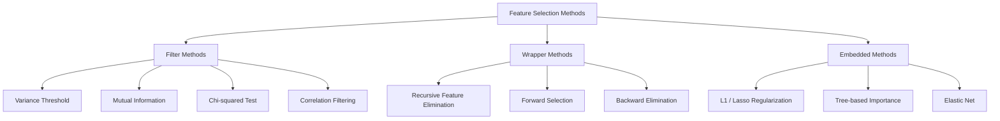
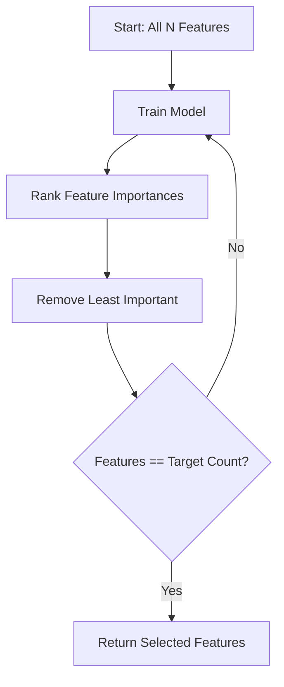
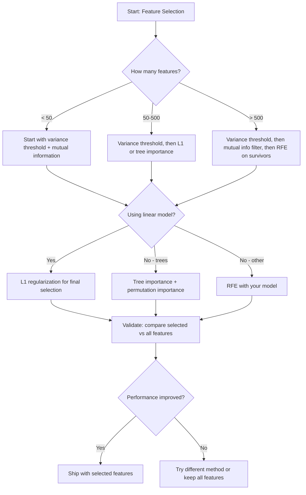

# Feature Selection

> Feature 多不代表比較好，選對 feature 才比較好。

**Type:** Build
**Language:** Python
**Prerequisites:** Phase 2, Lessons 01-09, 08 (feature engineering)
**Time:** ~75 分鐘

## 學習目標 (Learning Objectives)

- 從零實作 filter 方法（variance threshold、mutual information）、wrapper 方法（RFE）與 embedded 方法（L1、tree importance），並在練習中加入 forward selection
- 說明為什麼 mutual information 能捕捉到 correlation 會漏掉的非線性 feature-目標關係
- 比較 L1 regularization（embedded selection）與 RFE（wrapper selection），並評估它們在運算上的取捨
- 建立結合多種方法的 feature selection pipeline，並在 held-out 資料上示範 generalization 的改善

## 問題 (The Problem)

你有 500 個 feature。你的模型訓練很慢、一直 overfit，而且沒人能解釋它學到了什麼。你加入更多 feature，希望能改善效能，結果更糟了。

這就是 curse of dimensionality 的實際表現。隨著 feature 數量增加，feature 空間的體積爆炸性成長。資料點變得稀疏。點與點之間的距離趨於一致。模型需要指數級增加的資料才能找到真正的模式。雜訊 feature 淹沒了訊號 feature。Overfitting 成為預設狀態。

Feature selection 就是解藥。去掉雜訊。移除冗餘。保留真正帶有目標資訊的 feature。結果是：更快的訓練、更好的 generalization，以及你真正能解釋的模型。

目標不是使用所有可得的資訊，而是使用對的資訊。

## 核心概念 (The Concept)

### Feature Selection 的三大類別 (Three Categories of Feature Selection)

每種 feature selection 方法都屬於三大類別之一：



**Filter 方法**使用統計量獨立地為每個 feature 打分數。它們不使用模型。快速，但會漏掉 feature 之間的交互作用。

**Wrapper 方法**訓練模型來評估 feature 子集。它們用模型的表現當作分數。結果較好，但很昂貴，因為要多次重新訓練模型。

**Embedded 方法**把 feature 的挑選當作模型訓練的一部分。L1 regularization 把 weights 推到零。Decision tree 在最有用的 feature 上切分。挑選發生在 fit 的過程中，而不是獨立的步驟。

### Variance Threshold

最簡單的 filter。如果一個 feature 在各樣本之間幾乎不變動，它就幾乎不帶資訊。

考慮一個 feature，在 1000 個樣本中有 999 個是 0.0。它的變異數接近零。沒有任何模型能用它來區分類別。把它移除。

```math
\text{variance}(x) = \text{mean}\bigl((x - \text{mean}(x))^2\bigr)
```

設定一個 threshold（例如 0.01）。丟掉所有變異數低於它的 feature。這能在完全不看目標變數的情況下，移除常數或近乎常數的 feature。

何時使用：作為其他方法之前的前處理步驟。它以近乎零的成本抓出明顯無用的 feature。

限制：一個 feature 可能有很高的變異數，卻仍然是純雜訊。Variance threshold 是必要的，但不充分。

### Mutual Information

Mutual information 衡量知道 feature $X$ 的值，能減少多少關於目標 $Y$ 的不確定性。

```math
I(X; Y) = \sum_x \sum_y p(x, y) \cdot \log \frac{p(x, y)}{p(x) \cdot p(y)}
```

如果 $X$ 與 $Y$ 獨立，$p(x, y) = p(x) \cdot p(y)$，所以 log 項為零，$I(X; Y) = 0$。$X$ 告訴你關於 $Y$ 的資訊越多，mutual information 就越高。

相對於 correlation 的關鍵優點：mutual information 能捕捉非線性關係。一個 feature 可能與目標的 correlation 為零，但 mutual information 很高，因為關係是二次的或週期性的。

對於連續型 feature，先離散化成 bin（以 histogram 為基礎的估計）。Bin 的數量會影響估計 -- 太少會丟失資訊，太多會加入雜訊。常見的選擇：$\sqrt{n}$ 個 bin，或 Sturges 規則 ($1 + \log_2 n$)。


### Recursive Feature Elimination (RFE)

RFE 是 wrapper 方法。它利用模型自己的 feature importance 來反覆修剪：

1. 用所有 feature 訓練模型
2. 依 importance 為 feature 排序（線性模型用係數，樹用 impurity 減少量）
3. 移除最不重要的 feature
4. 重複，直到剩下所需數量的 feature



RFE 會考慮 feature 之間的交互作用，因為模型是一起看所有剩下的 feature。移除一個 feature 會改變其他 feature 的 importance。這讓它比 filter 方法更徹底。

代價：你要訓練模型 $N - \text{target}$ 次。有 500 個 feature、目標為 10 個的話，就是 490 次訓練。對昂貴的模型來說，這很慢。你可以每一步移除多個 feature 來加速（例如每一輪移除最低的 10%）。

### L1 (Lasso) Regularization

L1 regularization 把 weights 的絕對值加到 loss function 中：

```math
\text{loss} = \text{prediction\_error} + \alpha \cdot \sum \lvert w_i \rvert
```

Alpha 參數控制 feature 被修剪的積極程度。Alpha 越高，越多 weights 會變成剛好為零。

為什麼是剛好為零？L1 懲罰在 weight 空間中形成菱形的限制區域。最佳解傾向於落在這個菱形的角上，那裡有一個或多個 weights 為零。L2 regularization (ridge) 形成圓形的限制，weights 會縮小，但很少剛好碰到零。

這是 embedded feature selection：模型在訓練期間學會該忽略哪些 feature。Weight 為零的 feature 實際上就被移除了。

優點：只需一次訓練、能處理相關的 feature（挑一個，把其他的歸零）、內建於大多數線性模型的實作中。

限制：只適用於線性模型。無法捕捉非線性的 feature importance。

### 以樹為基礎的 Feature Importance (Tree-Based Feature Importance)

Decision tree 與它們的 ensemble（random forest、gradient boosting）自然地為 feature 排序。每次切分都會降低 impurity（classification 用 Gini 或 entropy，regression 用 variance）。產生較大 impurity 減少量的 feature 比較重要。

對於有 $T$ 棵樹的 random forest：

```math
\text{importance}(\text{feature}_j) = \frac{1}{T} \sum_{\text{all trees}} \; \sum_{\text{all nodes splitting on } \text{feature}_j} (\text{n\_samples} \cdot \text{impurity\_decrease})
```

這為每個 feature 給出一個正規化的 importance 分數。它自動處理非線性關係與 feature 之間的交互作用。

注意：以樹為基礎的 importance 會偏向有許多獨特值（高 cardinality）的 feature。一個隨機的 ID 欄位看起來會很重要，因為它能完美切開每個樣本。請用 permutation importance 做合理性檢查。

### Permutation Importance

一種與模型無關的方法：

1. 訓練模型，並在 validation 資料上記錄基準表現
2. 對每個 feature：隨機打亂它的值，量測表現的下降
3. 下降越多，該 feature 越重要

如果打亂某個 feature 不會損害表現，代表模型不依賴它。如果表現崩潰，那個 feature 就是關鍵。

Permutation importance 避免了以樹為基礎的 importance 的 cardinality 偏差。但它很慢：每個 feature 都要一次完整的評估，且為了穩定性還要重複多次。

### 比較表 (Comparison Table)

| 方法 | 類型 | 速度 | 非線性 | Feature 交互作用 |
|--------|------|-------|-----------|---------------------|
| Variance threshold | Filter | 非常快 | 否 | 否 |
| Mutual information | Filter | 快 | 是 | 否 |
| Correlation filter | Filter | 快 | 否 | 否 |
| RFE | Wrapper | 慢 | 取決於模型 | 是 |
| L1 / Lasso | Embedded | 快 | 否（線性） | 否 |
| Tree importance | Embedded | 中等 | 是 | 是 |
| Permutation importance | 與模型無關 | 慢 | 是 | 是 |

### 決策流程圖 (Decision Flowchart)



```figure
f3-feature-prune
```

## 動手做 (Build It)

### 步驟 1：產生具有已知 feature 結構的合成資料

```python
import numpy as np


def make_feature_selection_data(n_samples=500, seed=42):
    rng = np.random.RandomState(seed)

    x1 = rng.randn(n_samples)
    x2 = rng.randn(n_samples)
    x3 = rng.randn(n_samples)
    x4 = x1 + 0.1 * rng.randn(n_samples)
    x5 = x2 + 0.1 * rng.randn(n_samples)

    informative = np.column_stack([x1, x2, x3, x4, x5])

    correlated = np.column_stack([
        x1 * 0.9 + 0.1 * rng.randn(n_samples),
        x2 * 0.8 + 0.2 * rng.randn(n_samples),
        x3 * 0.7 + 0.3 * rng.randn(n_samples),
        x1 * 0.5 + x2 * 0.5 + 0.1 * rng.randn(n_samples),
        x2 * 0.6 + x3 * 0.4 + 0.1 * rng.randn(n_samples),
    ])

    noise = rng.randn(n_samples, 10) * 0.5

    X = np.hstack([informative, correlated, noise])
    y = (2 * x1 - 1.5 * x2 + x3 + 0.5 * rng.randn(n_samples) > 0).astype(int)

    feature_names = (
        [f"info_{i}" for i in range(5)]
        + [f"corr_{i}" for i in range(5)]
        + [f"noise_{i}" for i in range(10)]
    )

    return X, y, feature_names
```

我們知道真實情況：feature 0-4 是有資訊的（另外 3 和 4 是 0 和 1 的相關複本），feature 5-9 與有資訊的 feature 相關，feature 10-19 是純雜訊。好的挑選方法應該把 0-4 排最高、10-19 排最低。

### 步驟 2：Variance threshold

```python
def variance_threshold(X, threshold=0.01):
    variances = np.var(X, axis=0)
    mask = variances > threshold
    return mask, variances
```

### 步驟 3：Mutual information（離散）

```python
def discretize(x, n_bins=10):
    min_val, max_val = x.min(), x.max()
    if max_val == min_val:
        return np.zeros_like(x, dtype=int)
    bin_edges = np.linspace(min_val, max_val, n_bins + 1)
    binned = np.digitize(x, bin_edges[1:-1])
    return binned


def mutual_information(X, y, n_bins=10):
    n_samples, n_features = X.shape
    mi_scores = np.zeros(n_features)

    y_vals, y_counts = np.unique(y, return_counts=True)
    p_y = y_counts / n_samples

    for f in range(n_features):
        x_binned = discretize(X[:, f], n_bins)
        x_vals, x_counts = np.unique(x_binned, return_counts=True)
        p_x = dict(zip(x_vals, x_counts / n_samples))

        mi = 0.0
        for xv in x_vals:
            for yi, yv in enumerate(y_vals):
                joint_mask = (x_binned == xv) & (y == yv)
                p_xy = np.sum(joint_mask) / n_samples
                if p_xy > 0:
                    mi += p_xy * np.log(p_xy / (p_x[xv] * p_y[yi]))
        mi_scores[f] = mi

    return mi_scores
```

### 步驟 4：Recursive Feature Elimination

```python
def simple_logistic_importance(X, y, lr=0.1, epochs=100):
    n_samples, n_features = X.shape
    w = np.zeros(n_features)
    b = 0.0

    for _ in range(epochs):
        z = X @ w + b
        pred = 1.0 / (1.0 + np.exp(-np.clip(z, -500, 500)))
        error = pred - y
        w -= lr * (X.T @ error) / n_samples
        b -= lr * np.mean(error)

    return w, b


def rfe(X, y, n_features_to_select=5, lr=0.1, epochs=100):
    n_total = X.shape[1]
    remaining = list(range(n_total))
    rankings = np.ones(n_total, dtype=int)
    rank = n_total

    while len(remaining) > n_features_to_select:
        X_subset = X[:, remaining]
        w, _ = simple_logistic_importance(X_subset, y, lr, epochs)
        importances = np.abs(w)

        least_idx = np.argmin(importances)
        original_idx = remaining[least_idx]
        rankings[original_idx] = rank
        rank -= 1
        remaining.pop(least_idx)

    for idx in remaining:
        rankings[idx] = 1

    selected_mask = rankings == 1
    return selected_mask, rankings
```

### 步驟 5：L1 feature selection

```python
def soft_threshold(w, alpha):
    return np.sign(w) * np.maximum(np.abs(w) - alpha, 0)


def l1_feature_selection(X, y, alpha=0.1, lr=0.01, epochs=500):
    n_samples, n_features = X.shape
    w = np.zeros(n_features)
    b = 0.0

    for _ in range(epochs):
        z = X @ w + b
        pred = 1.0 / (1.0 + np.exp(-np.clip(z, -500, 500)))
        error = pred - y

        gradient_w = (X.T @ error) / n_samples
        gradient_b = np.mean(error)

        w -= lr * gradient_w
        w = soft_threshold(w, lr * alpha)
        b -= lr * gradient_b

    selected_mask = np.abs(w) > 1e-6
    return selected_mask, w
```

### 步驟 6：以樹為基礎的 importance（簡單 decision tree）

```python
def gini_impurity(y):
    if len(y) == 0:
        return 0.0
    classes, counts = np.unique(y, return_counts=True)
    probs = counts / len(y)
    return 1.0 - np.sum(probs ** 2)


def best_split(X, y, feature_idx):
    values = np.unique(X[:, feature_idx])
    if len(values) <= 1:
        return None, -1.0

    best_threshold = None
    best_gain = -1.0
    parent_gini = gini_impurity(y)
    n = len(y)

    for i in range(len(values) - 1):
        threshold = (values[i] + values[i + 1]) / 2.0
        left_mask = X[:, feature_idx] <= threshold
        right_mask = ~left_mask

        n_left = np.sum(left_mask)
        n_right = np.sum(right_mask)

        if n_left == 0 or n_right == 0:
            continue

        gain = parent_gini - (n_left / n) * gini_impurity(y[left_mask]) - (n_right / n) * gini_impurity(y[right_mask])

        if gain > best_gain:
            best_gain = gain
            best_threshold = threshold

    return best_threshold, best_gain


def tree_importance(X, y, n_trees=50, max_depth=5, seed=42):
    rng = np.random.RandomState(seed)
    n_samples, n_features = X.shape
    importances = np.zeros(n_features)

    for _ in range(n_trees):
        sample_idx = rng.choice(n_samples, size=n_samples, replace=True)
        feature_subset = rng.choice(n_features, size=max(1, int(np.sqrt(n_features))), replace=False)

        X_boot = X[sample_idx]
        y_boot = y[sample_idx]

        tree_imp = _build_tree_importance(X_boot, y_boot, feature_subset, max_depth)
        importances += tree_imp

    total = importances.sum()
    if total > 0:
        importances /= total

    return importances


def _build_tree_importance(X, y, feature_subset, max_depth, depth=0):
    n_features = X.shape[1]
    importances = np.zeros(n_features)

    if depth >= max_depth or len(np.unique(y)) <= 1 or len(y) < 4:
        return importances

    best_feature = None
    best_threshold = None
    best_gain = -1.0

    for f in feature_subset:
        threshold, gain = best_split(X, y, f)
        if gain > best_gain:
            best_gain = gain
            best_feature = f
            best_threshold = threshold

    if best_feature is None or best_gain <= 0:
        return importances

    importances[best_feature] += best_gain * len(y)

    left_mask = X[:, best_feature] <= best_threshold
    right_mask = ~left_mask

    importances += _build_tree_importance(X[left_mask], y[left_mask], feature_subset, max_depth, depth + 1)
    importances += _build_tree_importance(X[right_mask], y[right_mask], feature_subset, max_depth, depth + 1)

    return importances
```

### 步驟 7：執行所有方法並比較

程式碼檔案會在同一份合成資料集上執行全部五種方法，並印出比較表，顯示每種方法挑選了哪些 feature。

## 實際使用 (Use It)

用 scikit-learn，feature selection 已內建在 pipeline 中：

```python
from sklearn.feature_selection import (
    VarianceThreshold,
    mutual_info_classif,
    RFE,
    SelectFromModel,
)
from sklearn.linear_model import Lasso, LogisticRegression
from sklearn.ensemble import RandomForestClassifier

vt = VarianceThreshold(threshold=0.01)
X_filtered = vt.fit_transform(X)

mi_scores = mutual_info_classif(X, y)
top_k = np.argsort(mi_scores)[-10:]

rfe_selector = RFE(LogisticRegression(), n_features_to_select=10)
rfe_selector.fit(X, y)
X_rfe = rfe_selector.transform(X)

lasso_selector = SelectFromModel(Lasso(alpha=0.01))
lasso_selector.fit(X, y)
X_lasso = lasso_selector.transform(X)

rf = RandomForestClassifier(n_estimators=100)
rf.fit(X, y)
importances = rf.feature_importances_
```

從零實作的版本讓你看到每種方法內部發生了什麼事。Variance threshold 就是計算 `var(X, axis=0)` 並套用遮罩。Mutual information 就是在列聯表 (contingency table) 中計算聯合與邊際頻率。RFE 是一個訓練、排序、修剪的迴圈。L1 是帶有 soft-thresholding 步驟的 gradient descent。Tree importance 是跨切分累積 impurity 的減少量。沒有魔法 -- 只有統計與迴圈。

sklearn 的版本增加了穩健性（例如 mutual_info_classif 使用 k-NN 密度估計，而不是分 bin）、速度（C 實作）與 pipeline 整合。

## 交付 (Ship It)

這堂課會產出：
- `outputs/skill-feature-selector.md` -- 用於挑選合適 feature selection 方法的快速參考決策樹

## 練習 (Exercises)

1. **Forward selection**：實作 RFE 的相反做法。從零個 feature 開始。每一步加入最能改善模型表現的 feature。當加入 feature 不再有幫助時停止。將挑選出的 feature 與 RFE 的結果比較。哪個比較快？哪個結果比較好？

2. **Stability selection**：執行 L1 feature selection 50 次，每次在資料的隨機 80% 子樣本上，並使用略微不同的 alpha 值。計算每個 feature 被挑中的次數。在超過 80% 的執行中被挑中的 feature 是「穩定」的。將穩定的 feature 與單次 L1 selection 比較。哪個比較可靠？

3. **Multicollinearity 偵測**：計算所有 feature 的 correlation matrix。實作一個函式，給定 correlation threshold（例如 0.9），從每一對高度相關的 feature 中移除一個（保留與目標有較高 mutual information 的那個）。在合成資料集上測試，並驗證它移除了冗餘的相關 feature。

4. **Feature selection pipeline**：把 variance threshold、mutual information filter 和 RFE 串成單一 pipeline。先移除近乎零變異數的 feature，再依 mutual information 保留前 50%，然後對剩下的 feature 執行 RFE。將這個 pipeline 與直接對所有 feature 執行 RFE 比較。Pipeline 比較快嗎？同樣準確嗎？

5. **從零實作 permutation importance**：實作 permutation importance。對每個 feature，打亂它的值 10 次，量測 F1 score 的平均下降。將排序與以樹為基礎的 importance 比較。找出兩者不一致的情況並解釋原因（提示：相關的 feature）。

## 關鍵術語 (Key Terms)

| 術語 | 大家怎麼說 | 實際意義 |
|------|----------------|----------------------|
| Filter method | 「獨立地為 feature 打分數」 | 一種 feature selection 做法，使用統計量為 feature 排序而不訓練模型，孤立地評估每個 feature |
| Wrapper method | 「用模型來挑 feature」 | 一種 feature selection 做法，透過訓練模型並以其表現作為挑選準則，來評估 feature 子集 |
| Embedded method | 「模型在訓練中挑 feature」 | 作為模型 fit 一部分而發生的 feature selection，例如 L1 regularization 把 weights 推到零 |
| Mutual information | 「一個變數告訴你多少另一個變數的資訊」 | 衡量已知 $X$ 之後，$Y$ 的不確定性減少多少，能同時捕捉線性與非線性的相依關係 |
| Recursive Feature Elimination | 「訓練、排序、修剪、重複」 | 一種迭代式 wrapper 方法，訓練模型、移除最不重要的 feature，並重複直到達到目標數量 |
| L1 / Lasso regularization | 「殺死 feature 的懲罰」 | 把 weight 絕對值的總和加到 loss function 中，使不重要 feature 的 weights 被推到剛好為零 |
| Variance threshold | 「移除常數 feature」 | 丟掉在各樣本之間變異數低於指定 threshold 的 feature，過濾掉不帶資訊的 feature |
| Feature importance | 「哪些 feature 最重要」 | 表示每個 feature 對模型預測貢獻多少的分數，由切分增益（樹）或係數大小（線性）計算而來 |
| Permutation importance | 「打亂並衡量傷害」 | 透過隨機打亂每個 feature 的值，並量測模型表現的下降，來評估 feature importance |
| Curse of dimensionality | 「feature 太多，資料不夠」 | 增加 feature 會使 feature 空間的體積以指數成長，讓資料變稀疏、距離失去意義的現象 |

## 延伸閱讀 (Further Reading)

- [An Introduction to Variable and Feature Selection (Guyon & Elisseeff, 2003)](https://jmlr.org/papers/v3/guyon03a.html) -- feature selection 方法的奠基性綜述，至今仍被廣泛引用
- [scikit-learn Feature Selection Guide](https://scikit-learn.org/stable/modules/feature_selection.html) -- filter、wrapper 與 embedded 方法的實用參考，附程式碼範例
- [Stability Selection (Meinshausen & Buhlmann, 2010)](https://arxiv.org/abs/0809.2932) -- 結合子抽樣與 feature selection，得到穩健、可重現的結果
- [Beware Default Random Forest Importances (Strobl et al., 2007)](https://bmcbioinformatics.biomedcentral.com/articles/10.1186/1471-2105-8-25) -- 示範以樹為基礎的 importance 的 cardinality 偏差，並提出 conditional importance 作為替代方案
