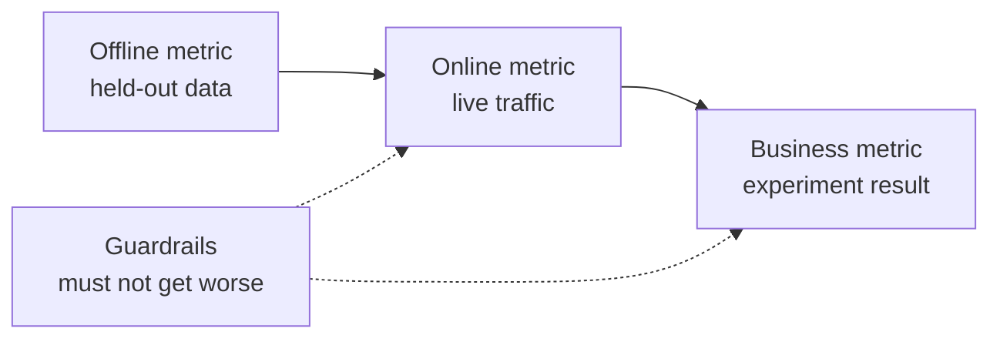

# ML 系統設計 — 從問題到部署的模型 (ML System Design — From Problem to Deployed Model)

> 模型只是系統的一部分。設計決定了模型要預測什麼、誰根據它採取行動、要花多少成本，以及失敗時會發生什麼事。

**Type:** Build
**Languages:** Python
**Prerequisites:** Phase 2, Lessons 09 (Model Evaluation) and 13 (ML Pipelines)
**Time:** ~110 分鐘

## 學習目標 (Learning Objectives)

- 把商業問題界定成 ML 任務，包含一個預測、使用該預測的決策，以及規則不夠用的理由
- 區分 offline、online、business 與 guardrail 指標，並把每個模型與 trivial 和 heuristic baseline 比較
- 根據流量數字，估算 batch 與 online inference 的每日成本、延遲與資料新鮮度 (staleness)
- 選擇 rollout 模式（shadow、canary、A/B test），並為每種失敗模式選擇安全的預設行為
- 辨認模型會改變訓練其下一個版本的資料的 feedback loop
- 撰寫 ML 設計文件，並依固定的檢查表為它評分

## 問題 (The Problem)

一家訂閱制公司要求做「一個 churn 模型」。資料科學家訓練了 gradient-boosted classifier，回報 AUC 為 0.91。三個月後，沒有人在用它。

原因與演算法毫無關係。沒有人決定分數會觸發哪個行動。分數每週才送達一次，但留客團隊每天都在打電話給客戶。標籤來自一張取消紀錄表，而這張表也儲存了取消原因，所以有一個 feature 包含了答案。沒有人把模型與客服團隊已經在用的規則做比較：打給任何閒置兩週的人。

這些失敗每一個都發生在訓練開始之前。它們是設計上的失敗，而一頁的設計文件就會針對每一項提問。這堂課教你那份文件中的決策。你會建立一套工具，為 batch 與 online serving 估算成本、把模型與其 baseline 比較，並依檢查表為設計文件評分。

## 核心概念 (The Concept)

### 從商業目標到 ML 任務 (From a business goal to an ML task)

商業目標不是 ML 任務。你用四個問題把它變成 ML 任務：

1. 模型到底預測什麼？針對哪個實體（使用者、付款、門市、商品）？
2. 哪個決策會用到這個預測？由誰或什麼來做這個決策？
3. 什麼時候需要這個預測？那一刻有哪些資料存在？
4. 你要怎麼知道決策變好了？

| 商業目標 | 預測 | 使用它的決策 | ML 任務 |
|---|---|---|---|
| 降低 churn | 使用者在未來 30 天內取消的機率 | 每晚對前 5% 的人發送挽留優惠 | Binary classification |
| 減少詐欺損失 | 一筆付款是詐欺的機率 | 在 100 ms 內核准、審查或封鎖 | Binary classification |
| 保持貨架有貨 | 下週每間門市每天的銷售量 | 每間門市的訂購數量 | Forecasting |
| 顯示相關商品 | (使用者, 商品) 配對的相關性分數 | 動態牆中商品的排序 | Ranking |

第二欄最需要小心。「預測 churn」把時間範圍、實體與行動都留白。「預測這位使用者在未來 30 天內是否取消，讓今晚的作業可以挑出誰收到優惠」則同時固定了這三者。

### 何時不該用 ML (When not to use ML)

Google 的 Rules of Machine Learning 的第 1 條規則說，不要害怕在沒有機器學習的情況下推出產品。機器學習需要資料，而簡單的啟發式規則通常就能讓你走完一部分路。以下情況不要用 ML：

- 一條簡短的規則就能達成目標並維持正確。規則在執行、測試與解釋上都更便宜。
- 你沒有標籤，也沒有實際可行的方法來收集。
- 沒有人根據預測採取行動，所以更好的預測什麼都不會改變。
- 預測時存在的資料不包含訊號。
- 一次錯誤都不能接受，而且沒有人能檢查輸出。
- 建置與營運系統的成本，高於更好決策所帶來的價值。

當規則變得冗長又脆弱時，ML 才開始划算。同一份指南的第 3 條規則偏好用 ML 而不是複雜的啟發式規則，因為學習出來的模型更容易更新與維護。

### 三層指標 (Three layers of metrics)

你在三個層次，加上一組限制，來衡量 ML 系統：

| 層次 | 何時可以衡量 | Churn 範例 |
|---|---|---|
| Offline metric | 上線前，在 held-out 的過去資料上 | 優惠 threshold 下的 F1、前 5% 的 precision |
| Online metric | 上線期間，在即時流量上 | 優惠接受率、被打分數的使用者比例、分數分布 |
| Business metric | 上線後數週，透過實驗 | 實驗組對比 holdout 組的 30 天 churn 率 |
| Guardrail metric | 隨時 | 每位挽留成功使用者的優惠成本、取消訂閱率、p99 延遲 |



這些層次經常彼此不一致。Offline metric 是對過去的資料評分，而過去並不包含你的模型。Online metric 取決於人們對決策的反應。Business metric 變動緩慢，並帶有公司內其他一切因素的雜訊。

挑選與決策相符的 offline metric。如果作業要聯絡前 5% 的使用者，就衡量前 5% 的 precision。AUC 是對每個 threshold 取平均，包括你從不會用到的 threshold。同一份指南的第 2 條規則說，在決定 ML 系統要做什麼之前，先設計並實作指標。

### Baseline

單獨一個指標值沒有意義。如果最好的替代方案只有 0.30，F1 為 0.56 就是好的；如果有規則能達到 0.60，它就很差。把每個模型與三種 baseline 比較：

- **Trivial baseline。**永遠預測多數類別，或永遠預測訓練平均值。我們在模型評估那堂課用過這個檢查。
- **Heuristic baseline。**來自領域知識的規則，或是你在 training data 上擬合的單一 feature threshold。
- **現行系統。**今天負責做這個決策的任何東西，即使那是一個拿著試算表的人。

Lift 是模型分數減去最強 baseline 的分數。在看結果之前就設定最小的 lift，並且大到足以支付額外系統的成本。Trivial baseline 通常很弱。Heuristic baseline 才是難以打敗的那個。

### 資料與標籤需求 (Data and label requirements)

在訓練之前回答這些問題：

- **標籤來源。**哪張表或哪個事件定義了標籤？誰擁有它？
- **標籤延遲。**預測之後多久才會取得真實結果？詐欺的 chargeback 可能在付款後數週才到。Churn 標籤要等到 30 天的時間範圍結束才會到。
- **標籤品質。**誰指派標籤？錯誤的頻率有多高？
- **預測時的可得性。**每個 feature 在預測的那一刻都存在嗎？系統在結果之後才寫入的 feature，會把標籤洩漏到訓練中。
- **每個類別的數量。**有多少正例？兩百個正例會讓你只能用簡單的模型。
- **時間切分。**保留最近的一段期間作為 hold-out。我們在時間序列那堂課也是為了同樣的理由依時間切分資料。

### 延遲、吞吐量與成本預算 (Latency, throughput, and cost budgets)

三個數字界定了每個 serving 設計：

- **延遲預算。**p99 延遲是 100 個請求中有 99 個低於的時間。付款檢查可能需要 50 ms。夜間報表可以花上幾小時。
- **尖峰吞吐量。**依最忙的那一分鐘來規劃系統，而不是依每日平均。尖峰 QPS 通常是平均的好幾倍。
- **成本預算。**用每天多少美元或每 1000 次預測多少美元來表示，這樣你就能比較不同的設計。

Little's law 把前兩者連結起來。處理中的請求數等於吞吐量乘以延遲。以每秒 400 個請求、每個 50 ms 計算，任何時刻都有 20 個請求在處理中。

### Batch inference 與 Online inference (Batch inference versus online inference)

提供預測有兩種基本方式：

- **Batch inference。**排程作業為每個實體打分數，並把分數寫入資料表或 key-value store。應用程式在請求時讀取已儲存的分數。
- **Online inference。**應用程式在請求時把 feature 送到模型服務並等待分數。

| 屬性 | Batch | Online |
|---|---|---|
| 新鮮度 | 與上次執行一樣舊，再加上執行時間 | 使用請求當下的資料 |
| 請求延遲 | 一次 key-value 讀取，幾 ms | 取得 feature 加上模型時間 |
| 成本驅動因素 | 實體數量乘以每天執行次數 | 為尖峰 QPS 規劃的 replica 數 |
| 新實體 | 下次執行前沒有分數 | 在第一次請求時就被打分數 |
| 何時壞掉 | 舊分數仍然可讀 | 請求失敗或逾時 |

這堂課的工具組會為兩者估價。Batch 成本隨實體數量與每天的執行次數而成長。更短的 staleness 限制代表更多次執行。Online 成本隨尖峰流量而成長，因為你要為尖峰之間閒置的 replica 付費。需要一個小時的 batch 作業，無論花多少錢，都無法滿足低於一小時的 staleness 限制。

混合式設計很常見。夜間 batch 作業為已知使用者打分數，而 online 路徑為新使用者與需要新鮮資料的請求打分數。

### 部署模式 (Deployment patterns)

新模型分階段到達使用者：

1. **Shadow。**新模型接收即時流量的副本。系統記錄它的預測，但從不使用。你比較延遲、錯誤率與預測分布與現行模型的差異。
2. **Canary。**新模型針對一小部分流量（通常 1 到 5%）做出真實決策。你逐步擴大比例，並在 guardrail 被破壞時 rollback。
3. **A/B test。**隨機分割使用者，各自看到不同的模型。你用統計檢定衡量 business metric，並且需要足夠的流量與足夠的時間才能看出差異。

每個階段都需要能在幾分鐘內完成的 rollback。保留舊的模型版本在部署中，並透過設定切換流量。LLM serving 階段在 [shadow and canary lesson](../../../17-infrastructure-and-production/20-shadow-canary-progressive/docs/en.md) 與 [A/B testing lesson](../../../17-infrastructure-and-production/21-ab-testing-llm-features/docs/en.md) 中，針對語言模型涵蓋了相同的三種模式。

### Feedback loop

當模型的決策改變了訓練其下一個版本的資料時，就存在 feedback loop。Sculley 等人將直接與隱藏的 feedback loop 列為 ML 系統技術債的主要來源之一。三個常見的情況：

- **介入隱藏了標籤。**Churn 模型發送優惠，而優惠留住了一些使用者。下個月，高風險使用者看起來很忠誠，重新訓練的模型就學到他們的 feature 無法預測 churn。
- **被阻擋的行動沒有結果。**詐欺模型封鎖了一筆付款，所以那筆付款永遠不會有 chargeback 標籤。重新訓練的模型從被封鎖的區域看到更少的詐欺範例。
- **曝光限制了回饋。**排序模型展示它的前幾名商品，所以只有那些商品會累積點擊。

這些修正方法共享一個想法：保留一些模型沒有影響過的資料。留出一小群永遠不會被介入的隨機群組。對一小部分流量給予隨機的決策。隨每個範例記錄分數與決策，讓之後的訓練能分辨受影響的資料與乾淨的資料。

### 失敗模式與安全預設 (Failure modes and safe defaults)

系統的每個部分遲早都會失敗。在設計時決定每種失敗的預設行為，而不是在事故發生時才決定：

| 失敗 | 沒有計畫時的結果 | 安全預設 |
|---|---|---|
| 模型服務逾時 | 請求失敗 | 使用 heuristic baseline |
| 夜間 batch 作業失敗 | 分數遺失或變舊 | 在固定時間內提供上一次良好的分數，之後改用規則 |
| Feature 缺失或超出範圍 | 模型對壞輸入打分數 | 使用文件記載的預設值並記錄該事件 |
| 沒有歷史紀錄的新實體 | 不存在分數 | 使用規則或母體平均值 |
| 分數分布突然移動 | 大規模的錯誤決策 | 暫停自動行動並通知人員 |

你在指標那一節的 heuristic baseline，也是大多數失敗的預設值，所以先把它建起來。

### 設計文件 (The design document)

設計文件在訓練開始前，將上述所有決策記錄在同一個地方。這堂課的檢查器會為它的 JSON 版本評分。有六個項目會阻擋審查，因為每一項都會讓系統不安全或無用：

| 章節 | 它回答的問題 | 是否阻擋 |
|---|---|---|
| Problem | 預測什麼、哪個決策使用它，以及為什麼規則不夠用？ | 決策 |
| Metrics | 適用哪些 offline、online、business 與 guardrail 指標？ | Business metric |
| Baselines | 適用哪些 trivial、heuristic 與現行系統的 baseline？ | Heuristic 或現行的 baseline |
| Data | 標籤來自哪裡、延遲多久，每個 feature 在預測時是否存在？ | 沒有 leakage |
| Budgets and serving | 適用哪些延遲、尖峰 QPS、成本與 staleness 限制，哪種 serving 模式符合它們？ | 否 |
| Rollout | 適用哪些 shadow、canary 與 A/B 階段，以及如何 rollback？ | Shadow 或 canary，加上 rollback |
| Feedback loops | 模型如何改變它自己未來的資料，以及什麼能保留乾淨的資料？ | 否 |
| Failure modes | 每種失敗的預設行動是什麼？ | 每種失敗都有預設值 |
| Monitoring | 上線後你要監看什麼？ | 否 |

```figure
mlprod-serving-cost
```

## 動手做 (Build It)

`code/main.py` 中的程式碼只使用標準函式庫。它有三個工具：serving 成本模型、baseline 比較器，以及設計文件檢查器。

### 步驟 1：描述 workload 與價格

Workload 包含流量數字與預算。成本模型包含價格。這些價格是為了練習而取的整數，不是廠商報價。

```python
@dataclass(frozen=True)
class Workload:
    name: str
    entities: int
    requests_per_day: int
    peak_qps: float
    max_staleness_hours: float
    latency_budget_ms: float


@dataclass(frozen=True)
class CostModel:
    batch_dollars_per_million: float = 0.40
    batch_job_hours: float = 1.0
    lookup_dollars_per_million: float = 0.25
    lookup_latency_ms: float = 4.0
    replica_dollars_per_hour: float = 0.50
    replica_qps: float = 200.0
    min_replicas: int = 2
    online_latency_ms: float = 35.0
```

### 步驟 2：為 batch 與 online serving 估價

Batch 作業必須在 staleness 限制內完成。兩次執行之間的時間是限制減去作業時間。每次執行都會為每個實體打分數，不管有沒有人需要那個分數。

```python
def batch_plan(workload: Workload, costs: CostModel) -> ServingPlan:
    refresh_hours = workload.max_staleness_hours - costs.batch_job_hours
    if refresh_hours <= 0:
        return ServingPlan(
            "batch", False, math.inf, costs.lookup_latency_ms, math.inf, 0.0,
            "staleness limit is shorter than one batch job",
        )
    runs_per_day = 24.0 / refresh_hours
    predictions = workload.entities * runs_per_day
    dollars = (
        predictions / 1e6 * costs.batch_dollars_per_million
        + workload.requests_per_day / 1e6 * costs.lookup_dollars_per_million
    )
    ...
```

Online serving 要為足以處理尖峰的 replica 付費，為了可用性至少要兩個：

```python
def online_plan(workload: Workload, costs: CostModel) -> ServingPlan:
    replicas = max(costs.min_replicas, math.ceil(workload.peak_qps / costs.replica_qps))
    dollars = replicas * costs.replica_dollars_per_hour * 24.0
    feasible = costs.online_latency_ms <= workload.latency_budget_ms
    ...
```

`choose_serving` 保留滿足延遲與 staleness 限制的方案，並回傳最便宜的那個。當沒有方案符合時，它回傳 `None`，這告訴你需要修改預算。

### 步驟 3：把模型與其 baseline 比較

比較器用相同的指標為模型和每個 baseline 評分。它衡量的是相對於最強 baseline 的 lift，而不是最弱的。

```python
def compare_to_baselines(
    y_true: list,
    model_pred: list,
    baselines: dict[str, list],
    metric,
    metric_name: str,
    higher_is_better: bool = True,
    min_lift: float = 0.02,
) -> BaselineReport:
    if not baselines:
        raise ValueError("a model needs at least one baseline")
    scores = {name: metric(y_true, pred) for name, pred in baselines.items()}
    pick = max if higher_is_better else min
    best_name = pick(scores, key=scores.get)
    model_score = metric(y_true, model_pred)
    lift = model_score - scores[best_name] if higher_is_better else scores[best_name] - model_score
    return BaselineReport(metric_name, {"model": model_score, **scores}, best_name, lift, min_lift)
```

Heuristic baseline 是單一 feature 的規則。`fit_rule` 在 training data 上嘗試 feature 的每個值作為 threshold，並保留 F1 最佳的 threshold。這個 demo 在合成的 churn 資料上訓練一個小型 logistic regression，並與三個 baseline 比較。

### 步驟 4：為設計文件評分

每個檢查表項目都有一個 key、一個權重、一個阻擋旗標、一則訊息，以及一個檢查函式。阻擋項目的權重為 2。

```python
CheckItem("decision", 2, True, "name the action that uses each prediction", lambda d: _text(d, "problem.decision")),
CheckItem("baselines", 2, True, "add a heuristic or current-system baseline", check_baselines),
CheckItem("no_leakage", 2, True, "confirm every feature exists at prediction time",
          lambda d: get_path(d, "data.features_available_at_prediction_time") is True),
CheckItem("serving_fit", 1, False, "pick a serving mode that meets the staleness, latency, and cost budgets",
          check_serving_fit),
```

`check_serving_fit` 重複使用成本模型。它從文件中讀取 workload 數字，並為所選的模式估價。當該模式未達到 staleness 限制、延遲預算或每日成本預算時，這項檢查就會失敗。寫著「batch」卻有三分鐘 staleness 限制的文件會通不過這項檢查。成本模型沒有 hybrid 方案，所以寫著「hybrid」的文件會一直通不過這項檢查，直到你在練習 1 中加入那個方案。

`review_design_doc` 把通過項目的權重相加，再除以總和。只有當分數達到 0.85 且沒有阻擋項目失敗時，結論才是「ready for review」。

### 步驟 5：執行它

```bash
python3 code/main.py
```

```console
nightly churn scores
  ok batch        $0.91/day      4 ms  1.0 runs per day over 2,000,000 entities
  ok online      $24.00/day     35 ms  2 replicas sized for 40 peak QPS
  choose: batch

feed ranking, 2-hour freshness
  ok batch       $48.50/day      4 ms  24.0 runs per day over 5,000,000 entities
  ok online      $24.00/day     35 ms  2 replicas sized for 120 peak QPS
  choose: online

=== Model versus baselines (churn, metric F1) ===
  model                    0.564
  days_idle > 12.8688      0.500
  random at base rate      0.232
  majority class           0.000
  model beats the strongest baseline (days_idle > 12.8688) by +0.064
```

Majority baseline 的 F1 為 0，因為它從不預測 churn。擬合出來的規則才是真正的對手。模型以 0.064 擊敗它，所以模型有存在的價值。如果 feature 比較弱，規則可能會勝出，那時規則才是該部署的正確系統。

設計文件的審查會印出有六個阻擋項目的不完整文件，以及分數為 1.00 的完整文件。傳入路徑即可審查你自己的文件：

```bash
python3 code/main.py my_design_doc.json
```

## 實際使用 (Use It)

工具組的每個部分都對應到團隊在正式環境中使用的工具。

**Baseline。**scikit-learn 以 estimator 的形式提供 trivial baseline，所以它們能與模型放進同一個 pipeline：

```python
from sklearn.dummy import DummyClassifier, DummyRegressor
from sklearn.metrics import f1_score

majority = DummyClassifier(strategy="most_frequent").fit(X_train, y_train)
base_rate = DummyClassifier(strategy="stratified", random_state=0).fit(X_train, y_train)
mean_value = DummyRegressor(strategy="mean").fit(X_train, y_reg_train)

print(f1_score(y_test, majority.predict(X_test)))
```

`most_frequent` 對應 `majority_baseline`，`stratified` 對應 `base_rate_baseline`。scikit-learn 沒有 heuristic baseline，因為 heuristic 來自你的領域。

**Batch serving。**像 Apache Airflow 或 Dagster 這類工作流程排程器負責執行打分數作業。作業把分數寫入資料倉儲的表，或像 Redis 或 DynamoDB 這類 key-value store。

**Online serving。**像 KServe、BentoML、NVIDIA Triton 與 TorchServe 這類模型伺服器，把模型包在 HTTP 或 gRPC endpoint 後面。對小型模型，載入了模型的一般 web 服務也可以。

**Rollout。**像 Argo Rollouts 這類 Kubernetes 工具為 canary 發佈分配流量。像 GrowthBook 和 Statsig 這類實驗平台指派使用者到 A/B 群組並計算統計量。

**設計審查。**Breck 等人發表了 ML Test Score，這是針對正式環境 ML 系統的 28 項測試與監控需求的評分準則。我們的檢查器比較小。它問的是出現在那些測試之前的設計問題。

## 交付 (Ship It)

這堂課會產出 `outputs/skill-ml-design-review.md`。這個 skill 逐章節審查 ML 設計文件，並先指出阻擋性的缺口。它也使用這堂課的 batch 與 online 成本算術，檢查 serving 的選擇。

## 練習 (Exercises)

1. 在 `choose_serving` 中加入 hybrid 方案。以 batch 為已知使用者打分數，以 online 為新使用者打分數。比較它的每日成本。
2. 修改 churn 資料，直到模型不再勝過規則。回報消除 lift 的最小係數變化。
3. 在檢查表中加入 `budgets.max_dollars_per_1k_predictions` 項目。寫一個沒有它就會失敗的測試。
4. 為付款詐欺檢查撰寫一份 JSON 設計文件。執行檢查器並修正每個阻擋項目。
5. 模擬 churn 的 feedback loop。移除收到優惠的使用者的標籤，重新訓練，並量測 F1 的變化。

## 關鍵術語 (Key Terms)

| 術語 | 大家怎麼說 | 實際意義 |
|------|----------------|----------------------|
| ML task | 「做一個 churn 模型」 | 一個預測目標、一個實體、一個時間範圍，以及使用該預測的決策 |
| Offline metric | 「模型分數」 | 上線前在 held-out 的過去資料上計算的指標 |
| Online metric | 「即時數字」 | 模型執行期間在真實流量上衡量的指標 |
| Business metric | 「目標」 | 決策必須改變的公司成果，透過實驗衡量 |
| Guardrail metric | 「不要造成傷害」 | 新模型上線時不得惡化的指標 |
| Baseline | 「笨模型」 | 模型必須以既定幅度擊敗的 trivial、heuristic 或現行系統預測器 |
| Batch inference | 「預先計算的分數」 | 排程作業為每個實體打分數，並儲存結果供查詢 |
| Online inference | 「即時模型」 | 模型在每個請求到達時為它打分數 |
| Shadow deployment | 「暗中上線」 | 新模型為即時流量打分數，但沒有人使用它的輸出 |
| Canary release | 「慢慢推出」 | 新模型為一小部分且逐漸擴大的流量做決策，並備有 rollback |
| Feedback loop | 「模型自己訓練自己」 | 模型的決策改變了訓練其下一個版本的資料 |

## 延伸閱讀 (Further Reading)

- [Sculley et al., Hidden Technical Debt in Machine Learning Systems (NeurIPS 2015)](https://papers.nips.cc/paper/2015/hash/86df7dcfd896fcaf2674f757a2463eba-Abstract.html)：feedback loop、entanglement，以及模型周邊的系統成本
- [Google, Rules of Machine Learning](https://developers.google.com/machine-learning/guides/rules-of-ml)：關於第一個模型、指標與 training-serving 一致性的實用規則
- [Breck et al., The ML Test Score (IEEE Big Data 2017)](https://research.google/pubs/the-ml-test-score-a-rubric-for-ml-production-readiness-and-technical-debt-reduction/)：衡量正式環境就緒程度的 28 項測試
- [Kohavi, Tang, and Xu, Trustworthy Online Controlled Experiments (Cambridge University Press, 2020)](https://experimentguide.com/)：如何執行能給出正確答案的 A/B test
- [Sato, Wider, and Windheuser, Continuous Delivery for Machine Learning (2019)](https://martinfowler.com/articles/cd4ml.html)：有版本管理的資料、模型與部署 pipeline
- [Google Cloud, MLOps: Continuous delivery and automation pipelines in machine learning](https://cloud.google.com/architecture/mlops-continuous-delivery-and-automation-pipelines-in-machine-learning)：訓練與 serving 自動化的三個成熟度等級
