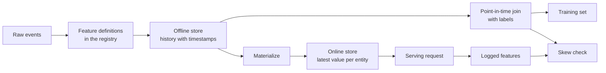

# Feature Store 與 Training-Serving Skew (Feature Stores and Training-Serving Skew)

> 一個 feature 只有一個定義，卻有兩個讀取者。Training 讀取的是每個標籤時間點的歷史值，serving 讀取的是最新值。當這兩個讀取者不一致時，模型看到的就是它從沒訓練過的輸入。

**Type:** Build
**Languages:** Python
**Prerequisites:** Phase 2, Lessons 08 (Feature Engineering), 13 (ML Pipelines), 15 (Time Series), and 19 (ML System Design)
**Time:** ~100 分鐘

## 學習目標 (Learning Objectives)

- 描述 offline store、online store、entity、event timestamp 與 TTL，以及各自的工作
- 實作 point-in-time 正確的 join，並示範單純的 join 如何把未來的值複製進訓練資料
- 說出 training-serving skew 的四個成因：兩條程式路徑、過時的 feature、不同的預設值，以及時間旅行
- 建立 feature registry，讓同一個定義同時餵給 training 路徑與 serving 路徑
- 在不讀取各日期之後資料的情況下，對過去日期 backfill 新的 feature
- 針對相同的 entity 與時間，比較記錄下來的 serving feature 與 training 路徑，以偵測 skew

## 問題 (The Problem)

一個團隊建立了 churn 模型。每個標籤表示一位使用者在標籤日之後的 30 天內是否沒有購買。團隊用 `user_id` 把標籤 join 到使用者 feature 表，並在 `days_since_last_purchase` 上訓練一條規則。Offline accuracy 是 0.948。

在即時流量上，模型的表現比較舊、較簡單的版本還差。Feature 表為每位使用者保存的是最新的值，來自標籤日之後好幾週。一位最後購買日為第 115 天的使用者，在第 175 天的快照中顯示閒置 60 天，所以這個 feature 包含了答案。同時，另一個團隊在另一個服務中重新撰寫了 serving 的 feature。他們的 30 天視窗多包含了一天，而且新使用者的預設值是 -1，而不是 365。

兩個缺陷有相同的根源。Training 和 serving 用兩種不同的方式計算「同一個 feature」。這堂課從零建立 feature store 的各個部分。你會寫出 registry、backfill、point-in-time join、帶有 TTL 的 online store，以及 skew 檢查。這個 demo 用數字重現這兩個缺陷。

## 核心概念 (The Concept)

### 同一個 feature 的兩個讀取者 (Two readers of the same feature)

Training 和 serving 要求 feature 的形狀不同：

| 屬性 | Training (offline) | Serving (online) |
|---|---|---|
| 問題 | 「這 1000 萬組 (entity, time) 配對各自的值是什麼？」 | 「這一個 entity 現在的值是什麼？」 |
| 時間 | 過去的許多時間點 | 現在 |
| 量 | 每個作業數百萬列 | 每個請求一列 |
| 延遲 | 數分鐘都沒問題 | 幾毫秒 |
| 儲存 | Offline store：附時間戳記的完整歷史，放在欄式檔案或資料倉儲中 | Online store：每個 entity 的最新值，放在 key-value 資料庫中 |

Feature store 讓兩個 store 都由同一組 feature 定義來填充。Materialization 是把最新的值從 offline store 複製到 online store 的作業。



### Entity、時間戳記與 TTL (Entities, timestamps, and TTL)

四個術語描述每一列 feature：

- **Entity。**feature 所描述的 key，例如 `user_id` 或 `card_id`。
- **Event timestamp。**這個值變為真實的時間。「截至第 14 天」的購買次數，其 event timestamp 是第 14 天。
- **Created timestamp。**系統寫入這一列的時間。今天執行的 backfill 會寫入帶有舊 event timestamp 與新 created timestamp 的列。
- **TTL (time to live)。**一個值的最大年齡。比 TTL 還老的值被視為缺失，所以讀取者使用預設值。

具有相同 entity、來源與 TTL 的一組 feature，通常稱為 feature view。

### Point-in-time 正確的 Join (Point-in-time correct joins)

一列 training 資料把標籤與標籤時間點當時存在的 feature 值配成一對。Point-in-time join 對每個標籤做以下事情：

1. 找出相同 entity 的 feature 列。
2. 保留 event timestamp 在標籤 timestamp 之前（含）的列。
3. 取其中最新的一列。
4. 如果標籤 timestamp 減去它的 event timestamp 超過 TTL，就丟掉它。

這裡有一位使用者、一個第 16 天的標籤，以及每週的 feature 列：

| Feature 列的日期 | `purchases_30d` | Point-in-time join | 依 `user_id` 的單純 join |
|---|---|---|---|
| 7 | 4 | | |
| 14 | 3 | 被選中 | |
| 21 | 1 | 未來 | |
| 28 | 0 | 未來 | 被選中 |

標籤問的是這位使用者在第 17 到 46 天內是否有購買任何東西。第 28 天那一列已經計入了標籤日之後的安靜日子。它顯示 0 次購買，因為使用者停止購買了，而這正是標籤所衡量的事件。單純的 join 把答案複製進了輸入。

我們在時間序列那堂課也是為了同樣的理由依時間切分資料。Point-in-time join 把這個規則套用到每一列，而不只是一個切分點。

### Training-Serving Skew 的成因 (Causes of training-serving skew)

Google 的 Rules of Machine Learning 把 training-serving skew 定義為訓練期間的表現與 serving 期間的表現之間的差異。它們指出三個成因：兩條 pipeline 中的資料處理方式不同、資料在 training 與 serving 之間發生改變，以及 feedback loop。在 feature pipeline 中，有四個具體的成因一再出現：

| 成因 | 發生什麼事 | Demo 中的範例 |
|---|---|---|
| 兩條程式路徑 | Training 和 serving 用不同的程式碼計算 feature | Serving 的視窗包含第 `now - 30` 天，而 training 的視窗不包含 |
| 過時的 feature | Serving 讀到的值與 training 使用的值有不同的年齡 | Training 讀取每週快照，而新服務計算的是最新的值 |
| 不同的預設值 | 兩條路徑以不同的方式填補缺失值 | Training 對「還沒購買過」使用 365，而 serving 使用 -1 |
| 時間旅行 | Training 讀取了標籤時間之後的值 | 單純的 join 為每個標籤讀取最新的快照 |

同一份指南的第 32 條規則說，盡可能在 training pipeline 與 serving pipeline 之間重複使用程式碼。Feature store 遵循這條規則，讓兩條路徑都呼叫同一個定義。

### Feature Registry

Registry 是 feature 定義的目錄。每個項目包含名稱、entity、來源、轉換、視窗、預設值、TTL、擁有者、版本與描述。

有兩條規則讓它保持安全：

- 兩條路徑都從 registry 讀取定義。沒有任何服務保有轉換的私人副本。
- 對定義的修改會建立新版本。舊版本會保留，所以舊的模型仍保有它們訓練時所用的 feature。

### Backfill

新的 feature 沒有歷史，但訓練需要它在每個舊標籤時間點的值。Backfill 在每個過去的日期執行定義，並為每個 entity 與日期寫入一列。每次執行只讀取 timestamp 在其日期之前（含）的事件。

Backfill 的運算成本隨 entity 數量乘以日期數量而成長。它們也帶來一個細微的洩漏。今天執行的 backfill 寫入的是帶有舊 event timestamp 的列，但它可能讀取到晚到或之後被修正的資料。嚴格的 point-in-time join 也會檢查 created timestamp 在標籤時間之前（含）。

### 偵測 Skew (Detecting skew)

同一份指南的第 29 條規則說，在 serving 時記錄 feature，並在 training 中使用它們。即使是一小份記錄下來的樣本，也能讓你檢查一致性。把每個記錄下來的值，與 training 路徑為相同 entity 與時間所產生的值比較。對每個 feature，回報不一致的比例與平均絕對差。

要找出原因，比較三組配對：

1. Online store 讀取 對比 training join。這測試整個系統，應該顯示 skew 為零。
2. 最新計算 對比 training join。這隔離出 staleness。
3. 第二條程式路徑 對比 最新計算。這隔離出程式碼的差異，例如視窗與預設值。

```figure
mlprod-pit-join
```

## 動手做 (Build It)

`code/main.py` 中的程式碼只使用標準函式庫。時間是以整數天表示。每週的 batch 作業在第 7、14 天，依此類推直到第 175 天寫入 feature 快照。

### 步驟 1：Feature 定義與 registry

`FeatureDefinition` 把轉換以資料的形式保存：一個聚合、一個視窗，以及一個預設值。它的 `compute` 方法絕不會讀取 `as_of` 之後的事件。

```python
@dataclass(frozen=True)
class FeatureDefinition:
    name: str
    entity: str
    aggregate: str
    window_days: int | None
    default: float
    version: int = 1
    owner: str = "growth-team"
    description: str = ""

    def compute(self, events: list[Event], as_of: int) -> float:
        visible = [e for e in events if e.day <= as_of]
        if self.window_days is not None:
            visible = [e for e in visible if e.day > as_of - self.window_days]
        if self.aggregate == "count":
            return float(len(visible))
        if self.aggregate == "sum":
            return round(sum(e.amount for e in visible), 2)
        if self.aggregate == "days_since_last":
            return float(as_of - max(e.day for e in visible)) if visible else self.default
        raise ValueError(f"unknown aggregate {self.aggregate!r}")
```

`FeatureRegistry.register` 接受相同的定義兩次，但會拒絕名稱與版本相同、內容卻不同的定義。`fill_defaults` 讓兩條路徑對缺失值使用相同的預設值。

模型用 `spend_30d@1` 這類參照來固定一個定義。`compute` 和 `fill_defaults` 會解析該參照，而沒有 `@` 的名稱則讀取最新版本。帶有 `@` 但沒有版本號的參照會引發 `ValueError`，所以打錯字不會在沒有警告的情況下讀到最新版本。這個參照同時也是每個儲存列中的 key，所以 backfill、online store 與 serving 讀取，全都使用固定的定義。

### 步驟 2：Backfill offline store

```python
def backfill(registry: FeatureRegistry, names: list[str], events: list[Event], days: list[int]) -> list[FeatureRow]:
    rows = []
    for entity, entity_events in sorted(group_events(events).items()):
        for day in days:
            rows.append(FeatureRow(entity, day, registry.compute(names, entity_events, day)))
    return rows
```

Demo 在 25 個快照日對 299 位使用者 backfill 三個 feature，共得到 7475 列。

### 步驟 3：Point-in-time join

先對每個 entity 的列依日期排序一次。對每個標籤，`bisect_right` 找出標籤日之前（含）的最後一列。TTL 檢查會丟掉太舊的列。

```python
def point_in_time_join(labels: list[LabelRow], rows: list[FeatureRow], ttl_days: int | None = None) -> list[JoinedRow]:
    by_entity: dict[str, list[FeatureRow]] = defaultdict(list)
    for row in rows:
        by_entity[row.entity].append(row)
    days_index = {}
    for entity, entity_rows in by_entity.items():
        entity_rows.sort(key=lambda r: r.day)
        days_index[entity] = [r.day for r in entity_rows]
    joined = []
    for label in labels:
        days = days_index.get(label.entity, [])
        pos = bisect.bisect_right(days, label.day) - 1
        match = by_entity[label.entity][pos] if pos >= 0 else None
        if match is not None and ttl_days is not None and label.day - match.day > ttl_days:
            match = None
        joined.append(JoinedRow(
            label.entity, label.day, label.label,
            match.day if match else None, match.values if match else None,
        ))
    return joined
```

### 步驟 4：衡量單純 join 的洩漏

`naive_latest_join` 只依 entity join，所以它為每個標籤回傳最新的一列。Demo 建立第 100、120 和 140 天的標籤，並在每個 training set 上擬合單一 feature 的規則。接著用 point-in-time 的 feature，在第 145 天的標籤上測試兩條規則：

```console
  naive join used a snapshot from after the label day for 100% of rows
  offline accuracy, naive join: 0.948 (rule: idle > 53 days)
  offline accuracy, PIT join:   0.893 (rule: idle > 19 days)
  accuracy on day 145, trained with naive join: 0.763
  accuracy on day 145, trained with PIT join:   0.876
```

單純的 join 在 offline 看起來比較好，0.948 對比 0.893。在新資料上它比較差，0.763 對比 0.876。洩漏的 feature 把擬合出的 threshold 從 19 個閒置日移動到 53 個閒置日。

### 步驟 5：Online store 與 materialization

Online store 為每個 entity 保留一列，並拒絕比 TTL 還舊的列。`materialize` 只寫入日期在作業時間之前（含）的列。

```python
class OnlineStore:
    def __init__(self, ttl_days: int):
        self.ttl_days = ttl_days
        self._latest: dict[str, FeatureRow] = {}

    def write(self, row: FeatureRow) -> None:
        current = self._latest.get(row.entity)
        if current is None or row.day >= current.day:
            self._latest[row.entity] = row

    def read(self, entity: str, now: int) -> dict[str, float] | None:
        row = self._latest.get(entity)
        if row is None or row.day > now or now - row.day > self.ttl_days:
            return None
        return dict(row.values)
```

TTL 為 10 天時，第 145 天的讀取會回傳第 140 天的那一列。第 160 天的讀取，在沒有新的 materialization 的情況下，會回傳預設值，因為那一列已經有 20 天之久。

### 步驟 6：Skew 檢查

`detect_skew` 比較兩個以 `(entity, day)` 為 key 的 view。它回報每個 feature 的不一致率與平均絕對差，並在超過 1% 的值不同時標記該 feature。當兩個 view 有不同的 key 或沒有 key 時，它會引發 `ValueError`。缺失的請求可能會隱藏 skew，而沒有任何請求的檢查什麼都顯示不出來。

```python
def detect_skew(
    training: dict[tuple[str, int], dict[str, float]],
    serving: dict[tuple[str, int], dict[str, float]],
    features: list[str],
    tolerance: float = 1e-6,
    max_mismatch_rate: float = 0.01,
) -> list[SkewReport]:
    if set(training) != set(serving):
        raise ValueError(f"{len(set(training) ^ set(serving))} keys are in only one view: log and compare the same requests")
    if not training:
        raise ValueError("no requests to compare")
    keys = sorted(training)
    reports = []
    for feature in features:
        diffs = [abs(training[k][feature] - serving[k][feature]) for k in keys]
        mismatches = sum(1 for d in diffs if d > tolerance)
        rate = mismatches / len(keys)
        mean_diff = sum(diffs) / len(keys)
        reports.append(SkewReport(feature, len(keys), rate, mean_diff, rate > max_mismatch_rate))
    return reports
```

Demo 記錄第 141 到 150 天的請求，並執行概念章節中的三組比較。請求池包含 20 位沒有歷史的新使用者。

```bash
python3 code/main.py
```

```console
=== Skew checks on 383 logged requests, days 141 to 150 ===
  online store read  vs  training join (one definition, same snapshots)
    ok   days_since_last_purchase   mismatch   0.0%  mean |diff|    0.00
    ok   purchases_30d              mismatch   0.0%  mean |diff|    0.00
    ok   spend_30d                  mismatch   0.0%  mean |diff|    0.00
  fresh compute      vs  training join (staleness only)
    SKEW days_since_last_purchase   mismatch  83.0%  mean |diff|    2.77
    SKEW purchases_30d              mismatch  30.5%  mean |diff|    0.38
    SKEW spend_30d                  mismatch  37.1%  mean |diff|   16.77
  second code path   vs  fresh compute (code differences only)
    SKEW days_since_last_purchase   mismatch   5.5%  mean |diff|   20.07
    SKEW purchases_30d              mismatch  12.5%  mean |diff|    0.13
    SKEW spend_30d                  mismatch  12.5%  mean |diff|    5.09
```

依序閱讀這三個區塊：

- **一個定義，相同的快照。**Online store 和 training join 讀取相同的 materialize 後的列，所以 skew 為零。
- **Staleness。**在大多數請求上，最新的值與每週快照不同。在這裡，較新的資料不一定比較好，因為模型是從最多六天前的值學習的。
- **程式碼差異。**第二條程式路徑在 12.5% 的視窗計數上不同，因為它的視窗多包含一天。它只在新使用者的 `days_since_last_purchase` 上不同，但差異很大：-1 對比 365。

## 實際使用 (Use It)

Feast 是開源的 feature store。從零實作的每個部分都有對應的 Feast 元件：

| 從零實作 | Feast |
|---|---|
| `FeatureDefinition`、`FeatureRegistry` | feature repository 中的 `Entity`、`FeatureView` 與 `Field`，以 `feast apply` 註冊 |
| `FeatureRow` 歷史 | Offline store，例如 Parquet 檔案上的 `FileSource` 或資料倉儲的表 |
| 帶有 TTL 的 `point_in_time_join` | `store.get_historical_features(entity_df=..., features=[...])` |
| `materialize` | `feast materialize-incremental <end time>` |
| `OnlineStore.read` | `store.get_online_features(features=[...], entity_rows=[...])` |
| Created timestamp 檢查 | 來源上的 `created_timestamp_column` 與 `filter_by_created_timestamp=True` |

定義看起來像這樣。這段程式碼依循 Feast quickstart，執行這堂課並不需要它。

```python
from datetime import timedelta

from feast import Entity, FeatureView, Field, FileSource
from feast.types import Float32, Int64

user = Entity(name="user", join_keys=["user_id"])

user_activity_source = FileSource(
    name="user_activity_source",
    path="data/user_activity.parquet",
    timestamp_field="event_timestamp",
    created_timestamp_column="created",
)

user_activity = FeatureView(
    name="user_activity",
    entities=[user],
    ttl=timedelta(days=10),
    schema=[
        Field(name="purchases_30d", dtype=Int64),
        Field(name="spend_30d", dtype=Float32),
        Field(name="days_since_last_purchase", dtype=Int64),
    ],
    source=user_activity_source,
)
```

接著 training 和 serving 讀取同一個 feature view：

```python
from feast import FeatureStore

store = FeatureStore(repo_path=".")

training_df = store.get_historical_features(
    entity_df=labels_df,
    features=["user_activity:purchases_30d", "user_activity:days_since_last_purchase"],
    filter_by_created_timestamp=True,
).to_df()

online = store.get_online_features(
    features=["user_activity:purchases_30d", "user_activity:days_since_last_purchase"],
    entity_rows=[{"user_id": 42}],
).to_dict()
```

`labels_df` 每個標籤一列，包含 `user_id`、`event_timestamp` 與標籤。Feast 文件指出，TTL 是相對於 entity dataframe 中的每個 timestamp，而不是相對於查詢的時間。這與 `point_in_time_join` 中的 TTL 檢查一致。同一頁描述了 `filter_by_created_timestamp=True`，它能避免 backfill 的值洩漏到 training 資料中。並非每個 offline store 都支援這個選項。不支援的 store 會引發錯誤，而不是忽略該選項。

Tecton、Hopsworks，以及大型雲端 ML 平台中的 feature store，都使用相同的 offline 與 online store 分離。對於 skew 檢查，TensorFlow Data Validation 可以比較 training 資料與 serving 資料來偵測 skew。Breck 等人描述了 TFX（Google 的端到端 ML 平台）中的資料驗證系統，包含 training-serving skew。

## 交付 (Ship It)

這堂課會產出 `outputs/skill-feature-skew-audit.md`。這個 skill 稽核 feature pipeline 是否有時間旅行與 training-serving skew。它會逐步檢視 join、定義、預設值、每條路徑的新鮮度，以及 skew 檢查所需的記錄。

## 練習 (Exercises)

1. 把快照間隔從 7 天改成 1 天。重新執行 staleness 比較並解釋結果。
2. 把 TTL 設為 3 天。計算有多少 training 列失去它們的 feature 並得到預設值。
3. 在 `FeatureRow` 中加入 created day。讓 join 忽略在標籤日之後寫入的列。
4. 將 `spend_7d` 註冊為 `spend_30d` 的版本 2。對它做 backfill，並從 registry 印出兩個版本。
5. 修正 `legacy_serving_features`，直到第三個 skew 檢查通過。列出每一項修改。

## 關鍵術語 (Key Terms)

| 術語 | 大家怎麼說 | 實際意義 |
|------|----------------|----------------------|
| Feature store | 「feature 的資料庫」 | 從同一組定義計算 feature，並提供給 training 與 serving 的系統 |
| Offline store | 「訓練資料」 | 附有 event timestamp 的完整 feature 歷史，由 training 作業與 backfill 讀取 |
| Online store | 「feature 快取」 | 每個 entity 的最新值，由 serving 路徑以毫秒為單位讀取 |
| Entity | 「那個 ID」 | feature 所描述的 key，例如使用者或信用卡 |
| Event timestamp | 「事情發生的時間」 | 一個 feature 值變為真實的時間 |
| Point-in-time join | 「as-of join」 | 把每個標籤與標籤時間點之前（含）最新的 feature 列配對的 join |
| TTL | 「過期時間」 | 在讀取者將它視為缺失之前，一個 feature 值的最大年齡 |
| Materialization | 「同步到 online」 | 把最新的 feature 值從 offline store 複製到 online store 的作業 |
| Backfill | 「計算歷史」 | 在過去的日期執行 feature 定義，以建立它的歷史 |
| Training-serving skew | 「offline 明明可以」 | training 與 serving 之間 feature 或行為的差異 |

## 延伸閱讀 (Further Reading)

- [Feast, Point-in-time joins](https://docs.feast.dev/getting-started/concepts/point-in-time-joins)：TTL 語意與 created timestamp 過濾
- [Feast documentation](https://docs.feast.dev/)：feature view、offline store、online store 與 materialization
- [Google, Rules of Machine Learning](https://developers.google.com/machine-learning/guides/rules-of-ml)：training-serving skew 的規則，從第 29 條到第 37 條
- [Breck et al., Data Validation for Machine Learning (SysML 2019)](https://research.google/pubs/data-validation-for-machine-learning/)：Google 的資料驗證，包含 training-serving skew
- [TensorFlow Data Validation guide](https://www.tensorflow.org/tfx/guide/tfdv)：schema 檢查、skew 偵測與 drift 偵測
- [Sculley et al., Hidden Technical Debt in Machine Learning Systems (NeurIPS 2015)](https://papers.nips.cc/paper/2015/hash/86df7dcfd896fcaf2674f757a2463eba-Abstract.html)：模型周邊的資料相依性與 pipeline 債務
