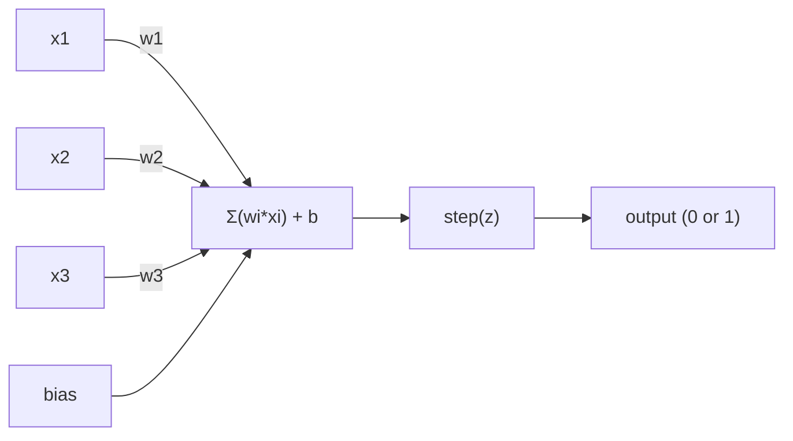
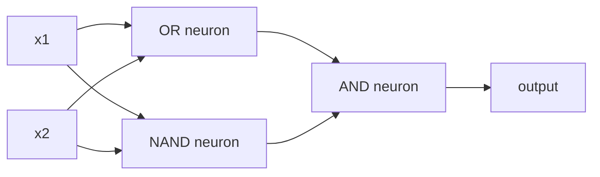

# 感知器 (The Perceptron)

> 感知器是神經網路的原子。把它拆開，你會看到 weights、bias 和一個決策。

**Type:** Build
**Languages:** Python
**Prerequisites:** Phase 1 (Linear Algebra Intuition)
**Time:** ~60 分鐘

## 學習目標 (Learning Objectives)

- 用 Python 從零實作感知器，包含 weight 更新規則與 step activation function
- 說明為什麼單一感知器只能解決線性可分的問題，並示範 XOR 的失敗案例
- 組合 OR、NAND、AND 閘，建構多層感知器來解決 XOR
- 用 sigmoid activation 與 backpropagation 訓練雙層網路，讓它自動學會 XOR

## 問題 (The Problem)

你已經懂 vector 和 dot product。你也知道 matrix 能把輸入轉換成輸出。但機器要怎麼 *學* 出該用哪一種轉換？

感知器就是答案。它是最簡單的學習機器：拿一些輸入，乘上 weights，加上 bias，做出二元決策。然後調整。就這樣。所有曾經打造過的神經網路，都是這個想法一層層疊起來的。

理解感知器，就是理解「學習」在程式裡到底是什麼：不斷調整數字，直到輸出符合現實。

## 核心概念 (The Concept)

### 一個神經元，一個決策 (One Neuron, One Decision)

感知器接收 $n$ 個輸入，每個乘上一個 weight，加總起來，再加上 bias，最後把結果交給 activation function。



step function 很直接：如果加權總和加上 bias 是 $\ge 0$，就輸出 1。否則輸出 0。

```math
\text{step}(z) = \begin{cases} 1 & \text{if } z \ge 0 \\ 0 & \text{if } z < 0 \end{cases}
```

這是一個線性分類器 (linear classifier)。weights 和 bias 定義出一條線（在更高維度則是 hyperplane），把輸入空間切成兩個區域。

### 決策邊界 (The Decision Boundary)

有兩個輸入時，感知器會在 2D 空間裡畫出一條線：

```
  x2
  ┤
  │  Class 1        /
  │    (0)          /
  │                /
  │               / w1·x1 + w2·x2 + b = 0
  │              /
  │             /     Class 2
  │            /        (1)
  ┼───────────/──────────── x1
```

線的一側全部輸出 0，另一側全部輸出 1。訓練就是移動這條線，直到它能正確分開兩個類別。

### 學習規則 (The Learning Rule)

感知器的學習規則很簡單：

```
For each training example (x, y_true):
    y_pred = predict(x)
    error = y_true - y_pred

    For each weight:
        w_i = w_i + learning_rate * error * x_i
    bias = bias + learning_rate * error
```

如果預測正確，$\text{error} = 0$，什麼都不會變。如果預測 0 但應該是 1，weights 會增加。如果預測 1 但應該是 0，weights 會減少。learning rate 控制每次調整的幅度。

### XOR 問題 (The XOR Problem)

問題出在這裡。看看這些邏輯閘：

```
AND gate:           OR gate:            XOR gate:
x1  x2  out         x1  x2  out         x1  x2  out
0   0   0           0   0   0           0   0   0
0   1   0           0   1   1           0   1   1
1   0   0           1   0   1           1   0   1
1   1   1           1   1   1           1   1   0
```

AND 和 OR 是線性可分的：你可以畫一條線，把 0 和 1 分開。XOR 不行。沒有任何一條線能把 [0,1] 和 [1,0] 從 [0,0] 和 [1,1] 中分出來。

```
AND (separable):        XOR (not separable):

  x2                      x2
  1 ┤  0     1            1 ┤  1     0
    │     /                 │
  0 ┤  0 / 0              0 ┤  0     1
    ┼──/──────── x1         ┼──────────── x1
       line works!          no single line works!
```

這是根本的限制。單一感知器只能解決線性可分的問題。Minsky 和 Papert 在 1969 年證明了這一點，也讓神經網路研究幾乎停擺了十年。

解法是：把感知器疊成多層。多層感知器可以把兩個線性決策組合成一個非線性決策，來解決 XOR。

```figure
perceptron-boundary
```

## 動手做 (Build It)

### 步驟 1：Perceptron class

```python
class Perceptron:
    def __init__(self, n_inputs, learning_rate=0.1):
        self.weights = [0.0] * n_inputs
        self.bias = 0.0
        self.lr = learning_rate

    def predict(self, inputs):
        total = sum(w * x for w, x in zip(self.weights, inputs))
        total += self.bias
        return 1 if total >= 0 else 0

    def train(self, training_data, epochs=100):
        for epoch in range(epochs):
            errors = 0
            for inputs, target in training_data:
                prediction = self.predict(inputs)
                error = target - prediction
                if error != 0:
                    errors += 1
                    for i in range(len(self.weights)):
                        self.weights[i] += self.lr * error * inputs[i]
                    self.bias += self.lr * error
            if errors == 0:
                print(f"Converged at epoch {epoch + 1}")
                return
        print(f"Did not converge after {epochs} epochs")
```

### 步驟 2：用邏輯閘訓練

```python
and_data = [
    ([0, 0], 0),
    ([0, 1], 0),
    ([1, 0], 0),
    ([1, 1], 1),
]

or_data = [
    ([0, 0], 0),
    ([0, 1], 1),
    ([1, 0], 1),
    ([1, 1], 1),
]

not_data = [
    ([0], 1),
    ([1], 0),
]

print("=== AND Gate ===")
p_and = Perceptron(2)
p_and.train(and_data)
for inputs, _ in and_data:
    print(f"  {inputs} -> {p_and.predict(inputs)}")

print("\n=== OR Gate ===")
p_or = Perceptron(2)
p_or.train(or_data)
for inputs, _ in or_data:
    print(f"  {inputs} -> {p_or.predict(inputs)}")

print("\n=== NOT Gate ===")
p_not = Perceptron(1)
p_not.train(not_data)
for inputs, _ in not_data:
    print(f"  {inputs} -> {p_not.predict(inputs)}")
```

### 步驟 3：看 XOR 失敗

```python
xor_data = [
    ([0, 0], 0),
    ([0, 1], 1),
    ([1, 0], 1),
    ([1, 1], 0),
]

print("\n=== XOR Gate (single perceptron) ===")
p_xor = Perceptron(2)
p_xor.train(xor_data, epochs=1000)
for inputs, expected in xor_data:
    result = p_xor.predict(inputs)
    status = "OK" if result == expected else "WRONG"
    print(f"  {inputs} -> {result} (expected {expected}) {status}")
```

它永遠不會收斂。這就是單一感知器學不會 XOR 的鐵證。

### 步驟 4：用兩層解決 XOR

訣竅是：$\text{XOR} = (x_1 \text{ OR } x_2) \text{ AND NOT } (x_1 \text{ AND } x_2)$。把三個感知器組合起來：



```python
def xor_network(x1, x2):
    or_neuron = Perceptron(2)
    or_neuron.weights = [1.0, 1.0]
    or_neuron.bias = -0.5

    nand_neuron = Perceptron(2)
    nand_neuron.weights = [-1.0, -1.0]
    nand_neuron.bias = 1.5

    and_neuron = Perceptron(2)
    and_neuron.weights = [1.0, 1.0]
    and_neuron.bias = -1.5

    hidden1 = or_neuron.predict([x1, x2])
    hidden2 = nand_neuron.predict([x1, x2])
    output = and_neuron.predict([hidden1, hidden2])
    return output


print("\n=== XOR Gate (multi-layer network) ===")
for inputs, expected in xor_data:
    result = xor_network(inputs[0], inputs[1])
    print(f"  {inputs} -> {result} (expected {expected})")
```

四種情況全部正確。把感知器疊成多層，就能產生單一感知器做不出來的決策邊界。

### 步驟 5：訓練雙層網路 (Train a Two-Layer Network)

步驟 4 的 weights 是手動接好的。XOR 這樣做可以，但真實問題你事先不知道正確的 weights。解法是：把 step function 換成 sigmoid，再透過 backpropagation 自動學出 weights。

```python
class TwoLayerNetwork:
    def __init__(self, learning_rate=0.5):
        import random
        random.seed(0)
        self.w_hidden = [[random.uniform(-1, 1), random.uniform(-1, 1)] for _ in range(2)]
        self.b_hidden = [random.uniform(-1, 1), random.uniform(-1, 1)]
        self.w_output = [random.uniform(-1, 1), random.uniform(-1, 1)]
        self.b_output = random.uniform(-1, 1)
        self.lr = learning_rate

    def sigmoid(self, x):
        import math
        x = max(-500, min(500, x))
        return 1.0 / (1.0 + math.exp(-x))

    def forward(self, inputs):
        self.inputs = inputs
        self.hidden_outputs = []
        for i in range(2):
            z = sum(w * x for w, x in zip(self.w_hidden[i], inputs)) + self.b_hidden[i]
            self.hidden_outputs.append(self.sigmoid(z))
        z_out = sum(w * h for w, h in zip(self.w_output, self.hidden_outputs)) + self.b_output
        self.output = self.sigmoid(z_out)
        return self.output

    def train(self, training_data, epochs=10000):
        for epoch in range(epochs):
            total_error = 0
            for inputs, target in training_data:
                output = self.forward(inputs)
                error = target - output
                total_error += error ** 2

                d_output = error * output * (1 - output)

                saved_w_output = self.w_output[:]
                hidden_deltas = []
                for i in range(2):
                    h = self.hidden_outputs[i]
                    hd = d_output * saved_w_output[i] * h * (1 - h)
                    hidden_deltas.append(hd)

                for i in range(2):
                    self.w_output[i] += self.lr * d_output * self.hidden_outputs[i]
                self.b_output += self.lr * d_output

                for i in range(2):
                    for j in range(len(inputs)):
                        self.w_hidden[i][j] += self.lr * hidden_deltas[i] * inputs[j]
                    self.b_hidden[i] += self.lr * hidden_deltas[i]
```

```python
net = TwoLayerNetwork(learning_rate=2.0)
net.train(xor_data, epochs=10000)
for inputs, expected in xor_data:
    result = net.forward(inputs)
    predicted = 1 if result >= 0.5 else 0
    print(f"  {inputs} -> {result:.4f} (rounded: {predicted}, expected {expected})")
```

和步驟 4 相比有兩個關鍵差異。第一，sigmoid 取代了 step function：它是平滑的，所以 gradient 存在。第二，`train` 方法會把 error 從輸出層往後傳到 hidden layer，依照每個 weight 對 error 的貢獻比例來調整。這就是只用 20 行寫成的 backpropagation。

這是通往第 03 課的橋梁。`d_output` 和 `hidden_deltas` 背後的數學，就是把 chain rule 套用在網路圖上。我們會在那一課好好推導。

## 實際使用 (Use It)

你剛才從零打造的一切，只要一行 import 就有了：

```python
from sklearn.linear_model import Perceptron as SkPerceptron
import numpy as np

X = np.array([[0,0],[0,1],[1,0],[1,1]])
y = np.array([0, 0, 0, 1])

clf = SkPerceptron(max_iter=100, tol=1e-3)
clf.fit(X, y)
print([clf.predict([x])[0] for x in X])
```

五行。你那個 30 行的 `Perceptron` class 做的是同一件事。sklearn 版本多了收斂檢查、多種 loss function 和 sparse 輸入支援，但核心迴圈完全一樣：加權總和、step function、出錯時更新 weights。

真正的差距出現在規模上。正式環境的網路有哪些不同：

- step function 變成 sigmoid、ReLU 或其他平滑的 activation
- weights 透過 backpropagation 自動學習（第 03 課）
- layer 越來越深：3 層、10 層、100 層以上
- 原理不變：每一層都用前一層的輸出，產生新的 feature

單一感知器只能畫直線。把它們疊起來，就能畫出任何形狀。

## 交付 (Ship It)

這堂課產出：
- `outputs/skill-perceptron.md` - 一個 skill，說明什麼時候需要單層架構、什麼時候需要多層架構

## 練習 (Exercises)

1. 用 NAND 閘訓練一個感知器（NAND 是萬用閘，任何邏輯電路都能用它建出來）。驗證它的 weights 和 bias 形成有效的決策邊界。
2. 修改 Perceptron class，在每個 epoch 追蹤決策邊界（$w_1 x_1 + w_2 x_2 + b = 0$）。在 AND 閘的訓練過程中，印出這條線如何移動。
3. 建一個 3 輸入的感知器，只有在 3 個輸入中至少 2 個是 1 時才輸出 1（多數決函數）。這是線性可分的嗎？為什麼？

## 關鍵術語 (Key Terms)

| Term | 一般說法 | 實際意義 |
|------|----------------|----------------------|
| Perceptron | 「假的神經元」 | 一種線性分類器：輸入與 weights 的 dot product 加上 bias，再通過 step function |
| Weight | 「輸入有多重要」 | 一個乘數，用來縮放每個輸入對決策的貢獻 |
| Bias | 「門檻」 | 一個常數，用來平移決策邊界，讓感知器即使輸入全為零也能觸發 |
| Activation function | 「把數值壓扁的東西」 | 套用在加權總和之後的函數：感知器用 step function，現代網路用 sigmoid/ReLU |
| Linearly separable | 「你可以在它們之間畫一條線」 | 一個資料集，能用單一 hyperplane 完美分開各個類別 |
| XOR problem | 「感知器做不到的事」 | 證明單層網路無法學會非線性可分的函數 |
| Decision boundary | 「分類器切換的地方」 | 把輸入空間分成兩個類別的 hyperplane $w \cdot x + b = 0$ |
| Multi-layer perceptron | 「真正的神經網路」 | 感知器疊成多層，每一層的輸出餵給下一層當輸入 |

## 延伸閱讀 (Further Reading)

- Frank Rosenblatt, "The Perceptron: A Probabilistic Model for Information Storage and Organization in the Brain" (1958) -- 開啟一切的原始論文
- Minsky & Papert, "Perceptrons" (1969) -- 證明單層網路無法解決 XOR、讓感知器研究停擺十年的那本書
- Michael Nielsen, "Neural Networks and Deep Learning", Chapter 1 (http://neuralnetworksanddeeplearning.com/) -- 免費線上閱讀，是說明感知器如何組成網路最好的視覺化解說
