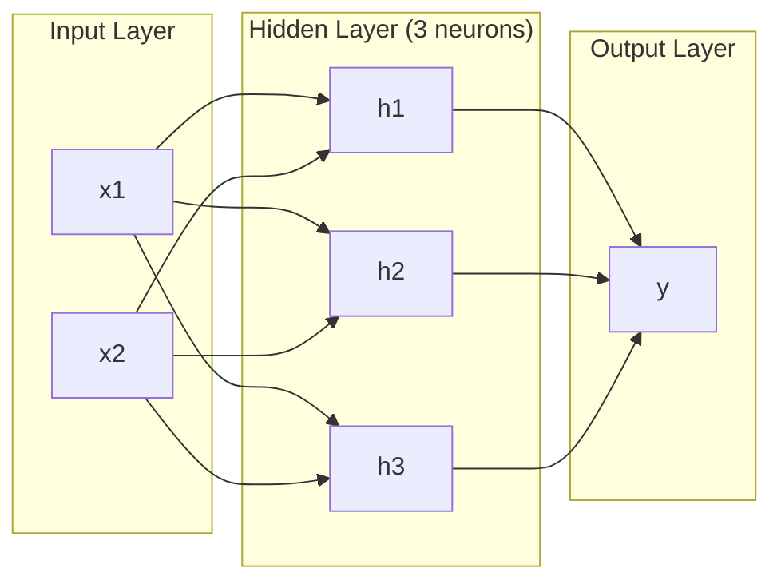
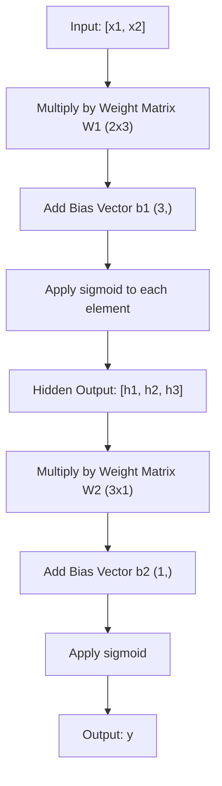
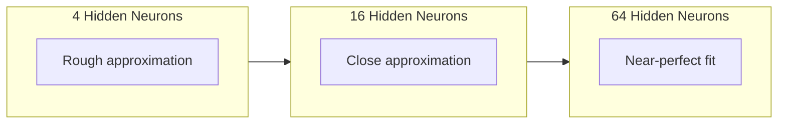

# 多層網路與 Forward Pass (Multi-Layer Networks and Forward Pass)

> 一個神經元只能畫一條線。把它們疊起來，你就能畫出任何東西。

**Type:** Build
**Languages:** Python
**Prerequisites:** Phase 01 (Math Foundations), Lesson 03.01 (The Perceptron)
**Time:** ~90 分鐘

## 學習目標 (Learning Objectives)

- 用 Layer 和 Network class 從零建構多層網路，並完成一次完整的 forward pass
- 追蹤網路每一層的 matrix 維度，找出 shape 不符的地方
- 說明堆疊非線性 activation 如何讓網路學出彎曲的決策邊界
- 用手動調好 weights 的 sigmoid，以 2-2-1 架構解決 XOR 問題

## 問題 (The Problem)

單一神經元只是個畫線工具。就這樣。在你的資料裡畫一條直線。AI 裡每個真實的問題，像是影像辨識、語言理解、下圍棋，都需要曲線。把神經元疊成多層，就是取得曲線的方法。

1969 年，Minsky 和 Papert 證明這個限制是致命的：單層網路學不會 XOR。不是「很難學會」，而是在數學上不可能。XOR 真值表把 [0,1] 和 [1,0] 放在一邊，[0,0] 和 [1,1] 放在另一邊。沒有任何一條線能把它們分開。

這件事讓神經網路的經費斷了十多年。事後看來，解法很明顯：不要只用一層。把神經元疊成多層。讓第一層把輸入空間切成新的 feature，再讓第二層把這些 feature 組合成單一條線做不到的決策。

這個堆疊就是多層網路。它是今天所有正式上線的 deep learning 模型的基礎。forward pass，也就是資料從輸入經過 hidden layer 流到輸出，是你必須先建好的第一件事，其他東西才有辦法運作。

## 核心概念 (The Concept)

### Layer：輸入、隱藏、輸出 (Layers: Input, Hidden, Output)

多層網路有三種 layer：

**Input layer**：其實不算真正的 layer。它只存放你的原始資料。兩個 feature 就是兩個輸入節點。這裡不做任何運算。

**Hidden layer**：工作都在這裡發生。每個 neuron 接收前一層的所有輸出，套用 weights 和 bias，再把結果交給 activation function。之所以叫「hidden」，是因為你在訓練資料裡看不到這些值。

**Output layer**：最終答案。二元分類用一個帶 sigmoid 的 neuron。多類別分類則是每個類別一個 neuron。



這是一個 2-3-1 網路。兩個輸入，三個 hidden neuron，一個輸出。每條連線都帶一個 weight。每個 neuron（輸入層除外）都帶一個 bias。

每一層會產生一個數字向量，叫做 hidden state。對文字來說，hidden state 會增加維度：把一個字編碼成 768 個數字，來捕捉語意。對影像來說，hidden state 會降低維度：把上百萬個像素壓縮成容易處理的表示。學習就發生在 hidden state 裡。

### Neuron 與 Activation (Neurons and Activations)

每個 neuron 做三件事：

1. 把每個輸入乘上對應的 weight
2. 把所有乘積加總，再加上 bias
3. 把總和交給 activation function

目前我們用的 activation 是 sigmoid：

```math
\text{sigmoid}(z) = \frac{1}{1 + e^{-z}}
```

Sigmoid 會把任何數字壓進 (0, 1) 的範圍。很大的正數會趨近 1。很大的負數會趨近 0。零則對應到 0.5。這條平滑的曲線讓學習成為可能：不像感知器的硬性 step，sigmoid 在每個地方都有 gradient。

### Forward Pass：資料如何流動 (Forward Pass: How Data Flows)

forward pass 會把輸入資料一層一層推過網路，直到抵達輸出。forward pass 期間不會發生學習。它是純粹的運算：相乘、相加、activate，然後重複。



每一層依序會發生三個運算：

```math
\begin{aligned}
z &= W \cdot \text{input} + b \quad \text{(linear transformation)} \\
a &= \text{sigmoid}(z) \quad \text{(activation)}
\end{aligned}
```

一層的輸出會變成下一層的輸入。整個 forward pass 就是這樣。

### Matrix 維度 (Matrix Dimensions)

追蹤維度，是 deep learning 裡最重要的除錯技巧。以下是 2-3-1 網路：

| 步驟 | 運算 | 維度 | 結果 Shape |
|------|-----------|------------|-------------|
| Input | $x$ | -- | (2,) |
| Hidden linear | $W_1 x + b_1$ | $W_1$: (3, 2), $b_1$: (3,) | (3,) |
| Hidden activation | $\text{sigmoid}(z_1)$ | -- | (3,) |
| Output linear | $W_2 h + b_2$ | $W_2$: (1, 3), $b_2$: (1,) | (1,) |
| Output activation | $\text{sigmoid}(z_2)$ | -- | (1,) |

規則是：第 $k$ 層的 weight matrix $W$ 的 shape 是 (第 k 層的 neuron 數, 第 k-1 層的 neuron 數)。Row 對應目前這一層，column 對應前一層。如果 shape 對不起來，就是有 bug。

### 通用近似定理 (Universal Approximation Theorem)

1989 年，George Cybenko 證明了一件了不起的事：只要有一個 hidden layer 和足夠多的 neuron，神經網路就能以任意精確度逼近任何連續函數。

這不代表單一 hidden layer 永遠最好。它的意思是，這種架構在理論上有能力做到。實務上，更深的網路（更多層、每層更少 neuron）學同樣的函數，所需的總參數量遠少於又淺又寬的網路。這就是 deep learning 有效的原因。

直覺是這樣：hidden layer 裡每個 neuron 學一個「凸起」或 feature。把足夠多的凸起放在對的位置，就能逼近任何平滑的曲線。neuron 越多，凸起越多，逼近越準確。



### 可組合性 (Composability)

神經網路是可以組合的。你可以堆疊它們、串接它們、平行執行它們。Whisper 模型用一個 encoder 網路處理音訊，再用另一個 decoder 網路產生文字。現代 LLM 是 decoder-only。BERT 是 encoder-only。T5 是 encoder-decoder。架構的選擇決定了模型能做什麼。

```figure
mlp-forward
```

## 動手做 (Build It)

純 Python。不用 numpy。每個 matrix 運算都從零寫起。

### 步驟 1：Sigmoid Activation

```python
import math

def sigmoid(x):
    x = max(-500.0, min(500.0, x))
    return 1.0 / (1.0 + math.exp(-x))
```

限制在 [-500, 500] 是為了防止溢位。`math.exp(500)` 很大但仍是有限值。`math.exp(1000)` 就是無限大。

### 步驟 2：Layer Class

整個 deep learning 裡最重要的運算是 matrix 乘法。每一層、每個 attention head、每次 forward pass，一路往下都是 matmul。linear layer 會拿輸入向量乘上 weight matrix，再加上 bias 向量：$y = Wx + b$。光是這一個式子，就佔了神經網路 90% 的運算量。

一個 layer 持有一個 weight matrix 和一個 bias 向量。它的 forward 方法接收輸入向量，回傳 activate 過的輸出。

```python
class Layer:
    def __init__(self, n_inputs, n_neurons, weights=None, biases=None):
        if weights is not None:
            self.weights = weights
        else:
            import random
            self.weights = [
                [random.uniform(-1, 1) for _ in range(n_inputs)]
                for _ in range(n_neurons)
            ]
        if biases is not None:
            self.biases = biases
        else:
            self.biases = [0.0] * n_neurons

    def forward(self, inputs):
        self.last_input = inputs
        self.last_output = []
        for neuron_idx in range(len(self.weights)):
            z = sum(
                w * x for w, x in zip(self.weights[neuron_idx], inputs)
            )
            z += self.biases[neuron_idx]
            self.last_output.append(sigmoid(z))
        return self.last_output
```

weight matrix 的 shape 是 (n_neurons, n_inputs)。每一個 row 是某個 neuron 對所有輸入的 weights。forward 方法會逐一走過每個 neuron，算出加權總和加上 bias，套用 sigmoid，再收集結果。

### 步驟 3：Network Class

網路就是一串 layer。forward pass 把它們串起來：第 $k$ 層的輸出餵給第 $k+1$ 層。

```python
class Network:
    def __init__(self, layers):
        self.layers = layers

    def forward(self, inputs):
        current = inputs
        for layer in self.layers:
            current = layer.forward(current)
        return current
```

這就是整個 forward pass。只有四行邏輯。資料進去，流過每一層，從另一端出來。

### 步驟 4：用手動調好的 Weights 解 XOR

在第 01 課，我們用 OR、NAND、AND 感知器的組合解決了 XOR。現在用我們的 Layer 和 Network class 做同一件事。2-2-1 架構：兩個輸入，兩個 hidden neuron，一個輸出。

```python
hidden = Layer(
    n_inputs=2,
    n_neurons=2,
    weights=[[20.0, 20.0], [-20.0, -20.0]],
    biases=[-10.0, 30.0],
)

output = Layer(
    n_inputs=2,
    n_neurons=1,
    weights=[[20.0, 20.0]],
    biases=[-30.0],
)

xor_net = Network([hidden, output])

xor_data = [
    ([0, 0], 0),
    ([0, 1], 1),
    ([1, 0], 1),
    ([1, 1], 0),
]

for inputs, expected in xor_data:
    result = xor_net.forward(inputs)
    predicted = 1 if result[0] >= 0.5 else 0
    print(f"  {inputs} -> {result[0]:.6f} (rounded: {predicted}, expected: {expected})")
```

很大的 weights（20、-20）讓 sigmoid 表現得像 step function。第一個 hidden neuron 近似 OR，第二個近似 NAND。輸出 neuron 把它們組合成 AND，也就是 XOR。

### 步驟 5：圓形分類 (Circle Classification)

更難的問題：把 2D 的點分類成在圓內或圓外，圓的半徑是 0.5，圓心在原點。這需要彎曲的決策邊界，單一感知器做不到。

```python
import random
import math

random.seed(42)

data = []
for _ in range(200):
    x = random.uniform(-1, 1)
    y = random.uniform(-1, 1)
    label = 1 if (x * x + y * y) < 0.25 else 0
    data.append(([x, y], label))

circle_net = Network([
    Layer(n_inputs=2, n_neurons=8),
    Layer(n_inputs=8, n_neurons=1),
])
```

用隨機 weights 的話，網路分類不會好。但 forward pass 還是能執行。重點就在這裡：forward pass 只是運算。學出正確的 weights 是 backpropagation 的工作，會在第 03 課介紹。

```python
correct = 0
for inputs, expected in data:
    result = circle_net.forward(inputs)
    predicted = 1 if result[0] >= 0.5 else 0
    if predicted == expected:
        correct += 1

print(f"Accuracy with random weights: {correct}/{len(data)} ({100*correct/len(data):.1f}%)")
```

隨機 weights 的準確率很差，常常比直接猜多數類別還糟。訓練之後（第 03 課），同樣這個有 8 個 hidden neuron 的架構，會畫出一條彎曲的邊界，把圓內和圓外分開。

## 實際使用 (Use It)

PyTorch 用四行就能做完上面所有事：

```python
import torch
import torch.nn as nn

model = nn.Sequential(
    nn.Linear(2, 8),
    nn.Sigmoid(),
    nn.Linear(8, 1),
    nn.Sigmoid(),
)

x = torch.tensor([[0.0, 0.0], [0.0, 1.0], [1.0, 0.0], [1.0, 1.0]])
output = model(x)
print(output)
```

`nn.Linear(2, 8)` 就是你的 Layer class：weight matrix 的 shape 是 (8, 2)，bias 向量的 shape 是 (8,)。`nn.Sigmoid()` 就是逐元素套用的 sigmoid 函數。`nn.Sequential` 就是你的 Network class：依序串接各個 layer。

差別在速度與規模。PyTorch 可以在 GPU 上執行，能處理數百萬筆樣本的 batch，還會自動計算 backpropagation 需要的 gradient。但 forward pass 的邏輯，和你剛剛從零打造的完全相同。

## 交付 (Ship It)

這堂課產出一個可重複使用的 prompt，用來設計網路架構：

- `outputs/prompt-network-architect.md`

當你要決定某個問題該用幾層、每層幾個 neuron、用哪些 activation function 時，就可以用它。

## 練習 (Exercises)

1. 建一個 2-4-2-1 網路（兩個 hidden layer），用隨機 weights 對 XOR 資料跑 forward pass。印出中間 hidden layer 的輸出，看看表示方式在每一層如何轉變。

2. 把圓形分類器的 hidden layer 大小從 8 改成 2，再改成 32。每次都用隨機 weights 跑 forward pass。hidden neuron 的數量會改變輸出的範圍或分布嗎？為什麼？

3. 在 Network class 上實作 `count_parameters` 方法，回傳可訓練的 weights 和 biases 的總數。用 784-256-128-10 網路（經典的 MNIST 架構）測試。它有多少參數？

4. 建一個 3-4-4-2 網路的 forward pass。餵進 RGB 顏色值（正規化到 0-1），觀察兩個輸出。這是一個簡單的雙類別顏色分類器的架構。

5. 把 sigmoid 換成「leaky step」函數：z < 0 時回傳 0.01 * z，否則回傳 1.0。用步驟 4 同樣的手動調整 weights 對 XOR 跑 forward pass。還行得通嗎？為什麼平滑的 sigmoid 比硬性截斷更受歡迎？

## 關鍵術語 (Key Terms)

| Term | 一般說法 | 實際意義 |
|------|----------------|----------------------|
| Forward pass | 「跑模型」 | 把輸入推過每一層（乘上 weights、加 bias、activate），產生輸出 |
| Hidden layer | 「中間那部分」 | 位於輸入與輸出之間的任何 layer，它的值不會直接出現在資料裡 |
| Multi-layer network | 「深度神經網路」 | 一層層依序堆疊的 neuron，每一層的輸出餵給下一層當輸入 |
| Activation function | 「非線性」 | 套用在線性轉換之後的函數，為決策邊界引入曲線 |
| Sigmoid | 「S 形曲線」 | $\sigma(z) = 1/(1+e^{-z})$，把任何實數壓到 (0,1)，處處平滑且可微分 |
| Weight matrix | 「參數」 | shape 為 (目前層的 neuron 數, 前一層的 neuron 數) 的 matrix $W$，存放可學習的連線強度 |
| Bias vector | 「偏移量」 | 在 matrix 乘法之後加上的向量，讓 neuron 即使所有輸入都是零也能被 activate |
| Universal approximation | 「神經網路什麼都學得會」 | 只要有一個 hidden layer 和足夠的 neuron，就能逼近任何連續函數，但「足夠」可能是數十億個 |
| Linear transformation | 「matrix 乘法那一步」 | $z = W x + b$，activation 之前的運算，把輸入映射到新的空間 |
| Decision boundary | 「分類器切換的地方」 | 輸入空間中，網路輸出越過分類門檻的那個曲面 |

## 延伸閱讀 (Further Reading)

- Michael Nielsen, "Neural Networks and Deep Learning", Chapter 1-2 (http://neuralnetworksanddeeplearning.com/) -- 對 forward pass 與網路結構最清楚的免費解說，還附互動式視覺化
- Cybenko, "Approximation by Superpositions of a Sigmoidal Function" (1989) -- 通用近似定理的原始論文，出乎意料地好讀
- 3Blue1Brown, "But what is a neural network?" (https://www.youtube.com/watch?v=aircAruvnKk) -- 20 分鐘的視覺化導覽，涵蓋 layer、weights 和 forward pass，幫你建立正確的心智模型
- Goodfellow, Bengio, Courville, "Deep Learning", Chapter 6 (https://www.deeplearningbook.org/) -- 多層網路的標準參考書，可免費線上閱讀
